# SLAM Lab: 카메라 관측에서 지도와 추정까지

**문서 버전: v3.0.0**<br>
**최종 갱신: 2026-11-24**<br>
**고정 경로: docs/report.md → docs/report.pdf**<br>
**카메라 교재 실험 코드 고정: d22a4e8**<br>
**연구 시작 기준: f09b08e; 과거 통합 기준: 681582f**

**저장소:** [SeunghwanByun/slam-lab](https://github.com/SeunghwanByun/slam-lab)<br>
**교재의 성격:** 이 책은 한국어로 새로 구성한 실험 중심 교재다. Hartley와 Zisserman의 *Multiple View Geometry in Computer Vision*, 2판(Cambridge University Press, 2004)이 보여주는 기하학적 깊이를 학습 목표로 참고하지만, 그 책의 번역·복제·완전 재현이 아니다. 책의 그림이나 문장을 옮겨 싣지 않았다. 본문의 도식·계산 예·실험 그림은 이 저장소의 교육 자료와 산출물이며, 실제 KITTI 관측과 합성 모델을 구분한다. [저자 공식 서지](https://www.robots.ox.ac.uk/~vgg/hzbook/)

**이번 확장의 결론:** 알려진 스테레오 기준선은 픽셀 시차에 미터 단위를 제공하지만, 좋은 매칭 수나 작은 최적화 잔차가 정확한 궤적을 보장하지는 않는다. 실제 KITTI 연구 구현에서는 ORB 스테레오 깊이와 LK 추적을 PnP에 연결했고, 합성 수업에서는 자세와 점을 함께 갱신하는 BA 및 참·거짓 루프의 영향을 따로 검증했다. 기존 운영 단안 VO는 변경하지 않았다. 전체 SLAM, ORB-SLAM, VIO, 학습 모델을 구동했다는 뜻이 아니다. 수학 기초 A1–A12와 상세 ORB·LO·역사적 결과를 보존하면서 C1–C12가 관측부터 고급 지도 표현까지 연결한다.

**이전 수학 확장 이력:** 기준 코드 178ec59724069e60b991f1f4b967b1d63fc3617c에서 기초 12단원, 그림 15개, 풀이 24개를 추가했다. 이는 v2.0.0의 계산 수업이며 새 카메라 성능 실험과 구분한다.

**현재 로컬 작업 경로:** `/Users/youth/Project/slam-lab`. v1.1.1에서 폴더 이름과 두 가상환경의 실행 경로를 맞췄다. 그 경로 정리 작업에서는 데이터 복사나 알고리즘 변경을 하지 않았다. 아래 과거 실험의 경로 기록은 역사적 출처로 보존한다.

## 읽는 순서와 문서 정책

이 파일이 유일한 최신 보고서 원본이다. PDF는 같은 원본에서 생성한다. 이후 설명 보완·실험 결과·그림 수정은 이 문서 안에서 갱신하고 마지막 변경 이력의 버전을 올린다. 날짜나 버전이 붙은 새 report 파일은 만들지 않는다. 변경 전 내용은 Git 이력으로 확인한다.

기존 날짜별 연구 디렉터리는 코드·설정·실험 산출물과 과거 보고서 보관소다. 오래된 PDF를 최신 설명으로 사용하지 않는다. 자료를 합치면서 ORB의 구형 자동 확대 피라미드 설명은 상세 교정본으로 대체했고, 과거 감사는 역사적 기록으로 표시했다. 기존 파일을 삭제하거나 실행 경로를 이동하지 않았다.

- [1. 현재 상태](#current)
- [학습 범위와 필요한 수학](#learning)
- [기초 교재: 문제에서 수학으로, 12개 단원](#foundations)
- [2. ORB 상세 학습](#orb)
- [카메라 교재 C1–C12: 상세 목차와 학습 경로](#camera-book)
- [3. VO 기하·LiDAR Odometry·성능 비교: 과거 연구](#vo-lo)
- [4. SLAM·재방문 후보](#loops)
- [5. 통합 재생](#playback)
- [6. 초기 감사와 IMU 기록](#audit)
- [7. 재현 및 문서 갱신](#reproduce)
- [실물 실습: Astra 실내 매핑 준비](#astra-indoor)
- [8. 버전 변경 이력](#versions)

<a id="current"></a>

## 1. 현재 상태

- 입력: KITTI Odometry grayscale stereo, 00 LiDAR, GT와 calibration. Raw OXTS도 있으나 시간 정렬은 검증되지 않았다.
- 기존 운영 VO: ORB→BF Hamming cross-check→Essential RANSAC→recoverPose. 단안 이동 방향을 누적하며 metric scale 복원은 없다.
- 신규 독립 연구 VO: `research/camera-slam-textbook`에서 좌우 ORB 삼각측량→시간 LK→PnP RANSAC→pose-only LM을 실행했다. 기준선에서 미터 척도를 얻으며 GT는 평가에서만 읽는다. 지속 지도·키프레임·실제 루프·공동 BA는 없다.
- 별도 합성 백엔드: `research/camera-backend-lessons`에서 4-pose/36-point 공동 BA와 25-node SE(2) 그래프를 검증했다. GT를 흔든 초기값과 GT에서 만든 참 루프를 쓰는 oracle 교육 설정이며 실제 KITTI SLAM 결과가 아니다.
- LO: KISS-ICP 기반 첫 200프레임 연구 구현. 전역 loop detection·pose graph 최적화는 미구현이다.
- 화면: 좌우 원본, 왼쪽 ORB·시간 매칭, LiDAR 투영·BEV, GT/VO/LO를 동기 재생한다.
- 평가: GT 사후 Sim(3) 형상 비교와 미터 단위 LO 평가를 구분한다. 좋은 모양이 실제 VO 거리 정확도를 뜻하지 않는다.

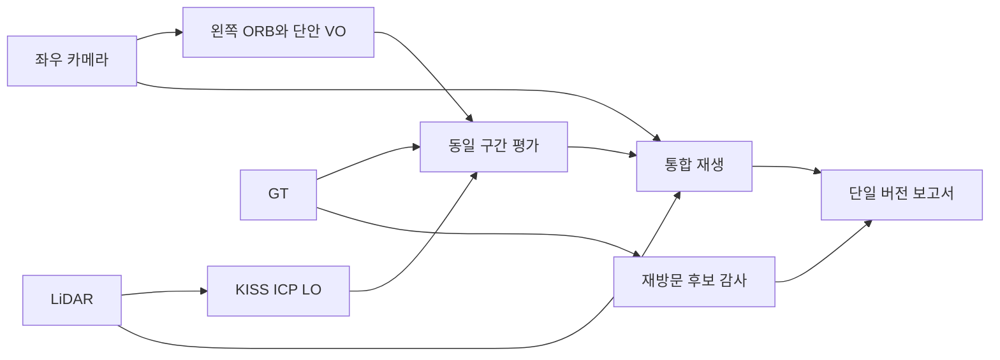

위 도식은 기존 운영·재생 경로다. **그 경로에서만** 오른쪽 카메라는 재생용이고 VO 입력에는 쓰지 않는다. 신규 독립 연구 경로는 오른쪽 영상을 깊이 추정에 사용한다. GT는 운영 연구의 평가와 과거 후보 감사에 사용하며, 실제 영상의 자동 루프 검출·보정은 어느 경로에도 구현되어 있지 않다. 합성 그래프의 루프 제약은 이 사실을 바꾸지 않는다.

이 문서의 버전과 알고리즘 성능 버전은 다르다. v1.0.0 통합 자체는 새 정확도 실험이나 알고리즘 변경이 아니다. 주제별 과거 실험에서 사용하는 상대 경로 'src/', 'artifacts/', 'configs/'는 각 장에 명시한 원 실험 디렉터리를 기준으로 읽는다. 쉘 실행 명령은 별도 지시가 없으면 레포 루트 기준이다.

<a id="learning"></a>

### 1.1 SLAM, 오도메트리, 센서 융합의 관계

SLAM은 **Simultaneous Localization and Mapping**, 즉 움직이는 주체의 상태와 주변 지도를 함께 추정하는 문제다. pose는 위치와 방향을 묶은 말이다. 상태(state)는 시스템에 따라 pose 외에 속도, 센서 bias 등을 포함한다. bias는 측정에 지속해서 더해지는 편향이다. 지도는 랜드마크 점, 점군, 표면, 격자 등으로 표현할 수 있다. [Cadena 외, SLAM 개관](https://arxiv.org/abs/1606.05830)

오도메트리는 연속 관측으로 상대 이동을 추정하고 이를 이어 붙이는 접근이다. VO는 카메라, LO는 LiDAR를 사용한다. SLAM 시스템은 오도메트리로 얻은 인접 pose 사이 제약을 사용할 수 있다. 하지만 독립적인 오도메트리는 그 자체로 유용하며, 누적 궤적이나 임시 local map이 있다고 항상 완전한 SLAM이라고 부르지는 않는다.

센서 융합은 여러 센서의 관측을 하나의 상태 추정에 함께 사용하는 방법이다. 카메라·IMU로 pose를 추정하는 VIO(Visual-Inertial Odometry), LiDAR·IMU를 사용하는 LIO(LiDAR-Inertial Odometry)는 대표적인 융합 예다. 이들이 반드시 전역 지도·루프 보정을 갖추는 것은 아니다. 반대로 카메라 하나로도 SLAM을 구성할 수 있으므로 다중 센서가 SLAM의 필수 조건은 아니다.

이 레포에서 같은 화면에 VO와 LO를 비교하는 것은 **비교**이지 **융합**이 아니다. 융합하려면 공통 상태, 관측 모델, 센서 좌표변환, 시간 대응, 불확실성 처리까지 정의해야 한다. 단순히 두 궤적을 평균 내거나 나란히 그리는 것으로 끝나지 않는다.

루프 클로징(loop closure)은 이전에 방문한 장소를 다시 관측했을 때 멀리 떨어진 시점 사이 제약을 추가하는 기능이다. 오도메트리의 누적 drift를 줄이는 데 중요하지만, 루프를 아직 만나지 않았다고 위치와 지도 추정 문제가 사라지지는 않는다. 여기서 drift는 작은 추정 오차가 시간에 따라 누적되는 현상이다.

따라서 **SLAM이 모든 추정·융합을 포함하는 보편적인 상위어는 아니지만, 이 프로젝트의 학습 목표를 묶는 이름으로는 적절하다.** 로봇의 경로 계획과 제어까지 자동으로 포함하는 이름은 아니다. 'lab'은 laboratory의 줄임말이며, 이론을 읽고 코드로 재현하고 결과를 검증하는 실험 공간이라는 현재 성격에 맞는다. 이미 완성된 SLAM 제품이라는 의미는 아니다.

### 1.2 지금 오도메트리에서 시작한 것은 맞는가

맞다. 지금까지는 '센서 관측이 pose 변화로 바뀌는 과정'을 다루었다. 이것은 이후 지도와 전역 최적화에 넣을 관측 제약을 이해하는 첫 발걸음이다. 모든 SLAM이 동일한 개발 순서를 강제하는 것은 아니지만, 현재 데이터와 학습 방식에서는 자연스러운 출발이다.

학습 흐름은 **전체 SLAM 구조 확인 → VO/LO 출력 관찰 → 필요한 수학 → map/최적화 → 재방문 보정 → 센서 융합**으로 둔다. 각 단계에서 다시 전체 시스템으로 돌아와 새 구성 요소가 어떤 오차를 줄이고 무엇은 해결하지 못하는지 확인한다. 아래 순서는 이 프로젝트를 위한 학습 제안이며 모든 연구자에게 유일한 순서는 아니다.

| 단계 | 먼저 던질 질문 | 필요한 수학 | 현재 자료와 연결 | 스스로 확인할 결과 |
|---|---|---|---|---|
| A. 좌표와 pose | 같은 점을 카메라와 LiDAR에서 어떻게 표현하나? | 벡터, 행렬, 회전, 역변환 | calibration, LiDAR 영상 투영 | 변환 후 역변환하면 원래 점으로 돌아옴 |
| B. 두 프레임 이동 | 왜 한 대응만으로 이동을 알 수 없나? | 최소제곱, rank, SVD, 투영 기하 | ORB 매칭, E, ICP | 충분한 제약과 퇴화 조건을 구분 |
| C. 믿을 정도 | 왜 두 센서 결과를 똑같이 믿으면 안 되나? | 확률, 분산/공분산, Bayes, MLE/MAP | VO/LO 오차, inlier | 측정 단위와 불확실성으로 가중치 설명 |
| D. 반복 보정 | pose를 어떻게 조금씩 개선하나? | 미분, Jacobian, Taylor, 비선형 최적화 | ICP, 재투영 오차 | 한 번의 업데이트 전후 오차 비교 |
| E. 지도와 전체 궤적 | 여러 프레임을 함께 보면 무엇이 달라지나? | 희소 선형대수, factor graph, gauge | BA, pose graph, loop closure | anchor 유무와 drift 보정 이해 |
| F. IMU 융합 | 카메라 사이의 고속 운동을 어떻게 연결하나? | 시간 적분, 잡음 모델, SO(3)/SE(3), 필터/평활화 | Raw OXTS, VIO/LIO | 시간·좌표·bias를 구분하고 검증 |

위 '확인할 결과'는 전체 학습의 도달 기준이다. A1–A12와 C1–C12에서 계산·실제 관측·합성 최적화의 일부를 검증했으나 모든 항목을 달성한 것은 아니다. 특히 실제 영상의 장기 지도·루프·VIO는 미수행이며, 구체적인 실행 범위는 각 단원과 C12의 계약을 따른다.

### 1.3 당장 필요한 선형대수와 좌표변환

벡터는 점의 좌표나 이동량을 모은 값이다. 행렬은 그 값을 다른 표현으로 바꾸거나 여러 연립식을 한꺼번에 쓰는 도구다. 점의 좌표에는 **어느 좌표계인지**를 항상 붙인다. 같은 숫자 (1,0,0)이라도 카메라에서의 전방/오른쪽과 LiDAR에서의 전방/왼쪽 규약은 다를 수 있다.

다음처럼 정의하면 변환 방향이 명확해진다.

```text
p_A = R_AB * p_B + t_AB
T_AB = [ R_AB  t_AB ]
       [   0      1 ]
```

p_B는 B 좌표계에서 본 점, p_A는 A 좌표계에서 본 같은 점이다. R_AB는 B의 축 방향을 A로 바꾸는 3×3 회전, t_AB는 A에서 본 B 원점 위치다. T_AB는 점에 마지막 좌표 1을 붙여 회전과 이동을 한 행렬곱으로 처리하는 4×4 동차변환이다. R의 성분은 무차원이고, t와 p는 여기서 m 단위다.

변환 합성은 T_AC=T_AB*T_BC다. 역변환은 R_BA=R_AB의 전치, t_BA=-R_AB의 전치*t_AB다. 전치는 행과 열을 바꾸는 연산이다. 회전행렬은 R의 전치*R=I, det(R)=1을 만족한다. 일반 행렬의 전치가 항상 역행렬인 것은 아니다.

작은 계산 예: B의 점 (1,0,0)을 z축 주위로 +90도 회전하고 A에서 (2,0,0)만큼 옮기면 (2,1,0)이 된다. '옮긴 뒤 회전'하면 다른 값이므로 곱셈 순서를 바꿀 수 없다. 이것이 pose 누적과 camera↔LiDAR 변환에서 행렬 순서를 외우기만 하면 위험한 이유다.

내적은 두 벡터의 정렬 정도와 투영, 노름은 크기, 외적은 3D에서 수직 방향을 계산하는 데 쓰인다. rank는 독립적인 제약의 수를 나타내는 선형대수 개념이다. SVD(Singular Value Decomposition, 특잇값 분해)는 A=U*S*V의 전치 형태로 행렬을 분해해, 최소제곱이나 퇴화에 가까운 방향을 살피는 도구다. 처음에는 유도 전체보다 작은 예에서 차원·곱셈 방향·실패 조건을 확인하는 것으로 시작해도 된다.

### 1.4 오차, 최소제곱, 미분은 왜 필요한가

실제 측정은 모두 완벽하게 일치하지 않는다. 예측한 관측 h(x)와 실제 관측 z의 차이 r(x)=z-h(x)를 residual(잔차)이라고 한다. x는 추정하려는 pose 등의 상태다. 여러 잔차의 제곱합을 작게 만드는 것이 최소제곱이다. 예를 들어 같은 길이에 대한 측정이1.0m와1.2m이고 동일한 오차 모델을 가정하면, 제곱합을 최소로 만드는 값은1.1m다.

영상 재투영 잔차는 pixel, LiDAR 점 정합 잔차는 m일 수 있다. 서로 다른 단위의 값을 그대로 합산하면 의미가 흐려진다. 측정의 공분산으로 정규화하거나 적절한 관측 모델을 사용해야 한다. residual이 작다는 사실만으로 정답이라고 할 수도 없다. 잘못된 대응이나 잘못된 calibration에 잘 맞는 해일 수 있다.

비선형 예측은 상태를 바꿀 때 변화량이 일정하지 않다. Jacobian J는 상태의 각 성분을 조금 바꿨을 때 관측 또는 residual의 각 성분이 얼마나 바뀌는지를 모은 편미분 행렬이다. 일차 Taylor 근사는 r(x+delta)≈r(x)+J*delta다. 이를 이용해 작은 업데이트 delta를 반복해서 찾는다.

Gauss-Newton은 이 국소 선형 근사를 이용하는 비선형 최소제곱 방법이고, Levenberg-Marquardt는 업데이트가 불안정할 때를 대비해 감쇠를 도입하는 방법이다. 이 이름들을 알기 전에 우선 '잔차 정의 → 단위 → Jacobian 크기 → 업데이트 전후 오차'를 계산할 수 있어야 한다. 회전의 업데이트는 보통 일반 벡터처럼 원소별 덧셈을 하지 않으며 아래 Lie group 내용과 연결된다.

### 1.5 확률, Bayes, MLE와 MAP

확률은 모르는 상태와 불완전한 관측을 표현한다. 평균은 중심, 분산은 한 변수의 퍼짐, 공분산은 여러 변수 사이의 함께 변하는 정도를 나타낸다. 예를 들어 위치의 x/y 오차가 연관되면 공분산 행렬의 비대각 성분을 무시할 수 없을 수 있다. 분산은 m² 같은 제곱 단위를 가진다. 정규분포(Gaussian)는 자주 쓰는 모델이지 모든 오차가 반드시 따르는 법칙은 아니다.

likelihood p(z|x)는 '상태 x를 가정하면 지금 관측 z가 얼마나 그럴듯한가'다. prior p(x)는 관측을 보기 전의 상태 정보, posterior p(x|z)는 관측을 반영한 뒤의 상태 정보다. Bayes 관계는 p(x|z) ∝ p(z|x)*p(x)다. 비례 기호는 x에 무관한 정규화 상수를 생략했다는 뜻이다.

- **MLE(Maximum Likelihood Estimation, 최대우도추정):** 관측의 likelihood를 가장 크게 만드는 x를 고른다.
- **MAP(Maximum A Posteriori, 최대사후확률추정):** prior도 반영해 posterior를 가장 크게 만드는 x를 고른다.

독립 Gaussian 측정이며 공분산이 상태에 따라 바뀌지 않는 등의 가정 아래, 음의 log likelihood를 최소화하면 가중 최소제곱 형태가 된다. log는 곱을 합으로 바꾸고, 음수를 붙이면 최대화가 최소화로 바뀐다. MAP에는 prior에 해당하는 항이 더해진다. 조건 없이 '모든 MLE는 최소제곱'이라고 말하면 틀리다. [GTSAM의 확률 제약·최적화 설명](https://gtsam.org/tutorials/intro.html)

설명용 센서 융합 예: 동일한 스칼라 위치를 독립적이고 편향 없이 관측한다고 가정하고, 센서A가10m(표준편차1m), 센서B가12m(표준편차2m)를 준다고 하자. 표준편차는 분산의 제곱근이다. 역분산 가중치는1과1/4이므로 결과는 (10*1+12*0.25)/1.25=10.4m다. 더 불확실한 B를 덜 믿는다. 이는 실제 VO/LO fusion 구현 결과가 아니라 가정이 명확한 1차원 설명 예다.

같은 이미지나 GT를 통해 얻은 두 추정은 서로 독립이 아닐 수 있다. 그 상관을 무시하면 정보를 두 번 센 것처럼 과신할 수 있다. 따라서 궤적을 단순 가중 평균하는 것보다 먼저 상태·좌표·시간·상관 모델을 정의해야 한다. 지금 GT로 맞춘 Sim(3) 결과를 독립적인 실제 센서 측정처럼 fusion 입력에 넣어서는 안 된다.

### 1.6 회전, Lie group, 지도 최적화

SO(3)는 유효한 3D 회전행렬들의 집합, SE(3)는 회전과 이동을 합친 3D 강체변환들의 집합이다. 이름의 S는 special, O는 orthogonal, E는 Euclidean을 가리킨다. 여기서 group은 합성·항등변환·역변환이 정의되는 구조라는 뜻이다. 회전행렬에는9개 숫자가 있지만 자유도는3이므로9개를 독립적으로 최적화하면 회전 조건을 깨뜨릴 수 있다.

Lie algebra는 이러한 변환 근처의 작은 변화를 벡터로 다루는 도구다. exp/log는 작은 변화 벡터와 변환 사이를 연결한다. 일반 행렬의 원소별 지수/로그와 혼동하면 안 된다. 처음부터 추상대수 전체를 끝낼 필요는 없다. '유효한 회전을 유지하며 작은 업데이트를 적용한다'는 목적에서 시작한다. quaternion은 회전을 표현하는 다른 방법이며, 네 숫자를 쓰지만 단위 노름 조건이 있다. [Solà·Deray·Atchuthan, 로봇 추정용 Lie 이론](https://arxiv.org/abs/1812.01537)

factor graph(요인 그래프)는 미지 상태 노드와 관측·사전정보 제약 노드를 연결한다. pose graph는 pose들 사이의 상대변환 제약을 중심으로 구성하고, BA(Bundle Adjustment)는 pose와3D 랜드마크를 함께 조정해 영상 재투영 오차를 줄인다. 희소성은 각 관측이 모든 상태가 아니라 일부 상태에만 연결되는 구조다. 계산 비용을 줄이는 핵심이다.

gauge freedom은 모든 위치와 지도를 함께 옮기거나 돌려도 상대 관측이 같아 절대 기준이 정해지지 않는 자유도다. 첫 pose를 고정하는 등의 anchor가 필요한 이유다. 단안의 scale 모호성과도 연결된다. 이 단계에서는 지도 전체를 바꿔도 관측이 유지되는 경우와 센서 오차로 값이 달라지는 경우를 구분해야 한다.

### 1.7 IMU는 어느 수학이 더 필요한가

IMU(Inertial Measurement Unit)는 각속도와 specific force를 측정한다. specific force는 단순한 세계좌표 가속도와 다르며, 자세와 중력을 고려해 해석해야 한다. 각속도를 시간 적분하면 방향 변화, 가속도를 적분하면 속도·위치 변화와 연결되지만 bias와 잡음도 함께 누적된다. 이를 위해 시간 적분, 미분방정식의 기초, 확률 과정, bias 모델을 공부한다.

필터링은 현재까지 관측으로 현재 상태를 갱신하고, 평활화(smoothing)는 여러 시점의 상태를 함께 다루는 관점이다. EKF(Extended Kalman Filter)는 비선형 모델을 현재 추정 근처에서 선형화하는 필터다. IMU preintegration은 카메라 등 저속 센서의 두 시점 사이 다수 IMU 관측을 하나의 상대 제약으로 요약하는 접근이다. 용어만 먼저 익히고 구현은 시간 동기화·좌표·단위·잡음 검증 이후로 둔다.

우리 Raw OXTS에는 비양수 시간 간격이 관측되었으며 Odometry와의 정렬이 미완료다. 수학을 안다고 이 입력 문제가 자동으로 해결되지 않는다. GPS/INS 위치·자세와 순수 IMU 측정 채널을 구분해 GT 누출도 막아야 한다.

### 1.8 지금 먼저 할 공부와 나중에 할 공부

**바로 필요한 최소 기반:** 벡터·행렬곱·역행렬·삼각함수, 좌표변환, 평균·분산, 제곱오차, 미분의 의미. 이를 현재 point projection과 두 프레임 pose에 연결한다.

**그다음 연결할 기반:** SVD·rank, 카메라 투영·에피폴라 기하, Jacobian, Bayes·MLE/MAP, Gaussian 가중 최소제곱. 이를 ORB 매칭 이후 E 추정과 ICP에 연결한다.

**지도·융합 단계에서 깊게 볼 내용:** SO(3)/SE(3), robust loss(큰 이상치의 영향을 제한하는 비용 함수), 희소 최적화·factor graph, filtering/smoothing, IMU bias·preintegration, observability(관측으로 구별 가능한 상태 성분).

첫 학습 과제는 새 알고리즘 구현이 아니라 **기존 LiDAR 점 하나를 카메라 좌표로 옮겨 영상에 투영하고, 변환 순서와 단위를 설명하는 것**으로 제안한다. 그다음 두 프레임에서 잔차가 어떻게 pose 업데이트로 이어지는지 본다. 이는 top-down 학습을 유지하면서 필요한 수학을 빠뜨리지 않는 순서다. 이번 문서 갱신에서는 이 과제를 실행하지 않았다.

이 절의 자료는 SLAM 개관, GTSAM 공식 설명, 로봇 추정용 Lie 이론 원문을 참고한 학습 설계다. 전체 내용을 한 번에 외우라는 선행 조건이 아니다. 기초→작은 계산→현재 데이터→실패 사례 순으로 같은 문서의 설명을 확장한다.

<a id="foundations"></a>

## 기초 교재: 문제에서 수학으로

### 이 책을 사용하는 방법

**출발 질문은 “자동차가 어디로 얼마나 움직였는가?”다.** 영상을 관측하고, 같은 지점을 찾고, 이동을 계산하고, 누적한다. 그런데 픽셀은 미터가 아니고, 센서마다 축이 다르며, 측정에는 오차가 있고, 오래 누적하면 궤적이 틀어진다. 아래 수학은 이 네 가지 문제를 해결하기 위해 등장한다. 모든 수학을 끝낸 뒤 코드를 시작하는 순서가 아니다.

처음에는 A1–A4를 읽고 실제 LiDAR 투영 그림을 재현한다. 그다음 기존 2장의 ORB 그림과 3장의 VO/LO 결과를 본다. “왜 매칭이 틀리면 궤적이 망가지는가?”가 궁금해질 때 A5–A9로 돌아온다. 마지막으로 A10–A12와 기존 4장의 재방문 결과를 연결한다. 이해가 막히면 아래 지도에서 그 문제에 필요한 단원으로 이동한다.

| 눈앞의 문제 | 필요한 단원 | 손으로 확인할 결과 |
|---|---|---|
| 센서 축이 서로 다르다 | [A1 벡터](#lesson-a1), [A2 좌표변환](#lesson-a2) | 같은 점이 (1,0)과 (2,1)로 표현됨 |
| 이미지에서 실제 거리를 모른다 | [A3 투영](#lesson-a3), [A4 스테레오](#lesson-a4) | 27px 시차가 10m 깊이로 변환됨 |
| 잘못된 매칭이 결과를 끌고 간다 | [A5 잔차](#lesson-a5), [A6 선형대수](#lesson-a6) | 평균 1.6m와 robust 추정 1.05m |
| 무엇을 더 믿어야 하나 | [A7 불확실성](#lesson-a7), [A8 MLE/MAP](#lesson-a8) | 두 측정의 결합 10.4m |
| 최적화가 어떻게 움직이나 | [A9 Jacobian](#lesson-a9), [A10 회전](#lesson-a10) | 1에서 시작해 2로 수렴하는 기록 |
| 재방문·IMU가 왜 필요한가 | [A11 그래프](#lesson-a11), [A12 IMU](#lesson-a12) | 루프 잔차와 bias 적분 오차 |

**기호 약속.** 소문자 x는 문맥에 따라 상태 벡터 또는 스칼라다. 굵은 글꼴에 의존하지 않고 차원을 함께 적는다. p는 공간의 점, z는 관측, r은 잔차, R은 회전행렬, t는 병진, T는 동차변환, K는 카메라 내부행렬, J는 Jacobian, Σ는 공분산이다. 위첨자 T는 전치이고, `T_AB`의 T는 변환 이름이다. 두 표기를 혼동하지 않는다. `||v||`는 벡터 길이, `argmin`은 비용을 가장 작게 만드는 입력값, `argmax`는 가장 크게 만드는 입력값을 뜻한다.

**그림의 출처와 범위.** 신규 15개 그림 중 A3의 KITTI 투영만 실제 데이터다. 나머지는 설정과 정답을 아는 교육용 모델이다. 합성 실험에서의 개선을 KITTI 성능 개선으로 해석하면 안 된다. 기존 ORB·매칭·LO 실제 산출물은 뒤의 응용 장에 그대로 남겼다. 모든 신규 그림은 `research/foundations-textbook/src/generate.py`가 만든다.

<a id="lesson-a1"></a>

### A1. 벡터: 위치를 숫자로 표현하기

#### 문제와 입력·출력

특징점은 이미지에서 (u,v), LiDAR 점은 센서 좌표에서 (X,Y,Z)로 주어진다. 벡터는 이런 순서 있는 숫자 묶음이다. 입력이 두 위치라면 출력은 상대 변위, 거리 또는 특정 방향으로의 성분이다. 단위와 좌표계가 같을 때만 두 위치를 빼거나 더할 수 있다.

점 p=(3,4)m는 원점에 대한 위치다. 변위 v=(3,4)m는 위치 사이의 차이다. 숫자가 같아도 의미는 다르다. 원점을 옮기면 점의 좌표는 변하지만 두 점 사이의 변위는 변하지 않는다. A2에서 점에는 이동 t를 더하고 방향에는 더하지 않는 이유다.

#### 계산을 따라가기

```text
v = (3,4) m
||v|| = sqrt(3² + 4²) = 5 m
단위 방향 n = v / ||v|| = (0.6,0.8), 길이 1, 단위 없음
내적 a·b = a1*b1 + a2*b2
v·(1,0) = 3 m: x 방향 성분
a·b = ||a|| ||b|| cos(theta)
```

내적은 방향의 정렬 정도를 측정한다. 단위벡터 두 개의 내적이 1이면 같은 방향, 0이면 직각, -1이면 반대 방향이다. **투영**은 어떤 방향으로 바라본 성분이다. 평면의 단위 법선 n과 점 오차 e의 내적 `n·e`는 그 평면에 수직인 거리 성분이다. 이는 뒤의 point-to-plane ICP를 읽을 때 필요한 수학이다. 현재 LO에 쓰인 KISS-ICP의 실제 잔차 형식은 응용 장에서 별도로 확인하며, 여기의 평면 예제를 현재 구현이라고 주장하지 않는다.

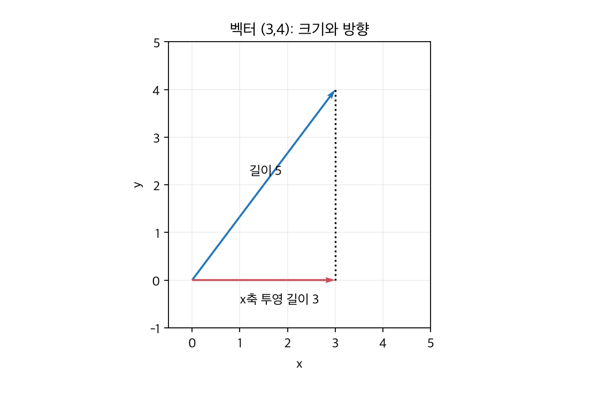

그림 A1. 파란 벡터의 길이는 5, 빨간 가로 성분은 3이다. 화살표 길이와 각도가 같은 축 비율에서 표현되어 있다.

행렬은 벡터를 다른 벡터로 바꾸는 규칙이다. 2×2 행렬 A의 첫 번째 열은 x 단위벡터가 이동한 곳, 두 번째 열은 y 단위벡터가 이동한 곳이다. 따라서 `A(3,4)`는 첫 번째 열의 3배와 두 번째 열의 4배를 더한 것이다. 행렬을 외우기보다 “기준 방향을 어디로 보내는가?”로 읽는다.

#### 코드 연결과 한계

`generate.py:frames()`의 a, R, q를 `artifacts/frames/values.npz`에서 확인한다. NumPy의 `@`는 행렬곱, `*`는 원소별 곱이다. 미터 위치와 픽셀 위치의 유클리드 거리를 직접 비교하지 않는다. 방향을 만들 때 길이가 0이면 나누기를 할 수 없으므로 먼저 검사해야 한다.

#### 연습문제와 해설

**문제 A1-1.** p=(1,2)m, q=(4,6)m일 때 p에서 q로 가는 변위와 거리는?

**해설 A1-1.** q−p=(3,4)m이고 거리는 sqrt(9+16)=5m다. p+q는 두 점 사이 변위가 아니다.

**문제 A1-2.** 오차 e=(3,4)m, 평면의 단위 법선 n=(0,1)일 때 수직 오차와 전체 거리는 같은가?

**해설 A1-2.** 수직 오차 n·e=4m, 전체 거리 ||e||=5m로 다르다. x 방향 3m는 평면에 평행하므로 수직 잔차에 나타나지 않는다. 이 정보 손실은 A6의 관측 불가능한 방향과 연결된다.

<a id="lesson-a2"></a>

### A2. 좌표변환: 같은 점을 다른 센서에서 보기

#### 왜 필요한가

카메라는 보통 영상 오른쪽·아래쪽·전방을 축으로 쓰고, LiDAR는 다른 축을 쓴다. 축의 순서만 바꾸는 것이 아니라 센서 원점도 다르다. **외부 보정값(extrinsic calibration)**은 이 상대 회전과 병진이다. 입력은 B 좌표의 점 p_B와 B→A 변환이고, 출력은 A 좌표의 같은 물리적 점 p_A다.

```text
p_A = R_AB p_B + t_AB
R_AB: 3×3, B의 벡터 성분을 A로 변환, 단위 없음
t_AB: 3×1, B 원점을 A에서 본 위치, m
T_AB = [ R_AB  t_AB ]       p_h = [X,Y,Z,1]^T
       [ 0 0 0   1  ]       p_Ah = T_AB p_Bh
```

끝에 1을 붙인 **동차좌표**를 쓰면 회전과 이동을 하나의 행렬곱으로 묶을 수 있다. 방향벡터에는 끝에 0을 붙인다. 그러면 t가 곱해지지 않는다. `T_AB`는 “B에서 A로”로 읽으며, 파일에서 pose를 받았을 때 이 방향부터 확인한다.

#### 2D로 손계산하기

```text
R = [0 -1]   t = (2,0)m   p_B = (1,0)m
    [1  0]
R p_B = (0,1)m
p_A = (0,1) + (2,0) = (2,1)m
R(p_B+t) = R(3,0) = (0,3)m    # 순서를 바꾸면 다른 결과
```


그림 A2. 왼쪽은 같은 점의 두 좌표, 오른쪽은 회전·이동 순서를 바꾸었을 때의 차이다. (2,1)과 (0,3)은 같은 변환이 아니다.

역변환은 단순히 t의 부호만 바꾸는 것이 아니다. `p_B=R_AB^T(p_A−t_AB)`이므로 역변환의 병진은 `−R_AB^T t_AB`다. 회전행렬은 열들이 서로 직교하고 길이가 1이어서 `R^T R=I`이며 역행렬이 전치와 같다. 합성은 `T_AC=T_AB T_BC`다. 오른쪽 변환을 먼저 적용한다. [Modern Robotics: 동차변환](https://modernrobotics.northwestern.edu/nu-gm-book-resource/3-3-1-homogeneous-transformation-matrices/)

#### 디버깅 계약과 한계

코드에서 행벡터 배열 N×3을 쓸 경우 `points @ R.T + t`가 위의 열벡터 수식과 같다. 전치가 있는 이유를 축 정의와 함께 확인한다. `frames()`는 역변환 후 원래 점 복원과 변환 순서 차이를 검사한다. 이 검사는 대수적 일관성만 보장한다. 잘못된 센서 보정값도 역변환 자체는 성립할 수 있으므로 실제 영상 overlay가 추가로 필요하다.

#### 연습문제와 해설

**문제 A2-1.** 위 예제의 p_A=(2,1)를 B로 되돌려라.

**해설 A2-1.** p_A−t=(0,1), R^T(0,1)=(1,0)이다. `R^T p_A−t`로 계산하면 (-1,-2)가 되어 틀린다.

**문제 A2-2.** 센서 방향 d_B=(1,0)에 동차좌표 마지막 값을 1로 넣으면 무엇이 잘못되는가?

**해설 A2-2.** 올바른 방향은 R d_B=(0,1)이다. 1을 붙이면 위치 이동 t까지 더해 (2,1)이 된다. 위치와 방향의 타입을 구분해야 한다.

<a id="lesson-a3"></a>

### A3. 카메라 투영: 미터가 픽셀이 되는 과정

#### 모델과 기호

**핀홀(pinhole) 모델**은 한 점인 카메라 중심을 지나가는 광선이 영상면에 닿는다고 본다. 카메라 좌표 X는 오른쪽, Y는 아래쪽, Z는 전방으로 두자. Z>0인 점에 대해 닮은 삼각형의 비율로 아래 식을 얻는다. 입력은 카메라 좌표의 3D 점과 내부 보정값, 출력은 영상의 픽셀 좌표다.

```text
u = fx * X/Z + cx       v = fy * Y/Z + cy
K = [fx  0 cx]         fx,fy: 픽셀 단위 초점거리
    [ 0 fy cy]         cx,cy: 주점(principal point), px
    [ 0  0  1]         X,Y,Z: m; u,v: px
q = K [X,Y,Z]^T        u=q1/q3, v=q2/q3
```

주점은 광학 축이 영상면을 만나는 위치다. fx가 크면 같은 X/Z 비율이 더 큰 픽셀 이동이 된다. 실제 렌즈의 왜곡은 별도 모델이 필요하지만, 이번 입력은 KITTI의 보정된 영상과 제공된 투영행렬을 사용한다. 이미 보정된 영상에 왜곡 보정을 중복 적용하면 안 된다. [OpenCV 카메라 모델](https://docs.opencv.org/4.13.0/d9/d0c/group__calib3d.html)


그림 A3-1. X=1m인 점도 깊이가 5m에서 10m가 되면 주점에서의 거리가 100px에서 50px로 줄어든다. 왼쪽 Z=1 선은 정규화된 가상 영상면이며 실제 초점거리 1m를 뜻하지 않는다.

**단안의 scale 모호성.** (X,Z)=(1,5)와 (2,10)은 X/Z가 같아 같은 픽셀이다. 한 이미지의 픽셀만으로 깊이를 결정할 수 없다. 여러 영상으로 구조와 이동을 계산하더라도 모든 거리와 이동을 같은 배율로 늘리면 같은 투영을 만들 수 있다. metric 기준이 없는 단안 VO의 이동을 미터라고 부를 수 없는 이유다.

#### 실제 KITTI 점 하나를 끝까지 계산하기

00 시퀀스의 frame120을 사용한다. `.bin`은 little-endian float32의 (x,y,z,reflectance) 레코드이며 좌표변환에는 앞 세 값만 쓴다. reflectance는 동차좌표의 1이 아니다. `Tr`로 카메라 좌표에 옮긴 뒤 `P0`로 투영한다.

```text
원시 점 index = 55553
p_L = (12.681147, -0.226356, -1.510892) m
p_C = Tr * [p_L;1] = (0.232002, 1.363495, 12.399397) m
fx=fy=718.856 px, cx=607.1928 px, cy=185.2157 px
u = 718.856 * 0.232002 / 12.399397 + 607.1928 = 620.6431 px
v = 718.856 * 1.363495 / 12.399397 + 185.2157 = 264.2644 px
```

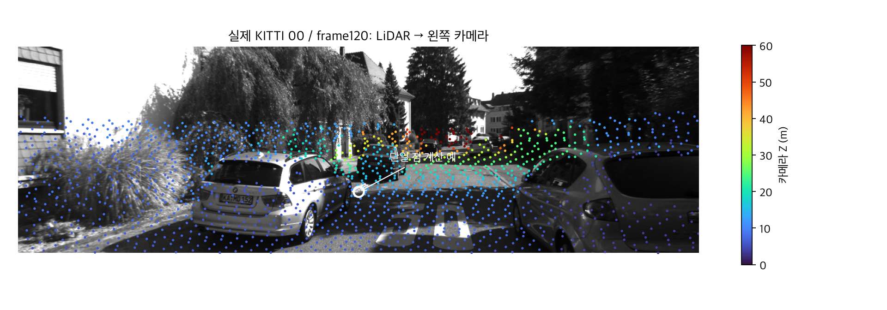

그림 A3-2. 흰 원이 계산한 단일 점이다. 색은 카메라 전방 깊이 Z이며 반사강도가 아니다. 원시 121,444점 중 전방이며 영상 경계 안인 점은 18,073개다. 보기 쉽게 그중 12개마다 하나씩 그렸다. 이는 가림까지 판정한 물리적 visibility가 아니라 투영 유효성 필터다.

`camera()`가 실제 Tr/P0, 선택 점, 전체 유효 투영을 `artifacts/kitti/values.npz`에 저장한다. 뒤쪽 점(Z≤0)은 나누기 전에 제외한다. 영상 밖 점도 제거하지만, 앞 물체에 가려진 뒤쪽 점을 제거하는 z-buffer는 여기서 구현하지 않았다. 따라서 overlay 일치만으로 시간 동기화나 모든 보정이 완벽하다고 결론내리지 않는다.

#### 연습문제와 해설

**문제 A3-1.** fx=500px, cx=320px, X=1m, Z=5m라면 u는? 같은 광선 위에서 깊이를 두 배로 하면 X는?

**해설 A3-1.** u=500/5+320=420px. 같은 광선이면 X도 2m가 되어야 한다. X=1m를 유지한 채 Z만 두 배로 하면 u=370px로 달라진다.

**문제 A3-2.** LiDAR 레코드 (x,y,z,0.2)를 그대로 4×4 동차변환에 넣어도 되는가?

**해설 A3-2.** 안 된다. 마지막 0.2는 반사강도다. 점을 변환할 때는 (x,y,z,1)을 새로 만들어야 병진이 정확히 한 번 더해진다.

<a id="lesson-a4"></a>

### A4. 스테레오: 깊이와 거리 기준 얻기

#### 단안에서 부족했던 정보

두 카메라의 간격 **baseline B**를 미터로 알면 길이 기준이 생긴다. 평행·정렬된 두 카메라가 같은 초점거리와 수평 주점을 가진 단순 모델에서 같은 점은 같은 영상 행에 나타난다. 왼쪽 좌표가 u_L, 오른쪽이 u_R이면 **시차(disparity)**는 d=u_L−u_R다. 입력은 대응점과 보정값이고 출력은 깊이 Z다. 주점이 다르면 그 차이를 반영해야 하며, 모든 데이터에 아래 단순식을 그대로 적용할 수는 없다.

```text
u_L-cx = f X/Z
u_R-cx = f (X-B)/Z
d = u_L-u_R = f B/Z
Z = f B/d
예: f=500px, B=0.54m, d=27px → Z=10m
```

둘을 빼면 모르는 X가 사라진다. 이것이 삼각측량의 가장 간단한 모습이다. 일반적인 두 시점 카메라는 회전과 이동을 포함한 투영행렬로 광선의 교차를 구한다. 광선이 거의 평행하면 작은 픽셀 오차가 큰 깊이 오차가 된다.


그림 A4. 왼쪽은 깊이에 반비례하는 시차, 오른쪽은 시차 표준편차 0.5px를 가정한 깊이 표준편차다. 실제 KITTI 보정값이 아니라 f=500px, B=0.54m인 교육용 설정이다.

오차를 계산하려면 함수의 기울기를 이용한다. `dZ/dd=−fB/d²`이고 작은 시차 오차의 표준편차가 σ_d이면 `σ_Z≈|dZ/dd| σ_d=Z² σ_d/(fB)`다. 10m에서 약 0.185m, 20m에서 약 0.741m다. 거리가 두 배면 불확실성은 이 근사에서 네 배가 된다. f와 B가 정확하고 오차가 작다는 가정이 포함된다. d가 0에 가까우면 이 선형 근사 자체도 불안정하다.

#### 프로젝트 연결과 다음 한계

기존 운영 VO는 왼쪽 영상 기반 단안 방식이다. 그 화면에서 오른쪽 원본이 재생된다고 스테레오 추정을 쓰는 것은 아니다. 이 단원이 제안했던 stereo matching→triangulation→3D-2D pose estimation은 신규 독립 연구의 C4–C5에서 실행했다. 컬러를 추가해도 baseline 같은 거리 기준이 자동으로 생기지 않는다. 반복 무늬·가림·반사·질감 없는 벽에서는 대응 자체가 틀릴 수 있다. 다음 A5가 그 잘못된 관측을 다룬다.

#### 연습문제와 해설

**문제 A4-1.** 같은 f와 B에서 d=13.5px이면 깊이는? d=0이면?

**해설 A4-1.** Z=270/13.5=20m다. d=0에서는 유한한 깊이를 계산할 수 없다. 작은 양수로 강제로 나누어 거대한 “정답”을 만들지 말고 유효하지 않거나 먼 점으로 처리한다.

**문제 A4-2.** 동일 깊이에서 baseline을 두 배로 늘리고 σ_d를 유지하면 σ_Z는?

**해설 A4-2.** 식의 분모 B가 두 배이므로 절반이다. 그러나 실제로는 공통 시야와 가림, 대응 난이도가 변하므로 baseline을 늘리기만 하면 항상 좋아지는 것은 아니다.

<a id="lesson-a5"></a>

### A5. 잔차와 최소제곱: 무엇을 작게 만드는가

#### 관측에서 목적함수로

상태 x로 예측한 관측을 h(x), 실제 측정을 z라 하면 **잔차(residual)**를 r(x)=h(x)−z로 정의한다. 부호를 반대로 써도 제곱 비용은 같지만 Jacobian과 업데이트는 같은 정의를 따라야 한다. 입력은 관측과 예측 모델, 출력은 잔차와 추정 상태다. 영상 재투영 잔차는 px, 공간 대응 잔차는 m일 수 있다. 단위가 다른 잔차를 그대로 더하면 큰 숫자의 단위가 결과를 지배한다.

```text
상수 위치를 여러 번 측정: h(x)=x, r_i=x-z_i
F(x) = sum_i (x-z_i)²
dF/dx = 2 sum_i (x-z_i) = 0
x_hat = sum_i z_i / N
```

즉 단순 최소제곱(Least Squares, LS)은 평균을 만든다. z=[1,1.1,0.9,1,4]m이면 평균은 1.6m다. 4m가 잘못된 대응이라면 나머지 네 측정에서 멀어진다. 제곱은 큰 잔차에 매우 큰 벌점을 주므로 추정값이 이상치를 향해 움직인다.

#### Huber 손실의 의미

```text
rho(r) = 0.5 r²                  if |r| <= delta
         delta (|r|-0.5 delta)   otherwise
```

작은 잔차에는 제곱, 큰 잔차에는 선형 벌점을 준다. **robust**란 일부 큰 오차의 영향에 덜 민감하도록 만든다는 뜻이지 오류를 모두 제거한다는 뜻은 아니다. delta=0.2m이면 이 예제의 해는 1.05m다. 그 근처에서 네 정상 측정의 기울기 합은 `4x−4`, 4m 관측은 기울기 `−0.2`를 주므로 `4x−4−0.2=0`, x=1.05다.

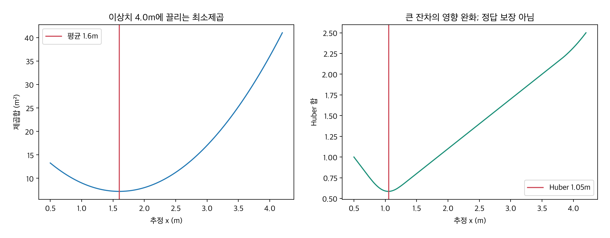

그림 A5. 같은 측정에 대한 두 목적함수와 최소점이다. 두 패널의 세로축 비용 정의가 다르므로 높이 자체를 성능으로 비교하지 않는다. 참값 1m를 가정한 교육 예제에서 추정 차이를 보여준다.

`estimation()`은 SciPy `least_squares(loss='huber', f_scale=0.2)`와 해석적 답을 비교한다. 현재 VO의 RANSAC(Random Sample Consensus, 무작위 표본 합의)은 작은 부분집합으로 모델을 만들고 그 모델과 맞는 관측을 찾는 별도 전략이다. Huber는 이미 선택한 잔차의 영향력을 줄이는 전략이다. 둘은 보완적으로 쓸 수 있지만 같은 알고리즘은 아니다. RANSAC의 threshold도 잔차의 단위와 정의에 맞춰야 한다.

#### 연습문제와 해설

**문제 A5-1.** 마지막 측정 4m를 제외하면 평균은? 이것만으로 이상치를 자동 판정할 수 있는가?

**해설 A5-1.** 평균은 1m다. 그러나 결과를 보고 임의로 제거한 것이므로 자동 판정 근거가 아니다. 관측 모델·기하 검증·고정된 규칙과 평가가 필요하다.

**문제 A5-2.** Huber delta를 매우 크게 하면 어떻게 되는가?

**해설 A5-2.** 모든 잔차가 제곱 구간에 들어가 일반 최소제곱과 같은 최소점을 갖는다. delta가 너무 작으면 정상적인 큰 잔차까지 약하게 취급할 수 있다. 값은 노이즈 규모와 단위를 기준으로 정한다.

<a id="lesson-a6"></a>

### A6. Rank와 SVD: 왜 어떤 방향은 못 알아내는가

#### 식이 많아도 정보는 적을 수 있다

선형 모델 `A x=b`에서 A의 행은 관측 조건, 열은 미지수 방향을 나타낸다. **rank(계수)**는 독립적인 열 또는 행의 수다. `x1+x2=1`을 백 번 반복해도 x1과 x2를 각각 결정할 수 없다. 관측 개수가 아니라 서로 다른 정보를 주는지가 중요하다.

**SVD(Singular Value Decomposition, 특잇값 분해)**는 `A=U S V^T`로 쓴다. V는 입력의 직교 방향, S의 비음수 대각값은 방향별 확대율, U는 출력 방향이다. 특잇값이 0이면 어떤 입력 변화가 출력에 전혀 나타나지 않는다. 아주 작으면 그 방향을 추정할 때 노이즈가 크게 증폭된다.

```text
A = diag(2,0.2)
b = (2,0.2) → x=(1,1)
b'=(2,0.22) → x'=(1,1.1)
두 번째 관측의 0.02 변화가 상태의 0.1 변화로 증폭
condition number = 최대 특잇값 / 최소 특잇값 = 2/0.2=10
```

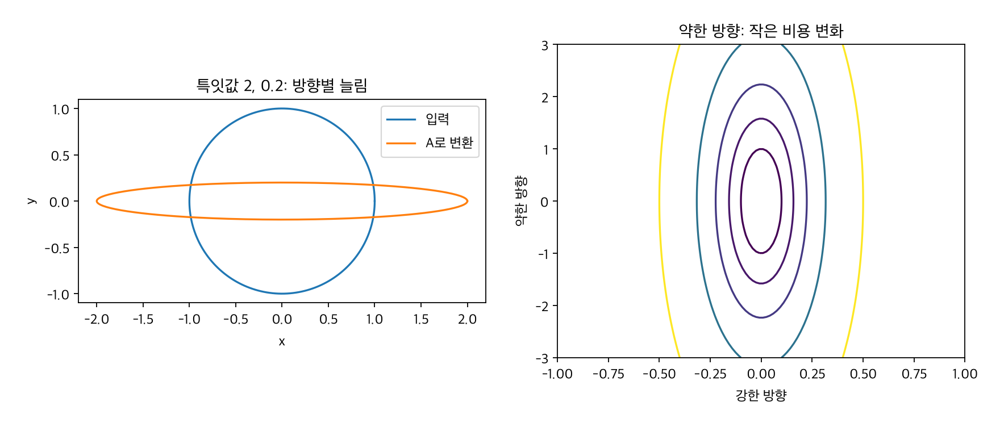

그림 A6. 왼쪽 단위원이 타원으로 바뀐다. 오른쪽 비용 등고선은 y 방향으로 길다. y를 많이 바꾸어도 비용 변화가 작으므로 그 방향의 추정이 약하다. 이 그래프는 무차원 선형 모델이다.

**null space(영공간)**는 `A v=0`을 만족하는 방향 집합이다. 벽까지 수직 거리만 잰다면 벽에 평행한 이동은 잔차를 바꾸지 않을 수 있다. 실제 3D LO의 관측 가능성은 장면 구조·움직임·잔차 모델 전체로 판단해야 하며, 이 작은 예제만으로 어느 주행 구간이 퇴화했다고 확정할 수 없다.

#### 계산 관점의 주의

해가 불안정할 때 `inverse(A.T@A)`를 무조건 계산하지 않는다. 정규방정식은 A의 조건수를 제곱할 수 있다. QR 분해(직교행렬 Q와 상삼각행렬 R로 분해)나 SVD 기반 선형해법을 이용한다. 단, 미터와 라디안처럼 열의 단위가 섞인 행렬에서는 단순 조건수가 스케일 설정에 의존한다. 상태 정규화와 gauge를 먼저 검토한다. `estimation()`의 A와 조건수는 저장되어 있으나 대규모 SLAM의 관측성 분석을 수행한 것은 아니다.

#### 연습문제와 해설

**문제 A6-1.** A=diag(2,0)이면 rank와 영공간 방향은?

**해설 A6-1.** rank는 1이고 v=(0,1)이 영공간 방향이다. 두 번째 상태를 아무리 바꿔도 출력은 같다. 반복 측정만 늘려서는 이 정보가 생기지 않는다.

**문제 A6-2.** A=diag(2,0.2)에서 A^T A의 조건수는?

**해설 A6-2.** 대각값이 4,0.04가 되므로 조건수는 100이다. A의 조건수 10보다 커져 수치적으로 불리해질 수 있다.

<a id="lesson-a7"></a>

### A7. 확률과 공분산: 오차에도 방향이 있다

#### 노이즈를 숫자 하나로 표현할 수 있을까

**확률변수**는 값이 불확실한 양이다. 평균 μ는 중심, 분산 σ²는 중심에서의 제곱 편차 평균, 표준편차 σ는 원래 단위의 퍼짐이다. Gaussian(정규) 분포의 1D 밀도는 다음과 같다. 밀도는 특정 점의 확률과 다르다. 연속 변수에서 구간 확률은 밀도를 적분한 값이며, 밀도 높이는 1을 넘을 수도 있다.

```text
p(x) = 1/(sqrt(2*pi)*sigma) * exp(-(x-mu)²/(2*sigma²))
Cov(x,y) = E[(x-mu_x)(y-mu_y)]
Sigma = [[Var(x), Cov(x,y)], [Cov(x,y), Var(y)]]
```

E는 기대값, 즉 분포로 가중한 평균이다. 좌표가 m라면 공분산 성분 단위는 m²다. 대각선은 각 축 분산, 비대각선은 두 축 오차가 함께 움직이는 정도다. 양의 상관이면 x 오차가 양수일 때 y 오차도 양수인 경향이 있다.


그림 A7. Σ=[[4,1.5],[1.5,1]]m²의 Gaussian 표본 1,000개(seed=7)다. 타원은 Mahalanobis 반경 1 경계다. **2D에서 이 타원 안의 이론적 확률은 약 39.3%이며, 1D의 ±1σ 약 68.3%와 같지 않다.** 표본의 실제 포함률은 난수에 따라 달라진다.

**Mahalanobis 거리**는 `d²=e^T Σ^(-1)e`다. 불확실한 방향의 오차는 덜, 정확한 방향의 오차는 더 크게 본다. Σ=diag(4,1)m²에서 e=(2,0)m와 (0,1)m는 모두 d²=1이다. 유클리드 거리는 다르지만 각 방향 표준편차로 보면 동일한 크기다. **정보행렬**은 Σ의 역행렬이며 높은 정보는 낮은 분산에 해당한다. 실제 계산은 명시적 역행렬보다 선형 시스템 풀이를 선호한다.

#### 한계와 모델 검증

Gaussian은 계산이 편리한 모델이지 모든 센서 오차의 사실이 아니다. 가림에 의한 오대응은 평균 주변 작은 노이즈와 다르다. 공분산을 너무 작게 잡으면 틀린 관측을 과신한다. 또한 두 센서가 같은 원자료나 보정값을 공유하면 오차가 상관될 수 있다. 독립이라는 가정 없이 분산만 더하거나 정밀도를 더하면 안 된다.

#### 연습문제와 해설

**문제 A7-1.** σ=0.2m의 분산은? 센티미터 단위로 바꾸면?

**해설 A7-1.** 분산은 0.04m²다. σ=20cm이고 분산은 400cm²다. 분산에 길이 환산계수 100만 곱하면 틀리며 100²를 곱해야 한다.

**문제 A7-2.** Σ=diag(4,1)m², e=(2,1)m의 Mahalanobis 거리는?

**해설 A7-2.** d²=2²/4+1²/1=2이므로 d=sqrt(2)다. 두 성분을 표준편차로 나눈 뒤 길이를 구한 것과 같다.

<a id="lesson-a8"></a>

### A8. Bayes, MLE, MAP: 측정과 믿음을 합치기

#### likelihood는 상태의 확률인가

관측 z가 주어졌을 때 상태 x를 추정한다. `p(z|x)`는 x라는 상태에서 이런 관측이 나올 모델이다. 관측을 고정하고 x를 바꾸며 평가하면 **likelihood(우도)**라고 부른다. 이것만으로 x에 대한 확률분포가 되는 것은 아니다. **prior(사전분포)** p(x)는 관측 전 상태의 불확실성, **posterior(사후분포)** p(x|z)는 관측 후 상태의 분포다.

```text
Bayes: p(x|z) = p(z|x) p(x) / p(z)
MLE (Maximum Likelihood Estimation, 최대우도추정): argmax_x p(z|x)
MAP (Maximum A Posteriori, 최대사후확률 추정): argmax_x p(x|z)
```

p(z)는 x와 무관한 정규화 상수라 최적점만 찾을 때 제외할 수 있다. 독립인 고정분산 Gaussian 측정이면 우도를 곱한다. 로그는 곱을 합으로 바꾸며, 음수를 붙이면 최대화가 최소화가 된다. 따라서 음의 로그우도는 상수항을 제외하고 `0.5 sum(r_i²/σ_i²)`다. 최소제곱이 확률 모델과 연결되는 지점이다. 분산이 x에 따라 바뀌면 정규화항도 달라지므로 이를 무조건 버릴 수는 없다.

#### 두 센서와 prior를 손으로 결합하기

```text
z1=10m, sigma1=1m → 정밀도 w1=1
z2=12m, sigma2=2m → 정밀도 w2=0.25
MLE 평균 = (w1*z1+w2*z2)/(w1+w2) = 10.4m
측정 결합 분산 = 1/(1+0.25) = 0.8m²
prior: 평균 9m, sigma=0.5m → 정밀도 4
MAP = (10+3+36)/(1+0.25+4) = 9.333333m
사후 분산 = 1/5.25 = 0.190476m²
```


그림 A8. 상태축에서 비교하도록 정규화한 측정 곡선과 결합 결과다. MLE 곡선은 이 특별한 위치 관측 모델의 정규화된 우도이며, 모든 우도가 자동으로 상태의 확률밀도라는 뜻은 아니다. Gaussian인 이 예에서는 MAP가 사후 평균과도 일치한다.

**과신의 위험.** prior가 실제로 틀렸는데 σ=0.5m로 매우 정확하다고 선언하면 두 측정보다 prior 쪽으로 강하게 끌린다. MAP는 prior를 추가했으니 무조건 더 정확한 방법이 아니다. 두 센서의 노이즈가 상관되거나 bias가 있으면 위 계산의 독립·불편향 가정이 깨진다. `estimation()`은 수식과 수치가 일치하는지 검사할 뿐 실제 카메라와 IMU를 융합하지 않는다.

#### 연습문제와 해설

**문제 A8-1.** 두 측정의 σ가 모두 1m이면 MLE와 결합 분산은?

**해설 A8-1.** 같은 가중치이므로 평균 11m, 분산 1/(1+1)=0.5m²다. 두 번 독립 측정했다는 조건이 필요하다.

**문제 A8-2.** prior의 σ를 무한히 크게 하면 MAP는 어디로 가는가?

**해설 A8-2.** prior 정밀도가 0으로 가므로 이 Gaussian 모델에서 MLE=10.4m로 간다. 반대로 σ가 0에 가까워지면 prior 평균 9m로 강하게 고정된다.

<a id="lesson-a9"></a>

### A9. 미분과 Jacobian: 최적화의 한 걸음

#### 비선형 함수를 잠시 직선으로 보기

미분은 입력을 조금 바꾸었을 때 출력이 얼마나 변하는지 나타낸다. 여러 입력과 여러 출력에 대한 미분을 모은 행렬이 **Jacobian(야코비안)**이다. 잔차가 m개, 상태가 n개이면 J는 m×n이다. `J_ij=∂r_i/∂x_j`이며 단위는 잔차 단위/상태 단위다. 카메라 투영의 X/Z 때문에 pose와 픽셀 관계는 일반적으로 비선형이다.

```text
r(x+delta) ≈ r(x) + J delta
Gauss-Newton: delta = argmin ||r+J delta||²
정규방정식: J^T J delta = -J^T r
x_next = x + delta
```

**Gauss-Newton(GN)**은 잔차를 현재 추정 근처에서 선형화하고 이 작은 문제를 반복해서 푼다. 실제 구현은 J의 rank와 단위를 확인하고 안정적인 선형해법을 사용한다. 큰 delta는 선형 근사가 유효한 범위를 벗어날 수 있다. **Levenberg-Marquardt(LM)**는 감쇠항을 더해 과한 이동을 제어하는 접근이며, 감쇠를 어떻게 조절하는지도 중요하다. 이번 교육 코드의 단일 변수 GN에는 LM을 구현하지 않았다.

#### 한 번의 업데이트를 계산하기

r(x)=x²−4, J=2x인 무차원 예제에서 x=1이면 r=−3, J=2다. `2 delta=3`이므로 delta=1.5, 다음 x는 2.5다. 다시 r=2.25, J=5이므로 delta=−0.45, x=2.05다. 이후 2.000609756, 2.000000093, 2.0으로 간다. x=−2도 해이며 x=0에서는 J=0이라 이 계산이 실패한다. 시작값에 관계없이 수렴한다는 예제가 아니다.

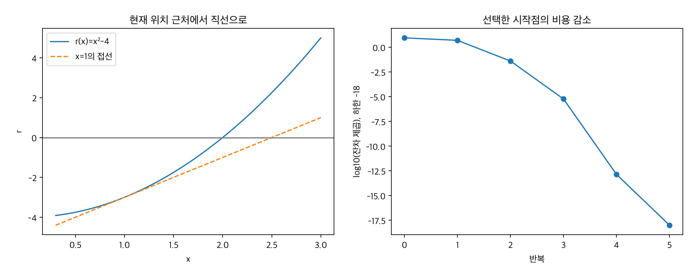

그림 A9. 왼쪽은 x=1에서의 접선, 오른쪽은 선택한 시작점에서의 비용 변화다. 작은 값의 표현을 위해 log10을 사용하고 -18에서 표시를 제한했다. 마지막 점은 실제 비용이 10^-18보다 작아도 그 아래로 그리지 않는다.

#### 구현을 검산하는 방법

유한차분은 `J≈[r(x+ε)−r(x−ε)]/(2ε)`로 미분을 수치적으로 확인한다. `linearization()`은 ε=10^-6으로 다섯 반복의 J를 확인하고, `artifacts/linearization/values.npz`의 trace에 x,r,J,r²를 저장한다. ε가 너무 작으면 반올림 오차, 너무 크면 곡률 오차가 생긴다. 수치 미분은 검증 도구이며 무조건 가장 정확한 기준이 아니다.

#### 연습문제와 해설

**문제 A9-1.** x=3에서 이 예제의 GN 한 번을 계산하라.

**해설 A9-1.** r=5, J=6, delta=−5/6이므로 다음 x=13/6≈2.166667이다. 비용은 25에서 약 0.482253으로 줄지만 모든 비선형 문제에서 감소를 보장하지는 않는다.

**문제 A9-2.** 관측 픽셀 (u,v) 두 성분과 6차원 pose 증분을 쓴다면 점 하나의 J 크기는?

**해설 A9-2.** 2×6이다. 점 N개를 세로로 쌓으면 2N×6이다. 행 수가 6보다 크다는 것만으로 rank가 6이라고 보장되지는 않는다.

<a id="lesson-a10"></a>

### A10. SO(3)와 SE(3): 회전을 망가뜨리지 않고 갱신하기

#### 아홉 숫자를 마음대로 바꾸면 안 되는 이유

3×3 회전행렬에는 아홉 숫자가 있지만 자유도는 셋이다. **자유도(Degrees of Freedom, DoF)**는 독립적으로 바꿀 수 있는 양의 수다. 회전은 `R^T R=I`, `det(R)=+1`을 만족해야 한다. determinant(행렬식)가 -1인 직교행렬은 반사를 포함하므로 올바른 3D 회전이 아니다.

**SO(3)**는 Special Orthogonal group in 3 dimensions, 3차원 특수직교군이다. **SE(3)**는 Special Euclidean group in 3 dimensions로 회전과 병진을 합친 강체변환 집합이다. 강체변환은 물체 내부 거리를 보존한다. “군”은 항등변환·합성·역변환이 집합 안에서 성립하는 구조를 뜻한다.

#### 작은 회전을 세 숫자로 표현하기

회전벡터 w는 방향이 회전축, 길이가 회전각(rad)인 3차원 벡터다. `[w]x`는 임의 v에 대해 `[w]x v=w×v`가 되도록 만든 반대칭행렬이다. ×는 두 벡터에 수직인 방향을 만드는 외적이다. 행렬의 **지수함수 exp**는 원소마다 지수를 취하는 것이 아니라 `I+A+A²/2!+...`의 행렬 급수다.

```text
w=(0,0,0.5) rad
[w]x = [[0,-0.5,0],[0.5,0,0],[0,0,0]]
1차 근사 R_bad=I+[w]x → (1,0,0)이 (1,0.5,0)으로, 길이 1.118034
올바른 R=exp([w]x) → (cos(0.5),sin(0.5),0), 길이 1
```


그림 A10. 초록 점은 단위원 위에 남지만 단순 1차 근사인 빨간 점은 원 밖으로 나간다. 작은 각도의 근사 자체는 유용하지만 이를 그대로 영구 회전행렬로 저장하면 제약이 깨질 수 있다.

`linearization()`은 OpenCV Rodrigues 변환을 사용해 회전벡터를 회전행렬로 바꾼다. Rodrigues 식은 이 3D 회전 지수함수를 계산하는 방법이다. 최적화에서는 `R_new=exp([delta_w]x)R`처럼 작은 증분으로 회전을 갱신할 수 있다. 오른쪽에 곱하는 `R exp(...)`도 가능하지만 증분이 표현된 좌표계와 Jacobian이 달라진다. 둘을 섞으면 안 된다.

#### SE(3)로 확장할 때의 주의

pose 증분 ξ는 보통 회전 3개와 병진 3개로 구성하지만 라이브러리마다 순서가 다르다. 엄밀한 SE(3) 지수지도에서는 회전과 병진 부분이 결합되므로 “회전은 exp, 병진은 그냥 더하기”가 언제나 동일한 연산은 아니다. 이번 예제는 SO(3)만 수치 검증했다. Lie algebra(리 대수)는 이런 국소 증분을 다루는 공간이며 전체 유도는 후속 학습 범위다. [Solà·Deray·Atchuthan, A micro Lie theory](https://arxiv.org/abs/1812.01537)

#### 연습문제와 해설

**문제 A10-1.** diag(1,1,-1)은 R^T R=I를 만족한다. SO(3)인가?

**해설 A10-1.** 행렬식이 -1이므로 아니다. z축 반사가 포함된다. 직교성 검사만으로 회전 유효성을 모두 검사할 수 없다.

**문제 A10-2.** 90도를 그대로 회전벡터 길이에 넣으면 올바른가?

**해설 A10-2.** 라디안 API라면 π/2≈1.570796을 넣어야 한다. 90을 넣으면 90rad다. 각도 단위 오류는 행렬의 직교성 검사로 잡히지 않는다.

<a id="lesson-a11"></a>

### A11. Factor Graph: 누적 궤적을 함께 고치기

#### 오도메트리와 전역 수정의 차이

오도메트리는 이웃 시점의 상대 이동을 이어 붙인다. 나중에 과거 장소로 돌아왔다는 정보가 생기면 최신 위치만 바꾸는 대신 전체 상태가 관측을 함께 만족하도록 조정할 수 있다. **factor graph(인자 그래프)**에서 변수 노드는 미지 상태, factor는 일부 변수에 대한 관측 제약이다. pose graph는 pose들을 변수로 삼는 특수한 경우다. [GTSAM 입문](https://gtsam.org/tutorials/intro.html)

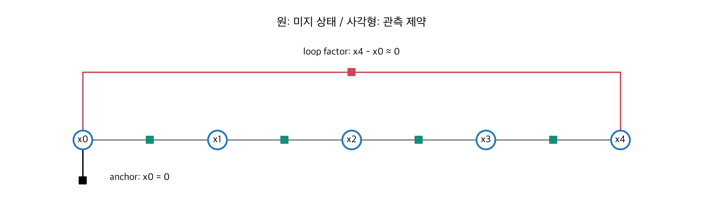

그림 A11-1. 원은 x0…x4, 초록 사각형은 이웃 이동 관측, 빨간 사각형은 시작과 끝의 상대 위치 관측이다. 검은 anchor는 기준 원점을 고정한다. 사각형 자체가 새 상태는 아니다.

#### 1D 예제를 실제로 최적화하기

참고용 경로를 [0,1,2,1,0]m라 하고, 이동 관측은 [1.1,1.1,-0.9,-0.9]m로 만든다. 누적하면 [0,1.1,2.2,1.3,0.4]m다. 끝에서 시작점으로 돌아왔다는 상대 관측 0m를 추가한다. 이 loop 관측은 인식 알고리즘이 찾은 것이 아니라 교육자가 제공한 것이다.

```text
x0=0 고정
odom residual_i = (x_(i+1)-x_i-z_i)/0.1
loop residual = (x4-x0-0)/0.05
최소화: 모든 정규화 잔차의 제곱합
보정 후: [0,1.005882,2.011765,1.017647,0.023529] m
```


그림 A11-2. 끝점 잔차가 0.4m에서 0.023529m로 줄었다. loop 분산을 0이 아닌 값으로 설정했으므로 끝점이 강제로 정확히 0이 되지는 않는다. 교육용 1D 결과이며 실제 KITTI 루프 클로징 성능이 아니다.

#### gauge와 잘못된 루프

상대 이동만 있으면 모든 x에 같은 상수 c를 더해도 잔차가 같다. 이 기준의 자유를 **gauge freedom**이라고 한다. 차분 Jacobian은 4×5, rank=4이고 J(1,1,1,1,1)^T=0이다. 한 상태를 고정하거나 적절한 prior로 기준을 정해야 한다. 이것은 “센서가 나빠서 생긴 문제”와 달리 상대 측정의 구조적 성질이다.

실제 loop closing에는 장소 후보 검색, 기하 검증, 상대 pose 추정, 불확실성 설정, 그래프 최적화가 필요하다. GT 위치가 가깝다는 감사 결과는 자동 검출이 아니다. 틀린 loop는 전체 지도를 망가뜨릴 수 있다. `graph_imu()`는 알려진 제약을 SciPy로 푸는 교육 예제만 추가하며 현재 playback의 궤적을 보정하지 않는다. landmark까지 포함한 시각적 **Bundle Adjustment(BA, 묶음 조정)**는 여러 pose와 3D 점을 재투영 오차로 함께 조정하는 별도 확장이다.

#### 연습문제와 해설

**문제 A11-1.** 보정 전 모든 pose에 100m를 더하면 이웃 이동 잔차는 변하는가?

**해설 A11-1.** `(x_(i+1)+100)-(x_i+100)`에서 100이 소거되므로 변하지 않는다. anchor를 적용한 문제에서는 x0=0 제약을 위반한다.

**문제 A11-2.** loop의 σ를 0.05m에서 0.5m로 늘리면 상대 영향력은?

**해설 A11-2.** 제곱 비용 가중치는 1/σ²이므로 100분의 1이 된다. 같은 관측이어도 덜 믿으므로 odometry 누적 결과에 더 가까운 해를 만든다.

<a id="lesson-a12"></a>

### A12. IMU와 시간: 센서를 더하면 저절로 좋아질까

#### 측정하는 것은 위치가 아니다

**IMU(Inertial Measurement Unit, 관성측정장치)**는 가속도계와 자이로스코프로 운동을 측정한다. 자이로는 각속도(rad/s), 가속도계는 비력(specific force, m/s²)을 측정한다. 비력은 단순한 세계 좌표 가속도와 다르며 자세와 중력을 고려해야 한다. `R_WB`가 body→world 회전이면 이상적인 모델은 다음과 같다.

```text
a_m = R_WB^T (a_W - g_W) + b_a + noise
a_W = R_WB (a_m - b_a) + g_W      # noise를 생략한 복원
omega_m = omega_true + b_g + noise
```

정지한 센서에서도 가속도계가 0이 아닌 중력 관련 값을 읽는 이유다. 부호는 축·중력 정의에 따라 확인한다. **bias**는 지속적인 오프셋이며 시간에 따라 변할 수도 있다. 위치를 얻으려면 속도와 위치로 적분해야 하므로 작은 오차가 누적된다.


그림 A12-1. 중력·자세 결합을 제외한 독립 1D 모델이다. 가속도 bias 0.02m/s²는 위치 오차 `0.5*b*t²`를 만들어 60초 후 36m가 된다. 각속도 bias 0.1deg/s는 60초 후 6deg 오차를 만든다. 실제 3D IMU의 성능 예측값은 아니다.

#### 시간 오차는 공간 오차가 된다

동일한 파일 번호가 동일 시각을 뜻한다고 가정하면 안 된다. 카메라와 IMU 사이 Δt가 있으면, 그동안 움직인 위치로 잘못 관측을 해석한다. 단순 가로 등속 v, 고정 깊이 Z, 회전 없음이라는 모델에서 영상 오차 크기는 `Δu≈f*v*Δt/Z`다.


그림 A12-2. f=500px, v=10m/s, Z=10m일 때 20ms가 약 10px에 해당한다. 이는 KITTI 동기화 오차의 측정값이 아니다. 실제 회전·노출·LiDAR 스캔 시간은 더 복잡한 영향을 준다.

#### filtering, smoothing, preintegration의 역할

**filtering(필터링)**은 현재까지 관측으로 현재 상태의 분포를 순차 갱신한다. Kalman filter는 선형·Gaussian 모델에서 평균과 공분산을 전달한다. 예측에서는 운동 모델로 상태와 불확실성을 전파하고, 갱신에서는 새 관측과 예측의 차이를 가중해 수정한다. **EKF(Extended Kalman Filter, 확장 칼만 필터)**는 비선형 함수를 현재 추정 근처에서 선형화한다.

**smoothing(평활화)**은 여러 시점 상태를 함께 수정한다. 미래 관측으로 과거 상태도 바꿀 수 있다는 점이 filtering과 다르다. 고정 길이 구간만 유지하는 방식도 있다. **preintegration(사전적분)**은 두 카메라 시점 사이의 많은 IMU 측정을 상대 운동 제약으로 요약하여 최적화 중 반복 적분 비용을 줄이는 접근이다. bias와 회전의 처리까지 포함되므로 단순한 가속도 누적합과 같지 않다. [Forster 외, On-Manifold Preintegration](https://arxiv.org/abs/1512.02363)

현재 저장소에는 Raw OXTS 자료가 있지만 Odometry 프레임과의 시간·좌표 정렬이 검증되지 않았다. OXTS의 융합된 GPS/INS 위치·자세를 원시 IMU인 것처럼 입력하면 평가 정보가 섞일 수 있다. VIO(Visual-Inertial Odometry)나 LIO(LiDAR-Inertial Odometry)를 시작하기 전에 timestamp, 단위, 축, 외부 보정, bias, 초기화, GT 분리를 확인해야 한다. 이번 교재는 필터·VIO·LIO를 새로 구현하지 않는다.

#### 연습문제와 해설

**문제 A12-1.** 같은 1D bias 모델에서 시간이 60초에서 30초가 되면 위치 오차는?

**해설 A12-1.** 0.5×0.02×30²=9m다. 시간이 절반이면 오차는 4분의 1이다. 초기 속도 오차 등이 없다는 가정이 필요하다.

**문제 A12-2.** 그림의 설정에서 시간차가 5ms라면 픽셀 오차는? 이 값으로 실제 동기화 오차를 확정할 수 있는가?

**해설 A12-2.** 500×10×0.005/10=2.5px다. 단순 모델의 예상치일 뿐 실제 timestamp 오차를 추정한 것이 아니다. 실제 데이터의 속도·깊이·회전·잔차를 확인해야 한다.

### 기초 교재 실험 기록과 재현

**이번 작업의 문제 정의.** v1.1.1의 로드맵만으로는 수식·그림·연습을 연결하기 어렵다는 것이 문제다. 입력은 기존 문서, KITTI 00 frame120, 교육용 설정이다. 출력은 동일한 통합 PDF와 재현 가능한 그림·배열이다. [가정] 성공 기준은 12개 상세 단원, 24개 문제/해설, 15개 신규 그림, 25개 수치 검사와 PDF 검증이다. 실제 학습 성취도는 사용자 학습 후 평가해야 하며, 페이지 수가 이해도를 보장하지 않는다.

| 항목 | 기존 기준 | 이번 확장 | 해석 |
|---|---|---|---|
| 수학 학습 | 1장의 로드맵·짧은 예제 | A1–A12 독립 단원 | 기존 응용 설명 보존 |
| 신규 단계 그림 | 이번 작업 전 없음 | 15개 | 실제 KITTI 1개, 교육 모델 14개 |
| 명시적 문제·해설 쌍 | 신규 기초 단원 없음 | 24쌍 | 각 단원 2쌍 |
| 계산 검산 | 신규 기초 실험 없음 | 25개 assertion | 제한된 설정의 수치 검사 |
| VO/LO 정확도 | 기존 연구 결과 | 재측정하지 않음 | 성능 향상 주장 없음 |

표 A13. 문서 완성도 기준의 baseline 비교다. 실제 주행 알고리즘의 정량 평가 표가 아니다.

코드 탐색 위치는 `research/foundations-textbook/src/generate.py:40`(벡터·좌표), `:55`(투영·스테레오·KITTI), `:75`(robust·SVD·확률), `:90`(Jacobian·회전), `:102`(그래프·IMU)다. 함수별 저장 배열을 먼저 살펴본 뒤 그림을 비교한다.

PDF 추가 환경 설치가 필요한 경우 아래 명령을 사용한다. 실제 사용 버전은 marked 18.1.3, Playwright 1.65.0, Mermaid 12.3.0이다. 시스템 Chrome도 필요하다.

```sh
npm install --prefix /tmp/kitti-report-pdf marked@18.1.3 playwright@1.65.0 mermaid@12.3.0
uv pip install --python research/20261031_vo-lo-study/.venv/bin/python \
  -r research/foundations-textbook/configs/pdf-requirements.txt
```

**모듈 흐름과 계약.** `configs/lessons.json → generate.py → artifacts/*/values.npz 및 summary.json → figures/*.png → docs/report.md → docs/report.pdf`. frames는 점·회전·병진, camera는 깊이·시차·표준편차, kitti는 원시 점·변환·픽셀, estimation은 비용·공분산·MLE/MAP, linearization은 반복 기록·회전, graph는 전후 상태·Jacobian, imu는 시간과 오차를 저장한다. 입력·출력의 차원과 좌표계는 각 단원에 정의했으며 상세 계약은 `research/foundations-textbook/notes/architecture.md`에 둔다. 새로운 상태 추정 모듈을 기존 playback에 연결하지 않았다.

```sh
# 저장소 루트에서 실행. 기존 KITTI 데이터와 연구 venv 필요.
env MPLCONFIGDIR=.cache/matplotlib XDG_CACHE_HOME=.cache \
  research/20261031_vo-lo-study/.venv/bin/python \
  research/foundations-textbook/src/generate.py
node tools/render_report.mjs
research/20261031_vo-lo-study/.venv/bin/python \
  research/foundations-textbook/src/check_pdf.py
```

수치 설정은 seed=7, frame120, 교육용 f=500px, B=0.54m, σ_d=0.5px다. 실제 투영 그림에는 교육용 f 대신 KITTI P0/Tr를 읽는다. 생성 당시 기준 커밋은 178ec59724069e60b991f1f4b967b1d63fc3617c이며 실행 시 HEAD와 설정 SHA-256을 `artifacts/summary.json`에 자동 기록한다. Python 3.11 환경에서 OpenCV 5.0.0, NumPy 2.4.6, SciPy 1.17.1, Matplotlib 3.11.1을 사용했다. 의존성은 기존 연구 lock 파일을 사용하고 PDF 검사는 신규 `configs/pdf-requirements.txt`의 pypdfium2 5.14.0을 추가한다. 한글 그림은 macOS Apple SD Gothic Neo를 사용하므로 다른 OS에서는 한글 글꼴 설정이 필요하다.

**검증 결과.** 변환 역복원, 순서 차이, 벡터 길이, 투영 scale 모호성, 스테레오 깊이, 실제 영상 내 점 수, 평균·Huber·MLE·MAP, 공분산 양의 고윳값, 다섯 유한차분 Jacobian, GN 해·선택 시작점의 비용 감소, SO(3) 직교성·잘못된 덧셈, gauge rank·공통 이동, loop 잔차, IMU·시간차 예제의 총 25개 검사가 통과했다. 이는 교재의 제한된 예제를 검산한 것이며 모든 입력에 대한 알고리즘 안정성 검증은 아니다.

**강점·약점과 다음 단계.** 원시 LiDAR는 미터 거리와 실제 투영을 확인하기 좋지만 가림·스캔 시간 문제를 이 단원에서 해결하지 않았다. 이미지 대응은 장면의 풍부한 정보를 쓰지만 단안 scale과 오대응이 남는다. 공분산 가중치는 서로 다른 신뢰도를 반영하지만 모델이 틀리면 과신한다. loop는 누적 오차를 재분배하지만 잘못된 제약은 전체 궤적을 망가뜨린다. IMU는 빠른 운동 정보를 주지만 bias와 시간 정렬을 필요로 한다. 이는 각 단원의 수식·그림으로 설명한 한계이지 이번 작업의 feature 성능 ablation 결과가 아니다.

다음 학습 선택지는 ① A1–A4의 실제 투영 검산, ② 기존 ORB 장의 실제 단계 이미지와 A5–A9 연결, ③ A11에서 실제 loop 검증·BA로 확장, ④ A12 이후 시간 정렬과 IMU 사전적분이다. 이번 책은 기초 1차 확장이며 BA 전체 유도, EKF 전체 구현, Lie Jacobian, 실제 SLAM 통합은 아직 남아 있다. 사용자의 선택 없이 해당 구현으로 넘어가지 않는다.

**가정·미확인 목록.** [가정] 교육용 Gaussian 독립·고정분산, 알려진 stereo baseline, 작은 시차 오차, 1D bias, 등속 가로 운동, 올바른 합성 loop를 사용했다. [미확인] 실제 OXTS 시간 정렬, 실제 VIO/LIO 성능, 신규 설명의 학습 효과, 다른 OS의 글꼴·PDF 동일성은 검증하지 않았다. 신규 원문 출처는 각 단원의 링크와 `notes/prior_work.md`에 모았으며 그림은 모두 자체 생성했다.

<a id="orb"></a>

## 2. ORB: 픽셀부터 descriptor와 매칭까지

**기존 ORB 연구의 상세 수업:** 검출·기술자·피라미드의 교육용 재현과 당시 운영 단안 VO를 설명한다. 이 장의 “이번”은 해당 ORB 연구를 뜻한다. 신규 스테레오·LK/PnP와 합성 BA는 C4–C7에서 별도 설정과 산출물로 다룬다.

기존 요약보다 상세한 설명을 우선한다. 피라미드 그림은 공통 픽셀 축으로 보완한 최신 자료다.

**원 실험 디렉터리:** `research/20261101_orb-explained/`

### 기본 용어와 사용 가능한 리소스


#### 약자와 이름을 먼저 풀기

| 이름 | 풀어 쓴 말 / 유래 | 이 프로젝트에서 하는 일 |
|---|---|---|
| ORB | Oriented FAST and Rotated BRIEF | 방향이 있는 코너와 회전 보정 이진 descriptor 생성 |
| FAST | Features from Accelerated Segment Test | 원 둘레 밝기를 비교해 코너 후보 검출 |
| Harris | Chris Harris의 성; 약자가 아님. Mike Stephens와 공동 제안 | 여러 방향으로 밝기가 바뀌는 정도를 평가 |
| NMS | Non-Maximum Suppression, 비최대 억제 | 가까이 중복된 응답 중 약한 것을 제거 |
| BRIEF | Binary Robust Independent Elementary Features | 여러 픽셀 쌍의 밝기 비교를 비트열로 표현 |
| rBRIEF | ORB 논문의 회전 대응·선택된 BRIEF 검사 패턴을 가리키는 명칭 | 분산이 높고 상관이 낮은 비교를 선택 |
| BF | Brute Force | 후보 descriptor들을 직접 비교 |
| Hamming | Richard Hamming의 성; 약자가 아님 | 두 비트열에서 서로 다른 자리 개수 |
| RANSAC | RANdom SAmple Consensus | 일부 잘못된 대응을 견디며 기하 모델 추정 |
| VO / SLAM | Visual Odometry / Simultaneous Localization and Mapping | 영상 이동 추정 / 위치와 지도 동시 추정 |
| ROI | Region of Interest, 관심 영역 | 피라미드에서 동일 장면 일부를 확대 비교 |
| MAE | Mean Absolute Error, 평균 절대 오차 | 축소 후 복원 영상과 원본의 평균 밝기 차이 |

ORB 이름·주요 구성은 [OpenCV ORB 설명](https://docs.opencv.org/4.13.0/d1/d89/tutorial_py_orb.html), FAST와 BRIEF의 이름은 각각 [FAST 설명](https://docs.opencv.org/4.13.0/df/d0c/tutorial_py_fast.html), [BRIEF 설명](https://docs.opencv.org/4.13.0/dc/d7d/tutorial_py_brief.html)에서 확인했다.

#### 자주 섞이는 데이터 타입

- **픽셀 intensity I(x,y):** 흑백 밝기. 이번 영상은 uint8, 즉 0~255 정수다. 색 이름이나 거리 값이 아니다.
- **patch:** 한 위치 주변을 잘라낸 작은 이미지. 예를 들어 31×31 픽셀이다.
- **keypoint:** 고른 위치와 부가 정보. x/y, 크기 size, 방향 angle, 검출 레벨 octave, 반응 response 등이 있다. angle과 response는 서로 다르다.
- **descriptor:** keypoint 주변 외형의 수치 요약. 이번 ORB는 32바이트=256비트다. keypoint 좌표가 descriptor 안에 그대로 저장되는 것은 아니다.
- **match:** 이전 영상 descriptor의 인덱스와 현재 영상 descriptor의 인덱스, 그 사이 거리다. 비슷하다고 검색된 후보이지 동일 물체라는 보장은 아니다.
- **inlier:** 지정한 기하 모델과 오차 허용 범위에 맞는 대응. 반대는 outlier다. 영상의 초록색 점이라는 이유만으로 진실이라고 단정할 수 없다.

#### 실제 보유 리소스

| 리소스 | 위치와 사용 |
|---|---|
| 원본 | data/kitti/dataset/sequences/00/image_0/000120.png 및 000121.png |
| 이전 교육 코드 | research/20261031_vo-lo-study/src/orb_stages.py:7~13 |
| 이전 피라미드 | 같은 study의 artifacts/orb/pyramid.npz |
| 실제 ORB 호출 | 같은 study의 src/vo.py; 새 src/analyze.py에도 설정 명시 |
| 새 중간 출력 | artifacts/*.npz, levels.csv, summary.json, harris_toys.json |
| 실행 환경 | 기존 연구 venv, OpenCV 5.0.0, 단일 CPU thread |

### 접근 선정: 단계마다 직접 확인하기

새 검출기를 개발할 문제가 아니라, 기존 알고리즘 설명과 그림의 정보 손실을 수정할 문제다. 따라서 기존 데이터를 사용하는 작은 재현 실험을 택했다. 이하 설명에서 **실제 ORB 출력**, **독립 교육 계산**, **가상의 수치 예제**를 구분한다. 원 논문 전체를 그대로 재구현했다고 부르지 않는다.

#### 피라미드: 왜 같은 사진을 여러 크기로 만드는가

차량이 물체에 가까워지면 그 물체가 사진에서 커진다. 한 크기의 작은 patch만 비교하면 같은 물체라도 주변 모양이 다르게 들어온다. 입력을 여러 해상도로 만들어 비슷한 크기로 보이는 레벨끼리 대응할 기회를 주는 것이 피라미드의 역할이다.

**다른 장면을 만드는 것이 아니다. 동일 장면을 더 적은 픽셀로 표현한다.** 따라서 큰 윤곽이 비슷한 것은 정상이다. 차이는 배열 크기, 작은 무늬의 소실, 같은 patch가 덮는 원본 영역이다.

이번 scaleFactor=1.2, 레벨 l=0~7이면 명목 축소 배수 s(l)=1.2^l이다. 폭은 대략 W/s(l), 높이는 H/s(l)이며 정수 반올림이 있다. 영상 길이 비율은 1/s(l), 픽셀 수 비율은 대략 1/s(l)^2다. '1.2배 scale'을 영상을 1.2배 키운다는 뜻으로 읽으면 반대가 된다.

가상의 예: 어떤 물체가 첫 영상에서 20px, 두 번째에서 24px라면 두 번째의 레벨1에서는 약 20px로 줄어든다. 이때 비슷한 크기의 모양을 비교할 수 있다. 실제 장면은 원근·가림·조명도 함께 변하므로 피라미드만으로 완전한 scale invariance가 생기지는 않는다.

**피라미드 scale과 VO metric scale은 별개다.** 전자는 영상 크기 비율이다. 후자는 '이동 벡터 1이 실제 몇 m인가'라는 물리 거리 문제다. ORB 레벨을 늘려도 단안 VO의 절대 거리 문제가 해결되지 않는다.

#### 기존 그림이 거의 같아 보였던 정확한 이유

이전 코드에서는 각 subplot의 `imshow(p)`가 해당 영상 크기에 맞춰 좌표 범위를 자동으로 잡았다. L0도 L3도 자기 칸을 거의 가득 채워 원래 줄어든 크기가 지워졌다. 제목에 shape만 적어 놓는 것으로는 충분하지 않았다.

기존 저장 배열과 같은 방식으로 재생성한 L0~L3를 `np.array_equal`로 비교했고 **네 배열 모두 동일**했다. 이는 이전 배열 생성이 실제 축소였다는 증거다. 이제 모든 subplot의 x축을 0~1241, y축을 0~376으로 고정했다. 같은 level pixel이 같은 도식 크기를 차지하므로 축소를 직접 볼 수 있다. PDF 화면의 실제 모니터 픽셀과 1:1이라는 뜻은 아니다.

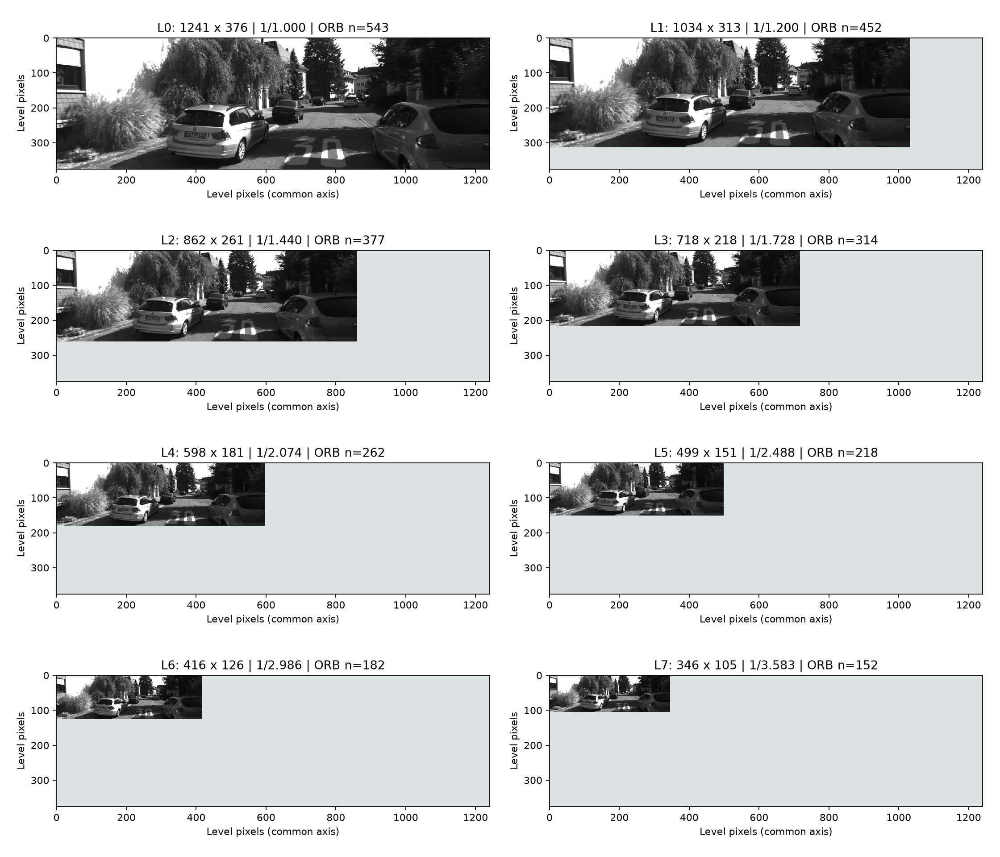
읽는 법: 회색 여백은 데이터가 없는 부분이다. L0는 전체 칸을 채우고 L7은 작은 부분만 채운다. 제목의 ORB n은 실제 ORB의 레벨별 개수이며 배경은 독립 교육용 resize다.

| 레벨 | 실제 배열 폭×높이 | 원본 대비 길이 | 31px patch의 원본 폭 | 실제 ORB 점 수 | 복원 MAE |
|---|---:|---:|---:|---:|---:|
| 0 | 1241×376 | 100.00% | 31.00px | 543 | 0.000 |
| 1 | 1034×313 | 83.33% | 37.20px | 452 | 3.138 |
| 2 | 862×261 | 69.44% | 44.64px | 377 | 3.312 |
| 3 | 718×218 | 57.87% | 53.57px | 314 | 4.442 |
| 4 | 598×181 | 48.23% | 64.28px | 262 | 5.277 |
| 5 | 499×151 | 40.19% | 77.14px | 218 | 5.348 |
| 6 | 416×126 | 33.49% | 92.57px | 182 | 6.339 |
| 7 | 346×105 | 27.91% | 111.08px | 152 | 7.170 |

MAE는 각 축소 영상을 원본 크기로 bilinear 확대하고 mean(abs(original-restored))로 계산했다. 단위는 0~255 밝기다. 0이 아니라는 것은 원본 복제본이 아니며 축소·복원 과정에서 정보가 바뀌었다는 뜻이다. VO 정확도 지표는 아니다. 레벨별 검출 개수도 품질 점수가 아니라 설정과 검출 결과다.

#### 같은 장면의 확대 비교와 patch 범위

bilinear interpolation은 정수 격자 사이 밝기를 주변 네 픽셀의 가중 평균으로 계산하는 보간이다. 줄어든 영상에서 모든 원본 픽셀을 독립적으로 보존할 수 없다. 미세 패턴이 사라지거나 다른 패턴처럼 보이는 aliasing이 생길 수 있다. 정밀한 축소 필터와 완벽한 영상 복원은 이번 실험 범위가 아니다.

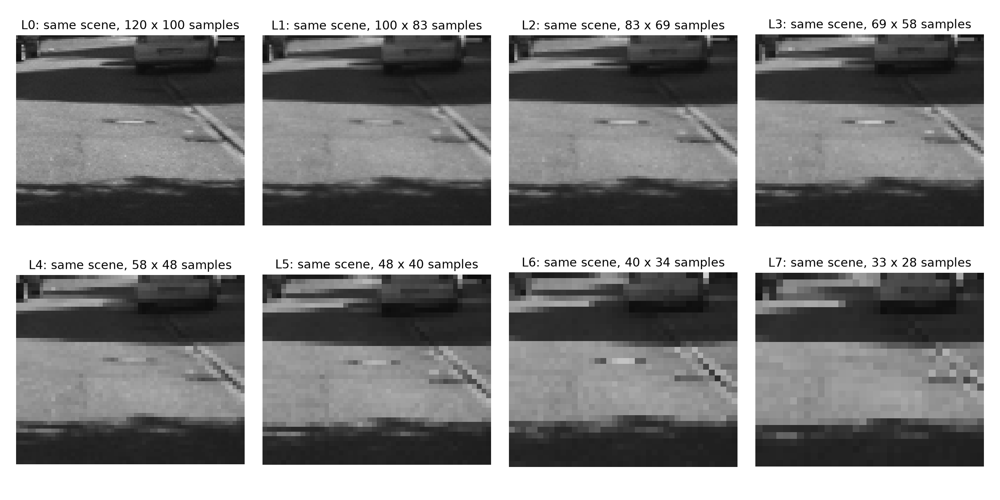
이번에는 의도적으로 같은 크기로 확대했다. 목적은 배열 전체 크기가 아니라 **정보 손실을 확대해 보는 것**이다. nearest 표시를 사용해 새 부드러운 픽셀을 만들어 숨기지 않았다. 같은 도로 부분이 L0에서는 120×100표본, L7에서는 33×28표본으로 표현된다. 작은 점과 경계가 뭉개지는 부분을 비교한다.

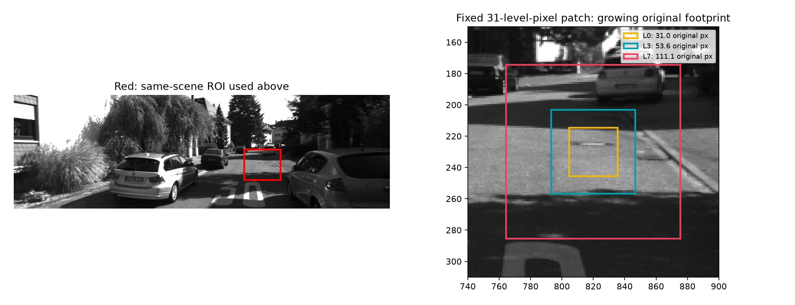
왼쪽 빨간 상자가 위 확대의 위치다. 오른쪽 상자들은 각 레벨에서 31픽셀인 patch가 원본에서 얼마나 큰 영역을 덮는지 보여준다. L7의 31px는 원본 약111px 범위다. 상자 중앙은 설명용 고정 위치이지 같은 keypoint가 모든 레벨에서 검출된다는 주장이 아니다.

OpenCV keypoint의 `octave`는 여기서 피라미드 레벨 인덱스다. 이름이 octave여도 매 레벨이 2배라는 뜻은 아니다. `pt`는 보통 원본 영상 좌표로 반환되고 `size`에는 레벨 scale이 반영된다. 그래서 서로 다른 레벨의 점도 원본 위에 그릴 수 있다. 이번 실험은 레벨별 출력 필드를 저장한다. [OpenCV ORB API](https://docs.opencv.org/4.13.0/db/d95/classcv_1_1ORB.html)

#### FAST: 원 둘레만 보고 후보를 빠르게 찾기

입력은 한 레벨의 grayscale 영상이다. 후보 중심 p의 밝기를 I(p), 밝기 문턱을 t라고 하자. 중심에서 반경 약3픽셀인 원 둘레의 16개 위치를 본다. 이번 FAST_9_16에서는 그 원을 따라 **연속 9개 이상**이 모두 I(p)+t보다 밝거나, 모두 I(p)-t보다 어두우면 통과한다. 밝고 어두운 것을 섞어 9개 세는 것이 아니다. 원이므로 끝 인덱스에서 처음으로 이어지는 구간도 검사한다.

FAST는 이름처럼 segment test의 구조를 이용해 많은 위치를 빨리 탈락시키려는 방법이다. 원래 FAST 논문의 FAST-12 설명과 이번 OpenCV FAST-9 설정을 혼동하면 안 된다. 학습된 decision tree는 검사 순서를 효율화하는 별도 요소이며 이번 코드는 그것을 재학습하지 않는다. [Rosten·Drummond, 2006 원문](https://www.edwardrosten.com/work/rosten_2006_machine.pdf)

왜 단순한데 코너를 찾을까? 균일한 영역은 원 둘레도 중심과 비슷해 탈락한다. 경계의 꺾임이나 국소적으로 독특한 밝기 분포에서는 긴 밝은/어두운 호가 생길 수 있다. 하지만 '기하학적으로 건물 모서리'만 검출하는 것은 아니다. 점광원·노이즈·텍스처도 통과할 수 있다.

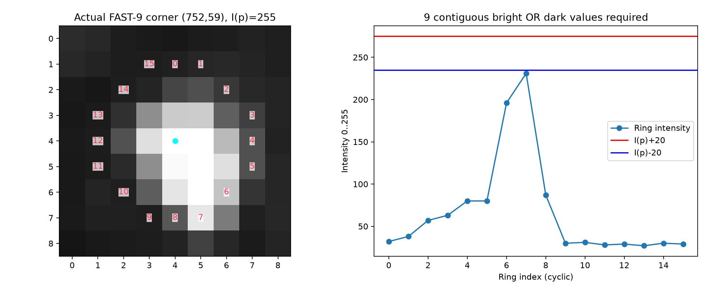
실제 선택 위치는 (752,59), 중심 밝기는 255다. t=20이므로 어두운 판정 경계는 235다. 원 둘레 밝기는 아래와 같고 모두 235보다 작아서 연속9 조건을 만족한다. 밝은 판정 경계 275는 uint8 범위 밖이라 이 위치는 밝은 호로 통과할 수 없다.

```text
ring index:  0  1  2  3  4  5   6   7  8  9 10 11 12 13 14 15
intensity:  32 38 57 63 80 80 196 231 87 30 31 28 29 27 30 29
state:      전부 dark (<235)
```

이 사례는 오히려 중요한 한계를 보여준다. FAST의 corner는 '물리적인 모서리'라는 의미와 동일하지 않다. 포화된 중심 밝기를 가진 작은 구조도 높은 응답이 가능하다. 이 점 하나를 대표적인 좋은 추적점이라고 일반화하지 않는다.

#### NMS: 이웃한 후보들을 왜 줄이는가

좋은 구조 주변에서 여러 픽셀이 동시에 통과할 수 있다. 이들을 모두 쓰면 한 군데에 점이 몰리고 비교 비용이 늘어난다. NMS는 가까운 후보 사이에서 응답이 더 큰 것을 남기는 지역 경쟁이다. 전체 영상에서 상위500개를 고르는 연산과는 다르다.

이번 영상에서 FAST nonmaxSuppression=False는 19,397개, True는 5,475개였다. 이 차이는 실제 detector를 두 설정으로 실행한 결과다. 점 개수가 줄었다고 recall이나 VO 성능이 좋아졌다고 결론내리지는 않는다. nonmax 점수의 정확한 내부 구현은 OpenCV 버전에 의존하므로 이 보고서는 임의의 간단한 점수를 같은 내부 점수라고 부르지 않는다.

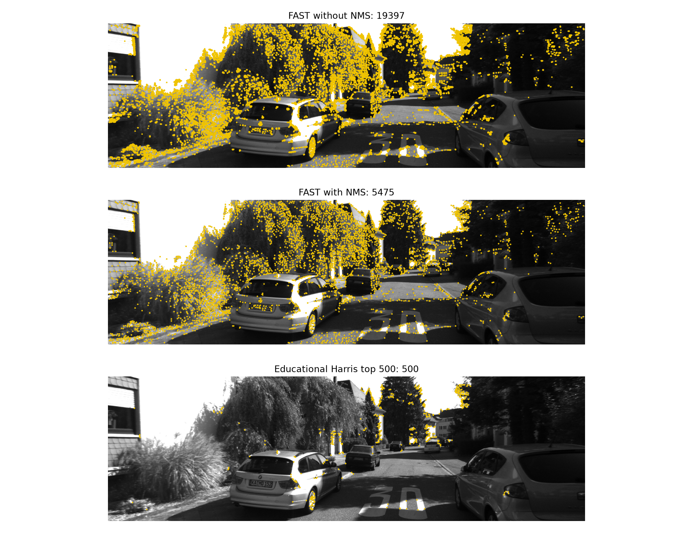
위에서 아래로 후보가 어떻게 줄어드는지 본다. 마지막 500개는 교육용 Harris 순위다. 실제 다중 레벨 ORB의 2,500개와 같은 집합이 아니다.

#### Harris: FAST를 썼는데 왜 또 다른 코너 점수가 필요한가

FAST의 역할은 빠른 후보 생성이다. 제한된 개수만 남길 때는 다른 관점의 코너 강도로 순위를 매길 수 있다. Harris는 patch를 어느 방향으로 조금 움직여도 모양이 달라지는지 평가한다. 이름은 약자가 아니라 제안자 이름에서 왔다. [Harris·Stephens, 1988 학회 기록](https://www.bmva-archive.org.uk/bmvc/1988/avc-88-023.html)

평평한 벽 patch는 좌우·위아래로 조금 이동해도 비슷하다. 긴 수직 경계는 가로로 이동하면 크게 달라지지만 세로로 이동하면 비슷하다. 코너는 두 방향 모두 변화가 크다. 이것이 코너가 2D 위치를 정하기에 유리한 이유다.

수식의 기호를 하나씩 쓰면 다음과 같다. I_x, I_y는 각각 가로·세로 밝기 변화량(영상 미분)이다. w는 patch 안의 픽셀에 주는 가중치다. sum은 patch 전체 합이다.

```text
M = [ sum(w * Ix²)      sum(w * Ix * Iy) ]
    [ sum(w * Ix * Iy)  sum(w * Iy²)     ]

R = det(M) - k * trace(M)²
  = lambda1 * lambda2 - k * (lambda1 + lambda2)²
```

M은 2×2 구조 행렬이다. trace는 대각 원소 합, det는 행렬식이다. lambda1/lambda2는 고유값으로, patch의 두 주된 방향에서 밝기가 얼마나 변하는지 요약한다. k는 점수 모양을 조절하는 상수이며 여기서는 0.04다. R이 큰 양수면 두 방향 변화가 모두 큰 경향, 음수면 한 방향만 큰 경계 경향, 0 근처면 평탄한 경향이다. 계산 구조와 해석은 [공식 Harris 설명](https://docs.opencv.org/4.13.0/dc/d0d/tutorial_py_features_harris.html)에 근거한다.

실제 교육 계산은 `cornerHarris(img, 7, 3, .04)`다. 7은 주변 집계 영역 크기, 3은 미분을 구하는 Sobel 커널 크기다. Sobel은 이웃 밝기의 가중 차분으로 미분을 근사하는 필터다. FAST 후보의 위치에서 R을 읽고 높은 순으로 500개를 골랐다. 이 dense Harris 계산을 OpenCV ORB 내부의 모든 최적화와 동일하다고 주장하지 않는다.


이 그림만은 해석을 쉽게 하려고 만든 41×41 합성 영상이다. 밝기는 0~1 float다. 위는 영상, 아래는 중심 부근 두 고유값이다. 실제 도로 사례와 합성 예제를 혼동하지 않는다.

| 합성 patch | lambda1 | lambda2 | R | 해석 |
|---|---:|---:|---:|---|
| 평탄면 | 0 | 0 | 0 | 어느 방향도 변화 없음 |
| 수직 경계 | 0.285714 | 0 | -0.003265 | 한 방향만 변화 |
| 코너 | 0.168367 | 0.127551 | 0.017973 | 두 방향 모두 변화 |

Harris의 약점은 blur·noise·밝기 대비에 따라 응답이 달라지고, 코너 점수가 높아도 다른 장소의 비슷한 코너와 구분된다는 보장은 없다는 것이다. 위치 선택과 식별력은 다른 문제다.

#### 방향: Oriented FAST의 Oriented는 어디서 생기는가

FAST만으로는 '이 patch가 어느 방향을 향하는가'를 얻지 못한다. 카메라가 회전하면 같은 물체 주변도 돌아가기 때문에 descriptor의 비교 방향을 맞출 기준이 필요하다.

교육 예에서는 중심을 (0,0)으로 놓고 반지름15인 원 안의 밝기를 무게처럼 사용한다. 좌표 x는 오른쪽, y는 아래로 증가한다. 모멘트(moment)는 '위치에 밝기를 곱해 더한 값'이다.

```text
m00 = sum(I)        : 밝기 총합
m10 = sum(x * I)    : 좌우 밝기 분포
m01 = sum(y * I)    : 상하 밝기 분포
centroid = (m10/m00, m01/m00)
theta = atan2(m01, m10)
```

centroid는 밝기 무게중심이다. 중심에서 무게중심으로 향하는 방향을 theta로 삼는다. atan2는 x/y 부호를 함께 고려해 사분면까지 구분하는 각도 함수다. m00=0인 검은 patch, m10/m01이 모두0인 대칭 patch는 방향이 의미 없거나 불안정해질 수 있다. 구현에서 반환하는 숫자가 있더라도 방향 정보가 충분하다는 뜻은 아니다.

이번 실제 patch의 m00=29662, m10=-1100, m01=-21548이다. 무게중심은 (-0.0371,-0.7265)px, 각도는 -92.92도다. 이미지 y가 아래로 증가하므로 화면상 위를 향한다. 0~360도로 표현하면 약267.08도지만 **이 독립 교육 계산이 실제 ORB keypoint.angle과 반드시 같다는 뜻은 아니다.** 경계/원형 표본 규칙이 다를 수 있다.

#### BRIEF: 작은 그림을 어떻게 0과 1로 바꾸는가

BRIEF는 검출기가 아니라 descriptor다. 이미 정해진 patch 안에서 위치 a와 b를 고르고 밝기를 비교한다. I(a)<I(b)이면 1, 아니면 0이다. 이런 질문 256개를 고정된 순서로 묶으면 256비트가 된다. 8비트가1바이트이므로 32바이트다. 픽셀을 비교하기 전에 smoothing을 해 작은 노이즈의 영향을 줄인다. [OpenCV BRIEF](https://docs.opencv.org/4.13.0/dc/d7d/tutorial_py_brief.html)

Gaussian smoothing은 이웃 밝기를 종 모양 가중치로 평균하는 것이다. 이번 교육 예는 7×7 커널과 sigma=2를 사용한다. sigma는 평균에 참여하는 공간 범위의 퍼짐을 조절한다. smoothing 때문에 작은 밝기 차이는 완화되지만 세부 정보도 줄어든다.

**Rotated BRIEF:** 고정된 비교 위치를 그대로 쓰면 patch가 회전할 때 다른 물체 부분을 읽는다. 앞에서 구한 theta만큼 비교 위치 좌표를 회전시키면 물체 기준으로 비슷한 위치를 비교할 수 있다. 여기서 이미지 전체를 회전시키는 것이 아니라 비교 좌표를 돌린다.

```text
[ x' ] = [ cos(theta)  -sin(theta) ] [ x ]
[ y' ]   [ sin(theta)   cos(theta) ] [ y ]
```

실제 영상에서 뽑은 교육용 첫8개 질문은 다음과 같다. 이것은 seed7로 뽑은 무작위 패턴이며 실제 ORB의 학습된 패턴이 아니다.

| 질문 | I(a) | I(b) | I(a)<I(b) |
|---|---:|---:|---:|
| 0 | 36 | 55 | 1 |
| 1 | 38 | 29 | 0 |
| 2 | 29 | 51 | 1 |
| 3 | 111 | 37 | 0 |
| 4 | 27 | 27 | 0 |
| 5 | 28 | 25 | 0 |
| 6 | 28 | 29 | 1 |
| 7 | 135 | 87 | 0 |

위 예의 앞8비트는 10100010이다. 어느 질문인지의 순서까지 같아야 두 descriptor를 비교할 수 있다. 프레임마다 새 random pattern을 뽑으면 대응 비교가 의미 없어진다.

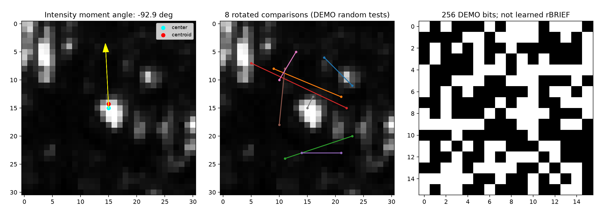
왼쪽은 원 중심·무게중심·방향, 가운데는 실제 patch에 그린8개 회전 비교, 오른쪽은256개 질문의 참/거짓이다. 화살표 길이10px는 각도를 보기 위한 표시 길이이며 무게중심 거리0.73px가 아니다. 비트의 16×16 배열은 표시용이며 실제 물체의 2D 모양 지도가 아니다.

#### rBRIEF: 무작위 질문만 있으면 충분한가

어떤 질문의 답이 거의 항상0이면 서로 다른 patch를 구분하는 정보가 적다. 반대로 0/1이 자주 바뀌는 질문은 더 다양한 경우를 나눌 수 있다. 또 두 질문의 답이 항상 함께 바뀌면 비슷한 정보를 중복해서 저장한다.

ORB의 rBRIEF 선택은 다양한 patch에서 비트의 평균이 약0.5이고 분산이 크며 질문 사이 상관이 낮은 패턴을 찾는 방향이다. Bernoulli 비트의 분산은 p(1-p)이므로 p=0.5일 때0.25로 최대다. 상관은 두 질문의 답이 함께 변하는 정도를 뜻한다. 완전한 독립을 보장한다는 뜻은 아니다. [OpenCV ORB의 rBRIEF 설명](https://docs.opencv.org/4.13.0/d1/d89/tutorial_py_orb.html)

이것은 '현재 frame120에서 매번 패턴을 다시 학습한다'는 말이 아니다. 이번 OpenCV 호출은 제공된 패턴으로 descriptor를 계산한다. 학습 데이터·선택 과정은 재실행하지 않았다. 새 교육 스크립트의 랜덤256질문을 rBRIEF 재현이라고 부르지 않는 이유다.

#### 실제 OpenCV ORB 출력과 교육 그림의 경계

실제 `detectAndCompute` 출력은 keypoint 2,500개와 uint8 descriptor 배열 (2500,32)다. 레벨별 개수 합도2,500이다. 각 행은 한 keypoint의256비트를32바이트에 담은 것이다. 코드에서 그림에 보이는 byte 값 하나를 하나의 bit로 해석하면 틀린다. `unpackbits`는 바이트를 비트들로 펼쳐 표시하는 연산이다.


모든 배경이 같은 원본 크기인 것은 의도적이다. 이 그림의 질문은 '각 레벨에서 찾은 점이 원본의 어디에 있는가'다. 피라미드 크기를 보여주는 첫 그림과 목적이 다르다. 같은 물체가 여러 레벨에서 검출될 수도 있으며 점 하나하나의 3D 동일성은 이 그림만으로 알 수 없다.

우리 교육 피라미드는 원본에서 각 레벨을 독립 resize했다. 실제 ORB는 버전별 내부 경계 확장·보간·반복 축소·blur 등의 세부가 다를 수 있다. OpenCV4.13 소스를 참고했으나 실행 binary는5.0.0이고 정확한 빌드 소스 일치까지 확인하지 못했다. 따라서 그림을 'ORB 내부 buffer 그대로'라고 표시하지 않는다. [참고 소스](https://raw.githubusercontent.com/opencv/opencv/4.13.0/modules/features2d/src/orb.cpp)

#### Hamming, BF, cross-check, ratio: 무엇을 기준으로 같은 점을 찾는가

Hamming distance는 같은 길이 비트열에서 다른 자리 수다. 예를 들어101100과100110은 세 번째와 다섯 번째가 달라 거리가2다. XOR는 다를 때1, 같을 때0을 내는 비트 연산이다. XOR 결과에서1의 개수를 세는 popcount로 Hamming을 계산한다.

BF는 이전 descriptor마다 현재 descriptor들을 직접 비교해 가장 작은 거리를 찾는다. cross-check는 A가 고른 최선이 B이면서 B가 고른 최선도 A일 때만 남기는 상호 최근접 조건이다. 반복된 무늬에서는 상호 최근접이어도 오매칭일 수 있다. [OpenCV matching](https://docs.opencv.org/4.13.0/dc/dc3/tutorial_py_matcher.html)

ratio test는 최근접 거리 d1과 두 번째 거리 d2를 비교해 d1<0.75*d2 같은 조건을 쓴다. 최선과 차선이 비슷하면 애매하다고 보는 것이다. 예를 들어20과22는 탈락,20과50은 통과한다. 0.75는 이전 실험의 설정이지 보편적 정답이 아니다. cross-check와 ratio는 서로 다른 필터이며 이번 기본 VO는 cross-check다.

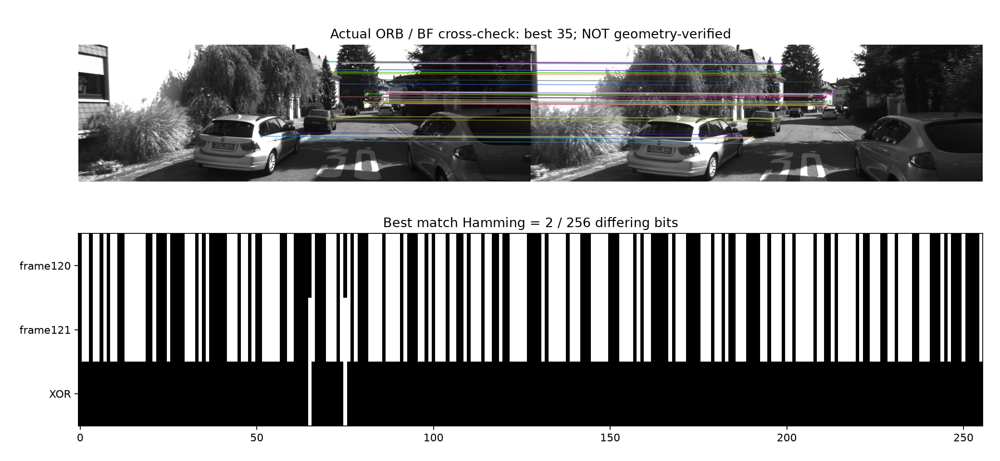
120→121의 실제 ORB/BF cross-check 대응은1,611개다. 위에는 거리순35개를 보여주고, 아래에는 최저 거리 대응의 descriptor 두 개와 XOR를 표시했다. XOR의1이2개이고 OpenCV distance도2로 일치한다. **이 그림은 기하 검증 전**이다. 작은 Hamming이 올바른 3D 대응을 보장하지 않는다.

#### 여기서 VO까지: ORB가 끝나는 곳

현재 baseline은 매칭을 거리순으로 최대1,000개 사용한다. 이후 `findEssentialMat`의 RANSAC으로 정적인 장면의 두 시점 기하를 추정한다. RANSAC은 일부 대응으로 후보 모델을 만들고 많은 대응이 그 모델에 맞는지 반복 확인하는 방식이다. 모델에 대한 오차가 작으면 inlier로 분류한다.

카메라 내부 파라미터 K는 초점거리와 주점을 담는다. 픽셀(u,v,1)에 K의 역행렬을 곱해 카메라 광선 방향에 대응하는 정규화 좌표 x를 만든다. Essential matrix E는 두 정규화 관측 사이의 관계 x2ᵀ E x1=0을 표현한다. 실제 대응에는 노이즈가 있어 이 값 또는 관련 거리 오차가 완전히0일 필요는 없다.

`recoverPose`는 E에서 회전 R과 이동 방향 t를 복원하고, 삼각측량된 점이 두 카메라 앞에 놓이는지 검사해 가능한 해를 고른다. 삼각측량은 두 광선으로3D 위치를 추정하는 계산이고, 앞쪽 여부 검사를 cheirality check라고 한다. [OpenCV 기하 API](https://docs.opencv.org/4.13.0/d9/d0c/group__calib3d.html)

단안 영상만으로 전체 장면과 이동을 함께 같은 배수로 키워도 같은 투영이 가능하다. 따라서 이 단계의 t 길이를 실제 m로 알 수 없다. 현재 코드는 단위 이동 방향을 누적하므로 속도 변화·프레임 간 거리 차이를 복원하지 못한다. 회전이 좋아도 경로 길이는 틀릴 수 있다. 피라미드·Harris·BRIEF는 이 물리적 scale 모호성을 해결하는 방법이 아니다.

이후의 발전 방향도 목적이 다르다. stereo는 알려진 카메라 간 거리로 깊이 scale을 얻는 접근, BA(Bundle Adjustment)는 여러 카메라 pose와3D 점을 영상 재투영 오차가 작도록 함께 조정하는 최적화, loop closure는 재방문 제약으로 전역 누적 오차를 줄이는 기능이다. 이들을 ORB라는 한 단어 안에 포함시키지 않는다. 이 ORB 연구 당시에는 구현하지 않았으나 v3.0.0의 C4–C5는 독립 stereo VO를, C6–C7은 별도 합성 BA·루프를 실행했다. 실제 영상의 장기 루프 SLAM은 여전히 미구현이다.

### 시스템 아키텍처와 산출물 계약

| 모듈 | 입력 | 출력 및 저장 | 검증 |
|---|---|---|---|
| 피라미드 | frame120 grayscale | artifacts/pyramid.npz, levels.csv, roi_level_*.npy | 기존4배열 동일, shape/hash, 복원 MAE |
| FAST/Harris | 원본 픽셀, threshold20 | artifacts/fast_harris.npz, harris_toys.json | cyclic9 조건, 고유값/응답 부호 |
| 방향/BRIEF 교육 | 실제 patch, seed7 패턴 | artifacts/orientation_brief.npz | 모멘트·회전 좌표·픽셀 비교 저장 |
| 실제 ORB | 원본, 명시 설정 | artifacts/actual_orb.npz | 8레벨 합2500, descriptor shape |
| 매칭 | 120/121 descriptor | artifacts/matching.npz | XOR1 개수=OpenCV distance |
| 출판 | 위 출력 | figures/*.png, report.pdf | 이미지 decode 및 레이아웃 검토 |

모든 영상 좌표는 x오른쪽/y아래, 단위pixel이다. 방향 교육 배열은 radian, 표시값은 degree다. pi radian=180도다. level 좌표와 원본 좌표의 scale을 구분하며 이번 작업에는 새로운 센서 시간 정렬이 없다.

### 결과와 baseline 비교

| 검사 | 이전 자료 | 이번 결과 |
|---|---|---|
| 배열 구분 | shape만 표시 | 기존4배열 동일 재현, 8레벨 shape/hash 기록 |
| 축소 크기 시각화 | subplot 자동 fit | 모든 축 동일, 여백으로 축소 표현 |
| 정보 손실 | 확인 어려움 | 같은 ROI 표본 수와 nearest 확대 |
| patch 범위 | 설명 부족 | 31px→원본31~111.08px 표시 |
| FAST | 후보 overlay만 | 실제16픽셀 수치와9연속 조건 통과 |
| Harris | 순위 결과만 | 합성 평탄/경계/코너 고유값과 R 비교 |
| 방향/BRIEF | 이름 위주 | 모멘트 값·각도·비교 밝기·비트 저장 |
| 실제 매칭 | 선 그림 | 실제 descriptor XOR와 distance2 일치 |

이 표는 교육적 관찰 가능성의 개선이다. VO RMSE, detector recall, 실행 지연 성능을 새로 측정한 것이 아니다. 코드 assert가 통과했고 그림9개를 생성했다. 사람이 이해했는지는 이 자동검사만으로 판정할 수 없다.

### 강점, 한계, 실패 사례


#### Feature별 강점과 약점

| 구성 | 강한 조건 | 약한 조건 | 이번 근거 |
|---|---|---|---|
| 피라미드 | 제한된 영상 크기 변화 | 극단적 축소, 원근 변형, 가림 | L7 ROI 세부 소실, MAE7.170 |
| FAST | 대비가 뚜렷한 국소 구조 | 노이즈, blur, 포화 점 | 중심255인 실제 통과 예 |
| NMS | 이웃 중복 후보 제거 | 강한 소수 영역 편중 해결 불충분 | 19397→5475, 위치 그림 |
| Harris | 두 방향 변화 구분 | 반복 코너의 식별 문제 | 합성 고유값 표 |
| 밝기 중심 방향 | 비대칭 밝기 분포 | 대칭/어두운 patch, 조명 변화 | 실제 centroid가 중심에서0.73px밖에 떨어지지 않음 |
| 회전 BRIEF | 방향 추정이 일관된 경우 | 방향 오차, 비교 밝기 차이가 작은 경우 | 27/27,28/29 같은 민감한 질문 |
| Hamming/BF | 가볍고 해석 가능한 거리 | 반복 무늬, 모든 점 비교 비용 | 거리2도 기하 정답 아님 |

#### 숨기지 말아야 할 한계

이번 frame120 하나와121의 대응만으로 일반적인 불변성·강건성을 평가하지 않았다. 밝기 변화·회전·blur 조건별 성능 곡선은 없다. FAST가 찾은 포화점의 실제 추적 안정성도 이 실험으로 확인하지 않았다. 실제 ORB 패턴과 random 교육 패턴의 성능 비교를 한 것이 아니다.

이전 연구의 단일30도 합성 회전 ablation은 방향의 영향을 보여주는 별도 진단이다. 그 수치를 KITTI 전체나 실제 주행 회전에서의 정확도로 읽으면 안 된다. 이번 보고서는 이해를 위해 입력과 계산을 눈으로 추적하는 데 집중했다.

#### 성공 기준 달성도

배열 동일성, 실제 shape 기록, L1~7 비영 복원 오차, FAST9, XOR 거리 일치와 주요 용어 설명은 완료했다. OpenCV 내부 buffer 완전 재현, rBRIEF 재학습, 모든 주행 상황의 성공률은 범위 밖이며 완료했다고 표시하지 않는다.

### 한계를 다루는 후속 접근


#### SuperPoint: 검출 위치와 descriptor를 데이터로 학습

SuperPoint는 FAST/Harris의 수작업 규칙과 BRIEF식 외형 표현 대신, 영상에서 위치 점수와 descriptor를 함께 계산하는 신경망 접근이다. Homographic Adaptation은 알려진 평면 투영 변환으로 영상을 바꿔 얻은 검출 결과를 모아 학습 신호를 보강하는 과정이다. homography는 평면 또는 특정 카메라 운동에서 두 영상의 점을 연결하는3×3 투영 변환이다.

이 방향은 '어떤 점이 다시 찾기 좋고 어떤 표현이 구분에 좋은가'를 학습한다. 하지만 가림으로 사라진 관측을 항상 복원하거나 단안 metric scale을 해결하는 방법은 아니다. 학습된 weight, 호환 런타임, 우리 데이터에서의 검증이 필요하며 이번에는 실행하지 않았다. [DeTone·Malisiewicz·Rabinovich, SuperPoint, 2018](https://arxiv.org/abs/1712.07629)

#### LightGlue: 점 하나의 가장 가까운 descriptor만 보지 않기

LightGlue는 두 이미지의 local feature들을 받아 주변 대응의 관계까지 활용하는 학습 기반 matcher다. attention은 다른 feature의 정보 중 무엇을 더 참고할지 가중하는 계산이다. 쉬운 쌍과 어려운 쌍에 계산량을 다르게 쓰는 적응적 설계가 포함된다.

이것은 FAST 자체를 만드는 검출기가 아니라 주로 매칭 단계의 대안이다. 임의의 ORB 32바이트를 기존 모델에 그대로 넣으면 된다는 뜻은 아니다. 모델이 지원하는 descriptor 종류·차원·학습 조건을 맞춰야 한다. 반복 패턴의 애매함을 줄이는 방향이지만 실제 차량 이동, 가림, 잘못된 카메라 모델까지 모두 해결한다고 볼 수 없다. [Lindenberger·Sarlin·Pollefeys, LightGlue, 2023](https://arxiv.org/abs/2306.13643)

#### 지금 선택할 때의 구분

| 다음 방법 | 해결하려는 한계 | 필요한 것 | 예상 공수 |
|---|---|---|---|
| 설정 ablation | threshold/level에 대한 민감도 | 현재 데이터로 가능, 통제된 변환 | 낮음 |
| SuperPoint | 검출·표현의 반복성/식별력 | weight, 비교 기준, 모델 실행 환경 | 중간 |
| 호환 feature+LightGlue | 독립 최근접 매칭의 애매함 | 호환 descriptor와 weight | 중간 |
| stereo+깊이+pose 추정 | 단안 metric scale 모호성 | 오른쪽 영상과 calibration | 높음 |

후속 논문은 '모든 단점의 만능 후계자'가 아니라 서로 다른 부분을 바꾸는 선택지다. 이번 작업에서 자동 적용하지 않는다.

### 부록: 재현 경계와 참고문헌

- [가정] 교육 목적의 대표 frame120과 ROI(760,180,120,100)를 선택했다. 장면 전체 대표성을 보장하지 않는다.
- [미확인] 현재 OpenCV5.0.0 binary와4.13 참고 소스의 정확한 구현 일치. 원 ORB PDF 전체 직접 열람. 실제 rBRIEF 선택 과정 재현.
- [구분] 교육 Harris/원형 moment/random BRIEF는 실제 ORB의 내부 단계 trace가 아니다. 실제 ORB의 kp/descriptor/octave 결과는 별도 저장했다.
- [출처] 도표 수치는 이 작업의 artifacts에서 생성했다. 일반 알고리즘 정의는 본문 가까이에 링크한 원저자 논문·학회 기록·공식 OpenCV 자료를 사용했다. 옛 논문의 속도 비교 숫자와 특허 상태는 현재 사실로 재사용하지 않았다.
- ORB 서지: Ethan Rublee, Vincent Rabaud, Kurt Konolige, Gary Bradski, *ORB: An efficient alternative to SIFT or SURF*, ICCV2011. 공식 OpenCV 자료로 서지 확인.
- BRIEF 서지: Michael Calonder, Vincent Lepetit, Christoph Strecha, Pascal Fua, *BRIEF: Binary Robust Independent Elementary Features*, ECCV2010. 공식 OpenCV 자료로 서지 확인.
- 실제 실행 코드와 결과의 연결: src/analyze.py, configs/experiment.json, artifacts/summary.json. 새 연구 코드는 이전 생산 VO/LO를 수정하지 않는다.


<a id="camera-book"></a>

## 카메라 교재 안내: 전체 시스템에서 필요한 수학으로

이 부는 관측·상태·불확실성·검증을 하나의 흐름으로 연결한다. 기초 A1–A12를 모두 외운 뒤 시작할 필요는 없다. C1의 광선에서 막히면 A3, C2의 행렬에서 막히면 A6, C6의 갱신에서 막히면 A9–A11로 돌아온다. ORB 장의 검출·기술자 계산은 C4의 대응 선택 앞에서 읽는다. 기존 3–6장의 날짜·수치는 과거 연구의 기록이며 최신 실험과 같은 설정의 비교가 아니다.

| 장 | 학습 질문 | 필요한 앞 단원 | 직접 확인할 출력 |
|---|---|---|---|
| [C1. 영상 형성과 보정: 픽셀은 광선이지 3D 점이 아니다](#c1) | 광선·보정·시간·밝기 | A1–A3 | 정류 좌우 영상, 합성 왜곡 |
| [C2. F·E·H와 삼각측량: 대응점을 운동과 구조로 바꾸기](#c2) | 점→선과 점→점 | A6, ORB 대응 | 에피폴라 잔차·재투영 |
| [C3. 단안 초기화와 퇴화: 해가 나와도 깊이가 관측된 것은 아니다](#c3) | 척도와 퇴화 | C2, A7–A8 | 조건별 성공/hold |
| [C4. 스테레오 깊이: 기준선에서 미터 척도를 전달하기](#c4) | 미터 깊이의 출처 | A4, ORB 상세 | 시차·희소 3D·SGBM |
| [C5. LK와 PnP: 시간 대응을 미터 자세로 바꾸기](#c5) | 시간 추적→자세 | A5, A9, C4 | LK/FB·pose-only LM |
| [C6. 키프레임과 공동 BA: 관측을 남기고 자세와 점을 함께 고치기](#c6) | 공동 지도 최적화 | A9–A11, C5 | 합성 BA·gauge·오염 관측 |
| [C7. 장소 검색과 루프: 높은 유사도에서 검증된 제약까지](#c7) | 후보→검증→제약 | C6 | 합성 참/거짓 루프 |
| [C8. 직접법: 픽셀 위치 대신 밝기 잔차를 사용하기](#c8) | 밝기 기반 운동 | C1, C5–C6 | 손계산 광도 잔차 |
| [C9. 시각·관성 추정: 고속 관측과 초기화의 계약](#c9) | 시간·bias·중력 | A12, C6 | 사전적분·초기화 계산 |
| [C10. 학습 대응과 반복 추정: 무엇을 학습하는지 먼저 구분하기](#c10) | 학습할 모듈의 계약 | ORB, C2–C6 | 출력 타입·자원 계산 |
| [C11. 밀집·신경·의미 지도: 표면과 행동의 경계](#c11) | 표면·거리·의미·행동 | C6–C10 | TSDF·의미·Gaussian 풀이 |
| [C12. 실험 계약과 평가: 재현 가능한 주장만 남기기](#c12) | 무엇이 검증되었나 | 전체 흐름 | 실측 비교·재현·참고문헌 |

각 C장 안의 수식은 렌더러에 의존하지 않는 텍스트 표기다. ^T는 전치, ^(-1)은 역, ~는 동차좌표의 비례, ~=는 근사다. 그림에는 실제 KITTI·합성 교육 모델을 명시한다. 문헌만 다루는 직접법·VIO·신경 지도에는 미실행 그림을 실제 결과처럼 넣지 않았다.

### 상세 학습 목차

**[C1. 영상 형성과 보정: 픽셀은 광선이지 3D 점이 아니다](#c1)**

[전체 시스템에서 시작하는 첫 장](#c1-1) · [SfM·SLAM·MVS를 섞지 않는 분류](#c1-2) · [좌표와 단위의 최소 계약](#c1-3) · [세 종류의 정규화](#c1-4) · [왜곡: 광선의 방향과 픽셀의 관계가 비선형이다](#c1-5) · [Zhang 보정: 왜 여러 방향의 평면이 필요한가](#c1-6) · [리사이즈·크롭·정렬은 K도 바꾼다](#c1-7) · [KITTI P0/P1과 Raw calibration을 구별하는 문단](#c1-8) · [셔터: 한 프레임에 하나의 자세가 있는가](#c1-9) · [노출 시간과 모션 블러](#c1-10) · [방사 응답: 같은 물체가 같은 픽셀값을 갖지 않는 이유](#c1-11) · [컬러와 회색조](#c1-12) · [어안·RGB-D는 대체 모델의 개념으로만](#c1-13) · [연습문제와 해설](#c1-14) · [이 장에서 확인한 것과 다음 질문](#c1-15)

**[C2. F·E·H와 삼각측량: 대응점을 운동과 구조로 바꾸기](#c2)**

[한 대응점은 왜 에피폴라 직선만 정하는가](#c2-1) · [E와 F의 관계를 빠짐없이 전개하기](#c2-2) · [자유도·rank·특이값은 어떤 정보를 말하는가](#c2-3) · [실제 부호를 확인하는 두 시점 예제](#c2-4) · [H: 평면 또는 순수 회전이 주는 점 대 점 관계](#c2-5) · [정규화 8점법의 입력 행을 직접 만들기](#c2-6) · [왜 5점법은 8점법에서 점만 줄인 것이 아닌가](#c2-7) · [RANSAC: 맞는 점의 수보다 모델과 잔차가 먼저다](#c2-8) · [잔차를 정의하지 않은 1px 문턱은 불완전하다](#c2-9) · [E 분해와 네 가지 자세 후보](#c2-10) · [삼각측량을 네 행의 선형식으로 만들기](#c2-11) · [삼각측량의 손계산과 오차 함수](#c2-12) · [시차와 관측 가능성](#c2-13) · [연습문제와 해설](#c2-14)

**[C3. 단안 초기화와 퇴화: 해가 나와도 깊이가 관측된 것은 아니다](#c3)**

[단안 척도 모호성을 식으로 증명하기](#c3-1) · [초기화는 상태를 승인하는 절차다](#c3-2) · [실패 사례를 관측 정보의 부족으로 설명하기](#c3-3) · [수용률과 실패 hold를 분리한 합성 퇴화 검사](#c3-4) · [연습문제와 해설](#c3-5)

**[C4. 스테레오 깊이: 기준선에서 미터 척도를 전달하기](#c4)**

[스테레오의 척도: 기준선에서 미터가 들어온다](#c4-1) · [깊이 불확실성과 역깊이](#c4-2) · [실제 보정값과 하나의 대응을 끝까지 계산하기](#c4-3) · [ORB 기술자의 선택과 정류 게이트](#c4-4) · [깊이 배열은 지도 후보이며 정답 표면이 아니다](#c4-5) · [SGBM: 조밀한 대응과 유효성의 별도 계약](#c4-6) · [연습문제와 해설](#c4-7)

**[C5. LK와 PnP: 시간 대응을 미터 자세로 바꾸기](#c5)**

[LK: descriptor 검색 대신 밝기 패치의 이동 찾기](#c5-1) · [작은 LK 문제를 끝까지 풀기](#c5-2) · [Aperture problem과 추적할 점의 조건](#c5-3) · [피라미드와 추적 실패 검사](#c5-4) · [실제 LK 입력과 실패 상태](#c5-5) · [PnP: 이미 아는 3D 지도에서 카메라 자세 구하기](#c5-6) · [PnP의 미분을 카메라 모델에서 연결하기](#c5-7) · [스테레오→지도→PnP의 자료 흐름](#c5-8) · [실제 자세 추정과 누적 방향](#c5-9) · [연습문제와 해설](#c5-10)

**[C6. 키프레임과 공동 BA: 관측을 남기고 자세와 점을 함께 고치기](#c6)**

[먼저 시스템을 상태·관측·결정으로 나눈다](#c6-1) · [키프레임은 시간 간격이 아니라 정보와 계산량의 절충이다](#c6-2) · [랜드마크의 수명주기](#c6-3) · [그래프는 하나가 아니다](#c6-4) · [BA의 입출력 계약부터 고정한다](#c6-5) · [재투영 Jacobian을 단계별로 유도한다](#c6-6) · [Whitening과 강건 손실은 서로 다른 연산이다](#c6-7) · [Schur complement: 점을 먼저 없애도 pose 정보를 잃지 않는 이유](#c6-8) · [Gauge: 숫자 부족과 좌표 기준의 자유를 구분한다](#c6-9) · [Marginalization: 오래된 상태를 버리면서 남기는 정보](#c6-10) · [PTAM에서 배울 것과 배울 수 없는 것](#c6-11) · [ORB-SLAM 세대를 기능 축으로 비교한다](#c6-12) · [연습문제와 해설](#c6-13) · [실행한 합성 공동 BA: oracle 초기화와 dense solver](#c6-14) · [합성 공동 BA의 추가 계산 문제](#c6-15) · [실험의 한계: 작은 장면에서 확인한 것만 주장하기](#c6-16)

**[C7. 장소 검색과 루프: 높은 유사도에서 검증된 제약까지](#c7)**

[BoW와 DBoW2: 지도 검색의 입력과 출력](#c7-1) · [Loop verification은 독립된 기하 문제다](#c7-2) · [SE(3)와 Sim(3)를 선택하는 이유](#c7-3) · [Pose graph residual의 방향을 검산한다](#c7-4) · [연습문제와 해설](#c7-5) · [실행한 합성 SE(2): 참 루프와 거짓 루프의 효과](#c7-6) · [합성 루프의 추가 계산 문제](#c7-7)

**[C8. 직접법: 픽셀 위치 대신 밝기 잔차를 사용하기](#c8)**

[직접법의 질문: 대응 픽셀 좌표 대신 밝기를 맞추면 무엇이 달라지는가?](#c8-1) · [광도 모델과 노출](#c8-2) · [광도 Jacobian과 aperture problem](#c8-3) · [LSD-SLAM과 DSO는 목적과 유지 정보가 다르다](#c8-4) · [연습문제와 해설](#c8-5)

**[C9. 시각·관성 추정: 고속 관측과 초기화의 계약](#c9)**

[VIO의 상태와 센서 계약](#c9-1) · [MSCKF: 점을 상태에 넣지 않고 점의 정보를 쓰는 방법](#c9-2) · [사전적분은 IMU를 버리는 것이 아니라 상대 factor로 압축하는 것이다](#c9-3) · [Bias 보정은 왜 필요한가?](#c9-4) · [VINS 초기화: 한꺼번에 모든 미지수를 푸는 문제가 아니다](#c9-5) · [시간 보정은 위치 보정과 다르다](#c9-6) · [연습문제와 해설](#c9-7)

**[C10. 학습 대응과 반복 추정: 무엇을 학습하는지 먼저 구분하기](#c10)**

[학습이 들어갈 위치를 먼저 정한다](#c10-1) · [SuperPoint의 교체 범위](#c10-2) · [SuperGlue의 핵심: 독립 최근접 비교에서 문맥적 부분 대응으로](#c10-3) · [LightGlue: 계산량도 입력에 따라 달라진다](#c10-4) · [DROID-SLAM: 기하를 없애는 대신 학습 업데이트와 결합한다](#c10-5) · [자원 요구를 사실과 계획으로 분리한다](#c10-6) · [연습문제와 해설](#c10-7)

**[C11. 밀집·신경·의미 지도: 표면과 행동의 경계](#c11)**

[RGB-D reconstruction의 목표부터 고른다](#c11-1) · [Depth 역투영과 RGB 정렬](#c11-2) · [KinectFusion식 연결: 추적한 pose가 다음 지도를 만든다](#c11-3) · [TSDF의 정의와 가중 적분](#c11-4) · [TSDF에서 표면을 꺼내는 의미](#c11-5) · [Occupancy와 log-odds](#c11-6) · [ESDF는 로봇이 표면에서 얼마나 떨어졌는지 묻는다](#c11-7) · [루프 보정 이후 dense map의 수명주기](#c11-8) · [실내 Astra와 실외 KITTI의 실험 질문은 다르다](#c11-9) · [지도와 사실적인 디지털 트윈의 차이](#c11-10) · [연습문제와 해설](#c11-11) · [신경 implicit 지도: 값은 어디에 저장되는가?](#c11-12) · [3DGS의 기하와 렌더링](#c11-13) · [3DGS와 Gaussian SLAM을 분리해서 읽는다](#c11-14) · [Semantic SLAM과 dynamic SLAM은 다른 질문이다](#c11-15) · [정적 배경을 고를 때 발생하는 순환 의존](#c11-16) · [의미 확률을 합칠 때의 주의](#c11-17) · [VLM과 VLA의 경계](#c11-18) · [KITTI는 왜 VLA 학습 데이터와 같지 않은가?](#c11-19) · [연습문제와 해설](#c11-20) · [표현별 근거와 다음 읽기](#c11-21)

**[C12. 실험 계약과 평가: 재현 가능한 주장만 남기기](#c12)**

[평가 지표는 층마다 다르게 둔다](#c12-1) · [문제·성공 기준과 자원의 경계](#c12-2) · [모듈 아키텍처와 GT 격리](#c12-3) · [파라미터를 바꾸기 전에 고정할 표](#c12-4) · [정렬과 지표의 계산식](#c12-5) · [실제 KITTI 여섯 평가와 음의 ablation](#c12-6) · [개발 구간: 같은 경로에서도 지표는 다른 질문을 한다](#c12-7) · [분리 구간: 같은 설정에서도 실패 신호의 관계는 바뀐다](#c12-8) · [관측 단계의 수치와 분모](#c12-9) · [실패 분류와 결론의 강도](#c12-10) · [학습 경로는 교체 사다리가 아니라 분기 그래프다](#c12-11) · [단계별 읽기 질문과 통과 기준](#c12-12) · [실행 명령과 산출물의 provenance](#c12-13) · [합성 백엔드의 독립 재현](#c12-14) · [코드에서 다시 찾는 관측과 변환](#c12-15) · [기호 색인과 약어: 숫자보다 좌표와 단위를 먼저 확인하기](#c12-16) · [참고문헌과 판본: 기하·관측의 1차 자료](#c12-17) · [참고문헌과 판본: 시스템·관성·지도·학습](#c12-18) · [남은 간극과 다음 연구의 승인 조건](#c12-19)

<a id="c1"></a>

## C1. 영상 형성과 보정: 픽셀은 광선이지 3D 점이 아니다

첫 질문은 “영상에서 움직인 모서리가 실제로 어디에 있는가?”다. A3의 핀홀 모델을 출발점으로 좌표·왜곡·보정·시간·밝기 형성을 확장한다. 이 장의 출력은 픽셀을 광선으로 해석하는 계약이며, 아직 깊이나 궤적은 아니다. 실제 KITTI 입력은 이미 정류되었고 왜곡 그림은 별도로 만든 합성 모델이다.

<a id="c1-1"></a>

### 1. 전체 시스템에서 시작하는 첫 장

SLAM은 Simultaneous Localization and Mapping, 동시 위치추정 및 지도작성이다.
ORB는 Oriented FAST and Rotated BRIEF의 약칭이다.
FAST는 Features from Accelerated Segment Test, 빠른 원형 이웃 밝기 검사 계열의 특징점 검출이며, BRIEF는 Binary Robust Independent Elementary Features, 밝기 비교를 비트열로 표현하는 기술자다.
두 하위 알고리즘의 상세 계산은 기존 보고서 ORB 장을 재사용하고 여기서는 기하 입력인 2D 대응을 만드는 역할만 연결한다.
ORB-SLAM은 관측 추적뿐 아니라 지도작성·재위치추정·루프 폐쇄를 함께 다루는 시스템의 구체적 사례다. [Mur-Artal·Montiel·Tardós, 2015](https://arxiv.org/abs/1502.00956)
VO는 Visual Odometry, 시각 오도메트리이며 주로 연속 영상에서 운동을 추정한다.
VO를 구성했다고 해서 장소 재인식과 전역 일관성 보정까지 구현한 것은 아니다. [Engel·Koltun·Cremers, 2016 사전공개본](https://arxiv.org/abs/1607.02565)

학습자는 먼저 다음 질문을 따라간다.
“같은 모서리가 영상에서 이동했다. 카메라가 움직였는가, 물체가 움직였는가, 밝기만 바뀌었는가?”
하나의 관측만으로 답할 수 없으므로 장면의 정적성, 카메라 모델, 여러 대응점, 여러 시점이라는 조건을 더한다.
첫 장의 출력은 완성된 궤적이 아니라 어떤 정보가 부족한지 구분하는 능력이다.
두 번째 질문은 “움직인 방향을 알아도 몇 미터인지 왜 모르는가?”이며, 이것이 스테레오와 척도 장으로 이어진다.
세 번째 질문은 “수식에 잘 맞는데 왜 지도는 틀리는가?”이며, 이것이 퇴화·관측 가능성·검증 장으로 이어진다.

<a id="c1-2"></a>

### 2. SfM·SLAM·MVS를 섞지 않는 분류

SfM은 Structure from Motion, 여러 시점의 영상으로부터 구조와 카메라 운동을 추정하는 문제다.
순서 없는 사진 집합의 점진적 재구성도 가능하므로 반드시 실시간 비디오 처리일 필요는 없다. [Schönberger·Frahm, 2016](https://openaccess.thecvf.com/content_cvpr_2016/html/Schonberger_Structure-From-Motion_Revisited_CVPR_2016_paper.html)
MVS는 Multi-View Stereo, 다중 시점 스테레오다.
COLMAP의 전형적 처리에서는 SfM의 카메라 자세·희소 구조를 받아 더 조밀한 구조를 복원한다. [COLMAP 공식 튜토리얼](https://colmap.github.io/tutorial.html)

같은 삼각측량과 재투영 오차가 여러 분야에 등장한다고 해서 시스템의 목표가 같아지는 것은 아니다.
사진 한 묶음을 오랫동안 처리하여 정밀한 건물 표면을 얻는 작업과, 주행 중 현재 위치를 지연 없이 유지하는 작업은 자원 제약이 다르다.
반대로 “SfM은 오프라인, SLAM은 온라인”만을 엄밀한 수학적 정의처럼 외우는 것도 피한다.
구조·운동의 공동 추정이라는 문제는 겹치지만, 지도 유지·추적 실패 복구·시간 제약의 강조점이 다르다고 설명한다.
또한 밀집이라는 말은 점의 밀도를, 직접법이라는 말은 주로 사용하는 잔차를 가리킨다.
희소 직접법이 가능하므로 “직접법이면 반드시 밀집 지도”라는 등식은 성립하지 않는다. [Direct Sparse Odometry](https://arxiv.org/abs/1607.02565)

<a id="c1-3"></a>

### 3. 좌표와 단위의 최소 계약

OpenCV의 일반적인 카메라 좌표는 오른쪽 X, 아래쪽 Y, 앞쪽 Z다.
`solvePnP`의 변환은 물체/세계 점을 카메라 좌표로 보낸다. [OpenCV PnP 공식 설명](https://docs.opencv.org/4.13.0/d5/d1f/calib3d_solvePnP.html)

아래 전체에서 점은 열벡터로 쓴다.
세계 점은 `X_W=[X,Y,Z]^T`, 카메라 점은 `X_C=R_CW X_W+t_CW`다.
`R_CW`의 원소는 무차원이고 `t_CW`와 `X_W`는 같은 길이 단위다.
회전행렬은 `R^T R=I`, `det(R)=+1`을 만족한다.
`I`는 단위행렬, 위첨자 `T`는 전치, `det`는 행렬식이다.
카메라 중심 `C_W`는 세계 좌표에서 카메라 원점의 위치다.
원점 조건 `0=R_CW C_W+t_CW`를 풀면 `C_W=-R_CW^T t_CW`다.
따라서 `t_CW`를 그대로 카메라 궤적 좌표에 넣지 않는다.

픽셀 관측은 `p=[u,v,1]^T`이며 `u,v`의 단위는 px, pixel이다.
마지막 1은 물리적 길이가 아니라 동차좌표 표현을 위한 성분이다.
`p`와 `a p`는 `a≠0`일 때 같은 영상 점을 나타내므로 동차 등식에는 `~`를 쓴다.
`q=[x,y,1]^T=[X_C/Z_C,Y_C/Z_C,1]^T`는 정규화 카메라 좌표다.
`x,y`는 길이의 비율이므로 무차원이며 단위 구간 `[0,1]`에 제한되지 않는다.
단위 광선은 `b=q/||q||`이고, `q` 자체는 일반적으로 길이가 1인 벡터가 아니다.

```text
K = [fx  s  cx]
    [ 0 fy  cy]
    [ 0  0   1]
p ~ K q
q ~ K^(-1) p                  # 왜곡이 제거된 관측일 때
P = K [R_CW | t_CW]           # 3x4 투영행렬
X_h = [X_W^T, 1]^T           # 4차원 동차 세계 점
p ~ P X_h
```

`fx,fy`는 픽셀 단위 초점거리, `cx,cy`는 주점, `s`는 비직교 영상 축의 skew 항이다.
보통의 설명 예제에서는 `s=0`을 가정하지만 보정 모델에서 묵시적으로 삭제하지 않는다.
내부 보정은 광선과 픽셀의 관계이고, 외부 보정은 좌표계 사이의 위치·방향 관계다.
정규화된 광선 계산에는 렌즈의 실제 초점거리 mm가 아니라 픽셀 단위 `K`가 들어간다. [카메라 모델의 공식 기준](https://docs.opencv.org/4.13.0/d9/d0c/group__calib3d.html)

<a id="c1-4"></a>

### 4. 세 종류의 정규화

“정규화했으니 K는 필요 없다”는 말은 어떤 정규화인지 밝히지 않으면 위험하다.
카메라 정규화는 `K^(-1)`와 왜곡 역변환으로 픽셀을 광선 좌표에 대응시키는 것이다.
Hartley 정규화는 선형 추정의 수치 조건을 개선하려고 대응점의 중심과 평균 거리를 조절하는 것이다.
영상 크기 정규화는 `u/width`, `v/height`처럼 표시나 학습 입력을 위한 별도의 변환이다.
이 세 연산은 목적과 사용 행렬이 다르므로 출력 배열 이름도 분리해야 한다. [Hartley, 1997](https://wcours.gel.ulaval.ca/GIF4105/tps/tp4/hartley.pdf)

[교육 예제 N1] `fx=800px, fy=600px, cx=320px, cy=240px`, 관측 `(400,300)px`를 둔다.
가로는 `(400-320)/800=0.1`, 세로는 `(300-240)/600=0.1`이다.
따라서 `q=(0.1,0.1,1)`, `||q||=sqrt(1.02)≈1.009950494`다.
단위 광선은 약 `(0.099014754,0.099014754,0.990147543)`이다.
이 광선에서 깊이 `Z=4m`를 가정하면 점은 `(0.4,0.4,4)m`이다.
픽셀만으로 깊이 4m를 얻은 것이 아니라 예제에 깊이를 추가한 것이다.

<a id="c1-5"></a>

### 5. 왜곡: 광선의 방향과 픽셀의 관계가 비선형이다

일반적인 보정 모델은 방사 왜곡과 접선 왜곡을 별도 계수로 표현한다.
아래 식은 OpenCV 표준 모델 중 낮은 차수의 다항식 부분이며, 모든 렌즈를 설명하는 유일한 법칙은 아니다. [OpenCV 카메라 모델](https://docs.opencv.org/4.13.0/d9/d0c/group__calib3d.html)

```text
r2 = x*x + y*y
L = 1 + k1*r2 + k2*r2*r2 + k3*r2*r2*r2
xd = x*L + 2*p1*x*y + p2*(r2 + 2*x*x)
yd = y*L + p1*(r2 + 2*y*y) + 2*p2*x*y
ud = fx*xd + s*yd + cx
vd = fy*yd + cy
```

여기서 `x,y`는 왜곡 전 정규화 좌표이고 `xd,yd`는 왜곡 후 좌표다.
이 좌표 정의에서는 `k1,k2,k3,p1,p2`가 무차원이다.
같은 계수 숫자를 픽셀 좌표 다항식에 그대로 넣으면 단위가 맞지 않는다.
방사 항은 중심에서 멀어질수록 변화하고, 접선 항은 렌즈와 센서 배치의 비대칭을 근사한다.
관측을 보정하는 일은 위 전방 함수를 역으로 푸는 것이며, 단순히 계수의 부호를 바꾸는 연산이 아니다.
왜곡된 원시 영상에서 직선이 휘어 보일 수 있으므로 선형 F 잔차를 그대로 계산하는 것도 모델 불일치를 만든다.

[교육 예제 N2] `x=0.2, y=0.1, k1=-0.2`, 나머지 왜곡 계수는 0으로 둔다.
`r2=0.05`, `L=0.99`, `(xd,yd)=(0.198,0.099)`다.
`fx=fy=500px, cx=320px, cy=240px`이면 이상적 관측은 `(420,290)px`다.
왜곡 관측은 `(419,289.5)px`이며 차이는 `(-1,-0.5)px`다.
반지름을 두 배로 하면 `r2`는 네 배가 되어 왜곡 크기를 선형 비율로 예측할 수 없다.
이 예제는 왜곡 보정이 정밀한 기하의 앞단에 있어야 하는 이유를 보여준다.


**그림 C1-01. 알려진 왜곡 모델에서 격자가 이동하는 모습 (합성 교육 모델).** 렌즈 계수는 설명용으로 만든 값이다. 이미 정류된 KITTI 영상에 이 계수를 적용하지 않는다.

원본: `artifacts/synthetic/distortion.npz` (카메라 연구 디렉터리 기준; data/는 저장소 기준).


**그림 C1-02. 영상 반지름과 왜곡 역변환 오차 (합성 교육 모델).** 알려진 왜곡 모델의 역변환은 실제 보정 파라미터 추정과 다르다. undistortion 수치 오차는 summary에 기록한다.

원본: `artifacts/synthetic/distortion.npz` (카메라 연구 디렉터리 기준; data/는 저장소 기준).

<a id="c1-6"></a>

### 6. Zhang 보정: 왜 여러 방향의 평면이 필요한가

Zhengyou Zhang의 방법은 여러 자세의 평면 패턴으로 초기 보정값을 구하고 비선형 정련으로 개선한다.
2000년 논문과 1998년 기술보고서 및 이후 수정본은 같은 제목의 서로 다른 판본이다. [Microsoft 연구 페이지](https://www.microsoft.com/en-us/research/publication/a-flexible-new-technique-for-camera-calibration/), [저자 기술보고서](https://www.microsoft.com/en-us/research/wp-content/uploads/2016/02/tr98-71.pdf)

평면 패턴 좌표를 `Z_W=0`으로 잡으면 `p~K(r1 X+r2 Y+t)`다.
따라서 패턴의 `(X,Y,1)`을 영상에 보내는 행렬은 `H~K[r1 r2 t]`가 된다.
여기서 `r1,r2`는 회전행렬의 첫째·둘째 열이며, 길이가 같고 서로 직교한다.
`H=[h1 h2 h3]`, `B=K^(-T)K^(-1)`이라고 두자.
`K^(-1)h1`과 `K^(-1)h2`가 각각 같은 비율의 `r1,r2`이므로 다음 두 식이 생긴다.

```text
h1^T B h2 = 0
h1^T B h1 - h2^T B h2 = 0
B = B^T
```

대칭 3x3 행렬 `B`는 독립 원소가 6개이고 전체 비율 하나를 제외하면 자유도는 5다.
한 영상이 독립 식 두 개를 주므로 일반적인 미지 내부 파라미터 모델은 여러 기울기의 영상이 필요하다.
단순 미지수 개수만으로는 세 영상이 선형 초기화의 일반적 최소 구성이지만, 실제 독립성은 자세 배치에 달려 있다.
저자의 “적어도 두 방향” 설명은 추가 내부 파라미터 제약 등과 구분해서 읽어야 한다.
“평면을 두 장 찍으면 모든 내부 보정값이 언제나 식별된다”로 일반화하지 않는다.
정면 패턴을 화면에서 옆으로만 옮기면 장수는 늘어도 필요한 방향 정보는 충분히 늘지 않을 수 있다.

초기 `K`를 얻은 뒤 각 영상의 `R,t`, 왜곡 계수까지 함께 재투영 오차로 정련한다.
잔차는 검출된 코너와 모델이 예측한 코너의 픽셀 차이다.
패턴 정밀도, 화면 주변 관측, 다양한 기울기, 포커스 유지 조건을 기록해야 한다.
총 평균 오차만 작은지 보는 것보다 영상별·반지름별·방향별 잔차를 보는 편이 원인 구분에 유리하다.
이 마지막 진단 방법은 이 교재의 실험 제안이지 저장소에서 실행한 보정 평가가 아니다.

<a id="c1-7"></a>

### 7. 리사이즈·크롭·정렬은 K도 바꾼다

이상적인 연속 좌표 규약에서 가로 `a`, 세로 `b`배 리사이즈는 `K'=diag(a,b,1)K`다.
그 뒤 왼쪽 `d_u`, 위쪽 `d_v`만큼 자르면 주점은 `cx'=a cx-d_u`, `cy'=b cy-d_v`다.
실제 보간기의 픽셀 중심 규약에 따라 반 픽셀 항이 들어갈 수 있으므로 사용한 좌표 변환을 계약에 적는다.
예를 들어 픽셀 중심을 보존하는 일부 리사이즈 규약은 `u'=a(u+0.5)-0.5`를 사용한다.
이 경우 주점도 같은 식으로 옮겨야 하며 `u'=a u`와 섞지 않는다.
이 교재의 수치 예제는 명시적으로 `u'=a u, v'=b v`를 사용한다. [내부 파라미터와 영상 크기 관계](https://docs.opencv.org/4.13.0/d9/d0c/group__calib3d.html)

[교육 예제 N3] N1의 영상을 절반으로 줄이고 왼쪽 10px, 위쪽 20px를 자른다.
`fx'=400, fy'=300, cx'=150, cy'=100`이다.
원래 `(400,300)px`는 새 영상에서 `(190,130)px`다.
`(190-150)/400=0.1`, `(130-100)/300=0.1`이므로 광선은 보존된다.
영상만 바꾸고 이전 `K`를 유지하면 다른 광선으로 해석하게 된다.

Rectification, 스테레오 정렬은 두 영상을 가상 카메라의 좌표로 재표현하여 대응 검색을 단순하게 만든다.
기하적으로는 카메라 중심을 보존하면서 공통 방향 등을 구성하는 방법이 있다. [Fusiello·Trucco·Verri, 2000](https://fusiello.github.io/papers/00120016.pdf)

Undistortion, 왜곡 제거는 렌즈 비선형을 제거하는 일이고 rectification은 두 카메라의 에피폴라 구조를 정렬하는 일이다.
둘은 함께 수행할 수 있지만 같은 개념이 아니다.
가상 카메라로 회전하면 `q'=R_rect q`, 출력 픽셀은 `p'~K'R_rect K^(-1)p`다.
이 식은 왜곡이 이미 제거된 광선에 대한 것이며, 원시 왜곡 픽셀을 그대로 넣지 않는다.
`R_rect`는 회전, `K'`는 출력 가상 카메라의 내부 파라미터다.
정렬 이후 알고리즘은 원본 K가 아니라 출력 P/K 및 유효 영상 영역과 일치해야 한다.
보정은 없는 관측을 생성하지 못하므로 가장자리의 빈 영역과 보간 손실도 남는다.

<a id="c1-8"></a>

### 8. KITTI P0/P1과 Raw calibration을 구별하는 문단

KITTI는 원시 및 정렬 영상과 보정 정보를 제공하며, 회색조 카메라와 컬러 카메라는 별도 센서다. [Geiger·Lenz·Stiller·Urtasun, 2013](https://www.cvlibs.net/publications/Geiger2013IJRR.pdf)
Odometry의 `P0/P1`을 Raw의 `K_00/D_00/R_rect_00/P_rect_00`과 이름만 바꾸어 섞지 않는다. [KITTI Raw 안내 및 devkit](https://www.cvlibs.net/datasets/kitti/raw_data.php)

Odometry의 정렬 회색조 영상 쌍에서는 `P0,P1`이 같은 정렬 기준 좌표의 점을 각 영상으로 투영하는 행렬이다.
통상적인 수평 구성에서는 `P_i=K_i[I|t_i]`처럼 읽을 수 있지만, 파일의 실제 형식과 축을 먼저 확인해야 한다.
`P_i`의 왼쪽 3x3 블록이 K라는 해석은 이미 회전이 제거된 이 구조에 의존한다.
임의의 투영행렬 `P=K[R|t]`에서 왼쪽 블록은 `KR`이므로 항상 K는 아니다.
오른쪽 카메라의 기준점 이동은 P의 마지막 열에 포함되며 마지막 열을 버리면 스테레오 기준선 정보도 잃는다.

Raw 계열에서 정렬 전 기준 카메라 좌표 `X_cam0`를 정렬 영상 i에 투영하는 전형적 흐름은 다음과 같다.
`p_i ~ P_rect_i * R_rect_0(homogeneous) * X_cam0(homogeneous)`다.
LiDAR 점부터 시작한다면 앞에 `T_cam0_velo`를 적용한다.
하지만 이미 정렬 기준 좌표인 점에 `R_rect_0`를 또 적용하면 이중 회전이다.
사용하는 devkit과 `Tr`의 정의에 맞춰 이 변환을 확정해야 하며, 서로 다른 배포 형식의 행렬을 추측으로 이어 붙이지 않는다.
센서 시간 정렬과 공간 보정은 별개의 문제여서 올바른 투영행렬만으로 시간 일치가 증명되지 않는다.

`src/datasets/kitti.py:11`은 `image_0`을 선택한다.
`src/datasets/kitti.py:26`은 회색조 읽기를 하고, `:42`부터 `P0`의 왼쪽 블록을 읽어 K로 반환한다.
이 로더는 본문에서 “일반적인 Raw 카메라 보정기”가 아니라 “현재 Odometry 입력용 로더”라고 부른다.
이 운영 로더와 달리 신규 연구의 common.py는 P0/P1을 함께 읽어 기준선을 구한다.

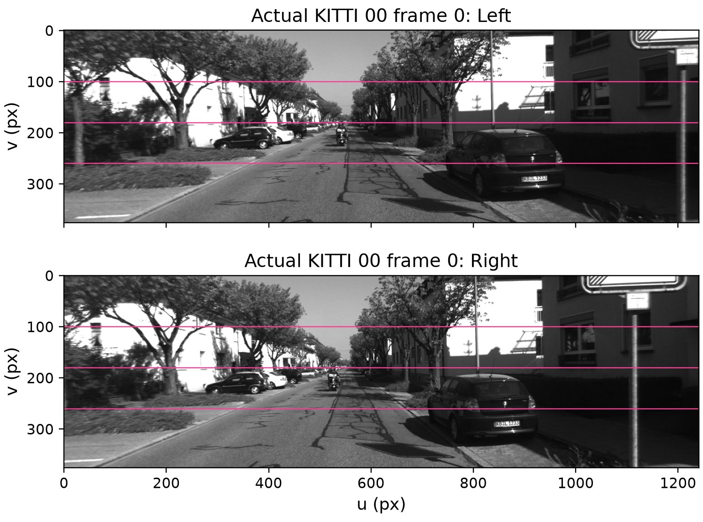

**그림 C1-03. 정류된 좌우 영상과 공통 행 (실제 KITTI 00).** 이미 정류된 좌우 입력에 같은 y선을 그렸다. raw 재정류를 수행한 그림이 아니다.

원본: `artifacts/stereo/000000.npz` (카메라 연구 디렉터리 기준; data/는 저장소 기준).

<a id="c1-9"></a>

### 9. 셔터: 한 프레임에 하나의 자세가 있는가

Global shutter, 전역 셔터는 영상의 행들이 공통 노출 구간을 갖는 모델이고, rolling shutter, 순차 셔터는 행에 따라 촬영 시간이 달라지는 모델이다.
순차 셔터 운동을 무시할 때의 문제와 행별 운동 모델은 관련 VO 연구의 대상이다. [Schubert·Demmel·Usenko·Stückler·Cremers, 2018](https://arxiv.org/abs/1808.00558)
KITTI 원 논문은 회색조·컬러 카메라를 global shutter로 명시한다. [KITTI 센서 논문](https://www.cvlibs.net/publications/Geiger2013IJRR.pdf)

행 번호 `v`, 기준 행 `v0`, 행당 시간 `tau`를 두면 대표 시각은 `t(v)=t0+(v-v0)tau`다.
`tau`의 단위는 s/row이며 위에서 아래로 읽는다는 가정도 명시해야 한다.
관측은 `p~K[R(t(v))|t_CW(t(v))]X_W`를 따른다.
식에서 `t(v)`는 시각이고 `t_CW`는 병진 벡터이므로 이름을 혼동하지 않는다.
한 프레임의 모든 점을 같은 R과 병진으로 설명한다는 F/E 모델의 전제가 약해진다.
행간 시간차를 픽셀 노이즈로만 취급하면 위치에 따라 방향성 있는 잔차가 남을 수 있다.

[교육 예제 N4] 1001행의 첫 행과 마지막 행 중심 사이가 0.020s인 센서를 가정한다.
행 간격은 1000개이므로 `tau=0.020/1000=0.00002s=20us`다.
행 0과 500의 시간차는 `0.010s`다.
영상 속도가 일정한 `200px/s`라면 두 행의 대표 시각 차이에 따른 위치 차이는 `2px`다.
이는 합성 등속 모델이며 KITTI의 순차 셔터 변형을 측정한 값이 아니다.
전역 셔터 센서인 KITTI에서 같은 패턴을 보았다고 바로 rolling shutter 원인으로 결론내리지 않는다.

<a id="c1-10"></a>

### 10. 노출 시간과 모션 블러

셔터 유형과 노출 시간은 다른 축이다.
전역 셔터여도 노출 중 카메라가 움직이면 한 픽셀은 시간에 따라 달라지는 광량을 적분한다.
밝기 응답을 잠시 선형으로 두면 `I(u) ∝ integral L(u,t) dt`다.
영상상 이동 속도가 `v_img px/s`, 노출이 `Delta_t s`이면 등속 블러 길이는 `l≈|v_img|Delta_t px`다.
이 식은 등속·국소 평행 이동 근사이며 가림이나 회전의 공간적 차이는 생략한다.
전역 셔터는 행별 자세 차이를 줄이지만 시간 적분 자체를 없애지는 않는다. [영상 형성의 광도 모델과 관련 한계](https://arxiv.org/pdf/1607.02565)

[교육 예제 N5] 정면 점의 깊이 10m, 카메라 횡속도 2m/s, 초점거리 500px를 가정한다.
회전과 깊이 변화가 없으면 영상 속도 크기는 `500*2/10=100px/s`다.
노출 0.010s에서는 블러 길이가 1px, 0.002s에서는 0.2px다.
노출을 줄이면 블러는 줄어도 수광량이 감소한다는 별도 문제가 남는다.
이 예제의 속도·깊이·노출은 KITTI에서 읽은 값이 아니다.

<a id="c1-11"></a>

### 11. 방사 응답: 같은 물체가 같은 픽셀값을 갖지 않는 이유

DSO, Direct Sparse Odometry, 직접 희소 오도메트리는 노출·비네팅·비선형 응답을 포함하는 광도 모델을 사용한다. [Engel·Koltun·Cremers](https://arxiv.org/pdf/1607.02565)
Radiometry는 물리적 광 에너지의 측정·모델링을 다루며, 영상처리의 photometric calibration은 밝기 관측의 일관성을 보정하는 작업을 가리킨다.
이 절의 상대 밝기 보정은 절대 물리 광량 단위의 센서 인증과 같지 않다. [저자들의 광도 보정 자료](https://cvg.cit.tum.de/research/vslam/photometric-calibration)

[자체 모델] `I=g(e V L)+noise`라고 쓰자.
`I`는 저장 픽셀값, `g`는 카메라 응답, `e`는 노출 시간, `V`는 위치별 감쇠, `L`은 상대 조사량이다.
`V`는 무차원이고 `e`는 s다.
`L`에 절대 광량 단위를 붙이려면 센서 이득 등 추가 보정이 필요하므로 여기서는 상대 단위/s로 둔다.
`g`가 역함수를 갖고 포화가 없다면 `g^(-1)(I)/(e V)`가 상대 조사량을 복원한다.
8비트 최대값으로 잘린 관측은 역함수 하나로 원래 광량을 되찾을 수 없다.
자동 노출·이득·화이트밸런스가 달라지면 단순 밝기 불변성은 약해질 수 있다.
비네팅은 주변부 감쇠이며 광선 좌표를 바꾸는 기하 왜곡과 구분한다.

[교육 예제 N6] 선형 응답, `L=10000 상대단위/s`, `V=0.8`, `e=0.01s`이면 `I=80`이다.
같은 물체를 `e=0.02s`로 찍으면 `I=160`이다.
원시 차이는 80이지만 노출·감쇠로 나누면 두 값 모두 10000이다.
노출 0.04s의 이상적 값은 320이며 8비트 상한 255로 포화되었다고 가정하자.
그 값을 보정하면 `255/(0.04*0.8)=7968.75`로 실제 상대값보다 작다.
이 차이는 기하 추정이 틀려서가 아니라 정보가 이미 잘렸기 때문이다.

<a id="c1-12"></a>

### 12. 컬러와 회색조

RGB는 Red, Green, Blue의 세 색 채널이고 OpenCV에는 채널 순서를 구분하는 색 변환이 있다.
문서의 일반 RGB→회색조 식은 `Y=0.299R+0.587G+0.114B`다. [OpenCV 색 변환](https://docs.opencv.org/4.13.0/de/d25/imgproc_color_conversions.html)

회색조 변환은 3차원 색 관측을 하나의 밝기 값으로 압축한다.
같은 Y를 갖는 서로 다른 색은 압축 후 구분하기 어려워지므로 컬러 경계가 모두 보존되는 것은 아니다.
반대로 세 채널을 모두 쓴다고 모든 기하 추정이 좋아지는 것도 아니다.
조명 스펙트럼·화이트밸런스·채널별 잡음·보간 특성이 잔차 모델에 영향을 줄 수 있기 때문이다.
위 계수 식의 Y를 원시 센서 광자 수나 정확한 선형 방사량으로 자동 해석하지 않는다.
이미 감마나 색 처리를 거친 RGB 값이면 그 처리까지 고려해야 한다.
KITTI `image_0`은 컬러 `image_2`를 단순 회색조 변환한 동일 광학 관측이 아니라 별도 회색조 카메라 영상이다. [KITTI 구성](https://www.cvlibs.net/datasets/kitti/setup.php)

[교육 예제 N7] RGB `(100,150,200)`의 가중 회색조 값은 `29.9+88.05+22.8=140.75`다.
정수 영상의 최종 반올림은 구현 규약에 따라 확인한다.
RGB와 BGR을 혼동하여 R과 B를 바꾸면 `59.8+88.05+11.4=159.25`다.
차이 18.5는 장면 운동이 아니라 채널 해석 오류로 생긴다.

<a id="c1-13"></a>

### 13. 어안·RGB-D는 대체 모델의 개념으로만

OpenCV의 어안 모델은 각도에 대한 왜곡 다항식을 사용하는 별도 모델이다. [OpenCV fisheye](https://docs.opencv.org/4.13.0/db/d58/group__calib3d__fisheye.html)
RGB-D의 D는 Depth, 깊이이며 색과 깊이 관측을 결합하는 설정이다. ORB-SLAM2는 단안·스테레오·RGB-D를 별도 입력 형태로 다룬다. [Mur-Artal·Tardós, 사전공개 2016](https://arxiv.org/abs/1610.06475)

어안을 “큰 k1 하나를 넣은 핀홀”로 단순화하지 않는다.
광선 추출을 올바르게 할 수 있는 중앙투영 어안에서는 광선 기반 기하를 연결할 수 있지만 원시 어안 픽셀의 에피폴라 자취는 일반적으로 직선이 아니다.
핀홀 영상으로 재투영하면 사용 가능한 시야와 표본 밀도도 바뀐다.
본 저장소가 어안 보정·광선 변환·추적을 지원한다고 확인한 것은 아니다.

깊이 센서의 출력이 광축 깊이 `Z`인지 카메라 중심까지의 거리 `rho`인지 먼저 구분한다.
전자는 `X=Z q`, 후자는 `X=rho b`로 역투영한다.
깊이 단위 배율, 무효값, 컬러와 깊이의 외부 보정·시간차가 필요하다.
깊이를 제공한다고 반사면·가림·거리 한계까지 해결되는 것은 아니다.
이번 교재에서는 RGB-D 실제 장치의 측정 방식·정확도·SLAM 성능을 검증하지 않았다.

<a id="c1-14"></a>

### 14. 연습문제와 해설

#### 문제 1. 픽셀과 광선

문제: `fx=400, fy=500, cx=300, cy=200`인 카메라에서 `(340,150)px`를 관측했다.
왜곡이 없을 때 정규화 좌표와 깊이 8m에서의 3D 점을 구하라.
해설: `x=(340-300)/400=0.1`, `y=(150-200)/500=-0.1`이다.
따라서 q는 `(0.1,-0.1,1)`, 3D 점은 `(0.8,-0.8,8)m`다.
검산: `400*0.8/8+300=340`, `500*(-0.8)/8+200=150`이다.
핵심: 음의 y는 카메라 위쪽을 가리키며, 깊이는 추가로 주어진 정보다.


#### 문제 2. 왜곡의 단위

문제: `q=(0.3,0.4,1)`, `k1=-0.1`, 나머지 계수는 0, `fx=fy=600px`, 주점은 원점이다.
왜곡 전·후 픽셀을 구하라.
해설: `r2=0.25`, `L=0.975`, 왜곡 정규화 좌표는 `(0.2925,0.39)`다.
왜곡 전 `(180,240)px`, 후 `(175.5,234)px`이므로 변화는 `(-4.5,-6)px`다.
핵심: 0.3과 0.4 대신 180과 240을 반지름 식에 넣으면 다른 모델이 된다.


#### 문제 9. 셔터와 블러를 구분하기

문제: 전역 셔터에서 영상 속도 150px/s, 노출 8ms라면 등속 블러 길이는 얼마인가?
같은 계산만으로 순차 셔터의 첫 행-마지막 행 변형을 알 수 있는가?
해설: `150*0.008=1.2px`다.
행간 변형에는 추가로 전체 판독 시간과 방향, 행별 자세가 필요하므로 알 수 없다.
핵심: 노출 시간과 프레임 판독 시간은 서로 다른 변수다.


#### 문제 11. RGB-D의 깊이 정의

문제: `q=(0.6,0,1)`에서 센서가 광축 깊이 5m를 줄 때와 광선 거리 5m를 줄 때의 점은 같은가?
해설: 광축 깊이면 `(3,0,5)m`이고 원점까지 거리는 `sqrt(34)≈5.830951895m`다.
거리이면 `5q/sqrt(1.36)≈(2.572478777,0,4.287464629)m`다.
핵심: 깊이 파일의 숫자와 단위만으로는 역투영 의미가 완성되지 않는다.


#### 문제 12. 광도 보정과 포화

문제: 선형 응답에서 같은 표면의 픽셀값이 60과 120이고 노출이 각각 5ms와 10ms다.
비네팅이 같고 1일 때 운동이 없다는 광도 가정과 모순되는가?
해설: 두 상대 조사량은 `60/0.005=12000`, `120/0.010=12000`으로 같다.
원시 밝기 차이만으로 움직임이나 오대응을 결론낼 수 없다.
포화되거나 응답이 비선형이면 이 단순 나눗셈의 가정을 다시 확인해야 한다.

<a id="c1-15"></a>

### 15. 이 장에서 확인한 것과 다음 질문

합성 왜곡 역변환은 이미 알려진 계수를 거꾸로 적용한 검사이지 실제 렌즈 보정 성능이 아니다. 실제 KITTI 보정 패턴 촬영, 어안 보정, 순차 셔터 추정은 수행하지 않았다. 다음 C2에서는 두 광선의 관계를 제약하는 F/E와 평면의 H를 구분한다. Zhang의 보정 논문을 읽은 뒤 Hartley의 정규화 8점법으로 넘어가면 보정과 수치 정규화가 다른 작업임을 확인할 수 있다.


<a id="c2"></a>

## C2. F·E·H와 삼각측량: 대응점을 운동과 구조로 바꾸기

한 대응점으로 다른 영상의 정확한 점을 예측할 수 있는지부터 묻는다. 일반 3D 장면에서는 점이 에피폴라 직선을 정하고, 평면 또는 순수 회전에서는 호모그래피가 점을 점으로 보낸다. 이 장은 A6의 rank·SVD, A7–A8의 불확실성을 실제 기하 제약에 연결한다.

<a id="c2-1"></a>

### 1. 한 대응점은 왜 에피폴라 직선만 정하는가

첫 카메라를 기준으로 `X_2=R_21 X_1+t_21`을 둔다.
편의상 아래에서는 첨자 21을 생략하고 `R,t`라고 쓴다.
깊이를 모르는 점은 `X_1=lambda1 q1`, `X_2=lambda2 q2`로 쓸 수 있다.
그러면 `lambda2 q2=lambda1 R q1+t`다.
세 벡터 `q2`, `Rq1`, `t`는 한 평면에 있으므로 스칼라 삼중곱이 0이다.

```text
q2^T (t cross Rq1) = 0
[t]_x = [  0 -tz  ty]
        [ tz   0 -tx]
        [-ty  tx   0]
E = [t]_x R
q2^T E q1 = 0
```

`cross`는 두 벡터에 수직인 벡터를 만드는 외적이고 `[t]_x`는 그 연산을 행렬로 표현한 것이다.
첫 광선과 두 카메라 중심을 포함하는 평면을 epipolar plane, 에피폴라 평면이라 부른다.
그 평면이 다른 영상면과 만나는 선이 epipolar line, 에피폴라 직선이다.
깊이를 모르는 첫 점은 두 번째 영상에서 일반적으로 한 선 위에만 제한된다.
에피폴라 제약은 그 선의 어느 위치인지까지 말해 주지 않는다. [기본 두 시점 관계](https://wcours.gel.ulaval.ca/GIF4105/tps/tp4/hartley.pdf)

<a id="c2-2"></a>

### 2. E와 F의 관계를 빠짐없이 전개하기

왜곡이 제거된 픽셀에서 `q1=K1^(-1)p1`, `q2=K2^(-1)p2`다.
앞 식에 대입하면 `p2^T K2^(-T) E K1^(-1)p1=0`이다.
따라서 `F=K2^(-T) E K1^(-1)`, 반대로 `E=K2^T F K1`이다.
E는 Essential matrix, 본질행렬로 보정된 광선의 상대 기하를 표현한다.
F는 Fundamental matrix, 기본행렬로 픽셀 좌표의 에피폴라 기하를 표현한다. [공식 F/E 인터페이스와 수식](https://docs.opencv.org/4.13.0/d9/d0c/group__calib3d.html)

`l2=F p1=[a,b,c]^T`이면 두 번째 영상의 직선은 `a u2+b v2+c=0`이다.
카메라 중심을 다른 영상으로 투영한 epipole, 에피폴은 모든 에피폴라 직선이 만나는 점이다.
그 점은 영상 밖이나 무한원에 있을 수도 있어 항상 이미지 내부에서 교차하는 것으로 그리지 않는다.
`F e1=0`, `F^T e2=0`의 좌우 영공간 관계는 방향 규약과 함께 기억한다.
F와 E는 비율까지 정의되므로 원소 값 자체에 픽셀 또는 미터 한 가지 단위를 일괄 부여하지 않는다.
특히 E를 두 배로 해도 에피폴라 식은 같으므로 E의 크기로 이동 거리를 읽을 수 없다.

<a id="c2-3"></a>

### 3. 자유도·rank·특이값은 어떤 정보를 말하는가

일반 3x3 행렬에는 원소 9개가 있다.
F는 전체 배율이 무의미하므로 8개에서 시작하고 `det(F)=0`이라는 제약으로 일반적으로 7자유도를 가진다.
일반 두 시점의 F는 rank 2이며, rank는 독립 열 또는 행의 수다.
E는 회전의 3자유도와 병진 방향의 2자유도를 합한 5자유도다.
병진 벡터는 3성분이지만 크기는 관측되지 않아 방향에는 두 값만 필요하다.
이 자유도 계산은 일반적인 비퇴화 조건에 대한 설명이지 모든 데이터에서 추정이 가능하다는 보장은 아니다. [Hartley](https://wcours.gel.ulaval.ca/GIF4105/tps/tp4/hartley.pdf), [Nistér 원문](https://www-users.cse.umn.edu/~hspark/CSci5980/nister.pdf)

SVD는 Singular Value Decomposition, 특이값 분해이며 `M=U diag(s1,s2,s3)V^T`다.
`U,V`는 직교행렬, `s_i`는 비음수 특이값이다.
이상적인 E의 특이값은 `(s,s,0)` 형태다.
이는 `[t]_x`가 t에 수직인 평면의 두 방향에 같은 크기의 작용을 하고 t 방향은 0으로 보내기 때문이다.
`t≠0`일 때 오른쪽 영공간의 비영 벡터는 `R^T t`다. 실제로 `E(R^T t)=[t]_x R R^T t=[t]_x t=0`이다.
즉 병진 방향을 첫 카메라 좌표로 표현한 `R^T t`는 E가 0으로 보내는 방향이며, “모든 방향에 대한 거리 정보가 있다”는 뜻이 아니다.
잡음 추정치를 `(평균(s1,s2), 평균(s1,s2),0)`으로 투영하는 것은 행렬 제약 보정이며, 픽셀 재투영의 최적화와 같지 않다.

<a id="c2-4"></a>

### 4. 실제 부호를 확인하는 두 시점 예제

[교육 예제 N8] 첫 카메라 중심은 `(0,0,0)m`, 두 번째 중심은 `(1,0,0)m`, 회전은 동일하다고 하자.
두 번째 카메라에서 점을 표현하면 `X_2=X_1-(1,0,0)`이므로 `R=I,t=(-1,0,0)m`다.
점 `X_1=(2,1,5)m`는 `q1=(0.4,0.2,1)`, `q2=(0.2,0.2,1)`로 보인다.

```text
E = [0 0  0]
    [0 0  1]
    [0 -1 0]
E q1 = (0,1,-0.2)^T
q2^T E q1 = 0.2 - 0.2 = 0
```

`fx=fy=500px, cx=320px, cy=240px`이면 `p1=(520,340,1)`, `p2=(420,340,1)`이다.
같은 행에 나타나지만 가로로 100px 차이가 난다.
이 경우 F의 편리한 비율 표현은 `[[0,0,0],[0,0,1],[0,-1,0]]`이며 직선은 `v2=340`이다.
이는 E와 F가 일반적으로 같다는 뜻이 아니라 이 단순한 K/R/t에서 행렬 배율이 흡수된 특수 예다.
카메라는 +X로 이동했지만 좌표변환의 t는 -X라는 점이 핵심이다.

<a id="c2-5"></a>

### 5. H: 평면 또는 순수 회전이 주는 점 대 점 관계

H는 Homography, 호모그래피 또는 사영변환 행렬이다.
평면을 첫 카메라 좌표에서 `n^T X_1=d`로 정의하고 `||n||=1`로 둔다.
`n`은 무차원 법선, `d`는 부호 있는 길이이며 이 식의 부호 규약이 중요하다.
평면 위에서는 `t=(t n^T/d)X_1`이므로 `X_2=(R+t n^T/d)X_1`다.
따라서 `p2~K2(R+t n^T/d)K1^(-1)p1`이고 이 행렬이 H다.
다른 책의 평면 식이 `n^T X+d=0`이면 부호가 바뀌므로 식만 복사해서 비교하지 않는다. [평면 기하 및 H의 사용 맥락](https://www.microsoft.com/en-us/research/wp-content/uploads/2016/02/tr98-71.pdf)

H는 비율을 제외하면 일반적으로 8자유도이며 일반 위치의 점 네 쌍이 최소 선형 제약을 줄 수 있다.
반면 F는 한 점을 다른 점이 아니라 선으로 보낸다.
H의 대응점 직접 예측이 잘 맞는다고 항상 넓은 3D 장면의 깊이가 잘 관측되는 것은 아니다.
순수 회전이면 `t=0`이므로 `H=K2 R K1^(-1)`가 깊이와 무관하게 성립한다.
이때 E는 영행렬이므로 E로부터 유효한 병진 방향을 복원할 수 없다.
물체 평면과 순수 회전은 모두 H가 맞을 수 있지만 물리적 상황은 다르다.

[교육 예제 N9] N8의 운동에서 `Z=5m` 평면은 `n=(0,0,1), d=5`다.
정규화 호모그래피는 `Hn=[[1,0,-0.2],[0,1,0],[0,0,1]]`다.
`Hn q1=(0.2,0.2,1)`로 앞의 q2를 재현한다.
픽셀에서는 `Hp=[[1,0,-100],[0,1,0],[0,0,1]]`이 된다.
깊이 10m의 점에는 실제 가로 변화가 -50px이므로 같은 H를 적용하면 50px 오차가 난다.
평면에 맞는 H를 장면 전체의 카메라 운동 그 자체로 해석하면 안 되는 이유다.

<a id="c2-6"></a>

### 6. 정규화 8점법의 입력 행을 직접 만들기

Hartley의 정규화 8점법은 좌표의 평행이동·척도 조절을 통해 수치 조건을 개선한다.
논문 제목은 1997년 저널판 기준 *In Defense of the Eight-Point Algorithm*이다. [원문](https://wcours.gel.ulaval.ca/GIF4105/tps/tp4/hartley.pdf)

`p1=(u,v,1)`, `p2=(u',v',1)`이고 F 원소를 행 우선으로 펼친 벡터를 f라 하자.
`p2^T F p1=0`을 전개하면 아래 한 행이 생긴다.

```text
f = [F11,F12,F13,F21,F22,F23,F31,F32,F33]^T
A_i = [u'*u, u'*v, u', v'*u, v'*v, v', u, v, 1]
A f = 0
minimize ||A f||^2 subject to ||f||=1
```

벡터화 순서를 열 우선으로 바꾸면 A의 열 순서도 바꾸어야 한다.
`||f||=1`은 모든 원소가 0인 무의미한 해를 막는 게이지 선택이다.
잡음이 있으면 정확히 0이 되는 해가 없으므로 가장 작은 특이값에 대응하는 오른쪽 특이벡터를 사용한다.
정확히 8개 대응의 A는 8x9이므로 full SVD의 9번째 오른쪽 특이벡터가 필요할 수 있다.
축소형 SVD가 8개의 오른쪽 벡터만 반환하면 원하는 영공간 벡터를 놓칠 수 있다.
이 부분은 교육 구현자가 배열 shape를 검사해야 하는 지점이지 여기서 새 코드를 구현한 것은 아니다.

정규화 변환은 각 영상에서 독립적으로 계산한다.
점 평균을 `mu=(mu_u,mu_v)`, 평균 유클리드 거리를 `dbar`라 한다.
`a=sqrt(2)/dbar`, `T=[[a,0,-a mu_u],[0,a,-a mu_v],[0,0,1]]`로 둔다.
모든 점이 같아 `dbar=0`이면 나누지 말고 추정을 거절한다.
변환된 점 `p_hat=T p`로 F_hat을 구하고 가장 작은 특이값을 0으로 만든다.
그 뒤 원래 좌표로 `F=T2^T F_hat T1`을 되돌린다.
역변환이 아닌 전치가 등장하는 이유는 `p_hat2^T F_hat p_hat1`에 `T1,T2`를 대입하면 바로 보인다.

[교육 예제 N10] 네 점 `(0,0),(2,0),(0,2),(2,2)`의 평균은 `(1,1)`이다.
각 점과 평균의 거리는 `sqrt(2)`이므로 `a=1`이다.
변환 후 점은 `(-1,-1),(1,-1),(-1,1),(1,1)`이다.
이 네 점 예제는 좌표 정규화만 검산하며 네 점으로 F를 구했다는 주장이 아니다.
별도로 `(u,v)=(2,3),(u',v')=(5,7)`이면 A 한 행은 `[10,15,5,14,21,7,2,3,1]`이다.

<a id="c2-7"></a>

### 7. 왜 5점법은 8점법에서 점만 줄인 것이 아닌가

Nistér의 방법은 보정된 두 영상의 다섯 대응에서 본질행렬 후보를 구하며 10차 다항식의 근을 이용한다.
다섯 대응만으로 항상 유일한 해가 생긴다고 주장하지 않는다. [Nistér 원문](https://www-users.cse.umn.edu/~hspark/CSci5980/nister.pdf), [2004년 저널 서지](https://pubmed.ncbi.nlm.nih.gov/18579936/)

정규화 광선의 에피폴라 식을 다섯 개 쌓으면 A는 5x9다.
일반적으로 rank가 5라서 영공간 차원은 `9-5=4`다.
네 기저 행렬을 `E1,E2,E3,E4`라고 하면 후보는 `E=a E1+b E2+c E3+d E4`다.
비율 자유도 때문에 한 좌표 영역에서는 `d=1`로 놓을 수 있으나 d가 0인 해의 처리는 별도로 고려해야 한다.
아무 선형 조합이나 E가 되지는 않으므로 다음 비선형 제약을 부과한다.

```text
det(E) = 0
2 E E^T E - trace(E E^T) E = 0
```

`trace`는 대각 원소의 합이다.
이 식은 E의 두 비영 특이값이 같다는 제약을 다항식 형태로 표현한다.
영공간 계수를 대입하면 미지수에 대한 다항식 문제가 된다.
실수 후보 여러 개가 나오면 각 후보를 전체 대응점으로 평가해야 한다.
복소근을 실제 회전·병진으로 해석하거나 첫 후보만 무조건 선택하면 안 된다.
이 교재는 소거 과정의 고차 계수표를 다시 구현하지 않고 입출력·다중 해·검증 이유를 가르친다.
따라서 “Nistér 5점법 완전 재현 코드”를 제공했다고 표현하지 않는다.

<a id="c2-8"></a>

### 8. RANSAC: 맞는 점의 수보다 모델과 잔차가 먼저다

RANSAC은 Random Sample Consensus, 무작위 표본 합의의 약칭이다.
작은 표본으로 후보 모델을 만들고 전체 관측이 그 모델을 얼마나 지지하는지 반복 평가한다. [Fischler·Bolles, 1981 원문](https://www.sri.com/wp-content/uploads/2021/12/ransac-publication.pdf)

하나의 대응이 inlier일 확률을 w, 표본 크기를 s라 하자.
독립 추출 근사에서 표본 전체가 inlier일 확률은 `w^s`다.
N번 모두 실패할 확률은 `(1-w^s)^N`이다.
적어도 한 번 성공할 목표 확률 p를 두면 `(1-w^s)^N≤1-p`다.
양변에 자연로그를 취하고 음수 분모를 나누면 부등호가 바뀌어 `N≥log(1-p)/log(1-w^s)`다.
최종 반복 수는 정수 올림을 한다.
유한 집합에서 비복원 표본을 뽑는 정확한 확률은 조합 비율이며 `w^s`는 널리 쓰는 근사다.
또한 inlier만 뽑아도 퇴화한 배치라면 유효한 모델이 안 나올 수 있다.

[교육 예제 N11] `w=0.5,p=0.99`로 둔다.
5점 표본은 `log(0.01)/log(1-0.5^5)≈145.05`이므로 최소 146회다.
8점 표본은 약 1176.62이므로 최소 1177회다.
표본이 작으면 이 조건의 반복 수는 줄지만 후보 계산 비용·다중 해·데이터 조건까지 자동으로 좋아지지는 않는다.
`p=0.99`는 모델이 맞을 사후확률이 아니라 가정된 표본 추출 성공 확률이다.
동적 물체에 대응점이 집중되면 높은 합의 점수로 잘못된 장면 운동을 선택할 수 있다.

<a id="c2-9"></a>

### 9. 잔차를 정의하지 않은 1px 문턱은 불완전하다

직선 `l=(a,b,c)`와 점 `(u,v)`의 부호 없는 수직 거리는 `|au+bv+c|/sqrt(a^2+b^2)`다.
분모는 직선 계수의 임의 배율을 상쇄한다.
`a=b=0`이면 유효한 영상 직선이 아니므로 거리를 계산하지 않는다.
단순 대수 잔차 `p2^T F p1`는 F의 배율에 따라 바뀌어 직접 픽셀 거리로 쓰기 어렵다.

Sampson 근사 제곱거리는 다음과 같다.

```text
r = p2^T F p1
dS2 = r*r / ((F p1)_1^2 + (F p1)_2^2
             + (F^T p2)_1^2 + (F^T p2)_2^2)
```

이 식은 에피폴라 제약의 1차 선형화로 두 영상 관측의 작은 보정을 근사한다.
`dS2`는 픽셀 좌표 입력에서 px²이며 제곱하지 않은 문턱과 혼동하지 않는다.
에피폴 부근처럼 분모가 작거나 큰 잡음이면 근사의 품질을 확인해야 한다. [OpenCV Sampson 정의](https://docs.opencv.org/4.13.0/d9/d0c/group__calib3d.html)

[교육 예제 N12] N8의 F에서 첫 점의 v는 340, 두 번째 관측의 v는 342라고 하자.
`r=2`, 두 직선의 법선 제곱합은 2이므로 `dS2=2px²`, `sqrt(dS2)=sqrt(2)px`다.
한쪽 점에서 직선까지 거리는 2px다.
동일 대응에도 두 잔차의 값이 다르므로 문턱 1이라는 숫자만 기록해서는 재현할 수 없다.
초점거리 500px의 등방성 카메라에서는 작은 픽셀 오차 1px가 정규화 좌표 약 0.002에 해당한다.
`fx≠fy`라면 두 축의 불확실성도 다르므로 한 스칼라 변환이 항상 충분하지 않다.

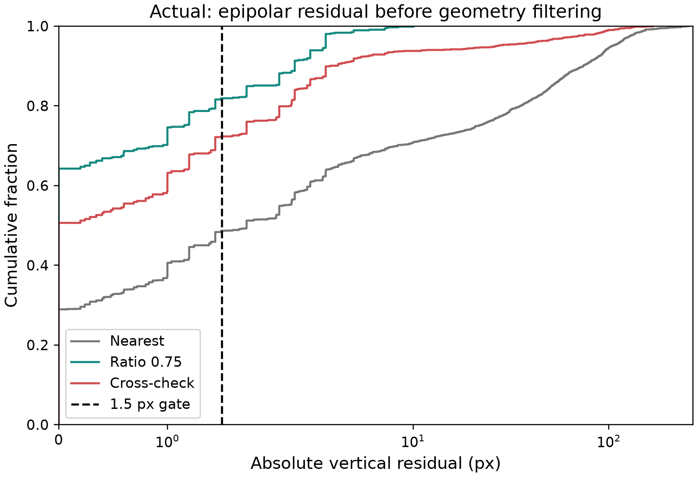

**그림 C2-01. 정류 잔차의 누적 분포 (실제 KITTI 00).** 게이트 전 y 오차의 누적 분포. 게이트 후 100% 일관성은 정의에 따른 결과이지 정확도 검증이 아니다.

원본: `artifacts/stereo/000000.npz` (카메라 연구 디렉터리 기준; data/는 저장소 기준).

<a id="c2-10"></a>

### 10. E 분해와 네 가지 자세 후보

제약을 만족하는 E의 SVD를 `U diag(s,s,0)V^T`라고 하자.
회전 후보를 구성할 때 determinant가 +1이 되도록 U/V의 부호 관례를 정리한다.
`W=[[0,-1,0],[1,0,0],[0,0,1]]`를 두면 회전은 `U W V^T` 또는 `U W^T V^T`다.
병진 방향은 U의 세 번째 열을 사용하며 부호 두 가지가 가능하다.
따라서 일반적으로 `(R1,+t),(R1,-t),(R2,+t),(R2,-t)`를 검사한다. [E 분해 및 recoverPose](https://docs.opencv.org/4.13.0/d9/d0c/group__calib3d.html)

Cheirality는 복원 점이 카메라 앞에 있는지를 보는 조건을 가리킨다.
우리 좌표에서는 `Z1>0`과 `(R X1+t)_z>0`를 동시에 요구한다.
점이 두 카메라 앞에 있다는 조건은 관측의 물리적 유효성을 확인하지만 충분한 깊이 정확도를 보장하지 않는다.
두 광선이 거의 평행하면 작은 픽셀 잡음으로 앞·뒤 판정이 바뀔 수 있다.
따라서 양의 깊이 개수뿐 아니라 시차·재투영 잔차·후보 간 우세성도 보아야 한다. [ORB-SLAM 초기화 절](https://arxiv.org/pdf/1502.00956)

<a id="c2-11"></a>

### 11. 삼각측량을 네 행의 선형식으로 만들기

Triangulation, 삼각측량은 알려진 카메라 기하와 대응 관측에서 3D 점을 구한다.
잡음이 있으면 두 광선은 보통 정확히 만나지 않으며, 어떤 오차를 최소화할지 정해야 한다. [Hartley·Sturm, 1997](https://users.cecs.anu.edu.au/~hartley/Papers/triangulation/triangulation.pdf)

`p~P X_h`에서 동차 배율을 제거하려면 `p cross (P X_h)=0`을 쓴다.
세 식 중 독립인 두 식을 선택하면 `u P3 X_h-P1 X_h=0`, `v P3 X_h-P2 X_h=0`다.
두 카메라에서 각각 두 행을 쌓아 4x4 행렬 A를 만든다.
P1/P2라는 표기가 카메라 번호인지 행 번호인지 혼동하지 않도록 아래는 `P_cam[row]`로 쓴다.

```text
A = [u1*P_cam1[3] - P_cam1[1]]
    [v1*P_cam1[3] - P_cam1[2]]
    [u2*P_cam2[3] - P_cam2[1]]
    [v2*P_cam2[3] - P_cam2[2]]
A X_h = 0
X = X_h[1:3] / X_h[4]        # 여기의 첨자는 수학적 1부터 시작
```

이 방식은 DLT, Direct Linear Transformation, 직접 선형 변환의 형태다.
`X_h[4]`가 거의 0이면 매우 먼 점이거나 불안정한 복원일 수 있으므로 무조건 나누지 않는다.
정규화 광선을 사용하면 카메라 행렬도 `[I|0]`, `[R|t]`로 맞춘다.
픽셀 관측이면 `K[I|0]`, `K[R|t]`를 사용한다.
정규화 점과 K가 포함된 P를 혼합하면 K를 두 번 적용한 셈이 된다.

<a id="c2-12"></a>

### 12. 삼각측량의 손계산과 오차 함수

[교육 예제 N13] N8의 카메라에서는 `X/Z=0.4`, `(X-1)/Z=0.2`다.
두 식을 빼면 `1/Z=0.2`, 따라서 `Z=5m`다.
`X=0.4*5=2m`, `Y=0.2*5=1m`로 원래 점을 복원한다.
만약 같은 관측에 대해 병진 부호만 반대로 쓰면 `Z=-5m`가 되어 앞쪽 조건을 위반한다.
이 계산은 한 후보의 부호 오류를 확인하는 예이지 일반 E 분해의 모든 모호성을 하나의 점으로 해결한다는 뜻은 아니다.

DLT는 동차식의 대수 잔차를 작게 하며, 영상에서 측정된 오차를 직접 최소화하지는 않는다.
재투영 정련의 목적함수는 `sum_j ||p_j(2D)-pi(P_j X_h)||^2`다.
`pi`는 세 번째 성분으로 나누어 2D 좌표를 만드는 함수다.
관측 공분산이 서로 다르면 각 잔차를 해당 공분산으로 가중할 수 있다.
두 광선의 최단 선분 중점을 택하는 방법도 있지만 그 3D 거리 목적이 픽셀 오차 목적과 항상 같지는 않다. [Hartley·Sturm](https://users.cecs.anu.edu.au/~hartley/Papers/triangulation/triangulation.pdf)

<a id="c2-13"></a>

### 13. 시차와 관측 가능성

두 카메라의 광선을 같은 좌표계로 옮겨 `b1`과 `R^T b2`의 각도를 본다.
`theta=acos(clamp(b1^T R^T b2,-1,1))`이며 theta 단위는 rad다.
`clamp`는 반올림 오차로 내적이 ±1을 조금 넘어갈 때 정의역을 보장한다.
작은 theta는 두 광선이 거의 평행하다는 뜻으로, 깊이 방향 위치가 작은 영상 오차에 민감해진다.
보이는 픽셀 이동 전체를 시차로 보면 회전으로 생긴 이동까지 깊이 정보로 오해하게 된다.
회전 효과를 분리한 광선의 교차각을 보아야 한다. [초기화의 시차 검사 근거](https://arxiv.org/pdf/1502.00956)

[교육 예제 N14] 첫 광선이 Z축이고 두 번째 카메라가 횡방향 0.2m에 있는 특수 배치를 생각한다.
깊이 10m이면 `theta=atan(0.2/10)≈0.019997334rad≈1.145763도`다.
깊이 100m이면 `theta≈0.001999997rad≈0.114591도`다.
깊이가 10배 늘자 각도는 약 10분의 1이 되었다.
점이 멀어도 회전 관측에 유용할 수 있지만 정밀 깊이와 병진 크기의 정보는 약할 수 있다.

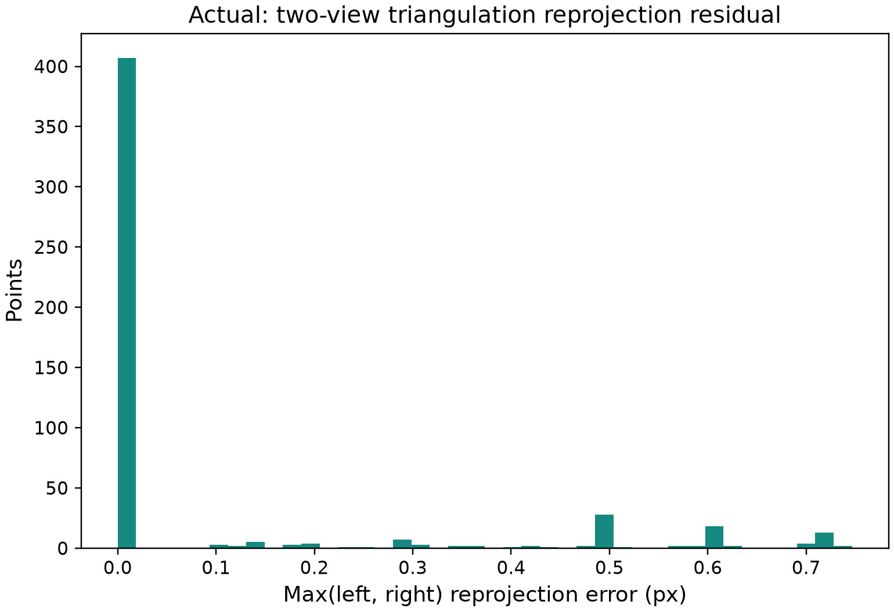

**그림 C2-02. 삼각측량 점을 양안에 다시 투영하기 (실제 KITTI 00).** 두 시점 재투영은 입력과의 자기 일관성이다. 작은 잔차만으로 올바른 대응이나 깊이를 보장하지 않는다.

원본: `artifacts/stereo/000000.npz` (카메라 연구 디렉터리 기준; data/는 저장소 기준).

<a id="c2-14"></a>

### 14. 연습문제와 해설

#### 문제 3. F 잔차와 점-선 거리

문제: 한 에피폴라 직선이 `3u+4v-100=0`이고 관측이 `(20,12)px`다.
수직 거리와 직선 계수를 두 배로 했을 때의 거리를 구하라.
해설: 분자는 `|60+48-100|=8`, 분모는 `sqrt(9+16)=5`다.
거리는 1.6px이며 계수를 두 배로 해도 `16/10=1.6px`다.
핵심: 대수 잔차 8은 모델 배율에 의존하지만 기하 거리는 그렇지 않다.


#### 문제 4. RANSAC 반복 수

문제: inlier 확률 0.6, 표본 크기 5, 목표 성공확률 0.99를 가정한다.
근사 반복 수를 구하고 그 수의 보장 범위를 설명하라.
해설: `0.6^5=0.07776`, `N=ceil(log(0.01)/log(0.92224))=57`이다.
이는 독립 표본 및 정확한 w 가정 아래 모두 inlier인 표본을 한 번 이상 뽑을 확률의 기준이다.
퇴화 표본·잘못된 잔차·동적 물체 우세 상황에서 정답 pose가 나온다는 보장은 아니다.


<a id="c3"></a>

## C3. 단안 초기화와 퇴화: 해가 나와도 깊이가 관측된 것은 아니다

첫 지도를 승인하려면 행렬의 존재뿐 아니라 양의 깊이, 시차, 후보의 모호성과 점의 분포를 판단해야 한다. 단안 한 지도의 공통 척도를 유지하는 일과 매 이동을 길이 1로 만드는 일은 다르다. 실제 mono_unit은 후자이며 완성된 단안 SLAM baseline이 아니다.

<a id="c3-1"></a>

### 1. 단안 척도 모호성을 식으로 증명하기

`p_ij~K_i(R_i X_j+t_i)`라는 보정된 단안 관측을 생각하자.
모든 점과 병진에 같은 양수 a를 곱하면 `K_i(R_i a X_j+a t_i)=a K_i(R_i X_j+t_i)`다.
동차좌표에서 a가 소거되므로 영상은 그대로다.
이것은 “센서가 충분히 정밀하면 해결되는 작은 오차”가 아니라 관측식의 구조적 모호성이다. [단안 상대 pose의 척도 한계](https://www-users.cse.umn.edu/~hspark/CSci5980/nister.pdf)

첫 카메라를 원점으로 고정하면 세계의 위치·방향 기준을 선택한 것이고, 기준선 길이를 1로 정하면 척도를 임의로 선택한 것이다.
둘 다 좌표계 선택이지 실제 미터 길이를 측정한 것은 아니다.
한 번 초기화한 지도의 공통 척도를 이후 2D-3D 관측으로 유지하는 것과, 모든 프레임 쌍의 병진 길이를 각각 1로 놓는 것은 다르다.
후자는 프레임별 실제 이동 거리의 비율도 잃어 하나의 전역 배율로 복구되지 않을 수 있다.

[교육 예제 N15] 첫 구간 실제 이동이 `(1,0)m`, 둘째가 `(0,2)m`이라고 하자.
각 병진을 단위 길이로 만들면 이동은 `(1,0)`, `(0,1)`이 된다.
실제 끝점은 `(1,2)m`, 단위 누적 끝점은 `(1,1)`이다.
첫 구간에 맞추려면 전역 배율 a=1, 둘째에 맞추려면 a=2가 필요하므로 하나의 a로 둘 다 맞출 수 없다.
정답 궤적을 이용한 사후 정렬은 입력 센서가 미터 척도를 알아냈다는 증거가 아니다.

<a id="c3-2"></a>

### 2. 초기화는 상태를 승인하는 절차다

처음 두 영상의 대응이 충분해도 바로 지도를 만들지 않는다.
먼저 유효 보정과 정적 장면 가정 아래 H와 F/E 중 어느 모델이 관측을 설명하는지 살핀다.
그다음 가능한 자세를 복원하고 각 자세에서 점을 삼각측량한다.
앞쪽에 있으면서 재투영 오차가 작고 충분한 시차를 가진 점이 공간적으로 분포하는지 확인한다.
서로 다른 후보가 비슷하게 그럴듯하면 정보를 더 모으는 것이 정당한 출력이다.
초기화를 유예하는 상태는 “프로그램이 아무것도 못함”과 구별해야 한다.

ORB-SLAM은 H와 F의 점수를 비교하는 초기화 정책과 복원 후보 검증을 제시했다.
논문의 `S_H/(S_H+S_F)>0.45`는 해당 점수 정의에 결합된 휴리스틱이며 모든 시스템의 보편적 상수는 아니다. [원문 초기화 절](https://arxiv.org/pdf/1502.00956)

이 점수를 단순 inlier 개수로 바꾸면서 0.45만 유지하면 원 정책을 재현한 것이 아니다.
여기서 H를 고른다고 “평면은 언제나 안정적으로 초기화된다”는 뜻도 아니다.
운동·평면의 모호성을 추가 관측으로 해소해야 하는 경우가 있다.
수용 후에는 BA, Bundle Adjustment, 묶음 조정으로 여러 자세와 점의 재투영 오차를 공동 정련하는 연결을 소개한다.
BA의 전체 유도는 C6에서 유도하고 별도 합성 장면에서 검증한다. 실제 KITTI에서는 pose-only 정련만 실행했다.

<a id="c3-3"></a>

### 3. 실패 사례를 관측 정보의 부족으로 설명하기

| 상황 | 약해지거나 깨지는 정보 | 교재의 판단 질문 |
|---|---|---|
| 순수 회전 | 병진·깊이의 관측 가능성 | 회전 보상 후 시차가 있는가? |
| 매우 작은 기준선 | 깊이 조건수 | 양의 깊이만 보고 통과시켰는가? |
| 멀리 있는 장면 | 병진에 대한 영상 감도 | 가까운 정적 점이 있는가? |
| 단일 평면 | 일반 F 추정의 독립성 | H 설명과 대안 pose를 비교했는가? |
| 점의 일직선 집중 | 추정 행렬의 rank/조건 | 점 수가 아니라 공간 분포가 충분한가? |
| 전진 운동의 중심부 점 | 중심 근처의 작은 시차 | 회전·주변부 광선·거리 분포를 보았는가? |
| 큰 동적 물체 | 단일 정적 장면 모델 | 다수 합의가 배경인지 확인했는가? |
| 잘못된 K/왜곡 | 관측 광선 | 영상 전처리와 K가 일치하는가? |
| 순차 셔터·블러 | 한 자세·한 광선 관측 근사 | 시간 형성 모델이 적합한가? |

위 표는 유도한 관측식에 대한 실패 분류이며 새 실험 결과가 아니다.
평면 퇴화와 낮은 시차는 ORB-SLAM 초기화 논의, 순차 셔터는 별도 행별 모델 연구와 연결된다. [ORB-SLAM](https://arxiv.org/pdf/1502.00956), [rolling-shutter VO](https://arxiv.org/pdf/1808.00558)
“전진 운동은 불가능하다”처럼 단정하지 않는다.
충분한 장면 구조와 분포가 있으면 관측할 수 있지만 일부 광선의 감도가 약해진다는 조건부 설명이 정확하다.

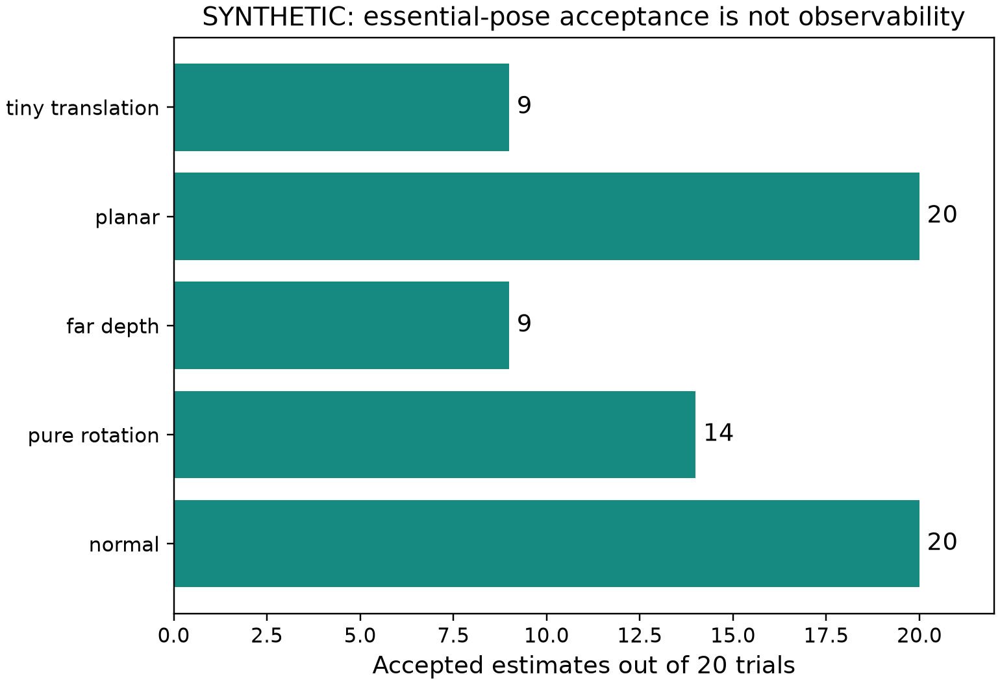

**그림 C3-01. 퇴화 장면에서 수용과 관측 가능성의 차이 (합성 교육 모델).** 순수 회전·작은 이동·먼 점·평면에서 accepted만으로 이동 방향의 신뢰성을 보장하지 않는다. PnP에는 합성 exact 3D를 주므로 공정한 stereo 비교가 아니다.

원본: `artifacts/synthetic/degeneracy.csv`, `artifacts/synthetic/degeneracy.npz` (카메라 연구 디렉터리 기준; data/는 저장소 기준).

<a id="c3-4"></a>

### 4. 수용률과 실패 hold를 분리한 합성 퇴화 검사

- 렌즈 계수 [-0.22,0.06,0.001,-0.0005,0]는 설명용 가정, 실제 KITTI 보정이 아니다.
- 가상 grid 최대 변위 83.7418847033159px, 알려진 모델 역변환 최대 오차 1.5956708065935117e-12px.
- disparity sigma=0.5px, 100m에서 선형 전파 sigma_Z=12.948510506939366m,
  깊이별 10000회 Monte Carlo 표준편차 14.182915498081321m. 비선형 변환 효과가 있다.
- 각 퇴화 조건 20회 E accepted: normal 20, pure_rotation 14, far_depth 9, planar 20, tiny_translation 9.
- pure_rotation에서 accepted 14회는 정상 이동 복원이 아니다. 병진이 없는데도 비영 이동을 추정하는 거짓 신뢰 사례다.
- planar accepted 20/20도 비퇴화 증명이 아니다. 방향/회전 오차 분포는 `synthetic/degeneracy.csv`를 함께 봐야 한다.
- 합성 PnP는 exact 3D를 받는다. 실제 stereo PnP 또는 단안과 공정한 성능 비교가 아니다.
- 합성 회전오차 summary는 `system_output_rotation_median_including_hold_deg`와
  `successful_estimate_rotation_median_deg`를 분리하고 `essential_accepted`/`essential_failed_hold`를 함께 기록한다.
  전자를 accepted만의 정확도로 인용하지 않는다. per-trial `E_accepted`도 CSV에 보존한다.

| 합성 조건 | 성공 / hold | 전체 출력 회전오차 중앙값 deg | 성공 추정만 중앙값 deg |
|---|---|---:|---:|
| normal | 20 / 0 | 0.3418 | 0.3418 |
| pure_rotation | 14 / 6 | 0.1087 | 0.0884 |
| far_depth | 9 / 11 | 1.4708 | 0.1505 |
| planar | 20 / 0 | 0.9543 | 0.9543 |
| tiny_translation | 9 / 11 | 1.4708 | 0.2154 |

전체 출력 통계는 실패 시 identity rotation의 오차를 포함한다. 성공 조건부 통계는 선택 편향이 있으므로 성공률과 함께 읽는다.
이 분리를 검증하는 회귀 테스트를 포함해 현재 19개 불변량 테스트가 통과한다.

<a id="c3-5"></a>

### 5. 연습문제와 해설

#### 문제 5. 척도 모호성

문제: 점 `(1,2,10)`과 병진 `(0.5,0,0)`을 모두 세 배로 하면 보정된 영상은 어떻게 되는가?
해설: `R(3X)+3t=3(RX+t)`이고 투영 때 Z로 나누면서 3이 소거된다.
따라서 같은 영상 관측을 얻는다.
미터 단위가 필요하면 알려진 기준선·실측 길이 등 추가 관측이 필요하다.
핵심: 더 많은 동일 종류의 무척도 관측만으로 절대 길이 기준이 자동 생성되지 않는다.


#### 문제 10. 양의 깊이만으로 충분한가

문제: 모든 삼각측량 점이 앞쪽에 있고 재투영 오차도 작지만 두 광선의 각도가 거의 0이다.
초기 지도를 바로 확정해도 되는가?
해설: 아니다. 작은 각도에서는 깊이를 크게 바꾸어도 픽셀 변화가 작을 수 있다.
시차, 깊이 불확실성, 후보 간 차이를 보고 관측을 더 모을 수 있어야 한다.
핵심: 물리적 유효성 검사와 수치적 안정성 검사는 별개다.


<a id="c4"></a>

## C4. 스테레오 깊이: 기준선에서 미터 척도를 전달하기

두 카메라의 간격을 알면 단안의 길이 모호성에 추가 관측이 생긴다. 그러나 미터 단위 출력과 정확한 깊이는 다른 속성이다. 이 장은 실제 ORB 대응의 선택, 삼각측량과 SGBM 진단을 분리하고 작은 시차의 불확실성을 끝까지 추적한다.

<a id="c4-1"></a>

### 1. 스테레오의 척도: 기준선에서 미터가 들어온다

왼쪽 중심을 원점, 오른쪽 중심을 `(B,0,0)`으로 두고 동일한 fx를 가정한다.
두 영상이 수평 정렬되었다면 `u_L=fx X/Z+cx_L`, `u_R=fx(X-B)/Z+cx_R`다.
관측 시차 `d=u_L-u_R`는 `fx B/Z+cx_L-cx_R`다.
주점 차이를 제거한 시차는 `d_eff=d-(cx_L-cx_R)`이며 `Z=fx B/d_eff`다.
`fx`와 `d_eff`가 px이므로 길이 단위는 B에서 온다. [정렬 투영·깊이 재구성](https://docs.opencv.org/4.13.0/d9/d0c/group__calib3d.html)

P의 마지막 열에서 `tx_i=P_i(1,4)/fx_i`를 읽을 수 있는 수평 정렬 형태라면 카메라 중심은 `Cx_i=-tx_i`다.
기준선은 `Cx_R-Cx_L`이므로 좌우 P 모두를 비교하는 것이 일반적이다.
왼쪽 마지막 열이 0인 경우에만 `B=-P_R(1,4)/fx`라는 단축식이 바로 나온다.
같은 K와 같은 주점이라는 가정을 깨뜨렸다면 단순 `Z=fB/d`로 되돌아가면 안 된다.

[교육 예제 N16] `fx=500px`, `B=0.2m`, `cx_L=320px`, `cx_R=315px`를 둔다.
왼쪽 관측 370px, 오른쪽 345px이면 `d=25px`, 주점 차이는 5px다.
`d_eff=20px`, `Z=500*0.2/20=5m`다.
주점 차이를 무시하면 `Z=100/25=4m`로 1m 작게 추정한다.
`X=(370-320)*5/500=0.5m`이고 오른쪽에서는 `500*(0.5-0.2)/5+315=345px`로 검산된다.

<a id="c4-2"></a>

### 2. 깊이 불확실성과 역깊이

`Z=fB/d_eff`를 시차로 미분하면 `dZ/dd_eff=-fB/d_eff^2`다.
다른 오차를 무시하고 작은 시차 표준편차를 `sigma_d`라 하면 `sigma_Z≈fB sigma_d/d_eff^2`다.
깊이 표현으로 바꾸면 `sigma_Z≈Z^2 sigma_d/(fB)`다.
같은 픽셀 정밀도에서도 먼 점의 깊이 오차가 빠르게 커진다.
역깊이 `rho=1/Z=d_eff/(fB)`를 쓰면 이 근사에서 `sigma_rho≈sigma_d/(fB)`다.
rho의 단위는 1/m이며, 먼 점의 rho가 0에 가까운 것이지 점 자체가 존재하지 않는 것은 아니다. [삼각측량 오차 목적의 배경](https://users.cecs.anu.edu.au/~hartley/Papers/triangulation/triangulation.pdf)

[교육 예제 N17] N16에서 `sigma_d=0.5px`를 가정한다.
`sigma_Z=100*0.5/20^2=0.125m`다.
깊이 10m이면 `d_eff=10px`, `sigma_Z=0.5m`다.
깊이가 두 배가 되어 표준편차는 네 배가 되었다.
이 계산은 K·기준선·정렬·상관 오차가 없다는 조건부 1차 근사다.
`sigma_d/d_eff`가 크면 깊이 분포의 비선형성이 강해져 대칭 오차 막대가 충분하지 않을 수 있다.


**그림 C4-01. 원거리 깊이의 비선형 불확실성 (합성 교육 모델).** 합성 disparity Gaussian sigma=0.5px. 원거리에서 비선형 변환 때문에 1차 근사와 Monte Carlo가 달라진다. KITTI 오차 추정이 아니다.

원본: `artifacts/synthetic/uncertainty.npz` (카메라 연구 디렉터리 기준; data/는 저장소 기준).

<a id="c4-3"></a>

### 3. 실제 보정값과 하나의 대응을 끝까지 계산하기

이미 정류된 P0=[K|0], P1=[K|(-fx*b,0,0)]를 읽는다. raw distortion을 추정하거나 raw 영상을 정류하지 않았다.
b=386.1448/718.856=0.5371657188644179m. 이상적인 같은 행 대응에서는 d=fx*b/Z, 즉 Z=fx*b/d.
실제 예제는 frame0의 candidate323: left=(956,161), right=(936,160), d=20px, dy=1px.
이상적 동일 행 모델 깊이는 19.30724m, 실제 OpenCV DLT 3D는
(9.368194026011457,-0.6638089660386813,19.306872628031506)m이다.
서로 다른 y 관측 때문에 DLT와 간단 공식의 마지막 자릿수가 다르며, 최대 양안 재투영 잔차는 0.5000097548414209px이다.
연습: disparity가 두 배이면 이상적 깊이는? 답: 절반 9.65362m. 코드 검증값은 `worked_examples/summary.json`.

Z=fx*b/d에서 abs(dZ/dd)=fx*b/d^2=Z^2/(fx*b). 따라서 sigma_Z≈Z^2*sigma_d/(fx*b).
candidate323과 d=20px, 가정 sigma_d=0.5px이면 sigma_Z=0.482681m.
실제 ORB의 정수/피라미드 양자화, 대응 오답, calibration 오차는 이 Gaussian 모델에 포함되지 않는다.
순수 회전에서 t 방향은 물리적으로 정의되지 않는다. E accepted flag는 observability 판정이 아니다.

<a id="c4-4"></a>

### 4. ORB 기술자의 선택과 정류 게이트

ORB는 Oriented FAST and Rotated BRIEF의 약자다. FAST는 밝기 비교로 코너 후보를 찾고,
BRIEF는 patch 내 픽셀쌍 밝기 비교를 binary descriptor로 만든다. ORB는 방향 정규화 등을 결합한다.
이 실험은 OpenCV ORB의 실제 keypoint/descriptor 출력만 사용하며 내부 FAST/Harris/BRIEF 배열을 재현했다고 주장하지 않는다.
Hamming 거리는 XOR에서 서로 다른 bit의 수. candidate323의 최근접=32bit, 차근접=47bit,
ratio=32/47=0.6808510638297872<0.75이고 Hamming<=64, abs(dy)<=1.5, d>1을 통과한다.
ratio는 모호성, Hamming은 절대 descriptor 차이, y는 정류 기하를 검사하는 서로 다른 조건이다.
cross-check는 서로가 서로의 최근접인 쌍이다. ratio의 동의어가 아니며 이번에는 더 많은 쌍을 남기지만 y 일관성 비율은 낮다.
연습: y gate를 통과한 쌍의 y 합격률이 100%라면 정확도인가? 답: 아니다. 같은 조건의 자기검사다.


**그림 C4-02. 스테레오 ORB 관측의 공간 분포 (실제 KITTI 00).** ORB는 2D 픽셀 관측이다. 특징점만으로 3D 지도나 ORB-SLAM이 되지 않는다.

원본: `artifacts/stereo/000000.npz` (카메라 연구 디렉터리 기준; data/는 저장소 기준).

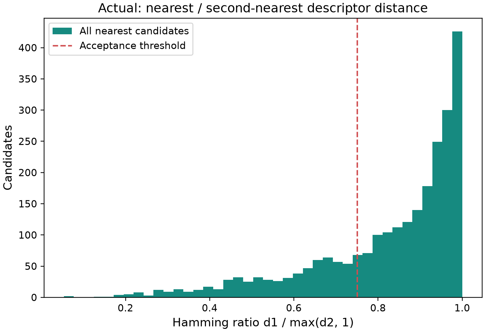

**그림 C4-03. 최근접과 차근접 기술자의 거리 비율 (실제 KITTI 00).** 이진 descriptor의 최근접/차근접 거리 비율. 실제 선택 조건은 d1 < 0.75*d2이며 d2=0은 거부된다.

원본: `artifacts/stereo/000000.npz` (카메라 연구 디렉터리 기준; data/는 저장소 기준).


**그림 C4-04. 기술자 유사도와 기하 일관성은 다르다 (실제 KITTI 00).** 작은 descriptor 거리도 기하 일관성을 보장하지 않는다. 60px 이상의 y 오차는 시각화에서만 잘랐다.

원본: `artifacts/stereo/000000.npz` (카메라 연구 디렉터리 기준; data/는 저장소 기준).


**그림 C4-05. 누적 게이트의 선택 효과 (실제 KITTI 00).** 동일 후보에 적용한 누적 게이트. 이 프레임에서는 Hamming 게이트의 추가 제거가 없으므로 개선을 주장하지 않는다.

원본: `artifacts/stereo/000000.npz`, `artifacts/stereo/000000_ablation.csv` (카메라 연구 디렉터리 기준; data/는 저장소 기준).

<a id="c4-5"></a>

### 5. 깊이 배열은 지도 후보이며 정답 표면이 아니다

선택된 대응의 disparity와 깊이를 함께 보면, 영상에서 비슷한 위치의 점도 서로 다른 깊이에 있을 수 있음을 확인한다. 다음 공간 그림은 단일 프레임 좌표의 희소 3D이며 여러 시점에 걸쳐 관리하는 지도는 아니다. 깊이 GT가 없으므로 작은 재투영 잔차를 깊이 정확도로 바꾸어 부르지 않는다.


**그림 C4-06. 시차에서 깊이로 바뀌는 관측 (실제 KITTI 00).** Z=fx*b/d. 깊이는 정답 오차가 아니라 알려진 baseline으로부터 얻은 추정값이다.

원본: `artifacts/stereo/000000.npz` (카메라 연구 디렉터리 기준; data/는 저장소 기준).

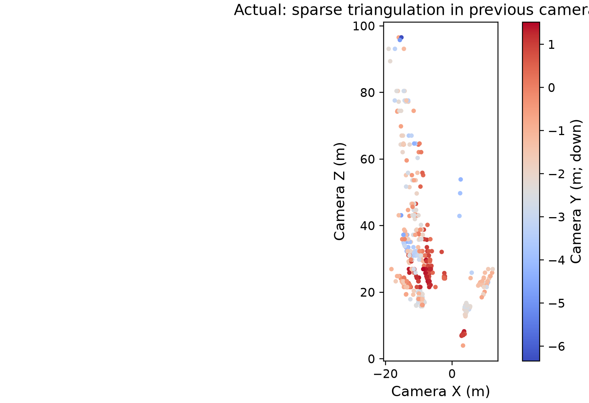

**그림 C4-07. 단일 프레임 희소 3D의 공간 구조 (실제 KITTI 00).** 카메라 좌표는 x 오른쪽, y 아래, z 전방. 먼 점의 깊이는 disparity 오차에 민감하다.

원본: `artifacts/stereo/000000.npz` (카메라 연구 디렉터리 기준; data/는 저장소 기준).

<a id="c4-6"></a>

### 6. SGBM: 조밀한 대응과 유효성의 별도 계약

SGBM은 Semi-Global Block Matching 계열 OpenCV 구현이다. 픽셀/블록 대응 비용과 disparity 변화 벌점을 여러 경로에서 결합한다.
교육적 목적 함수는 sum C(p,d_p)+P1*[이웃 disparity 차이=1]+P2*[차이>1] 형태지만,
이 실험은 OpenCV 내부 경로별 비용 배열을 추출하지 않았다. 저장된 raw는 실제 최종 fixed-point disparity다.
OpenCV disparity 정수 출력은 16으로 나누어 px로 변환한다. P1=8*5^2=200, P2=32*5^2=800,
disparities=128, block=5, uniqueness=10. 비용 벌점과 보정 projection P1은 이름만 같고 다른 기호다.
우측 매칭은 음수 disparity convention이라 LR residual=abs(dL+dR(uL-dL))이다.
영상 밖, 무효 우측 disparity, LR>1px, Z>100m를 제외한다. 무텍스처/가림/반사면 깊이는 여전히 틀릴 수 있다.

SGBM의 P1/P2는 시차가 이웃에서 급변하는 것을 벌점으로 억제한다. 평탄하게 보이는 깊이가 경계의 얇은 구조를 보존했다는 뜻은 아니다. 여러 방향의 경로 정보를 결합해도 가림 영역에는 동일 표면의 짝이 없으므로 무효 상태를 유지해야 한다. 이 수업은 라이브러리의 최종 출력과 좌우 일관성 마스크를 저장했으며 경로별 내부 비용을 재구현하지 않았다. [OpenCV StereoSGBM 공식 계약](https://docs.opencv.org/4.x/d2/d85/classcv_1_1StereoSGBM.html)


**그림 C4-08. SGBM의 조밀 시차 (실제 KITTI 00).** SGBM 고정소수점 출력을 16으로 나눈 뒤 양의 disparity, LR, 깊이 상한을 적용. 흰 영역은 무효, 색 상한은 표시만 제한한다.

원본: `artifacts/dense/000000.npz` (카메라 연구 디렉터리 기준; data/는 저장소 기준).


**그림 C4-09. SGBM의 미터 깊이와 무효 영역 (실제 KITTI 00).** SGBM 고정소수점 출력을 16으로 나눈 뒤 양의 disparity, LR, 깊이 상한을 적용. 흰 영역은 무효, 색 상한은 표시만 제한한다.

원본: `artifacts/dense/000000.npz` (카메라 연구 디렉터리 기준; data/는 저장소 기준).

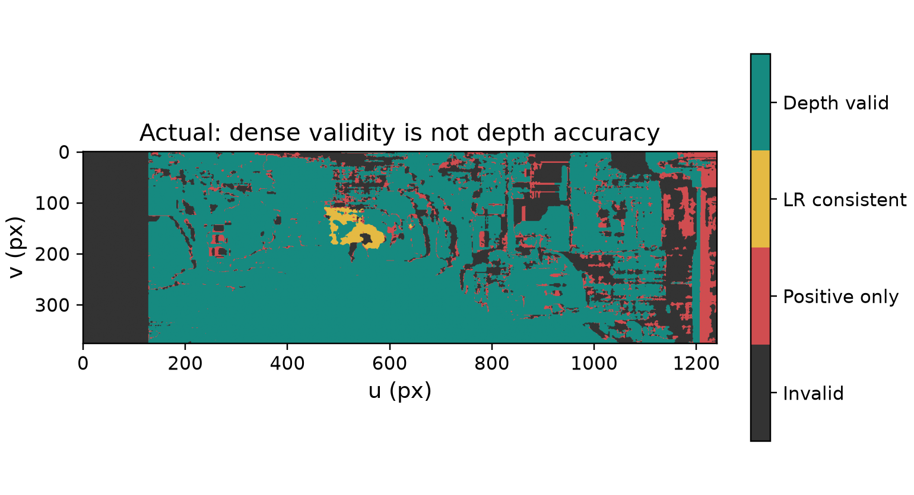

**그림 C4-10. 깊이 유효성 검사의 단계별 분모 (실제 KITTI 00).** 모든 픽셀을 분모로 한 단계별 유효성. 좌우 검증이 텍스처 부재·반복 무늬의 오답을 모두 제거하지는 않는다.

원본: `artifacts/dense/000000.npz` (카메라 연구 디렉터리 기준; data/는 저장소 기준).

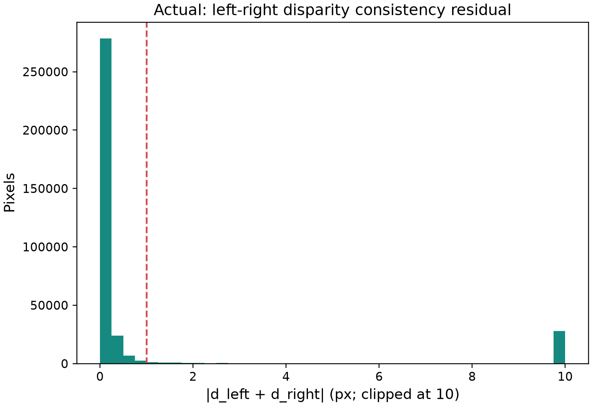

**그림 C4-11. 좌우 시차의 일관성 잔차 (실제 KITTI 00).** 우측 disparity는 음수 convention. 영상 밖 대응도 원래 배열에 보존되며 최종 mask에서 제거된다.

원본: `artifacts/dense/000000.npz` (카메라 연구 디렉터리 기준; data/는 저장소 기준).

<a id="c4-7"></a>

### 7. 연습문제와 해설

#### 문제 6. 주점이 다른 스테레오

문제: `f=600px, B=0.3m, cx_L=320px, cx_R=310px`, 관측 시차는 40px다.
깊이와 주점 차이를 무시한 잘못된 깊이를 구하라.
해설: 유효 시차는 `40-10=30px`, 깊이는 `180/30=6m`다.
잘못된 값은 `180/40=4.5m`다.
오차는 -1.5m, 실제값 대비 -25%다.
핵심: 정렬되었다고 좌우 주점까지 반드시 같지는 않다.


<a id="c5"></a>

## C5. LK와 PnP: 시간 대응을 미터 자세로 바꾸기

스테레오가 준 이전 프레임의 3D 점에 다음 프레임의 픽셀을 연결한다. LK는 2D 추적을, PnP는 3D–2D 자세 추정을 맡는다. 밝기 잔차·왕복 잔차·재투영 잔차는 각각 다른 검사를 하므로 한 숫자로 합치지 않는다.

<a id="c5-1"></a>

### 1. LK: descriptor 검색 대신 밝기 패치의 이동 찾기

LK는 Lucas-Kanade이며 Bruce D. Lucas와 Takeo Kanade의 이름을 딴 영상 정합 방법이다.
1981년 원문은 밝기 기울기를 이용한 반복 정합을 제시한다. [IJCAI 원문 및 서지](https://ijcai.org/proceedings/1981/127)
KLT는 Kanade-Lucas-Tomasi라는 추적 계열 명칭이며 모든 LK 호출을 별도 KLT 시스템 전체와 동일시하지 않는다.
아래는 원 논문의 문장 번역이 아니라 평행 이동 패치를 위한 자체 유도다.

첫 영상 I의 패치와 둘째 영상 J에서 같은 밝기 패턴을 찾는다고 하자.
점 좌표 `x=(u,v)`, 패치 공통 이동 `d=(du,dv)`를 두고 `r_i(d)=J(x_i+d)-I(x_i)`다.
목적함수는 `E(d)=sum_i r_i(d)^2`이며 SSD, Sum of Squared Differences, 차이 제곱합이라 부른다.
밝기값 단위를 DN, Digital Number, 디지털 수치 단위로 적으면 잔차는 DN, 비용은 DN²다.
미지수 d는 미터가 아닌 픽셀 이동이다.
일정 시간 간격으로 나눈 optical flow 속도와 프레임 간 변위도 구분한다.

현재 추정 d에서 작은 갱신 delta를 주면 `J(x+d+delta)≈J(x+d)+grad(J)^T delta`다.
따라서 `r(d+delta)≈r(d)+A delta`이며 A의 i번째 행은 `(J_u,J_v)`다.
제곱합을 delta로 미분하면 `2 A^T(r+A delta)=0`이다.
그러므로 `(A^T A)delta=-A^T r`를 풀고 `d←d+delta`로 갱신한다.
반복 중 기울기와 워핑을 어디서 계산하는지에 따라 변형이 달라진다.
Inverse compositional, 역합성 방식과 forward additive, 전방 가산 방식은 같은 식의 이름만 바꾼 것이 아니다. [Baker·Matthews, 2004](https://publications.ri.cmu.edu/lucas-kanade-20-years-on-a-unifying-framework)

<a id="c5-2"></a>

### 2. 작은 LK 문제를 끝까지 풀기

[교육 예제 N20] 세 관측의 기울기 행렬과 음의 밝기 잔차를 아래처럼 두자.

```text
A = [1 0]    b = -r = [ 2]
    [0 1]             [-1]
    [1 1]             [ 1]
A^T A = [2 1]
        [1 2]
A^T b = [3,0]^T
```

둘째 성분은 `0*2+1*(-1)+1*1=0`이다.
2x2 역행렬은 `(1/3)[[2,-1],[-1,2]]`다.
따라서 `delta=(2,-1)px`이고 `A delta=(2,-1,1)=b`여서 선형 잔차는 0이다.
이 결과는 실제 영상에서 한 번에 정확히 수렴한다는 주장이 아니라 주어진 선형 문제의 해다.
픽셀 기울기의 실제 단위는 DN/px이므로 곱 `A delta`가 DN이 되는 것도 확인한다.

<a id="c5-3"></a>

### 3. Aperture problem과 추적할 점의 조건

구조 텐서 `G=A^T A`는 패치의 기울기가 어느 방향으로 분포하는지를 나타낸다.
모든 기울기가 `(1,0)`이면 `G=[[N,0],[0,0]]`다.
수직 이동 dv에 대한 비용 변화가 없어 그 성분을 구할 수 없다.
이것이 aperture problem, 작은 관찰 창에서 이동의 한 성분을 구분하지 못하는 문제의 한 형태다.
평탄 패치에서는 두 고윳값이 모두 작아 두 방향이 모두 불확실하다.
서로 다른 방향의 기울기가 있으면 두 고윳값이 커져 국소 이동 추정에 유리하다. [LK 공식 튜토리얼](https://docs.opencv.org/4.13.0/d4/dee/tutorial_optical_flow.html)

[교육 예제 N21] `G=[[2,1],[1,2]]`의 고윳값은 3과 1이다.
N20은 두 방향 모두 제약되지만 감도는 완전히 같지 않다.
`G=[[3,0],[0,0]]`이면 고윳값은 3과 0이므로 역행렬이 없다.
인위적으로 작은 정규화 항을 더해 역행렬을 만들더라도 원래 관측에 없던 수직 정보를 측정한 것은 아니다.

<a id="c5-4"></a>

### 4. 피라미드와 추적 실패 검사

피라미드 LK는 작은 이동 근사를 여러 영상 해상도에서 적용하여 큰 이동을 다룬다. [OpenCV LK 튜토리얼](https://docs.opencv.org/4.13.0/d4/dee/tutorial_optical_flow.html)

한 레벨마다 영상 크기를 절반으로 줄인다면 원본 이동 d는 레벨 l에서 `d_l=d/2^l`이다.
거친 레벨에서 얻은 이동을 다음 세밀한 레벨로 전달할 때는 두 배로 한다.
원본 좌표와 레벨 좌표의 패치 크기를 구분하지 않으면 서로 다른 물리 영역을 비교하게 된다.
피라미드는 큰 이동을 작게 표현하지만 가림·반복 무늬·시간에 따른 밝기 변화까지 해결하지 않는다.

[교육 예제 N22] 원본 이동 24px는 레벨 3에서 `24/8=3px`다.
레벨 3의 7px 폭 패치는 원본에서 대략 56px 폭의 범위에 대응한다.
정확한 보간 지지 영역은 필터와 경계 처리에 따라 달라지므로 이 56px를 라이브러리 내부 커널의 정확한 크기라고 부르지 않는다.
그림에는 같은 좌표 축의 전체 영상과 동일 원본 영역의 확대를 함께 제시한다.

Forward-backward, 정방향-역방향 검사는 I→J로 추적한 위치를 J→I로 다시 추적해 시작점과의 거리를 본다.
작은 왕복 오차가 대응의 충분조건은 아니며 반복 무늬에서 왕복으로 같은 오답에 갈 수 있다.
큰 밝기 잔차·영상 경계·상태 플래그·공간 분포·기하 잔차를 별도로 보아야 한다.
LK 출력은 2D 대응이므로 그 자체가 3D 지도나 카메라 pose는 아니다.

<a id="c5-5"></a>

### 5. 실제 LK 입력과 실패 상태

LK는 Lucas-Kanade 광류. I_previous(p)≈I_current(p+delta)를 국소 선형화해
공간 밝기 gradient로 delta를 추정한다. pyramid는 큰 움직임의 국소 선형화 범위를 줄여 준다.
이 실험의 winSize=21, maxLevel=3, 최대 30회/epsilon0.01은 고정 설정이다.
FB는 norm(p_back-p_previous)<=1px. 순방향 status, 현재 영상 bounds, 역방향 status를 함께 검사한다.
단일 에지는 aperture ambiguity가 있고, 반복 무늬의 잘못된 대응도 왕복 일관성을 가질 수 있다.
status=0인 LK error는 OpenCV 계약상 미정의다. 이를 NaN으로 바꾸고 invalid 좌표/FB를 명시적으로 표시한다.
연습: FB=0이므로 true correspondence인가? 답: 아니며 GT flow 없이는 정답률을 측정할 수 없다.


**그림 C5-01. 시간 LK의 픽셀 이동 벡터 (실제 KITTI 00).** 원래 픽셀 길이의 흐름 벡터. 표시 개수만 줄였으며 전후방 mask는 전체 관측에 적용한다.

원본: `artifacts/tracking/000000.npz` (카메라 연구 디렉터리 기준; data/는 저장소 기준).


**그림 C5-02. 왕복 추적 오차의 분포 (실제 KITTI 00).** 전후방 추적은 자기 일관성 검사이며 flow GT 정확도가 아니다. 잘못된 반복 무늬도 통과할 수 있다.

원본: `artifacts/tracking/000000.npz` (카메라 연구 디렉터리 기준; data/는 저장소 기준).


**그림 C5-03. 밝기 잔차와 왕복 잔차의 차이 (실제 KITTI 00).** LK patch 밝기 잔차와 기하적 왕복 잔차는 서로 다른 기준이다.

원본: `artifacts/tracking/000000.npz` (카메라 연구 디렉터리 기준; data/는 저장소 기준).

<a id="c5-6"></a>

### 6. PnP: 이미 아는 3D 지도에서 카메라 자세 구하기

PnP는 Perspective-n-Point, n개의 3D-2D 대응에 대한 원근 자세 추정 문제다.
EPnP의 E는 Efficient를 뜻하며 본질행렬 E와 관계없는 이름이다.
Lepetit·Moreno-Noguer·Fua의 EPnP는 제어점 표현으로 계산량이 점 수에 선형으로 증가하도록 구성한다. [2009년 기관 서지](https://infoscience.epfl.ch/entities/publication/34721c4a-90c2-421c-9df6-15a96127a4a2), [저자 원문](https://vincentlepetit.github.io/files/papers/comp_lepetit_ijcv08.pdf)

2D-2D 상대 기하는 두 광선 사이의 제약을 풀지만 PnP는 3D 점 좌표가 이미 알려져 있다.
따라서 입력 점의 척도가 미터이면 출력 병진도 미터다.
단안으로 만든 임의 척도 지도를 넣으면 PnP가 새로운 미터 척도를 만들어 주지 않는다.
P3P는 Perspective-Three-Point이며 세 3D 점과 광선으로 여러 pose 후보가 생길 수 있는 최소 문제다.
라이브러리 함수가 추가 점을 요구하는지, 어떤 solver를 호출하는지, 여러 해를 반환하는지 구분한다. [OpenCV PnP solver 계약](https://docs.opencv.org/4.13.0/d5/d1f/calib3d_solvePnP.html)

정련 목적함수는 `sum_i ||p_i-pi(K(R X_i+t))||^2`이다.
원시 픽셀을 입력하면 왜곡 모델을 포함하고, 왜곡 제거된 픽셀을 넣으면 왜곡을 다시 적용하지 않는다.
오대응이 있으면 PnP도 강건 추정이 필요하며, 기존 3D 점의 깊이 불확실성도 무시하기 어렵다.
“2D 재투영 오차가 작다”와 “지도 좌표가 정확하다”는 같은 진술이 아니다.
평면 점에서도 가능한 solver가 있지만 유한 잡음에서의 자세 모호성과 배치 조건을 확인해야 한다.

<a id="c5-7"></a>

### 7. PnP의 미분을 카메라 모델에서 연결하기

skew와 왜곡이 없을 때 `u=fx X/Z+cx`, `v=fy Y/Z+cy`다.
카메라 점에 대한 2x3 미분행렬은 다음과 같다.

```text
J_pi = [fx/Z    0   -fx*X/Z^2]
       [   0 fy/Z   -fy*Y/Z^2]
```

이는 Jacobian, 여러 출력의 여러 입력에 대한 1차 변화율 행렬이다.
미터 점 좌표에 대한 각 원소 단위는 px/m다.
작은 왼쪽 pose 갱신을 `[delta_t,delta_theta]` 순서로 정의하면 `delta_X≈delta_t-[X]_x delta_theta`다.
delta_theta는 rad의 작은 회전 벡터이고 `[X]_x`는 외적 행렬이다.
예측 픽셀의 pose Jacobian은 `J_pi [I | -[X]_x]`다.
잔차를 `관측-예측`으로 정의하면 부호가 반대다.
오른쪽 갱신이나 반대 변환 방향을 쓰면 같은 식을 무조건 재사용하지 않는다. [영상 정합 선형화의 관련 틀](https://publications.ri.cmu.edu/lucas-kanade-20-years-on-a-unifying-framework)

[교육 예제 N18] `X_C=(1,0.5,5)m`, `fx=fy=500px`이면 `J_pi=[[100,0,-20],[0,100,-10]]`이다.
카메라 좌표 점의 `delta_X=0.01m` 변화는 u를 1px 증가시킨다.
Z만 0.01m 증가시키면 선형 예측은 `delta_u=-0.2px`, `delta_v=-0.1px`다.
정확한 u 변화는 `500/5.01-500/5≈-0.199600798px`다.
정확한 v 변화는 `250/5.01-250/5≈-0.099800399px`다.
근사의 오차가 작은 이유는 변화가 깊이에 비해 작기 때문이며 큰 변화에도 같은 정확도를 약속하지 않는다.

<a id="c5-8"></a>

### 8. 스테레오→지도→PnP의 자료 흐름

같은 시각의 왼쪽·오른쪽 대응으로 왼쪽 카메라 좌표의 3D 점을 만든다.
그 점의 좌표, 생성 프레임, 시차, 재투영 오차, 유효 마스크를 함께 보존한다.
다음 왼쪽 영상에서 같은 점의 관측을 찾으면 3D-2D PnP 입력이 된다.
출력 `T_Cnext_Cprev`는 이전 좌표 점을 다음 좌표로 보내므로 세계 카메라 pose 누적에는 역변환이 필요하다.
이 연결은 이번 독립 연구에서 실제 실행했다. 지속 랜드마크 지도 없이 이전 프레임의 점만 사용하는 VO이며 운영 경로에 통합하지 않았다.

[교육 예제 N19] N8의 두 번째 카메라 pose를 PnP가 `R=I,t=(-1,0,0)m`로 반환했다고 하자.
카메라 중심은 `C=-R^T t=(1,0,0)m`이다.
이미 알려진 점 `(2,1,5)m`의 다음 관측은 `(420,340)px`로 N8과 일치한다.
입력 지도의 모든 길이를 두 배로 바꾸면 같은 픽셀을 설명하는 t도 `(-2,0,0)`이 된다.
이것이 PnP의 척도가 입력 지도에서 전달된다는 직접 검산이다.

<a id="c5-9"></a>

### 9. 실제 자세 추정과 누적 방향

정규화 bearing x=K^-1*[u,v,1]에 대해 x_current^T E x_previous=0, E=[t]_x R이다.
E를 상수배해도 같은 제약이므로 t의 크기를 얻지 못한다. recoverPose의 단위 t를 frame마다 누적하는 것이 mono_unit이다.
PnP(Perspective-n-Point)는 이전 frame의 metric X_i와 현재 pixel p_i에서
sum ||pi(K*(R*X_i+t))-p_i||^2를 최소화한다. RANSAC이 outlier를 거르고 LM이 고정 inlier의 자세만 보정한다.
스테레오 baseline에서 metric이 전달되며 GT 이동량은 절대 사용하지 않는다.
이전 X를 현재로 옮기는 T_current_previous를 누적 자세에 그대로 곱하면 방향이 틀린다.
T_start_current=T_start_previous*inverse(T_current_previous). frame0→1 t_z=-0.67222211은
카메라 전진과 양립하며, 카메라 위치는 역변환의 -R^T*t로 계산해야 한다.
연습: t의 부호만 바꾸면 inverse인가? 답: 일반적으로 아니고 회전 전치가 필요하다.

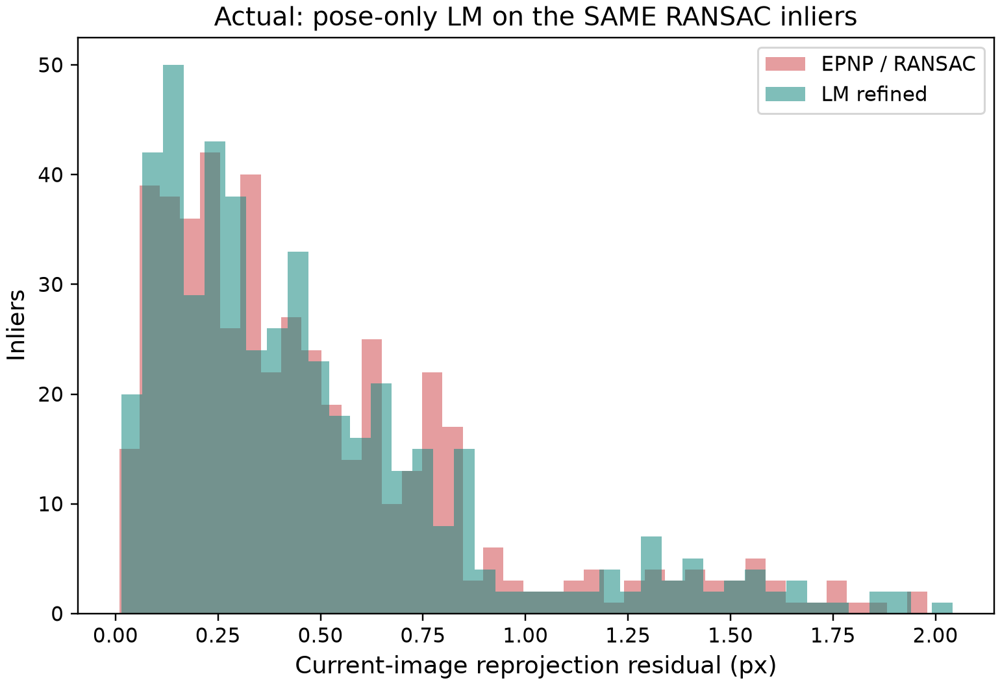

**그림 C5-04. 고정 3D에서 자세만 정련한 결과 (실제 KITTI 00).** 3D점을 고정하고 자세만 LM 최적화한다. 같은 inlier의 재투영 개선이며 joint BA나 일반화 평가가 아니다. 이 그림의 RMSE는 관측별 2D 잔차 norm의 제곱평균 제곱근이다. C6 합성 표의 u/v scalar RMSE와 분모가 다르다.

원본: `artifacts/reprojection/000000.npz` (카메라 연구 디렉터리 기준; data/는 저장소 기준).

<a id="c5-10"></a>

### 10. 연습문제와 해설

#### 문제 7. PnP와 카메라 중심

문제: `R=I`, 세계→카메라 병진 `t=(0,0,-2)m`를 얻었다.
카메라 중심과 세계 점 `(1,0,7)m`의 카메라 좌표를 구하라.
해설: `C=-R^T t=(0,0,2)m`, 카메라 점은 `(1,0,5)m`다.
`f=500px`, 주점이 `(320,240)px`라면 관측은 `(420,240)px`다.
핵심: t의 z가 -2라고 카메라 중심을 -2m로 그리면 변환 방향을 뒤집은 것이다.


#### 문제 8. LK의 관측 가능성

문제: `A=[[2,0],[1,0],[3,0]]`, `b=[4,2,6]^T`에서 이동을 구하라.
해설: 가로 이동은 du=2px로 일치하지만 dv는 어느 값이어도 식에 영향을 주지 않는다.
`G=A^T A=[[14,0],[0,0]]`이므로 역행렬이 없다.
해가 `(2,0)`이라고만 답하면 “수직 이동을 0으로 선택함”과 “수직 이동을 관측함”을 혼동한다.
핵심: 작은 잔차가 모든 자유도를 관측했다는 증거가 아니다.


<a id="c6"></a>

## C6. 키프레임과 공동 BA: 관측을 남기고 자세와 점을 함께 고치기

프레임별 VO를 장기 SLAM으로 바꾸려면 상태의 수명주기와 관측 연결을 관리해야 한다. 앞 장의 실제 pose-only LM은 점을 고정한다. 여기서는 자세와 점이 함께 미지수인 Bundle Adjustment를 유도하고, 별도로 생성한 4-pose 스테레오 장면에서 공동 갱신을 확인한다. [Triggs 외, Bundle Adjustment - A Modern Synthesis, 2000](https://thoth.inrialpes.fr/people/triggs/pubs/Triggs-hdr-papers.pdf)

<a id="c6-1"></a>

### 1. 먼저 시스템을 상태·관측·결정으로 나눈다

질문은 "매칭이 몇 개 나왔는가?"가 아니라 "어떤 관측이 어떤 상태를 제약했는가?"다.
프레임은 시각 t의 영상과 보정값을 담는 입력 단위다.
키프레임은 이후에도 최적화와 재방문 검색에 사용하기 위해 남긴 프레임이다.
랜드마크는 여러 영상의 관측을 하나의 물리적 장면점으로 묶은 지도 상태다.
관측은 `(keyframe_id, landmark_id, pixel, uncertainty)`라는 연결이다.
동일한 2D 특징이 검출되었다고 곧바로 동일한 3D 점이라는 뜻은 아니다.
지도점 ID를 공유하게 만드는 data association이 잘못되면 BA도 잘못된 문제를 푼다.
이때 최적화 성공 메시지는 데이터 연결이 옳다는 증거가 아니다.

교육용 상태 흐름은 다음과 같다.

```text
영상 + 보정 + timestamp
  -> 기존 지도에 현재 pose 정합
  -> 추적 품질 판단
  -> 새 시점의 정보가 충분하면 키프레임 삽입
  -> 삼각측량 또는 깊이 역투영으로 지도점 후보 생성
  -> 다중 관측 검증 / 중복점 병합 / 불량점 제거
  -> 지역 BA
  -> 장소 후보 검색
  -> 기하 검증
  -> 루프 제약 또는 지도 병합
  -> 전역 보정 및 파생 지도 갱신
```

추적 실패와 지도 실패를 구분한다.
현재 프레임 추적 실패 후 기존 지도에서 재위치추정에 성공할 수 있다.
추적이 계속되더라도 잘못된 점 연결이 누적되어 지도가 왜곡될 수 있다.
새 지도를 만드는 것은 실패를 없앤 것이 아니라 불확실한 연속성을 끊은 것이다.
나중에 지도 병합을 하려면 두 지도의 대응과 상대 변환을 다시 검증해야 한다.

<a id="c6-2"></a>

### 2. 키프레임은 시간 간격이 아니라 정보와 계산량의 절충이다

매 프레임을 남기면 반복 관측이 많아지고 최적화 비용이 커진다.
너무 드물게 남기면 시점 사이 대응이 끊기고 새 영역을 삼각측량하기 어렵다.
교육용 판단 변수는 공통 지도점 수, 새로운 영역, 시차, 시간 간격, 추적 잔차와 mapper 처리 여유다.
이 변수들은 논문마다 결합 방식이 다르므로 보편적인 한 임계값을 제시하지 않는다.
시차는 카메라 사이 위치 차이 자체가 아니라 같은 점을 보는 광선 방향의 차이다.
먼 점은 같은 이동에서도 작은 시차를 보인다.
회전만으로 픽셀이 많이 움직여도 깊이를 위한 기하적 baseline이 생기지 않을 수 있다.
따라서 픽셀 이동량을 그대로 삼각측량 가능성으로 해석하지 않는다.

수업용 예로 깊이 5 m인 점과 baseline 0.1 m를 생각한다.
작은 각도 근사에서 시차는 약 `0.1/5 = 0.02 rad`다.
같은 baseline에서 깊이 50 m이면 약 `0.002 rad`다.
이는 특정 카메라의 검출 기준이 아니라 baseline/depth 비율의 설명이다.
새 키프레임 선택에서 멀리 있는 점만 많이 보존하면 가까운 구조의 관측이 부족해질 수 있다.
반대로 가까운 점만 택하면 급격한 시점 변화에서 가림이 커질 수 있다.

예상 중간 산출물 `keyframe_decisions`의 한 행에는 다음이 필요하다.
- frame ID, timestamp[s], 후보 키프레임 ID.
- 공통점 수와 전체 후보점 수, 영상 내 분포.
- 회전 보정 전/후 시차 요약, 깊이 범위와 단위.
- 삽입 또는 거절 사유, 당시 mapper 대기열 길이.
- 추적 성공·실패와 새 지도 생성 여부.

후속 키프레임 실습의 출력은 같은 구간의 모든 프레임 위치를 회색, 선택 키프레임을 색으로 표시한다.
그림 아래에는 시차와 추적점 수의 시계열을 같은 시간축으로 놓는다.
촘촘한 키프레임 구간이 어려운 운동 때문인지 정책 오류 때문인지 설명해야 한다.
실제 키프레임 선택 실험과 그 시계열 그림은 미수행이다.

<a id="c6-3"></a>

### 3. 랜드마크의 수명주기

생성 직후 점은 충분히 검증된 고정 진실이 아니다.
처음에는 두 시점 삼각측량이나 한 시점 깊이 센서 측정으로 후보를 얻는다.
양의 깊이 조건, 재투영 잔차, 시차와 관측 가시성을 검사한다.
새 관측이 들어오면 위치·대표 descriptor·관측 목록을 갱신할 수 있다.
점이 예측상 보이는 상황에서 반복해서 매칭되지 않으면 잘못된 점일 가능성이 있다.
하지만 실제 가림이나 조명 변화도 있기 때문에 한 번의 실패로 단정하면 안 된다.
오래된 점의 삭제와 키프레임 삭제는 서로 다른 연산이다.
키프레임이 삭제되어도 다른 관측이 남으면 점은 유지할 수 있다.
점이 삭제되면 그 점을 참조하는 관측과 그래프 통계도 함께 정리해야 한다.
중복점을 병합할 때에는 모든 관측이 실제로 같은 물체의 같은 점인지 검증한다.
ID만 합치고 충돌하는 관측을 남기면 같은 프레임에서 같은 점이 두 픽셀에 나타나는 모순이 생긴다.

지도 유지 상태를 `candidate -> active -> weak -> removed`로 표현하는 것은 교육용 추상화다.
원 논문·라이브러리가 반드시 이 네 enum을 사용하는 것은 아니다.
상태 전이의 근거를 기록해야 지도점 수 감소가 품질 개선인지 추적 붕괴인지 해석할 수 있다.
관측 횟수만 많아도 동일 위치에서 찍은 거의 같은 영상이면 깊이 정보는 약할 수 있다.
관측 횟수와 관측 기하를 함께 본다.

<a id="c6-4"></a>

### 4. 그래프는 하나가 아니다

공동가시성 그래프의 노드는 키프레임이고 연결은 공유 지도점 관계를 나타낸다.
공유점 수는 이웃 선택에 도움이 되지만 센서 오차 공분산 그 자체는 아니다.
spanning tree는 연결성을 보존하는 뼈대로 사용할 수 있다.
pose graph의 edge는 두 pose 사이 상대 변환과 그 신뢰도를 나타낸다.
BA factor graph에는 pose뿐 아니라 지도점 변수와 각 재투영 관측이 있다.
장소 검색 데이터베이스는 외형 유사도를 위한 색인이다.
이 네 구조를 한 그림에서 같은 종류의 edge로 그리면 의미를 오해하기 쉽다.
권장 그림은 공동가시성 선, 측정 factor, 검색 후보 화살표를 다른 선 종류로 구별한다.

<a id="c6-5"></a>

### 5. BA의 입출력 계약부터 고정한다

BA는 Bundle Adjustment, 여러 카메라에서 나오는 관측 광선 묶음의 일관성을 조정하는 문제다.
이 절에서는 보정된 pinhole 카메라, 정적 점, 알려진 내부행렬 K를 가정한다.
왜곡이 남으면 아래 Jacobian 뒤에 왜곡 함수의 미분을 합성해야 한다.
세계점 `P_j^W`는 3차원 열벡터다.
`T_i = T_CiW = (R_i,t_i)`는 세계 좌표를 i번 카메라 좌표로 보낸다.
`p_ij = R_i P_j^W + t_i = (X,Y,Z)^T`다.
`z_ij = (u_obs,v_obs)^T`는 관측 픽셀이다.
잔차 부호는 일관되게 `r_ij = pi(p_ij) - z_ij`로 둔다.
이것은 예측 빼기 관측이며 반대 정의를 쓰는 코드의 Jacobian과 섞지 않는다.
미터 축척이 알려진 예제에서 X,Y,Z,t,P의 단위는 m다.
순수 단안 초기 지도라면 같은 식의 길이 단위는 임의 지도 단위다.
초점거리와 주점, u,v의 단위는 px다.

```text
pi(X,Y,Z) = [fx X/Z + cx, fy Y/Z + cy]^T
E = 1/2 sum_(i,j observed) rho(r_ij^T Sigma_ij^(-1) r_ij)
Sigma_ij : 2x2 pixel covariance [px^2]
s_ij = r_ij^T Sigma_ij^(-1) r_ij : dimensionless
```

관측되지 않은 `(i,j)` 조합에는 잔차를 만들지 않는다.
N개의 카메라와 M개의 점이 있다고 N*M개의 대응이 자동으로 생기는 것이 아니다.
픽셀 covariance의 비대각항은 두 픽셀 성분 오차의 상관을 뜻한다.
단순히 각 축 표준편차를 같은 값으로 두는 것은 모델 가정이다.
강건 손실을 쓴다고 잘못된 관측 노이즈 모델이 사라지는 것은 아니다.

<a id="c6-6"></a>

### 6. 재투영 Jacobian을 단계별로 유도한다

먼저 3D 점을 픽셀로 보내는 미분을 구한다.
분모 Z를 미분하면 `d(X/Z)/dZ = -X/Z^2`가 나온다.
따라서 다음 2x3 행렬을 얻는다.

```text
J_pi = [ fx/Z       0      -fx X/Z^2
           0     fy/Z      -fy Y/Z^2 ]
```

J_pi의 각 원소 단위는 px/m다.
pose 증분은 `delta_xi = (delta_rho, delta_phi)` 순서의 6차원 벡터로 둔다.
병진 증분 delta_rho의 단위는 m, 회전 증분 delta_phi는 rad다.
업데이트는 왼쪽 곱 `T_new = Exp(delta_xi^) T`로 고정한다.
작은 증분에 대해 `p_new ~= p + delta_rho + delta_phi cross p`다.
외적의 순서를 바꾸면 `delta_phi cross p = -[p]_x delta_phi`다.
여기서 `[p]_x q = p cross q`를 만족하는 3x3 반대칭행렬을 쓴다.
연쇄법칙으로 pose와 점 Jacobian은 다음과 같다.

```text
J_pose = J_pi [ I_3 | -[p]_x ]             # 2x6
J_point = J_pi R_i                         # 2x3
J_pose_translation : px/m
J_pose_rotation    : px/rad
J_point            : px/m
```

회전 성분을 rad로 구분하는 것은 구현상의 단위 실수를 잡기 위해서다.
수학적으로 rad는 무차원으로 취급할 수 있지만 degree 입력과 혼용하면 안 된다.
오른쪽 곱 업데이트는 증분 좌표계가 달라지므로 같은 J_pose를 그대로 쓸 수 없다.
카메라 pose를 `T_WC`로 저장하는 경우에도 역변환의 미분을 반영해야 한다.
내부 보정까지 추정한다면 fx,fy,cx,cy에 대한 추가 열이 필요하다.
예를 들어 `du/dfx = X/Z`, `du/dcx = 1`이다.

교육용 수치로 `p=(1,2,5)m`, `fx=fy=500px`를 넣는다.

```text
J_pi = [100,   0, -20
          0, 100, -40]
J_pose = [100,   0, -20,  -40, 520, -200
            0, 100, -40, -580,  40,  100]
```

`delta_rho_x=0.01m`만 주면 예측 픽셀은 u 방향으로 1px 증가한다.
`delta_phi_z=0.001rad`만 주면 1차 예측은 `(-0.2,+0.1)px`다.
이 예제에서는 z축 작은 회전이 `(X,Y)`를 `(-Y,X)` 방향으로 바꾸는 것도 직접 확인할 수 있다.
숫자가 작다고 유효한 관측인 것은 아니다. Z가 0에 가까우면 투영 자체가 불안정하다.
카메라 뒤의 점 `Z<=0`을 정상적인 재투영 관측으로 최적화하지 않는다.

후속 manifold 미분 검증에서는 analytic J와 manifold 중앙차분 J를 나란히 저장해야 한다.
중앙차분은 `r(Exp(+eps e_k^)T)`와 `r(Exp(-eps e_k^)T)`로 계산해야 한다.
회전행렬 원소 하나에 eps를 더하는 검사는 같은 미분이 아니다.
eps를 여러 크기로 바꾸며 절대/상대 오차를 본다.
위 식은 왼쪽 SE(3) 갱신의 손계산 유도다. 아래 합성 실험은 Rodrigues pose 미분과 점 미분을 중앙차분으로 검증하므로 매개화의 차이를 구분한다.

<a id="c6-7"></a>

### 7. Whitening과 강건 손실은 서로 다른 연산이다

Sigma가 양의 정부호이면 `L^T L = Sigma^(-1)`인 whitening 행렬 L을 잡는다.
`r_bar=Lr`, `J_bar=LJ`로 두면 잔차를 측정 노이즈 기준으로 비교할 수 있다.
L의 단위는 1/px이므로 r_bar는 무차원이다.
다른 센서 잔차를 함께 더하기 전에 이 단위 정리가 필요하다.
픽셀 잔차 제곱과 미터 잔차 제곱을 아무 가중치 없이 더하지 않는다.

여기서는 Huber 손실을 잔차 norm q에 대해 정의한다.

```text
q = ||r_bar||
h_delta(q) = 0.5 q^2                         if q <= delta
             delta(q - 0.5 delta)            otherwise
w(q) = 1                                    if q <= delta
       delta/q                              otherwise
```

이 정의는 `0.5*rho(q^2)` 표현과 맞춰 사용할 수 있다.
IRLS는 Iteratively Reweighted Least Squares, 반복 재가중 최소제곱이다.
현재 q에서 얻은 w로 `sqrt(w)r_bar`와 `sqrt(w)J_bar`를 함께 재가중한다.
잔차만 곱하고 Jacobian은 그대로 두면 다른 정상방정식을 만들게 된다.
교육용으로 q=10, delta=2이면 w=0.2이며 sqrt(w)는 약 0.447214다.
제곱 손실은 50이지만 위 Huber 손실은 `2*(10-1)=18`이다.
큰 잔차의 영향을 줄였을 뿐 관측을 완전히 삭제한 것은 아니다.
같은 잘못된 물체에 수백 개의 대응이 모이면 각각의 가중치를 줄여도 잘못된 운동이 우세할 수 있다.
따라서 강건 손실은 기하 검증이나 동적 물체 분리를 대신하지 않는다.

<a id="c6-8"></a>

### 8. Schur complement: 점을 먼저 없애도 pose 정보를 잃지 않는 이유

현재 선형화점에서 `r(x+delta) ~= r + J delta`로 근사한다.
측정 가중행렬을 Lambda로 써서 `H=J^T Lambda J`, `g=J^T Lambda r`라 두면 `H delta=-g`다.
pose 증분을 delta_c, 점 증분을 delta_p로 나눈다.

```text
[ U      W_cp ] [delta_c] = -[g_c]
[ W_cp^T V    ] [delta_p]    [g_p]
```

W_cp는 pose와 point 사이의 블록 교차행렬이며 측정 가중행렬 Lambda와 다르다.
둘째 식은 `V delta_p = -g_p - W_cp^T delta_c`다.
이를 첫째 식에 대입하면 pose만의 식이 된다.

```text
S = U - W_cp V^(-1) W_cp^T
S delta_c = -g_c + W_cp V^(-1) g_p
delta_p = -V^(-1)(g_p + W_cp^T delta_c)
```

서로 다른 점을 직접 연결하는 factor가 없으면 V는 점별 블록 대각이다.
그래서 작은 점 블록을 풀고 비교적 작은 pose 시스템을 풀 수 있다.
`V^(-1)`는 유도를 위한 표기이며 실제 수치 계산은 분해·선형해법으로 수행한다.
관측이 부족한 점은 해당 V 블록이 특이하거나 나쁘게 조건화될 수 있다.
감쇠나 제거 정책 없이 무조건 역행렬을 만들면 안 된다.
Levenberg-Marquardt 감쇠를 넣었다면 감쇠가 포함된 블록 시스템을 일관되게 소거한다.

교육용 스칼라 블록 예제는 `U=6, W_cp=2, V=4, g_c=-8, g_p=-4`다.
`S=6-2*(1/4)*2=5`다.
우변은 `8+2*(1/4)*(-4)=6`이다.
따라서 `delta_c=1.2`, `delta_p=-(1/4)*(-4+2*1.2)=0.4`다.
첫 식에 넣으면 `6*1.2+2*0.4=8`이다.
둘째 식에 넣으면 `2*1.2+4*0.4=4`다.
이 예제의 변수는 무차원이며 실제 카메라 pose와 점의 혼합 단위를 표현한 것이 아니다.

Schur 단계에서 점을 제거해도 같은 선형 문제의 최적 pose 해를 얻는다.
그 다음 점 증분을 복원하므로 지도를 영구히 버린 것이 아니다.
이 점이 다음 절의 시간 marginalization과 중요하게 다르다.

<a id="c6-9"></a>

### 9. Gauge: 숫자 부족과 좌표 기준의 자유를 구분한다

순수 단안 관측에서 모든 세계점과 카메라 중심을 같은 비율로 늘려도 투영은 같다.
관측은 상대 구조를 보지만 절대 원점·축 방향·길이 기준은 정하지 않는다.
일반적인 비퇴화 단안 BA에는 전역 translation 3, rotation 3, scale 1의 gauge가 있다.
미터 baseline을 아는 stereo/RGB-D에서는 scale 자유가 제거되어 보통 6개 전역 gauge가 남는다.
이 개수는 연결된 지도와 충분한 기하라는 전제에서 말하는 것이다.
순수 회전, 공선 점, 단절된 지도에는 추가적인 비관측 방향이 생길 수 있다.
첫 pose를 고정하면 6개 기준 자유를 정하지만 단안 scale까지 자동으로 정해지지는 않는다.
단안에서는 한 거리나 baseline 등 별도의 scale 규약이 필요하다.
이 규약은 미터를 관측했다는 뜻이 아니다.

예로 카메라 중심 두 개가 0과 1, 점이 `(1,1,5)`인 임의 단위를 생각한다.
중심과 모든 점을 10배하면 normalized projection은 변하지 않는다.
이때 t도 같은 좌표 규칙으로 바꿔야 한다.
점만 10배하고 카메라 translation을 고정하면 동일한 문제가 아니다.
시각적으로 같은 재투영을 가지는 여러 해는 solver 고장이 아니라 관측 모델의 성질이다.

강한 임의 prior로 H를 가역으로 만들 수는 있다.
그러나 임의 prior가 준 정보를 센서가 준 정보로 해석하면 covariance를 과신한다.
평가에서 Sim(3) 정렬을 사용하면 scale 오차를 정렬 과정에서 제거한다.
따라서 metric 성능을 주장할 때는 scale 정렬 허용 여부를 반드시 적는다.

<a id="c6-10"></a>

### 10. Marginalization: 오래된 상태를 버리면서 남기는 정보

실시간 sliding window에서는 모든 과거 프레임을 계속 최적화할 수 없다.
오래된 상태 m을 제거하고 남는 상태 r에 prior를 만든다고 하자.
현재 선형화에서 quadratic cost를 `0.5 delta^T H delta + g^T delta + const`로 쓴다.
블록 소거 결과는 다음과 같다.

```text
H_prior = H_rr - H_rm H_mm^(-1) H_mr
g_prior = g_r  - H_rm H_mm^(-1) g_m
E_prior(delta_r) = 0.5 delta_r^T H_prior delta_r
                   + g_prior^T delta_r + const
```

적절한 비특이 Gaussian 선형 문제에서 적분하여 얻은 marginal과 최적화 소거는 남은 변수의 같은 quadratic 정보를 준다.
정규화 상수는 달라질 수 있지만 상태 최적점에는 영향을 주지 않는다.
비선형 문제에서는 제거 시점의 선형 근사를 보존한 prior다.
원래 영상 관측 전체를 저장한 것과 같지 않다.
상태가 멀리 이동하면 과거 선형화의 유효성이 약해질 수 있다.
Schur BA는 한 iteration 안에서 점을 다시 복원하지만 window marginalization은 상태를 활성 집합에서 영구히 뺀다.
prior는 어떤 기준 상태 x0와 tangent 좌표에서 생성했는지 함께 보존해야 한다.
pose 차이를 단순 quaternion 원소 뺄셈으로 취급하면 prior 의미가 깨진다.
변수 순서나 기준 pose를 바꾸면 prior의 좌표도 일관되게 변환해야 한다.

수업용 두 상태 cost를 `0.5*x0^2 + 0.5*(x1-x0-1)^2`로 둔다.
전개하면 `H=[[2,-1],[-1,1]]`, `g=[1,-1]`다.
x0를 제거하면 `H_prior=1-1/2=0.5`다.
`g_prior=-1-(-1)*(1/2)*1=-0.5`다.
남은 최적점은 `x1=1`이다.
분산은 이 선형 Gaussian 예제에서 `1/H_prior=2`다.
처음 prior variance 1과 상대 관측 variance 1이 합쳐진 결과와 같다.
만약 첫 x0 prior를 없애면 남은 x1에 절대 위치 정보를 만들 수 없다.
이는 marginalization이 없는 정보를 발명해서는 안 된다는 간단한 검산이다.

예상 산출물 B2는 제거 전/후 변수 목록, x0, H_prior, g_prior, rank와 eigenvalue 요약이다.
관측을 prior에 포함한 뒤 같은 관측을 활성 factor로 다시 넣지 않는지 확인한다.
그렇지 않으면 같은 데이터를 두 번 믿는 double counting이 된다.
일관성 유지를 위한 선형화 고정 정책은 사용 추정기별로 검토해야 한다.
이 교재는 특정 FEJ 구현의 정확성을 검증했다고 주장하지 않는다.

<a id="c6-11"></a>

### 11. PTAM에서 배울 것과 배울 수 없는 것

PTAM은 Parallel Tracking and Mapping이라는 이름 그대로 두 작업의 주기가 다를 수 있음을 보여준다.
학습 목표는 빠른 현재 pose 추정과 느린 지도 개선을 같은 연산으로 취급하지 않는 것이다.
소규모 AR에서 키프레임과 점을 유지하는 설계는 대규모 장거리 시스템을 이해하는 출발점이 된다.
그러나 "추적과 지도 작성을 분리했다"는 이유만으로 장기 다중 세션 SLAM이 완성되지는 않는다.
지도 검색, 메모리 관리, 재초기화, 전역 일관성은 추가 문제다.
읽고 그릴 중간 그림은 tracker가 읽는 지도 snapshot과 mapper가 갱신하는 상태의 관계다.
병렬화는 계산 성능뿐 아니라 상태 소유권과 일관성 문제를 만든다는 점을 토론한다.

<a id="c6-12"></a>

### 12. ORB-SLAM 세대를 기능 축으로 비교한다

ORB-SLAM1이라는 이름은 보통 최초 ORB-SLAM 논문을 후속 버전과 구분하는 통칭이다.
정식 최초 제목에는 숫자 1이 없다.
ORB-SLAM의 수업 축은 특징 재사용, 지역 지도, 키프레임 선택, 장소 인식과 루프다.
ORB-SLAM2의 축은 센서 관측 모델 확장이다.
같은 점을 stereo에서는 좌우 영상으로, RGB-D에서는 픽셀과 깊이로 제약할 수 있다.
깊이가 있으면 scale을 얻기 쉬워지지만 깊이 센서 오차와 invalid pixel 처리가 추가된다.
ORB-SLAM3의 축은 관성 상태와 여러 지도의 수명주기다.
추적 상실 후 다른 지도를 시작하고 이후 장소 인식으로 병합하는 흐름을 배운다.
시스템 제목이 나열하는 센서와 카메라 모델의 모든 조합이 모든 코드 버전에서 동일하게 지원된다는 뜻은 아니다.
실제 재현에서는 선택 버전의 입력 예제와 calibration schema를 별도 확인한다.

세대가 올라간다는 이유만으로 모든 환경에서 더 작은 오차를 보장하지 않는다.
단안 영상만 있는 문제에는 관성 기능이 직접 정보를 추가하지 않는다.
나쁜 시간 동기화의 IMU를 더하면 추정이 악화될 수 있다.
추가 기능은 새 실패 경로와 설정 부담을 함께 만든다.
비교표의 첫 열은 연도가 아니라 입력 센서와 평가 목표여야 한다.

<a id="c6-13"></a>

### 13. 연습문제와 해설

**문제 1.** `p=(1,2,5)m`, f=500px에서 x translation 2cm가 만드는 1차 픽셀 변화는?
**풀이.** J_pose의 첫 열은 `(100,0)^T px/m`다.
0.02m를 곱해 `(2,0)px`다.
이는 세계 카메라 중심 이동이 아니라 앞서 정의한 왼쪽 pose 증분의 결과다.
중심 이동으로 문제를 바꾸면 변환 방향부터 다시 정해야 한다.


**문제 2.** 같은 점에 z축 회전 0.002rad만 적용하면?
**풀이.** 회전 z 열 `(-200,100)^T`에 0.002를 곱한다.
`(-0.4,0.2)px`다.
큰 각도에서 이 결과를 그대로 누적하지 않고 Exp와 재선형화를 사용한다.


**문제 3.** 관측 표준편차가 2px이고 잔차가 `(6,8)px`다. q와 delta=2 Huber weight는?
**풀이.** whitening 후 `(3,4)`, q=5다.
가중치 w=2/5=0.4다.
sqrt(w)는 약 0.632456이며 잔차와 J 모두에 곱한다.
Huber 비용은 `2*(5-1)=8`이다.


**문제 4.** U=6, W_cp=2, V=4, g_c=-8, g_p=-4의 Schur 해를 구하라.
**풀이.** S=5, 축약 우변=6이므로 delta_c=1.2다.
역대입하면 delta_p=0.4다.
두 원래 방정식을 만족하므로 부호를 확인할 수 있다.


**문제 5.** 단안 BA에서 첫 pose를 고정했으니 미터 scale을 얻었다는 주장에 답하라.
**풀이.** 첫 pose 고정은 원점과 축을 정한다.
첫 중심을 기준으로 다른 중심과 점을 함께 scale해도 단안 투영은 같다.
미터 baseline·깊이·관성 운동 등 추가 정보가 없으면 metric scale은 관측되지 않는다.


**문제 7.** `0.5*x0^2+0.5*(x1-x0-1)^2`에서 x0를 marginalize하라.
**풀이.** H_prior=0.5, g_prior=-0.5다.
상수항을 제외한 cost는 `0.25*x1^2-0.5*x1`이다.
미분 `0.5*x1-0.5=0`에서 x1=1이며 variance는 2다.
상수를 더해 `0.25*(x1-1)^2`로 표현할 수 있다.


<a id="c6-14"></a>

### 14. 실행한 합성 공동 BA: oracle 초기화와 dense solver

이 수업의 질문은 **"관측에 맞게 카메라와 점을 같이 움직이면 무엇이 개선되며,
틀린 관측을 강하게 믿으면 무엇이 망가지는가?"**이다.

- 공동 BA(Bundle Adjustment)는 pose와 3D점을 **한 최적화 변수 벡터에서 함께 갱신**한다. 점을 고정하는 pose-only refinement와 다르다.
- 좌표계 원점·방향은 영상만으로 정해지지 않는다. 첫 pose 고정으로 전역 강체 gauge(관측을 바꾸지 않는 자유도)를 제거하고, 알려진 stereo baseline으로 metric scale을 정한다.
- 오염 관측의 제곱합이 더 작다고 GT(Ground Truth, 생성 시 알고 있는 정답)에 더 가까운 것은 아니다. Robust loss는 잘못된 관측의 영향만 완화한다.
- 올바른 루프는 누적 drift를 줄이지만, 틀린 루프는 잔차를 줄이는 동안 지도 전체를 더 틀리게 만들 수 있다.

**전부 합성 데이터다.** 실제 영상 특징 추출, 삼각측량 초기화, KITTI 평가, loop detection을 수행하지 않았다.
BA 초기값은 GT perturbation이며 GT 첫 pose를 고정한다. Graph correct loop 역시 GT에서 만든 이상적 상대 제약이다.
최적화 함수에는 GT 오차 항을 넣지 않지만, 초기화·좌표계·correct loop는 oracle 교육 설정이다.
수치는 현실의 SLAM 정확도를 나타내지 않는다. Graph는 full 3D SLAM이 아닌 **2D SE(2) 수업**이다.

#### Stereo BA

| 기호 | 정의 | 단위/크기 |
|---|---|---|
| i, j, s | rig pose, 점, 영상 side 인덱스; s=0 left, 1 right | i=0..3, j=0..35 |
| N, M | pose 수, 점 수 | 4, 36 |
| X_j | world 좌표 3D점 | m, 3-vector |
| r_i, R_i | Rodrigues 회전벡터와 대응 world-to-camera 회전행렬 | rad, 3-vector / 무차원 3×3 |
| t_i, C_i | world-to-left 이동벡터와 world 카메라 중심 | m, 3-vector; C_i=-R_i^T t_i |
| b, e_x | 고정 stereo baseline, x축 단위벡터 (1,0,0)^T | 0.24 m, 무차원 |
| P_ijs=(X_c,Y_c,Z_c) | side s 카메라 좌표의 점 | m |
| K | 내부파라미터 행렬 [[f_x,0,c_x],[0,f_y,c_y],[0,0,1]] | pixel 투영 계수 |
| f_x,f_y,c_x,c_y | 초점거리, 주점 | 520,520,320,240 px |
| pi(P), u_ijs | 예측 투영 함수, noisy 관측 2-vector=(u,v) | px |
| e_ijs, e_k | 2D 예측-관측 잔차, 이를 펼친 k번째 scalar 잔차 | px |
| x, delta | 최적화 변수와 증가량 | 회전 rad, 이동·점 m 혼합 |
| J, D | de/dx Jacobian, d pi/dP pinhole Jacobian | 각 열 px/rad 또는 px/m, D는 px/m |
| F, rho, c | 목적함수, 무차원 loss 함수, robust scale | F는 px², c=1.2 px |
| Q,d,a | gauge 시험의 전역 회전, 이동, scale | 무차원 3×3, m, 무차원 |
| sigma_l(J) | Jacobian의 l번째 특이값 | 혼합 단위 열에 의존 |

입력은 K, b, 알려진 점 ID와 좌우 관측, 초기 pose·점이다. 출력은 첫 pose를 제외한
3개 pose와 36개 점의 공동 추정, pixel residual, solver 진단이다.
첫 pose는 (r,t)=(0,0)으로 고정하며 변수 벡터에 아예 넣지 않는다.
4×2×36×2=576 scalar 관측, 6×(4-1)+3×36=126 변수를 사용한다.
관측 수가 변수 수보다 많다는 사실만으로 퇴화가 없다고 단정하지 않는다.

#### 3.1 관측을 예측하는 식

카메라 앞쪽은 +z, 오른쪽은 +x, 아래는 +y다. World-to-camera 변환과 투영은


```text
P_ijs = R_i X_j + t_i - s b e_x
pi(P) = [fx Xc/Zc + cx, fy Yc/Zc + cy]^T
e_ijs = pi(P_ijs) - u_ijs
```


Right camera가 left에서 +b만큼 떨어져 있으므로 right 좌표에서는 x를 **빼야** 한다.
왜곡은 0이다. 코드의 `cv2.projectPoints` 입력은 rvec, tvec이며 camera center가 아니다.
API 근거: [OpenCV 공식 projectPoints 문서](https://docs.opencv.org/4.x/d9/d0c/group__calib3d.html).
구현: `research/camera-backend-lessons/src/backend.py:17`, `research/camera-backend-lessons/src/backend.py:83`.

**순서대로 계산하는 예:** 첫 카메라의 X=(1,0.5,5) m, R=I, t=0.

1. Left camera 좌표는 (1,0.5,5) m이다.
2. u_L=520×1/5+320=424 px, v_L=520×0.5/5+240=292 px.
3. Right camera 좌표는 (0.76,0.5,5) m이므로 u_R=399.04 px, v_R=292 px.
4. 관측 left=(424.6,291.4) px라면 left residual=(-0.6,+0.6) px.
5. 이 2D 관측의 LS cost는 ((-0.6)²+0.6²)/2=0.36 px².
6. Disparity d_px=u_L-u_R=24.96 px, 깊이는 f_x b/d_px=5 m다. 여기 d_px는 전역 이동 d와 다른 기호다.

단위 검산: px×m/px=m. 위 투영·깊이 예는 `research/camera-backend-lessons/src/test_backend.py:27`에서 수치 검사한다.

#### 3.2 무엇을 최소화하는가

LS(Least Squares, 최소제곱)는 F(x)=1/2 sum_k e_k(x)²를 최소화한다.
실험의 robust 목적함수는


```text
F(x) = (c^2/2) sum_k rho((e_k(x)/c)^2)
rho(z) = 2 (sqrt(1+z)-1)
```


이것은 각 **scalar u/v residual**에 적용하는 soft-L1이며, 2D residual norm을 하나로
묶는 block loss와는 다르다. Outlier mask는 평가 분리용이고 solver는 mask를 보지 않는다.
같은 초기값·관측에서 `loss`만 `linear`와 `soft_l1`으로 바꾼다.
호출 인자와 종료 진단의 근거는 [SciPy 공식 least_squares 문서](https://docs.scipy.org/doc/scipy/reference/generated/scipy.optimize.least_squares.html)다.

#### 3.3 선형화와 실제 구현의 경계

작은 변화 delta에서 e(x+delta) ≈ e(x)+J delta로 본다. 한 점에 대한 미분은


```text
D = [fx/Zc, 0, -fx Xc/Zc^2
     0, fy/Zc, -fy Yc/Zc^2]
d e / d X_j = D R_i
```


카메라 회전·이동 열은 OpenCV가 돌려주는 Jacobian의 첫 6열을 사용한다.
각 관측 행에 해당 camera block과 point block을 채우므로 양쪽 변수가 동시에 영향을 준다.
첫 pose block은 제외한다. 구현: `research/camera-backend-lessons/src/backend.py:88`; 모든 열의 중앙차분 비교: `research/camera-backend-lessons/src/test_backend.py:47`.
수치 Jacobian 대안은 `solve(..., numerical=True)`이며 작은 3-camera/10-point 문제에서 해와 cost를 비교한다.

**실제 solver는 SciPy TRF(Trust Region Reflective, 신뢰영역 반사법)**이고 dense `tr_solver="exact"`, `x_scale="jac"`를 사용한다.
여기서 exact는 신뢰영역 내부 부분문제의 solver 선택이다. Schur complement를 직접 구현하지 않았고,
block elimination 최적화·전역 최적해·LM 사용을 주장하지 않는다.
혼합 단위의 pose update norm은 단지 실제 변경 확인용이지 물리적 거리 지표가 아니다.

#### 3.4 실행 절차

1. 고정 seed로 4개 rig pose, 36개 world 점을 만든다. 모든 점은 모든 좌우 영상에 보인다.
2. 투영에 독립 Gaussian noise 0.6 px를 추가한다. 별도 사본의 29/288개 2D 관측에 표준편차 24 px의 추가 잡음을 준다.
3. GT pose·점을 각각 설정된 잡음으로 흔들어 초기값을 만든다. 첫 pose만 그대로 둔다.
4. clean LS, outlier LS, outlier soft-L1을 같은 초기값에서 푼다. 점과 pose 모두 variable이다.
5. 유한성, 양의 depth, 첫 pose 불변, pose·point update, 종료 상태를 검사한다.
6. 관측 residual과 별도의 GT 오차를 계산한다. GT 정렬·후처리 scale fitting은 하지 않는다.

전체 데이터 흐름과 저장은 `research/camera-backend-lessons/src/run.py:42`, solver 호출은 `research/camera-backend-lessons/src/backend.py:109`다.

#### 4. Gauge와 scale을 실제로 확인하기

관측을 바꾸지 않는 전역 좌표 변환은


```text
X'_j = Q X_j + d
R'_i = R_i Q^T
t'_i = t_i - R_i Q^T d
```


대입하면 R'_iX'_j+t'_i=R_iX_j+t_i이므로 right의 -b e_x도 변하지 않는다.
따라서 3개 회전+3개 이동의 6 자유도는 fixed baseline만으로 사라지지 않는다.
반면 점과 translation을 a배 하고 baseline은 유지하면 left 투영은 같아도 right disparity가 바뀐다.
스케일이 stereo gauge가 아닌 이유다. baseline까지 같이 a배 하면 다시 스케일 불변이므로
**알려진 baseline을 고정했다는 조건**이 중요하다.

`research/camera-backend-lessons/src/backend.py:118` 및 `artifacts/gauge`의 직접 확인 결과:

- 전역 Q,d 변환 후 최대 pixel 차이: 1.14e-13 px.
- GT 상태에서 unfixed J는 576×132, 상대 임계값 1e-10에서 nullity 6.
- 첫 pose를 제외한 J는 576×126, 같은 기준에서 nullity 0; 최소 특이값 3.4987.
- a=1.5에서 stereo 전체 scalar 투영변화 RMSE 3.4919 px. Left-only 변화는 sweep 전체에서 최대 2.12e-14 px.

SVD(Singular Value Decomposition, 특이값 분해)는 local Jacobian이 변화에 반응하지 않는 방향을
찾는 도구다. rad/m 단위가 섞인 열의 singular value 크기는 parameterization에 의존한다.
특이값 숫자를 좌표계와 무관한 품질 점수로 해석하지 않는다.
테스트는 3축 회전·3축 평행이동도 각각 확인한다. 모든 장면의 full rank를 증명한 것은 아니다.

#### 5. BA 결과 읽기

RMSE(Root Mean Square Error, 오차 제곱 평균의 제곱근)는 무엇을 평균하는지에 따라 다르다.
관측 RMSE는 u/v **scalar 좌표 전체**를 평균한다. Camera center와 point RMSE는 각 3D 오차 벡터의
제곱 norm을 평균한다. Rotation RMSE는 R_est R_gt^T의 회전각 제곱을 평균해 deg로 표시한다.
카메라 지표는 정확히 고정한 첫 pose를 제외한 3개만, 점 지표는 36개 전부를 쓴다.

| 실험 | 관측 좌표 RMSE px | Camera center RMSE m | Rotation RMSE deg | Point RMSE m |
|---|---:|---:|---:|---:|
| 초기, clean 관측 기준 | 17.0411 | 0.11037 | 1.99833 | 0.30231 |
| Clean LS | 0.50884 | 0.03791 | 0.28743 | 0.06351 |
| Outlier LS | 7.28989 | 0.73593 | 7.48733 | 0.72986 |
| Outlier soft-L1 | 8.04525 | 0.03569 | 0.23091 | 0.15268 |

수치 출처: `artifacts/ba/metrics.json`. Clean과 outlier 행은 관측 자체가 다르므로 전체 residual 수치를 직접 우열 비교하지 않는다.
Outlier LS와 soft-L1은 **동일한** 오염 관측이다. Robust는 전체 관측 RMSE를 오히려 키우면서
GT projection RMSE를 4.1171→1.0967 px, uncorrupted 관측 RMSE를 3.6556→0.8819 px로 낮췄다.
Robust point 오차는 clean LS보다 여전히 크고 일부 관측의 큰 잔차가 남는다.
Robust camera 오차가 clean보다 작게 나온 것은 이 seed의 관찰로, outlier가 도움이 된다는 결론은 아니다.

세 BA의 solver success=True이고 ftol 종료다. nfev는 7/43/33이다.
최종 optimality는 각각 약 5.24e-5/1.53e-2/2.89e-3으로 gtol=1e-9를 만족해서 멈춘 것이 아니다.
**success flag는 GT 정확성이나 전역 최적해 인증이 아니다.** Cost 단위·loss가 달라 LS cost와 robust cost를 그대로 비교해서도 안 된다.

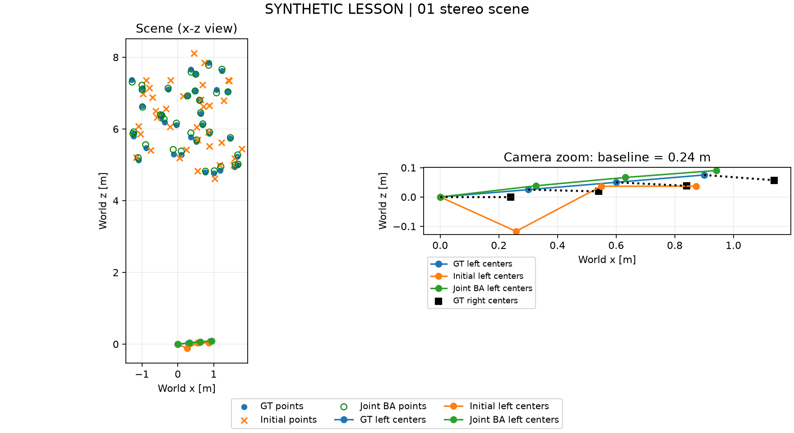

**그림 C6-01. 알려진 스테레오 장면과 초기 상태 (합성 교육 모델).** World x-z 평면의 점·left camera와 카메라 확대도. Right GT center와 고정 baseline을 함께 표시한다.
이 그림은 3D 장면을 x-z 평면에 투영한 표시이므로 y 오차를 볼 수 없다. 숫자 RMSE는 3D로 계산한다.


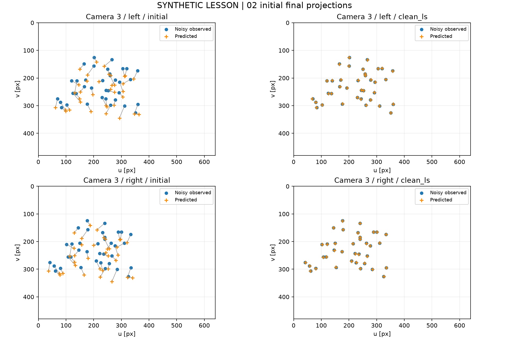

**그림 C6-02. 공동 BA 전후의 양안 투영 (합성 교육 모델).** 마지막 rig의 좌우 영상에서 초기·clean BA 예측과 noisy 관측을 같은 640×480 pixel 축으로 비교.
선은 대응점의 예측-관측 차이이며 실제 촬영 영상이 아니다.


**그림 C6-03. scalar 재투영 잔차 분포 (합성 교육 모델).** 왼쪽은 clean 초기/최종 scalar residual 분포, 오른쪽은 같은 uncorrupted 관측 subset의 최종 residual 분포.
각 패널 내부는 공통 bin이며 모든 극단값을 포함한다. 양 패널의 x 범위는 다르다.


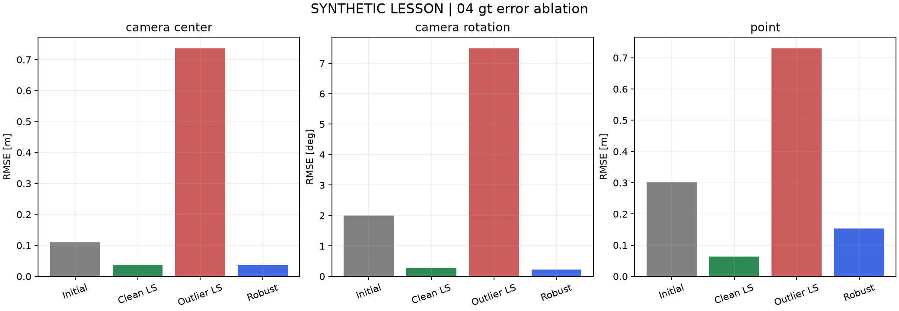

**그림 C6-04. 관측 비용과 합성 GT 오차 (합성 교육 모델).** 합성 GT 기준 위치·회전·점 오차. Outlier LS의 작은 관측 cost가 정확성을 뜻하지 않음을 보여준다.


**그림 C6-05. 좌표 gauge와 알려진 기준선의 척도 (합성 교육 모델).** 동일 GT 상태의 raw analytic J에서 6개 rigid gauge가 anchor 후 제거된다. 오른쪽은 baseline을 고정하고
pose translation·점을 scale할 때 stereo는 변하지만 left-only는 변하지 않는 실측이다.


**그림 C6-06. 강건 손실의 관측·정답 오차 절충 (합성 교육 모델).** 왼쪽은 inlier 2D residual norm의 정렬 분포, 오른쪽은 오염된 관측에서의 residual과 GT 투영 오차.
Scalar RMSE와 2D norm을 혼동하지 않는다. Robust도 일부 큰 오차를 남긴다.


<a id="c6-15"></a>

### 15. 합성 공동 BA의 추가 계산 문제

#### 문제 1: disparity와 깊이

f_x=520 px, b=0.24 m, u_L=424 px, u_R=399.04 px일 때 깊이는?
점과 translation만 2배로 늘리고 b는 고정하면 첫 camera의 u_R는?

**풀이:** disparity=24.96 px, Z=520×0.24/24.96=5 m.
X=(2,1,10) m가 되면 left u는 424로 같지만 right u=520×(2-0.24)/10+320=411.52 px.
Disparity는 12.48 px로 절반이 된다. Fixed baseline이 scale 변화를 관찰 가능하게 만든다.
원 투영·깊이는 `research/camera-backend-lessons/src/test_backend.py:27`, scale 불변/변화는 `research/camera-backend-lessons/src/test_backend.py:71`로 검사한다.


#### 문제 2: 진짜 공동 BA인지 확인

4 pose, 36 point, 좌우 관측에서 첫 pose 고정 시 변수·scalar residual 수는?
첫 pose도 풀면 몇 개의 관측 불변 자유도가 예상되는가?

**풀이:** pose 3×6=18, point 36×3=108, 합계 126변수. Residual은 4×2×36×2=576.
첫 pose까지 풀면 132변수이고 전역 rigid gauge 6개가 남는다. 알려진 b 때문에 scale은 포함되지 않는다.
점 108변수를 빼고 pose만 풀면 pose-only다. 실제 J 양쪽 block과 최종 pose·점 변경을 테스트한다.
`research/camera-backend-lessons/src/test_backend.py:83`, `research/camera-backend-lessons/src/test_backend.py:98`, `research/camera-backend-lessons/src/test_backend.py:137` 참고.


#### 문제 3: 큰 residual을 덜 믿는다는 뜻

한 scalar residual r=12 px, c=1.2 px일 때 LS와 soft-L1 cost 및 r에 대한 미분은?

**풀이:** LS cost=r²/2=72 px², dF/dr=12 px.
Soft-L1 cost=c²(sqrt(1+(r/c)²)-1)=1.44(sqrt(101)-1)=13.03182 px².
dF/dr=r/sqrt(1+(r/c)²)=12/sqrt(101)=1.19404 px.
큰 잔차가 목적함수를 끌어당기는 힘이 줄지만 완전히 0은 아니다. Outlier가 자동 삭제되는 것도 아니다.
`research/camera-backend-lessons/src/test_backend.py:98`에서 수치를 검사한다.


<a id="c6-16"></a>

### 16. 실험의 한계: 작은 장면에서 확인한 것만 주장하기

- 한 seed, 작은 일반 위치의 장면이다. [미확인] 다중 seed 분산, 퇴화장면, 매우 큰 초기오차, 실제 센서에서의 성능.
- 관측 연관과 가시성이 이상적이다. 삼각측량/track loss/rolling shutter/calibration error를 모델링하지 않는다.
- Depth를 강제하는 bounds/barrier는 없다. 본 실행의 초기·최종 depth 양수를 검사했지만 모든 solver 중간 trial에서 양수임을 인증하지 않는다. Z=0 근처와 뒤쪽 점 처리가 필요한 실용 구현은 별도다.
- General dense solver로 작게 풀었다. 대규모 sparse BA, marginalization, Schur complement, covariance 추정과 실시간성은 미구현이다.
- 일부 설정된 장면 범위·graph 원 경로 등 생성 형태는 코드에 있다. JSON이 모든 가능한 scene model을 기술하는 범용 schema는 아니다.
- 올바른 루프도 exact synthetic GT이며 현실의 loop uncertainty를 전부 반영하지 않는다. 거짓 loop 대응 방법 자체는 구현하지 않았다.
- Objective 감소, solver success, 좋은 영상 overlay만으로 GT 정확도나 전체 SLAM의 성공을 주장하지 않는다.


<a id="c7"></a>

## C7. 장소 검색과 루프: 높은 유사도에서 검증된 제약까지

재방문 후보는 아직 측정이 아니다. 과거 영상 검색, 기하 검증, 그래프 보정은 별도 단계이며, 잘못된 루프 하나는 전체 경로를 손상시킬 수 있다. 기존 4장의 GT 기반 후보 감사와 이번 합성 루프 수업 모두 실제 영상 자동 루프 검출기를 실행한 결과는 아니다. [Gálvez-López·Tardós, 2012 및 DBoW2](https://github.com/dorian3d/DBoW2), [ORB-SLAM 원문](https://arxiv.org/abs/1502.00956)

<a id="c7-1"></a>

### 1. BoW와 DBoW2: 지도 검색의 입력과 출력

BoW는 Bag of Words, 영상의 local descriptor들을 시각 단어 빈도로 요약하는 표현이다.
여기서 word는 자연어 단어가 아니라 descriptor 공간의 군집 ID다.
vocabulary는 학습 descriptor들을 계층적으로 나눈 색인 구조다.
질의 descriptor는 트리를 따라 가까운 대표 노드로 내려가 word ID를 얻는다.
이진 descriptor 비교에는 Hamming 거리가 자연스럽지만 실수 descriptor용 어휘와 그대로 호환되지는 않는다.
새 SuperPoint descriptor를 기존 ORB vocabulary에 그냥 넣는 것은 올바른 교체가 아니다.
inverted index는 특정 word가 등장한 키프레임을 찾아 전체 비교를 줄인다.
direct index는 영상 안의 feature와 트리 노드 관계를 보존해 후보 사이 대응 탐색을 돕는다.
검색 결과는 `(candidate_id, similarity_score)`이며 상대 pose가 아니다.

교육용 TF-IDF를 다음처럼 정한다.

```text
tf_w = count_w / total_descriptors
idf_w = log(N / n_w)
v_w = tf_w * idf_w
v <- v / ||v||_1
score(a,b) = 1 - 0.5 ||a-b||_1
```

N은 어휘 통계에 쓰인 영상 수, n_w는 word w를 포함한 영상 수다.
구현에는 smoothing과 weighting 선택지가 있으므로 위 식을 모든 DBoW2 설정의 유일한 식이라고 하지 않는다.
희귀한 단어는 더 큰 가중치를 가질 수 있지만 조명·가림·양자화 오류에도 민감할 수 있다.
예로 정규화된 `a=(0.6,0.3,0.1)`, `b=(0.5,0.2,0.3)`이면 L1 차이는 0.4다.
점수는 0.8이다.
이 값은 같은 장소일 확률 80%라는 뜻이 아니다.
반복 복도는 word 비율이 비슷하면서 다른 실제 장소일 수 있다.

<a id="c7-2"></a>

### 2. Loop verification은 독립된 기하 문제다

검색 단계에서는 최근 이웃 프레임을 제외하고 과거 후보를 찾을 수 있다.
최근 영상과 닮았다는 것은 당연하며 장기 재방문 발견과 다르다.
후보에 대해 실제 feature 대응과 지도점 대응을 만든다.
2D-2D면 essential/fundamental 모델, 2D-3D면 PnP, 3D-3D면 상대 정합 등을 검토한다.
선택은 사용 가능한 상태와 scale 관측 여부에 달려 있다.
RANSAC은 무작위 부분집합에서 가설을 만들고 전체 대응의 일치도를 검사한다.
inlier 개수 외에 영상 내 분포, 시차, 양의 깊이, residual 분포와 temporal consistency를 확인한다.
한 작은 반복 무늬에 몰린 많은 inlier는 전체 pose를 안정적으로 정하지 못할 수 있다.
추정된 상대변환은 재투영 또는 양방향 정합으로 추가 검증한다.
검증을 통과한 뒤에만 graph edge를 만든다.

교육용 단계별 로그는 다음을 분리해야 한다.
- 검색 후보 수와 각 BoW 점수.
- descriptor 대응 수와 geometric inlier 수.
- 상대변환 모델 종류: SE(3), Sim(3), PnP 등.
- scale, translation, rotation과 각각의 단위.
- 잔차의 중앙값/상위 분위수, 영상 공간 분포.
- 승인/거절 사유와 최종 graph edge ID.

기하 검증이 실패한 후보를 루프 성공으로 집계하지 않는다.
GT가 가깝다는 사실은 평가 label로 쓸 수 있지만 자동 검증기의 입력으로 섞지 않는다.
검색 recall과 verified-loop precision은 다른 지표다.
검색 임계값을 낮추면 후보가 늘 수 있지만 검증 계산량과 오검출 위험도 함께 바뀐다.

<a id="c7-3"></a>

### 3. SE(3)와 Sim(3)를 선택하는 이유

SE(3)는 rotation과 translation으로 거리를 보존한다.
Sim(3)는 Similarity transformation group으로 양의 scale s를 추가한다.
`p' = s R p + t`에서 s는 무차원이다.
단안 지도는 구간마다 scale drift가 생길 수 있어 상대 scale 보정이 필요할 수 있다.
metric scale이 관측된 stereo/RGB-D 지도에서는 임의 scale 변경을 허용하면 센서의 길이 기준을 훼손할 수 있다.
그러므로 모델 선택은 "자유도가 많으면 좋다"가 아니라 센서가 제약하는 자유도에 맞춘다.
Sim(3) inverse는 `p = (1/s) R^T (p'-t)`다.
translation을 단순히 -t로 바꾸는 것은 일반적으로 inverse가 아니다.

교육용으로 `s=2, R=I, t=(1,0,0)`이면 `(1,1,1)`은 `(3,2,2)`가 된다.
inverse를 적용하면 `0.5*((3,2,2)-(1,0,0))=(1,1,1)`이다.
여기서 scale 2는 보정 예제의 가정이며 실제 단안 궤적에서 측정한 값이 아니다.

<a id="c7-4"></a>

### 4. Pose graph residual의 방향을 검산한다

이 절에서만 설명 편의를 위해 `G_i=T_WCi`를 사용한다.
G_i는 앞 BA의 T_i와 inverse 관계다.
관측 `Z_ij`는 j 카메라 좌표를 i 카메라 좌표로 보내는 상대변환으로 정의한다.
예측 상대변환은 `G_i^(-1)G_j`다.

```text
e_ij = Log(Z_ij^(-1) G_i^(-1) G_j)
E_graph = 1/2 sum e_ij^T Omega_ij e_ij
```

관측과 예측이 같으면 Log의 입력은 항등변환이고 e=0이다.
SE(3)에서는 e가 6차원, Sim(3)에서는 log-scale을 포함해 7차원이다.
Omega는 이 tangent 좌표와 단위에 맞는 information matrix다.
회전과 병진의 covariance를 아무 좌표 변환 없이 다른 edge 방향에 복사하면 안 된다.
BoW 점수를 Omega의 모든 대각 원소로 넣는 규칙은 정당화된 측정 모델이 아니다.
상대변환이 같은 지도 관측에서 계산되었다면 다른 edge와 상관이 있을 수 있다.
독립 edge 가정은 실용적 근사이지 항상 정확한 확률 모델이 아니다.

pose graph를 고친 뒤 landmark와 dense map이 그대로면 서로 다른 좌표 상태가 된다.
희소점은 소속 키프레임의 보정에 따라 옮기거나 추가 BA를 수행한다.
TSDF는 과거 잘못된 pose에서 적분된 값이므로 단순히 최신 camera pose만 바꿔서는 복원되지 않는다.
재적분·변형·submap 이동 같은 별도 전략이 필요하다.
이 연결은 2절의 밀집 지도에서 다시 다룬다.

<a id="c7-5"></a>

### 5. 연습문제와 해설

**문제 6.** 3개 word의 a=(0.6,0.3,0.1), b=(0.5,0.2,0.3)의 점수가 0.8이면 loop edge를 추가해도 되는가?
**풀이.** L1 차이 0.4이므로 점수 계산 자체는 맞다.
그러나 상대 pose와 기하 일치가 없으므로 후보일 뿐이다.
기하 검증을 통과하지 않은 상태에서 edge를 추가하면 지도 전체를 왜곡할 수 있다.


<a id="c7-6"></a>

### 6. 실행한 합성 SE(2): 참 루프와 거짓 루프의 효과

| 기호 | 정의 | 단위/크기 |
|---|---|---|
| q_i=(p_i,theta_i) | 평면 pose; p_i=(x_i,y_i), theta_i heading | m,m,rad |
| R_2(theta) | [[cos(theta),-sin(theta)],[sin(theta),cos(theta)]] | 무차원 2×2 |
| z_ij=(z_t,z_theta) | directed edge i→j의 i-local 상대이동·각도 측정 | m,m,rad |
| h(q_i,q_j) | 두 pose에서 예측한 상대 측정 | m,m,rad |
| e_ij, w_ij | raw relative-coordinate 잔차, sigma로 나눈 잔차 | m,m,rad / 무차원 |
| sigma_t,sigma_theta | 측정 표준편차, 이 실험의 상대 가중치 설정 | m,rad |
| E | odometry와 선택 loop edge의 집합 | 24 또는 25 edge |
| F_g | graph 목적함수 | 무차원 |
| wrap(alpha) | atan2(sin(alpha),cos(alpha)); 동치 각도의 대표값 | rad, [-pi,pi] 경계 |

SE(2)는 Special Euclidean group in 2 dimensions, 즉 평면의 회전·이동 변환 집합이다.
위 기호 x_i는 평면 위치 성분이며 BA 전체 변수 x와 문맥이 다르다.

#### 6.1 상대 측정과 목적함수


```text
h(q_i,q_j) = [R2(theta_i)^T (p_j-p_i), wrap(theta_j-theta_i)]
```


Raw translation residual은 h의 앞 2성분-z_t, angular residual은
wrap(theta_j-theta_i-z_theta)다. 이를 각 표준편차로 나눈 w_ij에 대해
F_g=1/2 sum_(i,j in E) ||w_ij||²를 최소화한다.
이는 **i-local relative-coordinate residual**이며 SE(2) Log 오차의 완전한 구현은 아니다.
이동·회전 분산의 상관을 무시하는 대각 가중치 모델이다.

예를 들어 q_i=(1,2,pi/2), q_j=(1,3,pi/2+0.1)라면 world 이동은 (0,1) m이지만,
i-local 이동은 R_2(pi/2)^T(0,1)=(1,0) m이므로 h=(1,0,0.1)이다.
이 계산과 compose 역변환은 `research/camera-backend-lessons/src/test_backend.py:111`에서 확인한다.

#### 6.2 재현 절차와 루프의 뜻

1. 반지름 4 m의 닫힌 경로에 25개 pose를 만든다. 마지막 pose는 첫 pose와 같은 위치·방향이다.
2. 24개 상대 odometry 측정에 translation sigma=0.04 m, rotation sigma=0.012 rad 잡음을 더한다. 매 edge에 +0.008 rad heading bias도 더한다.
3. 상대 측정을 순서대로 compose해 초기 경로를 만든다. 이 경로는 noisy odometry edge를 거의 정확히 만족하므로 odometry cost가 0이어도 GT와 어긋난다.
4. 같은 초기값에서 odometry-only / correct loop / false loop 세 graph를 푼다. 첫 pose는 변수에서 제외한다.
5. 루프 방향은 **24→0**, correct 측정은 (0 m,0 m,0 rad), false는 (2 m,-1.5 m,0.45 rad)다. False case는 correct loop에 추가한 것이 아니라 correct loop를 **대체**한다.
6. 루프 sigma=(0.02 m,0.02 m,0.008 rad)로 상대적으로 강하게 믿게 설정했다. 검출·승인 없이 거짓 제약을 넣는 실패 사례다.

Odometry 측정 생성의 bias는 solver 모델에 추가 변수를 두어 추정하지 않는다.
따라서 sigma는 실제 전체 모델 오차의 완벽한 통계 표현이 아니다.
Graph는 72변수, odometry-only 72 residual 또는 loop 포함 75 residual이다.
`research/camera-backend-lessons/src/backend.py:155`, `research/camera-backend-lessons/src/backend.py:174`, `research/camera-backend-lessons/src/backend.py:202`가 각각 생성·최적화·case 구성이다.

#### 6.3 결과와 loop verification의 한계

| Case | 위치 RMSE m | Heading RMSE deg | 끝-시작 거리 m | Whitened scalar RMSE |
|---|---:|---:|---:|---:|
| Odometry only | 0.79434 | 9.82096 | 1.16349 | 약 6.34e-15 |
| Correct loop | 0.17331 | 0.61016 | 0.00087 | 0.55475 |
| False loop | 2.13234 | 18.19798 | 2.49250 | 1.63958 |

수치 출처: `artifacts/pose_graph/metrics.json`. 위치·heading RMSE는 고정 첫 pose 제외 24개를 평균한다.
별도 rigid/scale alignment는 하지 않는다. Correct loop의 잔차는 0이 아니며 다른 noisy edge와 절충한다.
False loop cost는 19776.56→100.81로 줄었지만 GT 위치 오차는 odometry보다 커졌다.
이 수업은 "최적화가 잘못된 제약을 알아서 거절한다"는 오해의 반례다.

검증은 합성 GT에 correct/false edge를 대입해 각각 (0,0,0), (-2,+1.5,-0.45)의 raw residual이
나오는지 확인하는 것이다. 이것은 **GT 기반 정답 확인**이며 실운영 geometric verification이나
RANSAC(Random Sample Consensus), 장소인식, 자동 rejection gate를 구현한 것이 아니다.
Graph의 wrap은 ±pi에서 비미분 경계가 있다. 이번 초기값·측정에서 그 경계 문제는 관찰되지 않았지만
큰 초기오차에 대한 안정성을 보장하지 않는다.

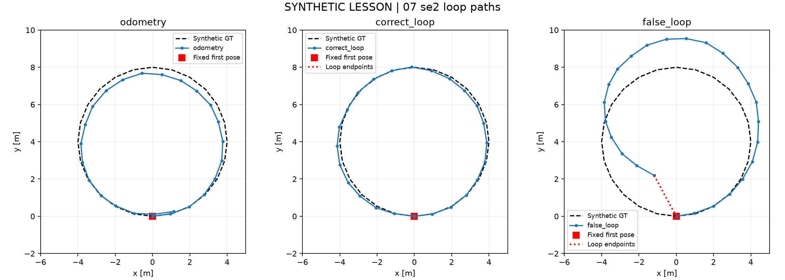

**그림 C7-01. 참·거짓 루프가 바꾸는 평면 경로 (합성 교육 모델).** 같은 축·종횡비에서 odometry / correct / false loop의 경로를 비교한다.
붉은 점선은 루프 endpoint 연결선이며, false loop의 상대이동 측정 그 자체를 world 벡터로 그린 것은 아니다.


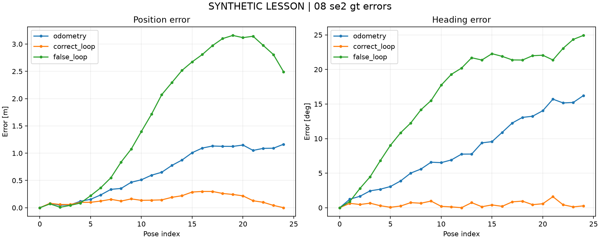

**그림 C7-02. 루프 이후 위치와 방향의 오차 (합성 교육 모델).** pose별 GT 위치·heading 오차. 거짓 loop로 오차가 끝점뿐 아니라 중간 경로에도 퍼진다.


**그림 C7-03. 루프와 오도메트리 제약의 충돌 (합성 교육 모델).** edge별 whitened residual norm과 GT 위치 RMSE. 마지막 edge index=24가 loop다.
Loop가 서로 모순되는 측정들을 조정하도록 graph 전체에 영향을 주는 모습을 보여준다.

<a id="c7-7"></a>

### 7. 합성 루프의 추가 계산 문제

#### 문제 4: 단위가 다른 graph residual과 거짓 루프

Raw residual=(0.04 m,-0.08 m,0.012 rad), sigma=(0.04 m,0.04 m,0.012 rad)의 whitened residual과 cost는?
GT의 마지막 pose=첫 pose인데 loop 측정이 (2 m,-1.5 m,0.45 rad)이면 raw residual은?

**풀이:** 성분별 나눗셈으로 w=(1,-2,1), cost=(1+4+1)/2=3, 둘 다 무차원이다.
실제 상대 pose는 (0,0,0)이므로 false loop residual=(-2,+1.5,-0.45).
강한 loop 가중치는 큰 모순을 줄이려고 경로를 변형시킬 수 있다. 최적화 후 cost 감소만으로 loop가 맞다고 승인하면 안 된다.
`research/camera-backend-lessons/src/test_backend.py:117`, `research/camera-backend-lessons/src/test_backend.py:129`에서 수치·방향을 검사한다.


<a id="c8"></a>

## C8. 직접법: 픽셀 위치 대신 밝기 잔차를 사용하기

C5의 LK가 밝기 기울기로 대응을 찾았다면 직접 VO는 깊이와 자세로 워프한 영상의 밝기를 상태 최적화에 직접 연결한다. 희소·밀집은 관측 밀도의 축이고 특징점·직접법은 잔차의 축이다. 이 장은 문헌과 손계산 수업이며 LSD-SLAM·DSO·LDSO를 실행하지 않았다. [LSD-SLAM](https://cvg.cit.tum.de/research/vslam/lsdslam), [DSO](https://arxiv.org/abs/1607.02565), [LDSO](https://arxiv.org/abs/1808.01111)

<a id="c8-1"></a>

### 1. 직접법의 질문: 대응 픽셀 좌표 대신 밝기를 맞추면 무엇이 달라지는가?

특징점법은 먼저 대응점을 만든 뒤 그 좌표의 기하 오차를 최소화한다.
직접법은 현재 깊이와 pose로 픽셀을 warp하고 대응 위치의 밝기를 비교한다.
"직접"은 모든 픽셀을 사용한다는 뜻이 아니다.
선택한 소수 픽셀만 사용하는 sparse direct 방법도 가능하다.
반대로 dense flow를 먼저 추정한 뒤 좌표 오차를 최적화하면 dense지만 광도 직접법과는 다르다.
밀도 축과 잔차 종류 축을 별도로 분류해야 한다.

기준 영상 i의 픽셀 p와 inverse depth d를 둔다.
depth는 `Z=1/d`이고 d의 단위는 metric 지도에서 1/m다.
`q=K^(-1) p_tilde`이며 마지막 성분이 1인 normalized ray다.
`P_i=q/d`, `P_j=R_ji P_i+t_ji`로 변환한다.
새 픽셀은 `p'=pi(P_j)`다.
단안 임의 scale 지도에서는 d도 그 지도 단위의 역수다.
영상 밖으로 나간 p'나 가려진 점은 정상 밝기 대응이 아니다.

<a id="c8-2"></a>

### 2. 광도 모델과 노출

원시 밝기를 raw image I_raw라고 하자.
카메라 응답함수의 inverse G^(-1), vignetting V(p), 노출시간 tau를 구분한다.
설명용 보정 영상은 `I(p)=G^(-1)(I_raw(p))/V(p)`로 정의한다.
이 정의에서는 노출시간은 아직 나누지 않았으므로 잔차에서 tau 비율을 사용한다.
노출까지 이미 나눈 영상에 다시 tau 비율을 적용하면 중복 보정이다.
영상 i와 j의 affine brightness 상태를 `(a_i,b_i)`, `(a_j,b_j)`라 둔다.

```text
alpha_ji = (tau_j / tau_i) * exp(a_j-a_i)
r_photo = [I_j(p') - b_j] - alpha_ji [I_i(p) - b_i]
```

a와 alpha는 무차원이고 b와 r_photo는 사용 보정 영상의 intensity 단위다.
tau 단위는 s이며 비율에서는 소거된다.
서로 다른 문헌의 I 정의가 같지 않으므로 식만 복사하지 말고 보정 순서를 확인한다.
패치 여러 위치의 잔차를 합치면 한 픽셀보다 정보를 늘릴 수 있다.
그러나 한 패치가 서로 다른 깊이 경계를 가로지르면 같은 기하 모델이 깨질 수 있다.
밝기 변화가 단순 affine가 아닌 반사·그림자·포화는 이 모델에 남는 오차다.

교육용으로 I_i=100, I_j=120, tau_i=tau_j, a_i=a_j=0, b_i=0, b_j=20을 둔다.
보정 잔차는 `(120-20)-1*(100-0)=0`이다.
b_j를 0으로 고정하면 잔차는 20이다.
optimizer가 이 20을 pose 이동으로만 줄이려 하면 실제 운동과 밝기 변화가 섞일 수 있다.

<a id="c8-3"></a>

### 3. 광도 Jacobian과 aperture problem

영상 미분을 `grad I_j = (dI/du,dI/dv)`라고 하자.
단위는 intensity/px다.
warp의 pose 미분은 앞 절의 J_pi와 `[I|-P_j cross]`를 조합한다.

```text
J_photo_pose = grad I_j(p') * J_pi(P_j) * [I | -[P_j]_x]
dP_i/dd = -q/d^2
J_photo_depth = grad I_j(p') * J_pi(P_j) * R_ji * (-q/d^2)
```

pose translation 열 단위는 intensity/m다.
inverse depth 열 단위는 intensity/(1/m)다.
밝기가 일정한 영역은 grad I가 0에 가까워 pose를 거의 제약하지 못한다.
직접법이 코너만 요구하지 않는다는 사실과 완전히 무텍스처에서 운동을 알아낸다는 주장은 다르다.
수직 경계 하나는 주로 경계 법선 방향 이동에 민감하다.
경계 접선 방향 이동은 밝기를 거의 바꾸지 않아 aperture problem이 생긴다.
서로 다른 방향의 gradient를 가진 픽셀들을 공간적으로 분산시키는 이유다.

작은 예로 gradient가 `(4,0) intensity/px`, warp 변화가 `(0.5,2)px`라면 밝기 변화는 2다.
수직 2px 변화는 이 국소 1차 모델에서 보이지 않는다.
최적화 iteration 수를 늘려도 없는 gradient 정보를 새로 만들 수는 없다.
피라미드는 큰 이동을 작은 이동으로 만드는 데 도움을 주지만 깊이·조명 가정의 오류까지 없애지는 않는다.

<a id="c8-4"></a>

### 4. LSD-SLAM과 DSO는 목적과 유지 정보가 다르다

LSD-SLAM의 학습 질문은 반밀집 inverse depth와 scale-aware 전역 그래프를 어떻게 연결하는가다.
DSO의 질문은 활성 window 안에서 geometry·pose·밝기 등을 함께 어떻게 정교하게 추정하는가다.
DSO 결과를 누적해 경로를 그렸다고 자동으로 루프가 닫힌 것은 아니다.
LDSO는 그 부족한 장기 제약을 추가하는 후속 분기다.
따라서 "LSD-SLAM이 오래되었으니 DSO가 모든 기능을 대체했다"는 설명은 틀리다.
직접법 실습에서 기대할 출력은 원본/warp 영상, 광도 잔차, gradient 선택 mask, inverse-depth uncertainty다.
재투영 좌표 오차만 저장하면 photometric calibration 실패를 설명하기 어렵다.
흑백 intensity를 사용했다는 사실만으로 RGB 채널의 모든 정보가 사용되었다고 말하지 않는다.

<a id="c8-5"></a>

### 5. 연습문제와 해설

**문제 8.** gradient `(4,0)`에 warp displacement `(0.5,2)px`가 주어졌다. 1차 밝기 변화는?
**풀이.** 내적 `4*0.5+0*2=2` intensity 단위다.
두 번째 이동 성분은 이 관측 하나로 제약하지 못한다.
두 성분 모두를 추정하려면 다른 gradient 방향 등의 추가 정보가 필요하다.


<a id="c9"></a>

## C9. 시각·관성 추정: 고속 관측과 초기화의 계약

A12의 가속도·각속도 적분을 영상 상태와 결합한다. IMU가 있으면 자동으로 척도가 복원되는 것이 아니라 시간·외부 보정·bias·중력과 운동 excitation이 필요하다. Raw OXTS의 fused GPS/INS pose는 입력 IMU 비력과 다르며 현재 저장소에서는 시간 정렬을 검증한 VIO를 실행하지 않았다. [MSCKF](https://intra.ece.ucr.edu/~mourikis/papers/MourikisRoumeliotis-ICRA07.pdf), [Forster 외 사전적분](https://dellaert.github.io/files/Forster16tro.pdf), [VINS-Mono](https://arxiv.org/abs/1708.03852), [시간 보정](https://arxiv.org/abs/1808.00692)

<a id="c9-1"></a>

### 1. VIO의 상태와 센서 계약

VIO는 Visual-Inertial Odometry, 시각-관성 오도메트리다.
VINS는 Visual-Inertial Navigation System, 시각-관성 항법 시스템을 뜻한다.
최소 교육 상태는 `x_i=(R_WBi,p_WBi,v_WBi,b_gi,b_ai)`다.
R은 body에서 world로의 회전, p는 위치[m], v는 속도[m/s]다.
b_g는 자이로 bias[rad/s], b_a는 가속도 bias[m/s^2]다.
센서 외부변환 `T_BC`와 시간 offset t_d[s]를 고정하거나 추정 상태에 포함할 수 있다.
"외부 보정"은 센서 간 고정 변환이고 매 시점의 세계 pose와 다르다.
내부 카메라 보정, IMU noise density, bias random walk, timestamp clock domain도 필요하다.
이 값들이 없으면 영상과 IMU 숫자를 함께 읽는 것만으로 재현 가능한 VIO 입력이 되지 않는다.

세계 중력은 예를 들어 `g_W=(0,0,-9.81)m/s^2`로 정한다.
측정 가속도는 비력이며 `a_m=R_WB^T(a_W-g_W)+b_a+n_a`다.
회전 측정은 `omega_m=omega+b_g+n_g`다.
정지한 수평 IMU에서 축 정의에 따라 중력 반대 방향의 비력이 나오는 이유를 먼저 확인한다.
g를 두 번 더하거나 빼는 오류는 정지 테스트로 잡을 수 있다.
noise density와 discrete sample variance는 단위와 샘플 간격을 통해 변환해야 한다.
데이터시트의 수치를 단위 확인 없이 covariance 대각에 복사하지 않는다.

<a id="c9-2"></a>

### 2. MSCKF: 점을 상태에 넣지 않고 점의 정보를 쓰는 방법

MSCKF는 Multi-State Constraint Kalman Filter다.
현재 IMU 상태와 여러 과거 카메라 pose clone을 유지한다.
한 정적 feature의 여러 관측을 쌓으면 선형화된 식을 얻는다.

```text
r = H_x delta_x + H_f delta_f + n
```

delta_f는 해당 3D 점 위치의 불확실한 증분이다.
그 점을 영구 상태로 추가하지 않고 제거하고 싶다.
H_f의 left nullspace basis N을 구하면 `N^T H_f=0`이다.
양변에 N^T를 곱한다.

```text
r_o = N^T r = N^T H_x delta_x + N^T n
R_o = N^T R N
```

점 증분은 없어졌지만 여러 pose의 상대 기하 정보는 남는다.
noise가 isotropic이고 N 열이 orthonormal이면 noise 처리가 단순해진다.
일반 covariance에서 projection 후 noise를 원래와 같다고 놓으면 안 된다.
5개 영상에서 한 점을 관측하면 픽셀 잔차는 10차원이다.
H_f rank가 3이면 left nullspace 차원은 7이다.
이는 남는 식 수를 뜻하며 pose의 모든 자유도를 독립적으로 관측했다는 뜻은 아니다.
rank가 다른 퇴화 상황에서는 차원과 정보량을 별도 해석한다.
영구 landmark map을 유지하지 않는 구조와 장소 재방문 기능의 존재는 별도 문제다.
MSCKF라는 이름만으로 loop closure까지 구현되었다고 가정하지 않는다.

<a id="c9-3"></a>

### 3. 사전적분은 IMU를 버리는 것이 아니라 상대 factor로 압축하는 것이다

카메라 i와 j 사이에 고주파 IMU 샘플이 여러 개 있다고 하자.
매 optimization iteration마다 모든 샘플을 세계 좌표에서 재적분하면 계산이 반복된다.
사전적분은 시작 body 좌표에서 상대 회전·속도·위치 변화를 요약한다.
이 절은 구간 내 bias가 일정하다는 1차 교육 모델을 사용한다.
정밀 구현에서는 covariance와 bias Jacobian을 함께 전파한다.

```text
DeltaR_ij = R_i^T R_j
Deltav_ij = R_i^T (v_j-v_i-g_W DeltaT)
Deltap_ij = R_i^T (p_j-p_i-v_i DeltaT-0.5 g_W DeltaT^2)
```

DeltaR은 회전, Deltav는 m/s, Deltap는 m다.
이 식은 참 상태가 만족할 상대량의 정의다.
실제 IMU에서 계산한 hat-Delta와 상태에서 예측한 Delta를 비교해 residual을 만든다.
교육용 discrete 적분은 다음 순서로 설명할 수 있다.

```text
Deltap_next = Deltap + Deltav*dt + 0.5*DeltaR*(a_m-b_a)*dt^2
Deltav_next = Deltav + DeltaR*(a_m-b_a)*dt
DeltaR_next = DeltaR * Exp((omega_m-b_g)*dt)
```

세 식 우변은 같은 이전 step의 DeltaR,Deltav를 사용한다고 정의한다.
실제 midpoint 적분과는 차이가 있는 교육용 전진 모델이다.
샘플 dt가 균일하다고 가정하지 않고 timestamp 차이를 사용한다.
camera interval의 경계에 걸린 IMU 샘플은 보간·분할 정책을 명시한다.

회전 residual은 예를 들어 `r_R=Log(hat_DeltaR^T R_i^T R_j)`로 둔다.
속도 residual은 `r_v=R_i^T(v_j-v_i-g DeltaT)-hat_Deltav`다.
위치 residual도 위 정의에서 hat_Deltap를 뺀다.
이 세 residual의 차원은 각각 3이고, bias 변화 residual을 더하면 흔히 15차원 factor를 구성한다.
회전·속도·위치 오차에는 상관이 생기므로 대각 covariance만 쓰는 것은 추가 근사다.
각 residual을 covariance로 whitening한 뒤 시각 residual과 결합한다.

<a id="c9-4"></a>

### 4. Bias 보정은 왜 필요한가?

사전적분은 기준 bias b0에서 수행된다.
최적화가 bias를 바꾸면 같은 측정의 해석도 달라진다.
작은 delta_b에서는 저장한 Jacobian으로 1차 보정할 수 있다.

```text
Deltav(b0+delta_b) ~= Deltav(b0) + J_v_bg delta_bg + J_v_ba delta_ba
Deltap(b0+delta_b) ~= Deltap(b0) + J_p_bg delta_bg + J_p_ba delta_ba
DeltaR(b0+delta_bg) ~= DeltaR(b0) Exp(J_R_bg delta_bg)
```

큰 bias 변화에서는 이 근사가 부족해 재적분이 필요할 수 있다.
사전적분을 한 번 했으니 bias를 바꾸어도 그대로 써도 된다는 뜻이 아니다.
bias Jacobian은 센서 축과 회전 perturbation 정의에 종속된다.
다른 논문에서 가져온 Jacobian을 좌표계 확인 없이 혼합하지 않는다.

단순 1D 예제로 중력을 이미 제거한 가속도 2m/s^2, dt=0.1s를 두 번 적분한다.
시작 속도와 위치가 0이면 최종 속도는 0.4m/s다.
최종 위치는 `0.5*2*(0.2)^2=0.04m`다.
이는 3D 사전적분을 완전 재현한 것이 아니라 단위와 시간 항의 검산이다.
회전과 bias가 있으면 가속도 방향도 바뀌므로 단순 스칼라 합으로 대체할 수 없다.

<a id="c9-5"></a>

### 5. VINS 초기화: 한꺼번에 모든 미지수를 푸는 문제가 아니다

단안 영상만으로 만든 초기 구조는 scale이 정해지지 않는다.
IMU에는 중력·속도·bias와 외부 보정의 불확실성이 있다.
초기화의 목표는 이 서로 다른 정보를 일관된 metric 상태로 연결하는 것이다.
교육 흐름은 시각 상대 구조 확보, 자이로 bias 검토, scale·중력·속도 정합, 중력 크기 제약과 비선형 refinement다.
이는 이해를 위한 단계화이며 모든 VIO 시스템이 동일한 순서와 식을 쓰는 것은 아니다.
ORB-SLAM3처럼 초기화를 MAP 추정 관점에서 구성하는 분기도 있다.
초기화 성공 여부는 solver return code만으로 판단하지 않는다.
양의 scale, 합리적인 gravity magnitude, bias 크기, residual와 condition을 함께 점검한다.

이를 수식으로 보려면 시각 카메라 중심을 임의 단위의 c_i, scale을 s[m/시각 단위]로 둔다.
외부 lever arm이 0이고 시각 회전이 세계축과 정렬된 교육용 단순화를 가정한다.
그러면 IMU 위치는 `p_i=s*c_i`로 쓸 수 있다.
앞 절의 사전적분 정의를 위치와 속도 갱신식으로 다시 정리한다.

```text
s*(c_j-c_i) = v_i*DeltaT + 0.5*g*DeltaT^2 + R_i*hat_Deltap_ij
v_j-v_i     = g*DeltaT + R_i*hat_Deltav_ij
```

위 식에서 c_i와 회전, 사전적분값을 잠시 고정하면 s, 각 v_i, g에 대해 선형인 부분 문제가 된다.
여러 시간 구간을 쌓아 풀고 gravity 크기 제약을 추가하여 refinement하는 직관을 얻는다.
실제 camera-IMU translation이 있으면 `p_C=p_B+R_WB*t_BC`를 사용해 lever arm을 포함한다.
그때 시각 중심 c와 IMU 위치를 같은 값으로 놓으면 회전 중 위치 오차를 만든다.
bias가 바뀌면 hat-Delta도 보정해야 하므로 이 선형 부분 문제만으로 전체 초기화가 끝나는 것은 아니다.
가속도·자세 변화가 빈약하면 scale과 속도·중력·bias를 구분하는 열들이 약하게 제약될 수 있다.
이것이 초기화 성공 여부를 조건수와 residual로 확인해야 하는 이유다.

별도 검산 예제로 중력이 제거된 1D에서 c_j-c_i=0.5 시각 단위, DeltaT=1s라 하자.
v_i=0m/s가 독립적으로 알려졌고 사전적분 위치 변화가 1m이면 s=2m/시각 단위다.
하지만 v_i도 미지수이면 식은 `0.5*s=v_i+1`뿐이다.
예를 들어 `(s,v_i)=(2,0)`과 `(4,1)`이 모두 성립하므로 이 한 구간만으로 scale을 정할 수 없다.
여러 관측을 추가하는 이유를 "식이 많아진다"보다 "혼동되던 상태를 구분한다"로 설명한다.

운동 excitation은 미지 상태를 구분할 수 있게 충분히 다양한 관측을 만드는 움직임이다.
계속 정지해 있으면 중력 방향 일부를 관찰할 수 있어도 단안 translation scale은 얻기 어렵다.
등속 직선 이동은 다양한 가속 운동에 비해 scale과 bias 분리가 약해질 수 있다.
회전만으로 외부 rotation을 제약할 수 있어도 translation scale의 모든 정보가 생기지는 않는다.
카메라-IMU lever arm이 있으면 회전이 유발하는 운동까지 고려해야 하므로 모든 순수 회전 상황을 같은 식으로 단정하지 않는다.
안전한 소규모 실험에서는 여러 방향의 완만한 회전·이동을 제공하고 excitation 지표를 기록한다.
불충분한 구간을 억지로 초기화하기보다 관측을 더 기다리는 정책도 필요하다.

이상적인 충분한 excitation의 VIO는 metric scale과 gravity 방향을 제약할 수 있다.
외부 절대 위치·방위 정보가 없으면 전역 translation과 gravity축 yaw는 보통 남는다.
gravity alignment 후 4DoF 전역 그래프를 설명하는 배경이다.
여전히 관측되지 않는 자유도를 제거한 covariance를 절대 위치 신뢰도로 해석하지 않는다.

<a id="c9-6"></a>

### 6. 시간 보정은 위치 보정과 다르다

카메라 시각 t_C와 대응 IMU 시각을 `t_I=t_C+t_d`로 정의한다.
t_d의 부호는 이 정의에 묶이며 반대 정의의 구현에 그대로 입력하면 안 된다.
normalized feature q의 시간 미분 q_dot를 알고 있다면 작은 offset에서 `q(t+t_d) ~= q(t)+q_dot*t_d`다.
픽셀 좌표로 쓰면 q_dot 대신 pixel velocity[px/s]를 쓴다.
시간 offset residual Jacobian에는 이 시간 미분이 들어간다.
정지 영상은 시간 이동을 주어도 거의 달라지지 않아 offset을 식별하기 어렵다.
일정한 단순 운동에서는 외부변환이나 bias와 강하게 결합될 수 있다.
따라서 시간 calibration도 관측가능성 문제다.

교육용 feature의 pixel velocity가 `(80,-20)px/s`이고 t_d=0.01s라면 보간 변화는 `(0.8,-0.2)px`다.
예측된 pixel p0와 관측 z에 대해 `r=p0+v_pixel*t_d-z`로 두면 `dr/dt_d=v_pixel`이다.
이 Jacobian의 단위는 px/s다.
앞서 정의한 offset 부호를 바꾸면 보간식과 Jacobian 부호도 함께 바꿔야 한다.
같은 pixel velocity에서 허용 보간 오차 norm을 0.5px로 정한 교육용 기준은 `|t_d|<=0.5/sqrt(80^2+20^2)`다.
약 0.00606s이며 특정 센서의 동기화 합격 기준이 아니라 운동에 따른 예시다.

노출시간, timestamp 기준 시점, rolling shutter row readout, 전송 지연, clock drift는 서로 다르다.
상수 t_d 하나로 모든 시간 오류를 설명하지 못할 수 있다.
하드웨어 동기화가 가능하면 먼저 그것을 검증하고 온라인 추정은 잔여 오차 모델로 본다.
GT 궤적을 가장 잘 맞추는 offset을 고른 뒤 이를 무감독 온라인 성능으로 보고하지 않는다.
그런 정렬은 oracle 또는 calibration 단계로 분리해야 한다.

<a id="c9-7"></a>

### 7. 연습문제와 해설

**문제 9.** 5개 영상의 2D 관측을 쌓은 MSCKF 잔차에서 H_f rank가 3이면 projection 후 최대 잔차 차원은?
**풀이.** 원래 10차원에서 3을 제거하여 7차원이다.
7차원이라는 사실만으로 pose state rank가 7이 되는 것은 아니다.
남은 H_x와 운동 기하를 확인해야 한다.


**문제 10.** 중력을 제거한 2m/s^2 가속도를 0.2s 적분하라. 초기 속도는 0이다.
**풀이.** 속도는 0.4m/s, 위치 변화는 0.04m다.
가속도 bias가 추가로 0.1m/s^2였다면 같은 단순 모델의 위치 오차는 0.002m다.
이는 3D 회전 오차로 중력이 누출되는 경우를 포함하지 않는다.


<a id="c10"></a>

## C10. 학습 대응과 반복 추정: 무엇을 학습하는지 먼저 구분하기

좋은 기술자, 문맥적 매칭, 깊이·자세의 반복 갱신은 서로 다른 교체 지점이다. 기존 ORB 세부 계산을 알고 나면 학습 모델의 입력·출력·전처리 계약을 정확하게 비교할 수 있다. 이 장의 모든 모델은 문헌 학습 대상이며 설치·추론·학습·GPU 성능 측정을 수행하지 않았다. [SuperPoint](https://openaccess.thecvf.com/content_cvpr_2018_workshops/w9/html/DeTone_SuperPoint_Self-Supervised_Interest_CVPR_2018_paper.html), [SuperGlue](https://arxiv.org/abs/1911.11763), [LightGlue](https://arxiv.org/abs/2306.13643), [DROID-SLAM](https://papers.neurips.cc/paper_files/paper/2021/hash/89fcd07f20b6785b92134bd6c1d0fa42-Abstract.html)

<a id="c10-1"></a>

### 1. 학습이 들어갈 위치를 먼저 정한다

첫 층은 detector와 descriptor다.
둘째 층은 두 집합 사이 data association이다.
셋째 층은 여러 시점의 geometry와 pose를 반복 추정하는 구조다.
넷째 층은 map representation과 rendering이다.
다섯째 층은 object/semantic 해석이다.
여섯째 층은 주어진 목표를 행동으로 바꾸는 정책이다.
이 층들은 조합할 수 있지만 입출력 타입이 다르므로 이름만 바꿔 끼우면 안 된다.
논문을 읽을 때 "학습한다"보다 "무엇을 출력하는가?"를 먼저 적는다.

| 방법 | 입력 | 직접 출력 | 별도로 필요한 것 |
|---|---|---|---|
| SuperPoint | 한 영상 | 2D 점·score·descriptor | 대응, pose, map 관리 |
| SuperGlue/LightGlue | 두 영상의 점·descriptor | 대응 index·confidence | 기하 검증, BA, 루프 정책 |
| DROID-SLAM | 영상 시퀀스와 보정 등 | pose·depth 추정 | 환경별 검증, 출력 scale 계약 |
| NICE-SLAM | 선택 구성의 RGB-D 관측 등 | pose와 implicit scene | 실제 센서 정합·자원 검증 |
| 원 3DGS | 보정 영상과 초기 geometry/pose 등 | 장면 appearance 표현 | 미지 pose의 온라인 추적 |
| GS-SLAM 계열 | 시퀀스와 해당 센서 가정 | pose와 Gaussian map | 충돌·물리 모델 검증 |
| semantic mapping | 영상·geometry·분류기 | class 분포가 붙은 지도 | 동적 판정·행동 계획 |
| VLA | 시각·언어·상태 등 모델 입력 | 행동 표현 | actuator 변환·제약·폐루프 검증 |

위 표는 개념 계약이며 각 논문의 모든 입력 조합을 열거한 API 명세가 아니다.

<a id="c10-2"></a>

### 2. SuperPoint의 교체 범위

SuperPoint 출력 점은 여전히 이미지 좌표다.
descriptor가 학습되었다고 점의 metric depth가 자동 생성되는 것은 아니다.
homography augmentation은 대응 일관성 학습을 돕지만 실제 3D 장면의 모든 parallax를 표현하지는 않는다.
원 detector score는 검출 우선순위이며 pose covariance와 같은 확률량이 아니다.
전처리 resize가 있으면 keypoint를 원 영상 좌표로 되돌리거나 K를 같은 비율로 바꿔야 한다.
padding을 추가했다면 주점 offset도 맞춘다.
모델이 어느 해상도에서 출력하는지와 descriptor sampling 위치를 기록한다.
이 정보를 놓치면 좋은 matcher를 써도 PnP residual이 체계적으로 커질 수 있다.
기존 ORB의 binary descriptor와 실수 descriptor의 거리·저장량·검색 구조가 다르다.
descriptor 차원과 normalization 방식은 실제 checkpoint 계약으로 확인한다.

교육용 중간 산출물 L1은 detection heatmap, NMS 전/후 점, descriptor shape, resize transform이다.
비교할 때 점 수를 통제하지 않으면 detector 품질과 단순 관측 수 증가가 섞인다.
특징 개수 증가로 latency가 커졌는지도 함께 기록한다.

<a id="c10-3"></a>

### 3. SuperGlue의 핵심: 독립 최근접 비교에서 문맥적 부분 대응으로

단순 nearest-neighbor matching은 각 descriptor를 따로 비교한다.
문맥적 matcher는 한 영상 안 점들의 관계와 다른 영상의 관계를 함께 사용한다.
self-attention은 같은 집합의 문맥을, cross-attention은 두 집합 사이 정보를 전달하는 관점으로 이해한다.
attention score가 높다고 실제 3D 대응이 보장되지는 않는다.
가림·시야 밖·검출 누락 때문에 모든 점에 짝이 있어야 한다는 가정은 틀리다.
부분 대응 모델은 unmatched를 허용해야 한다.
optimal transport 기반 assignment는 대응의 전체적 일관성을 다루는 수단이다.
dummy 또는 dustbin 항목은 짝이 없는 가능성을 표현하는 데 사용된다.
이런 구조는 descriptor 거리 하나보다 풍부하지만 학습 분포와 반복 패턴의 한계는 남는다.

교육용 2x2 유사도 행렬을 생각한다.
첫 행은 `(0.9,0.8)`, 둘째 행은 `(0.89,0.1)`이다.
독립 argmax는 두 점 모두 첫 열을 선택한다.
일대일 대응 총점을 비교하면 대각 합은 1.0, 반대 대각 합은 1.69다.
공동 assignment가 독립 선택과 다를 수 있음을 보여준다.
이것은 실제 SuperGlue의 optimal transport 계산을 재현한 예제가 아니다.
unmatched 비용과 정규화가 추가되면 결과는 다시 달라질 수 있다.

<a id="c10-4"></a>

### 4. LightGlue: 계산량도 입력에 따라 달라진다

적응형 matcher는 쉬운 pair에 적은 계산, 어려운 pair에 더 많은 계산을 배분할 수 있다.
따라서 평균 latency 하나로 worst-case 동작을 설명하기 어렵다.
교재 실험에서는 point count, image overlap, 실행 layer 수, 제거된 point 수, latency를 같이 기록한다.
early exit threshold를 바꾸면 속도와 대응 품질이 함께 달라진다.
confidence가 낮은 점을 지우는 정책이 작은 정적 배경까지 없애지 않는지 확인한다.
어려운 장면에서 많이 pruning되었다고 계산이 똑똑하게 끝났다는 뜻만은 아니다.
유효 geometry가 부족해진 실패일 수도 있다.
학습 matching 후에도 essential/PnP/RANSAC과 residual 검증이 필요하다.
장소 검색과 tracking의 point 수·시간 예산은 다르므로 동일 설정을 무조건 공유하지 않는다.

<a id="c10-5"></a>

### 5. DROID-SLAM: 기하를 없애는 대신 학습 업데이트와 결합한다

DROID의 수업 목표는 "신경망이 pose를 직접 찍는다"는 단순화를 피하는 것이다.
영상 간 correspondence 관련 정보를 반복 갱신하고, geometry를 만족시키는 BA layer로 pose와 depth를 조정하는 구조를 읽는다.
교육용 목적함수를 다음처럼 추상화할 수 있다.

```text
E(T,d) = sum_(i,j,p) || warp(T_j T_i^(-1),p,d_i(p)) - qhat_ij(p) ||^2_(W_ij(p))
```

여기 T는 이 식 안에서 세계→카메라 변환으로 정의한다.
qhat은 학습 업데이트가 제안한 target coordinate이며 pixel 단위다.
W는 해당 residual의 가중치를 표현한다.
이 식은 전체 네트워크 architecture와 training loss의 완전 전사가 아니라 geometric layer의 교육용 추상화다.
학습 confidence와 통계적으로 calibration된 covariance를 동일시하지 않는다.
단안 입력의 물리적 scale 모호성이 네트워크 이름 때문에 없어지지 않는다.
학습 데이터의 크기 prior를 사용할 수 있다는 것과 새로운 환경에서 metric scale을 관측했다는 것은 다르다.
stereo/depth를 사용하는 구성과 순수 단안 구성을 평가에서 분리한다.

중간 산출물 L2는 frame graph, proposed correspondence, weight map, depth, BA 전후 residual이다.
깊이가 매끈해 보이는지뿐 아니라 depth discontinuity와 motion boundary에서 잔차를 본다.
신경망 출력이 좋지 않을 때 geometry layer가 복구할 수 있는 범위도 초기값과 관측에 제한된다.
저장소에 DROID 코드를 설치하지 않았으므로 KITTI에서 기존 VO보다 나을 것이라고 약속하지 않는다.

<a id="c10-6"></a>

### 6. 자원 요구를 사실과 계획으로 분리한다

공식 DROID-SLAM 구현은 GPU 중심 환경과 별도 연산 의존성을 안내한다. [공식 README](https://github.com/princeton-vl/DROID-SLAM)
2026-11-24 열람한 README의 요구사항은 demo inference에 GPU memory 11G 이상, training에 24G 이상이며 CUDA 설치를 요구한다.
이는 저자 배포 구성의 안내값이다. 모든 sequence의 충분조건이나 이 호스트에서의 실측값이 아니다. [요구사항](https://github.com/princeton-vl/DROID-SLAM#requirements)
공식 NICE-SLAM 구현도 환경 구성과 학습된 구성요소를 제공한다. [공식 구현](https://github.com/cvg/nice-slam)
LightGlue의 adaptive pruning 동작은 point 수와 하드웨어에 따라 달라진다고 공식 README가 설명한다. [공식 설명](https://github.com/cvg/LightGlue/blob/main/README.md)
이 확인은 현재 로컬 호스트에서 실행 가능성을 검증했다는 뜻이 아니다.
특히 CUDA 대상 코드를 macOS arm64에서 같은 속도로 실행할 수 있다고 가정하지 않는다.
CPU fallback이 존재하는지, custom kernel 대체가 있는지, 정확도와 memory 차이가 무엇인지 먼저 확인한다.
설치 가능성과 실시간성은 다른 합격 조건이다.

후속 연구가 남길 resource ledger 항목은 다음과 같다.
- 모델·코드 버전과 checkpoint 식별자, 라이선스.
- 학습 데이터 종류, 평가 데이터와의 중복 여부.
- 입력 해상도, image resize, crop, intrinsics 변환.
- GPU/CPU 모델, RAM/VRAM, precision, batch와 point 수.
- 추론만 실행했는지 학습·미세조정까지 했는지.
- 최초 로딩, warm-up, steady-state latency를 구분한 기록.
- front-end, backend, rendering, disk I/O의 개별 시간.
- peak memory, window와 frame graph 크기, 누적 map 크기.
- 실패 프레임, 재시작, OOM, frame drop과 fallback 정책.

정해진 해상도에서 N개 keypoint를 M개와 모두 비교하면 pair 수는 N*M이다.
교육용으로 N=M=2048이면 pair 수는 4,194,304다.
float32 한 행렬만 저장해도 16,777,216byte, 즉 16MiB다.
실제 네트워크 memory는 feature, 여러 layer, attention, workspace와 gradient 때문에 더 커질 수 있다.
이는 특정 matcher의 실측 VRAM이 아니라 단일 배열 크기 하한 예제다.
해상도나 point 수를 줄이면 자원을 아끼지만 작은 구조와 시야 overlap 정보도 줄어든다.

<a id="c10-7"></a>

### 7. 연습문제와 해설

**문제 15.** 1280x960 영상을 가로·세로 절반으로 줄였다. fx=800px, cx=640px는 어떻게 바꾸는가?
**풀이.** 단순 좌표 scale 정의에서 fx'=400px, cx'=320px다.
u=1000px의 점은 u'=500px다.
pixel-center convention과 crop offset이 있으면 해당 resize API의 정확한 변환을 적용한다.
이미지만 줄이고 원 K를 쓰면 normalized ray가 달라진다.


**문제 16.** 2048x2048 float32 대응 score 행렬 하나의 크기는?
**풀이.** 원소 수는 4,194,304다.
4byte를 곱하면 16,777,216byte, 16MiB다.
이 값은 네트워크 전체 VRAM이 아니며 실제 실행 메모리는 추가 항목이 필요하다.


<a id="c11"></a>

## C11. 밀집·신경·의미 지도: 표면과 행동의 경계

추정한 자세를 어떤 지도로 저장할 것인가? 치수 측정, 충돌 질의, 사실적 렌더링, 의미 검색은 각각 다른 지도와 검증을 요구한다. RGB-D·TSDF·occupancy·ESDF에서 신경 지도와 Gaussian 표현으로 이어가되, 뒤의 방법이 앞의 목적을 자동으로 대체한다고 보지 않는다. 실제 RGB-D 수집과 이 장의 지도 구현은 수행하지 않았으며 계산 예와 문헌의 구조를 학습한다.

<a id="c11-1"></a>

### 1. RGB-D reconstruction의 목표부터 고른다

RGB-D는 color와 depth 관측을 제공하지만 결과 지도 형식은 따로 선택해야 한다.
점군은 관측된 3D 점의 집합이다.
surfel은 위치·법선·크기·색 등 국소 표면 요소다.
mesh는 정점과 면 연결로 표면을 표현한다.
TSDF는 표면 근처의 signed distance를 voxel에 누적한다.
occupancy는 공간이 점유되었을 확률과 관측 여부를 표현한다.
ESDF는 가까운 장애물/표면까지의 유클리드 거리를 제공한다.
같은 입력으로 여러 지도 레이어를 만들 수 있으며 각 레이어의 목적이 다르다.
"밀집 지도"라는 말만으로 충돌 검사, 렌더링, 치수 측정에 모두 적합하다고 말하지 않는다.

<a id="c11-2"></a>

### 2. Depth 역투영과 RGB 정렬

깊이가 카메라 optical axis의 Z라면 `P_C=Z*K^(-1)p_tilde`다.
센서가 광선을 따른 range를 준다면 ray를 unit length로 정규화해야 한다.
이 두 의미를 혼동하면 영상 가장자리에서 깊이 편향이 생긴다.
raw depth를 m로 바꾸는 scale은 메타데이터로 확인한다.
invalid depth 0, NaN, saturated 값은 실제 표면 0m와 구분한다.
depth와 RGB 해상도가 같아도 시점과 광선이 같지는 않다.
depth 좌표의 점을 `T_color_depth`로 보낸 뒤 color K로 투영해야 색을 붙일 수 있다.
가림 때문에 여러 depth 점이 같은 color pixel로 갈 수 있으므로 z-buffer 같은 visibility 처리가 필요하다.
등록 과정에서 생긴 hole을 임의 보간한 값은 원래 센서 측정과 구분한다.
움직이는 장면에서는 공간 calibration만으로 시간 어긋남을 해결하지 못한다.

예제로 fx=500px, cx=320px, u=420px, Z=2m이면 X=0.4m다.
Z를 range로 오해해 동일 식을 사용하면 원래 정의와 다른 좌표가 된다.
교재에서는 중심 픽셀과 가장자리 픽셀을 둘 다 보여 이 차이를 확인한다.

<a id="c11-3"></a>

### 3. KinectFusion식 연결: 추적한 pose가 다음 지도를 만든다

depth로 만든 현재 vertex/normal과 기존 지도에서 raycast한 표면을 정합한다고 하자.
point-to-plane residual은 `r=n^T(T p-q)`다.
p는 현재 점, q는 예측 표면점, n은 q의 단위 법선이다.
좌표를 m로 두면 residual도 m다.
추정 pose로 현재 depth를 volume에 통합하고 다음 프레임에서 그 volume을 예측에 사용한다.
잘못된 pose가 지도에 들어가면 이후 tracking의 reference도 잘못될 수 있다.
그러므로 tracking 품질이 낮은 프레임은 integration을 보류하는 정책을 검토한다.
특징이 없는 평면은 depth가 있어도 평면 내 이동이나 회전 일부에 약한 기하를 만들 수 있다.
깊이가 있다는 사실이 모든 6DoF를 항상 관측한다는 뜻은 아니다.

중간 산출물 D1은 depth validity, vertex map, normal map, correspondence mask, ICP residual이다.
결과 mesh만 보여주면 추적이 망가진 순간을 찾기 어렵다.
관측 범위와 voxel 크기에 따른 세부 형상 소실도 별도로 기록한다.

<a id="c11-4"></a>

### 4. TSDF의 정의와 가중 적분

TSDF는 Truncated Signed Distance Function이다.
이 절의 부호는 카메라와 관측 표면 사이가 양수, 표면 뒤쪽이 음수다.
voxel 중심 x를 현재 카메라로 보낸 위치의 z를 z_x라 하자.
해당 투영 pixel의 유효 depth가 D(u)이면 projective distance는 `s=D(u)-z_x`다.
truncation 길이 mu[m]를 정한다.

```text
f_obs = clip(s/mu, -1, +1)
F_new = (W_old F_old + w_obs f_obs)/(W_old+w_obs)
W_new = W_old+w_obs
```

F는 이 정규화 정의에서 무차원이다.
미터 단위 TSDF를 저장하는 구현도 있으므로 저장 형식을 확인한다.
s가 -mu보다 훨씬 작은 가려진 표면 뒤 영역을 모든 ray에서 무조건 음수로 갱신하지 않는다.
valid band와 free-space carving 정책을 별도로 정한다.
W는 관측 신뢰도의 누적이며 선택한 weight 모델에 따라 의미가 달라진다.
모든 프레임을 독립 동일 noise 관측으로 보는 것은 실용적 근사다.
최대 weight cap을 쓰면 오래된 지도 적응성이 달라지고 단순 순서 독립성도 달라질 수 있다.

교육용으로 F_old=0.5, W_old=2, f_obs=-0.25, w_obs=1이면 F_new=0.25다.
W_new=3이다.
mu=0.1m라면 같은 정규화 단위의 값 0.25는 0.025m에 대응한다.
하지만 이것을 모든 방향에서의 정확한 최근접 표면거리라고 읽으면 안 된다.
projective signed distance와 Euclidean distance는 기울어진 표면에서 다를 수 있다.
여러 관측의 융합과 truncation도 그 해석에 영향을 준다.

<a id="c11-5"></a>

### 5. TSDF에서 표면을 꺼내는 의미

F=0의 등위면이 표면 후보가 된다.
이웃 voxel의 부호 변화와 interpolation으로 표면 위치를 얻는다.
예로 위치 x0=0m에서 F0=0.2, x1=0.1m에서 F1=-0.3이면 선형 zero crossing은 x=0.04m다.
계산은 `x0+(x1-x0)*F0/(F0-F1)`이다.
이는 해당 두 값 사이 선형 근사이지 원래 실제 표면이 반드시 0.04m라는 보장은 아니다.
메시를 촘촘하게 추출해도 입력 depth 해상도와 pose 정확도가 늘어나는 것은 아니다.
W=0인 미관측 voxel에서 임의 F=0을 표면으로 추출하면 가짜 면이 생긴다.
따라서 값과 observation mask를 함께 저장한다.

그림 D2는 동일 단면에서 F, W, 유효 관측 mask, zero crossing을 나란히 보여준다.
F만 색칠하면 unknown과 실제 표면이 혼동될 수 있다.
voxel 축은 m로 표시하고 voxel size와 mu를 캡션에 적는다.

<a id="c11-6"></a>

### 6. Occupancy와 log-odds

occupancy는 특정 voxel이 점유되었을 확률 p를 표현한다.
확률을 log-odds `l=log(p/(1-p))`로 바꾸면 증거 누적을 덧셈으로 표현할 수 있다.
사전확률 p0의 log-odds를 l0라 하자.

```text
l_t = l_(t-1) + logit(p(m|z_t)) - l0
p_t = 1/(1+exp(-l_t))
```

이 식은 선택한 inverse sensor model과 조건부 독립 근사에 의존한다.
광선 끝점 근처에는 occupied 증거, 그 앞 통과 공간에는 free 증거를 준다.
반환점 뒤는 보지 못했으므로 일반적으로 unknown을 유지한다.
센서 무반환을 무한 거리 free-space 증거로 해석할지는 센서 모델에 따라 달라진다.
검은 물체나 유리에서 무효 depth가 나왔다고 그곳이 비어 있다고 결론내리지 않는다.
Octree는 공간을 8개 자식으로 나누는 계층 표현이다.
occupied 확률의 의미와 공간 압축 구조는 별개의 설계 축이다.

교육용 p0=0.5, hit 모델 0.7이면 log-odds 증분은 약 0.847298이다.
독립 hit를 두 번 받으면 odds는 `(0.7/0.3)^2=49/9`다.
확률은 `49/58 ~= 0.844828`이다.
연속 영상의 비슷한 depth는 상관되어 있으므로 이 숫자를 실제 confidence로 그대로 믿지 않는다.
clamping은 수치 포화와 적응 속도를 조절하지만 상관 문제의 완전한 해결책은 아니다.

<a id="c11-7"></a>

### 7. ESDF는 로봇이 표면에서 얼마나 떨어졌는지 묻는다

ESDF는 Euclidean Signed Distance Field다.
장애물 경계 집합 S에 대해 외부 점의 이상적 거리는 `d(x)=min_(y in S)||x-y||`다.
단위는 m이며 내부/외부를 정의할 수 있을 때 부호를 붙인다.
trajectory optimizer는 이 거리와 gradient를 사용해 장애물에서 떨어지게 만들 수 있다.
TSDF는 표면 reconstruction에 편리하고 ESDF는 거리 질의에 편리하다.
두 표현을 같은 배열이라고 취급하지 않는다.
Voxblox의 학습 핵심은 표면 부근 정보에서 넓은 공간의 distance field를 갱신하는 연결이다.
unknown 영역의 distance를 안전한 양수 거리로 취급하지 않는 정책이 필요하다.

교육용 로봇 반지름 r=0.3m, 여유 margin=0.1m, ESDF 거리 0.35m라면 clearance는 -0.05m다.
공식은 `d-r-margin`이다.
양수가 아니므로 이 단순 구형 모델에서는 요구 여유를 만족하지 못한다.
실제 로봇은 형상·자세·동적 장애물·지도 오차를 포함해야 한다.
이 계산은 비행 제어 안전성을 인증하는 기준이 아니다.

<a id="c11-8"></a>

### 8. 루프 보정 이후 dense map의 수명주기

희소 SLAM은 과거 pose를 수정할 수 있다.
TSDF는 과거 pose로 투영된 depth를 이미 평균에 섞어 두었다.
이때 마지막 pose만 바꾸면 벽의 이중 표면은 그대로 남는다.
원 관측과 적분 정보를 보존했다면 이전 기여 제거 후 새 pose로 재적분할 수 있다.
압축·weight cap·비선형 필터 때문에 정확한 역적분이 항상 간단한 것은 아니다.
다른 선택은 작은 local submap을 만들고 global graph에서는 submap transform을 최적화하는 것이다.
이때 submap 내부 drift와 경계 불일치가 별도 문제가 된다.
표면 deformation은 빠르게 시각적 정합을 고칠 수 있지만 metric 거리와 topology를 다시 확인해야 한다.
각 선택은 저장량, 보정 비용, 원 관측 재사용 가능성의 절충이다.

지도 export에는 world frame ID, scale, 생성 pose 버전, integration 설정을 함께 남긴다.
보정 전 mesh와 보정 후 trajectory를 한 장면에 겹치면 시각화 자체가 거짓 비교가 된다.
같은 지도 버전의 산출물끼리 연결되어야 한다.

<a id="c11-9"></a>

### 9. 실내 Astra와 실외 KITTI의 실험 질문은 다르다

현재 저장소 기록에서 Astra 정확한 모델과 RGB-D streaming은 미확인이다.
따라서 이 절는 거리 범위·정확도·fps·실외 동작 가능성을 제품 실측값처럼 제시하지 않는다.
실내 depth camera 실험에서는 단위·registration·짧은 거리의 표면·가림·반사·무효값을 먼저 본다.
능동 광학 방식이라면 주변 조명과 표면 반사 특성의 영향을 제품별로 확인해야 한다.
모든 Astra 제품이 같은 기술과 같은 sunlight 내성을 가진다고 가정하지 않는다.
KITTI 실외 영상에서는 먼 깊이, 전진 운동, 자동차·보행자, 노출 변화와 stereo disparity 불확실성이 중요하다.
LiDAR 투영 depth는 보통 희소하며 카메라와 위치·시각·가림이 다를 수 있다.
희소 투영을 채워 만든 dense depth는 원래 센서가 모든 pixel을 측정한 것이 아니다.
센서 유래 depth, stereo 추정 depth, 학습 추정 depth, GT depth를 별도 표시한다.

KITTI Odometry 영상 번호와 Raw OXTS를 이름만 보고 결합하지 않는다.
정렬 검증 전에는 입력 IMU라고 주장할 수 없다.
OXTS fused GPS/INS pose를 IMU acceleration처럼 넣으면 평가 정보가 유입될 수 있다.
보유 파일 존재와 알고리즘에 사용할 수 있는 관측 계약 완성은 다른 상태다.
실내 한 방 reconstruction 성능을 실외 자동차 SLAM 성능으로 일반화하지 않는다.

<a id="c11-10"></a>

### 10. 지도와 사실적인 디지털 트윈의 차이

사진처럼 보이는 표면은 visual inspection에 도움이 된다.
하지만 metric 치수, 관통하지 않는 collision mesh, 물리 재질, 관절, 질량, 센서 모델은 별도 요구사항이다.
디지털 트윈이라는 용어를 사용할 때 이 교재는 무엇을 검증한 복제인지 범위를 명시한다.
예를 들어 "시각화용 장면 복원"과 "충돌 검사 가능한 metric 지도"를 다른 결과로 표기한다.
렌더링의 빈틈을 줄이기 위한 보간이 실제 측정된 자유 공간을 늘리는 것은 아니다.
그럴듯한 벽 뒤 geometry는 로봇의 탐색 근거가 될 수 없다.
기하 관측 layer와 시각적 보완 layer를 분리하면 이런 혼동을 줄일 수 있다.

<a id="c11-11"></a>

### 11. 연습문제와 해설

**문제 11.** F_old=0.5, W_old=2, f_obs=-0.25, w=1의 TSDF를 갱신하라.
**풀이.** 분자는 1-0.25=0.75, 분모는 3이다.
F_new=0.25, W_new=3이다.
mu=0.1m이면 정규화 값의 환산은 0.025m지만 ESDF로 해석하지 않는다.


**문제 12.** prior 0.5인 occupancy cell에 독립 hit probability 0.7을 두 번 적용하라.
**풀이.** log-odds가 두 번 더해져 odds=49/9다.
p=49/58=0.844828이다.
같은 depth frame을 두 번 넣었다면 독립 관측이 아니므로 이 confidence 증가는 정당화되지 않는다.


**문제 13.** ESDF d=0.35m, 로봇 반지름 0.3m, margin 0.1m의 clearance는?
**풀이.** 0.35-0.3-0.1=-0.05m다.
요구한 margin을 5cm 부족하게 만족하지 못한다.
지도 오차를 무시한 구형 로봇 교육 모델이라는 한계도 함께 답해야 한다.


**문제 14.** depth가 2m, fx=500px, cx=320px, u=420px일 때 X를 구하라.
**풀이.** optical-axis depth 가정에서 X=(420-320)*2/500=0.4m다.
range depth이면 ray 정규화를 먼저 해야 하므로 같은 공식을 무조건 적용하지 않는다.


<a id="c11-12"></a>

### 12. 신경 implicit 지도: 값은 어디에 저장되는가?

명시적 point map은 각 점 좌표를 직접 저장한다.
implicit representation은 위치 x를 넣으면 geometry/appearance 관련 값을 반환하는 함수로 장면을 표현한다.
함수의 parameter, local feature grid, decoder가 지도 저장 수단이 된다.
NICE-SLAM은 이런 표현에 지역성과 계층 구조를 넣는 분기로 읽는다.
"neural"이라고 해서 센서에서 본 것과 보지 않은 것을 자동으로 구분해 주지는 않는다.
학습 prior가 보이지 않은 면을 그럴듯하게 보완할 수 있지만 그 면은 관측된 truth가 아니다.
출력 함수가 occupancy-like 값인지 SDF인지 density인지 확인한다.
모든 neural field를 signed distance라고 부르면 gradient와 표면 해석이 틀어진다.
rendering을 통한 pose 최적화는 관측과 예측의 차이를 줄이지만 장면과 pose가 함께 틀리는 모호성도 있다.
지도 표현의 유연성이 커질수록 잘못된 pose를 appearance로 흡수할 가능성을 경계한다.

<a id="c11-13"></a>

### 13. 3DGS의 기하와 렌더링

3DGS는 3D Gaussian Splatting이다.
각 Gaussian의 중심 mu는 3D 위치이며 metric 지도라면 m 단위다.
공분산 Sigma는 모양과 방향을 나타내는 3x3 행렬이고 m^2 단위다.
이는 pose 추정 오차 covariance와 다르다.
opacity alpha는 무차원이고 appearance에는 방향 의존 색 계수를 사용할 수 있다.
양의 공분산을 유지하기 위해 scale과 rotation으로 Sigma를 parameterize할 수 있다.
Gaussian 중심을 카메라로 옮기고 projection Jacobian J로 화면상 타원을 근사한다.

```text
Sigma_screen ~= J R Sigma_world R^T J^T
```

J의 단위가 px/m이므로 화면 covariance는 px^2다.
깊이 순서로 정렬된 Gaussian들의 pixel별 alpha를 사용하면 색 합성을 설명할 수 있다.

```text
C = sum_k T_k alpha_k c_k
T_k = product_(l<k) (1-alpha_l)
```

T_k는 앞 Gaussian들을 통과한 잔여 투과율이다.
배경색이 있으면 마지막 남은 투과율에 배경색을 곱해 더한다.
alpha_k에는 해당 pixel의 Gaussian footprint 영향이 포함된다고 정의한다.
이 식은 렌더링 색을 설명하며 TSDF zero level이나 occupancy 확률을 직접 주지 않는다.
Gaussian을 많이 넣어 이미지를 맞춘다고 충돌 면이 자동으로 닫히는 것은 아니다.
반사·투명체 appearance를 표현하는 성공과 실제 두께·재질의 물리적 복원은 다르다.

<a id="c11-14"></a>

### 14. 3DGS와 Gaussian SLAM을 분리해서 읽는다

원 3DGS의 입력 준비에는 알려진 camera pose와 초기 구조가 중요한 역할을 한다.
SLAM에서는 그 pose 자체가 미지수이며 시간에 따라 추정해야 한다.
따라서 online tracking, keyframe selection, visibility, Gaussian 추가·제거와 pose/map 공동 갱신이 추가된다.
Gaussian Splatting SLAM은 이 연결을 연구한 하나의 구체적 시스템이다.
이름이 비슷한 모든 GS 기반 SLAM이 같은 loop closure나 map management를 갖는 것은 아니다.
논문마다 실제 포함된 장기 보정 기능을 읽어야 한다.
사진 같은 결과만으로 "최신이므로 모든 전통 SLAM보다 우수"라고 결론내리지 않는다.
trajectory 오류, geometry 오류, held-out rendering, 메모리와 latency를 각각 평가한다.
학습·최적화에 사용한 같은 시점의 rendering 품질은 novel-view 일반화와 구분한다.

<a id="c11-15"></a>

### 15. Semantic SLAM과 dynamic SLAM은 다른 질문이다

semantic mapping은 각 위치나 object가 무엇인지 추정한다.
dynamic SLAM은 정적 장면 가정이 깨졌을 때 camera motion과 object motion을 구분한다.
"차량"이라는 class는 움직일 수 있다는 prior이지 현재 움직인다는 측정이 아니다.
주차 차량은 현재 정적일 수 있다.
반대로 움직이는 문이나 상자는 detector의 동적 class 목록에 없을 수 있다.
따라서 semantic mask와 geometric motion consistency를 함께 보는 것이 합리적이다.
SemanticFusion은 지도에 의미를 융합하는 분기이고 DynaSLAM은 동적 요소를 처리하는 분기로 배치한다.
하나를 다른 하나의 완전 대체라고 설명하지 않는다.

<a id="c11-16"></a>

### 16. 정적 배경을 고를 때 발생하는 순환 의존

정확한 camera pose가 있어야 움직이는 점을 잘 찾는다.
하지만 움직이는 점을 빼야 camera pose를 잘 추정한다.
초기 pose, 강건 추정, semantic prior, 여러 운동 가설과 시간 일관성을 결합해 이 의존을 완화한다.
큰 이동 차량이 화면 대부분을 차지하면 RANSAC이 그 차량 운동을 선택할 수 있다.
inlier 비율이 높아도 정적 세계 기준 camera motion이 아닐 수 있다.
가림 경계와 depth hole을 동적 물체로 오인하는 경우도 있다.
모든 dynamic-class 픽셀을 삭제하면 static feature가 부족한 장면에서 tracking이 더 나빠질 수 있다.
삭제 정책은 남은 점 수와 공간 분포, pose 관측가능성을 함께 확인한다.

교육용 motion test는 예측 정적 flow와 관측 flow 차이를 비교하는 것이다.
`e_flow = flow_observed - flow_static(T,depth)`로 둔다.
두 항 모두 px/frame 또는 px/s 중 같은 단위를 사용해야 한다.
depth나 pose가 틀려도 이 잔차가 커지므로 큰 잔차를 즉시 실제 물체 운동이라고 확정하지 않는다.
object ID를 시간에 걸쳐 추적하면 단일 프레임 mask보다 풍부한 근거를 얻는다.
object-centric map을 선택하면 물체 pose·shape·수명주기라는 추가 상태가 필요하다.

<a id="c11-17"></a>

### 17. 의미 확률을 합칠 때의 주의

지도점의 class 분포를 p(c)라 하자.
독립 관측이라는 교육용 가정에서 `p_new(c) proportional p_old(c)*p_obs(c)`로 설명할 수 있다.
두 class A,B에 prior `(0.5,0.5)`, 관측 `(0.8,0.2)`를 두 번 사용하면 비정규화 값은 `(0.32,0.02)`다.
정규화하면 `(16/17,1/17)`이다.
연속 영상의 거의 같은 network prediction은 독립이 아니므로 이 방식은 과신을 만들 수 있다.
잘못된 depth registration은 class를 다른 표면에 누적시키는 원인이 된다.
분류 confidence, geometry confidence, temporal consistency를 한 숫자로 무작정 곱하지 않는다.
학습되지 않은 class는 unknown으로 남길 수 있어야 한다.
배경 inpainting으로 채운 texture를 실제 관측된 표면으로 평가하지 않는다.

<a id="c11-18"></a>

### 18. VLM과 VLA의 경계

VLM은 Vision-Language Model, 시각과 언어를 연결하는 모델이다.
장면을 설명하거나 질문에 답하는 출력은 그 자체로 로봇 제어 명령이 아니다.
VLA는 Vision-Language-Action 모델로 행동 표현까지 다룬다.
하지만 action token의 의미는 학습 데이터의 로봇 embodiment와 제어 공간에 묶인다.
예를 들어 end-effector delta pose, 관절 목표값, gripper command는 서로 다른 action이다.
이들의 단위, reference frame, 실행 주기, 범위와 safety constraint가 명시되어야 한다.
언어로 "앞으로 가라"고 말할 수 있다는 이유만으로 motor command가 안전하게 정의되지는 않는다.
RT-2와 OpenVLA는 이 행동 학습 경계를 이해하기 위한 사례다.
SLAM은 상태와 지도를 제공할 수 있지만 VLA 학습에 필요한 행동 supervision을 대신하지 않는다.

VLM이 이미지에서 문을 찾는다고 문까지의 metric collision-free path가 검증되는 것은 아니다.
VLA가 행동을 출력한다고 장기 상태 추정의 모든 문제가 사라지는 것도 아니다.
실제 시스템은 perception, state estimation, planning/policy, control, safety monitoring의 책임을 정의해야 한다.
모든 VLA가 반드시 명시적 SLAM을 요구한다고 단정하는 것도 피한다.
중요한 것은 필요한 정보를 어느 구성요소가 제공하며 오류를 어떻게 검출하는가다.

<a id="c11-19"></a>

### 19. KITTI는 왜 VLA 학습 데이터와 같지 않은가?

여기서 말하는 KITTI는 공식 Raw/Odometry의 기본 배포 범위다.
영상·LiDAR·calibration·pose 또는 OXTS 자료가 있다고 language instruction/action trajectory가 자동으로 존재하지 않는다.
차량 궤적은 관측된 운동 상태이며 조향·가속 actuator 명령과 같은 것이 아니다.
동일한 이동은 서로 다른 제어·마찰·차량 동역학으로 발생할 수 있다.
따라서 pose 차이를 action label로 이름만 바꾸면 원래 제어 문제를 바꾼다.
후속 annotation 데이터셋이 있을 가능성과 현재 보유 자료의 label 존재는 별개다.
자연어 caption을 나중에 붙이는 것은 scene-language 실험에 도움이 될 수 있다.
그러나 원래 운전자의 목표와 수행 행동이 동기화된 demonstration을 복구하는 것과 같지 않다.
KITTI만으로 검증 가능한 주장은 관측·기하·일부 인식 과제의 범위에서 설정해야 한다.
언어 지시 성공률·행동 성공률은 해당 행동과 평가 환경 없이는 측정할 수 없다.

<a id="c11-20"></a>

### 20. 연습문제와 해설

**문제 17.** 두 Gaussian의 pixel alpha가 0.5와 0.4다. 첫 색은 빨강 `(1,0,0)`, 둘째는 파랑 `(0,0,1)`, 배경은 검정이다.
**풀이.** 첫 기여는 `(0.5,0,0)`이다.
둘째에 도달하는 투과율은 0.5이므로 둘째 기여는 `(0,0,0.2)`다.
합은 `(0.5,0,0.2)`이며 남은 투과율은 0.3이다.
이 색만으로 물체의 표면 깊이나 점유 확률을 확정할 수는 없다.


**문제 18.** 주차 차량의 semantic mask가 vehicle이다. 모든 feature를 제거해야 하는가?
**풀이.** class는 잠재 이동성의 prior이지 현재 운동 측정이 아니다.
시간·기하 일관성과 배경 관측 수를 확인해 정책을 정한다.
장기 정적 지도에서 제외할지 현재 tracking에 일시 사용할지도 구분할 수 있다.


**문제 19.** KITTI pose 차이를 action으로 부르고 영상에 자연어 caption을 붙였다. VLA demonstration이 완성되는가?
**풀이.** 아니다. pose 변화는 결과 상태 변화이지 actuator command가 아니다.
명령 공간·주기·차량 동역학·목표 지시와 실제 실행의 대응이 부족하다.
이 데이터는 별도로 정의한 예측 과제에 쓸 수 있지만 원래 VLA 제어 평가와 동일하지 않다.


**문제 20.** 신경 지도의 rendering이 개선되었지만 ATE와 surface error는 악화되었다. SLAM이 개선되었다고 할 수 있는가?
**풀이.** rendering 목표에서는 개선이라고 할 수 있다.
pose와 metric geometry 목표에서는 악화이며 합쳐서 우수하다고 단정할 수 없다.
학습에 사용하지 않은 시점인지, scale alignment가 같은지까지 확인한 뒤 목표별로 보고한다.

<a id="c11-21"></a>

### 21. 표현별 근거와 다음 읽기

표면 통합은 [Curless·Levoy, 1996](https://graphics.stanford.edu/papers/volrange/)과 [KinectFusion, 2011](https://www.cs.jhu.edu/~misha/ReadingSeminar/Papers/Newcombe11.pdf), 공간의 점유와 거리는 [OctoMap](https://www.ipb.uni-bonn.de/wp-content/papercite-data/pdf/hornung13auro.pdf)과 [Voxblox](https://helenol.github.io/publications/iros_2017_voxblox.pdf)로 연결한다. [NICE-SLAM](https://arxiv.org/abs/2112.12130), [3DGS](https://repo-sam.inria.fr/fungraph/3d-gaussian-splatting/), [Gaussian Splatting SLAM](https://openaccess.thecvf.com/content/CVPR2024/html/Matsuki_Gaussian_Splatting_SLAM_CVPR_2024_paper.html)은 각각 신경 표현, 렌더링, 온라인 추정의 차이를 확인하는 읽기다. 의미와 운동은 [SemanticFusion](https://www.imperial.ac.uk/media/imperial-college/research-centres-and-groups/dyson-robotics-lab/mccormac_etal_icra2017.pdf)과 [DynaSLAM](https://arxiv.org/abs/1806.05620), 행동의 경계는 [RT-2](https://proceedings.mlr.press/v229/zitkovich23a.html)와 [OpenVLA](https://arxiv.org/abs/2406.09246)로 읽는다. 이 링크들은 결과의 직접 비교표가 아니라 서로 다른 문제의 1차 근거다.


<a id="c12"></a>

## C12. 실험 계약과 평가: 재현 가능한 주장만 남기기

이 장의 목적은 알고리즘 이름을 순위로 나열하는 것이 아니라 무엇을 실행했고 어떤 기준을 통과했는지 판정하는 것이다. 원 연구 시작점 f09b08e와 최종 소스 고정 d22a4e8을 구분한다. 실제 KITTI 실험은 00의 [0,200), [400,500)이며 합성 백엔드는 다른 입력·초기화·평가를 사용한다. 같은 시퀀스의 분리 구간은 새로운 도시나 센서의 일반화 시험이 아니다.

<a id="c12-1"></a>

### 1. 평가 지표는 층마다 다르게 둔다

특징 층은 repeatability, match precision, 공간 분포, geometric inlier와 latency를 본다.
pose 층은 trajectory error와 실패율, 복구 시간, 정렬 정책을 본다.
map geometry는 표면 거리·완성도·치수·관측 영역을 본다.
occupancy는 free/occupied/unknown 구분 오류를 본다.
rendering은 관측에 쓰지 않은 시점의 appearance 품질을 본다.
semantic 지도는 class별 오류와 unknown 처리를 본다.
행동 정책은 실제 정의된 task 성공·충돌·제약 위반·복구를 본다.
한 층의 수치를 다른 층의 성공으로 보고하지 않는다.

ATE는 Absolute Trajectory Error, RPE는 Relative Pose Error다.
ATE는 지정한 alignment 이후 대응 pose 차이를 요약하며 RPE는 일정 간격의 상대 운동 오차를 본다.
time association, SE(3)/Sim(3) alignment, 실패 구간 처리와 단위를 명시해야 비교할 수 있다.
영상이 나빠 tracking을 잃은 구간을 삭제하면 평균 오차만 좋아질 수 있다.
완주율과 실패 후 재초기화 여부를 함께 공개한다.
학습 모델의 신뢰도는 in-distribution 평균뿐 아니라 illumination·motion·texture·dynamic 비율 변화로 평가한다.
학습 모델의 ATE·FPS·GPU peak memory는 측정하지 않았다. 아래 표는 독립적인 전통 stereo/mono 연구의 측정이다.

<a id="c12-2"></a>

### 2. 문제·성공 기준과 자원의 경계

기존 운영 단안 VO는 매 상대 이동의 길이를 1로 놓으므로 metric 이동을 얻지 못한다. 가장 작은 확장은 이미 보유한 우측 영상과 알려진 기준선을 사용하는 것이다. 새 특징 검출기나 거대 모델을 먼저 도입하지 않고 기존 OpenCV 추정기로 관측 계약을 검사했다. 정확도 개선은 사전 성공 조건이 아니며, 유한한 평가와 재현 가능한 중간 산출물, GT 격리, 실패 정책의 공개를 목표로 정했다.

| 항목 | 고정 계약 | 판정 |
|---|---|---|
| 입력 | 정류 흑백 좌우 영상, P0/P1; IMU·LiDAR·컬러 미사용 | 영상 번호로 동기화 |
| 구간 | 200/100 자세, 199/99 상대 이동 | 합계 300 자세/298 이동 |
| 추정 | GT 없는 stereo PnP와 mono unit-step | 평가 모듈에서만 GT 읽기 |
| 정렬 | stereo 첫 자세만 일치; mono 구간별 GT Sim(3) | 서로 다른 정확도 순위로 비교 금지 |
| 실행 | 고정 seed 37, OpenCV 단일 thread | hold 수·배열·hash 공개 |
| 그림 | 실제 33개, 합성 카메라 4개 | 원본 NPZ/CSV와 연결 |
| 미보유 정답 | dense depth·flow·동적 mask | 깊이/flow 정답률 주장 금지 |
| 범위 밖 | 지속 지도·키프레임·실제 루프·실시간 인증 | 미구현 유지 |

KITTI 00에는 좌우 각각 4541 PNG가 확인되었다. 본 실험은 그 전체를 평가한 것이 아니다. 보정 fx=fy=718.856px, cx=607.1928px, cy=185.2157px, baseline=0.5371657188644179m를 사용한다. calibration의 길이 기준과 GT의 사후 정렬은 정보 유입 위치가 다르다.

<a id="c12-3"></a>

### 3. 모듈 아키텍처와 GT 격리


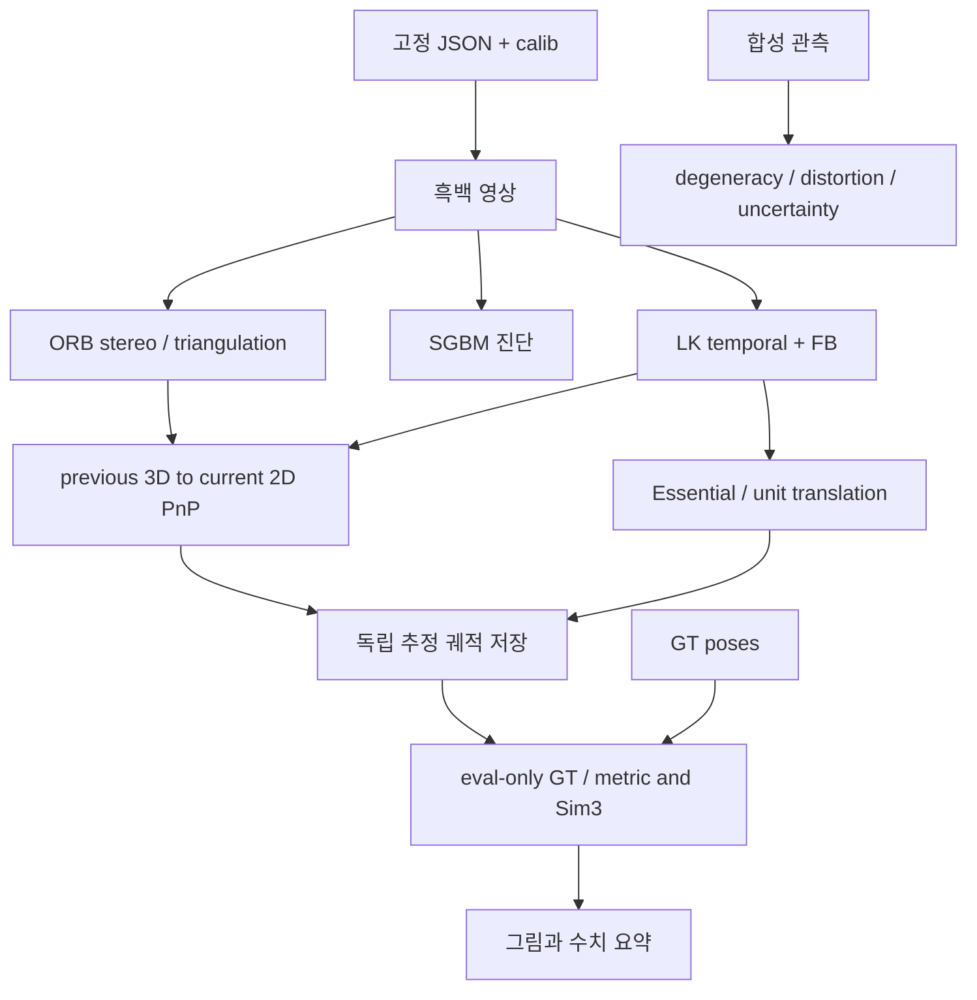


- geometry.py: SE(3) inverse/compose/transform/project, similarity fitting. T_ab는 b 좌표를 a로 변환한다.
- observations.py: ImagePair uint8 HxW, K 3x3 px, baseline m → ORB 좌우 pixels Nx2,
  descriptor Hamming bits, ratio 무차원, disparity px, X_previous Nx3 m, reprojection px.
  LK 입력은 previous ORB pixels, 출력은 current pixels 및 원래 인덱스 유지 mask.
- odometry.py: 영상·보정만 입력. PnP는 X_previous → current pixel로 T_current_previous를 추정한다.
  누적 T_start_current = T_start_previous @ inverse(T_current_previous).
  E도 같은 변환 방향이나 t는 임의 단위. GT 모듈을 import하지 않는다.
- evaluation.py: GT를 읽는 유일한 모듈. 각 구간 GT를 시작 자세로 정규화.
  stereo는 첫 자세 일치만, rigid fit/scale fit 없음. mono는 구간별 Sim3 position fit을 명시.
  ATE m, 1-frame relative translation RMSE m, rotation RMSE deg, endpoint m; 공식 KITTI score 아님.
- diagnostics.py: 실제 한 쌍 정류/게이트/SGBM/LK와 pose-only LM 전후. 깊이 정확도 GT 부재.
- synthetic.py: 알려진 생성 geometry/노이즈에서 퇴화·왜곡·불확실성을 별도 저장.
- figures.py: 저장된 stages에서 재현, 7인치 폭/12pt 이상, 실제와 합성을 제목으로 구분.
- run.py: seed, OpenCV 1 thread, 의존성 검사, 설정 및 입력 hash, 모듈 순차 실행/검증.
- test_invariants.py: 변환·단위·정렬·GT 의존성·hold·projection 불변량.


<a id="c12-4"></a>

### 4. 파라미터를 바꾸기 전에 고정할 표

| 단계 | 이번 설정 | 단위와 의미 |
|---|---|---|
| ORB | 2500 features | 검출 목표 수, 3D 점 수 아님 |
| ratio | d1 < 0.75 d2 | 무차원, d2=0 거절 |
| Hamming | <=64 | 서로 다른 bit 수 |
| 정류 | abs(dy)<=1.5, disparity>1 | px |
| 깊이 | 0<Z<=100 | m |
| LK | 21x21, maxLevel=3, 30회, eps=0.01 | 픽셀 패치·반복 종료 |
| FB | <=1 | px 왕복 오차 |
| PnP | RANSAC 2px + LM | 고정 3D, pose-only |
| PnP 반복·하한 | 최대 200회, 최소 inlier 12개 | 신뢰도 0.999, EPnP 가설 |
| Essential | RANSAC 1px, 신뢰도 0.999 | 최소 입력·수용 하한 12개, 다중 E이면 첫 후보 |
| 삼각측량 재투영 | 최대 1.5 | px, 양안 검사 |
| SGBM | 128 disparities, block=5, uniqueness=10 | 진단용, PnP 입력 아님 |
| SGBM penalty | 200, 800 | 내부 매칭 비용 벌점 |
| SGBM LR | <=1 | px, 우측 음수 disparity |

전체 설정의 진실의 원본은 `research/camera-slam-textbook/configs/experiment.json`이다. 설정 숫자를 같게 유지해도 FB로 입력 집합이 바뀌면 RANSAC 표본과 최종 pose가 달라질 수 있다. 실패 시 상대 pose를 항등으로 저장하고 다음 영상으로 진행한다. 따라서 유실된 이동을 다음 성공 프레임이 복구하지 않는다.

<a id="c12-5"></a>

### 5. 정렬과 지표의 계산식

GT는 각 구간의 첫 자세 역변환으로 시작 좌표계에 정규화한다. stereo에는 추가 fit을 하지 않는다.
ATE는 위치 오차 norm의 RMSE. relative D_i=inverse(T_i)*T_(i+1),
RPE residual=inverse(D_GT)*D_est이며 translation norm과 rotation angle을 각각 집계한다.
mono는 s,R,t로 위치의 제곱오차를 최소화한 Sim3를 평가에서만 사용한다. 한 가지 s는 가변 속도를 복원하지 못한다.
official KITTI 100..800m 구간 평가와 다르다. 구간이 짧고 동일 시퀀스라 광범위 성능 비교를 주장하지 않는다.

```text
ATE_RMSE = sqrt(mean_i ||p_est_i - p_gt_i||^2)
D_i = inverse(T_i) * T_(i+1)
E_i = inverse(D_gt_i) * D_est_i
RPE_translation_RMSE = sqrt(mean_i ||translation(E_i)||^2)
RPE_rotation_RMSE = sqrt(mean_i angle(rotation(E_i))^2)
```

위 회전각은 계산에서 rad이고 표에서는 deg로 변환한다. Stereo의 첫 자세 정규화는 전체 궤적에 최적 강체 정렬을 하는 연산이 아니다. Mono에서는 위치에 맞춘 Sim(3)의 회전·척도를 평가 출력에만 적용한다. 공식 KITTI의 긴 구간 상대 오차와 여기의 1-frame RPE를 혼동하지 않는다. [공식 평가 정의](https://www.cvlibs.net/datasets/kitti/eval_odometry.php)

<a id="c12-6"></a>

### 6. 실제 KITTI 여섯 평가와 음의 ablation


표는 읽기 쉬운 정밀도로 반올림했다. 판정·재계산에는 원본 JSON/CSV의 전체 정밀도를 사용한다. 단위가 같은 값도 정렬 정책이 다르면 직접 순위를 매기지 않는다.

| 구간 (끝 제외) | 방법 / 평가 정책 | ATE RMSE m | endpoint m | 1-frame RPE m | 회전 RPE deg |
|---|---|---:|---:|---:|---:|
| 0:200 | stereo FB, metric, 척도 적합 없음 | 1.7043 | 1.7156 | 0.0335 | 0.0725 |
| 0:200 | stereo forward only, metric | 1.6418 | 1.7462 | 0.0340 | 0.0745 |
| 0:200 | mono unit-step, 평가 전용 GT Sim3 | 5.1499 | 4.6047 | 0.2309 | 0.4292 |
| 400:500 | stereo FB, metric, 척도 적합 없음 | 0.7907 | 1.3389 | 0.0289 | 0.0466 |
| 400:500 | stereo forward only, metric | 0.7547 | 1.3275 | 0.0262 | 0.0472 |
| 400:500 | mono unit-step, 평가 전용 GT Sim3 | 3.1306 | 4.6432 | 0.2282 | 0.9030 |

- GT path length: 144.87855170702335m / 66.40044101005537m.
- mono 사후 fitted scale: 0.7242085489415547 / 0.7065476892909599 m per arbitrary unit.
- 각 방법의 hold=0/199, 0/99. 이는 이 두 구간의 결과일 뿐 robust tracking 인증이 아니다.
- FB는 두 구간 모두 ATE를 악화시켰다. 작은 잘못된 관측을 줄이는 게이트라도 최종 궤적 개선을 보장하지 않는다.
- stereo metric과 mono Sim3의 숫자를 공정한 정확도 순위로 해석하지 않는다. 관측과 정렬 조건이 다르다.
- 전체 숫자: `artifacts/summary.json`, 여섯 평가 행 `artifacts/metrics.csv`.
- 각 프레임의 잔차/오류/수: `artifacts/odometry/<segment>/frames.csv`, `artifacts/evaluation/<segment>/errors.csv`.


<a id="c12-7"></a>

### 7. 개발 구간: 같은 경로에서도 지표는 다른 질문을 한다

[0,200)은 첫 카메라에서 시작한 144.8786m의 GT 경로다. Stereo FB의 ATE는 forward-only보다 크지만 이 구간의 1-frame translation RPE는 조금 작다. 국소 제곱오차와 누적 drift의 방향·상관이 다르므로 모순이 아니다. 그림은 이 차이를 읽기 위한 것이며 일부 유리한 지표만 골라 개선이라고 결론내리지 않는다.

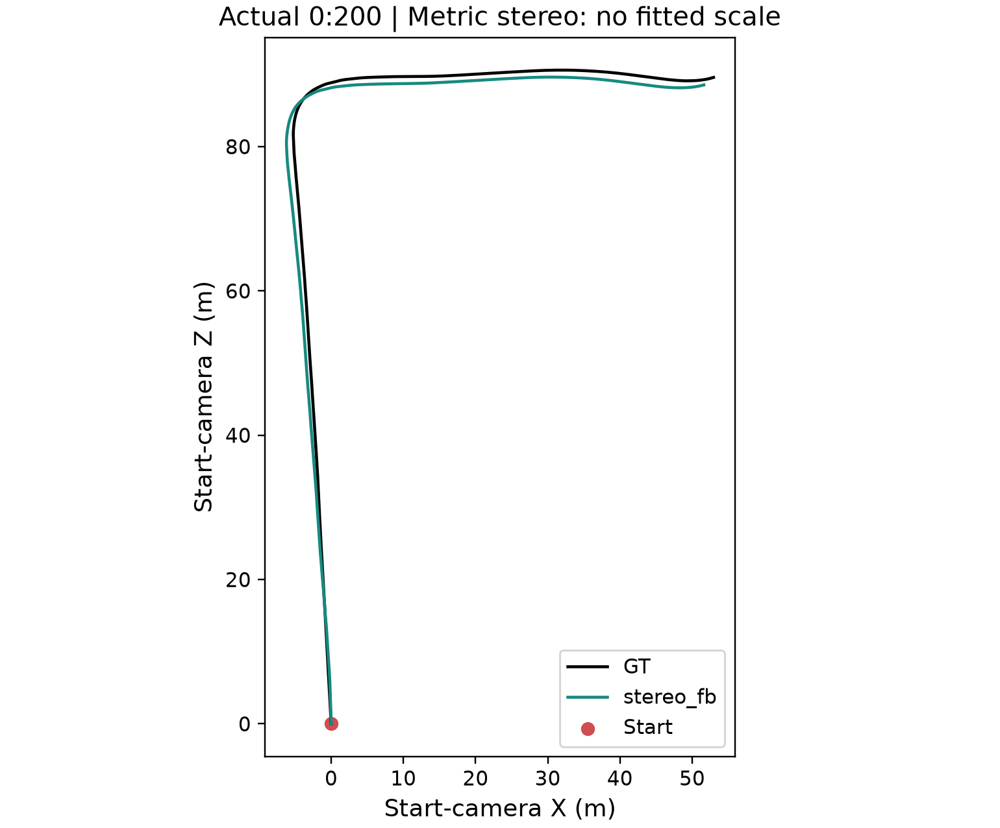

**그림 C12-01. 개발 구간: 미터 스테레오 궤적 (실제 KITTI 00).** 스테레오는 척도 적합 없음. 단안은 GT로 Sim3 적합한 형태 진단이므로 두 그림을 공정한 정확도 순위로 해석하지 않는다.

원본: `artifacts/evaluation/000000_000200/stages.npz`, `artifacts/odometry/000000_000200/frames.csv` (카메라 연구 디렉터리 기준; data/는 저장소 기준).


**그림 C12-02. 개발 구간: 평가 전용 Sim(3) 단안 궤적 (실제 KITTI 00).** 스테레오는 척도 적합 없음. 단안은 GT로 Sim3 적합한 형태 진단이므로 두 그림을 공정한 정확도 순위로 해석하지 않는다.

원본: `artifacts/evaluation/000000_000200/stages.npz`, `artifacts/odometry/000000_000200/frames.csv` (카메라 연구 디렉터리 기준; data/는 저장소 기준).


**그림 C12-03. 개발 구간: 미터 위치오차의 시계열 (실제 KITTI 00).** 동일 구간·metric 척도의 FB on/off 비교. 개선 또는 악화를 있는 그대로 표시한다.

원본: `artifacts/evaluation/000000_000200/stages.npz`, `artifacts/odometry/000000_000200/frames.csv` (카메라 연구 디렉터리 기준; data/는 저장소 기준).


**그림 C12-04. 개발 구간: 서로 다른 관측 집합의 합의 수 (실제 KITTI 00).** E는 전체 ORB의 temporal track, PnP는 stereo 유효 3D 부분집합을 사용한다. 같은 관측 수의 비교가 아니다.

원본: `artifacts/evaluation/000000_000200/stages.npz`, `artifacts/odometry/000000_000200/frames.csv` (카메라 연구 디렉터리 기준; data/는 저장소 기준).

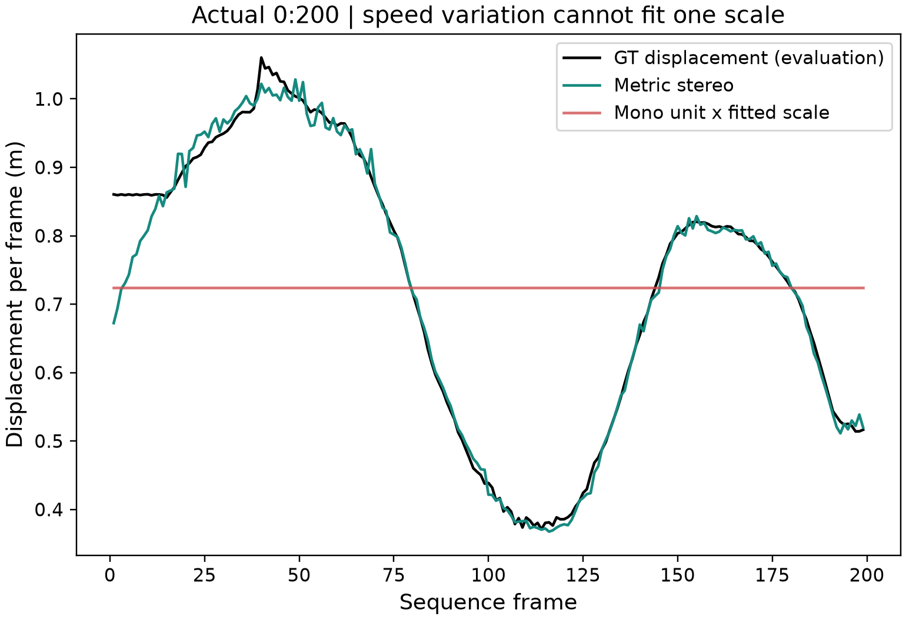

**그림 C12-05. 개발 구간: 프레임별 이동량과 단안 단위 길이 (실제 KITTI 00).** 단안의 성공 이동량은 항상 1이며 실패는 0이다. 하나의 Sim3 scale은 실제 속도 변화나 잃은 이동을 복원하지 못한다.

원본: `artifacts/evaluation/000000_000200/stages.npz`, `artifacts/odometry/000000_000200/frames.csv`, `artifacts/odometry/000000_000200/poses.npz` (카메라 연구 디렉터리 기준; data/는 저장소 기준).


**그림 C12-06. 개발 구간: 한 프레임 상대 이동오차 (실제 KITTI 00).** 1-frame RPE이며 KITTI 공식 100..800m 구간 점수가 아니다. 회전 RPE는 별도 CSV/JSON에 보존한다.

원본: `artifacts/evaluation/000000_000200/stages.npz`, `artifacts/odometry/000000_000200/frames.csv` (카메라 연구 디렉터리 기준; data/는 저장소 기준).

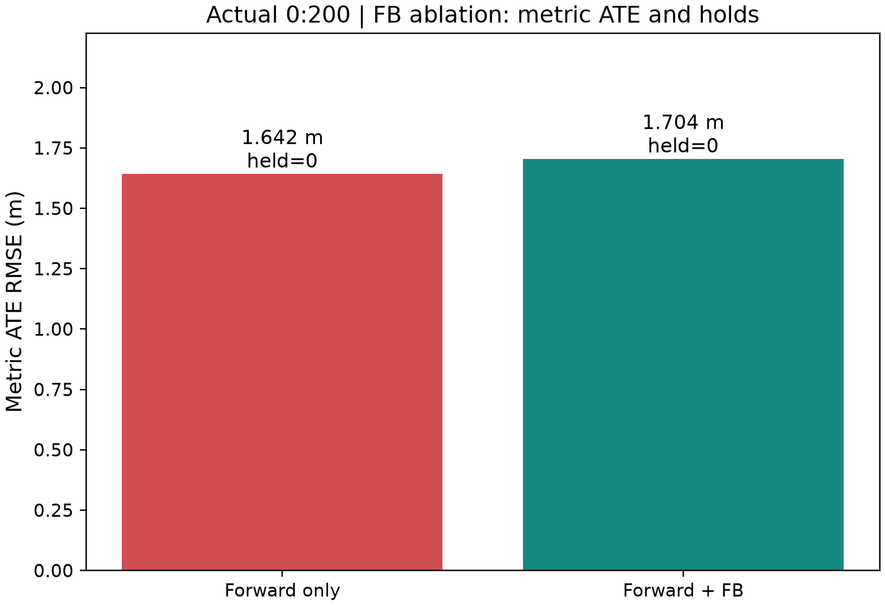

**그림 C12-07. 개발 구간: 전후방 검사의 추가 효과 (실제 KITTI 00).** FB 게이트 외 동일 설정. RANSAC 입력 집합 변화로 결과가 달라진다. 인과적 일반화나 성능 개선 보장은 아니다.

원본: `artifacts/evaluation/000000_000200/stages.npz`, `artifacts/odometry/000000_000200/frames.csv` (카메라 연구 디렉터리 기준; data/는 저장소 기준).


**그림 C12-08. 개발 구간: 최대 상대오차 프레임의 사후 진단 (실제 KITTI 00).** 평가에서 최대 RPE 프레임을 사후 선택한 진단. 동적 객체·가림 여부는 GT mask가 없어 확정하지 않는다.

원본: `artifacts/evaluation/000000_000200/stages.npz`, `artifacts/odometry/000000_000200/frames.csv`, `artifacts/odometry/000000_000200/000001.npz`, `data/kitti/dataset/sequences/00/image_0/000001.png` (카메라 연구 디렉터리 기준; data/는 저장소 기준).

<a id="c12-8"></a>

### 8. 분리 구간: 같은 설정에서도 실패 신호의 관계는 바뀐다

[400,500)은 개발 구간과 겹치지 않는 66.4004m GT 경로다. 이 구간에서도 FB의 ATE가 악화되었으며 translation RPE도 악화되었다. Holdout 결과를 본 뒤 임계값을 튜닝하지 않았다. 같은 시퀀스의 짧은 구간이므로 도시·날씨·카메라 일반화의 증거로 확대하지 않는다.


**그림 C12-09. 분리 구간: 미터 스테레오 궤적 (실제 KITTI 00).** 스테레오는 척도 적합 없음. 단안은 GT로 Sim3 적합한 형태 진단이므로 두 그림을 공정한 정확도 순위로 해석하지 않는다.

원본: `artifacts/evaluation/000400_000500/stages.npz`, `artifacts/odometry/000400_000500/frames.csv` (카메라 연구 디렉터리 기준; data/는 저장소 기준).

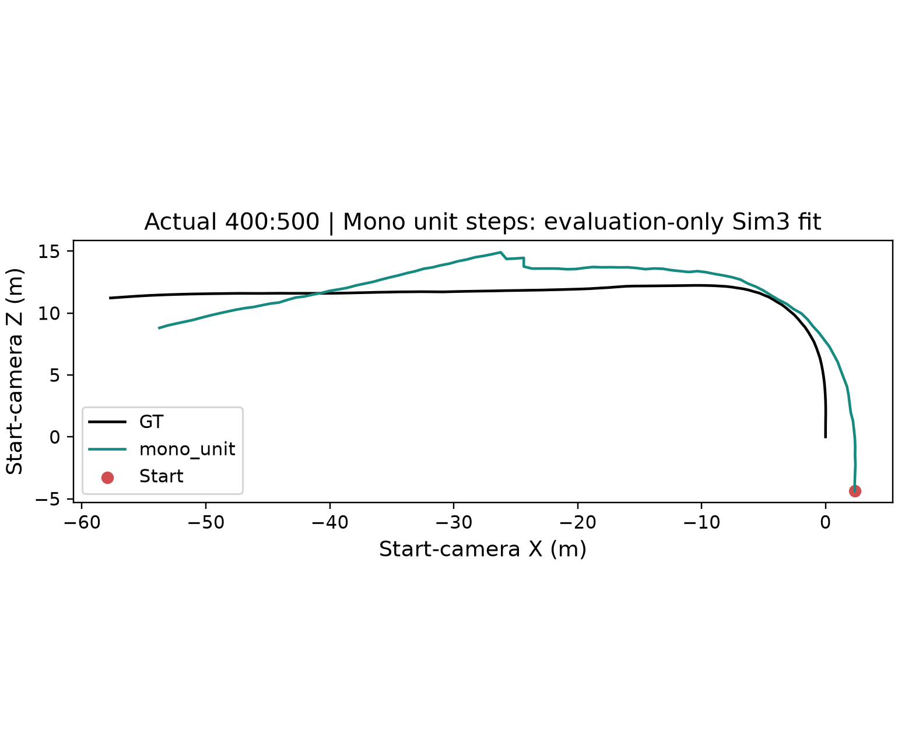

**그림 C12-10. 분리 구간: 평가 전용 Sim(3) 단안 궤적 (실제 KITTI 00).** 스테레오는 척도 적합 없음. 단안은 GT로 Sim3 적합한 형태 진단이므로 두 그림을 공정한 정확도 순위로 해석하지 않는다.

원본: `artifacts/evaluation/000400_000500/stages.npz`, `artifacts/odometry/000400_000500/frames.csv` (카메라 연구 디렉터리 기준; data/는 저장소 기준).

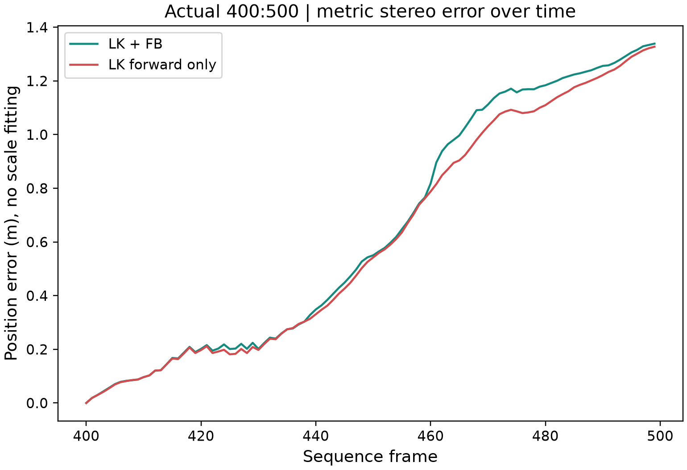

**그림 C12-11. 분리 구간: 미터 위치오차의 시계열 (실제 KITTI 00).** 동일 구간·metric 척도의 FB on/off 비교. 개선 또는 악화를 있는 그대로 표시한다.

원본: `artifacts/evaluation/000400_000500/stages.npz`, `artifacts/odometry/000400_000500/frames.csv` (카메라 연구 디렉터리 기준; data/는 저장소 기준).


**그림 C12-12. 분리 구간: 서로 다른 관측 집합의 합의 수 (실제 KITTI 00).** E는 전체 ORB의 temporal track, PnP는 stereo 유효 3D 부분집합을 사용한다. 같은 관측 수의 비교가 아니다.

원본: `artifacts/evaluation/000400_000500/stages.npz`, `artifacts/odometry/000400_000500/frames.csv` (카메라 연구 디렉터리 기준; data/는 저장소 기준).

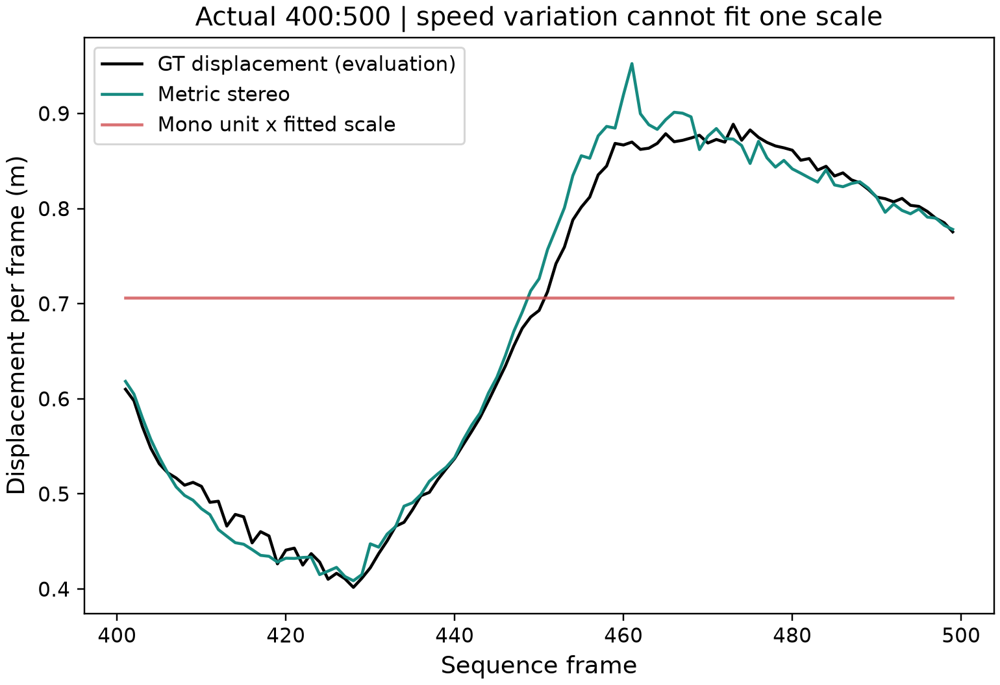

**그림 C12-13. 분리 구간: 프레임별 이동량과 단안 단위 길이 (실제 KITTI 00).** 단안의 성공 이동량은 항상 1이며 실패는 0이다. 하나의 Sim3 scale은 실제 속도 변화나 잃은 이동을 복원하지 못한다.

원본: `artifacts/evaluation/000400_000500/stages.npz`, `artifacts/odometry/000400_000500/frames.csv`, `artifacts/odometry/000400_000500/poses.npz` (카메라 연구 디렉터리 기준; data/는 저장소 기준).

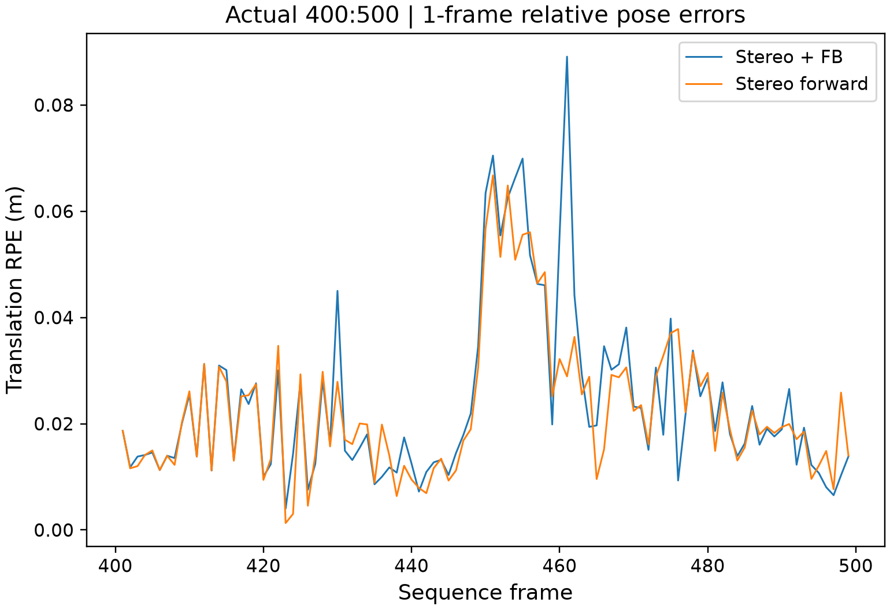

**그림 C12-14. 분리 구간: 한 프레임 상대 이동오차 (실제 KITTI 00).** 1-frame RPE이며 KITTI 공식 100..800m 구간 점수가 아니다. 회전 RPE는 별도 CSV/JSON에 보존한다.

원본: `artifacts/evaluation/000400_000500/stages.npz`, `artifacts/odometry/000400_000500/frames.csv` (카메라 연구 디렉터리 기준; data/는 저장소 기준).

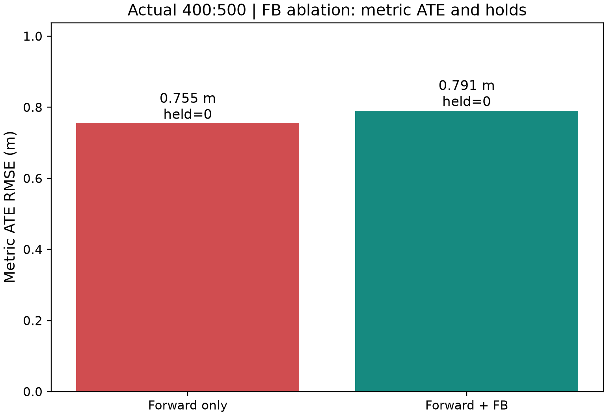

**그림 C12-15. 분리 구간: 전후방 검사의 추가 효과 (실제 KITTI 00).** FB 게이트 외 동일 설정. RANSAC 입력 집합 변화로 결과가 달라진다. 인과적 일반화나 성능 개선 보장은 아니다.

원본: `artifacts/evaluation/000400_000500/stages.npz`, `artifacts/odometry/000400_000500/frames.csv` (카메라 연구 디렉터리 기준; data/는 저장소 기준).


**그림 C12-16. 분리 구간: 최대 상대오차 프레임의 사후 진단 (실제 KITTI 00).** 평가에서 최대 RPE 프레임을 사후 선택한 진단. 동적 객체·가림 여부는 GT mask가 없어 확정하지 않는다.

원본: `artifacts/evaluation/000400_000500/stages.npz`, `artifacts/odometry/000400_000500/frames.csv`, `artifacts/odometry/000400_000500/000461.npz`, `data/kitti/dataset/sequences/00/image_0/000461.png` (카메라 연구 디렉터리 기준; data/는 저장소 기준).

<a id="c12-9"></a>

### 9. 관측 단계의 수치와 분모


| 프레임 | ratio 수 / y<=1.5px 비율 | cross-check 수 / y 비율 | 최종 sparse 3D 수 | LK forward → FB |
|---|---|---|---:|---|
| 0 | 657 / 0.8189 | 1217 / 0.7231 | 518 | 2495 → 2363 |
| 100 | 910 / 0.8615 | 1390 / 0.7986 | 731 | 2462 → 1539 |
| 400 | 1148 / 0.9233 | 1540 / 0.8942 | 897 | 2427 → 2417 |

ratio 뒤 Hamming<=64를 추가해도 세 프레임 모두 제거 수 0이었다. 이 ablation은 실제 무효한 추가 게이트도 공개한다.
ratio와 cross-check 비교는 정류 일관성/개수의 비교이며 정답 대응률이나 전체 VO 정확도 비교가 아니다.
y gate 뒤 y 비율=1은 게이트 정의에 의한 결과이므로 독립 검증 지표로 쓰지 않는다.
frame100의 큰 FB 제거 수는 관측 품질 변화의 신호지만, GT flow/가림 mask가 없어 원인을 확정하지 않는다.

| 프레임 | dense 양의 disparity 비율 | LR 일관 비율 | 깊이 유효 비율 / 수 | LM 전 → 후 RMSE px |
|---|---:|---:|---|---|
| 0 | 0.7453 | 0.6693 | 0.6600 / 307963 | 0.6297 → 0.6176 |
| 100 | 0.8177 | 0.7243 | 0.7173 / 334715 | 0.5516 → 0.4794 |
| 400 | 0.7028 | 0.5900 | 0.5836 / 272311 | 0.4649 → 0.4350 |

모든 dense 비율의 분모는 376*1241 전체 픽셀이다. 코드의 positive는 d>1px이며 수학적 d>0과 구분한다.
SGBM 깊이는 시각화/진단용이며 PnP 입력에 사용하지 않았다. PnP의 3D는 ORB stereo 삼각측량뿐이다.
LM 비교는 동일 RANSAC inlier의 in-sample 오차이다. 추가 일반화·joint BA 성능을 입증하지 않는다.


<a id="c12-10"></a>

### 10. 실패 분류와 결론의 강도


- 0:200의 최대 stereo 1-frame RPE는 frame1, 0.1907563355762054m. PnP 490/512 inlier에도 오차가 있다.
- 400:500의 최대값은 frame461, 0.08910900090936784m. PnP 435/466 inlier.
- 각 구간 상위 5개와 사후 Pearson 상관: `evaluation/<segment>/failures.json`, `worst_frames.csv`.
- feature 수/FB 오차와 RPE의 상관 부호가 구간별로 달라진다. 하나의 quality score로 오류 원인을 단정하지 않는다.
- 실패 프레임을 identity hold하더라도 다음 이미지로 진행하므로 실패 이동은 영구히 빠진다. 재추적 복구가 아니다.
- E가 여러 후보를 반환하면 첫 3x3만 사용한다. 이번 298 transition의 multi-E frame은 0개였다.
- 단안 성공 step=1은 속도 변화 표현 불가. 전체 Sim3가 맞더라도 국소 이동량은 틀릴 수 있다.
- 실제 loop closure, local map, keyframe selection, outlier semantic mask, 누적 BA 없음.


| 실패 분류 | 실제 관찰 또는 모델 | 아직 알 수 없는 것 |
|---|---|---|
| descriptor 모호성 | ratio/cross-check 개수·정류 비율 다름 | 정답 대응 precision |
| 기하 자기일관성 | y gate·재투영·FB 통과 | 물리적 대응의 진실 |
| 낮은 관측 가능성 | 합성 순수 회전에서도 E accepted | 모든 실제 퇴화 자동 검출 |
| 누적 오차 | 두 구간 FB ATE 악화 | 전체 시퀀스·다중 seed 일반화 |
| 지도 수명주기 부재 | 이전 frame 3D만 사용 | 장기 재추적·루프 복구 |
| 모델 불일치 | 동적 물체·블러 등이 가능한 원인 | mask/flow GT 없는 원인 확정 |
| 잘못된 제약 | 합성 false loop로 위치오차 확대 | 실제 loop rejection 성능 |

<a id="c12-11"></a>

### 11. 학습 경로는 교체 사다리가 아니라 분기 그래프다

공통 시작점은 A3/A5/A9/A10/A11과 C6의 재투영·Schur·gauge다.
그 다음 관심 있는 관측과 지도 목적에 따라 갈라진다.
한 분기의 최신 논문을 읽었다고 다른 분기의 기초 문제가 사라지는 것은 아니다.

```text
공통: projection -> residual -> Jacobian -> uncertainty -> gauge
  |
  +-- 희소 장기 지도: PTAM -> ORB-SLAM -> ORB-SLAM2 -> ORB-SLAM3
  |                    |        |
  |                    |        +-- BoW/DBoW2 -> geometric loop -> pose graph
  |                    +-- BA / Schur / map lifecycle
  |
  +-- 광도 관측: LSD-SLAM -> DSO -> LDSO
  |              |          |
  |              +-- Sim3   +-- photometric calibration / marginalization
  |
  +-- 관성 관측: MSCKF -----> nullspace / consistency
  |              Forster --> preintegration -> VINS-Mono / ORB-SLAM3
  |                                             +-- time calibration
  |
  +-- RGB-D 기하: Curless-Levoy -> KinectFusion -> TSDF surface
  |               OctoMap --------------------> occupancy
  |               Voxblox --------------------> ESDF planning distance
  |
  +-- 학습 대응: SuperPoint -> SuperGlue -> LightGlue
  +-- 학습 반복 추정: DROID-SLAM -> geometry + learned update 해석
  +-- 장면 표현: NICE-SLAM / 3DGS -> Gaussian Splatting SLAM
  +-- 의미와 운동: SemanticFusion / DynaSLAM
  +-- 별도 행동 학습: VLM 경계 -> RT-2 / OpenVLA
```

화살표는 이 교재의 읽기 의존성을 뜻하며 논문이 반드시 직접 계승 관계라는 뜻은 아니다.
MSCKF와 optimization VIO는 계산·선형화·상태 유지 방식이 다른 대안이다.
occupancy는 TSDF보다 오래되었다고 쓸모없어진 표현이 아니다.
photorealistic rendering이 필요 없는 navigation에는 ESDF/occupancy가 직접 목적에 맞을 수 있다.
신경 matcher를 쓰지 않는 baseline도 자원·해석 가능성·도메인 적합성 때문에 유효하다.

<a id="c12-12"></a>

### 12. 단계별 읽기 질문과 통과 기준

1. **PTAM + ORB-SLAM:** 키프레임·관측·지도점의 관계를 직접 그린다.
   통과 기준은 frame 삭제와 landmark 삭제가 어떻게 다른지 설명하는 것이다.
2. **BA synthesis:** 재투영 J와 Schur 블록을 손으로 계산한다.
   통과 기준은 residual 부호와 perturbation 방향을 바꾸었을 때 무엇이 달라지는지 말하는 것이다.
3. **DBoW2 + ORB loop:** 검색 점수에서 relative pose까지 필요한 산출물을 나열한다.
   통과 기준은 반복 복도에서 score가 높아도 edge를 거절할 근거를 제시하는 것이다.
4. **LSD-SLAM + DSO + LDSO:** residual 종류와 active/global map을 비교한다.
   통과 기준은 direct와 dense가 다른 축이고 DSO와 loop-SLAM이 다른 범위임을 설명하는 것이다.
5. **MSCKF + Forster:** feature elimination과 IMU factor compression을 구분한다.
   통과 기준은 nullspace projection과 Schur complement의 공통점·차이를 말하는 것이다.
6. **VINS-Mono + temporal calibration + ORB-SLAM3:** 초기화와 observability를 읽는다.
   통과 기준은 정지 구간만으로 모든 calibration을 추정할 수 없는 이유를 설명하는 것이다.
7. **Curless-Levoy + KinectFusion + OctoMap + Voxblox:** 지도 목적을 분리한다.
   통과 기준은 같은 depth에서 TSDF와 occupancy가 어떤 다른 값으로 갱신되는지 계산하는 것이다.
8. **SuperPoint + SuperGlue + LightGlue:** 학습 front-end의 타입 계약을 읽는다.
   통과 기준은 resize와 K, descriptor와 vocabulary, confidence와 covariance를 구별하는 것이다.
9. **DROID + NICE-SLAM + 3DGS + GS-SLAM:** 학습 대상이 update인지 scene인지 식별한다.
   통과 기준은 trajectory·geometry·rendering 평가를 분리하는 것이다.
10. **SemanticFusion + DynaSLAM + RT-2/OpenVLA:** 의미·운동·행동의 경계를 읽는다.
    통과 기준은 KITTI pose를 action label로 대체할 수 없는 이유를 설명하는 것이다.

위 번호는 수업 진행 순서이며 알고리즘의 절대 성능 순위가 아니다.
관성 데이터가 없다면 5~6은 이론 학습으로 남기고 RGB-D 수집 계약을 먼저 검증할 수 있다.
GPU가 없다면 8~9는 입출력·논문 수식·실패 분석을 공부하고 실행 가능성을 별도 검토한다.
실습 자원이 없다는 이유로 미실행 결과를 성공으로 쓰지 않는다.

<a id="c12-13"></a>

### 13. 실행 명령과 산출물의 provenance

저장소 루트에서 실행한다. 아래 명령은 기존 데이터와 연구 가상환경이 있다는 전제다. 실제 입력 영상은 Git에 포함된 코드만으로 대체되지 않는다. 전체 설정과 SHA-256으로 실행 당시의 입력·소스를 식별하고, code freeze는 **d22a4e8**로 기록한다. 초기 실행 manifest의 HEAD가 연구 시작점 또는 중간 커밋인 것은 그 당시 작업 트리에서 생성했기 때문이다. HEAD만으로 미커밋 소스를 식별하지 않고 source hash를 함께 보존했다.

~~~sh
cd /Users/youth/Project/slam-lab
research/20261031_vo-lo-study/.venv/bin/python research/camera-slam-textbook/src/run.py
research/20261031_vo-lo-study/.venv/bin/python research/camera-slam-textbook/src/verify.py --repeat
research/20261031_vo-lo-study/.venv/bin/python -m unittest discover -s research/camera-slam-textbook/src -p test_invariants.py -v
python3 research/camera-slam-textbook/notes/geometry-verification.py
python3 research/camera-slam-textbook/notes/advanced-verification.py
~~~

Python 3.11, NumPy 2.4.6, SciPy 1.17.1, Matplotlib 3.11.1, opencv-python 5.0.0.93 (cv2=5.0.0)을 사용했다. OpenCV 문헌 링크의 4.x API 설명과 실제 5.0 환경을 구분한다. --reuse-estimates는 추정 재실행이 아니라 기존 추정의 평가·그림 재집계다. 마지막 summary의 run_mode가 이 값이어도 독립 반복 검증 결과는 별도 보존한다. runtime은 두 추정기와 ablation을 포함하지만 모든 저장 I/O를 포함하는 end-to-end 처리 시간이 아니므로 실시간 인증에 사용하지 않는다.

| 경로: research/camera-slam-textbook/ 기준 | 산출물과 확인 질문 |
|---|---|
| configs/experiment.json | 구간·seed·게이트·추정기 설정 |
| artifacts/stereo/*.npz | 좌우 픽셀, descriptor 거리, mask, 3D, 재투영 |
| artifacts/dense/*.npz | fixed16 disparity, LR 잔차, 깊이·유효 mask |
| artifacts/tracking/*.npz | 순/역방향 좌표와 status, FB, 밝기 오차 |
| artifacts/reprojection/*.npz | 동일 inlier의 pose-only LM 전후 |
| artifacts/odometry/*/poses.npz | 정렬 전 세 방법의 추정 자세 |
| artifacts/odometry/*/frames.csv | 성공·hold·대응 수·프레임 진단 |
| artifacts/evaluation/*/errors.csv | 평가 전용 GT 연결과 지표 |
| artifacts/evaluation/*/failures.json | 사후 worst frame·상관 진단 |
| artifacts/synthetic/ | 왜곡·깊이 불확실성·퇴화 모델 |
| artifacts/provenance/ | 입력·설정·소스 hash와 환경 |
| artifacts/tests/ | 불변량·독립 반복 검증 |
| figures/figure_manifest.json | 모든 신규 카메라 그림의 원본 배열 연결 |

반복 검증에서 298 transition의 세 방법 자세는 최대 절대차 0이었고, 두 구간 8557+4257=12814개 stage 배열이 NaN 위치를 포함하여 일치했다. 749 산출물과 14 source/config hash를 검증했고 602 입력 hash를 기록했다. 이는 고정 환경에서의 결정적 재현성이지 정확성이나 다른 하드웨어의 bitwise 동일성 보장이 아니다.

19개 실제 연구 불변량 테스트, 15개 합성 백엔드 테스트, 기하 계산 69개와 고급 계산 32개 검사가 통과했다. 서로 다른 검사 묶음을 알고리즘 성공률로 합산하지 않는다. 기하 검사는 22개 본문 계산 예와 연습문제의 산술·행렬 관계를, 고급 검사는 Jacobian·Schur·사전적분·지도 갱신 등 손계산을 검사한다. 이로써 모든 문헌 알고리즘의 구현을 검증한 것은 아니다.

실제 수정한 버퍼 문제도 재현 계약의 일부다. LK status=0의 err는 미정의였고 초기 반복에서 2500개 중 3개가 달랐다. 궤적은 같았지만 이 값들을 정상 관측으로 저장하면 비결정적 진단이 된다. 실패 좌표/오차는 NaN, 왕복 오차는 inf로 정규화하고 raw status를 남긴 뒤 전체 stage 반복 일치를 확인했다. 합성 회전오차도 실패 hold 포함 통계와 성공 조건부 통계를 분리했다.

<a id="c12-14"></a>

### 14. 합성 백엔드의 독립 재현

Repository root에서 실행한다. 기존 venv를 재사용하며 install 명령은 필요 없다.

```sh
cd /Users/youth/Project/slam-lab
env PYTHONDONTWRITEBYTECODE=1 OPENBLAS_NUM_THREADS=1 OMP_NUM_THREADS=1 MPLCONFIGDIR=.cache/matplotlib research/20261031_vo-lo-study/.venv/bin/python research/camera-backend-lessons/src/run.py
env PYTHONDONTWRITEBYTECODE=1 OPENBLAS_NUM_THREADS=1 OMP_NUM_THREADS=1 MPLCONFIGDIR=.cache/matplotlib research/20261031_vo-lo-study/.venv/bin/python research/camera-backend-lessons/src/test_backend.py
```

`research/camera-backend-lessons/src/run.py`가 plotting import 전에 own directory로 이동하므로 상대 MPLCONFIGDIR도 그 안에 생긴다.
입력 seed=20261124, graph seed=20261125. NumPy 2.4.6, SciPy 1.17.1, cv2 5.0.0
(opencv-python distribution 5.0.0.93), Matplotlib 3.11.1을 사용했다.
Direct dependency 목록은 `configs/requirements-observed.txt`이며 전체 transitive lockfile은 아니다.

| 경로 | 내용 |
|---|---|
| `configs/lesson.json` | 모든 실험 noise·baseline·크기·seed·최대 평가 횟수 |
| `research/camera-backend-lessons/src/backend.py` | 원본 모델, analytic/numerical Jacobian 옵션, solver |
| `research/camera-backend-lessons/src/run.py` | 실험 case, 지표·NPZ·그림·manifest 생성 |
| `research/camera-backend-lessons/src/test_backend.py` | 기하·수치미분·수렴 관찰·hash·그림 테스트 |
| `artifacts/ba/module.npz` | GT/초기/각 해의 pose·point·projection·residual, 관측과 mask |
| `artifacts/gauge/module.npz` | free/fixed spectrum, 전역변환, scale별 pixel 변화 |
| `artifacts/pose_graph/module.npz` | GT/초기/각 해, directed edges·측정·sigma·raw/whitened residual |
| 각 모듈 `metrics.json` | 단위가 명시된 RMSE와 solver 상태 |
| `artifacts/manifest.json` | 실행 HEAD·Python·dependency·config, 소스/config와 산출물 SHA-256 |
| `artifacts/tests` | 실행한 unittest 목록·성패, 실패 시 nonzero exit |

NPZ shape/축 순서는 `notes/architecture.md` 참조. Source 위치는 이 수업 버전의 파일 기준이며
정확한 실행본은 manifest SHA-256으로 구분한다. 기존 HEAD만으로 새 미커밋 파일을 식별할 수 없다.

테스트는 finite projection, positive depth, 모든 analytic J 열의 중앙차분 대조,
analytic/numerical solver 비교, anchor 유지, rigid gauge·scale·SVD, seed 반복,
SE(2) compose/relative, loop 방향·정답, 전체 산출물 finite, 두 변수군 갱신, fixed-seed 결과,
source/artifact hash, 그림 개수와 계산 연습문제를 포함한다.
성패는 `artifacts/tests/metrics.json`을 진실의 원본으로 사용한다.

<a id="c12-15"></a>

### 15. 코드에서 다시 찾는 관측과 변환

모든 줄 번호는 d22a4e8의 경로다. 실제 실행본은 manifest의 SHA-256으로도 확인한다.

| 파일:줄 (research/camera-slam-textbook/ 기준) | 책임 |
|---|---|
| src/common.py:47 | 보정·기준선 |
| src/observations.py:8 | ORB stereo·게이트·삼각측량 |
| src/observations.py:45 | LK/FB·실패 버퍼 정규화 |
| src/observations.py:73 | SGBM fixed16/LR/깊이 |
| src/odometry.py:10 | PnP RANSAC·pose-only LM |
| src/odometry.py:38 | E 첫 후보·단위 이동 |
| src/odometry.py:62 | 상대변환 역누적·stage 저장 |
| src/odometry.py:108 | 실패 여부와 별개인 다음 영상 진행 |
| src/evaluation.py:22 | 유일한 GT 읽기·평가 정렬 |
| src/geometry.py:14 | SE(3) 역변환 |
| src/geometry.py:31 | 평가 Sim(3) |
| src/synthetic.py:9 | 성공/hold 분리 통계 |
| src/worked_examples.py:7 | 실제 수치 예 |
| src/verify.py:12 | 독립 재실행과 산출물 확인 |

이 표는 운영 src/vo 경로의 대체 선언이 아니다. 운영 코드에 통합하려면 자료형·실패 정책·시간 정렬·테스트를 별도로 설계해야 하며, 이번 산출물은 보고서 수준에서 그 연결만 제안한다.

<a id="c12-16"></a>

### 16. 기호 색인과 약어: 숫자보다 좌표와 단위를 먼저 확인하기

| 기호·용어 | 뜻과 단위 | 처음 찾아볼 장 |
|---|---|---|
| p=(u,v), q=K^-1 p | 픽셀 px, 정규화 광선 무차원 | C1 |
| K, fx,fy,cx,cy | 내부 보정, 초점거리·주점 px | C1 |
| T_AB, R_AB, t_AB | B→A 변환, 회전 무차원·병진 길이 | A1/C1 |
| C_W=-R_CW^T t_CW | 세계에서 본 카메라 중심 | C1/C5 |
| F / E / H | Fundamental / Essential / Homography | C2 |
| RANSAC | Random Sample Consensus, 오대응 강건 추정 | C2 |
| DLT | Direct Linear Transformation, 동차 선형 추정 | C2 |
| cheirality | 점이 카메라 앞에 있다는 양의 깊이 조건 | C2/C3 |
| gauge | 관측을 바꾸지 않는 좌표계 자유 | C3/C6 |
| B 또는 b, d, Z, rho | 기준선 m, 시차 px, 깊이 m, 역깊이 1/m | C4 |
| ORB / FAST / BRIEF | 방향 보정 특징 / 원형 밝기 검사 / 이진 기술자 | ORB장/C4 |
| SGBM | Semi-Global Block Matching, 조밀 대응 | C4 |
| LK / FB | Lucas–Kanade / Forward–Backward, 시간 추적·왕복 검사 | C5 |
| PnP / EPnP | Perspective-n-Point / Efficient PnP, 3D–2D 자세 | C5 |
| LM | Levenberg–Marquardt, 감쇠 비선형 정련 | A9/C5 |
| BA / J / Sigma | Bundle Adjustment / Jacobian / 공분산 | C6 |
| Schur / marginalization | 한 선형 문제 소거 / 과거 상태의 정보 압축 | C6 |
| BoW / TF-IDF | Bag of Words / Term Frequency–Inverse Document Frequency | C7 |
| SE(3) / Sim(3) | 강체 6자유도 / 척도 포함 유사변환 7자유도 | A10/C7 |
| DN / SSD | Digital Number / Sum of Squared Differences | C5/C8 |
| VIO / IMU / bias | Visual-Inertial Odometry / Inertial Measurement Unit / 편향 | C9 |
| MSCKF | Multi-State Constraint Kalman Filter | C9 |
| TSDF / ESDF | Truncated Signed Distance Function / Euclidean Signed Distance Field | C11 |
| 3DGS | 3D Gaussian Splatting, 장면 렌더링 표현 | C11 |
| VLM / VLA | Vision-Language Model / Vision-Language-Action | C11 |
| ATE / RPE / RMSE | Absolute Trajectory Error / Relative Pose Error / Root Mean Square Error | C12 |

같은 문자라도 관측 모델마다 뜻이 다르다. 보정 P1과 SGBM 벌점 P1, 본질행렬 E와 비용 E, 깊이의 역수 rho와 강건 손실 rho를 문맥·단위로 구분한다. 수식의 전치 T와 변환 T도 마찬가지다. 학습 confidence, 광도 weight, metric 공분산은 이름이 비슷해도 같은 확률량이 아니다.

<a id="c12-17"></a>

### 17. 참고문헌과 판본: 기하·관측의 1차 자료

| ID | 저자·제목·연도 | 확인한 1차 링크와 쓰임 |
|---|---|---|
| S1 | Zhengyou Zhang, *A Flexible New Technique for Camera Calibration*, 2000 | [Microsoft 출판 목록](https://www.microsoft.com/en-us/research/publication/a-flexible-new-technique-for-camera-calibration/), [기술보고서](https://www.microsoft.com/en-us/research/wp-content/uploads/2016/02/tr98-71.pdf): 평면 보정 |
| S2 | Richard I. Hartley, *In Defense of the Eight-Point Algorithm*, 1997 | [원문 사본](https://wcours.gel.ulaval.ca/GIF4105/tps/tp4/hartley.pdf): 정규화 8점법 |
| S3 | David Nistér, *An Efficient Solution to the Five-Point Relative Pose Problem*, 2004 저널판 | [원문 선행판 사본](https://www-users.cse.umn.edu/~hspark/CSci5980/nister.pdf), [저널 DOI](https://doi.org/10.1109/TPAMI.2004.17): 5점 다중 해 |
| S4 | Martin A. Fischler·Robert C. Bolles, *Random Sample Consensus: A Paradigm for Model Fitting with Applications to Image Analysis and Automated Cartography*, 1981 | [SRI 원문](https://www.sri.com/wp-content/uploads/2021/12/ransac-publication.pdf): 강건 추정 |
| S5 | Richard I. Hartley·Peter Sturm, *Triangulation*, 1997 저널판 | [저자 원문](https://users.cecs.anu.edu.au/~hartley/Papers/triangulation/triangulation.pdf): 삼각측량 목적함수 |
| S6 | Andrea Fusiello·Emanuele Trucco·Alessandro Verri, *A compact algorithm for rectification of stereo pairs*, 2000 | [저자 원문](https://fusiello.github.io/papers/00120016.pdf): 정렬 |
| S7 | Vincent Lepetit·Francesc Moreno-Noguer·Pascal Fua, *EPnP: An Accurate O(n) Solution to the PnP Problem*, 2009 권호 | [기관 서지](https://infoscience.epfl.ch/entities/publication/34721c4a-90c2-421c-9df6-15a96127a4a2), [저자 PDF](https://vincentlepetit.github.io/files/papers/comp_lepetit_ijcv08.pdf): PnP |
| S8 | Bruce D. Lucas·Takeo Kanade, *An Iterative Image Registration Technique with an Application to Stereo Vision*, 1981 | [IJCAI](https://ijcai.org/proceedings/1981/127): LK |
| S9 | Simon Baker·Iain Matthews, *Lucas-Kanade 20 Years On: A Unifying Framework*, 2004 | [CMU 기관 페이지](https://publications.ri.cmu.edu/lucas-kanade-20-years-on-a-unifying-framework): 정합 갱신 방식 |
| S10 | Raúl Mur-Artal·J. M. M. Montiel·Juan D. Tardós, *ORB-SLAM: A Versatile and Accurate Monocular SLAM System*, 2015 | [저자 공개본](https://arxiv.org/abs/1502.00956): 초기화·시스템 경계 |
| S11 | Andreas Geiger·Philip Lenz·Christoph Stiller·Raquel Urtasun, *Vision meets Robotics: The KITTI Dataset*, 2013 | [저자 원문](https://www.cvlibs.net/publications/Geiger2013IJRR.pdf): 센서·보정 형식 |
| S12 | Jakob Engel·Vladlen Koltun·Daniel Cremers, *Direct Sparse Odometry*, 2016 사전공개 | [공개본](https://arxiv.org/abs/1607.02565): 광도 관측 모델 |
| S13 | David Schubert·Nikolaus Demmel·Vladyslav Usenko·Jörg Stückler·Daniel Cremers, *Direct Sparse Odometry with Rolling Shutter*, 2018 | [공개본](https://arxiv.org/abs/1808.00558): 행별 시각 |
| S14 | Johannes L. Schönberger·Jan-Michael Frahm, *Structure-from-Motion Revisited*, 2016 | [CVF 학회 원문](https://openaccess.thecvf.com/content_cvpr_2016/html/Schonberger_Structure-From-Motion_Revisited_CVPR_2016_paper.html): SfM |
| S15 | Raúl Mur-Artal·Juan D. Tardós, *ORB-SLAM2: an Open-Source SLAM System for Monocular, Stereo and RGB-D Cameras*, 2016 사전공개 | [공개본](https://arxiv.org/abs/1610.06475): RGB-D의 시스템 위치 |
| S16 | OpenCV 프로젝트, *Camera Calibration and 3D Reconstruction*, 4.13.0 문서 | [공식 문서](https://docs.opencv.org/4.13.0/d9/d0c/group__calib3d.html): API 계약 |
| S17 | COLMAP 프로젝트, *Tutorial*, 열람 2026-11-24 | [공식 문서](https://colmap.github.io/tutorial.html): 희소·밀집 재구성 구별 |

S1의 기술보고서는 1998년부터 수정되었고 저널판은 2000년이다.
S2의 1997년 저널 제목은 Defense와 Eight-Point 표기를 사용하므로 다른 연도의 Defence/8-Point 표기와 구분한다.
S3는 IEEE 페이지가 접근 확인 화면을 반환해 전체 저널판을 직접 읽지 못했다.
읽은 8쪽 공개 원문과 2004년 저널판을 동일 PDF로 표기하지 않았으며, 불일치하는 페이지 범위는 인용에서 제외했다.
S3의 저자·제목·2004년은 [PubMed 서지](https://pubmed.ncbi.nlm.nih.gov/18579936/)와 공개 원문, DOI를 교차 확인했다.
S4의 SRI HTML 소개에는 무관한 사회인지 문장이 섞여 있어 그 소개는 근거로 사용하지 않고 원문 PDF를 확인했다.
S7의 PDF는 2008년 저작권·접수 정보를, 기관 서지는 2009년 권호 출판을 표기하므로 둘을 모순으로 처리하지 않는다.
S8의 IJCAI 판은 674~678쪽이며 다른 워크숍 재수록의 페이지 번호를 혼합하지 않는다.
S12와 S15는 이 교재에서 실제 확인한 사전공개 연도를 명시했으며 최종 저널 출판 연도로 가장하지 않는다.
문헌의 성능 우월성 문구나 논문의 실험 수치는 이 저장소의 성능으로 옮겨 적지 않았다.

Hartley, Richard I.; Zisserman, Andrew. *Multiple View Geometry in Computer Vision*, 2nd ed., Cambridge University Press, 2004. [저자 공식 서지](https://www.robots.ox.ac.uk/~vgg/hzbook/). 이 책은 심화 독서 대상이며 본 교재의 그림이나 문장 원본으로 사용하지 않았다.

<a id="c12-18"></a>

### 18. 참고문헌과 판본: 시스템·관성·지도·학습

아래의 연도는 출판 연도이며 필요할 때 최초 사전공개 연도를 함께 구분한다. 문헌에 보고된 성능을 이 저장소의 측정값으로 전용하지 않았다.

| 번호 | 저자·연도·제목 | 원문과 학습 초점 |
|---|---|---|
| 1 | Georg Klein, David Murray, 2007, **Parallel Tracking and Mapping for Small AR Workspaces**, ISMAR |  추적과 지도 작성을 분리한 키프레임 기반 AR 시스템이다. 논문과 이후 배포 구현의 초기화·재위치추정 구성이 항상 같지는 않다. [논문](https://www.robots.ox.ac.uk/~gk/publications/KleinMurray2007ISMAR.pdf), [저자 프로젝트](https://www.robots.ox.ac.uk/~gk/PTAM/) |
| 2 | Raul Mur-Artal, J. M. M. Montiel, Juan D. Tardos, 2015, **ORB-SLAM: a Versatile and Accurate Monocular SLAM System**, IEEE T-RO |  ORB 특징을 추적·지도 작성·재위치추정·루프 처리에 사용하며 키프레임과 점을 선택적으로 유지한다. [원문](https://arxiv.org/abs/1502.00956) |
| 3 | Raul Mur-Artal, Juan D. Tardos, 2017, **ORB-SLAM2: an Open-Source SLAM System for Monocular, Stereo and RGB-D Cameras**, IEEE T-RO |  단안 외에 stereo/RGB-D 관측을 지원하고 지도 재사용과 루프 후 최적화를 다룬다. arXiv 최초 공개는 2016년이다. [원문](https://arxiv.org/abs/1610.06475), [저자 서지](https://webdiis.unizar.es/~raulmur/) |
| 4 | Carlos Campos, Richard Elvira, Juan J. Gomez Rodriguez, Jose M. M. Montiel, Juan D. Tardos, 2021, **ORB-SLAM3: An Accurate Open-Source Library for Visual, Visual-Inertial and Multi-Map SLAM**, IEEE T-RO |  관성 초기화를 MAP 추정으로 다루고 여러 지도를 유지·병합한다. 최초 프리프린트는 2020년이다. [원문](https://arxiv.org/html/2007.11898v2) |
| 5 | Bill Triggs, Philip McLauchlan, Richard Hartley, Andrew Fitzgibbon, 2000, **Bundle Adjustment - A Modern Synthesis** |  공동 카메라·구조 추정, 희소 최적화, 강건 비용과 gauge를 체계화한다. 1999 워크숍과 2000 출판 연도를 혼동하지 않는다. [저자 보관 원문](https://thoth.inrialpes.fr/people/triggs/pubs/Triggs-hdr-papers.pdf) |
| 6 | Dorian Galvez-Lopez, Juan D. Tardos, 2012, **Bags of Binary Words for Fast Place Recognition in Image Sequences**, IEEE T-RO |  이진 기술자 vocabulary tree와 장소 검색, 기하 대응 가속을 다룬다. DBoW2는 해당 계열의 라이브러리이며 SLAM 전체가 아니다. [저자 서지](https://doriangalvez.com/publications), [공식 구현과 인용 정보](https://github.com/dorian3d/DBoW2) |
| 7 | Jakob Engel, Thomas Schops, Daniel Cremers, 2014, **LSD-SLAM: Large-Scale Direct Monocular SLAM**, ECCV |  직접 영상 정합, 반밀집 깊이와 Sim(3) 키프레임 그래프를 사용한다. [저자 프로젝트](https://cvg.cit.tum.de/research/vslam/lsdslam) |
| 8 | Jakob Engel, Vladlen Koltun, Daniel Cremers, 2018, **Direct Sparse Odometry**, IEEE TPAMI; 프리프린트 2016 |  광도 보정을 포함한 희소 직접 최적화로 pose와 inverse depth 등을 함께 추정한다. 이름 그대로 원 기본 시스템은 VO다. [원문](https://arxiv.org/pdf/1607.02565), [출판 연도 확인용 저자 서지](https://www.cvg.cit.tum.de/publications?key=Engel-et-al-pami2018) |
| 9 | Xiang Gao, Rui Wang, Nikolaus Demmel, Daniel Cremers, 2018, **LDSO: Direct Sparse Odometry with Loop Closure**, IROS |  DSO 계열에 루프 탐지와 pose graph 최적화를 추가한다. [원문](https://arxiv.org/abs/1808.01111) |
| 10 | Anastasios I. Mourikis, Stergios I. Roumeliotis, 2007, **A Multi-State Constraint Kalman Filter for Vision-aided Inertial Navigation**, ICRA |  여러 카메라 pose 관측의 제약을 사용하되 모든 3D feature를 EKF 상태에 넣지 않는다. [저자 원문](https://intra.ece.ucr.edu/~mourikis/papers/MourikisRoumeliotis-ICRA07.pdf) |
| 11 | Christian Forster, Luca Carlone, Frank Dellaert, Davide Scaramuzza, 2017, **On-Manifold Preintegration for Real-Time Visual-Inertial Odometry**, IEEE T-RO |  회전 군에서 사전적분·noise·bias 보정과 factor graph 결합을 유도한다. 프리프린트는 2015년, DOI에는 2016이 들어간다. [저자 원문](https://dellaert.github.io/files/Forster16tro.pdf), [기관 서지](https://infoscience.epfl.ch/entities/publication/a90bb09d-35a8-4d0b-9640-0e64b3fca64d/articledetails) |
| 12 | Tong Qin, Peiliang Li, Shaojie Shen, 2018, **VINS-Mono: A Robust and Versatile Monocular Visual-Inertial State Estimator**, IEEE T-RO |  초기화, tightly coupled 최적화, 재위치추정과 4DoF pose graph를 결합한다. 프리프린트는 2017년이다. [원문](https://arxiv.org/pdf/1708.03852), [저자 서지](https://github.com/HKUST-Aerial-Robotics/VINS-Mono/blob/master/support_files/paper_bib.txt) |
| 13 | Tong Qin, Shaojie Shen, 2018, **Online Temporal Calibration for Monocular Visual-Inertial Systems**, IROS |  시간 offset을 pose·feature 상태와 공동 추정한다. [원문](https://arxiv.org/abs/1808.00692) |
| 14 | Brian Curless, Marc Levoy, 1996, **A Volumetric Method for Building Complex Models from Range Images**, SIGGRAPH |  정렬된 거리 영상을 가중 signed-distance volume으로 누적하고 등위면을 추출한다. [저자 원문 페이지](https://graphics.stanford.edu/papers/volrange/) |
| 15 | Richard A. Newcombe, Shahram Izadi, Otmar Hilliges, David Molyneaux, David Kim, Andrew J. Davison, Pushmeet Kohli, Jamie Shotton, Steve Hodges, Andrew Fitzgibbon, 2011, **KinectFusion: Real-Time Dense Surface Mapping and Tracking**, ISMAR |  depth 기반 추적과 volumetric fusion을 결합한다. 같은 해 제목이 다른 KinectFusion 논문과 구별한다. [저자 논문 사본](https://www.cs.jhu.edu/~misha/ReadingSeminar/Papers/Newcombe11.pdf), [Microsoft Research 출판 목록](https://www.microsoft.com/en-us/research/project/kinectfusion-project-page/publications/) |
| 16 | Armin Hornung, Kai M. Wurm, Maren Bennewitz, Cyrill Stachniss, Wolfram Burgard, 2013, **OctoMap: An Efficient Probabilistic 3D Mapping Framework Based on Octrees**, Autonomous Robots |  occupied/free/unknown 공간을 확률적으로 표현한다. [저자 원문](https://www.ipb.uni-bonn.de/wp-content/papercite-data/pdf/hornung13auro.pdf) |
| 17 | Helen Oleynikova, Zachary Taylor, Marius Fehr, Roland Siegwart, Juan Nieto, 2017, **Voxblox: Incremental 3D Euclidean Signed Distance Fields for On-Board MAV Planning**, IROS |  TSDF에서 ESDF를 증분 구성하여 장애물 거리 질의를 지원한다. 여기 저자 순서는 열린 저자 PDF 표지 기준이다. [저자 원문](https://helenol.github.io/publications/iros_2017_voxblox.pdf) |
| 18 | KITTI 공식 Raw/Odometry 설명은 영상·보정·LiDAR·GPS/IMU 등 제공 항목과 benchmark 구성을 구별한다. 등록된 실내 RGB-D 스트림을 제공하는 카메라와 같은 입력은 아니다. [Raw](https://www.cvlibs.net/datasets/kitti/raw_data.php), [Odometry](https://www.cvlibs.net/datasets/kitti/eval_odometry.php) | 공식 자료 및 입력 경계 |
| 19 | Orbbec 공식 SDK 자료는 제품별 지원을 나눈다. Astra라는 이름만으로 정확한 모델·프로토콜·호스트 지원을 확정할 수 없다. [공식 SDK](https://github.com/orbbec/OrbbecSDK) | 공식 자료 및 입력 경계 |
| 20 | Daniel DeTone, Tomasz Malisiewicz, Andrew Rabinovich, 2018, **SuperPoint: Self-Supervised Interest Point Detection and Description**, CVPR Workshops; 프리프린트 2017 |  영상에서 interest point와 descriptor를 공동 추정하고 homographic adaptation으로 학습 신호를 만든다. [학회 원문](https://openaccess.thecvf.com/content_cvpr_2018_workshops/w9/html/DeTone_SuperPoint_Self-Supervised_Interest_CVPR_2018_paper.html) |
| 21 | Paul-Edouard Sarlin, Daniel DeTone, Tomasz Malisiewicz, Andrew Rabinovich, 2020, **SuperGlue: Learning Feature Matching with Graph Neural Networks**, CVPR; 프리프린트 2019 |  attention 기반 문맥과 optimal transport를 사용해 두 영상 feature의 부분 대응을 추정한다. [원문](https://arxiv.org/abs/1911.11763) |
| 22 | Philipp Lindenberger, Paul-Edouard Sarlin, Marc Pollefeys, 2023, **LightGlue: Local Feature Matching at Light Speed**, ICCV |  매칭 난이도에 맞춘 적응적 계산을 사용한다. [원문](https://arxiv.org/abs/2306.13643), [공식 구현](https://github.com/cvg/LightGlue/blob/main/README.md) |
| 23 | Zachary Teed, Jia Deng, 2021, **DROID-SLAM: Deep Visual SLAM for Monocular, Stereo, and RGB-D Cameras**, NeurIPS |  recurrent update와 dense bundle adjustment layer를 결합한다. [학회 원문](https://papers.neurips.cc/paper_files/paper/2021/hash/89fcd07f20b6785b92134bd6c1d0fa42-Abstract.html), [공식 구현](https://github.com/princeton-vl/DROID-SLAM) |
| 24 | Zihan Zhu, Songyou Peng, Viktor Larsson, Weiwei Xu, Hujun Bao, Zhaopeng Cui, Martin R. Oswald, Marc Pollefeys, 2022, **NICE-SLAM: Neural Implicit Scalable Encoding for SLAM**, CVPR; 프리프린트 2021 |  계층적 지역 표현과 사전학습 geometry prior를 이용한 신경 implicit SLAM이다. [원문](https://arxiv.org/abs/2112.12130), [공식 구현](https://github.com/cvg/nice-slam) |
| 25 | Bernhard Kerbl, Georgios Kopanas, Thomas Leimkuhler, George Drettakis, 2023, **3D Gaussian Splatting for Real-Time Radiance Field Rendering**, ACM TOG |  explicit Gaussian 표현을 최적화해 빠른 novel-view rendering을 수행한다. 원 논문 자체는 미지 camera pose를 실시간 추적하는 완결 SLAM 시스템이 아니다. [저자 프로젝트와 논문](https://repo-sam.inria.fr/fungraph/3d-gaussian-splatting/) |
| 26 | Hidenobu Matsuki, Riku Murai, Paul H. J. Kelly, Andrew J. Davison, 2024, **Gaussian Splatting SLAM**, CVPR; 프리프린트 2023 |  Gaussian 표현을 tracking과 mapping에 연결하는 구체적인 SLAM 확장이다. [학회 원문](https://openaccess.thecvf.com/content/CVPR2024/html/Matsuki_Gaussian_Splatting_SLAM_CVPR_2024_paper.html), [저자 프리프린트](https://arxiv.org/abs/2312.06741) |
| 27 | John McCormac, Ankur Handa, Andrew Davison, Stefan Leutenegger, 2017, **SemanticFusion: Dense 3D Semantic Mapping with Convolutional Neural Networks**, ICRA; 프리프린트 2016 |  여러 시점의 semantic prediction을 dense map에 융합한다. [저자 원문](https://www.imperial.ac.uk/media/imperial-college/research-centres-and-groups/dyson-robotics-lab/mccormac_etal_icra2017.pdf) |
| 28 | Berta Bescos, Jose M. Facil, Javier Civera, Jose Neira, 2018, **DynaSLAM: Tracking, Mapping and Inpainting in Dynamic Scenes**, IEEE RA-L |  동적 요소 검출을 통해 정적 지도를 만들고 배경 복원을 다룬다. [원문](https://arxiv.org/abs/1806.05620), [기관 서지](https://zaguan.unizar.es/record/71183/export/hx) |
| 29 | Brianna Zitkovich 외, 2023, **RT-2: Vision-Language-Action Models Transfer Web Knowledge to Robotic Control**, CoRL |  VLM을 행동 표현으로 확장해 robotic control을 학습한다. proceedings와 arXiv의 저자 나열 순서가 다르므로 여기서는 proceedings를 따른다. [학회 서지·원문](https://proceedings.mlr.press/v229/zitkovich23a.html), [Brohan 외 순서의 arXiv](https://arxiv.org/abs/2307.15818) |
| 30 | Moo Jin Kim 외, 2024, **OpenVLA: An Open-Source Vision-Language-Action Model** |  시각·언어와 로봇 행동 학습을 연결하는 공개 모델이다. 학습 데이터와 행동 인터페이스가 필요하다는 경계 사례로 사용한다. [저자 원문과 전체 저자 목록](https://arxiv.org/abs/2406.09246) |

<a id="c12-19"></a>

### 19. 남은 간극과 다음 연구의 승인 조건

이 교재가 검증한 가장 작은 연결은 실제 stereo 깊이→LK→PnP와 별도 합성 공동 최적화다. 두 경로를 이어 붙였다고 지속 지도·루프 SLAM이 되는 것은 아니다. 다음 연구는 먼저 랜드마크 ID와 관측 수명주기, 키프레임 선택, pose/map 버전 계약을 정의하고 같은 구간에서 고정 3D 대비 지역 공동 BA의 변화를 검증해야 한다. GT를 초기화에 쓰지 않는 실제 영상 BA와 미사용 구간 평가가 별도 통과 기준이다.

장기 루프는 검색 recall만이 아니라 검증된 edge의 precision, 오검출 시 손상, 추적 복구 시간과 지도의 일관성을 평가해야 한다. VIO는 OXTS 시간·축·비력·bias 계약이 검증되기 전에는 실행 단계로 승인하지 않는다. 학습 모델은 설치·checkpoint·전처리·자원·학습 데이터 중복을 먼저 확인한다. 실제 RGB-D는 장치 모델과 스트리밍 계약부터 확정한다. 이 작업들은 후속 제안이며 이번에 수행했다고 표시하지 않는다.

오차가 작다는 결론보다 중요한 것은 그 오차의 단위, 정렬, 분모와 입력 정보가 무엇인지 설명할 수 있는가다. 영상의 외형, 최적화 비용, 지도 표면, 로봇 행동의 성공을 분리할 때 각 연구 결과가 실제로 해결한 문제와 아직 해결하지 못한 문제가 드러난다.


<a id="vo-lo"></a>

## 3. VO 기하와 LiDAR Odometry: 구현·비교·한계

**과거 연구 범위:** 이 장의 “현재·이번·미구현”은 장에 기록한 당시 운영/연구 경로를 뜻한다. v3.0.0의 독립 stereo VO와 합성 백엔드는 C1–C12가 최신이며, 과거 수치와 설정을 소급 교체하지 않았다.

첫 200프레임 실험이다. 화면 구성은 5장의 통합 재생이 최신이다. 이 장의 실행 당시 커밋·측정 조건은 역사적 실험 출처로 보존한다.

**원 실험 디렉터리:** `research/20261031_vo-lo-study/`

### 영상 기하와 통제 실험

#### 방향 보정은 실제로 도움이 되는가: 통제 실험


frame 120을 정확히 30도 회전한 합성 영상을 만든다. 알려진 affine 변환으로 매칭의 정답 pixel 위치를 계산하고 오차 3px 미만을 올바른 대응으로 정의했다. GT는 이 교육 실험의 label에만 사용했다.

같은 검출 위치에서 ORB 방향을 사용한 경우와 angle을 0으로 강제한 경우를 비교했다. 방향을 제거한 방법은 실제 baseline 개선안이 아니라 구성 요소의 역할을 보는 ablation이다.

| 설정 | 상호 최근접 매칭 수 | 알려진 변환 기준 정확 대응 비율 |
|---|---:|---:|
| 실제 ORB 방향 사용 | 1280 | 89.14% |
| 같은 위치, descriptor angle=0 | 388 | 1.03% |

표 1. 단일 합성 회전에서 방향 보정 효과. 실제 도로의 원근·가림·독립 물체 운동·조명 변화를 포함한 전체 성능으로 해석하면 안 된다.

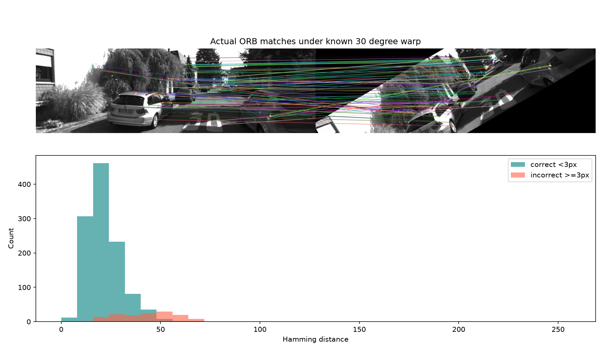

그림 6. 위는 실제 ORB 매칭 일부, 아래는 정답/오답별 Hamming 거리 분포. 겹치는 분포가 있으므로 거리 하나만으로 완벽한 판별이 불가능하다. 원시 자료는 `synthetic_rotation.csv`다.

#### 단계 5: BF Hamming, cross-check, ratio test


Hamming 거리는 두 descriptor의 XOR에서 다른 비트 수다. BFMatcher는 후보를 비교해 작은 거리를 찾는다. cross-check는 A가 선택한 B가 반대로도 A를 선택할 때 유지한다. 이는 상호 선택이지 같은 3D 점이라는 증명은 아니다.

ratio test는 가장 가까운 거리 d1이 두 번째 거리 d2에 비해 충분히 작은지 본다. 이번 비교는 `d1 < 0.75 d2`로, cross-check baseline을 KNN ratio 방식으로 **대체**한 ablation이다. 둘을 동시에 적용한 것으로 해석하지 않는다. 두 방법 모두 거리순 상위 1000개를 사용한다.


그림 7. frame 135→136의 pose inlier 중 거리순 상위 100개 범위만 표시했다. 전체 대응과 거리·mask는 `artifacts/vo/baseline/000136.npz`에 있으며 이 프레임의 pose inlier는 102/1000개다.

#### 단계 6: Essential Matrix와 RANSAC


매칭에는 오답이 섞인다. RANSAC은 작은 대응점 집합에서 기하 모델을 가정하고 많은 관측과 일관되는 모델을 찾는다. 카메라 K로 정규화한 대응 x1,x2에는 `x2ᵀ E x1≈0`라는 제약이 있고 `E=[t]×R`이다. 한 점의 상대 영상 위치가 한 직선 위에 놓여야 한다는 뜻이다.

이번 구현은 OpenCV `findEssentialMat`, RANSAC prob=0.999, threshold=1 pixel을 사용한다. 출력 E, Essential inlier mask, 두 영상 pixel 좌표를 모두 NPZ로 저장했다. 실제 API는 `vo.py`에 있다.


그림 8. frame 136의 epipolar line과 대응점, 점-직선 거리 분포. **pose에서 거절된 점의 중앙 거리가 더 작을 수도 있다:** 이번 inlier 중앙값 0.574px, 거절점 0.441px다. recoverPose는 epipolar 잔차만이 아니라 양의 깊이 등 기하 조건도 검사하므로 거절을 곧 오매칭 label로 취급하면 안 된다.

#### 단계 7: recoverPose와 경로 누적


E에서 가능한 R,t 후보를 복원하고 점이 카메라 앞쪽에 놓이는 해를 고른다. t는 방향만 알려준다. `X_current=R X_previous+t`이면 카메라 world pose는 상대 변환의 역행렬을 곱해 누적한다.

출력은 full 4×4 pose 배열이다. 개별 R,t와 E도 저장했다. 여기서 모든 프레임의 이동 길이를 1로 두면 차가 감속해도 추정 이동량은 1이다. 이것이 현 baseline의 구조적 scale 한계다. 좋은 descriptor만 넣어도 사라지지 않는다.

### LiDAR Odometry: 같은 깊이로 단계별 보기


#### LO는 무엇을 최적화하는가


카메라는 물체의 투영을 본다. LiDAR는 이미 meter 단위 3D 점을 제공한다. LO는 현재 점들을 이전 점군/지도에 맞추는 회전과 이동을 찾는다. 가장 단순한 목적은 대응 q에 대해 `Σ ||R p + t - q||²`를 줄이는 것이다. 대응이 알려져 있지 않아 대응 찾기와 변환 갱신을 반복한다.

이번 실행은 **공식 KISS-ICP 1.3.0의 핵심 pipeline**이다. 자체 신규 LO나 LOAM의 재현이 아니다. 별도로 이해를 위한 fixed-gate nearest-neighbor/SVD ICP를 저장된 실제 scan-map 쌍에 구현했다. 이 교육용 반복을 KISS C++ 내부 iteration log로 부르지 않는다.

#### 단계 1: XYZI 읽기와 범위 필터


각 .bin은 Nx4 float32의 x,y,z,intensity다. XYZ는 LiDAR 좌표계에서 x 전방/y 왼쪽/z 위쪽이다. intensity는 이번 정합 비용에 사용하지 않는다. 너무 가까운/먼 관측은 불안정하거나 비용 대비 효과가 낮을 수 있어 이번 실험은 5~100m를 사용했다.

입력 전체 스캔과 실제 KISS preprocessor 출력은 대표 프레임의 `artifacts/lo/000120.npz`에 저장된다. timestamp 기반 deskew는 **비활성화**했다. Odometry bin에 점별 시간 필드가 없고, 임의 시간 복원을 넣지 않기 위해서다.

#### 단계 2: Voxel 표본화


공간을 격자로 나눠 점 수를 줄인다. 그대로 모든 점을 사용하면 가까운 표면의 많은 점이 계산과 목적함수를 지배할 수 있다. 이번 KISS 설정의 map voxel은 1m, 내부 map 추가용 downsample은 0.5m, registration source는 1.5m다. 설치된 `KissICP.voxelize`에서 확인했다.


그림 9. frame 120의 원본→범위 필터→registration source. 각 점 개수는 그림 제목과 frames.csv에 있다. 같은 XY 범위를 그려 시각적 밀도를 비교한다. 큰 voxel은 비용을 줄이지만 작은 구조를 없앨 수 있다. voxel-size ablation은 미수행이다.

#### 단계 3: 운동 예측과 대응점


정합은 초기값에 민감하다. KISS는 직전 상대 운동을 다음 시점에도 적용하는 예측을 초기 pose로 사용한다. 이 예측은 IMU를 사용한 예측이 아니라 이전 LO 결과에 기반한다.

현재 source를 예측 pose로 변환해 local map과 대응시킨다. 너무 먼 대응은 배제하고 residual이 큰 관측의 영향은 robust kernel로 줄인다. KISS의 threshold σ는 예측과 실제 추정의 차이에 따라 갱신되며, 이번 설치 코드의 correspondence gate는 `3σ`, kernel 인자는 `σ`다. σ의 실제 시계열은 `artifacts/lo/frames.csv`에 저장된다.

#### 단계 4: 정합 반복과 pose 갱신


교육용 ICP는 다음 순서를 20회 실행한다: 현재 pose로 source 변환 → KD-tree 최근접 대응 → 1m gate → 중심을 뺀 대응의 cross-covariance → SVD로 R → 중심 차이로 t → pose 누적. reflection이면 det(R)=+1이 되도록 수정한다. 각 반복의 residual/대응 수/회전·이동 갱신을 CSV에 남긴다.


그림 10. frame 120 실제 scan-map에서 교육용 ICP의 gated 최근접 RMSE가 0.237m에서 0.167m로 줄었다. 매 반복 대응 집합이 달라지므로 고정 대응 비용의 단조 감소 보장은 아니며, 낮은 잔차 자체가 올바른 pose의 증명도 아니다.

실제 KISS는 robust registration backend를 사용한다. 보고서의 다음 거리 분포는 저장한 pose 전후에 SciPy KD-tree로 **독립 재계산한 진단**이고 KISS 내부 correspondence/가중치의 직접 dump가 아니다.


그림 11. 회색은 과거 local map, 청록은 현재 source. 예측과 최종 pose를 같은 공간에서 비교한다. 오른쪽은 최근접 거리 분포로 큰 거리는 3m에 모아 표시했다. 이전 source/target/pose와 거리 배열은 NPZ에 있다.

#### 단계 5: 로컬 지도 갱신


최종 pose로 downsample 스캔을 map에 추가하고 센서에서 멀어진 점을 관리한다. 모든 과거 점을 영구 보관하는 전역 지도와 다르다. 그림은 200프레임 후 rolling local map이며 loop closure로 보정된 완전한 SLAM 지도가 아니다.


그림 12. 높이로 색칠한 LO 로컬 점군과 센서 경로. `final_local_map.npy`로 실제 3D 점을 제공한다. 색은 높이이지 카메라 RGB가 아니다.

#### LO의 한계와 관련 후속 연구


| 한계 | 관련 연구 / 접근 | 얻는 것 | 새로 필요한 것과 한계 |
|---|---|---|---|
| 전체 점 정합의 비용·geometry 활용 | LOAM(Zhang/Singh, RSS 2014): edge/plane 특징과 odometry/mapping 분리 | 구조적 제약 활용 | feature quality/센서 가정; 이번 미실행 |
| 단순 ICP의 outlier·초기값 민감도 | KISS-ICP(Vizzo 외, RA-L 2023): 표본화·적응 gate·robust 정합·운동 예측 조합 | 순수 LiDAR baseline | geometry 부족/동적 물체/나쁜 초기값에서 실패 가능 |
| 빠른 운동과 스캔 시간차 | FAST-LIO2(Xu 외, 2021 preprint): LiDAR와 IMU 결합, 직접 map 정합 | 고주파 운동 예측과 융합 | 정확한 시간/외부 보정/bias 모델 필요 |
| 장기 drift | loop detection + pose graph/global optimization | 재방문 제약으로 일관성 개선 | false loop 위험; 이번 미구현 |

표 3. LOAM은 KISS보다 오래된 다른 설계 갈래다. “KISS 다음에 나온 논문”이라는 뜻이 아니다. 이번 KISS 실행도 공식 KITTI loader의 별도 scan correction을 적용하지 않은 core 실험이며, 공식 논문/벤치마크 수치 재현으로 주장하지 않는다.

### 실험 설정과 재현


| 항목 | 설정 |
|---|---|
| 데이터 | KITTI 00, 0~199, 동일 인덱스 이미지/LiDAR |
| VO | ORB 2500, match limit1000, RANSAC1px/prob0.999, seed7+frame |
| ratio variant | cross-check 대신 KNN d1<0.75d2 |
| LO | KISS-ICP1.3.0, voxel1m, range5~100m, deskew false, C++ threads4 |
| GT | 추정에는 미사용, 평가에만 사용 |
| Metric transform | T_camera(t)=Tr × T_lidar(t) × inverse(Tr), 첫 pose 정규화 |
| Shape 진단 | 각 방법에 전체 구간 GT 사용한 global Sim(3) least squares |
| 환경 | Python3.11 arm64, 연구 전용 .venv, pinned lock 저장 |

표 4. 기준 설정. 상세 설정 `configs/experiment.json`, 실제 KISS 설정 `artifacts/lo/effective_config.json`. GT 위치로 fit한 scale은 추정 입력이 아니라 사후 진단이며, 그 결과를 metric VO로 부르지 않는다.

기준 Git HEAD는 `c1b5ff7e3af1525061166953afb6caab855f11c8`이다. 이번 연구 코드는 아직 별도 커밋되지 않았다. 환경/설정·calibration hash는 `artifacts/evaluation/environment.json`에 저장한다. full dependency는 `configs/requirements-lock.txt`다.

레포 루트에서 실행한다. 기존 제품 .venv는 변경하지 않았다.

```bash
uv venv --python 3.11 research/20261031_vo-lo-study/.venv
uv pip install --python research/20261031_vo-lo-study/.venv/bin/python \
  -r research/20261031_vo-lo-study/configs/requirements-lock.txt
source research/20261031_vo-lo-study/.venv/bin/activate
export MPLCONFIGDIR="$PWD/.cache/matplotlib"
export XDG_CACHE_HOME="$PWD/.cache"
python research/20261031_vo-lo-study/src/orb_stages.py
python research/20261031_vo-lo-study/src/vo.py
python research/20261031_vo-lo-study/src/lo.py
python research/20261031_vo-lo-study/src/evaluate.py
python research/20261031_vo-lo-study/src/geometry_stages.py
python research/20261031_vo-lo-study/src/playback.py
```

PDF 생성에는 기존 `research/20261030_progress-review/src/render_pdf.mjs`에 이 연구 폴더 경로를 인자로 전달한다. 이 렌더러는 Chrome과 `/tmp/kitti-report-pdf/node_modules`의 marked/playwright/mermaid가 필요하다. PDF 생성 환경은 알고리즘 환경과 분리된다.

#### 모듈별 산출물 계약


표의 NPZ/CSV는 실제 저장된 값이다. 모든 대표 프레임은 configs의 목록으로 고정했다.

| 모듈 | 타입·단위·좌표 | 저장 경로 | 검증 |
|---|---|---|---|
| ORB 교육 | images uint8, xy pixels, angles radians, bits bool | artifacts/orb/* | 실제 descriptor shape와 synthetic warp label |
| VO | Nx2 pixel, E/R/t, masks, 4x4 camera0 arbitrary pose | artifacts/vo/baseline,ratio | finite/SE3/frame count, 실패 상태 |
| LO | Nx3 m LiDAR/world, 4x4 pose, sigma m | artifacts/lo/* | finite/SE3, scan0 pose 정규화 |
| Geometry | epipolar distance px, ICP residual m | artifacts/geometry/* | 기록된 입력으로 직접 재계산 |
| Evaluation | full pose, 위치 m, 각도 degree | artifacts/evaluation/* | GT=self zero error, 알려진 similarity 복원 테스트 |
| Playback | embedded JPEG/points/trajectories | artifacts/playback/index.html | 브라우저 재생/seek/mode/canvas 검사 |

### 결과: VO와 LO를 어떻게 비교했는가


#### Metric LO와 shape 진단을 구분


단안 VO에 실제 scale이 없으므로 raw 숫자를 미터로 간주한 RMSE를 발표하지 않는다. 먼저 LO만 시작 좌표계가 같은 GT와 직접 비교하고, 다음에는 VO·LO 모두에 동일한 전역 Sim(3) fit을 적용해 경로 모양을 비교한다. 후자는 GT를 보고 유리하게 정렬한 **사후 진단**이다.

| 방법 / 평가 정책 | 위치 RMSE m | 끝점 오차 m | 1-frame 상대 이동 RMSE m | 상대 회전 RMSE deg |
|---|---:|---:|---:|---:|
| LO, 시작 좌표계만 일치 | 2.299 | 2.964 | 0.0387 | 0.0905 |
| VO baseline, GT Sim(3) | 5.336 | 3.772 | 0.2772 | 0.6554 |
| VO ratio, GT Sim(3) | 5.208 | 5.845 | 0.2854 | 0.9836 |
| LO, GT Sim(3) | 0.209 | 0.312 | 0.0385 | 0.0905 |

표 5. 같은 200프레임의 실측. Sim(3) fitted scale은 VO 0.73054, ratio0.76298, LO1.00180이다. LO의 2.299→0.209 변화는 scale만의 효과가 아니라 전역 회전/이동 정렬도 포함한다. 자세 원점 정렬 외 GT 보정을 하지 않은 수치는 첫 행이다.

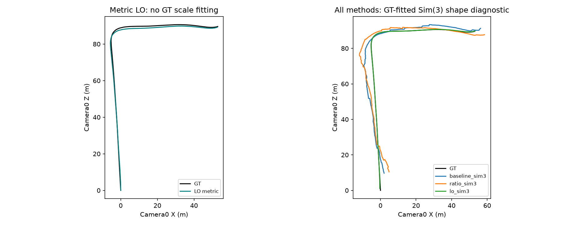

그림 13. 왼쪽은 metric LO, 오른쪽은 모든 방법의 사후 shape 정렬. 이번 LO가 이 구간에서 더 작은 오차를 보였지만 정교한 stereo/VIO/SLAM보다 낫다는 실험은 아니다.


그림 14. 위치 오차와 1-frame 상대 회전 오차. 짧은 translation RPE와 전체 누적 위치 오차는 다른 성질이다. KITTI 공식 100~800m segment 평균 benchmark를 실행한 것은 아니다.

#### 작은 해결책: ratio test의 결과


VO baseline과 ratio 모두 199개 전이에서 pose를 반환했다. pose inlier 중앙 비율은 baseline58.2%, ratio56.6%; 최저 비율은 둘 다 frame136에서 10.2%, 7.0%였다. ratio가 이 구간에서 더 좋은 관측만 골랐다고 결론 낼 근거가 없다.


그림 15. pose inlier 비율과 매칭 수 분포. inlier 비율은 실제 정답 precision이 아니다. ratio의 위치 RMSE는 약 2.4% 낮지만 끝점/상대 이동/회전 지표는 악화됐다. 따라서 전체 개선으로 채택하지 않는다.

시간은 코드 내 추정 구간의 관측값으로 VO baseline 중앙64.1ms, ratio37.0ms, LO9.7ms였다. 영상/스캔 읽기·artifact 저장·그리기는 제외했고, 최초 실행에서 다른 연구 프로세스가 일부 겹쳤으며 thread 수와 구현 언어도 다르다. **공정한 latency benchmark나 실시간 보장은 아니다.** 시간 로그는 제공하지만 성능 순위의 근거로 사용하지 않는다.

#### LiDAR와 영상은 같은 것을 보고 있는가


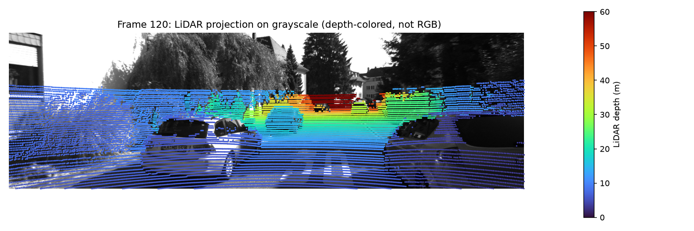

그림 16. frame120의 XYZ를 Tr/K로 영상에 투영했다. 색은 깊이이며 컬러 영상이 아니다. 이 그림은 대략적인 extrinsic 일관성 점검이고 동적 물체의 세밀한 시간 정렬을 보증하지 않는다.

[VO·LO 동기 비교 재생 열기](../research/20261031_vo-lo-study/artifacts/playback/index.html)

플레이백은 raw grayscale/LiDAR 투영/ORB 대응점, 현재 스캔 BEV, GT·VO·LO 누적 궤적을 같은 frame index로 갱신한다. 재생/일시정지/이전·다음/seek/속도/metric·shape 전환을 제공한다. 브라우저에서 파일을 직접 열 수 있고 서버·인터넷이 필요 없다. 사전 계산 결과를 재생하는 것이며 online estimation UI는 아니다.


그림 17. frame120의 비교 재생 화면. 점군은 표시용으로 균일 stride 표본화했고 실제 정합 입력은 별도로 저장했다.

### 분석: 강점·약점과 이번에 알 수 없는 것


#### Feature별 강약점


| 관측/표현 | 확인한 강점 | 약점·한계 | 근거 |
|---|---|---|---|
| ORB 방향+binary | 합성 회전에서 정확 대응89.14% | 단일 warp 실험; 3D 시점/조명/가림 일반화 불가 | 표1/그림6 |
| Hamming/cross-check | 작은 descriptor로 많은 대응 생성 | 반복 구조와 모호한 후보; 기하 검증 필요 | frame136/거리 분포 |
| ratio gate | 위치 RMSE 약간 감소 | 상대 회전 및 끝점 악화 | 표5/그림15 |
| LiDAR XYZ | metric 공간 제약으로 작은 상대 오차 | 긴 평면/동적 물체/초기값 실패 가능성 [가정] | 이번 수치와 미시험 조건 구분 |
| voxel source | 원본보다 작은 정합 집합 | 세부 구조 소실과 voxel 편향 가능성 [가정] | 그림9; size ablation 없음 |
| intensity | 파일에 존재 | 이번 cost에 사용하지 않아 효과 미확인 | lo.py XYZ만 입력 |
| IMU | 고주파 보조 관측 가능 | 시간축 이상/bias 확인 전 | 기존 회고 보고서, 이번 미사용 |

#### 실패·한계 사례


- VO의 frame136은 많은 대응이 pose 복원에 기여하지 못했다. 단순 Hamming 또는 epipolar 거리만으로 원인을 설명할 수 없다. 동일 장면에서 ratio도 악화됐다.
- 고정 단위 이동량은 차량 속도 변화를 표현하지 못한다. 전역 scale fit으로도 모든 구간의 왜곡은 없어지지 않는다.
- LO도 GT 보정 없이 누적 위치 RMSE2.299m이며 완벽하지 않다. deskew off, 공식 KITTI scan correction 미적용, 초기 회전/정합 편향 등이 후보이나 기여도를 분리한 ablation은 하지 않았다.
- KISS C++의 모든 iteration/correspondence를 dump하지 않았다. 교육용 ICP와 독립 nearest-map 잔차를 대체 관찰로 제공했고 이를 실제 내부 출력이라고 표현하지 않았다.
- 연구 VO의 실패 hold 정책과 seed/thread 설정은 과거 exporter와 완전히 동일하지 않다. 이번 비교 표는 이번 재실행끼리 비교한다.
- 순수 frame index 대응은 Odometry camera/LiDAR에 한정한다. Raw OXTS를 같은 숫자로 연결하지 않았다.
- 200프레임만으로 장거리 loop closure/재위치추정/야간/비·안개/급격한 운동을 평가할 수 없다.

#### 해결 정도


사용자의 핵심 요청인 알고리즘 설명→단계 산출물→한계→후속 접근을 구현/그림/평가와 연결했다. VO/LO의 비교와 실제 local map도 제공한다. 완전 ORB/후속 learned 논문 재현이나 full SLAM의 구현까지 완료한 것은 아니다. 후속 연구를 설명한 뒤 자동으로 모두 구현하지 않고 다음 선택지로 남긴다.

### 질문에 대한 답: 컬러, IMU, SLAM


#### Gray 대신 컬러면 더 좋아지는가


**자동으로 좋아지지 않는다.** 현재 ORB는 밝기 패턴 기반이므로 컬러를 받아 grayscale로 바꾸면 색 정보를 이용하는 새 알고리즘이 되지 않는다. 같은 밝기의 다른 색을 구분하는 관측이나 semantic masking, 색을 이용한 map 정합을 설계해야 색의 효과가 생긴다.

컬러의 장점 후보는 객체 의미 분류·동적 객체 masking·색이 있는 지도다. 단점 후보는 처리량/메모리/노출·white balance 변화이며, 이 프로젝트에서 그 효과는 측정하지 않았다. KITTI의 컬러 영상은 별도 센서와 calibration을 사용하므로 grayscale 비교를 단순 채널 수 차이로만 통제하기도 어렵다. 현재 로컬에 컬러가 없어 ablation을 했다고 말할 수 없다.

이 과거 연구가 제안한 다음 우선순위는 컬러 다운로드보다 **기존 우측 영상의 stereo 깊이**였다. 신규 독립 연구에서 이를 C4–C5와 C12의 범위로 실행했으며 운영 경로에는 통합하지 않았다. 이 판단은 현재 구조의 scale 미관측과 이미 보유한 데이터에 근거한다. 이후 실제 task가 semantic map이라면 컬러가 다른 가치를 갖는다.

#### IMU 데이터는 안 써도 되는가


**순수 VO/LO는 IMU 없이 가능하며, 이번 실험도 사용하지 않았다.** KISS-ICP의 운동 예측은 직전 LO의 변환을 활용한다. IMU가 없다는 이유로 LO가 meter scale을 잃지는 않는다. LiDAR가 이미 거리를 측정하기 때문이다.

IMU는 빠른 회전·짧은 시각 실패·scan 내 움직임을 다룰 보조 제약을 제공할 수 있지만 bias와 적분 drift가 있고 calibration/time offset/중력 처리가 필요하다. 센서를 하나 더 붙인다고 무조건 오차가 줄지 않는다. 현재 OXTS의 비양수 시간 간격5개와 긴 gap을 해결하지 않은 채 preintegration에 입력하면 오히려 잘못된 모델이 된다.

VIO/LIO는 별도 연구 단계다. 입력은 가속도/각속도이며 OXTS의 GPS/INS 위치·자세를 섞으면 GT 누출 우려가 있다. MLE/MAP, 공분산, residual weighting은 그 융합에서 관측의 신뢰도를 표현하는 도구가 된다.

#### KITTI Odometry로 SLAM 연구는 못하는가


**SLAM 연구도 할 수 있다.** 데이터셋 이름이 알고리즘을 odometry로 제한하지 않는다. 연속 영상/스캔으로 pose와 지도를 만들고 keyframe/BA/loop closure/재위치추정을 연구할 수 있다. 공식 페이지 이름도 Visual Odometry / SLAM Evaluation이다.

다만 평가에서 주어지는 주된 GT는 궤적이다. 지도 정확도를 정량 평가하려면 별도 기준 map·평가 방법이 필요하다. loop closure 효과를 보려면 실제 재방문이 있는 충분히 긴 구간이 필요하며 이번 0~199프레임은 그 실험이 아니다. SLAM에 loop closure가 정의상 항상 필수인 것은 아니지만 전역 일관성·장기 drift를 다루는 대표 기능이다.

이번 rolling local map은 LO의 scan-to-map 추정을 지원한다. 지도 그림이 있다는 사실만으로 loop-closed SLAM을 구현했다고 하지 않는다. KITTI 전체 00을 활용한 장기 지도/재방문 연구는 다음 단계로 분리한다.

### 개선 방향과 다음 단계 선택


| 우선순위 | 다음 연구 | 기대 효과 [가정] | 공수 [가정] |
|---|---|---|---|
| 1 | Stereo 깊이→PnP VO, 같은 LO/GT와 metric 비교 | 단안의 scale 한계를 직접 해소 | 중간 |
| 2 | LO deskew/scan correction/voxel 및 긴 구간 ablation | 이번 LO의 잔여 오차 원인 분리 | 중간 |
| 3 | ORB vs learned feature/matcher 비교 | 실제 모호한 관측에서 개선 여부 확인 | 중간~높음 |
| 4 | IMU 시간축/축/노이즈 검증 후 VIO 또는 LIO | 고속·관측 약화 조건의 융합 준비 | 높음 |

표 6. 모두 사용자 선택을 위한 제안이다. 실험하지 않은 효과를 보장하지 않는다. 기존 src 통합이나 자동 리팩터링은 하지 않았다. 교육 순서는 관측→대응→잔차→최적화→누적 오차→추가 센서/지도 제약으로 이어진다.

### 부록


#### 가정과 미확인


- [가정] 정량 목표가 지정되지 않아 동일 구간 baseline 비교를 사용했다. production latency 목표는 없다.
- [가정] 컬러·IMU·grid·stereo·learned matcher 개선 효과는 본 실험 밖이다.
- [미확인] 장거리/다른 시퀀스 일반화, 동적 객체별 GT, scan 내부 time 및 motion distortion의 기여도.
- [미확인] 공식 KITTI scan correction/deskew 적용 시 이 결과가 얼마나 바뀌는지.
- [미확인] multi-thread KISS의 다른 실행에서 bit-identical 재현. 환경/설정은 고정했으나 알고리즘 수치 결과가 bit-exact하다는 주장은 하지 않는다.

#### 참고문헌과 읽는 순서


1. Rublee, Rabaud, Konolige, Bradski. **ORB: An efficient alternative to SIFT or SURF**, ICCV 2011. DOI: 10.1109/ICCV.2011.6126544. [공식 구현 설명](https://docs.opencv.org/4.13.0/d1/d89/tutorial_py_orb.html). 본 보고서 4.2~4.6의 실험과 함께 읽는다.
2. [OpenCV Feature Matching](https://docs.opencv.org/4.13.0/dc/dc3/tutorial_py_matcher.html), [calib3d](https://docs.opencv.org/4.13.0/d9/d0c/group__calib3d.html). 매칭과 pose 추정의 책임을 구분한다.
3. Vizzo, Guadagnino, Mersch, Wiesmann, Behley, Stachniss. **KISS-ICP: In Defense of Point-to-Point ICP**, RA-L 2023. [저자 PDF](https://www.ipb.uni-bonn.de/pdfs/vizzo2023ral.pdf), [공식 코드](https://github.com/PRBonn/kiss-icp). 이번 LO 실험과 연결한다.
4. DeTone, Malisiewicz, Rabinovich. **SuperPoint: Self-Supervised Interest Point Detection and Description**, CVPR workshop 2018. [논문](https://arxiv.org/abs/1712.07629). feature 반복성과 descriptor 학습의 문제를 읽는다.
5. Lindenberger, Sarlin, Pollefeys. **LightGlue: Local Feature Matching at Light Speed**, ICCV 2023. [논문](https://arxiv.org/abs/2306.13643). 추출기와 matcher가 다른 모듈임을 염두에 둔다.
6. Engel, Koltun, Cremers. **Direct Sparse Odometry**, 2016 preprint. [논문](https://arxiv.org/abs/1607.02565). descriptor 대응 대신 광도 잔차를 쓰는 다른 갈래다.
7. Mur-Artal, Tardos. **ORB-SLAM2**, T-RO 2017. [논문](https://arxiv.org/abs/1610.06475). 특징점 이후 지도/최적화 시스템을 읽는다.
8. Zhang, Singh. **LOAM: Lidar Odometry and Mapping in Real-time**, RSS 2014. [저자 논문](https://roboticsproceedings.org/rss10/p07.pdf). edge/plane 기반의 다른 LO 설계를 비교한다.
9. Xu 외. **FAST-LIO2: Fast Direct LiDAR-inertial Odometry**, 2021 preprint. [논문](https://arxiv.org/abs/2107.06829). IMU와 map 정합을 결합할 때의 상태와 제약을 읽는다.
10. [KITTI Odometry 공식 설명](https://www.cvlibs.net/datasets/kitti/eval_odometry.php), [Raw 설명](https://www.cvlibs.net/datasets/kitti/raw_data.php). 원시 데이터/GT/동기화 범위를 확인한다.

#### 제출 점검


- 각 설명에 실행 산출물 또는 미수행 표기를 연결했다. 단일 링크 나열로 대체하지 않았다.
- 학습 패턴을 재훈련하지 않았고 실제 OpenCV 출력과 교육용 근사를 구분했다.
- 코드·설정·중간 산출물·그림·baseline ablation·실패 사례·좌표/단위·재현 명령을 제공했다.
- Sim(3) 진단과 metric 성능을 분리했고 GT를 estimator에 넣지 않았다.
- 추가 연구와 제품 통합은 자동 진행하지 않는다.


<a id="loops"></a>

## 4. SLAM과 재방문: 데이터가 있는가, 무엇이 아직 없는가

**과거 연구 범위:** 이 장의 “현재·이번·미구현”은 장에 기록한 당시 운영/연구 경로를 뜻한다. v3.0.0의 독립 stereo VO와 합성 백엔드는 C1–C12가 최신이며, 과거 수치와 설정을 소급 교체하지 않았다.

GT를 사용한 후보 분석이며 자동 loop closure 구현 결과가 아니다.

**원 실험 디렉터리:** `research/20261031_loop-readiness/`

### 문제 정의

SLAM은 위치와 지도를 함께 추정하는 문제다. 루프 클로징은 재방문으로 누적 오차를 줄이는 구성 요소이지 SLAM의 필수 정의는 아니다. KITTI Odometry라는 이름이 SLAM 연구를 금지하거나 데이터 사용을 오도메트리로 제한한다는 뜻은 아니다.

현재 baseline은 단안 ORB VO와 KISS-ICP LO의 00 시퀀스 첫 200프레임 결과다. VO에는 지도·BA·루프가 없고, LO의 rolling local map은 전역 루프 최적화 지도와 다르다. 이번 입력은 00 전체 GT poses/times, 실제 왼쪽 영상, 기존 VO/LO 산출물이다. 출력은 후보 CSV/JSON, 영상쌍, 비교 재생 HTML, 본 PDF다.

성공 기준: [가정] 500프레임 이상 떨어지고 중간 이동 100m 이상, GT 거리 5m 이하, 상대 회전 30도 이하인 후보가 최소 1쌍 존재할 것. 재생/탐색/정렬 모드 전환과 두 화면 이동에 브라우저 오류가 없어야 한다. 조건은 공식 벤치마크 규격이 아니라 이번 데이터 탐색용 설정이다.

범위 밖: 전체 구간 odometry 재실행, 자동 place recognition, pose graph 최적화, VIO/LIO, 운영 파이프라인 통합. 실제 루프 성능 기준은 이후 별도 정의해야 한다.

### 사용 가능한 리소스

| 리소스 | 확인 내용 | 부족한 것 |
|---|---|---|
| 데이터 | 00 grayscale stereo와 LiDAR 각각 4,541프레임, GT | 자동 루프 정답 라벨 |
| 기존 VO | ORB, Hamming 매칭, Essential RANSAC, recoverPose | metric scale, BA, 지도 |
| 기존 LO | KISS-ICP 1.3.0, metric 상대 이동 및 local map | 전역 그래프, 루프 검출 |
| Feature | ORB descriptor, LiDAR XYZ/intensity | 장소 검색 descriptor 및 검증 파이프라인 |
| 환경 | 연구용 Python venv, SciPy, OpenCV, Matplotlib, Chrome 검사 | 일반화 평가 및 전체 구간 실험 |

상세 인벤토리는 원 실험의 notes/inventory.md에 있다. VO/LO 알고리즘 단계 설명과 이미지는 이 문서의 2~3장을 참조한다.

### 접근 방법 선정

Quick-win으로 GT 위치의 cKDTree 근접 검색을 사용했다. 이는 '이 데이터에 재방문이 있는가'에 답할 수 있으므로 새 검출 알고리즘이나 선행연구 비교 실험은 수행하지 않았다. GT를 사용했기 때문에 실제 로봇의 loop detector로 사용해서는 안 된다.

근거 코드: src/audit.py:28 근접 검색, :31 시간·이동·회전 필터, :38 대표 선택, :63 실제 영상 읽기. 후보 수는 인접 프레임 조합을 포함하므로 11,772개의 독립 루프를 의미하지 않는다.

### 시스템 아키텍처

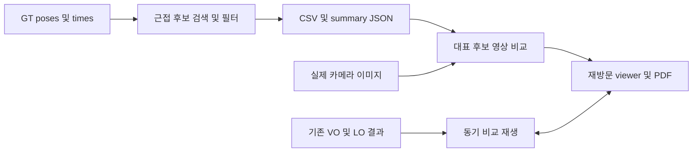

| 모듈 | 입력 / 좌표계 / 단위 | 출력 계약 | 검증 |
|---|---|---|---|
| 후보 검색 | GT Nx3 위치, 첫 카메라 좌표계, m | artifacts/candidates.csv | 유한값, 시간 단조 증가, 필터 |
| 대표 선정 | 후보와 GT 회전, 초/도 | artifacts/summary.json | 40m 이상 공간 분리 |
| 영상 비교 | uint8 image_0 PNG, 프레임 인덱스 | figures/pair_*.png 및 artifacts/loops/index.html | 이미지 decode와 프레임 표시 |
| 동기 재생 | 기존 200프레임 영상·LiDAR·poses | 별도 study의 artifacts/playback/index.html | play/seek/mode, canvas, 모바일 |

LiDAR pose는 기존 연구에서 Tr로 카메라 좌표계로 변환했다. 본 후보 검색은 GT 좌표만 사용하며 추가 센서 동기화나 단위 변환은 없다. 생산 코드 변경 없이 연구 디렉터리와 VSCode 실행 설정을 추가했다.

### 결과

| 후보 프레임 | GT 거리(m) | 시간 간격(s) | 중간 이동(m) | 상대 회전(도) |
|---|---:|---:|---:|---:|
| 2362 / 3305 | 0.031 | 97.7 | 800.4 | 0.94 |
| 421 / 3425 | 0.119 | 311.4 | 2348.8 | 6.11 |
| 61 / 4506 | 0.233 | 460.7 | 3627.0 | 0.37 |

표는 GT 근접 후보이며 검출 정확도나 보정 성능이 아니다. 전체 이동은 3724.2m, 시작-끝 거리는 97.2m다.


전체 경로 중 재방문 후보의 위치를 표시한다. 추정 궤적이 아니다.


2362/3305의 실제 영상으로 건물·차량·도로 구조가 반복되는 장면을 확인할 수 있다.

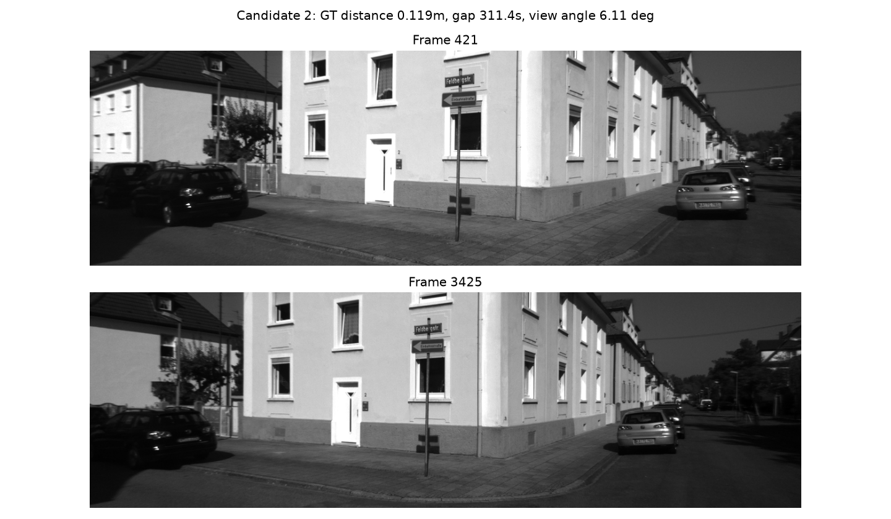
421/3425를 나란히 표시하여 시점 및 장면 차이를 확인한다.

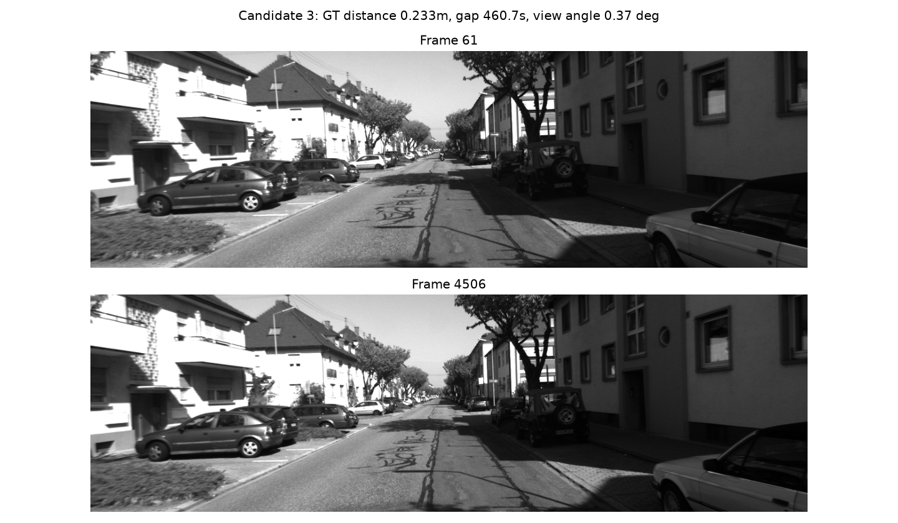
61/4506의 실제 영상 비교다. 첫 200프레임만으로는 이 재방문을 관측할 수 없다.

기존 첫 200프레임 평가 비교:
| 방법 / 정렬 정책 | 위치 RMSE(m) | 해석 |
|---|---:|---|
| ORB VO / GT 전역 Sim(3) | 5.336 | scale을 GT로 맞춘 사후 궤적 형상 |
| ratio VO / GT 전역 Sim(3) | 5.208 | 작은 개선이나 다른 지표 악화, 우월성 결론 불가 |
| KISS-ICP LO / GT 전역 Sim(3) | 0.209 | 동일 형상 비교 조건 |
| KISS-ICP LO / 시작점만 정렬 | 2.299 | metric 오차, 위 Sim(3) 수치와 구분 |

이 표는 이전 연구 산출물을 재사용하며 전체 KITTI 평가나 loop closure 효과가 아니다. 방법·평가 코드는 ../20261031_vo-lo-study/src/lo.py 및 evaluate.py다.

### 분석

#### Feature 강점/약점

| Feature | 강한 조건 | 약한 조건 | 근거 |
|---|---|---|---|
| GT 위치 근접 | 재방문 데이터 존재 확인 | 실사용 시 GT 없음 | 위 후보 3쌍 |
| 상대 회전 필터 | 비슷한 시점 영상 선별 | 반대 방향 루프 제외 | 30도 제한 |
| 실제 grayscale 영상 | 반복 구조 정성 확인 | 조명, 동적 물체, 유사 장소 | pair_1~3 |
| LiDAR 기하 | metric odometry 비교 | 반복 구조, 움직이는 물체 | 이전 LO 보고서; 이번에는 loop 검증 미실시 |

#### 알고리즘의 약점 및 실패 사례

GT 기준의 좋은 사례만 선정했으므로 자동 검색의 false positive/false negative는 측정하지 않았다. 가까운 GT 위치라도 가림이나 시선 차이로 정합이 실패할 수 있다. 프레임 간 연관으로 후보 개수는 크게 부풀 수 있다. 공식 KISS KITTI loader의 특수 scan correction과 deskew를 적용하지 않은 연구 설정이라는 한계도 유지된다.

#### 문제 해결 정도

데이터 존재 기준은 대표 3쌍으로 달성했다. Chrome 검사에서 재생, 120번 프레임 탐색, 정렬 모드 변경, 후보 선택, 양방향 화면 이동을 통과했고 JavaScript 오류는 0건이었다. 390px 모바일에서 가로 넘침이 없고 영상 3개가 정상 decode되었다. camera/BEV/path canvas의 비영 픽셀은 각각 466611/34435/3076개였다. 단, 실제 loop 검출·보정의 성공은 미평가다. 비교 재생은 원시 센서와 추정 궤적을 관찰하는 도구이며 실시간 온라인 계산기가 아니다.

### 개선 방향

| 보완 항목 | 기대 효과 | 예상 공수 |
|---|---|---|
| 전체 00 LO baseline | 루프 전 누적 오차 측정 | 중간 |
| 장소 검색 descriptor + 기하 검증 | GT 없이 후보 검색 및 오검출 배제 | 높음 |
| pose graph 최적화 | 검증된 루프를 통한 전역 보정 | 높음 |
| 추가 시퀀스 / 반대 시점 평가 | 선택 편향 확인 | 중간 |

### 다음 단계 제안

1. 00 전체 LO와 지도 누적을 실행해 baseline을 확정한다.
2. LiDAR 루프 검출 방법을 조사·선정하고 후보 검색과 정합 검증을 각각 평가한다.
3. 검증된 루프 제약으로 pose graph를 최적화하고 보정 전후 재생을 비교한다.

### 부록

- [가정] 5m/500프레임/100m/30도/40m 분리 조건은 탐색 목적의 임시 조건이다.
- [미확인] GT 없는 자동 루프 precision/recall, 전체 구간 LO 정확도, loop 최적화 개선량.
- 근거: 로컬 GT 및 실제 영상, src/audit.py, artifacts/summary.json, artifacts/candidates.csv. 본 작업은 새로운 논문 성능 수치를 인용하지 않는다.
- 관련 알고리즘 원문과 단계별 실험은 이 문서 2~3장의 참고문헌 및 본문 참조.


<a id="playback"></a>

## 5. 좌우 카메라·VO·LO 통합 재생

**과거 연구 범위:** 이 장의 “현재·이번·미구현”은 장에 기록한 당시 운영/연구 경로를 뜻한다. v3.0.0의 독립 stereo VO와 합성 백엔드는 C1–C12가 최신이며, 과거 수치와 설정을 소급 교체하지 않았다.

오른쪽 영상은 표시용이다. 단안 VO를 stereo VO로 바꾸지 않았다.

**원 실험 디렉터리:** `research/20261101_unified-playback/`

### 문제 정의

입력: KITTI 00 image_0/image_1/velodyne 및 기존 200프레임 VO/LO 산출물. 출력: 하나의 offline HTML. [가정] 성공 기준은 200개 오른쪽 영상의 존재/크기 검증, 다섯 canvas의 비영 픽셀, 재생/탐색/모드 전환 성공, 모바일 가로 넘침 0건, JavaScript 오류 0건이다. 알고리즘 개선 및 전체 시퀀스 추정은 범위 밖이다.

### 리소스

기존 src/viz/export_playback.py는 VO 전용이고, research/20261031_vo-lo-study/src/playback.py는 VO/LO 결과를 조합한다. 후자를 확장했다. image_1은 이미 로컬에 있다. 시간 매칭의 points_previous/current 및 pose_mask도 기존 NPZ에 존재한다. 새 센서 다운로드나 추정 실행은 필요 없다.

### 접근 선정

Quick-win: 기존 산출물을 재사용해 renderer/exporter만 확장한다. 알고리즘 개발이 아니므로 선행연구 조사와 신규 알고리즘 실험은 수행하지 않았다. 기존 생산 VO 코드는 변경하지 않는다.

### 아키텍처

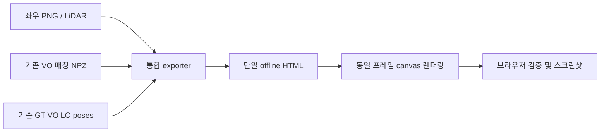
원본 영상은 uint8 grayscale이며 JPEG로 HTML에 내장한다. 매칭은 이전/현재 왼쪽 영상의 pixel 좌표와 pose inlier flag다. LiDAR는 센서 좌표 m, 궤적은 기존 평가 좌표계를 그대로 사용한다. 동일 프레임의 두 영상 decode가 끝난 후 전체 화면을 갱신하고 이전 비동기 렌더 요청을 version으로 폐기한다. HTML 산출물은 ../20261031_vo-lo-study/artifacts/playback/index.html, 스크린샷은 해당 study의 figures/playback_*.png다.

### 결과

| 항목 | 기존 연구 화면 | 통합 화면 |
|---|---|---|
| 카메라 원본 | 왼쪽 overlay만 | 왼쪽/오른쪽 원본 + 별도 왼쪽 overlay |
| 시간 매칭 | 현재 좌표 점만 | 이전→현재 선, inlier/rejected 선택 |
| LiDAR | 투영/BEV | 유지 |
| GT/VO/LO | 기본 Sim(3) | 기본 metric GT/LO, 선택형 Sim(3) |

표는 표시 기능 차이이며 VO 정확도 향상을 의미하지 않는다. 기존 baseline VO의 GT-fitted 위치 RMSE 5.336m도 그대로다. ratio 실험의 5.208m 결과가 기본 VO로 교체된 것이 아니다. 실제 오른쪽 영상을 읽지 못하거나 크기가 다르면 export는 실패한다.

검증 결과: 200프레임 export 성공. 120번 프레임에서 좌/우/overlay/BEV/궤적의 비영 픽셀은 466610/466609/466611/34435/3076개로 모두 비어 있지 않았다. 좌우 픽셀 배열이 다름을 검사하여 복제 영상이 아님을 확인했다. 재생, 탐색, 양쪽 궤적 모드, 후보 화면 왕복, 모바일 390px 가로 넘침 검사 통과. JavaScript 오류 0건. 이 검사는 센서 시간 offset의 독립 검증이나 알고리즘 정확도 검사가 아니다.


좌우 원본, 특징점/매칭 overlay, LiDAR, 궤적을 동일 프레임으로 표시한다.


좁은 화면에서는 좌우 영상을 세로로 배치한다.

### 분석

| 관측 | 강점 | 한계 |
|---|---|---|
| 좌우 원본 | 실제 시차 비교 | stereo depth/VO 미구현 |
| 시간 매칭 | 움직임과 outlier 관찰 | 3D 지도 아님 |
| Sim(3) 궤적 | 형상 비교 | GT 이용, metric 성능 아님 |
| metric LO | GT scale fitting 없는 비교 | 현재 200프레임만 |

기존 VO 전용 화면은 단위 이동량과 GT 미터를 그대로 비교했다. 연구 화면은 전역 GT 정렬을 하므로 둘의 시각적 차이를 알고리즘 개선으로 해석하면 안 된다. 두 코드 버전의 모든 차이에 대한 controlled benchmark는 이번 범위가 아니다. 전체 HTML 크기가 증가하며 저사양 장치에서 메모리 사용은 미측정이다.

### 개선 방향

이 과거 UI 연구 이후, 신규 독립 stereo VO에서 오른쪽 영상을 실제 깊이 추정에 사용했다(C4–C5). 당시 재생 경로에는 그 추정이 통합되지 않았다. 장시간 재생에서는 파일 분할/지연 로딩이 필요할 수 있다(중간). 이번에는 구현하지 않았다.

### 다음 단계

1. 현재 통합 화면에서 매칭과 GT 정렬 방식 차이를 학습한다.
2. 별도 연구로 stereo VO와 단안 VO의 metric 성능을 비교한다.

### 부록

[가정] 200프레임과 기존 추정 유지가 이번 UI 통합 범위다. [미확인] stereo 추정 성능, 장시간 메모리 사용. 출처는 로컬 exporter, evaluate.py의 sim3(), 기존 metrics.json이며 외부 논문 수치를 추가 인용하지 않는다.


<a id="audit"></a>

## 6. 초기 데이터·IMU 감사 기록과 과거 baseline

이 장만은 초기 상태의 보관 기록이다. 여기의 LO 미구현·ATE 미측정·옛 main 코드 지적은 당시 상태이며 현재 상태가 아니다. 현재 LO 구현 및 측정값은 3장, 현재 재생은 5장이 우선한다. 과거 실패·미확인 사항을 삭제하지 않기 위해 보존했다.

**원 실험 디렉터리:** `research/20261030_progress-review/`

### 사용 가능한 리소스


표는 이번에 확인한 리소스 요약이다. 전체 목록과 코드 위치는 [인벤토리](../research/20261030_progress-review/notes/inventory.md)에 있다.

| 리소스 | 현재 상태 | 제약 |
|---|---|---|
| Stereo grayscale | 00~21, 00 좌우 각 4,541장 | VO는 image_0만 사용 |
| GT | 00~10 pose 파일 | 평가용, 추정 입력으로 사용하지 않음 |
| LiDAR | Odometry 00의 4,541개 XYZI 스캔 | 다른 시퀀스 미추출; 추정 알고리즘 미구현 |
| OXTS | 45,700행 × 30열, 전 값 finite | IMU 외 GPS/INS 항목도 포함; 시간축 이상 존재 |
| Calibration | P0~P3/Tr, Raw 세 calibration 파일 | 센서간 변환 체인 실측 검증 전 |
| 플레이백 | 원본/ORB/매칭/GT·VO 동기화, seek/step/speed | 계산 후 재생; 실시간 VO 처리 성능 아님 |
| Feature | ORB 위치/descriptor, Hamming distance, inlier mask | 3D landmark나 semantic label 아님 |
| 부족한 것 | 공통 평가기, full pose log, stereo/VIO backend | ATE/RPE/latency 결과 아직 없음 |

데이터는 `data/kitti/dataset`, `data/kitti/raw`, 원본 ZIP은 `data/kitti/archives`에 있다. 이전 단계에서 Downloads의 세 ZIP을 이동하고 LiDAR 00과 OXTS·timestamp·calibration만 추출했다. Raw 영상/Raw LiDAR 중복 추출은 하지 않았다. 이 이력은 `data/kitti/SENSOR_IMPORT.md`와 이전 실행 기록에 근거한다.

### 결과


아래 표는 **기존 baseline 보관 결과의 재집계**이며 개선 방법과의 A/B 실험은 아니다.

| 지표 | 기존 결과 재집계 | 개선 알고리즘 |
|---|---:|---|
| 프레임 / 전이 | 200 / 199 | 미구현 |
| tracked 상태 | 199 / 199 전이 | 미평가 |
| ORB 개수 | 모든 프레임 2,500 | 미평가 |
| pose inlier 비율 최소/중앙/최대 | 10.2% / 58.2% / 90.6% | 미평가 |
| GT 누적 이동 거리 | 144.879m | 비교 참조 |
| VO 누적 이동량 | 199 임의 단위 | 미평가 |
| GT 1프레임 이동 | 0.371~1.060m | 비교 참조 |
| VO 1프레임 이동 | 약 1 고정 | 미평가 |
| ATE/RPE/heading error/latency | 미측정 | 미평가 |


그림 1. 스케일 미정렬 궤적과 이동량. 서로 다른 단위이므로 곡선 차이를 미터 오차로 읽으면 안 된다. GT의 이동량 변화에 비해 VO의 길이는 고정된다.

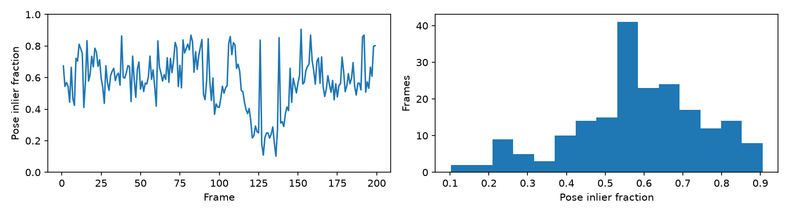

그림 2. 매칭 중 pose 복원 후 살아남은 비율. 정답 대응 label이 없으므로 precision/recall은 아니다.

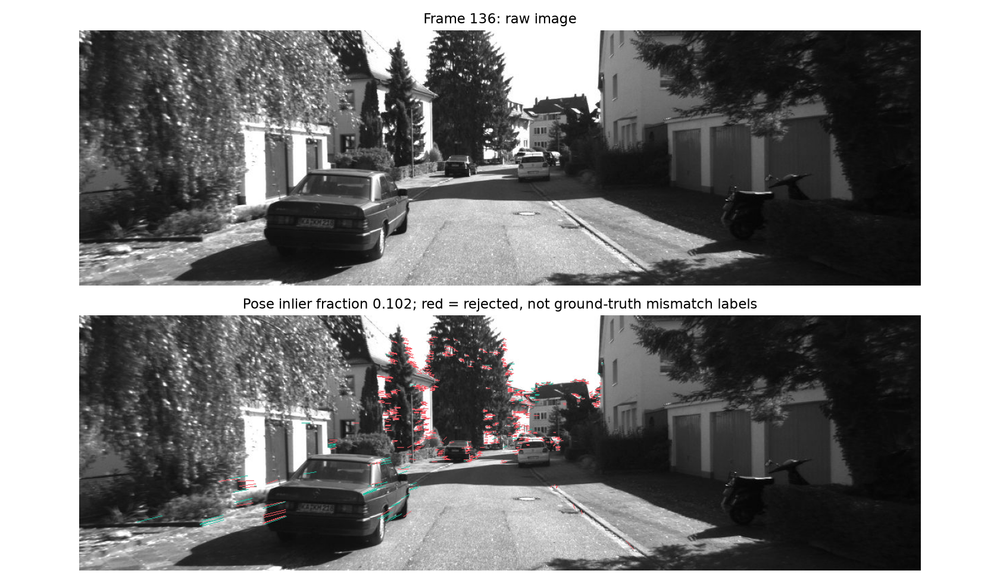

그림 3. 구간 내 최저 inlier 비율인 frame 136. 빨간 선은 기하/cheirality 검사에서 제외된 대응이며 실제 오매칭임을 보증하지 않는다.


그림 4. 이전에 저장한 데스크톱 UI(frame 120). 원본 영상/특징점/궤적의 동기 관찰이 가능하다. 과거 Playwright 재생·탐색·모바일 검증은 대화 실행 기록에 근거하며 이번에는 브라우저 검증을 다시 실행하지 않았다.


그림 5. OXTS 파일명 순서에서의 timestamp 차이. 중앙값 0.009996736초, 최소 -0.050010872초, 최대 1.919595343초, 비양수 간격 5개다. 원인은 아직 확인하지 않았다.

모듈 검증: 200프레임 파싱/유한 위치/영상 timestamp 단조 증가/inlier mask 일치 통과. IMU 45,700×30 유한값 및 timestamp 개수 일치 통과. **IMU 시간 단조성은 미달**이다. LiDAR 이미지 번호 일치와 첫/끝 XYZI 디코딩은 앞선 import 검증에서 통과했으며 전체 스캔 geometry 품질 검증은 아니다.

### 분석


#### Feature 강점/약점


| Feature | 강한 조건 또는 관찰 | 약한 조건 또는 한계 | 근거 |
|---|---|---|---|
| ORB 위치 | 이번 구간에서 2,500개를 지속 확보 | 개수가 많아도 분포/독립성/정확성 보장 안 됨 | frames.csv; 32칸 중 최소 13칸 점유 |
| Binary descriptor/Hamming | 실제 실행에서 프레임 대응 생성 | 반복무늬·시점/조명 변화 취약 가능성 [가정] | 코드 및 그림 3; 거리별 GT 분별력 미측정 |
| Pose inlier mask | 기하 일관성에 따른 후보 분리 | 비율 변화 큼, 정확도/정답 label 아님 | 그림 2, 최소 10.2% |
| Stereo disparity | metric 깊이 추출 가능성 | 원거리·작은 disparity 취약 예상 [가정] | P0/P1와 우측 영상 존재; 아직 미추출 |
| LiDAR XYZI | 공간 좌표 관측 가능 | 동적 객체·희소성 영향 [미확인] | 데이터 확보만 완료, 알고리즘 실험 없음 |
| IMU 가속도/각속도 | 약 100Hz 시간 간격의 측정 존재 | 시간 역전/간격 이상, bias/noise 미검증 | imu.json, 그림 5 |

표는 실측 관찰과 가설을 구분한다. Feature ablation, 실제 match label에 따른 분포 분리도, 오차 상관관계는 **미수행**이다. 2D 특징점 시각화를 3D 지도라고 부르지 않는다.

#### 알고리즘의 약점 및 실패 사례


1. **Scale 부재:** 서로 독립적인 두 프레임 추정에서 t 방향만 얻어 길이 1로 누적한다. 이는 단순한 전역 scale 차이뿐 아니라 구간별 속도 변화에 따른 형상 왜곡을 만들 수 있다. 그림 1과 runner:40이 근거다.
2. **낮은 inlier 구간:** frame 136은 1,000개 중 102개만 pose inlier다. 추정 상태는 tracked지만 정답 자세가 맞는지는 별도 평가하지 않았다. 원인을 차량 운동/오매칭/작은 시차 중 하나로 단정하지 않는다.
3. **main의 실패 처리:** 매칭 부족 시 frame을 생략하고 GT를 단순 앞부분 slicing한다(`run_kitti.py:30`, `:51`). 실제 skip이 생기면 frame 대응이 어긋날 수 있다. 이번 보관 구간의 실제 skip 사례는 없다.
4. **추정 구현 중복:** exporter는 자체 E/pose 처리와 최소 inlier gate를 갖고 runner와 동작이 다르다. main의 inlier 집계 오류도 남아 있다. 두 실행 결과를 동일 구현으로 무조건 취급하면 안 된다.
5. **IMU 입력 이상:** 파일 순서와 시간 순서가 일부 다르다. timestamp만 정렬하면 해결되는지, packet 순서/중복/누락 문제인지 확인 필요. 측정값·시각 대응을 깨뜨리는 임의 정렬은 하지 않았다.
6. **다운로더 재개:** feature 코드 `scripts/download_kitti_odometry.py:32` 부근은 Range 응답이 206인지와 Content-Range를 검증하지 않고 append한다. 서버가 Range를 무시하면 손상 가능성이 있다. 이번 다운로드에서 실제 손상이 있었다는 뜻은 아니다.

#### 문제 해결 정도


데이터 확보와 시각 디버깅, 관측 집계까지 완료됐다. metric VO 개선 여부, VIO/LIO 성능은 평가할 단계가 아니다. 00의 약 200프레임 결과만으로 전 시퀀스/고속/야간/동적 객체 성능을 일반화할 수 없다. 목표 성능 수치를 과거에 정하지 않았으므로 임의의 달성률은 제시하지 않는다.

### 부록


#### 가정 목록


- 다음 성능 연구는 동일 조건의 baseline 대비 개선으로 목표를 시작한다. 구체적 임계값은 아직 없다.
- Stereo/PnP의 metric scale 확보, grid/gate/KLT의 품질 효과와 예상 공수는 설계 판단이며 실험 결과가 아니다.
- 시점/조명 변화나 작은 disparity의 영향은 일반적 가설이며 이 데이터에서 ablation하지 않았다.

#### 미확인 사항


- IMU 비단조 시간/긴 gap 원인 및 Raw↔Odometry 정확한 시간 대응.
- IMU noise/bias, field별 적용 축, 동적 객체 GT, LiDAR 전체 스캔 품질.
- ATE/RPE/회전 오차, latency, 메모리, 다른 시퀀스 일반화 성능.
- 기존 HTML 생성의 정확한 환경/난수 상태/커밋 provenance; 이번 hash로 현재 파일만 식별.
- 원본 대용량 ZIP 전체 재검증은 이번 회고에서 하지 않았다.

#### 참고문헌


1. [OpenCV ORB 공식 설명](https://docs.opencv.org/4.13.0/d1/d89/tutorial_py_orb.html) — Rublee 외, ORB, 2011의 개념 및 API 배경.
2. [OpenCV Feature Matching](https://docs.opencv.org/4.13.0/dc/dc3/tutorial_py_matcher.html) — Hamming/cross-check 동작.
3. [OpenCV calib3d](https://docs.opencv.org/4.13.0/d9/d0c/group__calib3d.html) — Essential, recoverPose, PnP API.
4. [KITTI Odometry](https://www.cvlibs.net/datasets/kitti/eval_odometry.php) — 시퀀스/GT와 공식 segment 평가 정의. 이번에는 공식 100~800m 평가를 실행하지 않았다.
5. [KITTI Raw](https://www.cvlibs.net/datasets/kitti/raw_data.php) — 센서/보정/동기화 형식.
6. [Mur-Artal, Tardos, ORB-SLAM2](https://arxiv.org/abs/1610.06475), arXiv 2016 / T-RO 2017.
7. [Qin, Li, Shen, VINS-Mono](https://arxiv.org/abs/1708.03852), arXiv 2017 / T-RO 2018.

#### 제출 점검


- 회고 기준·baseline 재집계·그림 설명·모듈 산출물·코드 근거·재현 명령: 포함.
- 새 알고리즘 A/B 개선, feature ablation, full pose 정확도 평가: 미수행으로 표시.
- 과거 시스템의 E/R/descriptor 중간 산출물: 미보관 사실을 명시.
- 프로젝트 지침: 루트 CODEX.md에 연구 워크플로우 기록, AGENTS.md에서 참조.


<a id="astra-indoor"></a>

## 실물 실습: Astra 실내 매핑 준비

### 요약과 문제 정의

목표는 KITTI 재생을 넘어 실제 RGB-D 카메라로 실내 지도를 만들고, 실패 원인을 측정하는 것이다. RGB-D는 색상(RGB)과 깊이(Depth)를 함께 제공한다는 뜻이다. 이번 v2.1.0은 **연결·환경 진단과 실험 설계까지만 완료**했다. 카메라의 정확한 모델과 실시간 스트림이 확인되지 않아 드라이버 설치, 촬영, 지도 생성, VIO와 드론 제어는 수행하지 않았다.

Baseline은 KITTI 기반 VO/LO와 교재 v2.0.0이다. 실물 RGB-D 입력은 아직 없으며 KITTI 카메라와 LiDAR를 Astra의 RGB-D처럼 간주하지 않는다. 입력은 호스트/USB 정보와 사용자가 확인할 제품 라벨이다. 출력은 진단 JSON, 수집 메타데이터 양식, 아래 실험 계획이다. [가정] 이번 성공 기준은 진단 JSON 생성, 단위 테스트 10개 통과, 미확인 장치를 준비 완료로 표시하지 않는 것이다. 실물 매핑 성공은 별도로 평가한다.

### 실제 확인 결과와 SDK 선택

2026-11-18 로컬 검사 결과는 다음과 같다. 진단은 Python 3.11.14 표준 라이브러리만 사용한다. 센서 영상을 열거나 USB 설정을 변경하지 않으며 장치 일련번호도 내보내지 않는다.

| 항목 | 확인 결과 | 해석과 한계 |
|---|---|---|
| 호스트 | macOS, arm64, Darwin 25.6.0 | 제품별 드라이버 지원 확인 필요 |
| USB 제품 항목 | 6개 | 허브·어댑터·외장 저장장치 포함 |
| Orbbec/Astra 이름 후보 | 0개 | 미연결·권한·다른 제품명 가능; 미지원 판정 아님 |
| 실행 명령 | cmake 확인; ros2/rtabmap/docker는 현재 PATH에서 미확인 | 시스템 전체 미설치의 증거는 아님 |
| 작업 디스크 여유 | 약 75.5GiB | 검사 시점 값; 녹화 전 재확인 |
| 실측 RGB-D·지도 | 없음 | 추정 정확도나 지도 품질 평가 불가 |

표 B1. 자동 진단의 관측값과 그 값으로 확정할 수 없는 사항을 함께 표시했다.

**먼저 본체 라벨에서 정확한 모델명과 연결 여부를 확인한다.** Astra, Astra Pro, Astra Pro Plus, Astra 2를 같은 장치로 취급하면 안 된다. 공식 지원표에서 Astra 2와 Astra Pro Plus의 SDK v2 지원은 다르며, macOS 지원 제품 목록도 별도다. Mini 제품군은 펌웨어에 따라 프로토콜이 달라지는 경우도 있다. 따라서 여기서는 일괄 설치 명령이나 자동 펌웨어 갱신을 제공하지 않는다. [Orbbec SDK 지원표](https://github.com/orbbec/OrbbecSDK), [ROS2 wrapper 지원표](https://github.com/orbbec/OrbbecSDK_ROS2)

모델 확인 후에는 그 모델에 맞는 공식 Viewer에서 색상·깊이 두 스트림을 먼저 확인한다. Mac에서 지원되지 않는 조합이면 호환되는 Linux/Windows 수집 환경을 검토한다. Mac용 컨테이너만 설치하면 USB 깊이 카메라 문제가 자동으로 해결된다고 가정하지 않는다. 현재 장치의 지원 여부는 [미확인]이다.

### 최소 해결책과 아키텍처

새 SLAM을 처음부터 만들기보다 검증된 RGB-D 시스템을 baseline으로 삼고, 입력 오류와 추정 오류를 분리한다. RTAB-Map은 RGB-D 입력으로 지도와 루프 제약을 처리하는 후보이며 ROS2 구성도 제공한다. 이번에는 설치·구동하지 않았다. ORB-SLAM3는 이후 추적·초기화·최적화 학습과 비교 대상으로 남긴다. [RTAB-Map ROS2 공식 설명](https://github.com/introlab/rtabmap_ros)

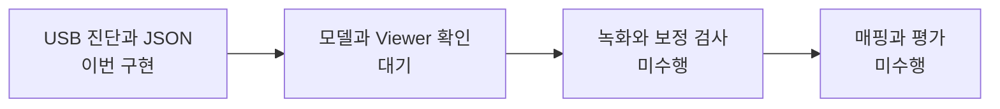

그림 B1. 현재 구현은 USB 진단까지다. 화살표 뒤 단계가 이미 구현되어 있다는 의미가 아니다. 기존 KITTI VO/LO 모듈은 변경하지 않았다.

| 모듈 | 입력·단위·좌표 | 출력·저장·검증 |
|---|---|---|
| preflight | 실행 시 1회 OS/USB 속성, VID/PID와 제품명 | artifacts/preflight/environment.json; plist/sysfs 테스트 |
| 수집 계약 | 모델·해상도·encoding·깊이 단위·K·외부변환·시각 | configs/session.template.json; null은 미확인 |
| 향후 수집 | 각 스트림의 실제 갱신 주기와 clock domain | 원시 녹화 및 별도 metadata; 중복·역행 timestamp 검사 |
| 향후 mapping | 보정·정렬이 검증된 RGB-D | 지도 DB, timestamp 포함 pose, 점군; 동일 녹화 재생 |
| 향후 평가 | 지도와 직접 측정한 거리, 실험 조건 | 길이 오차·실패율·지연; 외부 GT 없으면 궤적 정답은 미확인 |

표 B2. 구현된 모듈과 앞으로 필요한 모듈의 계약이다. 파일 경로는 research/astra-indoor-mapping/ 기준이다.

깊이 원시값이 1000이라고 무조건 1m는 아니다. `Z_m = raw_depth × meters_per_unit`을 적용하며 단위는 SDK/메타데이터로 확인한다. 색상과 깊이가 같은 크기여도 같은 광선을 뜻하지 않는다. 등록(registration)은 두 카메라 보정을 이용해 대응을 맞추는 과정이다. 깊이를 색상에 정렬했다면 출력 영상에 맞는 보정과 깊이의 의미를 사용한다. `T_color_depth`는 depth 좌표 점을 color 좌표로 보내는 변환이며 병진 단위는 m로 기록한다. 시간은 장치 시계인지 호스트 시계인지와 초/ms/us 단위를 함께 남긴다.

### 첫 실물 실험: 정지 → 한 바퀴 → 재현

1. **정지 60초:** 움직이지 않는 카메라로 RGB/depth/보정/timestamp를 기록한다. 프레임 수, 시각 역행·중복, 프레임 간격의 중앙값과 상위 95% 값, 깊이 유효 픽셀 비율을 확인한다. 이미지 내용과 노출 조건도 기록한다.
2. **밝은 실내 한 바퀴:** 천천히 이동하고 출발 장소로 돌아온다. 실제 길이를 잴 수 있는 벽·문틀 등 세 구간을 정해 지도에서도 같은 두 끝점을 선택한다. 외부 GT가 없으므로 이를 전체 pose 정확도라고 표현하지 않는다.
3. **동일 경로 3회:** 같은 조건과 설정으로 반복한다. 실측 길이 대비 오차 `abs(L_map-L_measured)/L_measured`와 반복 편차, 추적 실패 횟수, 루프 검증 결과를 저장한다. [가정] 첫 목표는 세 구간 길이 상대 오차 각각 5% 이하이며 센서 범위와 측정 불확실성을 확인한 뒤 조정한다.
4. **조건 하나씩 변경:** 빠른 회전, 어두운 조명, 흰 벽을 각각 별도 실험한다. 같은 원시 녹화를 baseline과 수정안에 재생하여 비교한다. 조명·속도·알고리즘을 한꺼번에 바꾸면 개선 원인을 구분하기 어렵다.

정지 녹화의 timestamp 역행·중복은 [가정] 0건을 요구한다. RGB/depth 동기 오차의 허용치는 운동 속도·깊이·목표 픽셀 오차로 결정해야 하므로 임의의 고정 ms 값을 합격선으로 쓰지 않는다. 실제 도달 여부는 전부 미측정이다. 녹화 예상 용량도 스트림의 해상도·bytes/pixel·fps·시간을 이용해 계산하며 압축률은 실제 기록으로 확인한다.

### 실패 분석과 다음 단계의 경계

| 관측 또는 feature | 강점 | 약점·검증 방법 |
|---|---|---|
| RGB 특징 | 질감이 풍부한 곳의 대응 | 저조명·블러·반복 무늬; 매칭과 추적 실패 로그 비교 |
| 깊이 | 거리 기준과 표면 형상 | 무효값·반사·측정 범위; 유효 비율과 실측 치수 확인 |
| loop 제약 | 과거 관측으로 누적 오차 수정 | 오검출이면 전체 지도 왜곡; 후보 이미지와 상대 기하 확인 |
| 시간·보정 정보 | 센서 관측을 일관되게 결합 | 잘못되면 정적인 장면도 중복 표면; 원본/투영 overlay 확인 |

표 B3. 실험 설계용 가설이다. 현재 장치의 feature 성능을 실제 측정한 결과가 아니다. 시각적으로 매끈한 지도만으로 정확도를 판단하지 않는다.

지도와 디지털 트윈도 구분한다. SLAM의 점·pose 지도에서 점군 통합, 표면 메시, 텍스처로 확장할 수 있지만 시뮬레이션에는 축척·충돌 형상·재질과 물리 속성 검증이 더 필요하다. 사진처럼 보인다는 이유로 물리적 디지털 트윈이 완성된 것은 아니다. 드론 탑재는 별도 과제이며 무게·전력·진동·빠른 운동·센서 시간 정렬을 다시 확인한다. 실내에서 카메라를 손에 들고 수집하는 단계와 오프라인 검증부터 하고, 미검증 SLAM 출력을 비행 제어에 연결하지 않는다.

### 재현·결과·가정

```sh
# 추가 Python 패키지 없이 기존 연구 환경에서 실행
research/20261031_vo-lo-study/.venv/bin/python \
  research/astra-indoor-mapping/src/preflight.py
research/20261031_vo-lo-study/.venv/bin/python -m unittest discover \
  -s research/astra-indoor-mapping/src -p 'test_*.py' -v
# 모델을 실제 확인한 뒤에만 --model '라벨에 적힌 정확한 이름'을 추가
```

코드는 `research/astra-indoor-mapping/src/preflight.py:15`의 `parse_macos_usb`, 같은 파일 62행의 `inspect_usb`, 82행의 `blockers`로 나뉜다. 출력 JSON은 실행 시각·HEAD·환경·확인 대기 항목을 남기며 Git에서는 제외한다. 사용자 제공 모델명은 검증된 모델로 취급하지 않는다. baseline 커밋은 a865c0d4c8424268b736d23b500c54db3ee8efee다.

**결과:** JSON 1개 생성, 테스트 10개 통과. 최초 구현은 macOS ioreg의 속성 출력 옵션 `-l`이 빠져 실제 장치가 있어도 빈 목록을 만들었다. 실제 호스트 검사로 이 문제를 찾아 수정하고 dict형 plist 루트와 해당 옵션을 확인하는 회귀 테스트를 추가했다. 따라서 초기 빈 목록을 카메라 미연결의 확정 증거로 사용하지 않는다. Linux는 sysfs fixture만 검사했고 실제 Linux 장치 시험은 하지 않았다.

**미완료:** 정확한 Astra 모델·펌웨어, 지원 OS/SDK 조합, 영상·깊이 수신, 실제 녹화·지도·추정 정확도. [가정] 60초·3회·세 구간·5%는 첫 학습 실험 목표이며 센서 사양 보장값이 아니다. 표 B3의 강약점은 실험 가설이며 ablation은 미수행이다.

다음 선택지는 ① 제품 라벨과 USB 연결을 확인해 SDK 경로 결정(우선, 공수 낮음), ② 검증된 스트림으로 실내 RGB-D baseline 매핑(공수 중간), ③ 실패 조건 한 가지를 선정해 개선 비교(공수 중간~높음)다. 드론/VIO/디지털 트윈 통합은 이 단계가 끝난 후 별도 연구로 진행한다. 실제 공수는 장치 지원 여부에 따라 달라진다.

<a id="reproduce"></a>

## 7. 재현 및 문서 갱신

### 최신 문서 갱신 절차
1. docs/report.md의 해당 주제를 직접 수정한다. 새 날짜별 보고서를 만들지 않는다.
2. 같은 문서 맨 위 버전과 아래 변경 이력을 함께 갱신한다. 오탈자는 patch, 설명/결과 확장은 minor, 구조·평가 계약의 큰 변경은 major를 올린다.
3. 그림은 실험 디렉터리의 실제 산출물을 상대경로로 연결하고 출처·설정·코드 버전을 기록한다.
4. 다음 명령으로 docs/report.pdf를 덮어쓴다. 원본과 PDF를 같은 기능 커밋에 포함한다.

```sh
node tools/render_report.mjs
```

초기 통합에 사용한 tools/consolidate_reports.mjs는 일회성 이관 도구다. 최신 원본이 있으면 실패하도록 되어 있으며 평소에는 실행하지 않는다. 각 장에 보존한 옛 PDF 생성 명령은 과거 재현 정보일 뿐 현재 문서 갱신에는 사용하지 않는다.

### 알고리즘 산출물 재현

```sh
# 기존 연구 환경과 데이터가 있을 때 전체 VO/LO 실험
research/20261031_vo-lo-study/.venv/bin/python research/20261031_vo-lo-study/src/run.py --stage all

# 기존 결과로 통합 playback과 재방문 viewer만 갱신
research/20261031_vo-lo-study/.venv/bin/python research/20261031_vo-lo-study/src/run.py --stage playback

# ORB 상세 그림/수치 재현 (기존 orb/pyramid.npz 필요)
env MPLCONFIGDIR=.cache/matplotlib XDG_CACHE_HOME=.cache research/20261031_vo-lo-study/.venv/bin/python research/20261101_orb-explained/src/analyze.py

# 통합 재생 검증
node research/20261031_vo-lo-study/src/check_playback.mjs

# 최신 PDF
node tools/render_report.mjs

# PDF 렌더 검증 결과 재확인
node tools/render_report.mjs --check-only

```

PDF 환경은 macOS Chrome, marked/playwright/mermaid다. 기본 의존성 경로는 /tmp/kitti-report-pdf/node_modules이고 REPORT_PDF_DEPS로 바꿀 수 있다. 설치 경로가 없으면 해당 패키지를 설치해야 한다. 다른 OS는 REPORT_CHROME으로 Chrome 실행 경로를 지정한다. 연구 Python 환경은 기존 requirements-lock.txt를 유지한다.

### Git 작업 규칙

병합된 feature 브랜치에 다음 작업을 이어 붙이지 않는다. 최신 main에서 새 feat/ 브랜치를 만든다. pull 실패를 해결하려고 데이터나 작업 파일을 지우지 않는다. 고유한 로컬 커밋이 있는지 먼저 확인한다.

```sh
git fetch origin --prune
git switch main
git pull --ff-only origin main
git switch -c feat/<next-task>
```

이번 로컬 main의 divergence 원인은 이미 원격에 동일 내용으로 존재하는 초기 session-summary 커밋의 해시 차이였다. backup/main-before-sync-20261101을 만든 뒤 rebase로 중복을 제거하여 681582f와 일치시켰다. 이 방법을 내용이 다른 로컬 커밋에도 무조건 적용한다는 뜻은 아니다. 전역 pull 설정은 변경하지 않았다.

<a id="versions"></a>

## 8. 버전 변경 이력

| 버전 | 갱신일 | 내용 | 알고리즘 변경 |
|---|---|---|---|
| v3.0.0 | 2026-11-24 | 카메라 교재 C1–C12: 영상 형성·F/E/H·초기화·스테레오·LK/PnP·BA·루프·직접법·VIO·학습·밀집/의미 지도·평가. 원문 문헌, 계산 풀이, 실제 KITTI 33그림과 합성 13그림을 기존 교재에 통합. 음의 ablation과 관측 가능성·평가 정렬의 한계를 명시. | 운영 코드 변경 없음; 독립 stereo/mono 연구와 합성 공동 BA/SE(2) 수업 추가 |
| v2.1.0 | 2026-11-18 | Astra 실내 매핑 준비 장 추가. 읽기 전용 USB·환경 진단, 수집 metadata 양식, 10개 테스트와 실제 호스트 확인, 미수행 단계 및 첫 실내 실험 기준 명시. | 운영 VO/LO 변경 없음; RGB-D SLAM 구동 전 단계 |
| v2.0.0 | 2026-11-09 | 통합 문서를 학습 교재로 확장. 수학 기초 12단원, 24문제와 해설, 자체 생성 15그림, 실제 KITTI 단일 점 투영, 25개 계산 검사 및 PDF 점검 추가. 기존 응용 장 보존. | 운영 VO/LO 변경 없음; 교육용 수치 실험 추가 |
| v1.1.1 | 2026-11-03 | 로컬 폴더를 slam-lab으로 변경하고 두 가상환경의 실행 경로 및 현재 문서의 경로 안내를 수정. | 없음 |
| v1.1.0 | 2026-11-02 | 저장소를 slam-lab으로 변경. SLAM/오도메트리/융합의 관계와 top-down 수학 학습 순서, 좌표변환·MLE/MAP·융합 계산 예 추가. 로컬 작업 폴더는 유지. | 없음 |
| v1.0.0 | 2026-11-02 | 날짜별 5개 보고서의 상세 설명·실험·그림을 주제별 고정 문서로 통합. ORB는 최신 교정본 우선, 초기 감사는 역사적 기록으로 구분. 고정 PDF 빌드와 링크/다이어그램 검증 추가. | 없음 |

과거 연구의 날짜·커밋·가정·미확인은 각 장에 보존했다. 추후 변경은 같은 파일과 Git 이력에 남긴다.
