# SLAM Lab: 컴퓨터 비전의 관측·계산·추정·복원

**문서 버전: v4.0.0**<br>
**최종 갱신: 2026-11-25**<br>
**고정 경로: docs/report.md → docs/report.pdf**<br>
**카메라 교재 실험 코드 고정: d22a4e8**<br>
**연구 시작 기준: f09b08e; 과거 통합 기준: 681582f**

**컴퓨터 비전 심화 연구 기준: 75f7140; 최종 연구 코드 고정: 7d30c33**<br>
**심화 연구 이력: 9f42aa0(기하), dce765b(학습), aef41e5(수학), 6ba9580(복원·출판 검사), 21d94c3(영상 기초), 7d30c33(대응·운동 및 여섯 파트 동결)**

**저장소:** [SeunghwanByun/slam-lab](https://github.com/SeunghwanByun/slam-lab)<br>
**교재의 성격:** 이 책은 한국어로 새로 구성한 실험 중심 교재다. Hartley와 Zisserman의 *Multiple View Geometry in Computer Vision*, 2판(Cambridge University Press, 2004)이 보여주는 기하학적 깊이를 학습 목표로 참고하지만, 그 책의 번역·복제·완전 재현이 아니다. 책의 그림이나 문장을 옮겨 싣지 않았다. 본문의 도식·계산 예·실험 그림은 이 저장소의 교육 자료와 산출물이며, 실제 KITTI 관측과 합성 모델을 구분한다. [저자 공식 서지](https://www.robots.ox.ac.uk/~vgg/hzbook/)

**이 책의 결론:** 컴퓨터 비전은 영상에서 그럴듯한 결과를 만드는 일만이 아니라, 관측이 실제로 구속하는 정보와 가정으로 보충한 정보를 구별하는 일이다. 픽셀의 생성·표본화에서 시작해 필터, 대응, 선형대수, 확률, 기하, 학습, 지도, 렌더링, 시간과 평가까지 같은 질문을 반복한다. 입력은 무엇이고, 출력의 단위는 무엇이며, 어떤 계산으로 이어지고, 어디서 실패하는가? A1–A12는 최소 수학, C1–C12는 카메라 시스템의 응용 흐름, D1–D24는 유도·수치 예·독립 실험·완전 풀이를 갖춘 심화 과정이다. 기존 ORB·VO/LO·역사적 연구도 보존하여 새 계산이 실제 관측과 어떻게 이어지는지 확인한다. 이는 유한한 24장 심화 교육과정이지 컴퓨터 비전의 모든 분야·논문·구현을 완결했다는 주장이 아니다. 기존 운영 코드의 성능을 개선하거나 전체 SLAM·VIO·대규모 사전학습 모델·NeRF·3DGS를 실행했다는 뜻도 아니다.

**응용 실험의 위치:** v3.0.0에서 실행한 실제 KITTI 연구는 ORB 스테레오 깊이와 LK 추적을 PnP에 연결했고, 별도 합성 수업에서는 공동 BA와 참·거짓 루프를 검증했다. v4.0.0은 그 기록을 교체하지 않고 계산의 안쪽으로 들어간다. 실제 grayscale 영상의 처리 결과, 정답을 아는 합성 교육 모델, 원문에 근거한 미실행 시스템 설명을 서로 다른 증거로 읽는다. 영상이 실제라고 disparity·flow·검출·분할 GT까지 있는 것은 아니며, 작은 attention·alpha 합성 계산이 사전학습 모델 추론이나 신경장 학습을 뜻하지 않는다.

**이번에 추가한 학습 범위:** D1–D24의 24장·337개 소절에 신규 자체 그림79개와 완전 풀이106문제를 담았다. 여섯 파트의 수치시험180개는 각 계산 계약을 검사한다. 기존 A/C 단원과 그림은 이 신규 수에 포함하지 않는다. 분량이나 시험 개수 자체가 전체 시스템의 정확성·일반화·안전성을 인증하지는 않는다.

**이전 수학 확장 이력:** 기준 코드 178ec59724069e60b991f1f4b967b1d63fc3617c에서 기초 12단원, 그림 15개, 풀이 24개를 추가했다. 이는 v2.0.0의 계산 수업이며 새 카메라 성능 실험과 구분한다.

**현재 로컬 작업 경로:** `/Users/youth/Project/slam-lab`. v1.1.1에서 폴더 이름과 두 가상환경의 실행 경로를 맞췄다. 그 경로 정리 작업에서는 데이터 복사나 알고리즘 변경을 하지 않았다. 아래 과거 실험의 경로 기록은 역사적 출처로 보존한다.

## 읽는 순서와 문서 정책

이 파일이 유일한 최신 보고서 원본이다. PDF는 같은 원본에서 생성한다. 이후 설명 보완·실험 결과·그림 수정은 이 문서 안에서 갱신하고 마지막 변경 이력의 버전을 올린다. 날짜나 버전이 붙은 새 report 파일은 만들지 않는다. 변경 전 내용은 Git 이력으로 확인한다.

기존 날짜별 연구 디렉터리는 코드·설정·실험 산출물과 과거 보고서 보관소다. 오래된 PDF를 최신 설명으로 사용하지 않는다. 자료를 합치면서 ORB의 구형 자동 확대 피라미드 설명은 상세 교정본으로 대체했고, 과거 감사는 역사적 기록으로 표시했다. 기존 파일을 삭제하거나 실행 경로를 이동하지 않았다.

- [1. 현재 상태](#current)
- [학습 범위와 필요한 수학](#learning)
- [기초 교재: 문제에서 수학으로, 12개 단원](#foundations)
- [2. ORB 상세 학습](#orb)
- [카메라 교재 C1–C12: 상세 목차와 학습 경로](#camera-book)
- [컴퓨터 비전 심화 D1–D24: 선수 지식 지도와 상세 목차](#cv-reading)
- [컴퓨터 비전 심화 본문: 계산과 관측의 계약](#cv-deep)
- [3. VO 기하·LiDAR Odometry·성능 비교: 과거 연구](#vo-lo)
- [4. SLAM·재방문 후보](#loops)
- [5. 통합 재생](#playback)
- [6. 초기 감사와 IMU 기록](#audit)
- [7. 재현 및 문서 갱신](#reproduce)
- [실물 실습: Astra 실내 매핑 준비](#astra-indoor)
- [8. 버전 변경 이력](#versions)

<a id="cv-reading"></a>

## 컴퓨터 비전 학습 경로: 결과에서 필요한 계산으로 내려가기

첫 질문은 여전히 “이 관측으로 무엇을 알 수 있는가?”다. 처음부터 수학 전체를 끝내려 하지 않는다. [현재 시스템](#current)과 [C4 스테레오](#c4), [C5 시간 추적](#c5)의 입출력을 먼저 보고, 깊이가 불안정하면 [D14](#d14), 대응이 흔들리면 [D9–D12](#d9), 갱신이 발산하면 [D6](#d6)으로 내려간다. 그 계산에 필요한 기호를 모를 때만 A단원과 D5–D8의 해당 절로 돌아온다. 한 문제를 읽고 손계산을 한 뒤 그림의 축·단위·입력을 확인하고, 실패 사례와 풀이를 검산한 다음 원래 시스템으로 복귀하는 순서다.

### 선수 지식 지도와 세 가지 읽기 경로

| 지금 설명하려는 현상 | 최소 기반 | 심화 계산 | 시스템으로 돌아올 지점 |
|---|---|---|---|
| 영상이 흐리고 줄무늬가 달라진다 | A1, A3; 평균·합·미분의 뜻 | [D1 영상 형성](#d1), [D2 표본화](#d2), [D3 필터·복원](#d3), [D4 경계·영역](#d4) | [C1 관측 모델](#c1), [C8 광도 잔차](#c8) |
| 수치해는 나왔지만 상태를 믿을 수 없다 | [A5 잔차](#lesson-a5), [A6 행렬](#lesson-a6) | [D5 rank·조건수](#d5), [D6 미분·최적화](#d6) | [C6 공동 BA](#c6), [D16 희소 소거](#d16) |
| 여러 측정이 같은 방향으로 틀린다 | [A7 불확실성](#lesson-a7), [A8 확률](#lesson-a8) | [D7 상관·강건 추정](#d7), [D8 필터·일관성](#d8) | [C9 관성](#c9), [D23 시간과 상태](#d23) |
| 특징은 많은데 매칭과 추적은 실패한다 | [ORB 상세](#orb), D2–D3, A5 | [D9 검출·기술](#d9), [D10 대응 결정](#d10), [D11 영상 정합](#d11), [D12 운동](#d12) | [C2 두 시점](#c2), [C5 LK·PnP](#c5) |
| 작은 픽셀 잔차와 큰 깊이 오차가 공존한다 | [A2 좌표](#lesson-a2), [A4 깊이](#lesson-a4), D5–D7 | [D13 사영·보정](#d13), [D14 다시점](#d14), [D15 밀집 복원](#d15), [D16 SfM·BA](#d16) | [C3 퇴화](#c3), [C4 깊이](#c4), [C6 지도](#c6) |
| 높은 점수와 신뢰할 만한 예측이 다르다 | D3, D6–D7; 행렬 shape·확률 | [D17 학습](#d17), [D18 CNN](#d18), [D19 인식 평가](#d19), [D20 attention](#d20) | [C10 학습 대응](#c10), [D24 누출·검증](#d24) |
| 좋은 영상이 안전한 지도나 빠른 시스템은 아니다 | D8, D13–D16; 좌표·거리·시간 | [D21 지도](#d21), [D22 렌더링](#d22), [D23 동적 세계](#d23), [D24 실험 계약](#d24) | [C11 표현](#c11), [C12 평가](#c12), [Astra 준비](#astra-indoor) |

**첫 독서 경로**는 C1→C4→C5→C12로 실제 입출력과 주장 범위를 잡고, 막히는 A단원만 읽은 뒤 D1부터 필요한 심화 장으로 이동하는 것이다. **계산 중심 경로**는 D1–D4→D5–D8→D9–D16→D17–D24이며, 각 장의 마지막 풀이를 풀 수 있는지를 진도 기준으로 삼는다. **실패 진단 경로**는 잘못된 결과 하나를 고르고 데이터·단위·관측 가능성·최적화·평가 중 어느 층이 깨졌는지 D24에서 분리한 뒤 해당 장의 반례로 돌아간다. 세 경로 모두 문헌 이름을 많이 기억하는 것보다 중간 배열 하나와 실패 조건 하나를 설명하는 것을 우선한다.

### 증거와 재현의 공통 규칙

실제 입력은 각 장이 지정한 KITTI Odometry grayscale 프레임과 calibration이다. 컬러 예제는 별도 합성 RGB이며 실제 KITTI 컬러 측정으로 바꾸어 부르지 않는다. 보유 pose GT와 미보유 disparity·flow·검출·분할 정답은 구분한다. GT로 정렬하거나 참값에서 초기화한 결과는 oracle 또는 평가용 사후 정렬이다. 합성 KF·MLP·SGM 경로·Schur·ICP·렌더링은 명시된 크기의 교육 실험이며 전체 논문 시스템의 재현이 아니다. Raw OXTS와 Odometry의 시간 정렬, 실제 VIO, 대규모 사전학습 모델 추론, 전체 NeRF·3DGS 학습, 실제 로봇 안전성은 이 책의 실행 완료 항목이 아니다.

기호는 장의 입력 계약이 우선한다. 같은 K라도 카메라 내부행렬과 Kalman gain은 다른 문맥이고, 같은 P라도 투영행렬과 공분산은 차원이 다르다. 잔차가 관측−예측인지 예측−관측인지, 회전 증가량이 왼쪽인지 오른쪽인지부터 확인한다. 본문의 표는 보통 소수 3–4자리로 읽고 정확한 재현은 JSON·NPZ의 원래 정밀도를 사용한다. 문헌은 각 장의 1차 링크와 확인 한계를 유지하며, 원문 접근 실패를 자체 수치시험의 성공으로 대신하지 않는다.

<a id="cv-c-toc"></a>

### C1–C12 응용 과정 상세 목차

**[C1. 영상 형성과 보정: 픽셀은 광선이지 3D 점이 아니다](#c1)**

[전체 시스템에서 시작하는 첫 장](#c1-1) · [SfM·SLAM·MVS를 섞지 않는 분류](#c1-2) · [좌표와 단위의 최소 계약](#c1-3) · [세 종류의 정규화](#c1-4) · [왜곡: 광선의 방향과 픽셀의 관계가 비선형이다](#c1-5) · [Zhang 보정: 왜 여러 방향의 평면이 필요한가](#c1-6) · [리사이즈·크롭·정렬은 K도 바꾼다](#c1-7) · [KITTI P0/P1과 Raw calibration을 구별하는 문단](#c1-8) · [셔터: 한 프레임에 하나의 자세가 있는가](#c1-9) · [노출 시간과 모션 블러](#c1-10) · [방사 응답: 같은 물체가 같은 픽셀값을 갖지 않는 이유](#c1-11) · [컬러와 회색조](#c1-12) · [어안·RGB-D는 대체 모델의 개념으로만](#c1-13) · [연습문제와 해설](#c1-14) · [이 장에서 확인한 것과 다음 질문](#c1-15)

**[C2. F·E·H와 삼각측량: 대응점을 운동과 구조로 바꾸기](#c2)**

[한 대응점은 왜 에피폴라 직선만 정하는가](#c2-1) · [E와 F의 관계를 빠짐없이 전개하기](#c2-2) · [자유도·rank·특이값은 어떤 정보를 말하는가](#c2-3) · [실제 부호를 확인하는 두 시점 예제](#c2-4) · [H: 평면 또는 순수 회전이 주는 점 대 점 관계](#c2-5) · [정규화 8점법의 입력 행을 직접 만들기](#c2-6) · [왜 5점법은 8점법에서 점만 줄인 것이 아닌가](#c2-7) · [RANSAC: 맞는 점의 수보다 모델과 잔차가 먼저다](#c2-8) · [잔차를 정의하지 않은 1px 문턱은 불완전하다](#c2-9) · [E 분해와 네 가지 자세 후보](#c2-10) · [삼각측량을 네 행의 선형식으로 만들기](#c2-11) · [삼각측량의 손계산과 오차 함수](#c2-12) · [시차와 관측 가능성](#c2-13) · [연습문제와 해설](#c2-14)

**[C3. 단안 초기화와 퇴화: 해가 나와도 깊이가 관측된 것은 아니다](#c3)**

[단안 척도 모호성을 식으로 증명하기](#c3-1) · [초기화는 상태를 승인하는 절차다](#c3-2) · [실패 사례를 관측 정보의 부족으로 설명하기](#c3-3) · [수용률과 실패 hold를 분리한 합성 퇴화 검사](#c3-4) · [연습문제와 해설](#c3-5)

**[C4. 스테레오 깊이: 기준선에서 미터 척도를 전달하기](#c4)**

[스테레오의 척도: 기준선에서 미터가 들어온다](#c4-1) · [깊이 불확실성과 역깊이](#c4-2) · [실제 보정값과 하나의 대응을 끝까지 계산하기](#c4-3) · [ORB 기술자의 선택과 정류 게이트](#c4-4) · [깊이 배열은 지도 후보이며 정답 표면이 아니다](#c4-5) · [SGBM: 조밀한 대응과 유효성의 별도 계약](#c4-6) · [연습문제와 해설](#c4-7)

**[C5. LK와 PnP: 시간 대응을 미터 자세로 바꾸기](#c5)**

[LK: descriptor 검색 대신 밝기 패치의 이동 찾기](#c5-1) · [작은 LK 문제를 끝까지 풀기](#c5-2) · [Aperture problem과 추적할 점의 조건](#c5-3) · [피라미드와 추적 실패 검사](#c5-4) · [실제 LK 입력과 실패 상태](#c5-5) · [PnP: 이미 아는 3D 지도에서 카메라 자세 구하기](#c5-6) · [PnP의 미분을 카메라 모델에서 연결하기](#c5-7) · [스테레오→지도→PnP의 자료 흐름](#c5-8) · [실제 자세 추정과 누적 방향](#c5-9) · [연습문제와 해설](#c5-10)

**[C6. 키프레임과 공동 BA: 관측을 남기고 자세와 점을 함께 고치기](#c6)**

[먼저 시스템을 상태·관측·결정으로 나눈다](#c6-1) · [키프레임은 시간 간격이 아니라 정보와 계산량의 절충이다](#c6-2) · [랜드마크의 수명주기](#c6-3) · [그래프는 하나가 아니다](#c6-4) · [BA의 입출력 계약부터 고정한다](#c6-5) · [재투영 Jacobian을 단계별로 유도한다](#c6-6) · [Whitening과 강건 손실은 서로 다른 연산이다](#c6-7) · [Schur complement: 점을 먼저 없애도 pose 정보를 잃지 않는 이유](#c6-8) · [Gauge: 숫자 부족과 좌표 기준의 자유를 구분한다](#c6-9) · [Marginalization: 오래된 상태를 버리면서 남기는 정보](#c6-10) · [PTAM에서 배울 것과 배울 수 없는 것](#c6-11) · [ORB-SLAM 세대를 기능 축으로 비교한다](#c6-12) · [연습문제와 해설](#c6-13) · [실행한 합성 공동 BA: oracle 초기화와 dense solver](#c6-14) · [합성 공동 BA의 추가 계산 문제](#c6-15) · [실험의 한계: 작은 장면에서 확인한 것만 주장하기](#c6-16)

**[C7. 장소 검색과 루프: 높은 유사도에서 검증된 제약까지](#c7)**

[BoW와 DBoW2: 지도 검색의 입력과 출력](#c7-1) · [Loop verification은 독립된 기하 문제다](#c7-2) · [SE(3)와 Sim(3)를 선택하는 이유](#c7-3) · [Pose graph residual의 방향을 검산한다](#c7-4) · [연습문제와 해설](#c7-5) · [실행한 합성 SE(2): 참 루프와 거짓 루프의 효과](#c7-6) · [합성 루프의 추가 계산 문제](#c7-7)

**[C8. 직접법: 픽셀 위치 대신 밝기 잔차를 사용하기](#c8)**

[직접법의 질문: 대응 픽셀 좌표 대신 밝기를 맞추면 무엇이 달라지는가?](#c8-1) · [광도 모델과 노출](#c8-2) · [광도 Jacobian과 aperture problem](#c8-3) · [LSD-SLAM과 DSO는 목적과 유지 정보가 다르다](#c8-4) · [연습문제와 해설](#c8-5)

**[C9. 시각·관성 추정: 고속 관측과 초기화의 계약](#c9)**

[VIO의 상태와 센서 계약](#c9-1) · [MSCKF: 점을 상태에 넣지 않고 점의 정보를 쓰는 방법](#c9-2) · [사전적분은 IMU를 버리는 것이 아니라 상대 factor로 압축하는 것이다](#c9-3) · [Bias 보정은 왜 필요한가?](#c9-4) · [VINS 초기화: 한꺼번에 모든 미지수를 푸는 문제가 아니다](#c9-5) · [시간 보정은 위치 보정과 다르다](#c9-6) · [연습문제와 해설](#c9-7)

**[C10. 학습 대응과 반복 추정: 무엇을 학습하는지 먼저 구분하기](#c10)**

[학습이 들어갈 위치를 먼저 정한다](#c10-1) · [SuperPoint의 교체 범위](#c10-2) · [SuperGlue의 핵심: 독립 최근접 비교에서 문맥적 부분 대응으로](#c10-3) · [LightGlue: 계산량도 입력에 따라 달라진다](#c10-4) · [DROID-SLAM: 기하를 없애는 대신 학습 업데이트와 결합한다](#c10-5) · [자원 요구를 사실과 계획으로 분리한다](#c10-6) · [연습문제와 해설](#c10-7)

**[C11. 밀집·신경·의미 지도: 표면과 행동의 경계](#c11)**

[RGB-D reconstruction의 목표부터 고른다](#c11-1) · [Depth 역투영과 RGB 정렬](#c11-2) · [KinectFusion식 연결: 추적한 pose가 다음 지도를 만든다](#c11-3) · [TSDF의 정의와 가중 적분](#c11-4) · [TSDF에서 표면을 꺼내는 의미](#c11-5) · [Occupancy와 log-odds](#c11-6) · [ESDF는 로봇이 표면에서 얼마나 떨어졌는지 묻는다](#c11-7) · [루프 보정 이후 dense map의 수명주기](#c11-8) · [실내 Astra와 실외 KITTI의 실험 질문은 다르다](#c11-9) · [지도와 사실적인 디지털 트윈의 차이](#c11-10) · [연습문제와 해설](#c11-11) · [신경 implicit 지도: 값은 어디에 저장되는가?](#c11-12) · [3DGS의 기하와 렌더링](#c11-13) · [3DGS와 Gaussian SLAM을 분리해서 읽는다](#c11-14) · [Semantic SLAM과 dynamic SLAM은 다른 질문이다](#c11-15) · [정적 배경을 고를 때 발생하는 순환 의존](#c11-16) · [의미 확률을 합칠 때의 주의](#c11-17) · [VLM과 VLA의 경계](#c11-18) · [KITTI는 왜 VLA 학습 데이터와 같지 않은가?](#c11-19) · [연습문제와 해설](#c11-20) · [표현별 근거와 다음 읽기](#c11-21)

**[C12. 실험 계약과 평가: 재현 가능한 주장만 남기기](#c12)**

[평가 지표는 층마다 다르게 둔다](#c12-1) · [문제·성공 기준과 자원의 경계](#c12-2) · [모듈 아키텍처와 GT 격리](#c12-3) · [파라미터를 바꾸기 전에 고정할 표](#c12-4) · [정렬과 지표의 계산식](#c12-5) · [실제 KITTI 여섯 평가와 음의 ablation](#c12-6) · [개발 구간: 같은 경로에서도 지표는 다른 질문을 한다](#c12-7) · [분리 구간: 같은 설정에서도 실패 신호의 관계는 바뀐다](#c12-8) · [관측 단계의 수치와 분모](#c12-9) · [실패 분류와 결론의 강도](#c12-10) · [학습 경로는 교체 사다리가 아니라 분기 그래프다](#c12-11) · [단계별 읽기 질문과 통과 기준](#c12-12) · [실행 명령과 산출물의 provenance](#c12-13) · [합성 백엔드의 독립 재현](#c12-14) · [코드에서 다시 찾는 관측과 변환](#c12-15) · [기호 색인과 약어: 숫자보다 좌표와 단위를 먼저 확인하기](#c12-16) · [참고문헌과 판본: 기하·관측의 1차 자료](#c12-17) · [참고문헌과 판본: 시스템·관성·지도·학습](#c12-18) · [남은 간극과 다음 연구의 승인 조건](#c12-19)

<a id="cv-d-toc"></a>

### D1–D24 심화 과정 상세 목차

아래 각 링크는 제목뿐 아니라 해당 유도·실험·풀이 소절로 바로 이동한다. 장 번호는 학습 위치이며 실제 운영 기능의 구현 완료 순서가 아니다.

**[D1. 역비전과 영상 형성: 픽셀은 세계가 아니라 측정이다](#d1)**

[문제에서 출발하기: 같은 벽이 왜 다른 숫자가 되는가](#d1-problem) · [기호와 단위의 계약](#d1-contract) · [순방향 연쇄를 한 식에 넣기 전에 나누어 보기](#d1-forward) · [에너지를 광자 수로, 광자 수를 전자로 바꾸기](#d1-photons) · [잡음 항을 더할 때 분산이 왜 더해지는가](#d1-noise) · [노출, gain, 포화는 같은 밝기 조절이 아니다](#d1-exposure) · [점 퍼짐과 면적 적분: 한 픽셀은 한 점이 아니다](#d1-psf) · [양자화 오차의 분산을 직접 구하기](#d1-quantization) · [색 채널은 세 파장을 그대로 읽는 장치가 아니다](#d1-color) · [선형 값과 sRGB: 평균을 내는 위치가 결과를 바꾼다](#d1-srgb) · [이상적 모델과 실제 KITTI 사이에 남겨야 할 빈칸](#d1-measured) · [연습문제와 완전 해설](#d1-exercises) · [다음 장에 넘기는 계약](#d1-handoff)

**[D2. 표본화와 주파수: 보간은 잃은 정보를 되돌리는가](#d2)**

[작은 영상에서 새 무늬가 생기는 문제](#d2-problem) · [연속 신호, 격자, 주파수의 단위](#d2-contract) · [서로 다른 파동이 같은 배열을 만드는 계산](#d2-alias) · [축소 전에 blur를 주는 이유와 그 한계](#d2-antialias) · [보간의 계약: 값이 없는 위치를 어떻게 채우는가](#d2-interpolation) · [합성곱을3×3 숫자로 끝까지 계산하기](#d2-convolution) · [분리 가능 커널은 무엇을 줄이는가](#d2-separable) · [경계는 사소한 구현 세부사항이 아니다](#d2-boundary) · [Fourier 변환은 무엇을 좌표로 삼는가](#d2-dft) · [길이4 DFT를 복소수까지 손으로 계산하기](#d2-fourpoint) · [합성곱이 주파수에서 곱이 되는 이유](#d2-frequencyfilter) · [유한 창, 누설, 크기와 위상의 역할](#d2-leakage) · [연습문제와 완전 해설](#d2-exercises) · [실패를 재현하는 순서와 다음 계약](#d2-debug)

**[D3. 평활화와 복원: 잡음을 줄이는 것과 구조를 지키는 것](#d3)**

[보기 좋은 영상과 좋은 측정의 차이](#d3-problem) · [실제 자료를 정답으로 사용할 때의 조건](#d3-contract) · [Gaussian 평균의 역할과 정규화](#d3-gaussian) · [평균이 잡음 분산을 줄이는 계산](#d3-variance) · [bias와 variance를 식으로 분리하기](#d3-bias) · [median은 평균이 아니라 순서를 사용한다](#d3-median) · [bilateral: 공간거리와 밝기거리의 두 문턱](#d3-bilateral) · [같은 필터를 두 잡음 모델에 적용한 실제 결과](#d3-results) · [MSE와 PSNR의 분모와 범위를 고정하기](#d3-psnr) · [SSIM의 국소 통계와 해석 한계](#d3-ssim) · [역필터의 폭발을 주파수 하나에서 이해하기](#d3-inverse) · [Wiener 해석: 정규화 상수는 어디서 오는가](#d3-wiener) · [국소 평균 이후의 선택과 검증 공백](#d3-successors) · [연습문제와 완전 해설](#d3-exercises) · [미분 단계로 넘길 때 보존할 정보](#d3-handoff)

**[D4. 미분에서 경계와 영역으로: 검출의 의미를 단계마다 지키기](#d4)**

[변화가 큰 곳을 찾는 것과 물체를 찾는 것은 다르다](#d4-problem) · [좌표와 부호, 미분 크기의 단위](#d4-contract) · [차분을 Taylor 전개에서 유도하기](#d4-difference) · [Sobel과 Scharr를 숫자와 정규화로 읽기](#d4-sobel) · [Laplacian, LoG, DoG를 서로 구분하기](#d4-second) · [Canny의 문제 정의와 교육 구현 경계](#d4-canny) · [방향에 따른 비최대 억제](#d4-nms) · [두 문턱과 그래프 도달성](#d4-hysteresis) · [문턱 숫자와 라이브러리 결과를 비교하는 방법](#d4-thresholds) · [Otsu: 밝기 군집을 나누는 목적함수](#d4-otsu) · [작은 histogram과 실제 실패를 함께 계산하기](#d4-otsuexample) · [형태학: 이진 집합의 크기와 연결을 바꾸기](#d4-morphology) · [연결요소와 구멍: 픽셀 개수만으로는 알 수 없는 구조](#d4-topology) · [연습문제와 완전 해설](#d4-exercises) · [D1–D4 실행 계약과 산출물 찾아가기](#d4-reproduction) · [이 네 장을 넘어서기 전에 확인할 질문](#d4-limits)

**[D5. 선형대수: 좌표를 바꾸는 일과 정보를 얻는 일은 다르다](#d5)**

[문제에서 출발하기: 작은 잔차가 정확한 해를 보장하는가](#d5-1) · [벡터 자체와 좌표 숫자를 분리하기](#d5-2) · [내적·외적·노름: 같은 곱셈 기호가 아닌 세 가지 질문](#d5-3) · [양의 준정부호와 고유분해: 제곱합의 곡률을 읽기](#d5-4) · [SVD, rank, 영공간을 하나의 분해로 보기](#d5-5) · [최소제곱: 정규방정식은 유도식이지 필수 구현법이 아니다](#d5-6) · [QR과 의사역행렬: 역행렬을 만들지 않고 해 구하기](#d5-7) · [조건수 실패 실험: 같은 입력, 다른 계산 경로](#d5-8) · [PCA: 가장 큰 분산이 항상 원하는 구조는 아니다](#d5-9) · [해설 연습문제: 좌표·제약·오차를 연결하기](#d5-10) · [재현과 다음 장의 경계](#d5-11)

**[D6. 미분과 최적화: 비선형 모델을 어디까지 믿고 움직일 것인가](#d6)**

[최적화의 계약: 답보다 먼저 잔차를 정의한다](#d6-1) · [편미분과 전미분: 무엇을 고정했는지 말하기](#d6-2) · [다변수 연쇄법칙을 중간 변수까지 전개하기](#d6-3) · [Taylor 전개와 Hessian: 선형 근사의 오차를 눈에 보이게 하기](#d6-4) · [수치 미분: h를 작게 할수록 정확하다는 착각](#d6-5) · [자동미분의 전방 모드: 값과 방향미분을 함께 운반하기](#d6-6) · [역방향 모드: 출력의 기여를 되돌리되 반드시 더하기](#d6-7) · [Gauss–Newton의 선형 시스템을 처음부터 만들기](#d6-8) · [감쇠·경사하강·신뢰영역을 구분하기](#d6-9) · [희소 연산: 잔차의 의존 관계가 메모리를 결정한다](#d6-10) · [해설 연습문제: 미분이 맞아도 이동은 틀릴 수 있다](#d6-11) · [종료 조건과 다음 장으로 넘어가는 질문](#d6-12)

**[D7. 확률과 통계: 오차를 숫자 하나가 아니라 분포로 설명하기](#d7)**

[문제와 계약: 여러 관측을 합치면 정말 더 정확해지는가](#d7-1) · [밀도와 확률: 점의 높이는 확률이 아니다](#d7-2) · [결합·조건부·Bayes: 데이터가 상태를 어떻게 바꾸는가](#d7-3) · [다변량 Gaussian: 타원의 방향과 면적까지 들어가는 모형](#d7-4) · [조건부 Gaussian: 상관이 있어야 다른 변수를 알게 된다](#d7-5) · [Gaussian 전파와 선형화의 한계](#d7-6) · [MLE와 MAP: 제곱 잔차는 가정에서 나온다](#d7-7) · [Laplace 근사: 최적화 곡률을 불확실성으로 읽는 조건](#d7-8) · [Robust IRLS: 큰 잔차의 영향력을 제한하기](#d7-9) · [상관을 지우는 ablation: 평균은 같아도 자신감이 틀리다](#d7-10) · [혼합 Gaussian과 EM: 모르는 소속을 확률로 나누기](#d7-11) · [EM이 단조로워도 좋은 분리를 보장하지 않는 이유](#d7-12) · [해설 연습문제: 분포의 계약을 수치로 검사하기](#d7-13) · [모델 선택의 경계와 재현 산출물](#d7-14)

**[D8. 상태 추정: 평균·불확실성·시간·관측 가능성을 함께 유지하기](#d8)**

[무엇을 추정하는가: 현재 위치만 맞추면 충분하지 않다](#d8-1) · [Bayes filtering의 두 적분에서 선형 KF로 내려오기](#d8-2) · [예측 단계: 평균뿐 아니라 교차 공분산이 생긴다](#d8-3) · [갱신 단계의 유도 1: 결합 Gaussian을 조건부로 만들기](#d8-4) · [갱신 단계의 유도 2: Joseph 형태와 수치 안정성](#d8-5) · [정보형: 관측 추가는 더하기, 예측은 그렇지 않다](#d8-6) · [EKF: 평균에서 선형화한 모델은 참 분포가 아니다](#d8-7) · [UKF와 sigma point: 평균 하나 대신 분포의 대표점을 변환하기](#d8-8) · [filtering과 smoothing: 미래 관측이 과거를 고칠 수 있는가](#d8-9) · [factor graph: 확률의 곱이 희소 제곱합이 되는 과정](#d8-10) · [주변화의 Schur complement를 완전제곱으로 유도하기](#d8-11) · [소거가 만드는 fill-in과 재선형화 경계](#d8-12) · [관측 가능성과 gauge: 숫자 해가 있어도 물리 원점은 모를 수 있다](#d8-13) · [innovation: 잔차와 추정 오차는 서로 다르다](#d8-14) · [Monte Carlo 일관성: 시간 샘플을 독립 시행으로 착각하지 않기](#d8-15) · [정상·과신 필터 ablation의 실제 결과](#d8-16) · [데이터 연관 게이트: 가까운 점과 그럴듯한 점은 다르다](#d8-17) · [해설 연습문제: 필터의 숫자와 의미를 함께 검산하기](#d8-18) · [재현 명령·검증 범위·산출물의 책임](#d8-19) · [네 장을 다시 연결하는 읽기 경로](#d8-20) · [원문 출처와 이 교재가 새로 계산한 범위](#d8-21)

**[D9. 국소 특징: 다시 찾을 위치와 구별할 표현을 분리한다](#d9)**

[시스템 문제: 선명한 점이라고 좋은 대응점은 아니다](#d9-1) · [이동했을 때 밝기가 얼마나 달라지는가: 구조 행렬의 유도](#d9-2) · [Harris와 Shi–Tomasi: 같은 행렬을 다른 질문에 사용한다](#d9-3) · [FAST의 원형 검사: 빠른 결정과 좋은 위치의 차이](#d9-4) · [척도 공간: 물체가 커지면 어떤 크기의 이웃을 읽을 것인가](#d9-5) · [DoG와 극점: 공간 두 축에 척도 한 축을 더한다](#d9-6) · [부분픽셀 위치: 격자에서 고른 후보를 이차식으로 정제한다](#d9-7) · [방향과 기술자: 좌표계를 먼저 맞춘 뒤 분포를 요약한다](#d9-8) · [RootSIFT: 검출기를 바꾸지 않고 비교 공간을 바꾼다](#d9-9) · [실험: 같은 영상의 알려진 변환에서 무엇이 실제로 달라졌는가](#d9-10) · [실패를 다음 방법으로 연결한다](#d9-11) · [연습문제와 완전 해설](#d9-12)

**[D10. 대응의 결정: 최근접 후보에서 부분 할당과 문맥으로](#d10)**

[문제와 계약: 모든 점에 짝을 주는 것이 목표가 아니다](#d10-1) · [최근접 거리: 숫자 표현의 타입이 먼저다](#d10-2) · [비율 검사: 가까움보다 모호함을 묻는다](#d10-3) · [상호 검색과 충돌: 양방향 최근접도 완전한 할당은 아니다](#d10-4) · [정밀도·회수량·확률 보정을 분리해서 읽는다](#d10-5) · [kd-tree와 FLANN: 검색의 근사가 의사결정까지 바꾼다](#d10-6) · [SuperPoint: 검출과 표현을 하나의 영상 계산에서 만든다](#d10-7) · [문맥적 대응과 attention: 비슷한 창문 주변의 관계를 읽는다](#d10-8) · [Sinkhorn: 행과 열의 요구량을 동시에 만족시킨다](#d10-9) · [LightGlue: 표현, 대응 가능성, 계산 종료를 나누어 본다](#d10-10) · [대응선을 읽는 순서와 기하 검증으로의 인계](#d10-11) · [연습문제와 완전 해설](#d10-12)

**[D11. 영상 정합: 좌표를 맞추는 문제와 밝기를 맞추는 문제](#d11)**

[무엇을 같은 것으로 만들 것인가](#d11-1) · [호모그래피에서 비동차 좌표까지 한 단계씩 내려간다](#d11-2) · [DLT: 비선형 나눗셈을 동차 선형계로 옮긴다](#d11-3) · [정규화: 큰 좌표값이 선형계의 특정 열을 지배하지 않게 한다](#d11-4) · [RANSAC: 틀린 연결을 모두 평균내지 않는다](#d11-5) · [실제 오염 대응 실험과 거의 일직선인 점의 실패](#d11-6) · [M-estimation: inlier도 모두 같은 무게일 필요는 없다](#d11-7) · [재투영 정제의 Jacobian: 분모까지 미분해야 한다](#d11-8) · [warp와 보간: 점의 이동 방향과 영상 샘플링 방향은 반대다](#d11-9) · [직접 정합과 inverse composition의 갱신 부호](#d11-10) · [ECC와 밝기 변화: 상관도가 높아도 잔차 단위는 남는다](#d11-11) · [모자이크: 좌표 캔버스와 가시성 정책까지 정합의 일부다](#d11-12) · [연습문제와 완전 해설](#d11-13)

**[D12. 움직임의 표현: 광류, 가림, 객체 ID를 혼동하지 않는다](#d12)**

[같은 픽셀 패턴, 같은 표면, 같은 객체는 다른 계약이다](#d12-1) · [밝기 보존식에서 한 개의 운동 제약을 얻는다](#d12-2) · [Lucas–Kanade: 여러 픽셀에 같은 작은 이동을 가정한다](#d12-3) · [피라미드: 큰 이동을 작은 잔차 이동으로 바꾼다](#d12-4) · [왕복 검사와 꼬리 오차: 돌아왔다고 정답인 것은 아니다](#d12-5) · [Horn–Schunck: 부족한 관측을 공간적 매끄러움으로 보완한다](#d12-6) · [Farnebäck: 이차 다항식의 계수 변화를 이동량으로 바꾼다](#d12-7) · [밀집 출력의 빈약한 영역: 값이 있다고 관측된 것은 아니다](#d12-8) · [RAFT: 모든 쌍의 유사도와 반복 갱신을 분리한다](#d12-9) · [실제 시간 영상: GT가 없을 때 무엇까지 말할 수 있는가](#d12-10) · [다중 객체 추적: 검출 상자에서 지속적인 ID까지](#d12-11) · [Kalman 예측과 갱신: 평균뿐 아니라 공분산도 이동한다](#d12-12) · [게이트와 Hungarian: 작은 비용의 개별 선택보다 전체 충돌을 본다](#d12-13) · [낮은 검출 점수와 가림: ByteTrack의 질문을 일반화한다](#d12-14) · [재현 계약과 산출물 읽기](#d12-15) · [연습문제와 완전 해설](#d12-16)

**[D13. 사영 기하와 보정: 영상에서 무엇이 보존되고 무엇이 사라지는가](#d13)**

[문제와 계약: 픽셀을 자로 쓰기 전에](#d13-1) · [동차 좌표: 나눗셈을 뒤로 미루면 생기는 구조](#d13-2) · [점·직선·평면의 쌍대성과 변환 규칙](#d13-3) · [사영·아핀·유사 변환의 계층](#d13-4) · [교차비: 사영에도 남는 네 점의 관계](#d13-5) · [소실점과 아핀 정류: 평행성을 먼저 되찾는다](#d13-6) · [계량 정류와 원뿔곡선: 직각을 되찾는 추가 정보](#d13-7) · [카메라 DLT: 대응점을 선형식으로 바꾸기](#d13-8) · [Zhang 보정: 한 평면이 주는 두 식을 모두 전개한다](#d13-9) · [B에서 K를 꺼내고 외부 자세를 복원한다](#d13-10) · [왜곡 모델과 잘못된 보정의 낮은 잔차](#d13-11) · [풀이가 포함된 연습문제](#d13-12)

**[D14. 다중 시점의 제약과 불확실성: 대응점에서 안정적인 깊이까지](#d14)**

[두 영상이 추가해 주는 것과 주지 못하는 것](#d14-1) · [에피폴라 식을 세 벡터의 공면성에서 만든다](#d14-2) · [8점법의 행렬 구성과 full SVD 함정](#d14-3) · [정규화는 카메라 보정과 다르다](#d14-4) · [Sampson 오차를 1차 제약 보정으로 유도한다](#d14-5) · [5점법: 선형 영공간 뒤에 다항식이 필요한 이유](#d14-6) · [E 분해, cheirality, 그리고 모델 선택](#d14-7) · [선형 삼각측량과 픽셀 최적 삼각측량](#d14-8) · [작은 시차: 낮은 재투영 오차가 숨기는 깊이 실패](#d14-9) · [역깊이 표현과 무한원점의 자연스러운 한계](#d14-10) · [에피폴라 정류와 출력 좌표의 계약](#d14-11) · [풀이가 포함된 연습문제](#d14-12)

**[D15. 스테레오와 다중 영상 밀집 복원: 비용에서 표면까지](#d15)**

[문제를 네 층으로 분리한다](#d15-1) · [SAD와 SSD: 밝기 차이가 의미를 가지는 조건](#d15-2) · [ZNCC: 평균과 contrast를 없애는 대신 잃는 정보](#d15-3) · [Census: 값 대신 순서를 비교한다](#d15-4) · [Cost volume: 모든 가설을 보존해야 ambiguity가 보인다](#d15-5) · [SGM 경로 recurrence를 목적함수에서 읽는다](#d15-6) · [Penalty ablation: 매끄러움의 이득과 편향](#d15-7) · [Subpixel 보간: 포물선의 꼭짓점을 직접 구한다](#d15-8) · [좌우 일관성, 가림, confidence의 계약](#d15-9) · [깊이 변환과 오차의 단위](#d15-10) · [Plane sweep: 깊이 가설을 평면 warp로 바꾼다](#d15-11) · [PatchMatch stereo: 시차 하나 대신 기울어진 평면](#d15-12) · [가시성 검사와 다중 깊이 융합](#d15-13) · [풀이가 포함된 연습문제](#d15-14)

**[D16. SfM에서 시각 SLAM으로: 희소 최적화의 계산과 시스템 계약](#d16)**

[문제: 정확한 두 시점 해를 오래 유지하는 일](#d16-1) · [증분 SfM의 순서와 각 단계의 실패 반환](#d16-2) · [PnP는 지도점이 맞다는 조건 아래의 카메라 등록](#d16-3) · [BA의 목적함수와 whitening](#d16-4) · [회전을 9개 숫자로 더하지 않고 접공간에서 갱신한다](#d16-5) · [Gauss–Newton 한 번의 의미와 damping](#d16-6) · [희소 블록 구조와 Schur 소거를 끝까지 전개한다](#d16-7) · [숫자로 검산하는 결합된 Schur step](#d16-8) · [Gauge: 좌표 기준의 자유와 실제 퇴화는 다르다](#d16-9) · [Global rotation averaging: 쌍별 회전을 전체로 맞추기](#d16-10) · [Marginalization: 같은 Schur 식, 다른 수명](#d16-11) · [잘못된 loop는 강건 손실만으로 해결되지 않는다](#d16-12) · [불확실성과 일반화: 낮은 학습 잔차 이후의 질문](#d16-13) · [풀이가 포함된 연습문제](#d16-14) · [이 파트의 재현 계약과 미수행 범위](#d16-15)

**[D17. 학습 문제를 계약으로 만들기: 데이터에서 확률과 미분까지](#d17)**

[문제: 정답을 많이 맞히는 것만으로 충분한가](#d17-1) · [표본·라벨·텐서의 계약](#d17-2) · [train·validation·test와 누출](#d17-3) · [경험 위험과 손실을 확률에서 유도하기](#d17-4) · [logistic 회귀의 미분을 빠짐없이 따라가기](#d17-5) · [다중 클래스 softmax와 교차 엔트로피](#d17-6) · [MLP와 역전파: 행렬 크기로 오류 찾기](#d17-7) · [수치 미분은 정답지가 아니라 검사 도구다](#d17-8) · [SGD·momentum·Adam을 같은 미분에서 비교하기](#d17-9) · [정규화·dropout·batch normalization](#d17-10) · [실제 실행: 표현력과 일반화의 분리](#d17-11) · [확률 교정과 의사결정 비용](#d17-12) · [연습문제와 완전 풀이](#d17-13) · [이 장의 한계와 다음 선택](#d17-14)

**[D18. CNN의 공간 계산: 필터, 수용 영역, 잔차와 다중 해상도](#d18)**

[문제: 픽셀마다 다른 가중치가 필요한가](#d18-1) · [합성곱 층의 입력과 출력](#d18-2) · [출력 크기를 부등식에서 유도하기](#d18-3) · [작은 패치의 순전파와 역전파](#d18-4) · [실제 영상의 고정 필터를 학습 특징과 구분하기](#d18-5) · [비선형성과 pooling의 정보 손실](#d18-6) · [stride와 aliasing: downsampling이 곧 요약은 아니다](#d18-7) · [수용 영역과 출력 격자의 간격](#d18-8) · [잔차 연결의 gradient 경로](#d18-9) · [U-Net: 위치를 되살리는 연결](#d18-10) · [FPN: 객체 크기에 맞는 다중 해상도](#d18-11) · [전이학습과 augmentation의 라벨 변환](#d18-12) · [파라미터·연산·압축의 계산](#d18-13) · [연습문제와 완전 풀이](#d18-14) · [실패에서 후속 구조로](#d18-15)

**[D19. 인식의 출력과 평가: 분류에서 집합 검출과 픽셀 분할까지](#d19)**

[문제를 출력 공간으로 구분하기](#d19-1) · [혼동 행렬과 threshold](#d19-2) · [상자의 좌표와 IoU](#d19-3) · [NMS: 중복을 지우면서 진짜 대상을 잃는 이유](#d19-4) · [검출의 TP는 정답과의 일대일 대응이다](#d19-5) · [PR 곡선과 AP를 손으로 계산하기](#d19-6) · [VOC와 COCO: AP라는 이름 뒤의 규약](#d19-7) · [proposal 기반 검출: R-CNN에서 Faster R-CNN으로](#d19-8) · [anchor와 box regression의 단위](#d19-9) · [one-stage와 focal loss](#d19-10) · [DETR: 순서 없는 정답에 순서 없는 예측을 맞추기](#d19-11) · [semantic·instance·panoptic segmentation](#d19-12) · [Dice와 픽셀 CE의 다른 성질](#d19-13) · [라벨이 부족할 때: self-supervised의 정확한 뜻](#d19-14) · [연습문제와 완전 풀이](#d19-15) · [이 장의 평가 경계](#d19-16)

**[D20. Attention과 기반 표현: 토큰의 계산에서 기하학의 경계까지](#d20)**

[문제: 멀리 떨어진 관측을 어떻게 결합할까](#d20-1) · [query·key·value의 역할과 shape](#d20-2) · [작은 attention을 끝까지 계산하기](#d20-3) · [왜 sqrt(d_k)로 나누는가](#d20-4) · [attention 역전파의 구조](#d20-5) · [위치 정보와 순열](#d20-6) · [multi-head와 encoder·decoder](#d20-7) · [ViT: 영상 patch를 토큰으로 만들기](#d20-8) · [attention의 메모리 계약](#d20-9) · [masked modeling: 보이지 않은 부분의 학습 신호](#d20-10) · [contrastive 목적을 확률로 읽기](#d20-11) · [CLIP: 언어와 영상의 유사도는 무엇을 뜻하나](#d20-12) · [SAM과 promptable segmentation의 계약](#d20-13) · [단안 깊이: 상대 구조와 미터 단위](#d20-14) · [affine 정렬의 최소제곱 유도](#d20-15) · [학습 flow와 특징: 대응과 pose는 다르다](#d20-16) · [기반 모델을 연결할 때의 실제 인터페이스](#d20-17) · [연습문제와 완전 풀이](#d20-18) · [재현 경로와 실험의 완결 조건](#d20-19) · [네 장을 하나의 학습 흐름으로 연결하기](#d20-20)

**[D21. 3차원 지도의 수치 계약: 점에서 표면·거리·등록으로](#d21)**

[문제부터 정한다: 같은 장면도 질문에 따라 다른 지도다](#d21-1) · [깊이의 의미를 고정한 뒤 점군으로 바꾼다](#d21-2) · [점 하나의 불확실성: 깊이 잡음은 등방 구가 아니다](#d21-3) · [점군·메시·복셀·옥트리의 메모리와 위상](#d21-4) · [점유 확률: 광선은 끝점뿐 아니라 통과 구간의 관측이다](#d21-5) · [TSDF의 가중 평균을 최소제곱에서 직접 유도한다](#d21-6) · [표면의 영점과 ESDF의 최근접 거리는 다르다](#d21-7) · [법선은 가까운 점들의 공분산에서 얻되, 이웃의 의미를 검사한다](#d21-8) · [점-평면 정합의 야코비안을 부호까지 유도한다](#d21-9) · [강건 손실이 고치는 오류와 고치지 못하는 오류](#d21-10) · [색 정렬과 실제 KITTI 점군: 예쁜 색이 기하 검증은 아니다](#d21-11) · [풀이가 있는 연습문제: 지도 수치의 일관성](#d21-12)

**[D22. 장면에서 영상으로, 영상에서 장면으로: 렌더링과 역그래픽스](#d22)**

[왜 SLAM 학습에 렌더링의 순방향 모델이 필요한가](#d22-1) · [카메라 앞의 삼각형을 화면의 픽셀로 바꾼다](#d22-2) · [깊이를 화면에서 선형 보간하면 왜 틀리는가](#d22-3) · [빛의 반사는 법선과 재료와 입사광의 결합이다](#d22-4) · [광도 스테레오의 선형해를 손으로 풀어 본다](#d22-5) · [역그래픽스의 식별 불가능성은 최적화 실패와 다르다](#d22-6) · [광선 위 부피 밀도에서 alpha를 유도한다](#d22-7) · [앞뒤 순서를 바꾸면 같은 색 표본도 다른 영상이 된다](#d22-8) · [NeRF의 학습 변수와 positional encoding을 분리해서 읽는다](#d22-9) · [3D Gaussian의 타원체를 화면 타원으로 투영한다](#d22-10) · [Gaussian의 alpha와 물리적 표면의 안전 거리는 다르다](#d22-11) · [풀이가 있는 연습문제: 렌더러의 값을 해석한다](#d22-12)

**[D23. 움직이는 세계에서 지도를 유지한다: 동역학·시간·관성·평가](#d23)**

[운용 중 추정의 목표는 “항상 숫자를 출력하기”가 아니다](#d23-1) · [정적·동적 혼합이 카메라 이동을 어떻게 치우치게 하는가](#d23-2) · [지도 항목에는 생성·검증·갱신·폐기 상태가 있다](#d23-3) · [장소 검색과 루프 검증은 서로 다른 확률 질문이다](#d23-4) · [시간 보정은 공간 보정만큼 기하학적이다](#d23-5) · [IMU가 측정하는 specific force와 중력을 분리한다](#d23-6) · [사전적분: 여러 IMU 표본을 초기 좌표의 상대 제약으로 묶는다](#d23-7) · [회전하는 동안 가속도를 그대로 더하면 다른 운동이 된다](#d23-8) · [롤링셔터·저조도·먼지: 잔차가 커지는 원인을 분해한다](#d23-9) · [불확실성과 실패 상태는 숫자 하나의 신뢰도로 대체하지 않는다](#d23-10) · [ATE·RPE·KITTI 점수는 서로 다른 오차 함수다](#d23-11) · [풀이가 있는 연습문제: 시간과 좌표의 반례](#d23-12)

**[D24. 재현 가능한 비전 연구: 가설·검증·실패·배포 경계](#d24)**

[실험의 산출물은 그림이 아니라 반증 가능한 주장이다](#d24-1) · [재현성 명세: 시드 외에 무엇을 고정해야 하는가](#d24-2) · [데이터셋 분류를 센서·운동·정답·환경 축으로 한다](#d24-3) · [데이터 누출: GT는 평가자이지 몰래 들어오는 센서가 아니다](#d24-4) · [연속 프레임을 독립 표본으로 세면 불확실성이 작아 보인다](#d24-5) · [Ablation은 부품을 빼는 행위보다 인과 질문의 설계다](#d24-6) · [단위·통합·성질 테스트를 서로 다른 질문에 배치한다](#d24-7) · [평균 처리시간이 짧아도 결과가 늦게 올 수 있다](#d24-8) · [실패 분석은 원인 후보를 좁히는 실험 순서다](#d24-9) · [디지털 트윈·Astra·드론·VLA로 연결할 때 추가되는 계약](#d24-10) · [논문을 가설에서 ablation까지 읽는 연구 경로](#d24-11) · [이 부분의 실행 결과와 남은 검사](#d24-12) · [풀이가 있는 연습문제: 실험 설계를 수치로 검산한다](#d24-13) · [용어 사전: 계산에서 어디에 등장하는가](#d24-14)


<a id="cv-symbols"></a>

### 기호·약어를 계산 위치에서 찾기

이 표는 정의를 대신하는 사전이 아니라 해당 유도로 가는 색인이다. 같은 문자라도 장의 shape·좌표계·단위가 달라지면 별개의 변수다. 전체 카메라 기호는 [C12 기호 색인](#c12-16), 지도·렌더링 용어는 [D24 용어 사전](#d24-14)에 있다.

| 표시 | 먼저 확인할 뜻 | 계산을 다시 찾는 위치 |
|---|---|---|
| I, u,v, px | 밝기 배열과 영상 좌표; 정규화·uint8·방사량을 구분 | [D1](#d1), [C1 좌표](#c1-3) |
| K, P | 카메라 내부/투영행렬인지, 필터 gain/공분산인지 shape로 구분 | [D13 보정](#d13-9), [D8 갱신](#d8-4) |
| R,t,T, p | 변환의 출발·도착 좌표계와 점의 단위 | [A2](#lesson-a2), [D16 회전](#d16-5) |
| J,H,g, delta | 잔차 미분·근사 Hessian·gradient·상태 증가량 | [D6](#d6), [D16 갱신](#d16-6) |
| sigma, Sigma, Lambda | 표준편차·공분산·정보; 혹은 문맥별 특잇값·밀도 | [D5 SVD](#d5-5), [D7 Gaussian](#d7-4), [D22 밀도](#d22-7) |
| SVD, QR, rank | 특잇값/직교삼각 분해와 독립 제약 수 | [D5 최소제곱](#d5-6) |
| MLE, MAP, IRLS | 최대우도·최대사후·반복 재가중 최소제곱 | [D7 추정](#d7-7), [D7 강건 손실](#d7-9) |
| KF, EKF, UKF, RTS | 선형/확장/시그마점 필터와 후방 평활화 | [D8](#d8) |
| NIS, NEES | innovation 또는 상태 오차를 공분산으로 정규화한 값 | [D8 일관성](#d8-14) |
| F,E,H; d,Z,rho | 두 시점 제약과 시차·깊이·역깊이 | [D14](#d14), [D15](#d15) |
| BA, Schur, gauge | 공동 재투영 최적화·블록 소거·좌표 기준의 자유 | [D16](#d16), [C6](#c6) |
| logits, CE, IoU, AP | 확률 전 값·교차 엔트로피·겹침·순위 평가 | [D17](#d17), [D19](#d19) |
| Q,K,V; attention | query·key·value와 행별 정규화 결합 | [D20](#d20) |
| TSDF, ESDF, alpha | 절단 표면 거리·최근접 거리·투과/합성 계수 | [D21](#d21), [D22](#d22) |
| ATE, RPE, SE(3), Sim(3) | 전역/상대 궤적 오차와 허용 정렬 자유도 | [D23 평가](#d23-11), [C12 정렬](#c12-5) |

<a id="current"></a>

## 1. 현재 상태

- 입력: KITTI Odometry grayscale stereo, 00 LiDAR, GT와 calibration. Raw OXTS도 있으나 시간 정렬은 검증되지 않았다.
- 기존 운영 VO: ORB→BF Hamming cross-check→Essential RANSAC→recoverPose. 단안 이동 방향을 누적하며 metric scale 복원은 없다.
- 신규 독립 연구 VO: `research/camera-slam-textbook`에서 좌우 ORB 삼각측량→시간 LK→PnP RANSAC→pose-only LM을 실행했다. 기준선에서 미터 척도를 얻으며 GT는 평가에서만 읽는다. 지속 지도·키프레임·실제 루프·공동 BA는 없다.
- 별도 합성 백엔드: `research/camera-backend-lessons`에서 4-pose/36-point 공동 BA와 25-node SE(2) 그래프를 검증했다. GT를 흔든 초기값과 GT에서 만든 참 루프를 쓰는 oracle 교육 설정이며 실제 KITTI SLAM 결과가 아니다.
- LO: KISS-ICP 기반 첫 200프레임 연구 구현. 전역 loop detection·pose graph 최적화는 미구현이다.
- 화면: 좌우 원본, 왼쪽 ORB·시간 매칭, LiDAR 투영·BEV, GT/VO/LO를 동기 재생한다.
- 평가: GT 사후 Sim(3) 형상 비교와 미터 단위 LO 평가를 구분한다. 좋은 모양이 실제 VO 거리 정확도를 뜻하지 않는다.

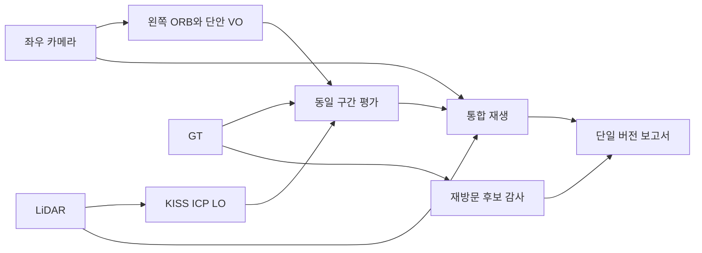

위 도식은 기존 운영·재생 경로다. **그 경로에서만** 오른쪽 카메라는 재생용이고 VO 입력에는 쓰지 않는다. 신규 독립 연구 경로는 오른쪽 영상을 깊이 추정에 사용한다. GT는 운영 연구의 평가와 과거 후보 감사에 사용하며, 실제 영상의 자동 루프 검출·보정은 어느 경로에도 구현되어 있지 않다. 합성 그래프의 루프 제약은 이 사실을 바꾸지 않는다.

이 문서의 버전과 알고리즘 성능 버전은 다르다. v1.0.0 통합 자체는 새 정확도 실험이나 알고리즘 변경이 아니다. 주제별 과거 실험에서 사용하는 상대 경로 'src/', 'artifacts/', 'configs/'는 각 장에 명시한 원 실험 디렉터리를 기준으로 읽는다. 쉘 실행 명령은 별도 지시가 없으면 레포 루트 기준이다.

<a id="learning"></a>

### 1.1 SLAM, 오도메트리, 센서 융합의 관계

SLAM은 **Simultaneous Localization and Mapping**, 즉 움직이는 주체의 상태와 주변 지도를 함께 추정하는 문제다. pose는 위치와 방향을 묶은 말이다. 상태(state)는 시스템에 따라 pose 외에 속도, 센서 bias 등을 포함한다. bias는 측정에 지속해서 더해지는 편향이다. 지도는 랜드마크 점, 점군, 표면, 격자 등으로 표현할 수 있다. [Cadena 외, SLAM 개관](https://arxiv.org/abs/1606.05830)

오도메트리는 연속 관측으로 상대 이동을 추정하고 이를 이어 붙이는 접근이다. VO는 카메라, LO는 LiDAR를 사용한다. SLAM 시스템은 오도메트리로 얻은 인접 pose 사이 제약을 사용할 수 있다. 하지만 독립적인 오도메트리는 그 자체로 유용하며, 누적 궤적이나 임시 local map이 있다고 항상 완전한 SLAM이라고 부르지는 않는다.

센서 융합은 여러 센서의 관측을 하나의 상태 추정에 함께 사용하는 방법이다. 카메라·IMU로 pose를 추정하는 VIO(Visual-Inertial Odometry), LiDAR·IMU를 사용하는 LIO(LiDAR-Inertial Odometry)는 대표적인 융합 예다. 이들이 반드시 전역 지도·루프 보정을 갖추는 것은 아니다. 반대로 카메라 하나로도 SLAM을 구성할 수 있으므로 다중 센서가 SLAM의 필수 조건은 아니다.

이 레포에서 같은 화면에 VO와 LO를 비교하는 것은 **비교**이지 **융합**이 아니다. 융합하려면 공통 상태, 관측 모델, 센서 좌표변환, 시간 대응, 불확실성 처리까지 정의해야 한다. 단순히 두 궤적을 평균 내거나 나란히 그리는 것으로 끝나지 않는다.

루프 클로징(loop closure)은 이전에 방문한 장소를 다시 관측했을 때 멀리 떨어진 시점 사이 제약을 추가하는 기능이다. 오도메트리의 누적 drift를 줄이는 데 중요하지만, 루프를 아직 만나지 않았다고 위치와 지도 추정 문제가 사라지지는 않는다. 여기서 drift는 작은 추정 오차가 시간에 따라 누적되는 현상이다.

따라서 **SLAM이 모든 추정·융합을 포함하는 보편적인 상위어는 아니지만, 이 프로젝트의 학습 목표를 묶는 이름으로는 적절하다.** 로봇의 경로 계획과 제어까지 자동으로 포함하는 이름은 아니다. 'lab'은 laboratory의 줄임말이며, 이론을 읽고 코드로 재현하고 결과를 검증하는 실험 공간이라는 현재 성격에 맞는다. 이미 완성된 SLAM 제품이라는 의미는 아니다.

### 1.2 지금 오도메트리에서 시작한 것은 맞는가

맞다. 지금까지는 '센서 관측이 pose 변화로 바뀌는 과정'을 다루었다. 이것은 이후 지도와 전역 최적화에 넣을 관측 제약을 이해하는 첫 발걸음이다. 모든 SLAM이 동일한 개발 순서를 강제하는 것은 아니지만, 현재 데이터와 학습 방식에서는 자연스러운 출발이다.

학습 흐름은 **전체 SLAM 구조 확인 → VO/LO 출력 관찰 → 필요한 수학 → map/최적화 → 재방문 보정 → 센서 융합**으로 둔다. 각 단계에서 다시 전체 시스템으로 돌아와 새 구성 요소가 어떤 오차를 줄이고 무엇은 해결하지 못하는지 확인한다. 아래 순서는 이 프로젝트를 위한 학습 제안이며 모든 연구자에게 유일한 순서는 아니다.

| 단계 | 먼저 던질 질문 | 필요한 수학 | 현재 자료와 연결 | 스스로 확인할 결과 |
|---|---|---|---|---|
| A. 좌표와 pose | 같은 점을 카메라와 LiDAR에서 어떻게 표현하나? | 벡터, 행렬, 회전, 역변환 | calibration, LiDAR 영상 투영 | 변환 후 역변환하면 원래 점으로 돌아옴 |
| B. 두 프레임 이동 | 왜 한 대응만으로 이동을 알 수 없나? | 최소제곱, rank, SVD, 투영 기하 | ORB 매칭, E, ICP | 충분한 제약과 퇴화 조건을 구분 |
| C. 믿을 정도 | 왜 두 센서 결과를 똑같이 믿으면 안 되나? | 확률, 분산/공분산, Bayes, MLE/MAP | VO/LO 오차, inlier | 측정 단위와 불확실성으로 가중치 설명 |
| D. 반복 보정 | pose를 어떻게 조금씩 개선하나? | 미분, Jacobian, Taylor, 비선형 최적화 | ICP, 재투영 오차 | 한 번의 업데이트 전후 오차 비교 |
| E. 지도와 전체 궤적 | 여러 프레임을 함께 보면 무엇이 달라지나? | 희소 선형대수, factor graph, gauge | BA, pose graph, loop closure | anchor 유무와 drift 보정 이해 |
| F. IMU 융합 | 카메라 사이의 고속 운동을 어떻게 연결하나? | 시간 적분, 잡음 모델, SO(3)/SE(3), 필터/평활화 | Raw OXTS, VIO/LIO | 시간·좌표·bias를 구분하고 검증 |

위 '확인할 결과'는 전체 학습의 도달 기준이다. A1–A12와 C1–C12에서 계산·실제 관측·합성 최적화의 일부를 검증했으나 모든 항목을 달성한 것은 아니다. 특히 실제 영상의 장기 지도·루프·VIO는 미수행이며, 구체적인 실행 범위는 각 단원과 C12의 계약을 따른다.

### 1.3 당장 필요한 선형대수와 좌표변환

벡터는 점의 좌표나 이동량을 모은 값이다. 행렬은 그 값을 다른 표현으로 바꾸거나 여러 연립식을 한꺼번에 쓰는 도구다. 점의 좌표에는 **어느 좌표계인지**를 항상 붙인다. 같은 숫자 (1,0,0)이라도 카메라에서의 전방/오른쪽과 LiDAR에서의 전방/왼쪽 규약은 다를 수 있다.

다음처럼 정의하면 변환 방향이 명확해진다.

```text
p_A = R_AB * p_B + t_AB
T_AB = [ R_AB  t_AB ]
       [   0      1 ]
```

p_B는 B 좌표계에서 본 점, p_A는 A 좌표계에서 본 같은 점이다. R_AB는 B의 축 방향을 A로 바꾸는 3×3 회전, t_AB는 A에서 본 B 원점 위치다. T_AB는 점에 마지막 좌표 1을 붙여 회전과 이동을 한 행렬곱으로 처리하는 4×4 동차변환이다. R의 성분은 무차원이고, t와 p는 여기서 m 단위다.

변환 합성은 T_AC=T_AB*T_BC다. 역변환은 R_BA=R_AB의 전치, t_BA=-R_AB의 전치*t_AB다. 전치는 행과 열을 바꾸는 연산이다. 회전행렬은 R의 전치*R=I, det(R)=1을 만족한다. 일반 행렬의 전치가 항상 역행렬인 것은 아니다.

작은 계산 예: B의 점 (1,0,0)을 z축 주위로 +90도 회전하고 A에서 (2,0,0)만큼 옮기면 (2,1,0)이 된다. '옮긴 뒤 회전'하면 다른 값이므로 곱셈 순서를 바꿀 수 없다. 이것이 pose 누적과 camera↔LiDAR 변환에서 행렬 순서를 외우기만 하면 위험한 이유다.

내적은 두 벡터의 정렬 정도와 투영, 노름은 크기, 외적은 3D에서 수직 방향을 계산하는 데 쓰인다. rank는 독립적인 제약의 수를 나타내는 선형대수 개념이다. SVD(Singular Value Decomposition, 특잇값 분해)는 A=U*S*V의 전치 형태로 행렬을 분해해, 최소제곱이나 퇴화에 가까운 방향을 살피는 도구다. 처음에는 유도 전체보다 작은 예에서 차원·곱셈 방향·실패 조건을 확인하는 것으로 시작해도 된다.

### 1.4 오차, 최소제곱, 미분은 왜 필요한가

실제 측정은 모두 완벽하게 일치하지 않는다. 예측한 관측 h(x)와 실제 관측 z의 차이 r(x)=z-h(x)를 residual(잔차)이라고 한다. x는 추정하려는 pose 등의 상태다. 여러 잔차의 제곱합을 작게 만드는 것이 최소제곱이다. 예를 들어 같은 길이에 대한 측정이1.0m와1.2m이고 동일한 오차 모델을 가정하면, 제곱합을 최소로 만드는 값은1.1m다.

영상 재투영 잔차는 pixel, LiDAR 점 정합 잔차는 m일 수 있다. 서로 다른 단위의 값을 그대로 합산하면 의미가 흐려진다. 측정의 공분산으로 정규화하거나 적절한 관측 모델을 사용해야 한다. residual이 작다는 사실만으로 정답이라고 할 수도 없다. 잘못된 대응이나 잘못된 calibration에 잘 맞는 해일 수 있다.

비선형 예측은 상태를 바꿀 때 변화량이 일정하지 않다. Jacobian J는 상태의 각 성분을 조금 바꿨을 때 관측 또는 residual의 각 성분이 얼마나 바뀌는지를 모은 편미분 행렬이다. 일차 Taylor 근사는 r(x+delta)≈r(x)+J*delta다. 이를 이용해 작은 업데이트 delta를 반복해서 찾는다.

Gauss-Newton은 이 국소 선형 근사를 이용하는 비선형 최소제곱 방법이고, Levenberg-Marquardt는 업데이트가 불안정할 때를 대비해 감쇠를 도입하는 방법이다. 이 이름들을 알기 전에 우선 '잔차 정의 → 단위 → Jacobian 크기 → 업데이트 전후 오차'를 계산할 수 있어야 한다. 회전의 업데이트는 보통 일반 벡터처럼 원소별 덧셈을 하지 않으며 아래 Lie group 내용과 연결된다.

### 1.5 확률, Bayes, MLE와 MAP

확률은 모르는 상태와 불완전한 관측을 표현한다. 평균은 중심, 분산은 한 변수의 퍼짐, 공분산은 여러 변수 사이의 함께 변하는 정도를 나타낸다. 예를 들어 위치의 x/y 오차가 연관되면 공분산 행렬의 비대각 성분을 무시할 수 없을 수 있다. 분산은 m² 같은 제곱 단위를 가진다. 정규분포(Gaussian)는 자주 쓰는 모델이지 모든 오차가 반드시 따르는 법칙은 아니다.

likelihood p(z|x)는 '상태 x를 가정하면 지금 관측 z가 얼마나 그럴듯한가'다. prior p(x)는 관측을 보기 전의 상태 정보, posterior p(x|z)는 관측을 반영한 뒤의 상태 정보다. Bayes 관계는 p(x|z) ∝ p(z|x)*p(x)다. 비례 기호는 x에 무관한 정규화 상수를 생략했다는 뜻이다.

- **MLE(Maximum Likelihood Estimation, 최대우도추정):** 관측의 likelihood를 가장 크게 만드는 x를 고른다.
- **MAP(Maximum A Posteriori, 최대사후확률추정):** prior도 반영해 posterior를 가장 크게 만드는 x를 고른다.

독립 Gaussian 측정이며 공분산이 상태에 따라 바뀌지 않는 등의 가정 아래, 음의 log likelihood를 최소화하면 가중 최소제곱 형태가 된다. log는 곱을 합으로 바꾸고, 음수를 붙이면 최대화가 최소화로 바뀐다. MAP에는 prior에 해당하는 항이 더해진다. 조건 없이 '모든 MLE는 최소제곱'이라고 말하면 틀리다. [GTSAM의 확률 제약·최적화 설명](https://gtsam.org/tutorials/intro.html)

설명용 센서 융합 예: 동일한 스칼라 위치를 독립적이고 편향 없이 관측한다고 가정하고, 센서A가10m(표준편차1m), 센서B가12m(표준편차2m)를 준다고 하자. 표준편차는 분산의 제곱근이다. 역분산 가중치는1과1/4이므로 결과는 (10*1+12*0.25)/1.25=10.4m다. 더 불확실한 B를 덜 믿는다. 이는 실제 VO/LO fusion 구현 결과가 아니라 가정이 명확한 1차원 설명 예다.

같은 이미지나 GT를 통해 얻은 두 추정은 서로 독립이 아닐 수 있다. 그 상관을 무시하면 정보를 두 번 센 것처럼 과신할 수 있다. 따라서 궤적을 단순 가중 평균하는 것보다 먼저 상태·좌표·시간·상관 모델을 정의해야 한다. 지금 GT로 맞춘 Sim(3) 결과를 독립적인 실제 센서 측정처럼 fusion 입력에 넣어서는 안 된다.

### 1.6 회전, Lie group, 지도 최적화

SO(3)는 유효한 3D 회전행렬들의 집합, SE(3)는 회전과 이동을 합친 3D 강체변환들의 집합이다. 이름의 S는 special, O는 orthogonal, E는 Euclidean을 가리킨다. 여기서 group은 합성·항등변환·역변환이 정의되는 구조라는 뜻이다. 회전행렬에는9개 숫자가 있지만 자유도는3이므로9개를 독립적으로 최적화하면 회전 조건을 깨뜨릴 수 있다.

Lie algebra는 이러한 변환 근처의 작은 변화를 벡터로 다루는 도구다. exp/log는 작은 변화 벡터와 변환 사이를 연결한다. 일반 행렬의 원소별 지수/로그와 혼동하면 안 된다. 처음부터 추상대수 전체를 끝낼 필요는 없다. '유효한 회전을 유지하며 작은 업데이트를 적용한다'는 목적에서 시작한다. quaternion은 회전을 표현하는 다른 방법이며, 네 숫자를 쓰지만 단위 노름 조건이 있다. [Solà·Deray·Atchuthan, 로봇 추정용 Lie 이론](https://arxiv.org/abs/1812.01537)

factor graph(요인 그래프)는 미지 상태 노드와 관측·사전정보 제약 노드를 연결한다. pose graph는 pose들 사이의 상대변환 제약을 중심으로 구성하고, BA(Bundle Adjustment)는 pose와3D 랜드마크를 함께 조정해 영상 재투영 오차를 줄인다. 희소성은 각 관측이 모든 상태가 아니라 일부 상태에만 연결되는 구조다. 계산 비용을 줄이는 핵심이다.

gauge freedom은 모든 위치와 지도를 함께 옮기거나 돌려도 상대 관측이 같아 절대 기준이 정해지지 않는 자유도다. 첫 pose를 고정하는 등의 anchor가 필요한 이유다. 단안의 scale 모호성과도 연결된다. 이 단계에서는 지도 전체를 바꿔도 관측이 유지되는 경우와 센서 오차로 값이 달라지는 경우를 구분해야 한다.

### 1.7 IMU는 어느 수학이 더 필요한가

IMU(Inertial Measurement Unit)는 각속도와 specific force를 측정한다. specific force는 단순한 세계좌표 가속도와 다르며, 자세와 중력을 고려해 해석해야 한다. 각속도를 시간 적분하면 방향 변화, 가속도를 적분하면 속도·위치 변화와 연결되지만 bias와 잡음도 함께 누적된다. 이를 위해 시간 적분, 미분방정식의 기초, 확률 과정, bias 모델을 공부한다.

필터링은 현재까지 관측으로 현재 상태를 갱신하고, 평활화(smoothing)는 여러 시점의 상태를 함께 다루는 관점이다. EKF(Extended Kalman Filter)는 비선형 모델을 현재 추정 근처에서 선형화하는 필터다. IMU preintegration은 카메라 등 저속 센서의 두 시점 사이 다수 IMU 관측을 하나의 상대 제약으로 요약하는 접근이다. 용어만 먼저 익히고 구현은 시간 동기화·좌표·단위·잡음 검증 이후로 둔다.

우리 Raw OXTS에는 비양수 시간 간격이 관측되었으며 Odometry와의 정렬이 미완료다. 수학을 안다고 이 입력 문제가 자동으로 해결되지 않는다. GPS/INS 위치·자세와 순수 IMU 측정 채널을 구분해 GT 누출도 막아야 한다.

### 1.8 지금 먼저 할 공부와 나중에 할 공부

**바로 필요한 최소 기반:** 벡터·행렬곱·역행렬·삼각함수, 좌표변환, 평균·분산, 제곱오차, 미분의 의미. 이를 현재 point projection과 두 프레임 pose에 연결한다.

**그다음 연결할 기반:** SVD·rank, 카메라 투영·에피폴라 기하, Jacobian, Bayes·MLE/MAP, Gaussian 가중 최소제곱. 이를 ORB 매칭 이후 E 추정과 ICP에 연결한다.

**지도·융합 단계에서 깊게 볼 내용:** SO(3)/SE(3), robust loss(큰 이상치의 영향을 제한하는 비용 함수), 희소 최적화·factor graph, filtering/smoothing, IMU bias·preintegration, observability(관측으로 구별 가능한 상태 성분).

첫 학습 과제는 새 알고리즘 구현이 아니라 **기존 LiDAR 점 하나를 카메라 좌표로 옮겨 영상에 투영하고, 변환 순서와 단위를 설명하는 것**으로 제안한다. 그다음 두 프레임에서 잔차가 어떻게 pose 업데이트로 이어지는지 본다. 이는 top-down 학습을 유지하면서 필요한 수학을 빠뜨리지 않는 순서다. 이번 문서 갱신에서는 이 과제를 실행하지 않았다.

이 절의 자료는 SLAM 개관, GTSAM 공식 설명, 로봇 추정용 Lie 이론 원문을 참고한 학습 설계다. 전체 내용을 한 번에 외우라는 선행 조건이 아니다. 기초→작은 계산→현재 데이터→실패 사례 순으로 같은 문서의 설명을 확장한다.

<a id="foundations"></a>

## 기초 교재: 문제에서 수학으로

### 이 책을 사용하는 방법

**출발 질문은 “자동차가 어디로 얼마나 움직였는가?”다.** 영상을 관측하고, 같은 지점을 찾고, 이동을 계산하고, 누적한다. 그런데 픽셀은 미터가 아니고, 센서마다 축이 다르며, 측정에는 오차가 있고, 오래 누적하면 궤적이 틀어진다. 아래 수학은 이 네 가지 문제를 해결하기 위해 등장한다. 모든 수학을 끝낸 뒤 코드를 시작하는 순서가 아니다.

처음에는 A1–A4를 읽고 실제 LiDAR 투영 그림을 재현한다. 그다음 기존 2장의 ORB 그림과 3장의 VO/LO 결과를 본다. “왜 매칭이 틀리면 궤적이 망가지는가?”가 궁금해질 때 A5–A9로 돌아온다. 마지막으로 A10–A12와 기존 4장의 재방문 결과를 연결한다. 이해가 막히면 아래 지도에서 그 문제에 필요한 단원으로 이동한다.

| 눈앞의 문제 | 필요한 단원 | 손으로 확인할 결과 |
|---|---|---|
| 센서 축이 서로 다르다 | [A1 벡터](#lesson-a1), [A2 좌표변환](#lesson-a2) | 같은 점이 (1,0)과 (2,1)로 표현됨 |
| 이미지에서 실제 거리를 모른다 | [A3 투영](#lesson-a3), [A4 스테레오](#lesson-a4) | 27px 시차가 10m 깊이로 변환됨 |
| 잘못된 매칭이 결과를 끌고 간다 | [A5 잔차](#lesson-a5), [A6 선형대수](#lesson-a6) | 평균 1.6m와 robust 추정 1.05m |
| 무엇을 더 믿어야 하나 | [A7 불확실성](#lesson-a7), [A8 MLE/MAP](#lesson-a8) | 두 측정의 결합 10.4m |
| 최적화가 어떻게 움직이나 | [A9 Jacobian](#lesson-a9), [A10 회전](#lesson-a10) | 1에서 시작해 2로 수렴하는 기록 |
| 재방문·IMU가 왜 필요한가 | [A11 그래프](#lesson-a11), [A12 IMU](#lesson-a12) | 루프 잔차와 bias 적분 오차 |

**기호 약속.** 소문자 x는 문맥에 따라 상태 벡터 또는 스칼라다. 굵은 글꼴에 의존하지 않고 차원을 함께 적는다. p는 공간의 점, z는 관측, r은 잔차, R은 회전행렬, t는 병진, T는 동차변환, K는 카메라 내부행렬, J는 Jacobian, Σ는 공분산이다. 위첨자 T는 전치이고, `T_AB`의 T는 변환 이름이다. 두 표기를 혼동하지 않는다. `||v||`는 벡터 길이, `argmin`은 비용을 가장 작게 만드는 입력값, `argmax`는 가장 크게 만드는 입력값을 뜻한다.

**그림의 출처와 범위.** 신규 15개 그림 중 A3의 KITTI 투영만 실제 데이터다. 나머지는 설정과 정답을 아는 교육용 모델이다. 합성 실험에서의 개선을 KITTI 성능 개선으로 해석하면 안 된다. 기존 ORB·매칭·LO 실제 산출물은 뒤의 응용 장에 그대로 남겼다. 모든 신규 그림은 `research/foundations-textbook/src/generate.py`가 만든다.

<a id="lesson-a1"></a>

### A1. 벡터: 위치를 숫자로 표현하기

#### 문제와 입력·출력

특징점은 이미지에서 (u,v), LiDAR 점은 센서 좌표에서 (X,Y,Z)로 주어진다. 벡터는 이런 순서 있는 숫자 묶음이다. 입력이 두 위치라면 출력은 상대 변위, 거리 또는 특정 방향으로의 성분이다. 단위와 좌표계가 같을 때만 두 위치를 빼거나 더할 수 있다.

점 p=(3,4)m는 원점에 대한 위치다. 변위 v=(3,4)m는 위치 사이의 차이다. 숫자가 같아도 의미는 다르다. 원점을 옮기면 점의 좌표는 변하지만 두 점 사이의 변위는 변하지 않는다. A2에서 점에는 이동 t를 더하고 방향에는 더하지 않는 이유다.

#### 계산을 따라가기

```text
v = (3,4) m
||v|| = sqrt(3² + 4²) = 5 m
단위 방향 n = v / ||v|| = (0.6,0.8), 길이 1, 단위 없음
내적 a·b = a1*b1 + a2*b2
v·(1,0) = 3 m: x 방향 성분
a·b = ||a|| ||b|| cos(theta)
```

내적은 방향의 정렬 정도를 측정한다. 단위벡터 두 개의 내적이 1이면 같은 방향, 0이면 직각, -1이면 반대 방향이다. **투영**은 어떤 방향으로 바라본 성분이다. 평면의 단위 법선 n과 점 오차 e의 내적 `n·e`는 그 평면에 수직인 거리 성분이다. 이는 뒤의 point-to-plane ICP를 읽을 때 필요한 수학이다. 현재 LO에 쓰인 KISS-ICP의 실제 잔차 형식은 응용 장에서 별도로 확인하며, 여기의 평면 예제를 현재 구현이라고 주장하지 않는다.


그림 A1. 파란 벡터의 길이는 5, 빨간 가로 성분은 3이다. 화살표 길이와 각도가 같은 축 비율에서 표현되어 있다.

행렬은 벡터를 다른 벡터로 바꾸는 규칙이다. 2×2 행렬 A의 첫 번째 열은 x 단위벡터가 이동한 곳, 두 번째 열은 y 단위벡터가 이동한 곳이다. 따라서 `A(3,4)`는 첫 번째 열의 3배와 두 번째 열의 4배를 더한 것이다. 행렬을 외우기보다 “기준 방향을 어디로 보내는가?”로 읽는다.

#### 코드 연결과 한계

`generate.py:frames()`의 a, R, q를 `artifacts/frames/values.npz`에서 확인한다. NumPy의 `@`는 행렬곱, `*`는 원소별 곱이다. 미터 위치와 픽셀 위치의 유클리드 거리를 직접 비교하지 않는다. 방향을 만들 때 길이가 0이면 나누기를 할 수 없으므로 먼저 검사해야 한다.

#### 연습문제와 해설

**문제 A1-1.** p=(1,2)m, q=(4,6)m일 때 p에서 q로 가는 변위와 거리는?

**해설 A1-1.** q−p=(3,4)m이고 거리는 sqrt(9+16)=5m다. p+q는 두 점 사이 변위가 아니다.

**문제 A1-2.** 오차 e=(3,4)m, 평면의 단위 법선 n=(0,1)일 때 수직 오차와 전체 거리는 같은가?

**해설 A1-2.** 수직 오차 n·e=4m, 전체 거리 ||e||=5m로 다르다. x 방향 3m는 평면에 평행하므로 수직 잔차에 나타나지 않는다. 이 정보 손실은 A6의 관측 불가능한 방향과 연결된다.

<a id="lesson-a2"></a>

### A2. 좌표변환: 같은 점을 다른 센서에서 보기

#### 왜 필요한가

카메라는 보통 영상 오른쪽·아래쪽·전방을 축으로 쓰고, LiDAR는 다른 축을 쓴다. 축의 순서만 바꾸는 것이 아니라 센서 원점도 다르다. **외부 보정값(extrinsic calibration)**은 이 상대 회전과 병진이다. 입력은 B 좌표의 점 p_B와 B→A 변환이고, 출력은 A 좌표의 같은 물리적 점 p_A다.

```text
p_A = R_AB p_B + t_AB
R_AB: 3×3, B의 벡터 성분을 A로 변환, 단위 없음
t_AB: 3×1, B 원점을 A에서 본 위치, m
T_AB = [ R_AB  t_AB ]       p_h = [X,Y,Z,1]^T
       [ 0 0 0   1  ]       p_Ah = T_AB p_Bh
```

끝에 1을 붙인 **동차좌표**를 쓰면 회전과 이동을 하나의 행렬곱으로 묶을 수 있다. 방향벡터에는 끝에 0을 붙인다. 그러면 t가 곱해지지 않는다. `T_AB`는 “B에서 A로”로 읽으며, 파일에서 pose를 받았을 때 이 방향부터 확인한다.

#### 2D로 손계산하기

```text
R = [0 -1]   t = (2,0)m   p_B = (1,0)m
    [1  0]
R p_B = (0,1)m
p_A = (0,1) + (2,0) = (2,1)m
R(p_B+t) = R(3,0) = (0,3)m    # 순서를 바꾸면 다른 결과
```

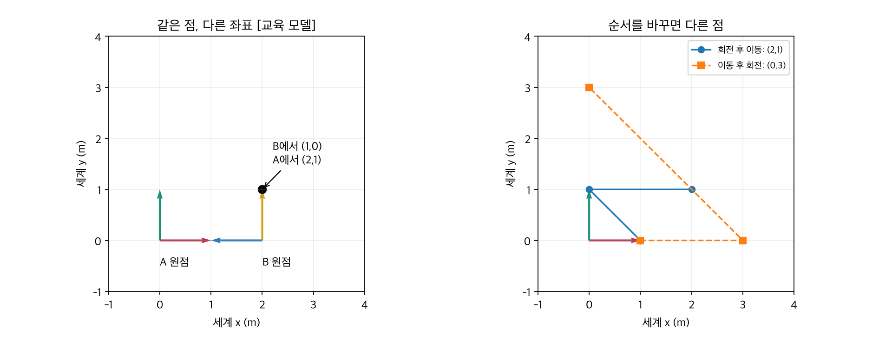

그림 A2. 왼쪽은 같은 점의 두 좌표, 오른쪽은 회전·이동 순서를 바꾸었을 때의 차이다. (2,1)과 (0,3)은 같은 변환이 아니다.

역변환은 단순히 t의 부호만 바꾸는 것이 아니다. `p_B=R_AB^T(p_A−t_AB)`이므로 역변환의 병진은 `−R_AB^T t_AB`다. 회전행렬은 열들이 서로 직교하고 길이가 1이어서 `R^T R=I`이며 역행렬이 전치와 같다. 합성은 `T_AC=T_AB T_BC`다. 오른쪽 변환을 먼저 적용한다. [Modern Robotics: 동차변환](https://modernrobotics.northwestern.edu/nu-gm-book-resource/3-3-1-homogeneous-transformation-matrices/)

#### 디버깅 계약과 한계

코드에서 행벡터 배열 N×3을 쓸 경우 `points @ R.T + t`가 위의 열벡터 수식과 같다. 전치가 있는 이유를 축 정의와 함께 확인한다. `frames()`는 역변환 후 원래 점 복원과 변환 순서 차이를 검사한다. 이 검사는 대수적 일관성만 보장한다. 잘못된 센서 보정값도 역변환 자체는 성립할 수 있으므로 실제 영상 overlay가 추가로 필요하다.

#### 연습문제와 해설

**문제 A2-1.** 위 예제의 p_A=(2,1)를 B로 되돌려라.

**해설 A2-1.** p_A−t=(0,1), R^T(0,1)=(1,0)이다. `R^T p_A−t`로 계산하면 (-1,-2)가 되어 틀린다.

**문제 A2-2.** 센서 방향 d_B=(1,0)에 동차좌표 마지막 값을 1로 넣으면 무엇이 잘못되는가?

**해설 A2-2.** 올바른 방향은 R d_B=(0,1)이다. 1을 붙이면 위치 이동 t까지 더해 (2,1)이 된다. 위치와 방향의 타입을 구분해야 한다.

<a id="lesson-a3"></a>

### A3. 카메라 투영: 미터가 픽셀이 되는 과정

#### 모델과 기호

**핀홀(pinhole) 모델**은 한 점인 카메라 중심을 지나가는 광선이 영상면에 닿는다고 본다. 카메라 좌표 X는 오른쪽, Y는 아래쪽, Z는 전방으로 두자. Z>0인 점에 대해 닮은 삼각형의 비율로 아래 식을 얻는다. 입력은 카메라 좌표의 3D 점과 내부 보정값, 출력은 영상의 픽셀 좌표다.

```text
u = fx * X/Z + cx       v = fy * Y/Z + cy
K = [fx  0 cx]         fx,fy: 픽셀 단위 초점거리
    [ 0 fy cy]         cx,cy: 주점(principal point), px
    [ 0  0  1]         X,Y,Z: m; u,v: px
q = K [X,Y,Z]^T        u=q1/q3, v=q2/q3
```

주점은 광학 축이 영상면을 만나는 위치다. fx가 크면 같은 X/Z 비율이 더 큰 픽셀 이동이 된다. 실제 렌즈의 왜곡은 별도 모델이 필요하지만, 이번 입력은 KITTI의 보정된 영상과 제공된 투영행렬을 사용한다. 이미 보정된 영상에 왜곡 보정을 중복 적용하면 안 된다. [OpenCV 카메라 모델](https://docs.opencv.org/4.13.0/d9/d0c/group__calib3d.html)

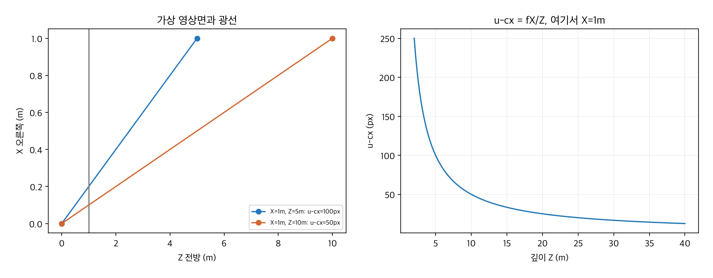

그림 A3-1. X=1m인 점도 깊이가 5m에서 10m가 되면 주점에서의 거리가 100px에서 50px로 줄어든다. 왼쪽 Z=1 선은 정규화된 가상 영상면이며 실제 초점거리 1m를 뜻하지 않는다.

**단안의 scale 모호성.** (X,Z)=(1,5)와 (2,10)은 X/Z가 같아 같은 픽셀이다. 한 이미지의 픽셀만으로 깊이를 결정할 수 없다. 여러 영상으로 구조와 이동을 계산하더라도 모든 거리와 이동을 같은 배율로 늘리면 같은 투영을 만들 수 있다. metric 기준이 없는 단안 VO의 이동을 미터라고 부를 수 없는 이유다.

#### 실제 KITTI 점 하나를 끝까지 계산하기

00 시퀀스의 frame120을 사용한다. `.bin`은 little-endian float32의 (x,y,z,reflectance) 레코드이며 좌표변환에는 앞 세 값만 쓴다. reflectance는 동차좌표의 1이 아니다. `Tr`로 카메라 좌표에 옮긴 뒤 `P0`로 투영한다.

```text
원시 점 index = 55553
p_L = (12.681147, -0.226356, -1.510892) m
p_C = Tr * [p_L;1] = (0.232002, 1.363495, 12.399397) m
fx=fy=718.856 px, cx=607.1928 px, cy=185.2157 px
u = 718.856 * 0.232002 / 12.399397 + 607.1928 = 620.6431 px
v = 718.856 * 1.363495 / 12.399397 + 185.2157 = 264.2644 px
```


그림 A3-2. 흰 원이 계산한 단일 점이다. 색은 카메라 전방 깊이 Z이며 반사강도가 아니다. 원시 121,444점 중 전방이며 영상 경계 안인 점은 18,073개다. 보기 쉽게 그중 12개마다 하나씩 그렸다. 이는 가림까지 판정한 물리적 visibility가 아니라 투영 유효성 필터다.

`camera()`가 실제 Tr/P0, 선택 점, 전체 유효 투영을 `artifacts/kitti/values.npz`에 저장한다. 뒤쪽 점(Z≤0)은 나누기 전에 제외한다. 영상 밖 점도 제거하지만, 앞 물체에 가려진 뒤쪽 점을 제거하는 z-buffer는 여기서 구현하지 않았다. 따라서 overlay 일치만으로 시간 동기화나 모든 보정이 완벽하다고 결론내리지 않는다.

#### 연습문제와 해설

**문제 A3-1.** fx=500px, cx=320px, X=1m, Z=5m라면 u는? 같은 광선 위에서 깊이를 두 배로 하면 X는?

**해설 A3-1.** u=500/5+320=420px. 같은 광선이면 X도 2m가 되어야 한다. X=1m를 유지한 채 Z만 두 배로 하면 u=370px로 달라진다.

**문제 A3-2.** LiDAR 레코드 (x,y,z,0.2)를 그대로 4×4 동차변환에 넣어도 되는가?

**해설 A3-2.** 안 된다. 마지막 0.2는 반사강도다. 점을 변환할 때는 (x,y,z,1)을 새로 만들어야 병진이 정확히 한 번 더해진다.

<a id="lesson-a4"></a>

### A4. 스테레오: 깊이와 거리 기준 얻기

#### 단안에서 부족했던 정보

두 카메라의 간격 **baseline B**를 미터로 알면 길이 기준이 생긴다. 평행·정렬된 두 카메라가 같은 초점거리와 수평 주점을 가진 단순 모델에서 같은 점은 같은 영상 행에 나타난다. 왼쪽 좌표가 u_L, 오른쪽이 u_R이면 **시차(disparity)**는 d=u_L−u_R다. 입력은 대응점과 보정값이고 출력은 깊이 Z다. 주점이 다르면 그 차이를 반영해야 하며, 모든 데이터에 아래 단순식을 그대로 적용할 수는 없다.

```text
u_L-cx = f X/Z
u_R-cx = f (X-B)/Z
d = u_L-u_R = f B/Z
Z = f B/d
예: f=500px, B=0.54m, d=27px → Z=10m
```

둘을 빼면 모르는 X가 사라진다. 이것이 삼각측량의 가장 간단한 모습이다. 일반적인 두 시점 카메라는 회전과 이동을 포함한 투영행렬로 광선의 교차를 구한다. 광선이 거의 평행하면 작은 픽셀 오차가 큰 깊이 오차가 된다.

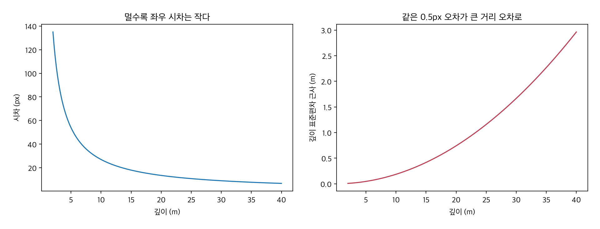

그림 A4. 왼쪽은 깊이에 반비례하는 시차, 오른쪽은 시차 표준편차 0.5px를 가정한 깊이 표준편차다. 실제 KITTI 보정값이 아니라 f=500px, B=0.54m인 교육용 설정이다.

오차를 계산하려면 함수의 기울기를 이용한다. `dZ/dd=−fB/d²`이고 작은 시차 오차의 표준편차가 σ_d이면 `σ_Z≈|dZ/dd| σ_d=Z² σ_d/(fB)`다. 10m에서 약 0.185m, 20m에서 약 0.741m다. 거리가 두 배면 불확실성은 이 근사에서 네 배가 된다. f와 B가 정확하고 오차가 작다는 가정이 포함된다. d가 0에 가까우면 이 선형 근사 자체도 불안정하다.

#### 프로젝트 연결과 다음 한계

기존 운영 VO는 왼쪽 영상 기반 단안 방식이다. 그 화면에서 오른쪽 원본이 재생된다고 스테레오 추정을 쓰는 것은 아니다. 이 단원이 제안했던 stereo matching→triangulation→3D-2D pose estimation은 신규 독립 연구의 C4–C5에서 실행했다. 컬러를 추가해도 baseline 같은 거리 기준이 자동으로 생기지 않는다. 반복 무늬·가림·반사·질감 없는 벽에서는 대응 자체가 틀릴 수 있다. 다음 A5가 그 잘못된 관측을 다룬다.

#### 연습문제와 해설

**문제 A4-1.** 같은 f와 B에서 d=13.5px이면 깊이는? d=0이면?

**해설 A4-1.** Z=270/13.5=20m다. d=0에서는 유한한 깊이를 계산할 수 없다. 작은 양수로 강제로 나누어 거대한 “정답”을 만들지 말고 유효하지 않거나 먼 점으로 처리한다.

**문제 A4-2.** 동일 깊이에서 baseline을 두 배로 늘리고 σ_d를 유지하면 σ_Z는?

**해설 A4-2.** 식의 분모 B가 두 배이므로 절반이다. 그러나 실제로는 공통 시야와 가림, 대응 난이도가 변하므로 baseline을 늘리기만 하면 항상 좋아지는 것은 아니다.

<a id="lesson-a5"></a>

### A5. 잔차와 최소제곱: 무엇을 작게 만드는가

#### 관측에서 목적함수로

상태 x로 예측한 관측을 h(x), 실제 측정을 z라 하면 **잔차(residual)**를 r(x)=h(x)−z로 정의한다. 부호를 반대로 써도 제곱 비용은 같지만 Jacobian과 업데이트는 같은 정의를 따라야 한다. 입력은 관측과 예측 모델, 출력은 잔차와 추정 상태다. 영상 재투영 잔차는 px, 공간 대응 잔차는 m일 수 있다. 단위가 다른 잔차를 그대로 더하면 큰 숫자의 단위가 결과를 지배한다.

```text
상수 위치를 여러 번 측정: h(x)=x, r_i=x-z_i
F(x) = sum_i (x-z_i)²
dF/dx = 2 sum_i (x-z_i) = 0
x_hat = sum_i z_i / N
```

즉 단순 최소제곱(Least Squares, LS)은 평균을 만든다. z=[1,1.1,0.9,1,4]m이면 평균은 1.6m다. 4m가 잘못된 대응이라면 나머지 네 측정에서 멀어진다. 제곱은 큰 잔차에 매우 큰 벌점을 주므로 추정값이 이상치를 향해 움직인다.

#### Huber 손실의 의미

```text
rho(r) = 0.5 r²                  if |r| <= delta
         delta (|r|-0.5 delta)   otherwise
```

작은 잔차에는 제곱, 큰 잔차에는 선형 벌점을 준다. **robust**란 일부 큰 오차의 영향에 덜 민감하도록 만든다는 뜻이지 오류를 모두 제거한다는 뜻은 아니다. delta=0.2m이면 이 예제의 해는 1.05m다. 그 근처에서 네 정상 측정의 기울기 합은 `4x−4`, 4m 관측은 기울기 `−0.2`를 주므로 `4x−4−0.2=0`, x=1.05다.


그림 A5. 같은 측정에 대한 두 목적함수와 최소점이다. 두 패널의 세로축 비용 정의가 다르므로 높이 자체를 성능으로 비교하지 않는다. 참값 1m를 가정한 교육 예제에서 추정 차이를 보여준다.

`estimation()`은 SciPy `least_squares(loss='huber', f_scale=0.2)`와 해석적 답을 비교한다. 현재 VO의 RANSAC(Random Sample Consensus, 무작위 표본 합의)은 작은 부분집합으로 모델을 만들고 그 모델과 맞는 관측을 찾는 별도 전략이다. Huber는 이미 선택한 잔차의 영향력을 줄이는 전략이다. 둘은 보완적으로 쓸 수 있지만 같은 알고리즘은 아니다. RANSAC의 threshold도 잔차의 단위와 정의에 맞춰야 한다.

#### 연습문제와 해설

**문제 A5-1.** 마지막 측정 4m를 제외하면 평균은? 이것만으로 이상치를 자동 판정할 수 있는가?

**해설 A5-1.** 평균은 1m다. 그러나 결과를 보고 임의로 제거한 것이므로 자동 판정 근거가 아니다. 관측 모델·기하 검증·고정된 규칙과 평가가 필요하다.

**문제 A5-2.** Huber delta를 매우 크게 하면 어떻게 되는가?

**해설 A5-2.** 모든 잔차가 제곱 구간에 들어가 일반 최소제곱과 같은 최소점을 갖는다. delta가 너무 작으면 정상적인 큰 잔차까지 약하게 취급할 수 있다. 값은 노이즈 규모와 단위를 기준으로 정한다.

<a id="lesson-a6"></a>

### A6. Rank와 SVD: 왜 어떤 방향은 못 알아내는가

#### 식이 많아도 정보는 적을 수 있다

선형 모델 `A x=b`에서 A의 행은 관측 조건, 열은 미지수 방향을 나타낸다. **rank(계수)**는 독립적인 열 또는 행의 수다. `x1+x2=1`을 백 번 반복해도 x1과 x2를 각각 결정할 수 없다. 관측 개수가 아니라 서로 다른 정보를 주는지가 중요하다.

**SVD(Singular Value Decomposition, 특잇값 분해)**는 `A=U S V^T`로 쓴다. V는 입력의 직교 방향, S의 비음수 대각값은 방향별 확대율, U는 출력 방향이다. 특잇값이 0이면 어떤 입력 변화가 출력에 전혀 나타나지 않는다. 아주 작으면 그 방향을 추정할 때 노이즈가 크게 증폭된다.

```text
A = diag(2,0.2)
b = (2,0.2) → x=(1,1)
b'=(2,0.22) → x'=(1,1.1)
두 번째 관측의 0.02 변화가 상태의 0.1 변화로 증폭
condition number = 최대 특잇값 / 최소 특잇값 = 2/0.2=10
```


그림 A6. 왼쪽 단위원이 타원으로 바뀐다. 오른쪽 비용 등고선은 y 방향으로 길다. y를 많이 바꾸어도 비용 변화가 작으므로 그 방향의 추정이 약하다. 이 그래프는 무차원 선형 모델이다.

**null space(영공간)**는 `A v=0`을 만족하는 방향 집합이다. 벽까지 수직 거리만 잰다면 벽에 평행한 이동은 잔차를 바꾸지 않을 수 있다. 실제 3D LO의 관측 가능성은 장면 구조·움직임·잔차 모델 전체로 판단해야 하며, 이 작은 예제만으로 어느 주행 구간이 퇴화했다고 확정할 수 없다.

#### 계산 관점의 주의

해가 불안정할 때 `inverse(A.T@A)`를 무조건 계산하지 않는다. 정규방정식은 A의 조건수를 제곱할 수 있다. QR 분해(직교행렬 Q와 상삼각행렬 R로 분해)나 SVD 기반 선형해법을 이용한다. 단, 미터와 라디안처럼 열의 단위가 섞인 행렬에서는 단순 조건수가 스케일 설정에 의존한다. 상태 정규화와 gauge를 먼저 검토한다. `estimation()`의 A와 조건수는 저장되어 있으나 대규모 SLAM의 관측성 분석을 수행한 것은 아니다.

#### 연습문제와 해설

**문제 A6-1.** A=diag(2,0)이면 rank와 영공간 방향은?

**해설 A6-1.** rank는 1이고 v=(0,1)이 영공간 방향이다. 두 번째 상태를 아무리 바꿔도 출력은 같다. 반복 측정만 늘려서는 이 정보가 생기지 않는다.

**문제 A6-2.** A=diag(2,0.2)에서 A^T A의 조건수는?

**해설 A6-2.** 대각값이 4,0.04가 되므로 조건수는 100이다. A의 조건수 10보다 커져 수치적으로 불리해질 수 있다.

<a id="lesson-a7"></a>

### A7. 확률과 공분산: 오차에도 방향이 있다

#### 노이즈를 숫자 하나로 표현할 수 있을까

**확률변수**는 값이 불확실한 양이다. 평균 μ는 중심, 분산 σ²는 중심에서의 제곱 편차 평균, 표준편차 σ는 원래 단위의 퍼짐이다. Gaussian(정규) 분포의 1D 밀도는 다음과 같다. 밀도는 특정 점의 확률과 다르다. 연속 변수에서 구간 확률은 밀도를 적분한 값이며, 밀도 높이는 1을 넘을 수도 있다.

```text
p(x) = 1/(sqrt(2*pi)*sigma) * exp(-(x-mu)²/(2*sigma²))
Cov(x,y) = E[(x-mu_x)(y-mu_y)]
Sigma = [[Var(x), Cov(x,y)], [Cov(x,y), Var(y)]]
```

E는 기대값, 즉 분포로 가중한 평균이다. 좌표가 m라면 공분산 성분 단위는 m²다. 대각선은 각 축 분산, 비대각선은 두 축 오차가 함께 움직이는 정도다. 양의 상관이면 x 오차가 양수일 때 y 오차도 양수인 경향이 있다.

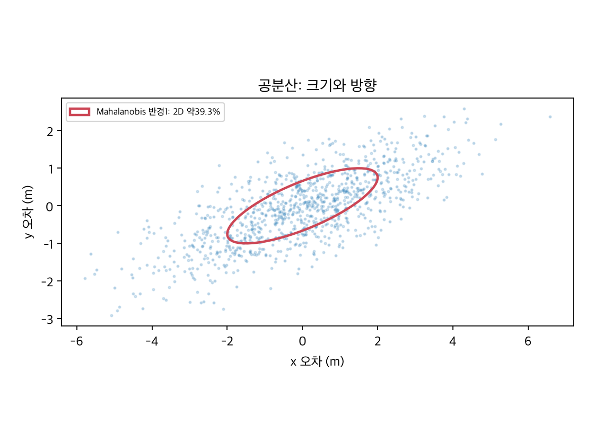

그림 A7. Σ=[[4,1.5],[1.5,1]]m²의 Gaussian 표본 1,000개(seed=7)다. 타원은 Mahalanobis 반경 1 경계다. **2D에서 이 타원 안의 이론적 확률은 약 39.3%이며, 1D의 ±1σ 약 68.3%와 같지 않다.** 표본의 실제 포함률은 난수에 따라 달라진다.

**Mahalanobis 거리**는 `d²=e^T Σ^(-1)e`다. 불확실한 방향의 오차는 덜, 정확한 방향의 오차는 더 크게 본다. Σ=diag(4,1)m²에서 e=(2,0)m와 (0,1)m는 모두 d²=1이다. 유클리드 거리는 다르지만 각 방향 표준편차로 보면 동일한 크기다. **정보행렬**은 Σ의 역행렬이며 높은 정보는 낮은 분산에 해당한다. 실제 계산은 명시적 역행렬보다 선형 시스템 풀이를 선호한다.

#### 한계와 모델 검증

Gaussian은 계산이 편리한 모델이지 모든 센서 오차의 사실이 아니다. 가림에 의한 오대응은 평균 주변 작은 노이즈와 다르다. 공분산을 너무 작게 잡으면 틀린 관측을 과신한다. 또한 두 센서가 같은 원자료나 보정값을 공유하면 오차가 상관될 수 있다. 독립이라는 가정 없이 분산만 더하거나 정밀도를 더하면 안 된다.

#### 연습문제와 해설

**문제 A7-1.** σ=0.2m의 분산은? 센티미터 단위로 바꾸면?

**해설 A7-1.** 분산은 0.04m²다. σ=20cm이고 분산은 400cm²다. 분산에 길이 환산계수 100만 곱하면 틀리며 100²를 곱해야 한다.

**문제 A7-2.** Σ=diag(4,1)m², e=(2,1)m의 Mahalanobis 거리는?

**해설 A7-2.** d²=2²/4+1²/1=2이므로 d=sqrt(2)다. 두 성분을 표준편차로 나눈 뒤 길이를 구한 것과 같다.

<a id="lesson-a8"></a>

### A8. Bayes, MLE, MAP: 측정과 믿음을 합치기

#### likelihood는 상태의 확률인가

관측 z가 주어졌을 때 상태 x를 추정한다. `p(z|x)`는 x라는 상태에서 이런 관측이 나올 모델이다. 관측을 고정하고 x를 바꾸며 평가하면 **likelihood(우도)**라고 부른다. 이것만으로 x에 대한 확률분포가 되는 것은 아니다. **prior(사전분포)** p(x)는 관측 전 상태의 불확실성, **posterior(사후분포)** p(x|z)는 관측 후 상태의 분포다.

```text
Bayes: p(x|z) = p(z|x) p(x) / p(z)
MLE (Maximum Likelihood Estimation, 최대우도추정): argmax_x p(z|x)
MAP (Maximum A Posteriori, 최대사후확률 추정): argmax_x p(x|z)
```

p(z)는 x와 무관한 정규화 상수라 최적점만 찾을 때 제외할 수 있다. 독립인 고정분산 Gaussian 측정이면 우도를 곱한다. 로그는 곱을 합으로 바꾸며, 음수를 붙이면 최대화가 최소화가 된다. 따라서 음의 로그우도는 상수항을 제외하고 `0.5 sum(r_i²/σ_i²)`다. 최소제곱이 확률 모델과 연결되는 지점이다. 분산이 x에 따라 바뀌면 정규화항도 달라지므로 이를 무조건 버릴 수는 없다.

#### 두 센서와 prior를 손으로 결합하기

```text
z1=10m, sigma1=1m → 정밀도 w1=1
z2=12m, sigma2=2m → 정밀도 w2=0.25
MLE 평균 = (w1*z1+w2*z2)/(w1+w2) = 10.4m
측정 결합 분산 = 1/(1+0.25) = 0.8m²
prior: 평균 9m, sigma=0.5m → 정밀도 4
MAP = (10+3+36)/(1+0.25+4) = 9.333333m
사후 분산 = 1/5.25 = 0.190476m²
```

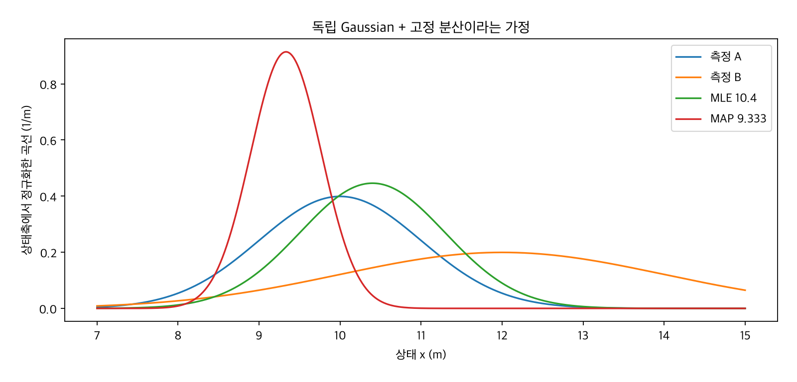

그림 A8. 상태축에서 비교하도록 정규화한 측정 곡선과 결합 결과다. MLE 곡선은 이 특별한 위치 관측 모델의 정규화된 우도이며, 모든 우도가 자동으로 상태의 확률밀도라는 뜻은 아니다. Gaussian인 이 예에서는 MAP가 사후 평균과도 일치한다.

**과신의 위험.** prior가 실제로 틀렸는데 σ=0.5m로 매우 정확하다고 선언하면 두 측정보다 prior 쪽으로 강하게 끌린다. MAP는 prior를 추가했으니 무조건 더 정확한 방법이 아니다. 두 센서의 노이즈가 상관되거나 bias가 있으면 위 계산의 독립·불편향 가정이 깨진다. `estimation()`은 수식과 수치가 일치하는지 검사할 뿐 실제 카메라와 IMU를 융합하지 않는다.

#### 연습문제와 해설

**문제 A8-1.** 두 측정의 σ가 모두 1m이면 MLE와 결합 분산은?

**해설 A8-1.** 같은 가중치이므로 평균 11m, 분산 1/(1+1)=0.5m²다. 두 번 독립 측정했다는 조건이 필요하다.

**문제 A8-2.** prior의 σ를 무한히 크게 하면 MAP는 어디로 가는가?

**해설 A8-2.** prior 정밀도가 0으로 가므로 이 Gaussian 모델에서 MLE=10.4m로 간다. 반대로 σ가 0에 가까워지면 prior 평균 9m로 강하게 고정된다.

<a id="lesson-a9"></a>

### A9. 미분과 Jacobian: 최적화의 한 걸음

#### 비선형 함수를 잠시 직선으로 보기

미분은 입력을 조금 바꾸었을 때 출력이 얼마나 변하는지 나타낸다. 여러 입력과 여러 출력에 대한 미분을 모은 행렬이 **Jacobian(야코비안)**이다. 잔차가 m개, 상태가 n개이면 J는 m×n이다. `J_ij=∂r_i/∂x_j`이며 단위는 잔차 단위/상태 단위다. 카메라 투영의 X/Z 때문에 pose와 픽셀 관계는 일반적으로 비선형이다.

```text
r(x+delta) ≈ r(x) + J delta
Gauss-Newton: delta = argmin ||r+J delta||²
정규방정식: J^T J delta = -J^T r
x_next = x + delta
```

**Gauss-Newton(GN)**은 잔차를 현재 추정 근처에서 선형화하고 이 작은 문제를 반복해서 푼다. 실제 구현은 J의 rank와 단위를 확인하고 안정적인 선형해법을 사용한다. 큰 delta는 선형 근사가 유효한 범위를 벗어날 수 있다. **Levenberg-Marquardt(LM)**는 감쇠항을 더해 과한 이동을 제어하는 접근이며, 감쇠를 어떻게 조절하는지도 중요하다. 이번 교육 코드의 단일 변수 GN에는 LM을 구현하지 않았다.

#### 한 번의 업데이트를 계산하기

r(x)=x²−4, J=2x인 무차원 예제에서 x=1이면 r=−3, J=2다. `2 delta=3`이므로 delta=1.5, 다음 x는 2.5다. 다시 r=2.25, J=5이므로 delta=−0.45, x=2.05다. 이후 2.000609756, 2.000000093, 2.0으로 간다. x=−2도 해이며 x=0에서는 J=0이라 이 계산이 실패한다. 시작값에 관계없이 수렴한다는 예제가 아니다.


그림 A9. 왼쪽은 x=1에서의 접선, 오른쪽은 선택한 시작점에서의 비용 변화다. 작은 값의 표현을 위해 log10을 사용하고 -18에서 표시를 제한했다. 마지막 점은 실제 비용이 10^-18보다 작아도 그 아래로 그리지 않는다.

#### 구현을 검산하는 방법

유한차분은 `J≈[r(x+ε)−r(x−ε)]/(2ε)`로 미분을 수치적으로 확인한다. `linearization()`은 ε=10^-6으로 다섯 반복의 J를 확인하고, `artifacts/linearization/values.npz`의 trace에 x,r,J,r²를 저장한다. ε가 너무 작으면 반올림 오차, 너무 크면 곡률 오차가 생긴다. 수치 미분은 검증 도구이며 무조건 가장 정확한 기준이 아니다.

#### 연습문제와 해설

**문제 A9-1.** x=3에서 이 예제의 GN 한 번을 계산하라.

**해설 A9-1.** r=5, J=6, delta=−5/6이므로 다음 x=13/6≈2.166667이다. 비용은 25에서 약 0.482253으로 줄지만 모든 비선형 문제에서 감소를 보장하지는 않는다.

**문제 A9-2.** 관측 픽셀 (u,v) 두 성분과 6차원 pose 증분을 쓴다면 점 하나의 J 크기는?

**해설 A9-2.** 2×6이다. 점 N개를 세로로 쌓으면 2N×6이다. 행 수가 6보다 크다는 것만으로 rank가 6이라고 보장되지는 않는다.

<a id="lesson-a10"></a>

### A10. SO(3)와 SE(3): 회전을 망가뜨리지 않고 갱신하기

#### 아홉 숫자를 마음대로 바꾸면 안 되는 이유

3×3 회전행렬에는 아홉 숫자가 있지만 자유도는 셋이다. **자유도(Degrees of Freedom, DoF)**는 독립적으로 바꿀 수 있는 양의 수다. 회전은 `R^T R=I`, `det(R)=+1`을 만족해야 한다. determinant(행렬식)가 -1인 직교행렬은 반사를 포함하므로 올바른 3D 회전이 아니다.

**SO(3)**는 Special Orthogonal group in 3 dimensions, 3차원 특수직교군이다. **SE(3)**는 Special Euclidean group in 3 dimensions로 회전과 병진을 합친 강체변환 집합이다. 강체변환은 물체 내부 거리를 보존한다. “군”은 항등변환·합성·역변환이 집합 안에서 성립하는 구조를 뜻한다.

#### 작은 회전을 세 숫자로 표현하기

회전벡터 w는 방향이 회전축, 길이가 회전각(rad)인 3차원 벡터다. `[w]x`는 임의 v에 대해 `[w]x v=w×v`가 되도록 만든 반대칭행렬이다. ×는 두 벡터에 수직인 방향을 만드는 외적이다. 행렬의 **지수함수 exp**는 원소마다 지수를 취하는 것이 아니라 `I+A+A²/2!+...`의 행렬 급수다.

```text
w=(0,0,0.5) rad
[w]x = [[0,-0.5,0],[0.5,0,0],[0,0,0]]
1차 근사 R_bad=I+[w]x → (1,0,0)이 (1,0.5,0)으로, 길이 1.118034
올바른 R=exp([w]x) → (cos(0.5),sin(0.5),0), 길이 1
```

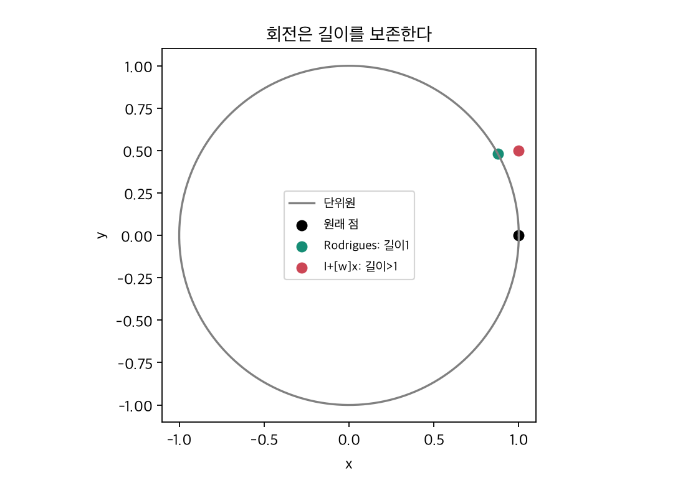

그림 A10. 초록 점은 단위원 위에 남지만 단순 1차 근사인 빨간 점은 원 밖으로 나간다. 작은 각도의 근사 자체는 유용하지만 이를 그대로 영구 회전행렬로 저장하면 제약이 깨질 수 있다.

`linearization()`은 OpenCV Rodrigues 변환을 사용해 회전벡터를 회전행렬로 바꾼다. Rodrigues 식은 이 3D 회전 지수함수를 계산하는 방법이다. 최적화에서는 `R_new=exp([delta_w]x)R`처럼 작은 증분으로 회전을 갱신할 수 있다. 오른쪽에 곱하는 `R exp(...)`도 가능하지만 증분이 표현된 좌표계와 Jacobian이 달라진다. 둘을 섞으면 안 된다.

#### SE(3)로 확장할 때의 주의

pose 증분 ξ는 보통 회전 3개와 병진 3개로 구성하지만 라이브러리마다 순서가 다르다. 엄밀한 SE(3) 지수지도에서는 회전과 병진 부분이 결합되므로 “회전은 exp, 병진은 그냥 더하기”가 언제나 동일한 연산은 아니다. 이번 예제는 SO(3)만 수치 검증했다. Lie algebra(리 대수)는 이런 국소 증분을 다루는 공간이며 전체 유도는 후속 학습 범위다. [Solà·Deray·Atchuthan, A micro Lie theory](https://arxiv.org/abs/1812.01537)

#### 연습문제와 해설

**문제 A10-1.** diag(1,1,-1)은 R^T R=I를 만족한다. SO(3)인가?

**해설 A10-1.** 행렬식이 -1이므로 아니다. z축 반사가 포함된다. 직교성 검사만으로 회전 유효성을 모두 검사할 수 없다.

**문제 A10-2.** 90도를 그대로 회전벡터 길이에 넣으면 올바른가?

**해설 A10-2.** 라디안 API라면 π/2≈1.570796을 넣어야 한다. 90을 넣으면 90rad다. 각도 단위 오류는 행렬의 직교성 검사로 잡히지 않는다.

<a id="lesson-a11"></a>

### A11. Factor Graph: 누적 궤적을 함께 고치기

#### 오도메트리와 전역 수정의 차이

오도메트리는 이웃 시점의 상대 이동을 이어 붙인다. 나중에 과거 장소로 돌아왔다는 정보가 생기면 최신 위치만 바꾸는 대신 전체 상태가 관측을 함께 만족하도록 조정할 수 있다. **factor graph(인자 그래프)**에서 변수 노드는 미지 상태, factor는 일부 변수에 대한 관측 제약이다. pose graph는 pose들을 변수로 삼는 특수한 경우다. [GTSAM 입문](https://gtsam.org/tutorials/intro.html)


그림 A11-1. 원은 x0…x4, 초록 사각형은 이웃 이동 관측, 빨간 사각형은 시작과 끝의 상대 위치 관측이다. 검은 anchor는 기준 원점을 고정한다. 사각형 자체가 새 상태는 아니다.

#### 1D 예제를 실제로 최적화하기

참고용 경로를 [0,1,2,1,0]m라 하고, 이동 관측은 [1.1,1.1,-0.9,-0.9]m로 만든다. 누적하면 [0,1.1,2.2,1.3,0.4]m다. 끝에서 시작점으로 돌아왔다는 상대 관측 0m를 추가한다. 이 loop 관측은 인식 알고리즘이 찾은 것이 아니라 교육자가 제공한 것이다.

```text
x0=0 고정
odom residual_i = (x_(i+1)-x_i-z_i)/0.1
loop residual = (x4-x0-0)/0.05
최소화: 모든 정규화 잔차의 제곱합
보정 후: [0,1.005882,2.011765,1.017647,0.023529] m
```

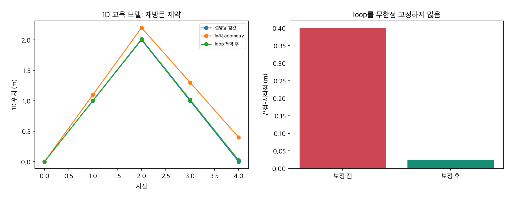

그림 A11-2. 끝점 잔차가 0.4m에서 0.023529m로 줄었다. loop 분산을 0이 아닌 값으로 설정했으므로 끝점이 강제로 정확히 0이 되지는 않는다. 교육용 1D 결과이며 실제 KITTI 루프 클로징 성능이 아니다.

#### gauge와 잘못된 루프

상대 이동만 있으면 모든 x에 같은 상수 c를 더해도 잔차가 같다. 이 기준의 자유를 **gauge freedom**이라고 한다. 차분 Jacobian은 4×5, rank=4이고 J(1,1,1,1,1)^T=0이다. 한 상태를 고정하거나 적절한 prior로 기준을 정해야 한다. 이것은 “센서가 나빠서 생긴 문제”와 달리 상대 측정의 구조적 성질이다.

실제 loop closing에는 장소 후보 검색, 기하 검증, 상대 pose 추정, 불확실성 설정, 그래프 최적화가 필요하다. GT 위치가 가깝다는 감사 결과는 자동 검출이 아니다. 틀린 loop는 전체 지도를 망가뜨릴 수 있다. `graph_imu()`는 알려진 제약을 SciPy로 푸는 교육 예제만 추가하며 현재 playback의 궤적을 보정하지 않는다. landmark까지 포함한 시각적 **Bundle Adjustment(BA, 묶음 조정)**는 여러 pose와 3D 점을 재투영 오차로 함께 조정하는 별도 확장이다.

#### 연습문제와 해설

**문제 A11-1.** 보정 전 모든 pose에 100m를 더하면 이웃 이동 잔차는 변하는가?

**해설 A11-1.** `(x_(i+1)+100)-(x_i+100)`에서 100이 소거되므로 변하지 않는다. anchor를 적용한 문제에서는 x0=0 제약을 위반한다.

**문제 A11-2.** loop의 σ를 0.05m에서 0.5m로 늘리면 상대 영향력은?

**해설 A11-2.** 제곱 비용 가중치는 1/σ²이므로 100분의 1이 된다. 같은 관측이어도 덜 믿으므로 odometry 누적 결과에 더 가까운 해를 만든다.

<a id="lesson-a12"></a>

### A12. IMU와 시간: 센서를 더하면 저절로 좋아질까

#### 측정하는 것은 위치가 아니다

**IMU(Inertial Measurement Unit, 관성측정장치)**는 가속도계와 자이로스코프로 운동을 측정한다. 자이로는 각속도(rad/s), 가속도계는 비력(specific force, m/s²)을 측정한다. 비력은 단순한 세계 좌표 가속도와 다르며 자세와 중력을 고려해야 한다. `R_WB`가 body→world 회전이면 이상적인 모델은 다음과 같다.

```text
a_m = R_WB^T (a_W - g_W) + b_a + noise
a_W = R_WB (a_m - b_a) + g_W      # noise를 생략한 복원
omega_m = omega_true + b_g + noise
```

정지한 센서에서도 가속도계가 0이 아닌 중력 관련 값을 읽는 이유다. 부호는 축·중력 정의에 따라 확인한다. **bias**는 지속적인 오프셋이며 시간에 따라 변할 수도 있다. 위치를 얻으려면 속도와 위치로 적분해야 하므로 작은 오차가 누적된다.

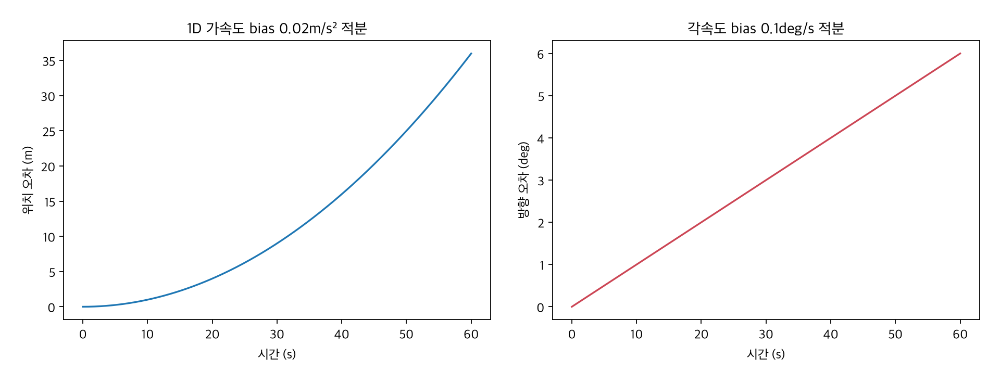

그림 A12-1. 중력·자세 결합을 제외한 독립 1D 모델이다. 가속도 bias 0.02m/s²는 위치 오차 `0.5*b*t²`를 만들어 60초 후 36m가 된다. 각속도 bias 0.1deg/s는 60초 후 6deg 오차를 만든다. 실제 3D IMU의 성능 예측값은 아니다.

#### 시간 오차는 공간 오차가 된다

동일한 파일 번호가 동일 시각을 뜻한다고 가정하면 안 된다. 카메라와 IMU 사이 Δt가 있으면, 그동안 움직인 위치로 잘못 관측을 해석한다. 단순 가로 등속 v, 고정 깊이 Z, 회전 없음이라는 모델에서 영상 오차 크기는 `Δu≈f*v*Δt/Z`다.

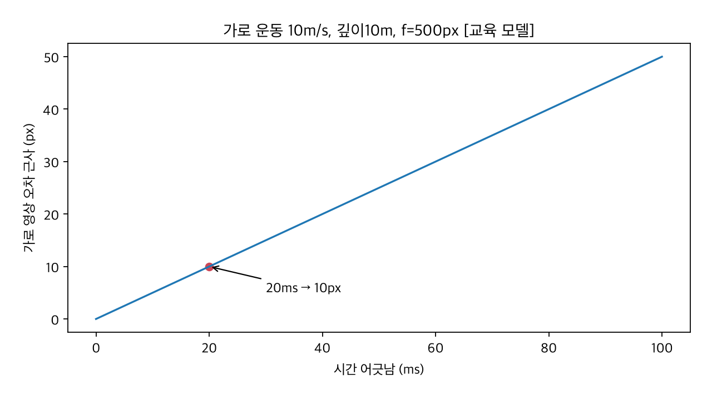

그림 A12-2. f=500px, v=10m/s, Z=10m일 때 20ms가 약 10px에 해당한다. 이는 KITTI 동기화 오차의 측정값이 아니다. 실제 회전·노출·LiDAR 스캔 시간은 더 복잡한 영향을 준다.

#### filtering, smoothing, preintegration의 역할

**filtering(필터링)**은 현재까지 관측으로 현재 상태의 분포를 순차 갱신한다. Kalman filter는 선형·Gaussian 모델에서 평균과 공분산을 전달한다. 예측에서는 운동 모델로 상태와 불확실성을 전파하고, 갱신에서는 새 관측과 예측의 차이를 가중해 수정한다. **EKF(Extended Kalman Filter, 확장 칼만 필터)**는 비선형 함수를 현재 추정 근처에서 선형화한다.

**smoothing(평활화)**은 여러 시점 상태를 함께 수정한다. 미래 관측으로 과거 상태도 바꿀 수 있다는 점이 filtering과 다르다. 고정 길이 구간만 유지하는 방식도 있다. **preintegration(사전적분)**은 두 카메라 시점 사이의 많은 IMU 측정을 상대 운동 제약으로 요약하여 최적화 중 반복 적분 비용을 줄이는 접근이다. bias와 회전의 처리까지 포함되므로 단순한 가속도 누적합과 같지 않다. [Forster 외, On-Manifold Preintegration](https://arxiv.org/abs/1512.02363)

현재 저장소에는 Raw OXTS 자료가 있지만 Odometry 프레임과의 시간·좌표 정렬이 검증되지 않았다. OXTS의 융합된 GPS/INS 위치·자세를 원시 IMU인 것처럼 입력하면 평가 정보가 섞일 수 있다. VIO(Visual-Inertial Odometry)나 LIO(LiDAR-Inertial Odometry)를 시작하기 전에 timestamp, 단위, 축, 외부 보정, bias, 초기화, GT 분리를 확인해야 한다. 이번 교재는 필터·VIO·LIO를 새로 구현하지 않는다.

#### 연습문제와 해설

**문제 A12-1.** 같은 1D bias 모델에서 시간이 60초에서 30초가 되면 위치 오차는?

**해설 A12-1.** 0.5×0.02×30²=9m다. 시간이 절반이면 오차는 4분의 1이다. 초기 속도 오차 등이 없다는 가정이 필요하다.

**문제 A12-2.** 그림의 설정에서 시간차가 5ms라면 픽셀 오차는? 이 값으로 실제 동기화 오차를 확정할 수 있는가?

**해설 A12-2.** 500×10×0.005/10=2.5px다. 단순 모델의 예상치일 뿐 실제 timestamp 오차를 추정한 것이 아니다. 실제 데이터의 속도·깊이·회전·잔차를 확인해야 한다.

### 기초 교재 실험 기록과 재현

**이번 작업의 문제 정의.** v1.1.1의 로드맵만으로는 수식·그림·연습을 연결하기 어렵다는 것이 문제다. 입력은 기존 문서, KITTI 00 frame120, 교육용 설정이다. 출력은 동일한 통합 PDF와 재현 가능한 그림·배열이다. [가정] 성공 기준은 12개 상세 단원, 24개 문제/해설, 15개 신규 그림, 25개 수치 검사와 PDF 검증이다. 실제 학습 성취도는 사용자 학습 후 평가해야 하며, 페이지 수가 이해도를 보장하지 않는다.

| 항목 | 기존 기준 | 이번 확장 | 해석 |
|---|---|---|---|
| 수학 학습 | 1장의 로드맵·짧은 예제 | A1–A12 독립 단원 | 기존 응용 설명 보존 |
| 신규 단계 그림 | 이번 작업 전 없음 | 15개 | 실제 KITTI 1개, 교육 모델 14개 |
| 명시적 문제·해설 쌍 | 신규 기초 단원 없음 | 24쌍 | 각 단원 2쌍 |
| 계산 검산 | 신규 기초 실험 없음 | 25개 assertion | 제한된 설정의 수치 검사 |
| VO/LO 정확도 | 기존 연구 결과 | 재측정하지 않음 | 성능 향상 주장 없음 |

표 A13. 문서 완성도 기준의 baseline 비교다. 실제 주행 알고리즘의 정량 평가 표가 아니다.

코드 탐색 위치는 `research/foundations-textbook/src/generate.py:40`(벡터·좌표), `:55`(투영·스테레오·KITTI), `:75`(robust·SVD·확률), `:90`(Jacobian·회전), `:102`(그래프·IMU)다. 함수별 저장 배열을 먼저 살펴본 뒤 그림을 비교한다.

PDF 추가 환경 설치가 필요한 경우 아래 명령을 사용한다. 실제 사용 버전은 marked 18.1.3, Playwright 1.65.0, Mermaid 12.3.0이다. 시스템 Chrome도 필요하다.

```sh
npm install --prefix /tmp/kitti-report-pdf marked@18.1.3 playwright@1.65.0 mermaid@12.3.0
uv pip install --python research/20261031_vo-lo-study/.venv/bin/python \
  -r research/foundations-textbook/configs/pdf-requirements.txt
```

**모듈 흐름과 계약.** `configs/lessons.json → generate.py → artifacts/*/values.npz 및 summary.json → figures/*.png → docs/report.md → docs/report.pdf`. frames는 점·회전·병진, camera는 깊이·시차·표준편차, kitti는 원시 점·변환·픽셀, estimation은 비용·공분산·MLE/MAP, linearization은 반복 기록·회전, graph는 전후 상태·Jacobian, imu는 시간과 오차를 저장한다. 입력·출력의 차원과 좌표계는 각 단원에 정의했으며 상세 계약은 `research/foundations-textbook/notes/architecture.md`에 둔다. 새로운 상태 추정 모듈을 기존 playback에 연결하지 않았다.

```sh
# 저장소 루트에서 실행. 기존 KITTI 데이터와 연구 venv 필요.
env MPLCONFIGDIR=.cache/matplotlib XDG_CACHE_HOME=.cache \
  research/20261031_vo-lo-study/.venv/bin/python \
  research/foundations-textbook/src/generate.py
node tools/render_report.mjs
research/20261031_vo-lo-study/.venv/bin/python \
  research/foundations-textbook/src/check_pdf.py
```

수치 설정은 seed=7, frame120, 교육용 f=500px, B=0.54m, σ_d=0.5px다. 실제 투영 그림에는 교육용 f 대신 KITTI P0/Tr를 읽는다. 생성 당시 기준 커밋은 178ec59724069e60b991f1f4b967b1d63fc3617c이며 실행 시 HEAD와 설정 SHA-256을 `artifacts/summary.json`에 자동 기록한다. Python 3.11 환경에서 OpenCV 5.0.0, NumPy 2.4.6, SciPy 1.17.1, Matplotlib 3.11.1을 사용했다. 의존성은 기존 연구 lock 파일을 사용하고 PDF 검사는 신규 `configs/pdf-requirements.txt`의 pypdfium2 5.14.0을 추가한다. 한글 그림은 macOS Apple SD Gothic Neo를 사용하므로 다른 OS에서는 한글 글꼴 설정이 필요하다.

**검증 결과.** 변환 역복원, 순서 차이, 벡터 길이, 투영 scale 모호성, 스테레오 깊이, 실제 영상 내 점 수, 평균·Huber·MLE·MAP, 공분산 양의 고윳값, 다섯 유한차분 Jacobian, GN 해·선택 시작점의 비용 감소, SO(3) 직교성·잘못된 덧셈, gauge rank·공통 이동, loop 잔차, IMU·시간차 예제의 총 25개 검사가 통과했다. 이는 교재의 제한된 예제를 검산한 것이며 모든 입력에 대한 알고리즘 안정성 검증은 아니다.

**강점·약점과 다음 단계.** 원시 LiDAR는 미터 거리와 실제 투영을 확인하기 좋지만 가림·스캔 시간 문제를 이 단원에서 해결하지 않았다. 이미지 대응은 장면의 풍부한 정보를 쓰지만 단안 scale과 오대응이 남는다. 공분산 가중치는 서로 다른 신뢰도를 반영하지만 모델이 틀리면 과신한다. loop는 누적 오차를 재분배하지만 잘못된 제약은 전체 궤적을 망가뜨린다. IMU는 빠른 운동 정보를 주지만 bias와 시간 정렬을 필요로 한다. 이는 각 단원의 수식·그림으로 설명한 한계이지 이번 작업의 feature 성능 ablation 결과가 아니다.

다음 학습 선택지는 ① A1–A4의 실제 투영 검산, ② 기존 ORB 장의 실제 단계 이미지와 A5–A9 연결, ③ A11에서 실제 loop 검증·BA로 확장, ④ A12 이후 시간 정렬과 IMU 사전적분이다. 이번 책은 기초 1차 확장이며 BA 전체 유도, EKF 전체 구현, Lie Jacobian, 실제 SLAM 통합은 아직 남아 있다. 사용자의 선택 없이 해당 구현으로 넘어가지 않는다.

**가정·미확인 목록.** [가정] 교육용 Gaussian 독립·고정분산, 알려진 stereo baseline, 작은 시차 오차, 1D bias, 등속 가로 운동, 올바른 합성 loop를 사용했다. [미확인] 실제 OXTS 시간 정렬, 실제 VIO/LIO 성능, 신규 설명의 학습 효과, 다른 OS의 글꼴·PDF 동일성은 검증하지 않았다. 신규 원문 출처는 각 단원의 링크와 `notes/prior_work.md`에 모았으며 그림은 모두 자체 생성했다.

<a id="orb"></a>

## 2. ORB: 픽셀부터 descriptor와 매칭까지

**기존 ORB 연구의 상세 수업:** 검출·기술자·피라미드의 교육용 재현과 당시 운영 단안 VO를 설명한다. 이 장의 “이번”은 해당 ORB 연구를 뜻한다. 신규 스테레오·LK/PnP와 합성 BA는 C4–C7에서 별도 설정과 산출물로 다룬다.

기존 요약보다 상세한 설명을 우선한다. 피라미드 그림은 공통 픽셀 축으로 보완한 최신 자료다.

**원 실험 디렉터리:** `research/20261101_orb-explained/`

### 기본 용어와 사용 가능한 리소스


#### 약자와 이름을 먼저 풀기

| 이름 | 풀어 쓴 말 / 유래 | 이 프로젝트에서 하는 일 |
|---|---|---|
| ORB | Oriented FAST and Rotated BRIEF | 방향이 있는 코너와 회전 보정 이진 descriptor 생성 |
| FAST | Features from Accelerated Segment Test | 원 둘레 밝기를 비교해 코너 후보 검출 |
| Harris | Chris Harris의 성; 약자가 아님. Mike Stephens와 공동 제안 | 여러 방향으로 밝기가 바뀌는 정도를 평가 |
| NMS | Non-Maximum Suppression, 비최대 억제 | 가까이 중복된 응답 중 약한 것을 제거 |
| BRIEF | Binary Robust Independent Elementary Features | 여러 픽셀 쌍의 밝기 비교를 비트열로 표현 |
| rBRIEF | ORB 논문의 회전 대응·선택된 BRIEF 검사 패턴을 가리키는 명칭 | 분산이 높고 상관이 낮은 비교를 선택 |
| BF | Brute Force | 후보 descriptor들을 직접 비교 |
| Hamming | Richard Hamming의 성; 약자가 아님 | 두 비트열에서 서로 다른 자리 개수 |
| RANSAC | RANdom SAmple Consensus | 일부 잘못된 대응을 견디며 기하 모델 추정 |
| VO / SLAM | Visual Odometry / Simultaneous Localization and Mapping | 영상 이동 추정 / 위치와 지도 동시 추정 |
| ROI | Region of Interest, 관심 영역 | 피라미드에서 동일 장면 일부를 확대 비교 |
| MAE | Mean Absolute Error, 평균 절대 오차 | 축소 후 복원 영상과 원본의 평균 밝기 차이 |

ORB 이름·주요 구성은 [OpenCV ORB 설명](https://docs.opencv.org/4.13.0/d1/d89/tutorial_py_orb.html), FAST와 BRIEF의 이름은 각각 [FAST 설명](https://docs.opencv.org/4.13.0/df/d0c/tutorial_py_fast.html), [BRIEF 설명](https://docs.opencv.org/4.13.0/dc/d7d/tutorial_py_brief.html)에서 확인했다.

#### 자주 섞이는 데이터 타입

- **픽셀 intensity I(x,y):** 흑백 밝기. 이번 영상은 uint8, 즉 0~255 정수다. 색 이름이나 거리 값이 아니다.
- **patch:** 한 위치 주변을 잘라낸 작은 이미지. 예를 들어 31×31 픽셀이다.
- **keypoint:** 고른 위치와 부가 정보. x/y, 크기 size, 방향 angle, 검출 레벨 octave, 반응 response 등이 있다. angle과 response는 서로 다르다.
- **descriptor:** keypoint 주변 외형의 수치 요약. 이번 ORB는 32바이트=256비트다. keypoint 좌표가 descriptor 안에 그대로 저장되는 것은 아니다.
- **match:** 이전 영상 descriptor의 인덱스와 현재 영상 descriptor의 인덱스, 그 사이 거리다. 비슷하다고 검색된 후보이지 동일 물체라는 보장은 아니다.
- **inlier:** 지정한 기하 모델과 오차 허용 범위에 맞는 대응. 반대는 outlier다. 영상의 초록색 점이라는 이유만으로 진실이라고 단정할 수 없다.

#### 실제 보유 리소스

| 리소스 | 위치와 사용 |
|---|---|
| 원본 | data/kitti/dataset/sequences/00/image_0/000120.png 및 000121.png |
| 이전 교육 코드 | research/20261031_vo-lo-study/src/orb_stages.py:7~13 |
| 이전 피라미드 | 같은 study의 artifacts/orb/pyramid.npz |
| 실제 ORB 호출 | 같은 study의 src/vo.py; 새 src/analyze.py에도 설정 명시 |
| 새 중간 출력 | artifacts/*.npz, levels.csv, summary.json, harris_toys.json |
| 실행 환경 | 기존 연구 venv, OpenCV 5.0.0, 단일 CPU thread |

### 접근 선정: 단계마다 직접 확인하기

새 검출기를 개발할 문제가 아니라, 기존 알고리즘 설명과 그림의 정보 손실을 수정할 문제다. 따라서 기존 데이터를 사용하는 작은 재현 실험을 택했다. 이하 설명에서 **실제 ORB 출력**, **독립 교육 계산**, **가상의 수치 예제**를 구분한다. 원 논문 전체를 그대로 재구현했다고 부르지 않는다.

#### 피라미드: 왜 같은 사진을 여러 크기로 만드는가

차량이 물체에 가까워지면 그 물체가 사진에서 커진다. 한 크기의 작은 patch만 비교하면 같은 물체라도 주변 모양이 다르게 들어온다. 입력을 여러 해상도로 만들어 비슷한 크기로 보이는 레벨끼리 대응할 기회를 주는 것이 피라미드의 역할이다.

**다른 장면을 만드는 것이 아니다. 동일 장면을 더 적은 픽셀로 표현한다.** 따라서 큰 윤곽이 비슷한 것은 정상이다. 차이는 배열 크기, 작은 무늬의 소실, 같은 patch가 덮는 원본 영역이다.

이번 scaleFactor=1.2, 레벨 l=0~7이면 명목 축소 배수 s(l)=1.2^l이다. 폭은 대략 W/s(l), 높이는 H/s(l)이며 정수 반올림이 있다. 영상 길이 비율은 1/s(l), 픽셀 수 비율은 대략 1/s(l)^2다. '1.2배 scale'을 영상을 1.2배 키운다는 뜻으로 읽으면 반대가 된다.

가상의 예: 어떤 물체가 첫 영상에서 20px, 두 번째에서 24px라면 두 번째의 레벨1에서는 약 20px로 줄어든다. 이때 비슷한 크기의 모양을 비교할 수 있다. 실제 장면은 원근·가림·조명도 함께 변하므로 피라미드만으로 완전한 scale invariance가 생기지는 않는다.

**피라미드 scale과 VO metric scale은 별개다.** 전자는 영상 크기 비율이다. 후자는 '이동 벡터 1이 실제 몇 m인가'라는 물리 거리 문제다. ORB 레벨을 늘려도 단안 VO의 절대 거리 문제가 해결되지 않는다.

#### 기존 그림이 거의 같아 보였던 정확한 이유

이전 코드에서는 각 subplot의 `imshow(p)`가 해당 영상 크기에 맞춰 좌표 범위를 자동으로 잡았다. L0도 L3도 자기 칸을 거의 가득 채워 원래 줄어든 크기가 지워졌다. 제목에 shape만 적어 놓는 것으로는 충분하지 않았다.

기존 저장 배열과 같은 방식으로 재생성한 L0~L3를 `np.array_equal`로 비교했고 **네 배열 모두 동일**했다. 이는 이전 배열 생성이 실제 축소였다는 증거다. 이제 모든 subplot의 x축을 0~1241, y축을 0~376으로 고정했다. 같은 level pixel이 같은 도식 크기를 차지하므로 축소를 직접 볼 수 있다. PDF 화면의 실제 모니터 픽셀과 1:1이라는 뜻은 아니다.


읽는 법: 회색 여백은 데이터가 없는 부분이다. L0는 전체 칸을 채우고 L7은 작은 부분만 채운다. 제목의 ORB n은 실제 ORB의 레벨별 개수이며 배경은 독립 교육용 resize다.

| 레벨 | 실제 배열 폭×높이 | 원본 대비 길이 | 31px patch의 원본 폭 | 실제 ORB 점 수 | 복원 MAE |
|---|---:|---:|---:|---:|---:|
| 0 | 1241×376 | 100.00% | 31.00px | 543 | 0.000 |
| 1 | 1034×313 | 83.33% | 37.20px | 452 | 3.138 |
| 2 | 862×261 | 69.44% | 44.64px | 377 | 3.312 |
| 3 | 718×218 | 57.87% | 53.57px | 314 | 4.442 |
| 4 | 598×181 | 48.23% | 64.28px | 262 | 5.277 |
| 5 | 499×151 | 40.19% | 77.14px | 218 | 5.348 |
| 6 | 416×126 | 33.49% | 92.57px | 182 | 6.339 |
| 7 | 346×105 | 27.91% | 111.08px | 152 | 7.170 |

MAE는 각 축소 영상을 원본 크기로 bilinear 확대하고 mean(abs(original-restored))로 계산했다. 단위는 0~255 밝기다. 0이 아니라는 것은 원본 복제본이 아니며 축소·복원 과정에서 정보가 바뀌었다는 뜻이다. VO 정확도 지표는 아니다. 레벨별 검출 개수도 품질 점수가 아니라 설정과 검출 결과다.

#### 같은 장면의 확대 비교와 patch 범위

bilinear interpolation은 정수 격자 사이 밝기를 주변 네 픽셀의 가중 평균으로 계산하는 보간이다. 줄어든 영상에서 모든 원본 픽셀을 독립적으로 보존할 수 없다. 미세 패턴이 사라지거나 다른 패턴처럼 보이는 aliasing이 생길 수 있다. 정밀한 축소 필터와 완벽한 영상 복원은 이번 실험 범위가 아니다.


이번에는 의도적으로 같은 크기로 확대했다. 목적은 배열 전체 크기가 아니라 **정보 손실을 확대해 보는 것**이다. nearest 표시를 사용해 새 부드러운 픽셀을 만들어 숨기지 않았다. 같은 도로 부분이 L0에서는 120×100표본, L7에서는 33×28표본으로 표현된다. 작은 점과 경계가 뭉개지는 부분을 비교한다.


왼쪽 빨간 상자가 위 확대의 위치다. 오른쪽 상자들은 각 레벨에서 31픽셀인 patch가 원본에서 얼마나 큰 영역을 덮는지 보여준다. L7의 31px는 원본 약111px 범위다. 상자 중앙은 설명용 고정 위치이지 같은 keypoint가 모든 레벨에서 검출된다는 주장이 아니다.

OpenCV keypoint의 `octave`는 여기서 피라미드 레벨 인덱스다. 이름이 octave여도 매 레벨이 2배라는 뜻은 아니다. `pt`는 보통 원본 영상 좌표로 반환되고 `size`에는 레벨 scale이 반영된다. 그래서 서로 다른 레벨의 점도 원본 위에 그릴 수 있다. 이번 실험은 레벨별 출력 필드를 저장한다. [OpenCV ORB API](https://docs.opencv.org/4.13.0/db/d95/classcv_1_1ORB.html)

#### FAST: 원 둘레만 보고 후보를 빠르게 찾기

입력은 한 레벨의 grayscale 영상이다. 후보 중심 p의 밝기를 I(p), 밝기 문턱을 t라고 하자. 중심에서 반경 약3픽셀인 원 둘레의 16개 위치를 본다. 이번 FAST_9_16에서는 그 원을 따라 **연속 9개 이상**이 모두 I(p)+t보다 밝거나, 모두 I(p)-t보다 어두우면 통과한다. 밝고 어두운 것을 섞어 9개 세는 것이 아니다. 원이므로 끝 인덱스에서 처음으로 이어지는 구간도 검사한다.

FAST는 이름처럼 segment test의 구조를 이용해 많은 위치를 빨리 탈락시키려는 방법이다. 원래 FAST 논문의 FAST-12 설명과 이번 OpenCV FAST-9 설정을 혼동하면 안 된다. 학습된 decision tree는 검사 순서를 효율화하는 별도 요소이며 이번 코드는 그것을 재학습하지 않는다. [Rosten·Drummond, 2006 원문](https://www.edwardrosten.com/work/rosten_2006_machine.pdf)

왜 단순한데 코너를 찾을까? 균일한 영역은 원 둘레도 중심과 비슷해 탈락한다. 경계의 꺾임이나 국소적으로 독특한 밝기 분포에서는 긴 밝은/어두운 호가 생길 수 있다. 하지만 '기하학적으로 건물 모서리'만 검출하는 것은 아니다. 점광원·노이즈·텍스처도 통과할 수 있다.


실제 선택 위치는 (752,59), 중심 밝기는 255다. t=20이므로 어두운 판정 경계는 235다. 원 둘레 밝기는 아래와 같고 모두 235보다 작아서 연속9 조건을 만족한다. 밝은 판정 경계 275는 uint8 범위 밖이라 이 위치는 밝은 호로 통과할 수 없다.

```text
ring index:  0  1  2  3  4  5   6   7  8  9 10 11 12 13 14 15
intensity:  32 38 57 63 80 80 196 231 87 30 31 28 29 27 30 29
state:      전부 dark (<235)
```

이 사례는 오히려 중요한 한계를 보여준다. FAST의 corner는 '물리적인 모서리'라는 의미와 동일하지 않다. 포화된 중심 밝기를 가진 작은 구조도 높은 응답이 가능하다. 이 점 하나를 대표적인 좋은 추적점이라고 일반화하지 않는다.

#### NMS: 이웃한 후보들을 왜 줄이는가

좋은 구조 주변에서 여러 픽셀이 동시에 통과할 수 있다. 이들을 모두 쓰면 한 군데에 점이 몰리고 비교 비용이 늘어난다. NMS는 가까운 후보 사이에서 응답이 더 큰 것을 남기는 지역 경쟁이다. 전체 영상에서 상위500개를 고르는 연산과는 다르다.

이번 영상에서 FAST nonmaxSuppression=False는 19,397개, True는 5,475개였다. 이 차이는 실제 detector를 두 설정으로 실행한 결과다. 점 개수가 줄었다고 recall이나 VO 성능이 좋아졌다고 결론내리지는 않는다. nonmax 점수의 정확한 내부 구현은 OpenCV 버전에 의존하므로 이 보고서는 임의의 간단한 점수를 같은 내부 점수라고 부르지 않는다.


위에서 아래로 후보가 어떻게 줄어드는지 본다. 마지막 500개는 교육용 Harris 순위다. 실제 다중 레벨 ORB의 2,500개와 같은 집합이 아니다.

#### Harris: FAST를 썼는데 왜 또 다른 코너 점수가 필요한가

FAST의 역할은 빠른 후보 생성이다. 제한된 개수만 남길 때는 다른 관점의 코너 강도로 순위를 매길 수 있다. Harris는 patch를 어느 방향으로 조금 움직여도 모양이 달라지는지 평가한다. 이름은 약자가 아니라 제안자 이름에서 왔다. [Harris·Stephens, 1988 학회 기록](https://www.bmva-archive.org.uk/bmvc/1988/avc-88-023.html)

평평한 벽 patch는 좌우·위아래로 조금 이동해도 비슷하다. 긴 수직 경계는 가로로 이동하면 크게 달라지지만 세로로 이동하면 비슷하다. 코너는 두 방향 모두 변화가 크다. 이것이 코너가 2D 위치를 정하기에 유리한 이유다.

수식의 기호를 하나씩 쓰면 다음과 같다. I_x, I_y는 각각 가로·세로 밝기 변화량(영상 미분)이다. w는 patch 안의 픽셀에 주는 가중치다. sum은 patch 전체 합이다.

```text
M = [ sum(w * Ix²)      sum(w * Ix * Iy) ]
    [ sum(w * Ix * Iy)  sum(w * Iy²)     ]

R = det(M) - k * trace(M)²
  = lambda1 * lambda2 - k * (lambda1 + lambda2)²
```

M은 2×2 구조 행렬이다. trace는 대각 원소 합, det는 행렬식이다. lambda1/lambda2는 고유값으로, patch의 두 주된 방향에서 밝기가 얼마나 변하는지 요약한다. k는 점수 모양을 조절하는 상수이며 여기서는 0.04다. R이 큰 양수면 두 방향 변화가 모두 큰 경향, 음수면 한 방향만 큰 경계 경향, 0 근처면 평탄한 경향이다. 계산 구조와 해석은 [공식 Harris 설명](https://docs.opencv.org/4.13.0/dc/d0d/tutorial_py_features_harris.html)에 근거한다.

실제 교육 계산은 `cornerHarris(img, 7, 3, .04)`다. 7은 주변 집계 영역 크기, 3은 미분을 구하는 Sobel 커널 크기다. Sobel은 이웃 밝기의 가중 차분으로 미분을 근사하는 필터다. FAST 후보의 위치에서 R을 읽고 높은 순으로 500개를 골랐다. 이 dense Harris 계산을 OpenCV ORB 내부의 모든 최적화와 동일하다고 주장하지 않는다.

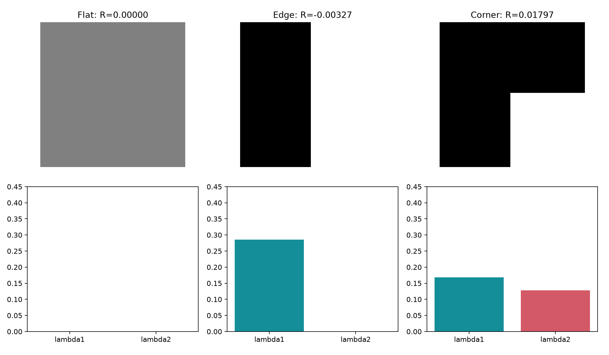
이 그림만은 해석을 쉽게 하려고 만든 41×41 합성 영상이다. 밝기는 0~1 float다. 위는 영상, 아래는 중심 부근 두 고유값이다. 실제 도로 사례와 합성 예제를 혼동하지 않는다.

| 합성 patch | lambda1 | lambda2 | R | 해석 |
|---|---:|---:|---:|---|
| 평탄면 | 0 | 0 | 0 | 어느 방향도 변화 없음 |
| 수직 경계 | 0.2857 | 0 | -0.0033 | 한 방향만 변화 |
| 코너 | 0.1684 | 0.1276 | 0.0180 | 두 방향 모두 변화 |

Harris의 약점은 blur·noise·밝기 대비에 따라 응답이 달라지고, 코너 점수가 높아도 다른 장소의 비슷한 코너와 구분된다는 보장은 없다는 것이다. 위치 선택과 식별력은 다른 문제다.

#### 방향: Oriented FAST의 Oriented는 어디서 생기는가

FAST만으로는 '이 patch가 어느 방향을 향하는가'를 얻지 못한다. 카메라가 회전하면 같은 물체 주변도 돌아가기 때문에 descriptor의 비교 방향을 맞출 기준이 필요하다.

교육 예에서는 중심을 (0,0)으로 놓고 반지름15인 원 안의 밝기를 무게처럼 사용한다. 좌표 x는 오른쪽, y는 아래로 증가한다. 모멘트(moment)는 '위치에 밝기를 곱해 더한 값'이다.

```text
m00 = sum(I)        : 밝기 총합
m10 = sum(x * I)    : 좌우 밝기 분포
m01 = sum(y * I)    : 상하 밝기 분포
centroid = (m10/m00, m01/m00)
theta = atan2(m01, m10)
```

centroid는 밝기 무게중심이다. 중심에서 무게중심으로 향하는 방향을 theta로 삼는다. atan2는 x/y 부호를 함께 고려해 사분면까지 구분하는 각도 함수다. m00=0인 검은 patch, m10/m01이 모두0인 대칭 patch는 방향이 의미 없거나 불안정해질 수 있다. 구현에서 반환하는 숫자가 있더라도 방향 정보가 충분하다는 뜻은 아니다.

이번 실제 patch의 m00=29662, m10=-1100, m01=-21548이다. 무게중심은 (-0.0371,-0.7265)px, 각도는 -92.92도다. 이미지 y가 아래로 증가하므로 화면상 위를 향한다. 0~360도로 표현하면 약267.08도지만 **이 독립 교육 계산이 실제 ORB keypoint.angle과 반드시 같다는 뜻은 아니다.** 경계/원형 표본 규칙이 다를 수 있다.

#### BRIEF: 작은 그림을 어떻게 0과 1로 바꾸는가

BRIEF는 검출기가 아니라 descriptor다. 이미 정해진 patch 안에서 위치 a와 b를 고르고 밝기를 비교한다. I(a)<I(b)이면 1, 아니면 0이다. 이런 질문 256개를 고정된 순서로 묶으면 256비트가 된다. 8비트가1바이트이므로 32바이트다. 픽셀을 비교하기 전에 smoothing을 해 작은 노이즈의 영향을 줄인다. [OpenCV BRIEF](https://docs.opencv.org/4.13.0/dc/d7d/tutorial_py_brief.html)

Gaussian smoothing은 이웃 밝기를 종 모양 가중치로 평균하는 것이다. 이번 교육 예는 7×7 커널과 sigma=2를 사용한다. sigma는 평균에 참여하는 공간 범위의 퍼짐을 조절한다. smoothing 때문에 작은 밝기 차이는 완화되지만 세부 정보도 줄어든다.

**Rotated BRIEF:** 고정된 비교 위치를 그대로 쓰면 patch가 회전할 때 다른 물체 부분을 읽는다. 앞에서 구한 theta만큼 비교 위치 좌표를 회전시키면 물체 기준으로 비슷한 위치를 비교할 수 있다. 여기서 이미지 전체를 회전시키는 것이 아니라 비교 좌표를 돌린다.

```text
[ x' ] = [ cos(theta)  -sin(theta) ] [ x ]
[ y' ]   [ sin(theta)   cos(theta) ] [ y ]
```

실제 영상에서 뽑은 교육용 첫8개 질문은 다음과 같다. 이것은 seed7로 뽑은 무작위 패턴이며 실제 ORB의 학습된 패턴이 아니다.

| 질문 | I(a) | I(b) | I(a)<I(b) |
|---|---:|---:|---:|
| 0 | 36 | 55 | 1 |
| 1 | 38 | 29 | 0 |
| 2 | 29 | 51 | 1 |
| 3 | 111 | 37 | 0 |
| 4 | 27 | 27 | 0 |
| 5 | 28 | 25 | 0 |
| 6 | 28 | 29 | 1 |
| 7 | 135 | 87 | 0 |

위 예의 앞8비트는 10100010이다. 어느 질문인지의 순서까지 같아야 두 descriptor를 비교할 수 있다. 프레임마다 새 random pattern을 뽑으면 대응 비교가 의미 없어진다.


왼쪽은 원 중심·무게중심·방향, 가운데는 실제 patch에 그린8개 회전 비교, 오른쪽은256개 질문의 참/거짓이다. 화살표 길이10px는 각도를 보기 위한 표시 길이이며 무게중심 거리0.73px가 아니다. 비트의 16×16 배열은 표시용이며 실제 물체의 2D 모양 지도가 아니다.

#### rBRIEF: 무작위 질문만 있으면 충분한가

어떤 질문의 답이 거의 항상0이면 서로 다른 patch를 구분하는 정보가 적다. 반대로 0/1이 자주 바뀌는 질문은 더 다양한 경우를 나눌 수 있다. 또 두 질문의 답이 항상 함께 바뀌면 비슷한 정보를 중복해서 저장한다.

ORB의 rBRIEF 선택은 다양한 patch에서 비트의 평균이 약0.5이고 분산이 크며 질문 사이 상관이 낮은 패턴을 찾는 방향이다. Bernoulli 비트의 분산은 p(1-p)이므로 p=0.5일 때0.25로 최대다. 상관은 두 질문의 답이 함께 변하는 정도를 뜻한다. 완전한 독립을 보장한다는 뜻은 아니다. [OpenCV ORB의 rBRIEF 설명](https://docs.opencv.org/4.13.0/d1/d89/tutorial_py_orb.html)

이것은 '현재 frame120에서 매번 패턴을 다시 학습한다'는 말이 아니다. 이번 OpenCV 호출은 제공된 패턴으로 descriptor를 계산한다. 학습 데이터·선택 과정은 재실행하지 않았다. 새 교육 스크립트의 랜덤256질문을 rBRIEF 재현이라고 부르지 않는 이유다.

#### 실제 OpenCV ORB 출력과 교육 그림의 경계

실제 `detectAndCompute` 출력은 keypoint 2,500개와 uint8 descriptor 배열 (2500,32)다. 레벨별 개수 합도2,500이다. 각 행은 한 keypoint의256비트를32바이트에 담은 것이다. 코드에서 그림에 보이는 byte 값 하나를 하나의 bit로 해석하면 틀린다. `unpackbits`는 바이트를 비트들로 펼쳐 표시하는 연산이다.

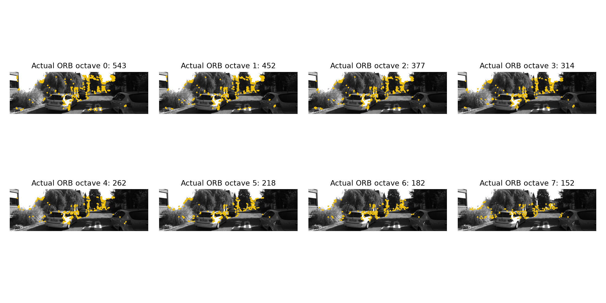
모든 배경이 같은 원본 크기인 것은 의도적이다. 이 그림의 질문은 '각 레벨에서 찾은 점이 원본의 어디에 있는가'다. 피라미드 크기를 보여주는 첫 그림과 목적이 다르다. 같은 물체가 여러 레벨에서 검출될 수도 있으며 점 하나하나의 3D 동일성은 이 그림만으로 알 수 없다.

우리 교육 피라미드는 원본에서 각 레벨을 독립 resize했다. 실제 ORB는 버전별 내부 경계 확장·보간·반복 축소·blur 등의 세부가 다를 수 있다. OpenCV4.13 소스를 참고했으나 실행 binary는5.0.0이고 정확한 빌드 소스 일치까지 확인하지 못했다. 따라서 그림을 'ORB 내부 buffer 그대로'라고 표시하지 않는다. [참고 소스](https://raw.githubusercontent.com/opencv/opencv/4.13.0/modules/features2d/src/orb.cpp)

#### Hamming, BF, cross-check, ratio: 무엇을 기준으로 같은 점을 찾는가

Hamming distance는 같은 길이 비트열에서 다른 자리 수다. 예를 들어101100과100110은 세 번째와 다섯 번째가 달라 거리가2다. XOR는 다를 때1, 같을 때0을 내는 비트 연산이다. XOR 결과에서1의 개수를 세는 popcount로 Hamming을 계산한다.

BF는 이전 descriptor마다 현재 descriptor들을 직접 비교해 가장 작은 거리를 찾는다. cross-check는 A가 고른 최선이 B이면서 B가 고른 최선도 A일 때만 남기는 상호 최근접 조건이다. 반복된 무늬에서는 상호 최근접이어도 오매칭일 수 있다. [OpenCV matching](https://docs.opencv.org/4.13.0/dc/dc3/tutorial_py_matcher.html)

ratio test는 최근접 거리 d1과 두 번째 거리 d2를 비교해 d1<0.75*d2 같은 조건을 쓴다. 최선과 차선이 비슷하면 애매하다고 보는 것이다. 예를 들어20과22는 탈락,20과50은 통과한다. 0.75는 이전 실험의 설정이지 보편적 정답이 아니다. cross-check와 ratio는 서로 다른 필터이며 이번 기본 VO는 cross-check다.


120→121의 실제 ORB/BF cross-check 대응은1,611개다. 위에는 거리순35개를 보여주고, 아래에는 최저 거리 대응의 descriptor 두 개와 XOR를 표시했다. XOR의1이2개이고 OpenCV distance도2로 일치한다. **이 그림은 기하 검증 전**이다. 작은 Hamming이 올바른 3D 대응을 보장하지 않는다.

#### 여기서 VO까지: ORB가 끝나는 곳

현재 baseline은 매칭을 거리순으로 최대1,000개 사용한다. 이후 `findEssentialMat`의 RANSAC으로 정적인 장면의 두 시점 기하를 추정한다. RANSAC은 일부 대응으로 후보 모델을 만들고 많은 대응이 그 모델에 맞는지 반복 확인하는 방식이다. 모델에 대한 오차가 작으면 inlier로 분류한다.

카메라 내부 파라미터 K는 초점거리와 주점을 담는다. 픽셀(u,v,1)에 K의 역행렬을 곱해 카메라 광선 방향에 대응하는 정규화 좌표 x를 만든다. Essential matrix E는 두 정규화 관측 사이의 관계 x2ᵀ E x1=0을 표현한다. 실제 대응에는 노이즈가 있어 이 값 또는 관련 거리 오차가 완전히0일 필요는 없다.

`recoverPose`는 E에서 회전 R과 이동 방향 t를 복원하고, 삼각측량된 점이 두 카메라 앞에 놓이는지 검사해 가능한 해를 고른다. 삼각측량은 두 광선으로3D 위치를 추정하는 계산이고, 앞쪽 여부 검사를 cheirality check라고 한다. [OpenCV 기하 API](https://docs.opencv.org/4.13.0/d9/d0c/group__calib3d.html)

단안 영상만으로 전체 장면과 이동을 함께 같은 배수로 키워도 같은 투영이 가능하다. 따라서 이 단계의 t 길이를 실제 m로 알 수 없다. 현재 코드는 단위 이동 방향을 누적하므로 속도 변화·프레임 간 거리 차이를 복원하지 못한다. 회전이 좋아도 경로 길이는 틀릴 수 있다. 피라미드·Harris·BRIEF는 이 물리적 scale 모호성을 해결하는 방법이 아니다.

이후의 발전 방향도 목적이 다르다. stereo는 알려진 카메라 간 거리로 깊이 scale을 얻는 접근, BA(Bundle Adjustment)는 여러 카메라 pose와3D 점을 영상 재투영 오차가 작도록 함께 조정하는 최적화, loop closure는 재방문 제약으로 전역 누적 오차를 줄이는 기능이다. 이들을 ORB라는 한 단어 안에 포함시키지 않는다. 이 ORB 연구 당시에는 구현하지 않았으나 v3.0.0의 C4–C5는 독립 stereo VO를, C6–C7은 별도 합성 BA·루프를 실행했다. 실제 영상의 장기 루프 SLAM은 여전히 미구현이다.

### 시스템 아키텍처와 산출물 계약

| 모듈 | 입력 | 출력 및 저장 | 검증 |
|---|---|---|---|
| 피라미드 | frame120 grayscale | artifacts/pyramid.npz, levels.csv, roi_level_*.npy | 기존4배열 동일, shape/hash, 복원 MAE |
| FAST/Harris | 원본 픽셀, threshold20 | artifacts/fast_harris.npz, harris_toys.json | cyclic9 조건, 고유값/응답 부호 |
| 방향/BRIEF 교육 | 실제 patch, seed7 패턴 | artifacts/orientation_brief.npz | 모멘트·회전 좌표·픽셀 비교 저장 |
| 실제 ORB | 원본, 명시 설정 | artifacts/actual_orb.npz | 8레벨 합2500, descriptor shape |
| 매칭 | 120/121 descriptor | artifacts/matching.npz | XOR1 개수=OpenCV distance |
| 출판 | 위 출력 | figures/*.png, report.pdf | 이미지 decode 및 레이아웃 검토 |

모든 영상 좌표는 x오른쪽/y아래, 단위pixel이다. 방향 교육 배열은 radian, 표시값은 degree다. pi radian=180도다. level 좌표와 원본 좌표의 scale을 구분하며 이번 작업에는 새로운 센서 시간 정렬이 없다.

### 결과와 baseline 비교

| 검사 | 이전 자료 | 이번 결과 |
|---|---|---|
| 배열 구분 | shape만 표시 | 기존4배열 동일 재현, 8레벨 shape/hash 기록 |
| 축소 크기 시각화 | subplot 자동 fit | 모든 축 동일, 여백으로 축소 표현 |
| 정보 손실 | 확인 어려움 | 같은 ROI 표본 수와 nearest 확대 |
| patch 범위 | 설명 부족 | 31px→원본31~111.08px 표시 |
| FAST | 후보 overlay만 | 실제16픽셀 수치와9연속 조건 통과 |
| Harris | 순위 결과만 | 합성 평탄/경계/코너 고유값과 R 비교 |
| 방향/BRIEF | 이름 위주 | 모멘트 값·각도·비교 밝기·비트 저장 |
| 실제 매칭 | 선 그림 | 실제 descriptor XOR와 distance2 일치 |

이 표는 교육적 관찰 가능성의 개선이다. VO RMSE, detector recall, 실행 지연 성능을 새로 측정한 것이 아니다. 코드 assert가 통과했고 그림9개를 생성했다. 사람이 이해했는지는 이 자동검사만으로 판정할 수 없다.

### 강점, 한계, 실패 사례


#### Feature별 강점과 약점

| 구성 | 강한 조건 | 약한 조건 | 이번 근거 |
|---|---|---|---|
| 피라미드 | 제한된 영상 크기 변화 | 극단적 축소, 원근 변형, 가림 | L7 ROI 세부 소실, MAE7.170 |
| FAST | 대비가 뚜렷한 국소 구조 | 노이즈, blur, 포화 점 | 중심255인 실제 통과 예 |
| NMS | 이웃 중복 후보 제거 | 강한 소수 영역 편중 해결 불충분 | 19397→5475, 위치 그림 |
| Harris | 두 방향 변화 구분 | 반복 코너의 식별 문제 | 합성 고유값 표 |
| 밝기 중심 방향 | 비대칭 밝기 분포 | 대칭/어두운 patch, 조명 변화 | 실제 centroid가 중심에서0.73px밖에 떨어지지 않음 |
| 회전 BRIEF | 방향 추정이 일관된 경우 | 방향 오차, 비교 밝기 차이가 작은 경우 | 27/27,28/29 같은 민감한 질문 |
| Hamming/BF | 가볍고 해석 가능한 거리 | 반복 무늬, 모든 점 비교 비용 | 거리2도 기하 정답 아님 |

#### 숨기지 말아야 할 한계

이번 frame120 하나와121의 대응만으로 일반적인 불변성·강건성을 평가하지 않았다. 밝기 변화·회전·blur 조건별 성능 곡선은 없다. FAST가 찾은 포화점의 실제 추적 안정성도 이 실험으로 확인하지 않았다. 실제 ORB 패턴과 random 교육 패턴의 성능 비교를 한 것이 아니다.

이전 연구의 단일30도 합성 회전 ablation은 방향의 영향을 보여주는 별도 진단이다. 그 수치를 KITTI 전체나 실제 주행 회전에서의 정확도로 읽으면 안 된다. 이번 보고서는 이해를 위해 입력과 계산을 눈으로 추적하는 데 집중했다.

#### 성공 기준 달성도

배열 동일성, 실제 shape 기록, L1~7 비영 복원 오차, FAST9, XOR 거리 일치와 주요 용어 설명은 완료했다. OpenCV 내부 buffer 완전 재현, rBRIEF 재학습, 모든 주행 상황의 성공률은 범위 밖이며 완료했다고 표시하지 않는다.

### 한계를 다루는 후속 접근


#### SuperPoint: 검출 위치와 descriptor를 데이터로 학습

SuperPoint는 FAST/Harris의 수작업 규칙과 BRIEF식 외형 표현 대신, 영상에서 위치 점수와 descriptor를 함께 계산하는 신경망 접근이다. Homographic Adaptation은 알려진 평면 투영 변환으로 영상을 바꿔 얻은 검출 결과를 모아 학습 신호를 보강하는 과정이다. homography는 평면 또는 특정 카메라 운동에서 두 영상의 점을 연결하는3×3 투영 변환이다.

이 방향은 '어떤 점이 다시 찾기 좋고 어떤 표현이 구분에 좋은가'를 학습한다. 하지만 가림으로 사라진 관측을 항상 복원하거나 단안 metric scale을 해결하는 방법은 아니다. 학습된 weight, 호환 런타임, 우리 데이터에서의 검증이 필요하며 이번에는 실행하지 않았다. [DeTone·Malisiewicz·Rabinovich, SuperPoint, 2018](https://arxiv.org/abs/1712.07629)

#### LightGlue: 점 하나의 가장 가까운 descriptor만 보지 않기

LightGlue는 두 이미지의 local feature들을 받아 주변 대응의 관계까지 활용하는 학습 기반 matcher다. attention은 다른 feature의 정보 중 무엇을 더 참고할지 가중하는 계산이다. 쉬운 쌍과 어려운 쌍에 계산량을 다르게 쓰는 적응적 설계가 포함된다.

이것은 FAST 자체를 만드는 검출기가 아니라 주로 매칭 단계의 대안이다. 임의의 ORB 32바이트를 기존 모델에 그대로 넣으면 된다는 뜻은 아니다. 모델이 지원하는 descriptor 종류·차원·학습 조건을 맞춰야 한다. 반복 패턴의 애매함을 줄이는 방향이지만 실제 차량 이동, 가림, 잘못된 카메라 모델까지 모두 해결한다고 볼 수 없다. [Lindenberger·Sarlin·Pollefeys, LightGlue, 2023](https://arxiv.org/abs/2306.13643)

#### 지금 선택할 때의 구분

| 다음 방법 | 해결하려는 한계 | 필요한 것 | 예상 공수 |
|---|---|---|---|
| 설정 ablation | threshold/level에 대한 민감도 | 현재 데이터로 가능, 통제된 변환 | 낮음 |
| SuperPoint | 검출·표현의 반복성/식별력 | weight, 비교 기준, 모델 실행 환경 | 중간 |
| 호환 feature+LightGlue | 독립 최근접 매칭의 애매함 | 호환 descriptor와 weight | 중간 |
| stereo+깊이+pose 추정 | 단안 metric scale 모호성 | 오른쪽 영상과 calibration | 높음 |

후속 논문은 '모든 단점의 만능 후계자'가 아니라 서로 다른 부분을 바꾸는 선택지다. 이번 작업에서 자동 적용하지 않는다.

### 부록: 재현 경계와 참고문헌

- [가정] 교육 목적의 대표 frame120과 ROI(760,180,120,100)를 선택했다. 장면 전체 대표성을 보장하지 않는다.
- [미확인] 현재 OpenCV5.0.0 binary와4.13 참고 소스의 정확한 구현 일치. 원 ORB PDF 전체 직접 열람. 실제 rBRIEF 선택 과정 재현.
- [구분] 교육 Harris/원형 moment/random BRIEF는 실제 ORB의 내부 단계 trace가 아니다. 실제 ORB의 kp/descriptor/octave 결과는 별도 저장했다.
- [출처] 도표 수치는 이 작업의 artifacts에서 생성했다. 일반 알고리즘 정의는 본문 가까이에 링크한 원저자 논문·학회 기록·공식 OpenCV 자료를 사용했다. 옛 논문의 속도 비교 숫자와 특허 상태는 현재 사실로 재사용하지 않았다.
- ORB 서지: Ethan Rublee, Vincent Rabaud, Kurt Konolige, Gary Bradski, *ORB: An efficient alternative to SIFT or SURF*, ICCV2011. 공식 OpenCV 자료로 서지 확인.
- BRIEF 서지: Michael Calonder, Vincent Lepetit, Christoph Strecha, Pascal Fua, *BRIEF: Binary Robust Independent Elementary Features*, ECCV2010. 공식 OpenCV 자료로 서지 확인.
- 실제 실행 코드와 결과의 연결: src/analyze.py, configs/experiment.json, artifacts/summary.json. 새 연구 코드는 이전 생산 VO/LO를 수정하지 않는다.


<a id="camera-book"></a>

## 카메라 교재 안내: 전체 시스템에서 필요한 수학으로

이 부는 관측·상태·불확실성·검증을 하나의 흐름으로 연결한다. 기초 A1–A12를 모두 외운 뒤 시작할 필요는 없다. C1의 광선에서 막히면 A3, C2의 행렬에서 막히면 A6, C6의 갱신에서 막히면 A9–A11로 돌아온다. ORB 장의 검출·기술자 계산은 C4의 대응 선택 앞에서 읽는다. 기존 3–6장의 날짜·수치는 과거 연구의 기록이며 최신 실험과 같은 설정의 비교가 아니다.

| 장 | 학습 질문 | 필요한 앞 단원 | 직접 확인할 출력 |
|---|---|---|---|
| [C1. 영상 형성과 보정: 픽셀은 광선이지 3D 점이 아니다](#c1) | 광선·보정·시간·밝기 | A1–A3 | 정류 좌우 영상, 합성 왜곡 |
| [C2. F·E·H와 삼각측량: 대응점을 운동과 구조로 바꾸기](#c2) | 점→선과 점→점 | A6, ORB 대응 | 에피폴라 잔차·재투영 |
| [C3. 단안 초기화와 퇴화: 해가 나와도 깊이가 관측된 것은 아니다](#c3) | 척도와 퇴화 | C2, A7–A8 | 조건별 성공/hold |
| [C4. 스테레오 깊이: 기준선에서 미터 척도를 전달하기](#c4) | 미터 깊이의 출처 | A4, ORB 상세 | 시차·희소 3D·SGBM |
| [C5. LK와 PnP: 시간 대응을 미터 자세로 바꾸기](#c5) | 시간 추적→자세 | A5, A9, C4 | LK/FB·pose-only LM |
| [C6. 키프레임과 공동 BA: 관측을 남기고 자세와 점을 함께 고치기](#c6) | 공동 지도 최적화 | A9–A11, C5 | 합성 BA·gauge·오염 관측 |
| [C7. 장소 검색과 루프: 높은 유사도에서 검증된 제약까지](#c7) | 후보→검증→제약 | C6 | 합성 참/거짓 루프 |
| [C8. 직접법: 픽셀 위치 대신 밝기 잔차를 사용하기](#c8) | 밝기 기반 운동 | C1, C5–C6 | 손계산 광도 잔차 |
| [C9. 시각·관성 추정: 고속 관측과 초기화의 계약](#c9) | 시간·bias·중력 | A12, C6 | 사전적분·초기화 계산 |
| [C10. 학습 대응과 반복 추정: 무엇을 학습하는지 먼저 구분하기](#c10) | 학습할 모듈의 계약 | ORB, C2–C6 | 출력 타입·자원 계산 |
| [C11. 밀집·신경·의미 지도: 표면과 행동의 경계](#c11) | 표면·거리·의미·행동 | C6–C10 | TSDF·의미·Gaussian 풀이 |
| [C12. 실험 계약과 평가: 재현 가능한 주장만 남기기](#c12) | 무엇이 검증되었나 | 전체 흐름 | 실측 비교·재현·참고문헌 |

각 C장 안의 수식은 렌더러에 의존하지 않는 텍스트 표기다. ^T는 전치, ^(-1)은 역, ~는 동차좌표의 비례, ~=는 근사다. 그림에는 실제 KITTI·합성 교육 모델을 명시한다. 문헌만 다루는 직접법·VIO·신경 지도에는 미실행 그림을 실제 결과처럼 넣지 않았다.

### 상세 학습 목차

[C1–C12의 전체 소절 목차](#cv-c-toc)는 앞의 공통 읽기 지도에 모았다. 아래 본문에서 필요한 심화 계산으로 연결하고 [D1–D24 상세 목차](#cv-d-toc)로 돌아갈 수 있다.

<a id="c1"></a>

## C1. 영상 형성과 보정: 픽셀은 광선이지 3D 점이 아니다

**심화 연결:** 이 장의 관측 계약을 먼저 읽고 [D1–D4 영상·표본화·복원](#d1)에서 픽셀 계산을, [D13 보정 유도](#d13)에서 내부행렬 식별성과 실패 실험을 따라간다.

첫 질문은 “영상에서 움직인 모서리가 실제로 어디에 있는가?”다. A3의 핀홀 모델을 출발점으로 좌표·왜곡·보정·시간·밝기 형성을 확장한다. 이 장의 출력은 픽셀을 광선으로 해석하는 계약이며, 아직 깊이나 궤적은 아니다. 실제 KITTI 입력은 이미 정류되었고 왜곡 그림은 별도로 만든 합성 모델이다.

<a id="c1-1"></a>

### 1. 전체 시스템에서 시작하는 첫 장

SLAM은 Simultaneous Localization and Mapping, 동시 위치추정 및 지도작성이다.
ORB는 Oriented FAST and Rotated BRIEF의 약칭이다.
FAST는 Features from Accelerated Segment Test, 빠른 원형 이웃 밝기 검사 계열의 특징점 검출이며, BRIEF는 Binary Robust Independent Elementary Features, 밝기 비교를 비트열로 표현하는 기술자다.
두 하위 알고리즘의 상세 계산은 기존 보고서 ORB 장을 재사용하고 여기서는 기하 입력인 2D 대응을 만드는 역할만 연결한다.
ORB-SLAM은 관측 추적뿐 아니라 지도작성·재위치추정·루프 폐쇄를 함께 다루는 시스템의 구체적 사례다. [Mur-Artal·Montiel·Tardós, 2015](https://arxiv.org/abs/1502.00956)
VO는 Visual Odometry, 시각 오도메트리이며 주로 연속 영상에서 운동을 추정한다.
VO를 구성했다고 해서 장소 재인식과 전역 일관성 보정까지 구현한 것은 아니다. [Engel·Koltun·Cremers, 2016 사전공개본](https://arxiv.org/abs/1607.02565)

학습자는 먼저 다음 질문을 따라간다.
“같은 모서리가 영상에서 이동했다. 카메라가 움직였는가, 물체가 움직였는가, 밝기만 바뀌었는가?”
하나의 관측만으로 답할 수 없으므로 장면의 정적성, 카메라 모델, 여러 대응점, 여러 시점이라는 조건을 더한다.
첫 장의 출력은 완성된 궤적이 아니라 어떤 정보가 부족한지 구분하는 능력이다.
두 번째 질문은 “움직인 방향을 알아도 몇 미터인지 왜 모르는가?”이며, 이것이 스테레오와 척도 장으로 이어진다.
세 번째 질문은 “수식에 잘 맞는데 왜 지도는 틀리는가?”이며, 이것이 퇴화·관측 가능성·검증 장으로 이어진다.

<a id="c1-2"></a>

### 2. SfM·SLAM·MVS를 섞지 않는 분류

SfM은 Structure from Motion, 여러 시점의 영상으로부터 구조와 카메라 운동을 추정하는 문제다.
순서 없는 사진 집합의 점진적 재구성도 가능하므로 반드시 실시간 비디오 처리일 필요는 없다. [Schönberger·Frahm, 2016](https://openaccess.thecvf.com/content_cvpr_2016/html/Schonberger_Structure-From-Motion_Revisited_CVPR_2016_paper.html)
MVS는 Multi-View Stereo, 다중 시점 스테레오다.
COLMAP의 전형적 처리에서는 SfM의 카메라 자세·희소 구조를 받아 더 조밀한 구조를 복원한다. [COLMAP 공식 튜토리얼](https://colmap.github.io/tutorial.html)

같은 삼각측량과 재투영 오차가 여러 분야에 등장한다고 해서 시스템의 목표가 같아지는 것은 아니다.
사진 한 묶음을 오랫동안 처리하여 정밀한 건물 표면을 얻는 작업과, 주행 중 현재 위치를 지연 없이 유지하는 작업은 자원 제약이 다르다.
반대로 “SfM은 오프라인, SLAM은 온라인”만을 엄밀한 수학적 정의처럼 외우는 것도 피한다.
구조·운동의 공동 추정이라는 문제는 겹치지만, 지도 유지·추적 실패 복구·시간 제약의 강조점이 다르다고 설명한다.
또한 밀집이라는 말은 점의 밀도를, 직접법이라는 말은 주로 사용하는 잔차를 가리킨다.
희소 직접법이 가능하므로 “직접법이면 반드시 밀집 지도”라는 등식은 성립하지 않는다. [Direct Sparse Odometry](https://arxiv.org/abs/1607.02565)

<a id="c1-3"></a>

### 3. 좌표와 단위의 최소 계약

OpenCV의 일반적인 카메라 좌표는 오른쪽 X, 아래쪽 Y, 앞쪽 Z다.
`solvePnP`의 변환은 물체/세계 점을 카메라 좌표로 보낸다. [OpenCV PnP 공식 설명](https://docs.opencv.org/4.13.0/d5/d1f/calib3d_solvePnP.html)

아래 전체에서 점은 열벡터로 쓴다.
세계 점은 `X_W=[X,Y,Z]^T`, 카메라 점은 `X_C=R_CW X_W+t_CW`다.
`R_CW`의 원소는 무차원이고 `t_CW`와 `X_W`는 같은 길이 단위다.
회전행렬은 `R^T R=I`, `det(R)=+1`을 만족한다.
`I`는 단위행렬, 위첨자 `T`는 전치, `det`는 행렬식이다.
카메라 중심 `C_W`는 세계 좌표에서 카메라 원점의 위치다.
원점 조건 `0=R_CW C_W+t_CW`를 풀면 `C_W=-R_CW^T t_CW`다.
따라서 `t_CW`를 그대로 카메라 궤적 좌표에 넣지 않는다.

픽셀 관측은 `p=[u,v,1]^T`이며 `u,v`의 단위는 px, pixel이다.
마지막 1은 물리적 길이가 아니라 동차좌표 표현을 위한 성분이다.
`p`와 `a p`는 `a≠0`일 때 같은 영상 점을 나타내므로 동차 등식에는 `~`를 쓴다.
`q=[x,y,1]^T=[X_C/Z_C,Y_C/Z_C,1]^T`는 정규화 카메라 좌표다.
`x,y`는 길이의 비율이므로 무차원이며 단위 구간 `[0,1]`에 제한되지 않는다.
단위 광선은 `b=q/||q||`이고, `q` 자체는 일반적으로 길이가 1인 벡터가 아니다.

```text
K = [fx  s  cx]
    [ 0 fy  cy]
    [ 0  0   1]
p ~ K q
q ~ K^(-1) p                  # 왜곡이 제거된 관측일 때
P = K [R_CW | t_CW]           # 3x4 투영행렬
X_h = [X_W^T, 1]^T           # 4차원 동차 세계 점
p ~ P X_h
```

`fx,fy`는 픽셀 단위 초점거리, `cx,cy`는 주점, `s`는 비직교 영상 축의 skew 항이다.
보통의 설명 예제에서는 `s=0`을 가정하지만 보정 모델에서 묵시적으로 삭제하지 않는다.
내부 보정은 광선과 픽셀의 관계이고, 외부 보정은 좌표계 사이의 위치·방향 관계다.
정규화된 광선 계산에는 렌즈의 실제 초점거리 mm가 아니라 픽셀 단위 `K`가 들어간다. [카메라 모델의 공식 기준](https://docs.opencv.org/4.13.0/d9/d0c/group__calib3d.html)

<a id="c1-4"></a>

### 4. 세 종류의 정규화

“정규화했으니 K는 필요 없다”는 말은 어떤 정규화인지 밝히지 않으면 위험하다.
카메라 정규화는 `K^(-1)`와 왜곡 역변환으로 픽셀을 광선 좌표에 대응시키는 것이다.
Hartley 정규화는 선형 추정의 수치 조건을 개선하려고 대응점의 중심과 평균 거리를 조절하는 것이다.
영상 크기 정규화는 `u/width`, `v/height`처럼 표시나 학습 입력을 위한 별도의 변환이다.
이 세 연산은 목적과 사용 행렬이 다르므로 출력 배열 이름도 분리해야 한다. [Hartley, 1997](https://wcours.gel.ulaval.ca/GIF4105/tps/tp4/hartley.pdf)

[교육 예제 N1] `fx=800px, fy=600px, cx=320px, cy=240px`, 관측 `(400,300)px`를 둔다.
가로는 `(400-320)/800=0.1`, 세로는 `(300-240)/600=0.1`이다.
따라서 `q=(0.1,0.1,1)`, `||q||=sqrt(1.02)≈1.009950494`다.
단위 광선은 약 `(0.099014754,0.099014754,0.990147543)`이다.
이 광선에서 깊이 `Z=4m`를 가정하면 점은 `(0.4,0.4,4)m`이다.
픽셀만으로 깊이 4m를 얻은 것이 아니라 예제에 깊이를 추가한 것이다.

<a id="c1-5"></a>

### 5. 왜곡: 광선의 방향과 픽셀의 관계가 비선형이다

일반적인 보정 모델은 방사 왜곡과 접선 왜곡을 별도 계수로 표현한다.
아래 식은 OpenCV 표준 모델 중 낮은 차수의 다항식 부분이며, 모든 렌즈를 설명하는 유일한 법칙은 아니다. [OpenCV 카메라 모델](https://docs.opencv.org/4.13.0/d9/d0c/group__calib3d.html)

```text
r2 = x*x + y*y
L = 1 + k1*r2 + k2*r2*r2 + k3*r2*r2*r2
xd = x*L + 2*p1*x*y + p2*(r2 + 2*x*x)
yd = y*L + p1*(r2 + 2*y*y) + 2*p2*x*y
ud = fx*xd + s*yd + cx
vd = fy*yd + cy
```

여기서 `x,y`는 왜곡 전 정규화 좌표이고 `xd,yd`는 왜곡 후 좌표다.
이 좌표 정의에서는 `k1,k2,k3,p1,p2`가 무차원이다.
같은 계수 숫자를 픽셀 좌표 다항식에 그대로 넣으면 단위가 맞지 않는다.
방사 항은 중심에서 멀어질수록 변화하고, 접선 항은 렌즈와 센서 배치의 비대칭을 근사한다.
관측을 보정하는 일은 위 전방 함수를 역으로 푸는 것이며, 단순히 계수의 부호를 바꾸는 연산이 아니다.
왜곡된 원시 영상에서 직선이 휘어 보일 수 있으므로 선형 F 잔차를 그대로 계산하는 것도 모델 불일치를 만든다.

[교육 예제 N2] `x=0.2, y=0.1, k1=-0.2`, 나머지 왜곡 계수는 0으로 둔다.
`r2=0.05`, `L=0.99`, `(xd,yd)=(0.198,0.099)`다.
`fx=fy=500px, cx=320px, cy=240px`이면 이상적 관측은 `(420,290)px`다.
왜곡 관측은 `(419,289.5)px`이며 차이는 `(-1,-0.5)px`다.
반지름을 두 배로 하면 `r2`는 네 배가 되어 왜곡 크기를 선형 비율로 예측할 수 없다.
이 예제는 왜곡 보정이 정밀한 기하의 앞단에 있어야 하는 이유를 보여준다.

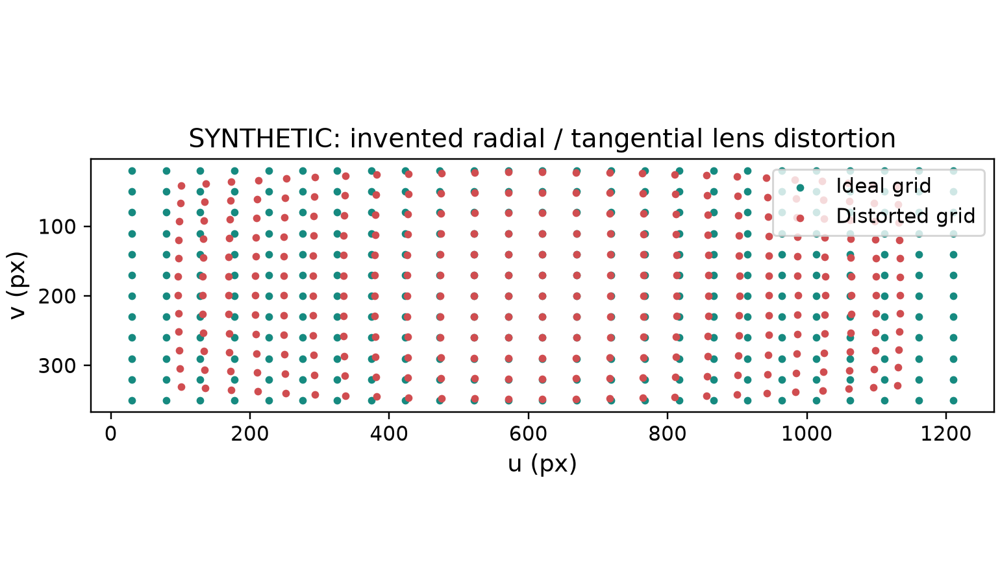

**그림 C1-01. 알려진 왜곡 모델에서 격자가 이동하는 모습 (합성 교육 모델).** 렌즈 계수는 설명용으로 만든 값이다. 이미 정류된 KITTI 영상에 이 계수를 적용하지 않는다.

원본: `artifacts/synthetic/distortion.npz` (카메라 연구 디렉터리 기준; data/는 저장소 기준).

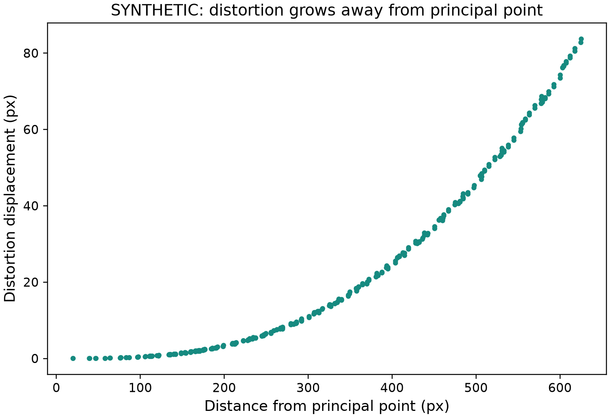

**그림 C1-02. 영상 반지름과 왜곡 역변환 오차 (합성 교육 모델).** 알려진 왜곡 모델의 역변환은 실제 보정 파라미터 추정과 다르다. undistortion 수치 오차는 summary에 기록한다.

원본: `artifacts/synthetic/distortion.npz` (카메라 연구 디렉터리 기준; data/는 저장소 기준).

<a id="c1-6"></a>

### 6. Zhang 보정: 왜 여러 방향의 평면이 필요한가

Zhengyou Zhang의 방법은 여러 자세의 평면 패턴으로 초기 보정값을 구하고 비선형 정련으로 개선한다.
2000년 논문과 1998년 기술보고서 및 이후 수정본은 같은 제목의 서로 다른 판본이다. [Microsoft 연구 페이지](https://www.microsoft.com/en-us/research/publication/a-flexible-new-technique-for-camera-calibration/), [저자 기술보고서](https://www.microsoft.com/en-us/research/wp-content/uploads/2016/02/tr98-71.pdf)

평면 패턴 좌표를 `Z_W=0`으로 잡으면 `p~K(r1 X+r2 Y+t)`다.
따라서 패턴의 `(X,Y,1)`을 영상에 보내는 행렬은 `H~K[r1 r2 t]`가 된다.
여기서 `r1,r2`는 회전행렬의 첫째·둘째 열이며, 길이가 같고 서로 직교한다.
`H=[h1 h2 h3]`, `B=K^(-T)K^(-1)`이라고 두자.
`K^(-1)h1`과 `K^(-1)h2`가 각각 같은 비율의 `r1,r2`이므로 다음 두 식이 생긴다.

```text
h1^T B h2 = 0
h1^T B h1 - h2^T B h2 = 0
B = B^T
```

대칭 3x3 행렬 `B`는 독립 원소가 6개이고 전체 비율 하나를 제외하면 자유도는 5다.
한 영상이 독립 식 두 개를 주므로 일반적인 미지 내부 파라미터 모델은 여러 기울기의 영상이 필요하다.
단순 미지수 개수만으로는 세 영상이 선형 초기화의 일반적 최소 구성이지만, 실제 독립성은 자세 배치에 달려 있다.
저자의 “적어도 두 방향” 설명은 추가 내부 파라미터 제약 등과 구분해서 읽어야 한다.
“평면을 두 장 찍으면 모든 내부 보정값이 언제나 식별된다”로 일반화하지 않는다.
정면 패턴을 화면에서 옆으로만 옮기면 장수는 늘어도 필요한 방향 정보는 충분히 늘지 않을 수 있다.

초기 `K`를 얻은 뒤 각 영상의 `R,t`, 왜곡 계수까지 함께 재투영 오차로 정련한다.
잔차는 검출된 코너와 모델이 예측한 코너의 픽셀 차이다.
패턴 정밀도, 화면 주변 관측, 다양한 기울기, 포커스 유지 조건을 기록해야 한다.
총 평균 오차만 작은지 보는 것보다 영상별·반지름별·방향별 잔차를 보는 편이 원인 구분에 유리하다.
이 마지막 진단 방법은 이 교재의 실험 제안이지 저장소에서 실행한 보정 평가가 아니다.

<a id="c1-7"></a>

### 7. 리사이즈·크롭·정렬은 K도 바꾼다

이상적인 연속 좌표 규약에서 가로 `a`, 세로 `b`배 리사이즈는 `K'=diag(a,b,1)K`다.
그 뒤 왼쪽 `d_u`, 위쪽 `d_v`만큼 자르면 주점은 `cx'=a cx-d_u`, `cy'=b cy-d_v`다.
실제 보간기의 픽셀 중심 규약에 따라 반 픽셀 항이 들어갈 수 있으므로 사용한 좌표 변환을 계약에 적는다.
예를 들어 픽셀 중심을 보존하는 일부 리사이즈 규약은 `u'=a(u+0.5)-0.5`를 사용한다.
이 경우 주점도 같은 식으로 옮겨야 하며 `u'=a u`와 섞지 않는다.
이 교재의 수치 예제는 명시적으로 `u'=a u, v'=b v`를 사용한다. [내부 파라미터와 영상 크기 관계](https://docs.opencv.org/4.13.0/d9/d0c/group__calib3d.html)

[교육 예제 N3] N1의 영상을 절반으로 줄이고 왼쪽 10px, 위쪽 20px를 자른다.
`fx'=400, fy'=300, cx'=150, cy'=100`이다.
원래 `(400,300)px`는 새 영상에서 `(190,130)px`다.
`(190-150)/400=0.1`, `(130-100)/300=0.1`이므로 광선은 보존된다.
영상만 바꾸고 이전 `K`를 유지하면 다른 광선으로 해석하게 된다.

Rectification, 스테레오 정렬은 두 영상을 가상 카메라의 좌표로 재표현하여 대응 검색을 단순하게 만든다.
기하적으로는 카메라 중심을 보존하면서 공통 방향 등을 구성하는 방법이 있다. [Fusiello·Trucco·Verri, 2000](https://fusiello.github.io/papers/00120016.pdf)

Undistortion, 왜곡 제거는 렌즈 비선형을 제거하는 일이고 rectification은 두 카메라의 에피폴라 구조를 정렬하는 일이다.
둘은 함께 수행할 수 있지만 같은 개념이 아니다.
가상 카메라로 회전하면 `q'=R_rect q`, 출력 픽셀은 `p'~K'R_rect K^(-1)p`다.
이 식은 왜곡이 이미 제거된 광선에 대한 것이며, 원시 왜곡 픽셀을 그대로 넣지 않는다.
`R_rect`는 회전, `K'`는 출력 가상 카메라의 내부 파라미터다.
정렬 이후 알고리즘은 원본 K가 아니라 출력 P/K 및 유효 영상 영역과 일치해야 한다.
보정은 없는 관측을 생성하지 못하므로 가장자리의 빈 영역과 보간 손실도 남는다.

<a id="c1-8"></a>

### 8. KITTI P0/P1과 Raw calibration을 구별하는 문단

KITTI는 원시 및 정렬 영상과 보정 정보를 제공하며, 회색조 카메라와 컬러 카메라는 별도 센서다. [Geiger·Lenz·Stiller·Urtasun, 2013](https://www.cvlibs.net/publications/Geiger2013IJRR.pdf)
Odometry의 `P0/P1`을 Raw의 `K_00/D_00/R_rect_00/P_rect_00`과 이름만 바꾸어 섞지 않는다. [KITTI Raw 안내 및 devkit](https://www.cvlibs.net/datasets/kitti/raw_data.php)

Odometry의 정렬 회색조 영상 쌍에서는 `P0,P1`이 같은 정렬 기준 좌표의 점을 각 영상으로 투영하는 행렬이다.
통상적인 수평 구성에서는 `P_i=K_i[I|t_i]`처럼 읽을 수 있지만, 파일의 실제 형식과 축을 먼저 확인해야 한다.
`P_i`의 왼쪽 3x3 블록이 K라는 해석은 이미 회전이 제거된 이 구조에 의존한다.
임의의 투영행렬 `P=K[R|t]`에서 왼쪽 블록은 `KR`이므로 항상 K는 아니다.
오른쪽 카메라의 기준점 이동은 P의 마지막 열에 포함되며 마지막 열을 버리면 스테레오 기준선 정보도 잃는다.

Raw 계열에서 정렬 전 기준 카메라 좌표 `X_cam0`를 정렬 영상 i에 투영하는 전형적 흐름은 다음과 같다.
`p_i ~ P_rect_i * R_rect_0(homogeneous) * X_cam0(homogeneous)`다.
LiDAR 점부터 시작한다면 앞에 `T_cam0_velo`를 적용한다.
하지만 이미 정렬 기준 좌표인 점에 `R_rect_0`를 또 적용하면 이중 회전이다.
사용하는 devkit과 `Tr`의 정의에 맞춰 이 변환을 확정해야 하며, 서로 다른 배포 형식의 행렬을 추측으로 이어 붙이지 않는다.
센서 시간 정렬과 공간 보정은 별개의 문제여서 올바른 투영행렬만으로 시간 일치가 증명되지 않는다.

`src/datasets/kitti.py:11`은 `image_0`을 선택한다.
`src/datasets/kitti.py:26`은 회색조 읽기를 하고, `:42`부터 `P0`의 왼쪽 블록을 읽어 K로 반환한다.
이 로더는 본문에서 “일반적인 Raw 카메라 보정기”가 아니라 “현재 Odometry 입력용 로더”라고 부른다.
이 운영 로더와 달리 신규 연구의 common.py는 P0/P1을 함께 읽어 기준선을 구한다.


**그림 C1-03. 정류된 좌우 영상과 공통 행 (실제 KITTI 00).** 이미 정류된 좌우 입력에 같은 y선을 그렸다. raw 재정류를 수행한 그림이 아니다.

원본: `artifacts/stereo/000000.npz` (카메라 연구 디렉터리 기준; data/는 저장소 기준).

<a id="c1-9"></a>

### 9. 셔터: 한 프레임에 하나의 자세가 있는가

Global shutter, 전역 셔터는 영상의 행들이 공통 노출 구간을 갖는 모델이고, rolling shutter, 순차 셔터는 행에 따라 촬영 시간이 달라지는 모델이다.
순차 셔터 운동을 무시할 때의 문제와 행별 운동 모델은 관련 VO 연구의 대상이다. [Schubert·Demmel·Usenko·Stückler·Cremers, 2018](https://arxiv.org/abs/1808.00558)
KITTI 원 논문은 회색조·컬러 카메라를 global shutter로 명시한다. [KITTI 센서 논문](https://www.cvlibs.net/publications/Geiger2013IJRR.pdf)

행 번호 `v`, 기준 행 `v0`, 행당 시간 `tau`를 두면 대표 시각은 `t(v)=t0+(v-v0)tau`다.
`tau`의 단위는 s/row이며 위에서 아래로 읽는다는 가정도 명시해야 한다.
관측은 `p~K[R(t(v))|t_CW(t(v))]X_W`를 따른다.
식에서 `t(v)`는 시각이고 `t_CW`는 병진 벡터이므로 이름을 혼동하지 않는다.
한 프레임의 모든 점을 같은 R과 병진으로 설명한다는 F/E 모델의 전제가 약해진다.
행간 시간차를 픽셀 노이즈로만 취급하면 위치에 따라 방향성 있는 잔차가 남을 수 있다.

[교육 예제 N4] 1001행의 첫 행과 마지막 행 중심 사이가 0.020s인 센서를 가정한다.
행 간격은 1000개이므로 `tau=0.020/1000=0.00002s=20us`다.
행 0과 500의 시간차는 `0.010s`다.
영상 속도가 일정한 `200px/s`라면 두 행의 대표 시각 차이에 따른 위치 차이는 `2px`다.
이는 합성 등속 모델이며 KITTI의 순차 셔터 변형을 측정한 값이 아니다.
전역 셔터 센서인 KITTI에서 같은 패턴을 보았다고 바로 rolling shutter 원인으로 결론내리지 않는다.

<a id="c1-10"></a>

### 10. 노출 시간과 모션 블러

셔터 유형과 노출 시간은 다른 축이다.
전역 셔터여도 노출 중 카메라가 움직이면 한 픽셀은 시간에 따라 달라지는 광량을 적분한다.
밝기 응답을 잠시 선형으로 두면 `I(u) ∝ integral L(u,t) dt`다.
영상상 이동 속도가 `v_img px/s`, 노출이 `Delta_t s`이면 등속 블러 길이는 `l≈|v_img|Delta_t px`다.
이 식은 등속·국소 평행 이동 근사이며 가림이나 회전의 공간적 차이는 생략한다.
전역 셔터는 행별 자세 차이를 줄이지만 시간 적분 자체를 없애지는 않는다. [영상 형성의 광도 모델과 관련 한계](https://arxiv.org/pdf/1607.02565)

[교육 예제 N5] 정면 점의 깊이 10m, 카메라 횡속도 2m/s, 초점거리 500px를 가정한다.
회전과 깊이 변화가 없으면 영상 속도 크기는 `500*2/10=100px/s`다.
노출 0.010s에서는 블러 길이가 1px, 0.002s에서는 0.2px다.
노출을 줄이면 블러는 줄어도 수광량이 감소한다는 별도 문제가 남는다.
이 예제의 속도·깊이·노출은 KITTI에서 읽은 값이 아니다.

<a id="c1-11"></a>

### 11. 방사 응답: 같은 물체가 같은 픽셀값을 갖지 않는 이유

DSO, Direct Sparse Odometry, 직접 희소 오도메트리는 노출·비네팅·비선형 응답을 포함하는 광도 모델을 사용한다. [Engel·Koltun·Cremers](https://arxiv.org/pdf/1607.02565)
Radiometry는 물리적 광 에너지의 측정·모델링을 다루며, 영상처리의 photometric calibration은 밝기 관측의 일관성을 보정하는 작업을 가리킨다.
이 절의 상대 밝기 보정은 절대 물리 광량 단위의 센서 인증과 같지 않다. [저자들의 광도 보정 자료](https://cvg.cit.tum.de/research/vslam/photometric-calibration)

[자체 모델] `I=g(e V L)+noise`라고 쓰자.
`I`는 저장 픽셀값, `g`는 카메라 응답, `e`는 노출 시간, `V`는 위치별 감쇠, `L`은 상대 조사량이다.
`V`는 무차원이고 `e`는 s다.
`L`에 절대 광량 단위를 붙이려면 센서 이득 등 추가 보정이 필요하므로 여기서는 상대 단위/s로 둔다.
`g`가 역함수를 갖고 포화가 없다면 `g^(-1)(I)/(e V)`가 상대 조사량을 복원한다.
8비트 최대값으로 잘린 관측은 역함수 하나로 원래 광량을 되찾을 수 없다.
자동 노출·이득·화이트밸런스가 달라지면 단순 밝기 불변성은 약해질 수 있다.
비네팅은 주변부 감쇠이며 광선 좌표를 바꾸는 기하 왜곡과 구분한다.

[교육 예제 N6] 선형 응답, `L=10000 상대단위/s`, `V=0.8`, `e=0.01s`이면 `I=80`이다.
같은 물체를 `e=0.02s`로 찍으면 `I=160`이다.
원시 차이는 80이지만 노출·감쇠로 나누면 두 값 모두 10000이다.
노출 0.04s의 이상적 값은 320이며 8비트 상한 255로 포화되었다고 가정하자.
그 값을 보정하면 `255/(0.04*0.8)=7968.75`로 실제 상대값보다 작다.
이 차이는 기하 추정이 틀려서가 아니라 정보가 이미 잘렸기 때문이다.

<a id="c1-12"></a>

### 12. 컬러와 회색조

RGB는 Red, Green, Blue의 세 색 채널이고 OpenCV에는 채널 순서를 구분하는 색 변환이 있다.
문서의 일반 RGB→회색조 식은 `Y=0.299R+0.587G+0.114B`다. [OpenCV 색 변환](https://docs.opencv.org/4.13.0/de/d25/imgproc_color_conversions.html)

회색조 변환은 3차원 색 관측을 하나의 밝기 값으로 압축한다.
같은 Y를 갖는 서로 다른 색은 압축 후 구분하기 어려워지므로 컬러 경계가 모두 보존되는 것은 아니다.
반대로 세 채널을 모두 쓴다고 모든 기하 추정이 좋아지는 것도 아니다.
조명 스펙트럼·화이트밸런스·채널별 잡음·보간 특성이 잔차 모델에 영향을 줄 수 있기 때문이다.
위 계수 식의 Y를 원시 센서 광자 수나 정확한 선형 방사량으로 자동 해석하지 않는다.
이미 감마나 색 처리를 거친 RGB 값이면 그 처리까지 고려해야 한다.
KITTI `image_0`은 컬러 `image_2`를 단순 회색조 변환한 동일 광학 관측이 아니라 별도 회색조 카메라 영상이다. [KITTI 구성](https://www.cvlibs.net/datasets/kitti/setup.php)

[교육 예제 N7] RGB `(100,150,200)`의 가중 회색조 값은 `29.9+88.05+22.8=140.75`다.
정수 영상의 최종 반올림은 구현 규약에 따라 확인한다.
RGB와 BGR을 혼동하여 R과 B를 바꾸면 `59.8+88.05+11.4=159.25`다.
차이 18.5는 장면 운동이 아니라 채널 해석 오류로 생긴다.

<a id="c1-13"></a>

### 13. 어안·RGB-D는 대체 모델의 개념으로만

OpenCV의 어안 모델은 각도에 대한 왜곡 다항식을 사용하는 별도 모델이다. [OpenCV fisheye](https://docs.opencv.org/4.13.0/db/d58/group__calib3d__fisheye.html)
RGB-D의 D는 Depth, 깊이이며 색과 깊이 관측을 결합하는 설정이다. ORB-SLAM2는 단안·스테레오·RGB-D를 별도 입력 형태로 다룬다. [Mur-Artal·Tardós, 사전공개 2016](https://arxiv.org/abs/1610.06475)

어안을 “큰 k1 하나를 넣은 핀홀”로 단순화하지 않는다.
광선 추출을 올바르게 할 수 있는 중앙투영 어안에서는 광선 기반 기하를 연결할 수 있지만 원시 어안 픽셀의 에피폴라 자취는 일반적으로 직선이 아니다.
핀홀 영상으로 재투영하면 사용 가능한 시야와 표본 밀도도 바뀐다.
본 저장소가 어안 보정·광선 변환·추적을 지원한다고 확인한 것은 아니다.

깊이 센서의 출력이 광축 깊이 `Z`인지 카메라 중심까지의 거리 `rho`인지 먼저 구분한다.
전자는 `X=Z q`, 후자는 `X=rho b`로 역투영한다.
깊이 단위 배율, 무효값, 컬러와 깊이의 외부 보정·시간차가 필요하다.
깊이를 제공한다고 반사면·가림·거리 한계까지 해결되는 것은 아니다.
이번 교재에서는 RGB-D 실제 장치의 측정 방식·정확도·SLAM 성능을 검증하지 않았다.

<a id="c1-14"></a>

### 14. 연습문제와 해설

#### 문제 1. 픽셀과 광선

문제: `fx=400, fy=500, cx=300, cy=200`인 카메라에서 `(340,150)px`를 관측했다.
왜곡이 없을 때 정규화 좌표와 깊이 8m에서의 3D 점을 구하라.
해설: `x=(340-300)/400=0.1`, `y=(150-200)/500=-0.1`이다.
따라서 q는 `(0.1,-0.1,1)`, 3D 점은 `(0.8,-0.8,8)m`다.
검산: `400*0.8/8+300=340`, `500*(-0.8)/8+200=150`이다.
핵심: 음의 y는 카메라 위쪽을 가리키며, 깊이는 추가로 주어진 정보다.


#### 문제 2. 왜곡의 단위

문제: `q=(0.3,0.4,1)`, `k1=-0.1`, 나머지 계수는 0, `fx=fy=600px`, 주점은 원점이다.
왜곡 전·후 픽셀을 구하라.
해설: `r2=0.25`, `L=0.975`, 왜곡 정규화 좌표는 `(0.2925,0.39)`다.
왜곡 전 `(180,240)px`, 후 `(175.5,234)px`이므로 변화는 `(-4.5,-6)px`다.
핵심: 0.3과 0.4 대신 180과 240을 반지름 식에 넣으면 다른 모델이 된다.


#### 문제 9. 셔터와 블러를 구분하기

문제: 전역 셔터에서 영상 속도 150px/s, 노출 8ms라면 등속 블러 길이는 얼마인가?
같은 계산만으로 순차 셔터의 첫 행-마지막 행 변형을 알 수 있는가?
해설: `150*0.008=1.2px`다.
행간 변형에는 추가로 전체 판독 시간과 방향, 행별 자세가 필요하므로 알 수 없다.
핵심: 노출 시간과 프레임 판독 시간은 서로 다른 변수다.


#### 문제 11. RGB-D의 깊이 정의

문제: `q=(0.6,0,1)`에서 센서가 광축 깊이 5m를 줄 때와 광선 거리 5m를 줄 때의 점은 같은가?
해설: 광축 깊이면 `(3,0,5)m`이고 원점까지 거리는 `sqrt(34)≈5.830951895m`다.
거리이면 `5q/sqrt(1.36)≈(2.572478777,0,4.287464629)m`다.
핵심: 깊이 파일의 숫자와 단위만으로는 역투영 의미가 완성되지 않는다.


#### 문제 12. 광도 보정과 포화

문제: 선형 응답에서 같은 표면의 픽셀값이 60과 120이고 노출이 각각 5ms와 10ms다.
비네팅이 같고 1일 때 운동이 없다는 광도 가정과 모순되는가?
해설: 두 상대 조사량은 `60/0.005=12000`, `120/0.010=12000`으로 같다.
원시 밝기 차이만으로 움직임이나 오대응을 결론낼 수 없다.
포화되거나 응답이 비선형이면 이 단순 나눗셈의 가정을 다시 확인해야 한다.

<a id="c1-15"></a>

### 15. 이 장에서 확인한 것과 다음 질문

합성 왜곡 역변환은 이미 알려진 계수를 거꾸로 적용한 검사이지 실제 렌즈 보정 성능이 아니다. 실제 KITTI 보정 패턴 촬영, 어안 보정, 순차 셔터 추정은 수행하지 않았다. 다음 C2에서는 두 광선의 관계를 제약하는 F/E와 평면의 H를 구분한다. Zhang의 보정 논문을 읽은 뒤 Hartley의 정규화 8점법으로 넘어가면 보정과 수치 정규화가 다른 작업임을 확인할 수 있다.


<a id="c2"></a>

## C2. F·E·H와 삼각측량: 대응점을 운동과 구조로 바꾸기

**심화 연결:** 대응 선택의 근거는 [D9–D12](#d9), 사영 좌표와 full SVD·Sampson 유도는 [D13–D14](#d13)에 있다. [D5](#d5)의 영공간을 함께 읽으면 점의 개수와 독립 제약 수를 구분할 수 있다.

한 대응점으로 다른 영상의 정확한 점을 예측할 수 있는지부터 묻는다. 일반 3D 장면에서는 점이 에피폴라 직선을 정하고, 평면 또는 순수 회전에서는 호모그래피가 점을 점으로 보낸다. 이 장은 A6의 rank·SVD, A7–A8의 불확실성을 실제 기하 제약에 연결한다.

<a id="c2-1"></a>

### 1. 한 대응점은 왜 에피폴라 직선만 정하는가

첫 카메라를 기준으로 `X_2=R_21 X_1+t_21`을 둔다.
편의상 아래에서는 첨자 21을 생략하고 `R,t`라고 쓴다.
깊이를 모르는 점은 `X_1=lambda1 q1`, `X_2=lambda2 q2`로 쓸 수 있다.
그러면 `lambda2 q2=lambda1 R q1+t`다.
세 벡터 `q2`, `Rq1`, `t`는 한 평면에 있으므로 스칼라 삼중곱이 0이다.

```text
q2^T (t cross Rq1) = 0
[t]_x = [  0 -tz  ty]
        [ tz   0 -tx]
        [-ty  tx   0]
E = [t]_x R
q2^T E q1 = 0
```

`cross`는 두 벡터에 수직인 벡터를 만드는 외적이고 `[t]_x`는 그 연산을 행렬로 표현한 것이다.
첫 광선과 두 카메라 중심을 포함하는 평면을 epipolar plane, 에피폴라 평면이라 부른다.
그 평면이 다른 영상면과 만나는 선이 epipolar line, 에피폴라 직선이다.
깊이를 모르는 첫 점은 두 번째 영상에서 일반적으로 한 선 위에만 제한된다.
에피폴라 제약은 그 선의 어느 위치인지까지 말해 주지 않는다. [기본 두 시점 관계](https://wcours.gel.ulaval.ca/GIF4105/tps/tp4/hartley.pdf)

<a id="c2-2"></a>

### 2. E와 F의 관계를 빠짐없이 전개하기

왜곡이 제거된 픽셀에서 `q1=K1^(-1)p1`, `q2=K2^(-1)p2`다.
앞 식에 대입하면 `p2^T K2^(-T) E K1^(-1)p1=0`이다.
따라서 `F=K2^(-T) E K1^(-1)`, 반대로 `E=K2^T F K1`이다.
E는 Essential matrix, 본질행렬로 보정된 광선의 상대 기하를 표현한다.
F는 Fundamental matrix, 기본행렬로 픽셀 좌표의 에피폴라 기하를 표현한다. [공식 F/E 인터페이스와 수식](https://docs.opencv.org/4.13.0/d9/d0c/group__calib3d.html)

`l2=F p1=[a,b,c]^T`이면 두 번째 영상의 직선은 `a u2+b v2+c=0`이다.
카메라 중심을 다른 영상으로 투영한 epipole, 에피폴은 모든 에피폴라 직선이 만나는 점이다.
그 점은 영상 밖이나 무한원에 있을 수도 있어 항상 이미지 내부에서 교차하는 것으로 그리지 않는다.
`F e1=0`, `F^T e2=0`의 좌우 영공간 관계는 방향 규약과 함께 기억한다.
F와 E는 비율까지 정의되므로 원소 값 자체에 픽셀 또는 미터 한 가지 단위를 일괄 부여하지 않는다.
특히 E를 두 배로 해도 에피폴라 식은 같으므로 E의 크기로 이동 거리를 읽을 수 없다.

<a id="c2-3"></a>

### 3. 자유도·rank·특이값은 어떤 정보를 말하는가

일반 3x3 행렬에는 원소 9개가 있다.
F는 전체 배율이 무의미하므로 8개에서 시작하고 `det(F)=0`이라는 제약으로 일반적으로 7자유도를 가진다.
일반 두 시점의 F는 rank 2이며, rank는 독립 열 또는 행의 수다.
E는 회전의 3자유도와 병진 방향의 2자유도를 합한 5자유도다.
병진 벡터는 3성분이지만 크기는 관측되지 않아 방향에는 두 값만 필요하다.
이 자유도 계산은 일반적인 비퇴화 조건에 대한 설명이지 모든 데이터에서 추정이 가능하다는 보장은 아니다. [Hartley](https://wcours.gel.ulaval.ca/GIF4105/tps/tp4/hartley.pdf), [Nistér 원문](https://www-users.cse.umn.edu/~hspark/CSci5980/nister.pdf)

SVD는 Singular Value Decomposition, 특이값 분해이며 `M=U diag(s1,s2,s3)V^T`다.
`U,V`는 직교행렬, `s_i`는 비음수 특이값이다.
이상적인 E의 특이값은 `(s,s,0)` 형태다.
이는 `[t]_x`가 t에 수직인 평면의 두 방향에 같은 크기의 작용을 하고 t 방향은 0으로 보내기 때문이다.
`t≠0`일 때 오른쪽 영공간의 비영 벡터는 `R^T t`다. 실제로 `E(R^T t)=[t]_x R R^T t=[t]_x t=0`이다.
즉 병진 방향을 첫 카메라 좌표로 표현한 `R^T t`는 E가 0으로 보내는 방향이며, “모든 방향에 대한 거리 정보가 있다”는 뜻이 아니다.
잡음 추정치를 `(평균(s1,s2), 평균(s1,s2),0)`으로 투영하는 것은 행렬 제약 보정이며, 픽셀 재투영의 최적화와 같지 않다.

<a id="c2-4"></a>

### 4. 실제 부호를 확인하는 두 시점 예제

[교육 예제 N8] 첫 카메라 중심은 `(0,0,0)m`, 두 번째 중심은 `(1,0,0)m`, 회전은 동일하다고 하자.
두 번째 카메라에서 점을 표현하면 `X_2=X_1-(1,0,0)`이므로 `R=I,t=(-1,0,0)m`다.
점 `X_1=(2,1,5)m`는 `q1=(0.4,0.2,1)`, `q2=(0.2,0.2,1)`로 보인다.

```text
E = [0 0  0]
    [0 0  1]
    [0 -1 0]
E q1 = (0,1,-0.2)^T
q2^T E q1 = 0.2 - 0.2 = 0
```

`fx=fy=500px, cx=320px, cy=240px`이면 `p1=(520,340,1)`, `p2=(420,340,1)`이다.
같은 행에 나타나지만 가로로 100px 차이가 난다.
이 경우 F의 편리한 비율 표현은 `[[0,0,0],[0,0,1],[0,-1,0]]`이며 직선은 `v2=340`이다.
이는 E와 F가 일반적으로 같다는 뜻이 아니라 이 단순한 K/R/t에서 행렬 배율이 흡수된 특수 예다.
카메라는 +X로 이동했지만 좌표변환의 t는 -X라는 점이 핵심이다.

<a id="c2-5"></a>

### 5. H: 평면 또는 순수 회전이 주는 점 대 점 관계

H는 Homography, 호모그래피 또는 사영변환 행렬이다.
평면을 첫 카메라 좌표에서 `n^T X_1=d`로 정의하고 `||n||=1`로 둔다.
`n`은 무차원 법선, `d`는 부호 있는 길이이며 이 식의 부호 규약이 중요하다.
평면 위에서는 `t=(t n^T/d)X_1`이므로 `X_2=(R+t n^T/d)X_1`다.
따라서 `p2~K2(R+t n^T/d)K1^(-1)p1`이고 이 행렬이 H다.
다른 책의 평면 식이 `n^T X+d=0`이면 부호가 바뀌므로 식만 복사해서 비교하지 않는다. [평면 기하 및 H의 사용 맥락](https://www.microsoft.com/en-us/research/wp-content/uploads/2016/02/tr98-71.pdf)

H는 비율을 제외하면 일반적으로 8자유도이며 일반 위치의 점 네 쌍이 최소 선형 제약을 줄 수 있다.
반면 F는 한 점을 다른 점이 아니라 선으로 보낸다.
H의 대응점 직접 예측이 잘 맞는다고 항상 넓은 3D 장면의 깊이가 잘 관측되는 것은 아니다.
순수 회전이면 `t=0`이므로 `H=K2 R K1^(-1)`가 깊이와 무관하게 성립한다.
이때 E는 영행렬이므로 E로부터 유효한 병진 방향을 복원할 수 없다.
물체 평면과 순수 회전은 모두 H가 맞을 수 있지만 물리적 상황은 다르다.

[교육 예제 N9] N8의 운동에서 `Z=5m` 평면은 `n=(0,0,1), d=5`다.
정규화 호모그래피는 `Hn=[[1,0,-0.2],[0,1,0],[0,0,1]]`다.
`Hn q1=(0.2,0.2,1)`로 앞의 q2를 재현한다.
픽셀에서는 `Hp=[[1,0,-100],[0,1,0],[0,0,1]]`이 된다.
깊이 10m의 점에는 실제 가로 변화가 -50px이므로 같은 H를 적용하면 50px 오차가 난다.
평면에 맞는 H를 장면 전체의 카메라 운동 그 자체로 해석하면 안 되는 이유다.

<a id="c2-6"></a>

### 6. 정규화 8점법의 입력 행을 직접 만들기

Hartley의 정규화 8점법은 좌표의 평행이동·척도 조절을 통해 수치 조건을 개선한다.
논문 제목은 1997년 저널판 기준 *In Defense of the Eight-Point Algorithm*이다. [원문](https://wcours.gel.ulaval.ca/GIF4105/tps/tp4/hartley.pdf)

`p1=(u,v,1)`, `p2=(u',v',1)`이고 F 원소를 행 우선으로 펼친 벡터를 f라 하자.
`p2^T F p1=0`을 전개하면 아래 한 행이 생긴다.

```text
f = [F11,F12,F13,F21,F22,F23,F31,F32,F33]^T
A_i = [u'*u, u'*v, u', v'*u, v'*v, v', u, v, 1]
A f = 0
minimize ||A f||^2 subject to ||f||=1
```

벡터화 순서를 열 우선으로 바꾸면 A의 열 순서도 바꾸어야 한다.
`||f||=1`은 모든 원소가 0인 무의미한 해를 막는 게이지 선택이다.
잡음이 있으면 정확히 0이 되는 해가 없으므로 가장 작은 특이값에 대응하는 오른쪽 특이벡터를 사용한다.
정확히 8개 대응의 A는 8x9이므로 full SVD의 9번째 오른쪽 특이벡터가 필요할 수 있다.
축소형 SVD가 8개의 오른쪽 벡터만 반환하면 원하는 영공간 벡터를 놓칠 수 있다.
이 부분은 교육 구현자가 배열 shape를 검사해야 하는 지점이지 여기서 새 코드를 구현한 것은 아니다.

정규화 변환은 각 영상에서 독립적으로 계산한다.
점 평균을 `mu=(mu_u,mu_v)`, 평균 유클리드 거리를 `dbar`라 한다.
`a=sqrt(2)/dbar`, `T=[[a,0,-a mu_u],[0,a,-a mu_v],[0,0,1]]`로 둔다.
모든 점이 같아 `dbar=0`이면 나누지 말고 추정을 거절한다.
변환된 점 `p_hat=T p`로 F_hat을 구하고 가장 작은 특이값을 0으로 만든다.
그 뒤 원래 좌표로 `F=T2^T F_hat T1`을 되돌린다.
역변환이 아닌 전치가 등장하는 이유는 `p_hat2^T F_hat p_hat1`에 `T1,T2`를 대입하면 바로 보인다.

[교육 예제 N10] 네 점 `(0,0),(2,0),(0,2),(2,2)`의 평균은 `(1,1)`이다.
각 점과 평균의 거리는 `sqrt(2)`이므로 `a=1`이다.
변환 후 점은 `(-1,-1),(1,-1),(-1,1),(1,1)`이다.
이 네 점 예제는 좌표 정규화만 검산하며 네 점으로 F를 구했다는 주장이 아니다.
별도로 `(u,v)=(2,3),(u',v')=(5,7)`이면 A 한 행은 `[10,15,5,14,21,7,2,3,1]`이다.

<a id="c2-7"></a>

### 7. 왜 5점법은 8점법에서 점만 줄인 것이 아닌가

Nistér의 방법은 보정된 두 영상의 다섯 대응에서 본질행렬 후보를 구하며 10차 다항식의 근을 이용한다.
다섯 대응만으로 항상 유일한 해가 생긴다고 주장하지 않는다. [Nistér 원문](https://www-users.cse.umn.edu/~hspark/CSci5980/nister.pdf), [2004년 저널 서지](https://pubmed.ncbi.nlm.nih.gov/18579936/)

정규화 광선의 에피폴라 식을 다섯 개 쌓으면 A는 5x9다.
일반적으로 rank가 5라서 영공간 차원은 `9-5=4`다.
네 기저 행렬을 `E1,E2,E3,E4`라고 하면 후보는 `E=a E1+b E2+c E3+d E4`다.
비율 자유도 때문에 한 좌표 영역에서는 `d=1`로 놓을 수 있으나 d가 0인 해의 처리는 별도로 고려해야 한다.
아무 선형 조합이나 E가 되지는 않으므로 다음 비선형 제약을 부과한다.

```text
det(E) = 0
2 E E^T E - trace(E E^T) E = 0
```

`trace`는 대각 원소의 합이다.
이 식은 E의 두 비영 특이값이 같다는 제약을 다항식 형태로 표현한다.
영공간 계수를 대입하면 미지수에 대한 다항식 문제가 된다.
실수 후보 여러 개가 나오면 각 후보를 전체 대응점으로 평가해야 한다.
복소근을 실제 회전·병진으로 해석하거나 첫 후보만 무조건 선택하면 안 된다.
이 교재는 소거 과정의 고차 계수표를 다시 구현하지 않고 입출력·다중 해·검증 이유를 가르친다.
따라서 “Nistér 5점법 완전 재현 코드”를 제공했다고 표현하지 않는다.

<a id="c2-8"></a>

### 8. RANSAC: 맞는 점의 수보다 모델과 잔차가 먼저다

RANSAC은 Random Sample Consensus, 무작위 표본 합의의 약칭이다.
작은 표본으로 후보 모델을 만들고 전체 관측이 그 모델을 얼마나 지지하는지 반복 평가한다. [Fischler·Bolles, 1981 원문](https://www.sri.com/wp-content/uploads/2021/12/ransac-publication.pdf)

하나의 대응이 inlier일 확률을 w, 표본 크기를 s라 하자.
독립 추출 근사에서 표본 전체가 inlier일 확률은 `w^s`다.
N번 모두 실패할 확률은 `(1-w^s)^N`이다.
적어도 한 번 성공할 목표 확률 p를 두면 `(1-w^s)^N≤1-p`다.
양변에 자연로그를 취하고 음수 분모를 나누면 부등호가 바뀌어 `N≥log(1-p)/log(1-w^s)`다.
최종 반복 수는 정수 올림을 한다.
유한 집합에서 비복원 표본을 뽑는 정확한 확률은 조합 비율이며 `w^s`는 널리 쓰는 근사다.
또한 inlier만 뽑아도 퇴화한 배치라면 유효한 모델이 안 나올 수 있다.

[교육 예제 N11] `w=0.5,p=0.99`로 둔다.
5점 표본은 `log(0.01)/log(1-0.5^5)≈145.05`이므로 최소 146회다.
8점 표본은 약 1176.62이므로 최소 1177회다.
표본이 작으면 이 조건의 반복 수는 줄지만 후보 계산 비용·다중 해·데이터 조건까지 자동으로 좋아지지는 않는다.
`p=0.99`는 모델이 맞을 사후확률이 아니라 가정된 표본 추출 성공 확률이다.
동적 물체에 대응점이 집중되면 높은 합의 점수로 잘못된 장면 운동을 선택할 수 있다.

<a id="c2-9"></a>

### 9. 잔차를 정의하지 않은 1px 문턱은 불완전하다

직선 `l=(a,b,c)`와 점 `(u,v)`의 부호 없는 수직 거리는 `|au+bv+c|/sqrt(a^2+b^2)`다.
분모는 직선 계수의 임의 배율을 상쇄한다.
`a=b=0`이면 유효한 영상 직선이 아니므로 거리를 계산하지 않는다.
단순 대수 잔차 `p2^T F p1`는 F의 배율에 따라 바뀌어 직접 픽셀 거리로 쓰기 어렵다.

Sampson 근사 제곱거리는 다음과 같다.

```text
r = p2^T F p1
dS2 = r*r / ((F p1)_1^2 + (F p1)_2^2
             + (F^T p2)_1^2 + (F^T p2)_2^2)
```

이 식은 에피폴라 제약의 1차 선형화로 두 영상 관측의 작은 보정을 근사한다.
`dS2`는 픽셀 좌표 입력에서 px²이며 제곱하지 않은 문턱과 혼동하지 않는다.
에피폴 부근처럼 분모가 작거나 큰 잡음이면 근사의 품질을 확인해야 한다. [OpenCV Sampson 정의](https://docs.opencv.org/4.13.0/d9/d0c/group__calib3d.html)

[교육 예제 N12] N8의 F에서 첫 점의 v는 340, 두 번째 관측의 v는 342라고 하자.
`r=2`, 두 직선의 법선 제곱합은 2이므로 `dS2=2px²`, `sqrt(dS2)=sqrt(2)px`다.
한쪽 점에서 직선까지 거리는 2px다.
동일 대응에도 두 잔차의 값이 다르므로 문턱 1이라는 숫자만 기록해서는 재현할 수 없다.
초점거리 500px의 등방성 카메라에서는 작은 픽셀 오차 1px가 정규화 좌표 약 0.002에 해당한다.
`fx≠fy`라면 두 축의 불확실성도 다르므로 한 스칼라 변환이 항상 충분하지 않다.


**그림 C2-01. 정류 잔차의 누적 분포 (실제 KITTI 00).** 게이트 전 y 오차의 누적 분포. 게이트 후 100% 일관성은 정의에 따른 결과이지 정확도 검증이 아니다.

원본: `artifacts/stereo/000000.npz` (카메라 연구 디렉터리 기준; data/는 저장소 기준).

<a id="c2-10"></a>

### 10. E 분해와 네 가지 자세 후보

제약을 만족하는 E의 SVD를 `U diag(s,s,0)V^T`라고 하자.
회전 후보를 구성할 때 determinant가 +1이 되도록 U/V의 부호 관례를 정리한다.
`W=[[0,-1,0],[1,0,0],[0,0,1]]`를 두면 회전은 `U W V^T` 또는 `U W^T V^T`다.
병진 방향은 U의 세 번째 열을 사용하며 부호 두 가지가 가능하다.
따라서 일반적으로 `(R1,+t),(R1,-t),(R2,+t),(R2,-t)`를 검사한다. [E 분해 및 recoverPose](https://docs.opencv.org/4.13.0/d9/d0c/group__calib3d.html)

Cheirality는 복원 점이 카메라 앞에 있는지를 보는 조건을 가리킨다.
우리 좌표에서는 `Z1>0`과 `(R X1+t)_z>0`를 동시에 요구한다.
점이 두 카메라 앞에 있다는 조건은 관측의 물리적 유효성을 확인하지만 충분한 깊이 정확도를 보장하지 않는다.
두 광선이 거의 평행하면 작은 픽셀 잡음으로 앞·뒤 판정이 바뀔 수 있다.
따라서 양의 깊이 개수뿐 아니라 시차·재투영 잔차·후보 간 우세성도 보아야 한다. [ORB-SLAM 초기화 절](https://arxiv.org/pdf/1502.00956)

<a id="c2-11"></a>

### 11. 삼각측량을 네 행의 선형식으로 만들기

Triangulation, 삼각측량은 알려진 카메라 기하와 대응 관측에서 3D 점을 구한다.
잡음이 있으면 두 광선은 보통 정확히 만나지 않으며, 어떤 오차를 최소화할지 정해야 한다. [Hartley·Sturm, 1997](https://users.cecs.anu.edu.au/~hartley/Papers/triangulation/triangulation.pdf)

`p~P X_h`에서 동차 배율을 제거하려면 `p cross (P X_h)=0`을 쓴다.
세 식 중 독립인 두 식을 선택하면 `u P3 X_h-P1 X_h=0`, `v P3 X_h-P2 X_h=0`다.
두 카메라에서 각각 두 행을 쌓아 4x4 행렬 A를 만든다.
P1/P2라는 표기가 카메라 번호인지 행 번호인지 혼동하지 않도록 아래는 `P_cam[row]`로 쓴다.

```text
A = [u1*P_cam1[3] - P_cam1[1]]
    [v1*P_cam1[3] - P_cam1[2]]
    [u2*P_cam2[3] - P_cam2[1]]
    [v2*P_cam2[3] - P_cam2[2]]
A X_h = 0
X = X_h[1:3] / X_h[4]        # 여기의 첨자는 수학적 1부터 시작
```

이 방식은 DLT, Direct Linear Transformation, 직접 선형 변환의 형태다.
`X_h[4]`가 거의 0이면 매우 먼 점이거나 불안정한 복원일 수 있으므로 무조건 나누지 않는다.
정규화 광선을 사용하면 카메라 행렬도 `[I|0]`, `[R|t]`로 맞춘다.
픽셀 관측이면 `K[I|0]`, `K[R|t]`를 사용한다.
정규화 점과 K가 포함된 P를 혼합하면 K를 두 번 적용한 셈이 된다.

<a id="c2-12"></a>

### 12. 삼각측량의 손계산과 오차 함수

[교육 예제 N13] N8의 카메라에서는 `X/Z=0.4`, `(X-1)/Z=0.2`다.
두 식을 빼면 `1/Z=0.2`, 따라서 `Z=5m`다.
`X=0.4*5=2m`, `Y=0.2*5=1m`로 원래 점을 복원한다.
만약 같은 관측에 대해 병진 부호만 반대로 쓰면 `Z=-5m`가 되어 앞쪽 조건을 위반한다.
이 계산은 한 후보의 부호 오류를 확인하는 예이지 일반 E 분해의 모든 모호성을 하나의 점으로 해결한다는 뜻은 아니다.

DLT는 동차식의 대수 잔차를 작게 하며, 영상에서 측정된 오차를 직접 최소화하지는 않는다.
재투영 정련의 목적함수는 `sum_j ||p_j(2D)-pi(P_j X_h)||^2`다.
`pi`는 세 번째 성분으로 나누어 2D 좌표를 만드는 함수다.
관측 공분산이 서로 다르면 각 잔차를 해당 공분산으로 가중할 수 있다.
두 광선의 최단 선분 중점을 택하는 방법도 있지만 그 3D 거리 목적이 픽셀 오차 목적과 항상 같지는 않다. [Hartley·Sturm](https://users.cecs.anu.edu.au/~hartley/Papers/triangulation/triangulation.pdf)

<a id="c2-13"></a>

### 13. 시차와 관측 가능성

두 카메라의 광선을 같은 좌표계로 옮겨 `b1`과 `R^T b2`의 각도를 본다.
`theta=acos(clamp(b1^T R^T b2,-1,1))`이며 theta 단위는 rad다.
`clamp`는 반올림 오차로 내적이 ±1을 조금 넘어갈 때 정의역을 보장한다.
작은 theta는 두 광선이 거의 평행하다는 뜻으로, 깊이 방향 위치가 작은 영상 오차에 민감해진다.
보이는 픽셀 이동 전체를 시차로 보면 회전으로 생긴 이동까지 깊이 정보로 오해하게 된다.
회전 효과를 분리한 광선의 교차각을 보아야 한다. [초기화의 시차 검사 근거](https://arxiv.org/pdf/1502.00956)

[교육 예제 N14] 첫 광선이 Z축이고 두 번째 카메라가 횡방향 0.2m에 있는 특수 배치를 생각한다.
깊이 10m이면 `theta=atan(0.2/10)≈0.019997334rad≈1.145763도`다.
깊이 100m이면 `theta≈0.001999997rad≈0.114591도`다.
깊이가 10배 늘자 각도는 약 10분의 1이 되었다.
점이 멀어도 회전 관측에 유용할 수 있지만 정밀 깊이와 병진 크기의 정보는 약할 수 있다.


**그림 C2-02. 삼각측량 점을 양안에 다시 투영하기 (실제 KITTI 00).** 두 시점 재투영은 입력과의 자기 일관성이다. 작은 잔차만으로 올바른 대응이나 깊이를 보장하지 않는다.

원본: `artifacts/stereo/000000.npz` (카메라 연구 디렉터리 기준; data/는 저장소 기준).

<a id="c2-14"></a>

### 14. 연습문제와 해설

#### 문제 3. F 잔차와 점-선 거리

문제: 한 에피폴라 직선이 `3u+4v-100=0`이고 관측이 `(20,12)px`다.
수직 거리와 직선 계수를 두 배로 했을 때의 거리를 구하라.
해설: 분자는 `|60+48-100|=8`, 분모는 `sqrt(9+16)=5`다.
거리는 1.6px이며 계수를 두 배로 해도 `16/10=1.6px`다.
핵심: 대수 잔차 8은 모델 배율에 의존하지만 기하 거리는 그렇지 않다.


#### 문제 4. RANSAC 반복 수

문제: inlier 확률 0.6, 표본 크기 5, 목표 성공확률 0.99를 가정한다.
근사 반복 수를 구하고 그 수의 보장 범위를 설명하라.
해설: `0.6^5=0.07776`, `N=ceil(log(0.01)/log(0.92224))=57`이다.
이는 독립 표본 및 정확한 w 가정 아래 모두 inlier인 표본을 한 번 이상 뽑을 확률의 기준이다.
퇴화 표본·잘못된 잔차·동적 물체 우세 상황에서 정답 pose가 나온다는 보장은 아니다.


<a id="c3"></a>

## C3. 단안 초기화와 퇴화: 해가 나와도 깊이가 관측된 것은 아니다

**심화 연결:** [D14 작은 시차의 실패](#d14-9)와 [D8 관측 가능성](#d8-13)은 “해가 나왔다”와 “상태가 관측되었다”의 차이를 수치로 검사한다.

첫 지도를 승인하려면 행렬의 존재뿐 아니라 양의 깊이, 시차, 후보의 모호성과 점의 분포를 판단해야 한다. 단안 한 지도의 공통 척도를 유지하는 일과 매 이동을 길이 1로 만드는 일은 다르다. 실제 mono_unit은 후자이며 완성된 단안 SLAM baseline이 아니다.

<a id="c3-1"></a>

### 1. 단안 척도 모호성을 식으로 증명하기

`p_ij~K_i(R_i X_j+t_i)`라는 보정된 단안 관측을 생각하자.
모든 점과 병진에 같은 양수 a를 곱하면 `K_i(R_i a X_j+a t_i)=a K_i(R_i X_j+t_i)`다.
동차좌표에서 a가 소거되므로 영상은 그대로다.
이것은 “센서가 충분히 정밀하면 해결되는 작은 오차”가 아니라 관측식의 구조적 모호성이다. [단안 상대 pose의 척도 한계](https://www-users.cse.umn.edu/~hspark/CSci5980/nister.pdf)

첫 카메라를 원점으로 고정하면 세계의 위치·방향 기준을 선택한 것이고, 기준선 길이를 1로 정하면 척도를 임의로 선택한 것이다.
둘 다 좌표계 선택이지 실제 미터 길이를 측정한 것은 아니다.
한 번 초기화한 지도의 공통 척도를 이후 2D-3D 관측으로 유지하는 것과, 모든 프레임 쌍의 병진 길이를 각각 1로 놓는 것은 다르다.
후자는 프레임별 실제 이동 거리의 비율도 잃어 하나의 전역 배율로 복구되지 않을 수 있다.

[교육 예제 N15] 첫 구간 실제 이동이 `(1,0)m`, 둘째가 `(0,2)m`이라고 하자.
각 병진을 단위 길이로 만들면 이동은 `(1,0)`, `(0,1)`이 된다.
실제 끝점은 `(1,2)m`, 단위 누적 끝점은 `(1,1)`이다.
첫 구간에 맞추려면 전역 배율 a=1, 둘째에 맞추려면 a=2가 필요하므로 하나의 a로 둘 다 맞출 수 없다.
정답 궤적을 이용한 사후 정렬은 입력 센서가 미터 척도를 알아냈다는 증거가 아니다.

<a id="c3-2"></a>

### 2. 초기화는 상태를 승인하는 절차다

처음 두 영상의 대응이 충분해도 바로 지도를 만들지 않는다.
먼저 유효 보정과 정적 장면 가정 아래 H와 F/E 중 어느 모델이 관측을 설명하는지 살핀다.
그다음 가능한 자세를 복원하고 각 자세에서 점을 삼각측량한다.
앞쪽에 있으면서 재투영 오차가 작고 충분한 시차를 가진 점이 공간적으로 분포하는지 확인한다.
서로 다른 후보가 비슷하게 그럴듯하면 정보를 더 모으는 것이 정당한 출력이다.
초기화를 유예하는 상태는 “프로그램이 아무것도 못함”과 구별해야 한다.

ORB-SLAM은 H와 F의 점수를 비교하는 초기화 정책과 복원 후보 검증을 제시했다.
논문의 `S_H/(S_H+S_F)>0.45`는 해당 점수 정의에 결합된 휴리스틱이며 모든 시스템의 보편적 상수는 아니다. [원문 초기화 절](https://arxiv.org/pdf/1502.00956)

이 점수를 단순 inlier 개수로 바꾸면서 0.45만 유지하면 원 정책을 재현한 것이 아니다.
여기서 H를 고른다고 “평면은 언제나 안정적으로 초기화된다”는 뜻도 아니다.
운동·평면의 모호성을 추가 관측으로 해소해야 하는 경우가 있다.
수용 후에는 BA, Bundle Adjustment, 묶음 조정으로 여러 자세와 점의 재투영 오차를 공동 정련하는 연결을 소개한다.
BA의 전체 유도는 C6에서 유도하고 별도 합성 장면에서 검증한다. 실제 KITTI에서는 pose-only 정련만 실행했다.

<a id="c3-3"></a>

### 3. 실패 사례를 관측 정보의 부족으로 설명하기

| 상황 | 약해지거나 깨지는 정보 | 교재의 판단 질문 |
|---|---|---|
| 순수 회전 | 병진·깊이의 관측 가능성 | 회전 보상 후 시차가 있는가? |
| 매우 작은 기준선 | 깊이 조건수 | 양의 깊이만 보고 통과시켰는가? |
| 멀리 있는 장면 | 병진에 대한 영상 감도 | 가까운 정적 점이 있는가? |
| 단일 평면 | 일반 F 추정의 독립성 | H 설명과 대안 pose를 비교했는가? |
| 점의 일직선 집중 | 추정 행렬의 rank/조건 | 점 수가 아니라 공간 분포가 충분한가? |
| 전진 운동의 중심부 점 | 중심 근처의 작은 시차 | 회전·주변부 광선·거리 분포를 보았는가? |
| 큰 동적 물체 | 단일 정적 장면 모델 | 다수 합의가 배경인지 확인했는가? |
| 잘못된 K/왜곡 | 관측 광선 | 영상 전처리와 K가 일치하는가? |
| 순차 셔터·블러 | 한 자세·한 광선 관측 근사 | 시간 형성 모델이 적합한가? |

위 표는 유도한 관측식에 대한 실패 분류이며 새 실험 결과가 아니다.
평면 퇴화와 낮은 시차는 ORB-SLAM 초기화 논의, 순차 셔터는 별도 행별 모델 연구와 연결된다. [ORB-SLAM](https://arxiv.org/pdf/1502.00956), [rolling-shutter VO](https://arxiv.org/pdf/1808.00558)
“전진 운동은 불가능하다”처럼 단정하지 않는다.
충분한 장면 구조와 분포가 있으면 관측할 수 있지만 일부 광선의 감도가 약해진다는 조건부 설명이 정확하다.


**그림 C3-01. 퇴화 장면에서 수용과 관측 가능성의 차이 (합성 교육 모델).** 순수 회전·작은 이동·먼 점·평면에서 accepted만으로 이동 방향의 신뢰성을 보장하지 않는다. PnP에는 합성 exact 3D를 주므로 공정한 stereo 비교가 아니다.

원본: `artifacts/synthetic/degeneracy.csv`, `artifacts/synthetic/degeneracy.npz` (카메라 연구 디렉터리 기준; data/는 저장소 기준).

<a id="c3-4"></a>

### 4. 수용률과 실패 hold를 분리한 합성 퇴화 검사

- 렌즈 계수 [-0.22,0.06,0.001,-0.0005,0]는 설명용 가정, 실제 KITTI 보정이 아니다.
- 가상 grid 최대 변위 83.7418847033159px, 알려진 모델 역변환 최대 오차 1.5956708065935117e-12px.
- disparity sigma=0.5px, 100m에서 선형 전파 sigma_Z=12.948510506939366m,
  깊이별 10000회 Monte Carlo 표준편차 14.182915498081321m. 비선형 변환 효과가 있다.
- 각 퇴화 조건 20회 E accepted: normal 20, pure_rotation 14, far_depth 9, planar 20, tiny_translation 9.
- pure_rotation에서 accepted 14회는 정상 이동 복원이 아니다. 병진이 없는데도 비영 이동을 추정하는 거짓 신뢰 사례다.
- planar accepted 20/20도 비퇴화 증명이 아니다. 방향/회전 오차 분포는 `synthetic/degeneracy.csv`를 함께 봐야 한다.
- 합성 PnP는 exact 3D를 받는다. 실제 stereo PnP 또는 단안과 공정한 성능 비교가 아니다.
- 합성 회전오차 summary는 `system_output_rotation_median_including_hold_deg`와
  `successful_estimate_rotation_median_deg`를 분리하고 `essential_accepted`/`essential_failed_hold`를 함께 기록한다.
  전자를 accepted만의 정확도로 인용하지 않는다. per-trial `E_accepted`도 CSV에 보존한다.

| 합성 조건 | 성공 / hold | 전체 출력 회전오차 중앙값 deg | 성공 추정만 중앙값 deg |
|---|---|---:|---:|
| normal | 20 / 0 | 0.3418 | 0.3418 |
| pure_rotation | 14 / 6 | 0.1087 | 0.0884 |
| far_depth | 9 / 11 | 1.4708 | 0.1505 |
| planar | 20 / 0 | 0.9543 | 0.9543 |
| tiny_translation | 9 / 11 | 1.4708 | 0.2154 |

전체 출력 통계는 실패 시 identity rotation의 오차를 포함한다. 성공 조건부 통계는 선택 편향이 있으므로 성공률과 함께 읽는다.
이 분리를 검증하는 회귀 테스트를 포함해 현재 19개 불변량 테스트가 통과한다.

<a id="c3-5"></a>

### 5. 연습문제와 해설

#### 문제 5. 척도 모호성

문제: 점 `(1,2,10)`과 병진 `(0.5,0,0)`을 모두 세 배로 하면 보정된 영상은 어떻게 되는가?
해설: `R(3X)+3t=3(RX+t)`이고 투영 때 Z로 나누면서 3이 소거된다.
따라서 같은 영상 관측을 얻는다.
미터 단위가 필요하면 알려진 기준선·실측 길이 등 추가 관측이 필요하다.
핵심: 더 많은 동일 종류의 무척도 관측만으로 절대 길이 기준이 자동 생성되지 않는다.


#### 문제 10. 양의 깊이만으로 충분한가

문제: 모든 삼각측량 점이 앞쪽에 있고 재투영 오차도 작지만 두 광선의 각도가 거의 0이다.
초기 지도를 바로 확정해도 되는가?
해설: 아니다. 작은 각도에서는 깊이를 크게 바꾸어도 픽셀 변화가 작을 수 있다.
시차, 깊이 불확실성, 후보 간 차이를 보고 관측을 더 모을 수 있어야 한다.
핵심: 물리적 유효성 검사와 수치적 안정성 검사는 별개다.


<a id="c4"></a>

## C4. 스테레오 깊이: 기준선에서 미터 척도를 전달하기

**심화 연결:** [D15](#d15)에서 SAD·ZNCC·Census·cost volume·SGM recurrence·subpixel 계산을 전개하고, [D21](#d21)에서 깊이의 불확실성을 지도 표현으로 전달한다.

두 카메라의 간격을 알면 단안의 길이 모호성에 추가 관측이 생긴다. 그러나 미터 단위 출력과 정확한 깊이는 다른 속성이다. 이 장은 실제 ORB 대응의 선택, 삼각측량과 SGBM 진단을 분리하고 작은 시차의 불확실성을 끝까지 추적한다.

<a id="c4-1"></a>

### 1. 스테레오의 척도: 기준선에서 미터가 들어온다

왼쪽 중심을 원점, 오른쪽 중심을 `(B,0,0)`으로 두고 동일한 fx를 가정한다.
두 영상이 수평 정렬되었다면 `u_L=fx X/Z+cx_L`, `u_R=fx(X-B)/Z+cx_R`다.
관측 시차 `d=u_L-u_R`는 `fx B/Z+cx_L-cx_R`다.
주점 차이를 제거한 시차는 `d_eff=d-(cx_L-cx_R)`이며 `Z=fx B/d_eff`다.
`fx`와 `d_eff`가 px이므로 길이 단위는 B에서 온다. [정렬 투영·깊이 재구성](https://docs.opencv.org/4.13.0/d9/d0c/group__calib3d.html)

P의 마지막 열에서 `tx_i=P_i(1,4)/fx_i`를 읽을 수 있는 수평 정렬 형태라면 카메라 중심은 `Cx_i=-tx_i`다.
기준선은 `Cx_R-Cx_L`이므로 좌우 P 모두를 비교하는 것이 일반적이다.
왼쪽 마지막 열이 0인 경우에만 `B=-P_R(1,4)/fx`라는 단축식이 바로 나온다.
같은 K와 같은 주점이라는 가정을 깨뜨렸다면 단순 `Z=fB/d`로 되돌아가면 안 된다.

[교육 예제 N16] `fx=500px`, `B=0.2m`, `cx_L=320px`, `cx_R=315px`를 둔다.
왼쪽 관측 370px, 오른쪽 345px이면 `d=25px`, 주점 차이는 5px다.
`d_eff=20px`, `Z=500*0.2/20=5m`다.
주점 차이를 무시하면 `Z=100/25=4m`로 1m 작게 추정한다.
`X=(370-320)*5/500=0.5m`이고 오른쪽에서는 `500*(0.5-0.2)/5+315=345px`로 검산된다.

<a id="c4-2"></a>

### 2. 깊이 불확실성과 역깊이

`Z=fB/d_eff`를 시차로 미분하면 `dZ/dd_eff=-fB/d_eff^2`다.
다른 오차를 무시하고 작은 시차 표준편차를 `sigma_d`라 하면 `sigma_Z≈fB sigma_d/d_eff^2`다.
깊이 표현으로 바꾸면 `sigma_Z≈Z^2 sigma_d/(fB)`다.
같은 픽셀 정밀도에서도 먼 점의 깊이 오차가 빠르게 커진다.
역깊이 `rho=1/Z=d_eff/(fB)`를 쓰면 이 근사에서 `sigma_rho≈sigma_d/(fB)`다.
rho의 단위는 1/m이며, 먼 점의 rho가 0에 가까운 것이지 점 자체가 존재하지 않는 것은 아니다. [삼각측량 오차 목적의 배경](https://users.cecs.anu.edu.au/~hartley/Papers/triangulation/triangulation.pdf)

[교육 예제 N17] N16에서 `sigma_d=0.5px`를 가정한다.
`sigma_Z=100*0.5/20^2=0.125m`다.
깊이 10m이면 `d_eff=10px`, `sigma_Z=0.5m`다.
깊이가 두 배가 되어 표준편차는 네 배가 되었다.
이 계산은 K·기준선·정렬·상관 오차가 없다는 조건부 1차 근사다.
`sigma_d/d_eff`가 크면 깊이 분포의 비선형성이 강해져 대칭 오차 막대가 충분하지 않을 수 있다.

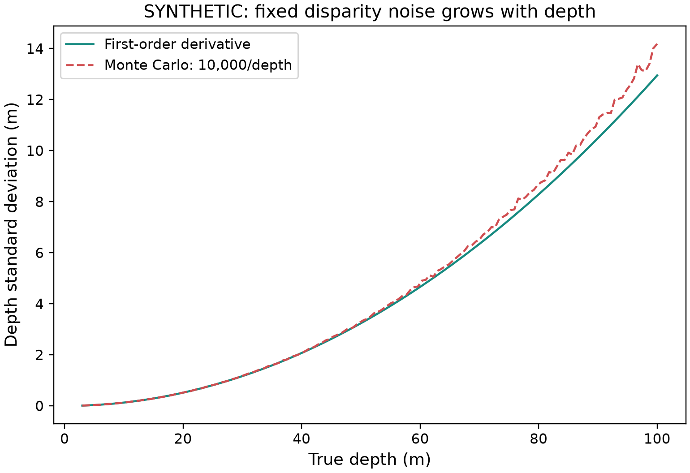

**그림 C4-01. 원거리 깊이의 비선형 불확실성 (합성 교육 모델).** 합성 disparity Gaussian sigma=0.5px. 원거리에서 비선형 변환 때문에 1차 근사와 Monte Carlo가 달라진다. KITTI 오차 추정이 아니다.

원본: `artifacts/synthetic/uncertainty.npz` (카메라 연구 디렉터리 기준; data/는 저장소 기준).

<a id="c4-3"></a>

### 3. 실제 보정값과 하나의 대응을 끝까지 계산하기

이미 정류된 P0=[K|0], P1=[K|(-fx*b,0,0)]를 읽는다. raw distortion을 추정하거나 raw 영상을 정류하지 않았다.
b=386.1448/718.856=0.5371657188644179m. 이상적인 같은 행 대응에서는 d=fx*b/Z, 즉 Z=fx*b/d.
실제 예제는 frame0의 candidate323: left=(956,161), right=(936,160), d=20px, dy=1px.
이상적 동일 행 모델 깊이는 19.30724m, 실제 OpenCV DLT 3D는
(9.368194026011457,-0.6638089660386813,19.306872628031506)m이다.
서로 다른 y 관측 때문에 DLT와 간단 공식의 마지막 자릿수가 다르며, 최대 양안 재투영 잔차는 0.5000097548414209px이다.
연습: disparity가 두 배이면 이상적 깊이는? 답: 절반 9.65362m. 코드 검증값은 `worked_examples/summary.json`.

Z=fx*b/d에서 abs(dZ/dd)=fx*b/d^2=Z^2/(fx*b). 따라서 sigma_Z≈Z^2*sigma_d/(fx*b).
candidate323과 d=20px, 가정 sigma_d=0.5px이면 sigma_Z=0.482681m.
실제 ORB의 정수/피라미드 양자화, 대응 오답, calibration 오차는 이 Gaussian 모델에 포함되지 않는다.
순수 회전에서 t 방향은 물리적으로 정의되지 않는다. E accepted flag는 observability 판정이 아니다.

<a id="c4-4"></a>

### 4. ORB 기술자의 선택과 정류 게이트

ORB는 Oriented FAST and Rotated BRIEF의 약자다. FAST는 밝기 비교로 코너 후보를 찾고,
BRIEF는 patch 내 픽셀쌍 밝기 비교를 binary descriptor로 만든다. ORB는 방향 정규화 등을 결합한다.
이 실험은 OpenCV ORB의 실제 keypoint/descriptor 출력만 사용하며 내부 FAST/Harris/BRIEF 배열을 재현했다고 주장하지 않는다.
Hamming 거리는 XOR에서 서로 다른 bit의 수. candidate323의 최근접=32bit, 차근접=47bit,
ratio=32/47=0.6808510638297872<0.75이고 Hamming<=64, abs(dy)<=1.5, d>1을 통과한다.
ratio는 모호성, Hamming은 절대 descriptor 차이, y는 정류 기하를 검사하는 서로 다른 조건이다.
cross-check는 서로가 서로의 최근접인 쌍이다. ratio의 동의어가 아니며 이번에는 더 많은 쌍을 남기지만 y 일관성 비율은 낮다.
연습: y gate를 통과한 쌍의 y 합격률이 100%라면 정확도인가? 답: 아니다. 같은 조건의 자기검사다.

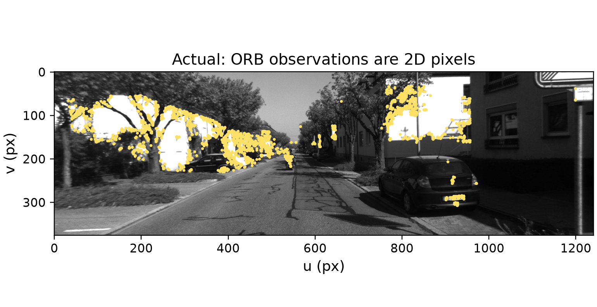

**그림 C4-02. 스테레오 ORB 관측의 공간 분포 (실제 KITTI 00).** ORB는 2D 픽셀 관측이다. 특징점만으로 3D 지도나 ORB-SLAM이 되지 않는다.

원본: `artifacts/stereo/000000.npz` (카메라 연구 디렉터리 기준; data/는 저장소 기준).


**그림 C4-03. 최근접과 차근접 기술자의 거리 비율 (실제 KITTI 00).** 이진 descriptor의 최근접/차근접 거리 비율. 실제 선택 조건은 d1 < 0.75*d2이며 d2=0은 거부된다.

원본: `artifacts/stereo/000000.npz` (카메라 연구 디렉터리 기준; data/는 저장소 기준).

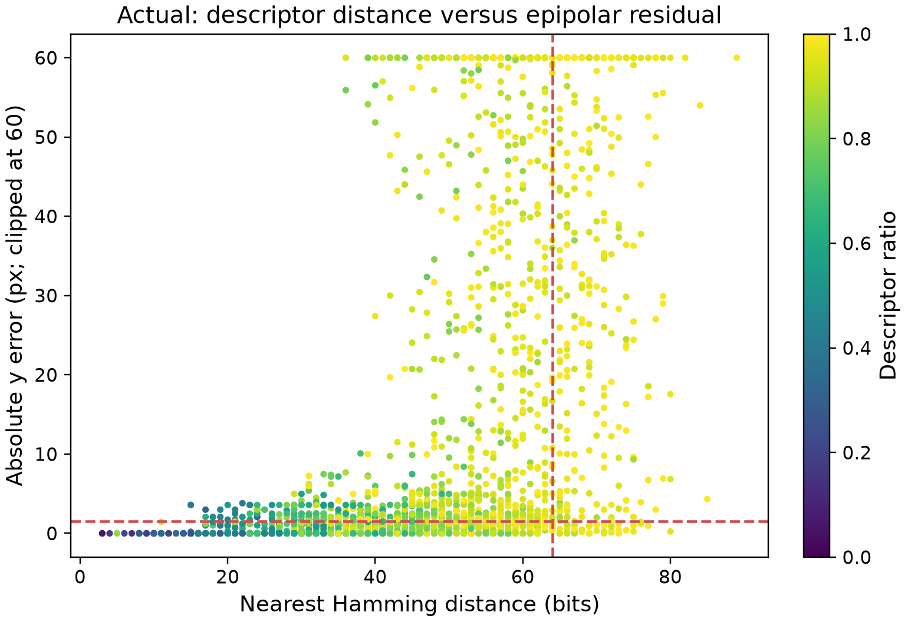

**그림 C4-04. 기술자 유사도와 기하 일관성은 다르다 (실제 KITTI 00).** 작은 descriptor 거리도 기하 일관성을 보장하지 않는다. 60px 이상의 y 오차는 시각화에서만 잘랐다.

원본: `artifacts/stereo/000000.npz` (카메라 연구 디렉터리 기준; data/는 저장소 기준).

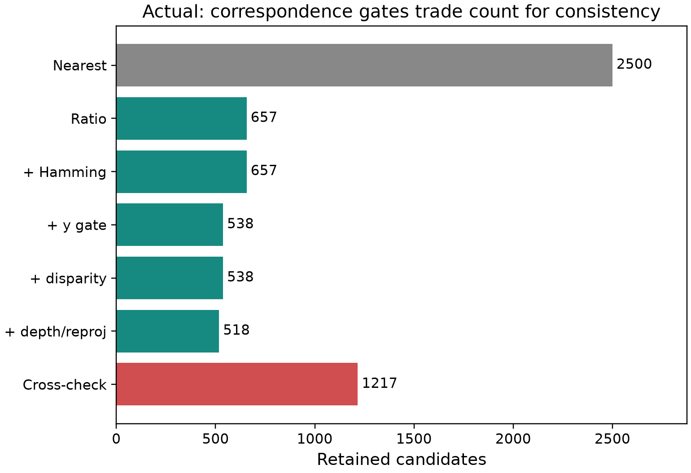

**그림 C4-05. 누적 게이트의 선택 효과 (실제 KITTI 00).** 동일 후보에 적용한 누적 게이트. 이 프레임에서는 Hamming 게이트의 추가 제거가 없으므로 개선을 주장하지 않는다.

원본: `artifacts/stereo/000000.npz`, `artifacts/stereo/000000_ablation.csv` (카메라 연구 디렉터리 기준; data/는 저장소 기준).

<a id="c4-5"></a>

### 5. 깊이 배열은 지도 후보이며 정답 표면이 아니다

선택된 대응의 disparity와 깊이를 함께 보면, 영상에서 비슷한 위치의 점도 서로 다른 깊이에 있을 수 있음을 확인한다. 다음 공간 그림은 단일 프레임 좌표의 희소 3D이며 여러 시점에 걸쳐 관리하는 지도는 아니다. 깊이 GT가 없으므로 작은 재투영 잔차를 깊이 정확도로 바꾸어 부르지 않는다.

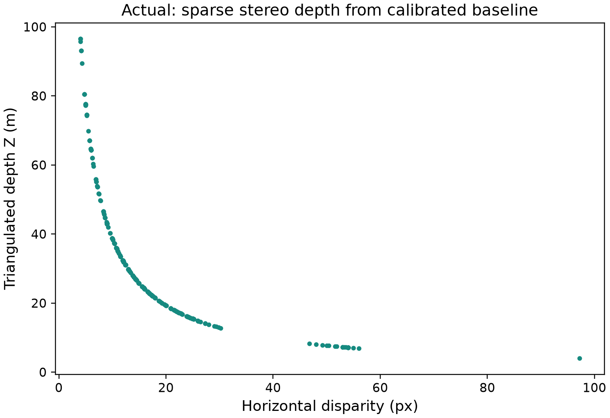

**그림 C4-06. 시차에서 깊이로 바뀌는 관측 (실제 KITTI 00).** Z=fx*b/d. 깊이는 정답 오차가 아니라 알려진 baseline으로부터 얻은 추정값이다.

원본: `artifacts/stereo/000000.npz` (카메라 연구 디렉터리 기준; data/는 저장소 기준).


**그림 C4-07. 단일 프레임 희소 3D의 공간 구조 (실제 KITTI 00).** 카메라 좌표는 x 오른쪽, y 아래, z 전방. 먼 점의 깊이는 disparity 오차에 민감하다.

원본: `artifacts/stereo/000000.npz` (카메라 연구 디렉터리 기준; data/는 저장소 기준).

<a id="c4-6"></a>

### 6. SGBM: 조밀한 대응과 유효성의 별도 계약

SGBM은 Semi-Global Block Matching 계열 OpenCV 구현이다. 픽셀/블록 대응 비용과 disparity 변화 벌점을 여러 경로에서 결합한다.
교육적 목적 함수는 sum C(p,d_p)+P1*[이웃 disparity 차이=1]+P2*[차이>1] 형태지만,
이 실험은 OpenCV 내부 경로별 비용 배열을 추출하지 않았다. 저장된 raw는 실제 최종 fixed-point disparity다.
OpenCV disparity 정수 출력은 16으로 나누어 px로 변환한다. P1=8*5^2=200, P2=32*5^2=800,
disparities=128, block=5, uniqueness=10. 비용 벌점과 보정 projection P1은 이름만 같고 다른 기호다.
우측 매칭은 음수 disparity convention이라 LR residual=abs(dL+dR(uL-dL))이다.
영상 밖, 무효 우측 disparity, LR>1px, Z>100m를 제외한다. 무텍스처/가림/반사면 깊이는 여전히 틀릴 수 있다.

SGBM의 P1/P2는 시차가 이웃에서 급변하는 것을 벌점으로 억제한다. 평탄하게 보이는 깊이가 경계의 얇은 구조를 보존했다는 뜻은 아니다. 여러 방향의 경로 정보를 결합해도 가림 영역에는 동일 표면의 짝이 없으므로 무효 상태를 유지해야 한다. 이 수업은 라이브러리의 최종 출력과 좌우 일관성 마스크를 저장했으며 경로별 내부 비용을 재구현하지 않았다. [OpenCV StereoSGBM 공식 계약](https://docs.opencv.org/4.x/d2/d85/classcv_1_1StereoSGBM.html)

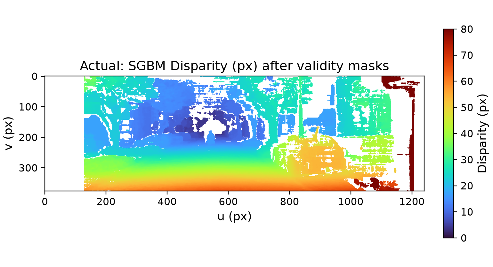

**그림 C4-08. SGBM의 조밀 시차 (실제 KITTI 00).** SGBM 고정소수점 출력을 16으로 나눈 뒤 양의 disparity, LR, 깊이 상한을 적용. 흰 영역은 무효, 색 상한은 표시만 제한한다.

원본: `artifacts/dense/000000.npz` (카메라 연구 디렉터리 기준; data/는 저장소 기준).

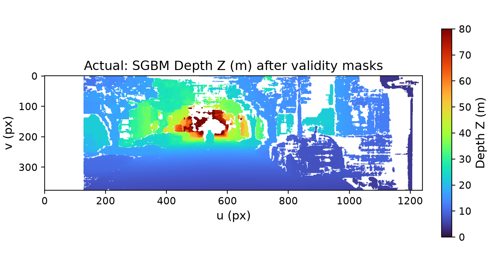

**그림 C4-09. SGBM의 미터 깊이와 무효 영역 (실제 KITTI 00).** SGBM 고정소수점 출력을 16으로 나눈 뒤 양의 disparity, LR, 깊이 상한을 적용. 흰 영역은 무효, 색 상한은 표시만 제한한다.

원본: `artifacts/dense/000000.npz` (카메라 연구 디렉터리 기준; data/는 저장소 기준).


**그림 C4-10. 깊이 유효성 검사의 단계별 분모 (실제 KITTI 00).** 모든 픽셀을 분모로 한 단계별 유효성. 좌우 검증이 텍스처 부재·반복 무늬의 오답을 모두 제거하지는 않는다.

원본: `artifacts/dense/000000.npz` (카메라 연구 디렉터리 기준; data/는 저장소 기준).


**그림 C4-11. 좌우 시차의 일관성 잔차 (실제 KITTI 00).** 우측 disparity는 음수 convention. 영상 밖 대응도 원래 배열에 보존되며 최종 mask에서 제거된다.

원본: `artifacts/dense/000000.npz` (카메라 연구 디렉터리 기준; data/는 저장소 기준).

<a id="c4-7"></a>

### 7. 연습문제와 해설

#### 문제 6. 주점이 다른 스테레오

문제: `f=600px, B=0.3m, cx_L=320px, cx_R=310px`, 관측 시차는 40px다.
깊이와 주점 차이를 무시한 잘못된 깊이를 구하라.
해설: 유효 시차는 `40-10=30px`, 깊이는 `180/30=6m`다.
잘못된 값은 `180/40=4.5m`다.
오차는 -1.5m, 실제값 대비 -25%다.
핵심: 정렬되었다고 좌우 주점까지 반드시 같지는 않다.


<a id="c5"></a>

## C5. LK와 PnP: 시간 대응을 미터 자세로 바꾸기

**심화 연결:** [D12](#d12)는 밝기 선형화·피라미드·가림·추적 실패를, [D16](#d16)은 PnP의 조건부 지도 가정과 공동 BA의 차이를 다룬다. 미분 부호는 [D6](#d6)에서 검산한다.

스테레오가 준 이전 프레임의 3D 점에 다음 프레임의 픽셀을 연결한다. LK는 2D 추적을, PnP는 3D–2D 자세 추정을 맡는다. 밝기 잔차·왕복 잔차·재투영 잔차는 각각 다른 검사를 하므로 한 숫자로 합치지 않는다.

<a id="c5-1"></a>

### 1. LK: descriptor 검색 대신 밝기 패치의 이동 찾기

LK는 Lucas-Kanade이며 Bruce D. Lucas와 Takeo Kanade의 이름을 딴 영상 정합 방법이다.
1981년 원문은 밝기 기울기를 이용한 반복 정합을 제시한다. [IJCAI 원문 및 서지](https://ijcai.org/proceedings/1981/127)
KLT는 Kanade-Lucas-Tomasi라는 추적 계열 명칭이며 모든 LK 호출을 별도 KLT 시스템 전체와 동일시하지 않는다.
아래는 원 논문의 문장 번역이 아니라 평행 이동 패치를 위한 자체 유도다.

첫 영상 I의 패치와 둘째 영상 J에서 같은 밝기 패턴을 찾는다고 하자.
점 좌표 `x=(u,v)`, 패치 공통 이동 `d=(du,dv)`를 두고 `r_i(d)=J(x_i+d)-I(x_i)`다.
목적함수는 `E(d)=sum_i r_i(d)^2`이며 SSD, Sum of Squared Differences, 차이 제곱합이라 부른다.
밝기값 단위를 DN, Digital Number, 디지털 수치 단위로 적으면 잔차는 DN, 비용은 DN²다.
미지수 d는 미터가 아닌 픽셀 이동이다.
일정 시간 간격으로 나눈 optical flow 속도와 프레임 간 변위도 구분한다.

현재 추정 d에서 작은 갱신 delta를 주면 `J(x+d+delta)≈J(x+d)+grad(J)^T delta`다.
따라서 `r(d+delta)≈r(d)+A delta`이며 A의 i번째 행은 `(J_u,J_v)`다.
제곱합을 delta로 미분하면 `2 A^T(r+A delta)=0`이다.
그러므로 `(A^T A)delta=-A^T r`를 풀고 `d←d+delta`로 갱신한다.
반복 중 기울기와 워핑을 어디서 계산하는지에 따라 변형이 달라진다.
Inverse compositional, 역합성 방식과 forward additive, 전방 가산 방식은 같은 식의 이름만 바꾼 것이 아니다. [Baker·Matthews, 2004](https://publications.ri.cmu.edu/lucas-kanade-20-years-on-a-unifying-framework)

<a id="c5-2"></a>

### 2. 작은 LK 문제를 끝까지 풀기

[교육 예제 N20] 세 관측의 기울기 행렬과 음의 밝기 잔차를 아래처럼 두자.

```text
A = [1 0]    b = -r = [ 2]
    [0 1]             [-1]
    [1 1]             [ 1]
A^T A = [2 1]
        [1 2]
A^T b = [3,0]^T
```

둘째 성분은 `0*2+1*(-1)+1*1=0`이다.
2x2 역행렬은 `(1/3)[[2,-1],[-1,2]]`다.
따라서 `delta=(2,-1)px`이고 `A delta=(2,-1,1)=b`여서 선형 잔차는 0이다.
이 결과는 실제 영상에서 한 번에 정확히 수렴한다는 주장이 아니라 주어진 선형 문제의 해다.
픽셀 기울기의 실제 단위는 DN/px이므로 곱 `A delta`가 DN이 되는 것도 확인한다.

<a id="c5-3"></a>

### 3. Aperture problem과 추적할 점의 조건

구조 텐서 `G=A^T A`는 패치의 기울기가 어느 방향으로 분포하는지를 나타낸다.
모든 기울기가 `(1,0)`이면 `G=[[N,0],[0,0]]`다.
수직 이동 dv에 대한 비용 변화가 없어 그 성분을 구할 수 없다.
이것이 aperture problem, 작은 관찰 창에서 이동의 한 성분을 구분하지 못하는 문제의 한 형태다.
평탄 패치에서는 두 고윳값이 모두 작아 두 방향이 모두 불확실하다.
서로 다른 방향의 기울기가 있으면 두 고윳값이 커져 국소 이동 추정에 유리하다. [LK 공식 튜토리얼](https://docs.opencv.org/4.13.0/d4/dee/tutorial_optical_flow.html)

[교육 예제 N21] `G=[[2,1],[1,2]]`의 고윳값은 3과 1이다.
N20은 두 방향 모두 제약되지만 감도는 완전히 같지 않다.
`G=[[3,0],[0,0]]`이면 고윳값은 3과 0이므로 역행렬이 없다.
인위적으로 작은 정규화 항을 더해 역행렬을 만들더라도 원래 관측에 없던 수직 정보를 측정한 것은 아니다.

<a id="c5-4"></a>

### 4. 피라미드와 추적 실패 검사

피라미드 LK는 작은 이동 근사를 여러 영상 해상도에서 적용하여 큰 이동을 다룬다. [OpenCV LK 튜토리얼](https://docs.opencv.org/4.13.0/d4/dee/tutorial_optical_flow.html)

한 레벨마다 영상 크기를 절반으로 줄인다면 원본 이동 d는 레벨 l에서 `d_l=d/2^l`이다.
거친 레벨에서 얻은 이동을 다음 세밀한 레벨로 전달할 때는 두 배로 한다.
원본 좌표와 레벨 좌표의 패치 크기를 구분하지 않으면 서로 다른 물리 영역을 비교하게 된다.
피라미드는 큰 이동을 작게 표현하지만 가림·반복 무늬·시간에 따른 밝기 변화까지 해결하지 않는다.

[교육 예제 N22] 원본 이동 24px는 레벨 3에서 `24/8=3px`다.
레벨 3의 7px 폭 패치는 원본에서 대략 56px 폭의 범위에 대응한다.
정확한 보간 지지 영역은 필터와 경계 처리에 따라 달라지므로 이 56px를 라이브러리 내부 커널의 정확한 크기라고 부르지 않는다.
그림에는 같은 좌표 축의 전체 영상과 동일 원본 영역의 확대를 함께 제시한다.

Forward-backward, 정방향-역방향 검사는 I→J로 추적한 위치를 J→I로 다시 추적해 시작점과의 거리를 본다.
작은 왕복 오차가 대응의 충분조건은 아니며 반복 무늬에서 왕복으로 같은 오답에 갈 수 있다.
큰 밝기 잔차·영상 경계·상태 플래그·공간 분포·기하 잔차를 별도로 보아야 한다.
LK 출력은 2D 대응이므로 그 자체가 3D 지도나 카메라 pose는 아니다.

<a id="c5-5"></a>

### 5. 실제 LK 입력과 실패 상태

LK는 Lucas-Kanade 광류. I_previous(p)≈I_current(p+delta)를 국소 선형화해
공간 밝기 gradient로 delta를 추정한다. pyramid는 큰 움직임의 국소 선형화 범위를 줄여 준다.
이 실험의 winSize=21, maxLevel=3, 최대 30회/epsilon0.01은 고정 설정이다.
FB는 norm(p_back-p_previous)<=1px. 순방향 status, 현재 영상 bounds, 역방향 status를 함께 검사한다.
단일 에지는 aperture ambiguity가 있고, 반복 무늬의 잘못된 대응도 왕복 일관성을 가질 수 있다.
status=0인 LK error는 OpenCV 계약상 미정의다. 이를 NaN으로 바꾸고 invalid 좌표/FB를 명시적으로 표시한다.
연습: FB=0이므로 true correspondence인가? 답: 아니며 GT flow 없이는 정답률을 측정할 수 없다.

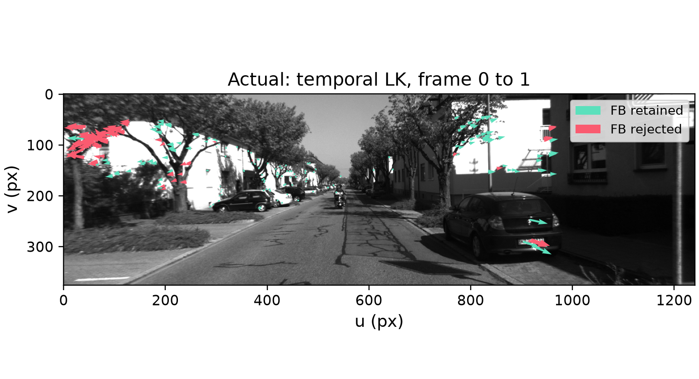

**그림 C5-01. 시간 LK의 픽셀 이동 벡터 (실제 KITTI 00).** 원래 픽셀 길이의 흐름 벡터. 표시 개수만 줄였으며 전후방 mask는 전체 관측에 적용한다.

원본: `artifacts/tracking/000000.npz` (카메라 연구 디렉터리 기준; data/는 저장소 기준).

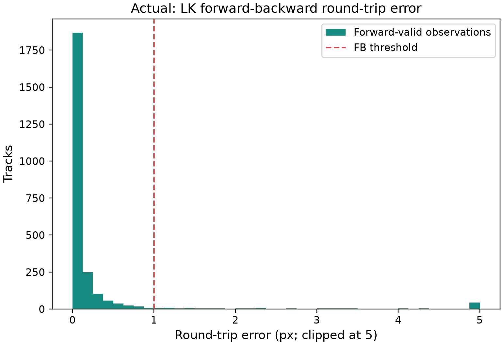

**그림 C5-02. 왕복 추적 오차의 분포 (실제 KITTI 00).** 전후방 추적은 자기 일관성 검사이며 flow GT 정확도가 아니다. 잘못된 반복 무늬도 통과할 수 있다.

원본: `artifacts/tracking/000000.npz` (카메라 연구 디렉터리 기준; data/는 저장소 기준).

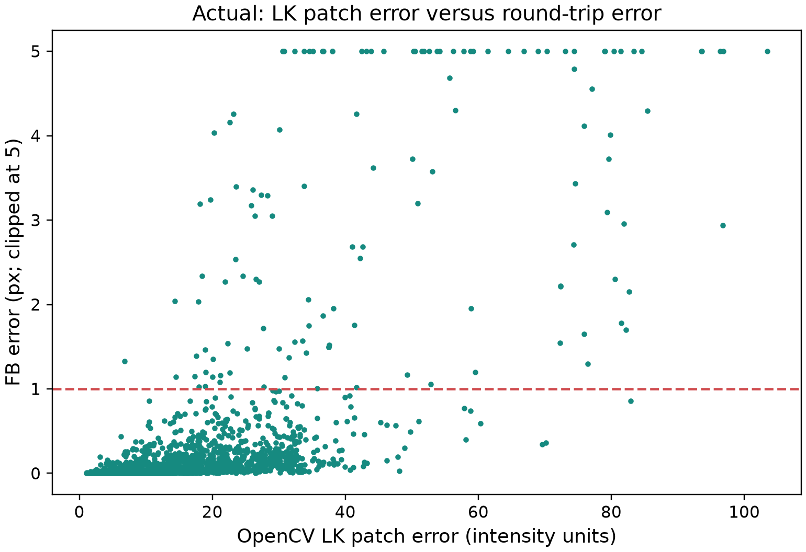

**그림 C5-03. 밝기 잔차와 왕복 잔차의 차이 (실제 KITTI 00).** LK patch 밝기 잔차와 기하적 왕복 잔차는 서로 다른 기준이다.

원본: `artifacts/tracking/000000.npz` (카메라 연구 디렉터리 기준; data/는 저장소 기준).

<a id="c5-6"></a>

### 6. PnP: 이미 아는 3D 지도에서 카메라 자세 구하기

PnP는 Perspective-n-Point, n개의 3D-2D 대응에 대한 원근 자세 추정 문제다.
EPnP의 E는 Efficient를 뜻하며 본질행렬 E와 관계없는 이름이다.
Lepetit·Moreno-Noguer·Fua의 EPnP는 제어점 표현으로 계산량이 점 수에 선형으로 증가하도록 구성한다. [2009년 기관 서지](https://infoscience.epfl.ch/entities/publication/34721c4a-90c2-421c-9df6-15a96127a4a2), [저자 원문](https://vincentlepetit.github.io/files/papers/comp_lepetit_ijcv08.pdf)

2D-2D 상대 기하는 두 광선 사이의 제약을 풀지만 PnP는 3D 점 좌표가 이미 알려져 있다.
따라서 입력 점의 척도가 미터이면 출력 병진도 미터다.
단안으로 만든 임의 척도 지도를 넣으면 PnP가 새로운 미터 척도를 만들어 주지 않는다.
P3P는 Perspective-Three-Point이며 세 3D 점과 광선으로 여러 pose 후보가 생길 수 있는 최소 문제다.
라이브러리 함수가 추가 점을 요구하는지, 어떤 solver를 호출하는지, 여러 해를 반환하는지 구분한다. [OpenCV PnP solver 계약](https://docs.opencv.org/4.13.0/d5/d1f/calib3d_solvePnP.html)

정련 목적함수는 `sum_i ||p_i-pi(K(R X_i+t))||^2`이다.
원시 픽셀을 입력하면 왜곡 모델을 포함하고, 왜곡 제거된 픽셀을 넣으면 왜곡을 다시 적용하지 않는다.
오대응이 있으면 PnP도 강건 추정이 필요하며, 기존 3D 점의 깊이 불확실성도 무시하기 어렵다.
“2D 재투영 오차가 작다”와 “지도 좌표가 정확하다”는 같은 진술이 아니다.
평면 점에서도 가능한 solver가 있지만 유한 잡음에서의 자세 모호성과 배치 조건을 확인해야 한다.

<a id="c5-7"></a>

### 7. PnP의 미분을 카메라 모델에서 연결하기

skew와 왜곡이 없을 때 `u=fx X/Z+cx`, `v=fy Y/Z+cy`다.
카메라 점에 대한 2x3 미분행렬은 다음과 같다.

```text
J_pi = [fx/Z    0   -fx*X/Z^2]
       [   0 fy/Z   -fy*Y/Z^2]
```

이는 Jacobian, 여러 출력의 여러 입력에 대한 1차 변화율 행렬이다.
미터 점 좌표에 대한 각 원소 단위는 px/m다.
작은 왼쪽 pose 갱신을 `[delta_t,delta_theta]` 순서로 정의하면 `delta_X≈delta_t-[X]_x delta_theta`다.
delta_theta는 rad의 작은 회전 벡터이고 `[X]_x`는 외적 행렬이다.
예측 픽셀의 pose Jacobian은 `J_pi [I | -[X]_x]`다.
잔차를 `관측-예측`으로 정의하면 부호가 반대다.
오른쪽 갱신이나 반대 변환 방향을 쓰면 같은 식을 무조건 재사용하지 않는다. [영상 정합 선형화의 관련 틀](https://publications.ri.cmu.edu/lucas-kanade-20-years-on-a-unifying-framework)

[교육 예제 N18] `X_C=(1,0.5,5)m`, `fx=fy=500px`이면 `J_pi=[[100,0,-20],[0,100,-10]]`이다.
카메라 좌표 점의 `delta_X=0.01m` 변화는 u를 1px 증가시킨다.
Z만 0.01m 증가시키면 선형 예측은 `delta_u=-0.2px`, `delta_v=-0.1px`다.
정확한 u 변화는 `500/5.01-500/5≈-0.199600798px`다.
정확한 v 변화는 `250/5.01-250/5≈-0.099800399px`다.
근사의 오차가 작은 이유는 변화가 깊이에 비해 작기 때문이며 큰 변화에도 같은 정확도를 약속하지 않는다.

<a id="c5-8"></a>

### 8. 스테레오→지도→PnP의 자료 흐름

같은 시각의 왼쪽·오른쪽 대응으로 왼쪽 카메라 좌표의 3D 점을 만든다.
그 점의 좌표, 생성 프레임, 시차, 재투영 오차, 유효 마스크를 함께 보존한다.
다음 왼쪽 영상에서 같은 점의 관측을 찾으면 3D-2D PnP 입력이 된다.
출력 `T_Cnext_Cprev`는 이전 좌표 점을 다음 좌표로 보내므로 세계 카메라 pose 누적에는 역변환이 필요하다.
이 연결은 이번 독립 연구에서 실제 실행했다. 지속 랜드마크 지도 없이 이전 프레임의 점만 사용하는 VO이며 운영 경로에 통합하지 않았다.

[교육 예제 N19] N8의 두 번째 카메라 pose를 PnP가 `R=I,t=(-1,0,0)m`로 반환했다고 하자.
카메라 중심은 `C=-R^T t=(1,0,0)m`이다.
이미 알려진 점 `(2,1,5)m`의 다음 관측은 `(420,340)px`로 N8과 일치한다.
입력 지도의 모든 길이를 두 배로 바꾸면 같은 픽셀을 설명하는 t도 `(-2,0,0)`이 된다.
이것이 PnP의 척도가 입력 지도에서 전달된다는 직접 검산이다.

<a id="c5-9"></a>

### 9. 실제 자세 추정과 누적 방향

정규화 bearing x=K^-1*[u,v,1]에 대해 x_current^T E x_previous=0, E=[t]_x R이다.
E를 상수배해도 같은 제약이므로 t의 크기를 얻지 못한다. recoverPose의 단위 t를 frame마다 누적하는 것이 mono_unit이다.
PnP(Perspective-n-Point)는 이전 frame의 metric X_i와 현재 pixel p_i에서
sum ||pi(K*(R*X_i+t))-p_i||^2를 최소화한다. RANSAC이 outlier를 거르고 LM이 고정 inlier의 자세만 보정한다.
스테레오 baseline에서 metric이 전달되며 GT 이동량은 절대 사용하지 않는다.
이전 X를 현재로 옮기는 T_current_previous를 누적 자세에 그대로 곱하면 방향이 틀린다.
T_start_current=T_start_previous*inverse(T_current_previous). frame0→1 t_z=-0.67222211은
카메라 전진과 양립하며, 카메라 위치는 역변환의 -R^T*t로 계산해야 한다.
연습: t의 부호만 바꾸면 inverse인가? 답: 일반적으로 아니고 회전 전치가 필요하다.


**그림 C5-04. 고정 3D에서 자세만 정련한 결과 (실제 KITTI 00).** 3D점을 고정하고 자세만 LM 최적화한다. 같은 inlier의 재투영 개선이며 joint BA나 일반화 평가가 아니다. 이 그림의 RMSE는 관측별 2D 잔차 norm의 제곱평균 제곱근이다. C6 합성 표의 u/v scalar RMSE와 분모가 다르다.

원본: `artifacts/reprojection/000000.npz` (카메라 연구 디렉터리 기준; data/는 저장소 기준).

<a id="c5-10"></a>

### 10. 연습문제와 해설

#### 문제 7. PnP와 카메라 중심

문제: `R=I`, 세계→카메라 병진 `t=(0,0,-2)m`를 얻었다.
카메라 중심과 세계 점 `(1,0,7)m`의 카메라 좌표를 구하라.
해설: `C=-R^T t=(0,0,2)m`, 카메라 점은 `(1,0,5)m`다.
`f=500px`, 주점이 `(320,240)px`라면 관측은 `(420,240)px`다.
핵심: t의 z가 -2라고 카메라 중심을 -2m로 그리면 변환 방향을 뒤집은 것이다.


#### 문제 8. LK의 관측 가능성

문제: `A=[[2,0],[1,0],[3,0]]`, `b=[4,2,6]^T`에서 이동을 구하라.
해설: 가로 이동은 du=2px로 일치하지만 dv는 어느 값이어도 식에 영향을 주지 않는다.
`G=A^T A=[[14,0],[0,0]]`이므로 역행렬이 없다.
해가 `(2,0)`이라고만 답하면 “수직 이동을 0으로 선택함”과 “수직 이동을 관측함”을 혼동한다.
핵심: 작은 잔차가 모든 자유도를 관측했다는 증거가 아니다.


<a id="c6"></a>

## C6. 키프레임과 공동 BA: 관측을 남기고 자세와 점을 함께 고치기

**심화 연결:** [D6 미분과 최적화](#d6), [D8 확률적 주변화](#d8-11), [D16 결합 Schur 수치해](#d16-8)를 연결한다. 같은 소거식이라도 일회성 선형해와 오래 유지하는 prior의 수명이 다르다.

프레임별 VO를 장기 SLAM으로 바꾸려면 상태의 수명주기와 관측 연결을 관리해야 한다. 앞 장의 실제 pose-only LM은 점을 고정한다. 여기서는 자세와 점이 함께 미지수인 Bundle Adjustment를 유도하고, 별도로 생성한 4-pose 스테레오 장면에서 공동 갱신을 확인한다. [Triggs 외, Bundle Adjustment - A Modern Synthesis, 2000](https://thoth.inrialpes.fr/people/triggs/pubs/Triggs-hdr-papers.pdf)

<a id="c6-1"></a>

### 1. 먼저 시스템을 상태·관측·결정으로 나눈다

질문은 "매칭이 몇 개 나왔는가?"가 아니라 "어떤 관측이 어떤 상태를 제약했는가?"다.
프레임은 시각 t의 영상과 보정값을 담는 입력 단위다.
키프레임은 이후에도 최적화와 재방문 검색에 사용하기 위해 남긴 프레임이다.
랜드마크는 여러 영상의 관측을 하나의 물리적 장면점으로 묶은 지도 상태다.
관측은 `(keyframe_id, landmark_id, pixel, uncertainty)`라는 연결이다.
동일한 2D 특징이 검출되었다고 곧바로 동일한 3D 점이라는 뜻은 아니다.
지도점 ID를 공유하게 만드는 data association이 잘못되면 BA도 잘못된 문제를 푼다.
이때 최적화 성공 메시지는 데이터 연결이 옳다는 증거가 아니다.

교육용 상태 흐름은 다음과 같다.

```text
영상 + 보정 + timestamp
  -> 기존 지도에 현재 pose 정합
  -> 추적 품질 판단
  -> 새 시점의 정보가 충분하면 키프레임 삽입
  -> 삼각측량 또는 깊이 역투영으로 지도점 후보 생성
  -> 다중 관측 검증 / 중복점 병합 / 불량점 제거
  -> 지역 BA
  -> 장소 후보 검색
  -> 기하 검증
  -> 루프 제약 또는 지도 병합
  -> 전역 보정 및 파생 지도 갱신
```

추적 실패와 지도 실패를 구분한다.
현재 프레임 추적 실패 후 기존 지도에서 재위치추정에 성공할 수 있다.
추적이 계속되더라도 잘못된 점 연결이 누적되어 지도가 왜곡될 수 있다.
새 지도를 만드는 것은 실패를 없앤 것이 아니라 불확실한 연속성을 끊은 것이다.
나중에 지도 병합을 하려면 두 지도의 대응과 상대 변환을 다시 검증해야 한다.

<a id="c6-2"></a>

### 2. 키프레임은 시간 간격이 아니라 정보와 계산량의 절충이다

매 프레임을 남기면 반복 관측이 많아지고 최적화 비용이 커진다.
너무 드물게 남기면 시점 사이 대응이 끊기고 새 영역을 삼각측량하기 어렵다.
교육용 판단 변수는 공통 지도점 수, 새로운 영역, 시차, 시간 간격, 추적 잔차와 mapper 처리 여유다.
이 변수들은 논문마다 결합 방식이 다르므로 보편적인 한 임계값을 제시하지 않는다.
시차는 카메라 사이 위치 차이 자체가 아니라 같은 점을 보는 광선 방향의 차이다.
먼 점은 같은 이동에서도 작은 시차를 보인다.
회전만으로 픽셀이 많이 움직여도 깊이를 위한 기하적 baseline이 생기지 않을 수 있다.
따라서 픽셀 이동량을 그대로 삼각측량 가능성으로 해석하지 않는다.

수업용 예로 깊이 5 m인 점과 baseline 0.1 m를 생각한다.
작은 각도 근사에서 시차는 약 `0.1/5 = 0.02 rad`다.
같은 baseline에서 깊이 50 m이면 약 `0.002 rad`다.
이는 특정 카메라의 검출 기준이 아니라 baseline/depth 비율의 설명이다.
새 키프레임 선택에서 멀리 있는 점만 많이 보존하면 가까운 구조의 관측이 부족해질 수 있다.
반대로 가까운 점만 택하면 급격한 시점 변화에서 가림이 커질 수 있다.

예상 중간 산출물 `keyframe_decisions`의 한 행에는 다음이 필요하다.
- frame ID, timestamp[s], 후보 키프레임 ID.
- 공통점 수와 전체 후보점 수, 영상 내 분포.
- 회전 보정 전/후 시차 요약, 깊이 범위와 단위.
- 삽입 또는 거절 사유, 당시 mapper 대기열 길이.
- 추적 성공·실패와 새 지도 생성 여부.

후속 키프레임 실습의 출력은 같은 구간의 모든 프레임 위치를 회색, 선택 키프레임을 색으로 표시한다.
그림 아래에는 시차와 추적점 수의 시계열을 같은 시간축으로 놓는다.
촘촘한 키프레임 구간이 어려운 운동 때문인지 정책 오류 때문인지 설명해야 한다.
실제 키프레임 선택 실험과 그 시계열 그림은 미수행이다.

<a id="c6-3"></a>

### 3. 랜드마크의 수명주기

생성 직후 점은 충분히 검증된 고정 진실이 아니다.
처음에는 두 시점 삼각측량이나 한 시점 깊이 센서 측정으로 후보를 얻는다.
양의 깊이 조건, 재투영 잔차, 시차와 관측 가시성을 검사한다.
새 관측이 들어오면 위치·대표 descriptor·관측 목록을 갱신할 수 있다.
점이 예측상 보이는 상황에서 반복해서 매칭되지 않으면 잘못된 점일 가능성이 있다.
하지만 실제 가림이나 조명 변화도 있기 때문에 한 번의 실패로 단정하면 안 된다.
오래된 점의 삭제와 키프레임 삭제는 서로 다른 연산이다.
키프레임이 삭제되어도 다른 관측이 남으면 점은 유지할 수 있다.
점이 삭제되면 그 점을 참조하는 관측과 그래프 통계도 함께 정리해야 한다.
중복점을 병합할 때에는 모든 관측이 실제로 같은 물체의 같은 점인지 검증한다.
ID만 합치고 충돌하는 관측을 남기면 같은 프레임에서 같은 점이 두 픽셀에 나타나는 모순이 생긴다.

지도 유지 상태를 `candidate -> active -> weak -> removed`로 표현하는 것은 교육용 추상화다.
원 논문·라이브러리가 반드시 이 네 enum을 사용하는 것은 아니다.
상태 전이의 근거를 기록해야 지도점 수 감소가 품질 개선인지 추적 붕괴인지 해석할 수 있다.
관측 횟수만 많아도 동일 위치에서 찍은 거의 같은 영상이면 깊이 정보는 약할 수 있다.
관측 횟수와 관측 기하를 함께 본다.

<a id="c6-4"></a>

### 4. 그래프는 하나가 아니다

공동가시성 그래프의 노드는 키프레임이고 연결은 공유 지도점 관계를 나타낸다.
공유점 수는 이웃 선택에 도움이 되지만 센서 오차 공분산 그 자체는 아니다.
spanning tree는 연결성을 보존하는 뼈대로 사용할 수 있다.
pose graph의 edge는 두 pose 사이 상대 변환과 그 신뢰도를 나타낸다.
BA factor graph에는 pose뿐 아니라 지도점 변수와 각 재투영 관측이 있다.
장소 검색 데이터베이스는 외형 유사도를 위한 색인이다.
이 네 구조를 한 그림에서 같은 종류의 edge로 그리면 의미를 오해하기 쉽다.
권장 그림은 공동가시성 선, 측정 factor, 검색 후보 화살표를 다른 선 종류로 구별한다.

<a id="c6-5"></a>

### 5. BA의 입출력 계약부터 고정한다

BA는 Bundle Adjustment, 여러 카메라에서 나오는 관측 광선 묶음의 일관성을 조정하는 문제다.
이 절에서는 보정된 pinhole 카메라, 정적 점, 알려진 내부행렬 K를 가정한다.
왜곡이 남으면 아래 Jacobian 뒤에 왜곡 함수의 미분을 합성해야 한다.
세계점 `P_j^W`는 3차원 열벡터다.
`T_i = T_CiW = (R_i,t_i)`는 세계 좌표를 i번 카메라 좌표로 보낸다.
`p_ij = R_i P_j^W + t_i = (X,Y,Z)^T`다.
`z_ij = (u_obs,v_obs)^T`는 관측 픽셀이다.
잔차 부호는 일관되게 `r_ij = pi(p_ij) - z_ij`로 둔다.
이것은 예측 빼기 관측이며 반대 정의를 쓰는 코드의 Jacobian과 섞지 않는다.
미터 축척이 알려진 예제에서 X,Y,Z,t,P의 단위는 m다.
순수 단안 초기 지도라면 같은 식의 길이 단위는 임의 지도 단위다.
초점거리와 주점, u,v의 단위는 px다.

```text
pi(X,Y,Z) = [fx X/Z + cx, fy Y/Z + cy]^T
E = 1/2 sum_(i,j observed) rho(r_ij^T Sigma_ij^(-1) r_ij)
Sigma_ij : 2x2 pixel covariance [px^2]
s_ij = r_ij^T Sigma_ij^(-1) r_ij : dimensionless
```

관측되지 않은 `(i,j)` 조합에는 잔차를 만들지 않는다.
N개의 카메라와 M개의 점이 있다고 N*M개의 대응이 자동으로 생기는 것이 아니다.
픽셀 covariance의 비대각항은 두 픽셀 성분 오차의 상관을 뜻한다.
단순히 각 축 표준편차를 같은 값으로 두는 것은 모델 가정이다.
강건 손실을 쓴다고 잘못된 관측 노이즈 모델이 사라지는 것은 아니다.

<a id="c6-6"></a>

### 6. 재투영 Jacobian을 단계별로 유도한다

먼저 3D 점을 픽셀로 보내는 미분을 구한다.
분모 Z를 미분하면 `d(X/Z)/dZ = -X/Z^2`가 나온다.
따라서 다음 2x3 행렬을 얻는다.

```text
J_pi = [ fx/Z       0      -fx X/Z^2
           0     fy/Z      -fy Y/Z^2 ]
```

J_pi의 각 원소 단위는 px/m다.
pose 증분은 `delta_xi = (delta_rho, delta_phi)` 순서의 6차원 벡터로 둔다.
병진 증분 delta_rho의 단위는 m, 회전 증분 delta_phi는 rad다.
업데이트는 왼쪽 곱 `T_new = Exp(delta_xi^) T`로 고정한다.
작은 증분에 대해 `p_new ~= p + delta_rho + delta_phi cross p`다.
외적의 순서를 바꾸면 `delta_phi cross p = -[p]_x delta_phi`다.
여기서 `[p]_x q = p cross q`를 만족하는 3x3 반대칭행렬을 쓴다.
연쇄법칙으로 pose와 점 Jacobian은 다음과 같다.

```text
J_pose = J_pi [ I_3 | -[p]_x ]             # 2x6
J_point = J_pi R_i                         # 2x3
J_pose_translation : px/m
J_pose_rotation    : px/rad
J_point            : px/m
```

회전 성분을 rad로 구분하는 것은 구현상의 단위 실수를 잡기 위해서다.
수학적으로 rad는 무차원으로 취급할 수 있지만 degree 입력과 혼용하면 안 된다.
오른쪽 곱 업데이트는 증분 좌표계가 달라지므로 같은 J_pose를 그대로 쓸 수 없다.
카메라 pose를 `T_WC`로 저장하는 경우에도 역변환의 미분을 반영해야 한다.
내부 보정까지 추정한다면 fx,fy,cx,cy에 대한 추가 열이 필요하다.
예를 들어 `du/dfx = X/Z`, `du/dcx = 1`이다.

교육용 수치로 `p=(1,2,5)m`, `fx=fy=500px`를 넣는다.

```text
J_pi = [100,   0, -20
          0, 100, -40]
J_pose = [100,   0, -20,  -40, 520, -200
            0, 100, -40, -580,  40,  100]
```

`delta_rho_x=0.01m`만 주면 예측 픽셀은 u 방향으로 1px 증가한다.
`delta_phi_z=0.001rad`만 주면 1차 예측은 `(-0.2,+0.1)px`다.
이 예제에서는 z축 작은 회전이 `(X,Y)`를 `(-Y,X)` 방향으로 바꾸는 것도 직접 확인할 수 있다.
숫자가 작다고 유효한 관측인 것은 아니다. Z가 0에 가까우면 투영 자체가 불안정하다.
카메라 뒤의 점 `Z<=0`을 정상적인 재투영 관측으로 최적화하지 않는다.

후속 manifold 미분 검증에서는 analytic J와 manifold 중앙차분 J를 나란히 저장해야 한다.
중앙차분은 `r(Exp(+eps e_k^)T)`와 `r(Exp(-eps e_k^)T)`로 계산해야 한다.
회전행렬 원소 하나에 eps를 더하는 검사는 같은 미분이 아니다.
eps를 여러 크기로 바꾸며 절대/상대 오차를 본다.
위 식은 왼쪽 SE(3) 갱신의 손계산 유도다. 아래 합성 실험은 Rodrigues pose 미분과 점 미분을 중앙차분으로 검증하므로 매개화의 차이를 구분한다.

<a id="c6-7"></a>

### 7. Whitening과 강건 손실은 서로 다른 연산이다

Sigma가 양의 정부호이면 `L^T L = Sigma^(-1)`인 whitening 행렬 L을 잡는다.
`r_bar=Lr`, `J_bar=LJ`로 두면 잔차를 측정 노이즈 기준으로 비교할 수 있다.
L의 단위는 1/px이므로 r_bar는 무차원이다.
다른 센서 잔차를 함께 더하기 전에 이 단위 정리가 필요하다.
픽셀 잔차 제곱과 미터 잔차 제곱을 아무 가중치 없이 더하지 않는다.

여기서는 Huber 손실을 잔차 norm q에 대해 정의한다.

```text
q = ||r_bar||
h_delta(q) = 0.5 q^2                         if q <= delta
             delta(q - 0.5 delta)            otherwise
w(q) = 1                                    if q <= delta
       delta/q                              otherwise
```

이 정의는 `0.5*rho(q^2)` 표현과 맞춰 사용할 수 있다.
IRLS는 Iteratively Reweighted Least Squares, 반복 재가중 최소제곱이다.
현재 q에서 얻은 w로 `sqrt(w)r_bar`와 `sqrt(w)J_bar`를 함께 재가중한다.
잔차만 곱하고 Jacobian은 그대로 두면 다른 정상방정식을 만들게 된다.
교육용으로 q=10, delta=2이면 w=0.2이며 sqrt(w)는 약 0.447214다.
제곱 손실은 50이지만 위 Huber 손실은 `2*(10-1)=18`이다.
큰 잔차의 영향을 줄였을 뿐 관측을 완전히 삭제한 것은 아니다.
같은 잘못된 물체에 수백 개의 대응이 모이면 각각의 가중치를 줄여도 잘못된 운동이 우세할 수 있다.
따라서 강건 손실은 기하 검증이나 동적 물체 분리를 대신하지 않는다.

<a id="c6-8"></a>

### 8. Schur complement: 점을 먼저 없애도 pose 정보를 잃지 않는 이유

현재 선형화점에서 `r(x+delta) ~= r + J delta`로 근사한다.
측정 가중행렬을 Lambda로 써서 `H=J^T Lambda J`, `g=J^T Lambda r`라 두면 `H delta=-g`다.
pose 증분을 delta_c, 점 증분을 delta_p로 나눈다.

```text
[ U      W_cp ] [delta_c] = -[g_c]
[ W_cp^T V    ] [delta_p]    [g_p]
```

W_cp는 pose와 point 사이의 블록 교차행렬이며 측정 가중행렬 Lambda와 다르다.
둘째 식은 `V delta_p = -g_p - W_cp^T delta_c`다.
이를 첫째 식에 대입하면 pose만의 식이 된다.

```text
S = U - W_cp V^(-1) W_cp^T
S delta_c = -g_c + W_cp V^(-1) g_p
delta_p = -V^(-1)(g_p + W_cp^T delta_c)
```

서로 다른 점을 직접 연결하는 factor가 없으면 V는 점별 블록 대각이다.
그래서 작은 점 블록을 풀고 비교적 작은 pose 시스템을 풀 수 있다.
`V^(-1)`는 유도를 위한 표기이며 실제 수치 계산은 분해·선형해법으로 수행한다.
관측이 부족한 점은 해당 V 블록이 특이하거나 나쁘게 조건화될 수 있다.
감쇠나 제거 정책 없이 무조건 역행렬을 만들면 안 된다.
Levenberg-Marquardt 감쇠를 넣었다면 감쇠가 포함된 블록 시스템을 일관되게 소거한다.

교육용 스칼라 블록 예제는 `U=6, W_cp=2, V=4, g_c=-8, g_p=-4`다.
`S=6-2*(1/4)*2=5`다.
우변은 `8+2*(1/4)*(-4)=6`이다.
따라서 `delta_c=1.2`, `delta_p=-(1/4)*(-4+2*1.2)=0.4`다.
첫 식에 넣으면 `6*1.2+2*0.4=8`이다.
둘째 식에 넣으면 `2*1.2+4*0.4=4`다.
이 예제의 변수는 무차원이며 실제 카메라 pose와 점의 혼합 단위를 표현한 것이 아니다.

Schur 단계에서 점을 제거해도 같은 선형 문제의 최적 pose 해를 얻는다.
그 다음 점 증분을 복원하므로 지도를 영구히 버린 것이 아니다.
이 점이 다음 절의 시간 marginalization과 중요하게 다르다.

<a id="c6-9"></a>

### 9. Gauge: 숫자 부족과 좌표 기준의 자유를 구분한다

순수 단안 관측에서 모든 세계점과 카메라 중심을 같은 비율로 늘려도 투영은 같다.
관측은 상대 구조를 보지만 절대 원점·축 방향·길이 기준은 정하지 않는다.
일반적인 비퇴화 단안 BA에는 전역 translation 3, rotation 3, scale 1의 gauge가 있다.
미터 baseline을 아는 stereo/RGB-D에서는 scale 자유가 제거되어 보통 6개 전역 gauge가 남는다.
이 개수는 연결된 지도와 충분한 기하라는 전제에서 말하는 것이다.
순수 회전, 공선 점, 단절된 지도에는 추가적인 비관측 방향이 생길 수 있다.
첫 pose를 고정하면 6개 기준 자유를 정하지만 단안 scale까지 자동으로 정해지지는 않는다.
단안에서는 한 거리나 baseline 등 별도의 scale 규약이 필요하다.
이 규약은 미터를 관측했다는 뜻이 아니다.

예로 카메라 중심 두 개가 0과 1, 점이 `(1,1,5)`인 임의 단위를 생각한다.
중심과 모든 점을 10배하면 normalized projection은 변하지 않는다.
이때 t도 같은 좌표 규칙으로 바꿔야 한다.
점만 10배하고 카메라 translation을 고정하면 동일한 문제가 아니다.
시각적으로 같은 재투영을 가지는 여러 해는 solver 고장이 아니라 관측 모델의 성질이다.

강한 임의 prior로 H를 가역으로 만들 수는 있다.
그러나 임의 prior가 준 정보를 센서가 준 정보로 해석하면 covariance를 과신한다.
평가에서 Sim(3) 정렬을 사용하면 scale 오차를 정렬 과정에서 제거한다.
따라서 metric 성능을 주장할 때는 scale 정렬 허용 여부를 반드시 적는다.

<a id="c6-10"></a>

### 10. Marginalization: 오래된 상태를 버리면서 남기는 정보

실시간 sliding window에서는 모든 과거 프레임을 계속 최적화할 수 없다.
오래된 상태 m을 제거하고 남는 상태 r에 prior를 만든다고 하자.
현재 선형화에서 quadratic cost를 `0.5 delta^T H delta + g^T delta + const`로 쓴다.
블록 소거 결과는 다음과 같다.

```text
H_prior = H_rr - H_rm H_mm^(-1) H_mr
g_prior = g_r  - H_rm H_mm^(-1) g_m
E_prior(delta_r) = 0.5 delta_r^T H_prior delta_r
                   + g_prior^T delta_r + const
```

적절한 비특이 Gaussian 선형 문제에서 적분하여 얻은 marginal과 최적화 소거는 남은 변수의 같은 quadratic 정보를 준다.
정규화 상수는 달라질 수 있지만 상태 최적점에는 영향을 주지 않는다.
비선형 문제에서는 제거 시점의 선형 근사를 보존한 prior다.
원래 영상 관측 전체를 저장한 것과 같지 않다.
상태가 멀리 이동하면 과거 선형화의 유효성이 약해질 수 있다.
Schur BA는 한 iteration 안에서 점을 다시 복원하지만 window marginalization은 상태를 활성 집합에서 영구히 뺀다.
prior는 어떤 기준 상태 x0와 tangent 좌표에서 생성했는지 함께 보존해야 한다.
pose 차이를 단순 quaternion 원소 뺄셈으로 취급하면 prior 의미가 깨진다.
변수 순서나 기준 pose를 바꾸면 prior의 좌표도 일관되게 변환해야 한다.

수업용 두 상태 cost를 `0.5*x0^2 + 0.5*(x1-x0-1)^2`로 둔다.
전개하면 `H=[[2,-1],[-1,1]]`, `g=[1,-1]`다.
x0를 제거하면 `H_prior=1-1/2=0.5`다.
`g_prior=-1-(-1)*(1/2)*1=-0.5`다.
남은 최적점은 `x1=1`이다.
분산은 이 선형 Gaussian 예제에서 `1/H_prior=2`다.
처음 prior variance 1과 상대 관측 variance 1이 합쳐진 결과와 같다.
만약 첫 x0 prior를 없애면 남은 x1에 절대 위치 정보를 만들 수 없다.
이는 marginalization이 없는 정보를 발명해서는 안 된다는 간단한 검산이다.

예상 산출물 B2는 제거 전/후 변수 목록, x0, H_prior, g_prior, rank와 eigenvalue 요약이다.
관측을 prior에 포함한 뒤 같은 관측을 활성 factor로 다시 넣지 않는지 확인한다.
그렇지 않으면 같은 데이터를 두 번 믿는 double counting이 된다.
일관성 유지를 위한 선형화 고정 정책은 사용 추정기별로 검토해야 한다.
이 교재는 특정 FEJ 구현의 정확성을 검증했다고 주장하지 않는다.

<a id="c6-11"></a>

### 11. PTAM에서 배울 것과 배울 수 없는 것

PTAM은 Parallel Tracking and Mapping이라는 이름 그대로 두 작업의 주기가 다를 수 있음을 보여준다.
학습 목표는 빠른 현재 pose 추정과 느린 지도 개선을 같은 연산으로 취급하지 않는 것이다.
소규모 AR에서 키프레임과 점을 유지하는 설계는 대규모 장거리 시스템을 이해하는 출발점이 된다.
그러나 "추적과 지도 작성을 분리했다"는 이유만으로 장기 다중 세션 SLAM이 완성되지는 않는다.
지도 검색, 메모리 관리, 재초기화, 전역 일관성은 추가 문제다.
읽고 그릴 중간 그림은 tracker가 읽는 지도 snapshot과 mapper가 갱신하는 상태의 관계다.
병렬화는 계산 성능뿐 아니라 상태 소유권과 일관성 문제를 만든다는 점을 토론한다.

<a id="c6-12"></a>

### 12. ORB-SLAM 세대를 기능 축으로 비교한다

ORB-SLAM1이라는 이름은 보통 최초 ORB-SLAM 논문을 후속 버전과 구분하는 통칭이다.
정식 최초 제목에는 숫자 1이 없다.
ORB-SLAM의 수업 축은 특징 재사용, 지역 지도, 키프레임 선택, 장소 인식과 루프다.
ORB-SLAM2의 축은 센서 관측 모델 확장이다.
같은 점을 stereo에서는 좌우 영상으로, RGB-D에서는 픽셀과 깊이로 제약할 수 있다.
깊이가 있으면 scale을 얻기 쉬워지지만 깊이 센서 오차와 invalid pixel 처리가 추가된다.
ORB-SLAM3의 축은 관성 상태와 여러 지도의 수명주기다.
추적 상실 후 다른 지도를 시작하고 이후 장소 인식으로 병합하는 흐름을 배운다.
시스템 제목이 나열하는 센서와 카메라 모델의 모든 조합이 모든 코드 버전에서 동일하게 지원된다는 뜻은 아니다.
실제 재현에서는 선택 버전의 입력 예제와 calibration schema를 별도 확인한다.

세대가 올라간다는 이유만으로 모든 환경에서 더 작은 오차를 보장하지 않는다.
단안 영상만 있는 문제에는 관성 기능이 직접 정보를 추가하지 않는다.
나쁜 시간 동기화의 IMU를 더하면 추정이 악화될 수 있다.
추가 기능은 새 실패 경로와 설정 부담을 함께 만든다.
비교표의 첫 열은 연도가 아니라 입력 센서와 평가 목표여야 한다.

<a id="c6-13"></a>

### 13. 연습문제와 해설

**문제 1.** `p=(1,2,5)m`, f=500px에서 x translation 2cm가 만드는 1차 픽셀 변화는?
**풀이.** J_pose의 첫 열은 `(100,0)^T px/m`다.
0.02m를 곱해 `(2,0)px`다.
이는 세계 카메라 중심 이동이 아니라 앞서 정의한 왼쪽 pose 증분의 결과다.
중심 이동으로 문제를 바꾸면 변환 방향부터 다시 정해야 한다.


**문제 2.** 같은 점에 z축 회전 0.002rad만 적용하면?
**풀이.** 회전 z 열 `(-200,100)^T`에 0.002를 곱한다.
`(-0.4,0.2)px`다.
큰 각도에서 이 결과를 그대로 누적하지 않고 Exp와 재선형화를 사용한다.


**문제 3.** 관측 표준편차가 2px이고 잔차가 `(6,8)px`다. q와 delta=2 Huber weight는?
**풀이.** whitening 후 `(3,4)`, q=5다.
가중치 w=2/5=0.4다.
sqrt(w)는 약 0.632456이며 잔차와 J 모두에 곱한다.
Huber 비용은 `2*(5-1)=8`이다.


**문제 4.** U=6, W_cp=2, V=4, g_c=-8, g_p=-4의 Schur 해를 구하라.
**풀이.** S=5, 축약 우변=6이므로 delta_c=1.2다.
역대입하면 delta_p=0.4다.
두 원래 방정식을 만족하므로 부호를 확인할 수 있다.


**문제 5.** 단안 BA에서 첫 pose를 고정했으니 미터 scale을 얻었다는 주장에 답하라.
**풀이.** 첫 pose 고정은 원점과 축을 정한다.
첫 중심을 기준으로 다른 중심과 점을 함께 scale해도 단안 투영은 같다.
미터 baseline·깊이·관성 운동 등 추가 정보가 없으면 metric scale은 관측되지 않는다.


**문제 7.** `0.5*x0^2+0.5*(x1-x0-1)^2`에서 x0를 marginalize하라.
**풀이.** H_prior=0.5, g_prior=-0.5다.
상수항을 제외한 cost는 `0.25*x1^2-0.5*x1`이다.
미분 `0.5*x1-0.5=0`에서 x1=1이며 variance는 2다.
상수를 더해 `0.25*(x1-1)^2`로 표현할 수 있다.


<a id="c6-14"></a>

### 14. 실행한 합성 공동 BA: oracle 초기화와 dense solver

이 수업의 질문은 **"관측에 맞게 카메라와 점을 같이 움직이면 무엇이 개선되며,
틀린 관측을 강하게 믿으면 무엇이 망가지는가?"**이다.

- 공동 BA(Bundle Adjustment)는 pose와 3D점을 **한 최적화 변수 벡터에서 함께 갱신**한다. 점을 고정하는 pose-only refinement와 다르다.
- 좌표계 원점·방향은 영상만으로 정해지지 않는다. 첫 pose 고정으로 전역 강체 gauge(관측을 바꾸지 않는 자유도)를 제거하고, 알려진 stereo baseline으로 metric scale을 정한다.
- 오염 관측의 제곱합이 더 작다고 GT(Ground Truth, 생성 시 알고 있는 정답)에 더 가까운 것은 아니다. Robust loss는 잘못된 관측의 영향만 완화한다.
- 올바른 루프는 누적 drift를 줄이지만, 틀린 루프는 잔차를 줄이는 동안 지도 전체를 더 틀리게 만들 수 있다.

**전부 합성 데이터다.** 실제 영상 특징 추출, 삼각측량 초기화, KITTI 평가, loop detection을 수행하지 않았다.
BA 초기값은 GT perturbation이며 GT 첫 pose를 고정한다. Graph correct loop 역시 GT에서 만든 이상적 상대 제약이다.
최적화 함수에는 GT 오차 항을 넣지 않지만, 초기화·좌표계·correct loop는 oracle 교육 설정이다.
수치는 현실의 SLAM 정확도를 나타내지 않는다. Graph는 full 3D SLAM이 아닌 **2D SE(2) 수업**이다.

#### Stereo BA

| 기호 | 정의 | 단위/크기 |
|---|---|---|
| i, j, s | rig pose, 점, 영상 side 인덱스; s=0 left, 1 right | i=0..3, j=0..35 |
| N, M | pose 수, 점 수 | 4, 36 |
| X_j | world 좌표 3D점 | m, 3-vector |
| r_i, R_i | Rodrigues 회전벡터와 대응 world-to-camera 회전행렬 | rad, 3-vector / 무차원 3×3 |
| t_i, C_i | world-to-left 이동벡터와 world 카메라 중심 | m, 3-vector; C_i=-R_i^T t_i |
| b, e_x | 고정 stereo baseline, x축 단위벡터 (1,0,0)^T | 0.24 m, 무차원 |
| P_ijs=(X_c,Y_c,Z_c) | side s 카메라 좌표의 점 | m |
| K | 내부파라미터 행렬 [[f_x,0,c_x],[0,f_y,c_y],[0,0,1]] | pixel 투영 계수 |
| f_x,f_y,c_x,c_y | 초점거리, 주점 | 520,520,320,240 px |
| pi(P), u_ijs | 예측 투영 함수, noisy 관측 2-vector=(u,v) | px |
| e_ijs, e_k | 2D 예측-관측 잔차, 이를 펼친 k번째 scalar 잔차 | px |
| x, delta | 최적화 변수와 증가량 | 회전 rad, 이동·점 m 혼합 |
| J, D | de/dx Jacobian, d pi/dP pinhole Jacobian | 각 열 px/rad 또는 px/m, D는 px/m |
| F, rho, c | 목적함수, 무차원 loss 함수, robust scale | F는 px², c=1.2 px |
| Q,d,a | gauge 시험의 전역 회전, 이동, scale | 무차원 3×3, m, 무차원 |
| sigma_l(J) | Jacobian의 l번째 특이값 | 혼합 단위 열에 의존 |

입력은 K, b, 알려진 점 ID와 좌우 관측, 초기 pose·점이다. 출력은 첫 pose를 제외한
3개 pose와 36개 점의 공동 추정, pixel residual, solver 진단이다.
첫 pose는 (r,t)=(0,0)으로 고정하며 변수 벡터에 아예 넣지 않는다.
4×2×36×2=576 scalar 관측, 6×(4-1)+3×36=126 변수를 사용한다.
관측 수가 변수 수보다 많다는 사실만으로 퇴화가 없다고 단정하지 않는다.

#### 3.1 관측을 예측하는 식

카메라 앞쪽은 +z, 오른쪽은 +x, 아래는 +y다. World-to-camera 변환과 투영은


```text
P_ijs = R_i X_j + t_i - s b e_x
pi(P) = [fx Xc/Zc + cx, fy Yc/Zc + cy]^T
e_ijs = pi(P_ijs) - u_ijs
```


Right camera가 left에서 +b만큼 떨어져 있으므로 right 좌표에서는 x를 **빼야** 한다.
왜곡은 0이다. 코드의 `cv2.projectPoints` 입력은 rvec, tvec이며 camera center가 아니다.
API 근거: [OpenCV 공식 projectPoints 문서](https://docs.opencv.org/4.x/d9/d0c/group__calib3d.html).
구현: `research/camera-backend-lessons/src/backend.py:17`, `research/camera-backend-lessons/src/backend.py:83`.

**순서대로 계산하는 예:** 첫 카메라의 X=(1,0.5,5) m, R=I, t=0.

1. Left camera 좌표는 (1,0.5,5) m이다.
2. u_L=520×1/5+320=424 px, v_L=520×0.5/5+240=292 px.
3. Right camera 좌표는 (0.76,0.5,5) m이므로 u_R=399.04 px, v_R=292 px.
4. 관측 left=(424.6,291.4) px라면 left residual=(-0.6,+0.6) px.
5. 이 2D 관측의 LS cost는 ((-0.6)²+0.6²)/2=0.36 px².
6. Disparity d_px=u_L-u_R=24.96 px, 깊이는 f_x b/d_px=5 m다. 여기 d_px는 전역 이동 d와 다른 기호다.

단위 검산: px×m/px=m. 위 투영·깊이 예는 `research/camera-backend-lessons/src/test_backend.py:27`에서 수치 검사한다.

#### 3.2 무엇을 최소화하는가

LS(Least Squares, 최소제곱)는 F(x)=1/2 sum_k e_k(x)²를 최소화한다.
실험의 robust 목적함수는


```text
F(x) = (c^2/2) sum_k rho((e_k(x)/c)^2)
rho(z) = 2 (sqrt(1+z)-1)
```


이것은 각 **scalar u/v residual**에 적용하는 soft-L1이며, 2D residual norm을 하나로
묶는 block loss와는 다르다. Outlier mask는 평가 분리용이고 solver는 mask를 보지 않는다.
같은 초기값·관측에서 `loss`만 `linear`와 `soft_l1`으로 바꾼다.
호출 인자와 종료 진단의 근거는 [SciPy 공식 least_squares 문서](https://docs.scipy.org/doc/scipy/reference/generated/scipy.optimize.least_squares.html)다.

#### 3.3 선형화와 실제 구현의 경계

작은 변화 delta에서 e(x+delta) ≈ e(x)+J delta로 본다. 한 점에 대한 미분은


```text
D = [fx/Zc, 0, -fx Xc/Zc^2
     0, fy/Zc, -fy Yc/Zc^2]
d e / d X_j = D R_i
```


카메라 회전·이동 열은 OpenCV가 돌려주는 Jacobian의 첫 6열을 사용한다.
각 관측 행에 해당 camera block과 point block을 채우므로 양쪽 변수가 동시에 영향을 준다.
첫 pose block은 제외한다. 구현: `research/camera-backend-lessons/src/backend.py:88`; 모든 열의 중앙차분 비교: `research/camera-backend-lessons/src/test_backend.py:47`.
수치 Jacobian 대안은 `solve(..., numerical=True)`이며 작은 3-camera/10-point 문제에서 해와 cost를 비교한다.

**실제 solver는 SciPy TRF(Trust Region Reflective, 신뢰영역 반사법)**이고 dense `tr_solver="exact"`, `x_scale="jac"`를 사용한다.
여기서 exact는 신뢰영역 내부 부분문제의 solver 선택이다. Schur complement를 직접 구현하지 않았고,
block elimination 최적화·전역 최적해·LM 사용을 주장하지 않는다.
혼합 단위의 pose update norm은 단지 실제 변경 확인용이지 물리적 거리 지표가 아니다.

#### 3.4 실행 절차

1. 고정 seed로 4개 rig pose, 36개 world 점을 만든다. 모든 점은 모든 좌우 영상에 보인다.
2. 투영에 독립 Gaussian noise 0.6 px를 추가한다. 별도 사본의 29/288개 2D 관측에 표준편차 24 px의 추가 잡음을 준다.
3. GT pose·점을 각각 설정된 잡음으로 흔들어 초기값을 만든다. 첫 pose만 그대로 둔다.
4. clean LS, outlier LS, outlier soft-L1을 같은 초기값에서 푼다. 점과 pose 모두 variable이다.
5. 유한성, 양의 depth, 첫 pose 불변, pose·point update, 종료 상태를 검사한다.
6. 관측 residual과 별도의 GT 오차를 계산한다. GT 정렬·후처리 scale fitting은 하지 않는다.

전체 데이터 흐름과 저장은 `research/camera-backend-lessons/src/run.py:42`, solver 호출은 `research/camera-backend-lessons/src/backend.py:109`다.

#### 4. Gauge와 scale을 실제로 확인하기

관측을 바꾸지 않는 전역 좌표 변환은


```text
X'_j = Q X_j + d
R'_i = R_i Q^T
t'_i = t_i - R_i Q^T d
```


대입하면 R'_iX'_j+t'_i=R_iX_j+t_i이므로 right의 -b e_x도 변하지 않는다.
따라서 3개 회전+3개 이동의 6 자유도는 fixed baseline만으로 사라지지 않는다.
반면 점과 translation을 a배 하고 baseline은 유지하면 left 투영은 같아도 right disparity가 바뀐다.
스케일이 stereo gauge가 아닌 이유다. baseline까지 같이 a배 하면 다시 스케일 불변이므로
**알려진 baseline을 고정했다는 조건**이 중요하다.

`research/camera-backend-lessons/src/backend.py:118` 및 `artifacts/gauge`의 직접 확인 결과:

- 전역 Q,d 변환 후 최대 pixel 차이: 1.14e-13 px.
- GT 상태에서 unfixed J는 576×132, 상대 임계값 1e-10에서 nullity 6.
- 첫 pose를 제외한 J는 576×126, 같은 기준에서 nullity 0; 최소 특이값 3.4987.
- a=1.5에서 stereo 전체 scalar 투영변화 RMSE 3.4919 px. Left-only 변화는 sweep 전체에서 최대 2.12e-14 px.

SVD(Singular Value Decomposition, 특이값 분해)는 local Jacobian이 변화에 반응하지 않는 방향을
찾는 도구다. rad/m 단위가 섞인 열의 singular value 크기는 parameterization에 의존한다.
특이값 숫자를 좌표계와 무관한 품질 점수로 해석하지 않는다.
테스트는 3축 회전·3축 평행이동도 각각 확인한다. 모든 장면의 full rank를 증명한 것은 아니다.

#### 5. BA 결과 읽기

RMSE(Root Mean Square Error, 오차 제곱 평균의 제곱근)는 무엇을 평균하는지에 따라 다르다.
관측 RMSE는 u/v **scalar 좌표 전체**를 평균한다. Camera center와 point RMSE는 각 3D 오차 벡터의
제곱 norm을 평균한다. Rotation RMSE는 R_est R_gt^T의 회전각 제곱을 평균해 deg로 표시한다.
카메라 지표는 정확히 고정한 첫 pose를 제외한 3개만, 점 지표는 36개 전부를 쓴다.

| 실험 | 관측 좌표 RMSE px | Camera center RMSE m | Rotation RMSE deg | Point RMSE m |
|---|---:|---:|---:|---:|
| 초기, clean 관측 기준 | 17.0411 | 0.1104 | 1.9983 | 0.3023 |
| Clean LS | 0.5088 | 0.0379 | 0.2874 | 0.0635 |
| Outlier LS | 7.2899 | 0.7359 | 7.4873 | 0.7299 |
| Outlier soft-L1 | 8.0453 | 0.0357 | 0.2309 | 0.1527 |

수치 출처: `artifacts/ba/metrics.json`. Clean과 outlier 행은 관측 자체가 다르므로 전체 residual 수치를 직접 우열 비교하지 않는다.
Outlier LS와 soft-L1은 **동일한** 오염 관측이다. Robust는 전체 관측 RMSE를 오히려 키우면서
GT projection RMSE를 4.1171→1.0967 px, uncorrupted 관측 RMSE를 3.6556→0.8819 px로 낮췄다.
Robust point 오차는 clean LS보다 여전히 크고 일부 관측의 큰 잔차가 남는다.
Robust camera 오차가 clean보다 작게 나온 것은 이 seed의 관찰로, outlier가 도움이 된다는 결론은 아니다.

세 BA의 solver success=True이고 ftol 종료다. nfev는 7/43/33이다.
최종 optimality는 각각 약 5.24e-5/1.53e-2/2.89e-3으로 gtol=1e-9를 만족해서 멈춘 것이 아니다.
**success flag는 GT 정확성이나 전역 최적해 인증이 아니다.** Cost 단위·loss가 달라 LS cost와 robust cost를 그대로 비교해서도 안 된다.


**그림 C6-01. 알려진 스테레오 장면과 초기 상태 (합성 교육 모델).** World x-z 평면의 점·left camera와 카메라 확대도. Right GT center와 고정 baseline을 함께 표시한다.
이 그림은 3D 장면을 x-z 평면에 투영한 표시이므로 y 오차를 볼 수 없다. 숫자 RMSE는 3D로 계산한다.


**그림 C6-02. 공동 BA 전후의 양안 투영 (합성 교육 모델).** 마지막 rig의 좌우 영상에서 초기·clean BA 예측과 noisy 관측을 같은 640×480 pixel 축으로 비교.
선은 대응점의 예측-관측 차이이며 실제 촬영 영상이 아니다.


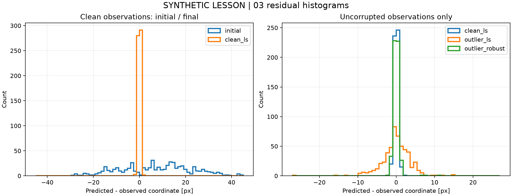

**그림 C6-03. scalar 재투영 잔차 분포 (합성 교육 모델).** 왼쪽은 clean 초기/최종 scalar residual 분포, 오른쪽은 같은 uncorrupted 관측 subset의 최종 residual 분포.
각 패널 내부는 공통 bin이며 모든 극단값을 포함한다. 양 패널의 x 범위는 다르다.


**그림 C6-04. 관측 비용과 합성 GT 오차 (합성 교육 모델).** 합성 GT 기준 위치·회전·점 오차. Outlier LS의 작은 관측 cost가 정확성을 뜻하지 않음을 보여준다.


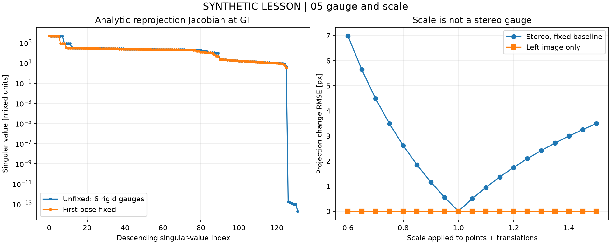

**그림 C6-05. 좌표 gauge와 알려진 기준선의 척도 (합성 교육 모델).** 동일 GT 상태의 raw analytic J에서 6개 rigid gauge가 anchor 후 제거된다. 오른쪽은 baseline을 고정하고
pose translation·점을 scale할 때 stereo는 변하지만 left-only는 변하지 않는 실측이다.


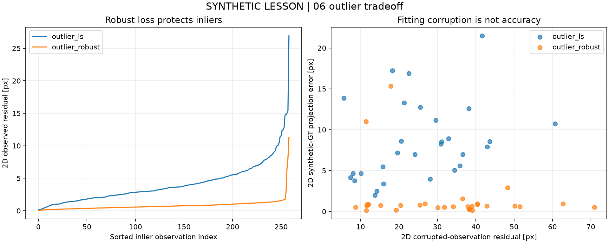

**그림 C6-06. 강건 손실의 관측·정답 오차 절충 (합성 교육 모델).** 왼쪽은 inlier 2D residual norm의 정렬 분포, 오른쪽은 오염된 관측에서의 residual과 GT 투영 오차.
Scalar RMSE와 2D norm을 혼동하지 않는다. Robust도 일부 큰 오차를 남긴다.


<a id="c6-15"></a>

### 15. 합성 공동 BA의 추가 계산 문제

#### 문제 1: disparity와 깊이

f_x=520 px, b=0.24 m, u_L=424 px, u_R=399.04 px일 때 깊이는?
점과 translation만 2배로 늘리고 b는 고정하면 첫 camera의 u_R는?

**풀이:** disparity=24.96 px, Z=520×0.24/24.96=5 m.
X=(2,1,10) m가 되면 left u는 424로 같지만 right u=520×(2-0.24)/10+320=411.52 px.
Disparity는 12.48 px로 절반이 된다. Fixed baseline이 scale 변화를 관찰 가능하게 만든다.
원 투영·깊이는 `research/camera-backend-lessons/src/test_backend.py:27`, scale 불변/변화는 `research/camera-backend-lessons/src/test_backend.py:71`로 검사한다.


#### 문제 2: 진짜 공동 BA인지 확인

4 pose, 36 point, 좌우 관측에서 첫 pose 고정 시 변수·scalar residual 수는?
첫 pose도 풀면 몇 개의 관측 불변 자유도가 예상되는가?

**풀이:** pose 3×6=18, point 36×3=108, 합계 126변수. Residual은 4×2×36×2=576.
첫 pose까지 풀면 132변수이고 전역 rigid gauge 6개가 남는다. 알려진 b 때문에 scale은 포함되지 않는다.
점 108변수를 빼고 pose만 풀면 pose-only다. 실제 J 양쪽 block과 최종 pose·점 변경을 테스트한다.
`research/camera-backend-lessons/src/test_backend.py:83`, `research/camera-backend-lessons/src/test_backend.py:98`, `research/camera-backend-lessons/src/test_backend.py:137` 참고.


#### 문제 3: 큰 residual을 덜 믿는다는 뜻

한 scalar residual r=12 px, c=1.2 px일 때 LS와 soft-L1 cost 및 r에 대한 미분은?

**풀이:** LS cost=r²/2=72 px², dF/dr=12 px.
Soft-L1 cost=c²(sqrt(1+(r/c)²)-1)=1.44(sqrt(101)-1)=13.03182 px².
dF/dr=r/sqrt(1+(r/c)²)=12/sqrt(101)=1.19404 px.
큰 잔차가 목적함수를 끌어당기는 힘이 줄지만 완전히 0은 아니다. Outlier가 자동 삭제되는 것도 아니다.
`research/camera-backend-lessons/src/test_backend.py:98`에서 수치를 검사한다.


<a id="c6-16"></a>

### 16. 실험의 한계: 작은 장면에서 확인한 것만 주장하기

- 한 seed, 작은 일반 위치의 장면이다. [미확인] 다중 seed 분산, 퇴화장면, 매우 큰 초기오차, 실제 센서에서의 성능.
- 관측 연관과 가시성이 이상적이다. 삼각측량/track loss/rolling shutter/calibration error를 모델링하지 않는다.
- Depth를 강제하는 bounds/barrier는 없다. 본 실행의 초기·최종 depth 양수를 검사했지만 모든 solver 중간 trial에서 양수임을 인증하지 않는다. Z=0 근처와 뒤쪽 점 처리가 필요한 실용 구현은 별도다.
- General dense solver로 작게 풀었다. 대규모 sparse BA, marginalization, Schur complement, covariance 추정과 실시간성은 미구현이다.
- 일부 설정된 장면 범위·graph 원 경로 등 생성 형태는 코드에 있다. JSON이 모든 가능한 scene model을 기술하는 범용 schema는 아니다.
- 올바른 루프도 exact synthetic GT이며 현실의 loop uncertainty를 전부 반영하지 않는다. 거짓 loop 대응 방법 자체는 구현하지 않았다.
- Objective 감소, solver success, 좋은 영상 overlay만으로 GT 정확도나 전체 SLAM의 성공을 주장하지 않는다.


<a id="c7"></a>

## C7. 장소 검색과 루프: 높은 유사도에서 검증된 제약까지

**심화 연결:** [D11 대응 검증](#d11), [D16 거짓 루프 실패](#d16-12), [D23 지도 수명주기](#d23-3)를 통해 검색 점수·기하 검증·그래프 갱신을 분리한다.

재방문 후보는 아직 측정이 아니다. 과거 영상 검색, 기하 검증, 그래프 보정은 별도 단계이며, 잘못된 루프 하나는 전체 경로를 손상시킬 수 있다. 기존 4장의 GT 기반 후보 감사와 이번 합성 루프 수업 모두 실제 영상 자동 루프 검출기를 실행한 결과는 아니다. [Gálvez-López·Tardós, 2012 및 DBoW2](https://github.com/dorian3d/DBoW2), [ORB-SLAM 원문](https://arxiv.org/abs/1502.00956)

<a id="c7-1"></a>

### 1. BoW와 DBoW2: 지도 검색의 입력과 출력

BoW는 Bag of Words, 영상의 local descriptor들을 시각 단어 빈도로 요약하는 표현이다.
여기서 word는 자연어 단어가 아니라 descriptor 공간의 군집 ID다.
vocabulary는 학습 descriptor들을 계층적으로 나눈 색인 구조다.
질의 descriptor는 트리를 따라 가까운 대표 노드로 내려가 word ID를 얻는다.
이진 descriptor 비교에는 Hamming 거리가 자연스럽지만 실수 descriptor용 어휘와 그대로 호환되지는 않는다.
새 SuperPoint descriptor를 기존 ORB vocabulary에 그냥 넣는 것은 올바른 교체가 아니다.
inverted index는 특정 word가 등장한 키프레임을 찾아 전체 비교를 줄인다.
direct index는 영상 안의 feature와 트리 노드 관계를 보존해 후보 사이 대응 탐색을 돕는다.
검색 결과는 `(candidate_id, similarity_score)`이며 상대 pose가 아니다.

교육용 TF-IDF를 다음처럼 정한다.

```text
tf_w = count_w / total_descriptors
idf_w = log(N / n_w)
v_w = tf_w * idf_w
v <- v / ||v||_1
score(a,b) = 1 - 0.5 ||a-b||_1
```

N은 어휘 통계에 쓰인 영상 수, n_w는 word w를 포함한 영상 수다.
구현에는 smoothing과 weighting 선택지가 있으므로 위 식을 모든 DBoW2 설정의 유일한 식이라고 하지 않는다.
희귀한 단어는 더 큰 가중치를 가질 수 있지만 조명·가림·양자화 오류에도 민감할 수 있다.
예로 정규화된 `a=(0.6,0.3,0.1)`, `b=(0.5,0.2,0.3)`이면 L1 차이는 0.4다.
점수는 0.8이다.
이 값은 같은 장소일 확률 80%라는 뜻이 아니다.
반복 복도는 word 비율이 비슷하면서 다른 실제 장소일 수 있다.

<a id="c7-2"></a>

### 2. Loop verification은 독립된 기하 문제다

검색 단계에서는 최근 이웃 프레임을 제외하고 과거 후보를 찾을 수 있다.
최근 영상과 닮았다는 것은 당연하며 장기 재방문 발견과 다르다.
후보에 대해 실제 feature 대응과 지도점 대응을 만든다.
2D-2D면 essential/fundamental 모델, 2D-3D면 PnP, 3D-3D면 상대 정합 등을 검토한다.
선택은 사용 가능한 상태와 scale 관측 여부에 달려 있다.
RANSAC은 무작위 부분집합에서 가설을 만들고 전체 대응의 일치도를 검사한다.
inlier 개수 외에 영상 내 분포, 시차, 양의 깊이, residual 분포와 temporal consistency를 확인한다.
한 작은 반복 무늬에 몰린 많은 inlier는 전체 pose를 안정적으로 정하지 못할 수 있다.
추정된 상대변환은 재투영 또는 양방향 정합으로 추가 검증한다.
검증을 통과한 뒤에만 graph edge를 만든다.

교육용 단계별 로그는 다음을 분리해야 한다.
- 검색 후보 수와 각 BoW 점수.
- descriptor 대응 수와 geometric inlier 수.
- 상대변환 모델 종류: SE(3), Sim(3), PnP 등.
- scale, translation, rotation과 각각의 단위.
- 잔차의 중앙값/상위 분위수, 영상 공간 분포.
- 승인/거절 사유와 최종 graph edge ID.

기하 검증이 실패한 후보를 루프 성공으로 집계하지 않는다.
GT가 가깝다는 사실은 평가 label로 쓸 수 있지만 자동 검증기의 입력으로 섞지 않는다.
검색 recall과 verified-loop precision은 다른 지표다.
검색 임계값을 낮추면 후보가 늘 수 있지만 검증 계산량과 오검출 위험도 함께 바뀐다.

<a id="c7-3"></a>

### 3. SE(3)와 Sim(3)를 선택하는 이유

SE(3)는 rotation과 translation으로 거리를 보존한다.
Sim(3)는 Similarity transformation group으로 양의 scale s를 추가한다.
`p' = s R p + t`에서 s는 무차원이다.
단안 지도는 구간마다 scale drift가 생길 수 있어 상대 scale 보정이 필요할 수 있다.
metric scale이 관측된 stereo/RGB-D 지도에서는 임의 scale 변경을 허용하면 센서의 길이 기준을 훼손할 수 있다.
그러므로 모델 선택은 "자유도가 많으면 좋다"가 아니라 센서가 제약하는 자유도에 맞춘다.
Sim(3) inverse는 `p = (1/s) R^T (p'-t)`다.
translation을 단순히 -t로 바꾸는 것은 일반적으로 inverse가 아니다.

교육용으로 `s=2, R=I, t=(1,0,0)`이면 `(1,1,1)`은 `(3,2,2)`가 된다.
inverse를 적용하면 `0.5*((3,2,2)-(1,0,0))=(1,1,1)`이다.
여기서 scale 2는 보정 예제의 가정이며 실제 단안 궤적에서 측정한 값이 아니다.

<a id="c7-4"></a>

### 4. Pose graph residual의 방향을 검산한다

이 절에서만 설명 편의를 위해 `G_i=T_WCi`를 사용한다.
G_i는 앞 BA의 T_i와 inverse 관계다.
관측 `Z_ij`는 j 카메라 좌표를 i 카메라 좌표로 보내는 상대변환으로 정의한다.
예측 상대변환은 `G_i^(-1)G_j`다.

```text
e_ij = Log(Z_ij^(-1) G_i^(-1) G_j)
E_graph = 1/2 sum e_ij^T Omega_ij e_ij
```

관측과 예측이 같으면 Log의 입력은 항등변환이고 e=0이다.
SE(3)에서는 e가 6차원, Sim(3)에서는 log-scale을 포함해 7차원이다.
Omega는 이 tangent 좌표와 단위에 맞는 information matrix다.
회전과 병진의 covariance를 아무 좌표 변환 없이 다른 edge 방향에 복사하면 안 된다.
BoW 점수를 Omega의 모든 대각 원소로 넣는 규칙은 정당화된 측정 모델이 아니다.
상대변환이 같은 지도 관측에서 계산되었다면 다른 edge와 상관이 있을 수 있다.
독립 edge 가정은 실용적 근사이지 항상 정확한 확률 모델이 아니다.

pose graph를 고친 뒤 landmark와 dense map이 그대로면 서로 다른 좌표 상태가 된다.
희소점은 소속 키프레임의 보정에 따라 옮기거나 추가 BA를 수행한다.
TSDF는 과거 잘못된 pose에서 적분된 값이므로 단순히 최신 camera pose만 바꿔서는 복원되지 않는다.
재적분·변형·submap 이동 같은 별도 전략이 필요하다.
이 연결은 2절의 밀집 지도에서 다시 다룬다.

<a id="c7-5"></a>

### 5. 연습문제와 해설

**문제 6.** 3개 word의 a=(0.6,0.3,0.1), b=(0.5,0.2,0.3)의 점수가 0.8이면 loop edge를 추가해도 되는가?
**풀이.** L1 차이 0.4이므로 점수 계산 자체는 맞다.
그러나 상대 pose와 기하 일치가 없으므로 후보일 뿐이다.
기하 검증을 통과하지 않은 상태에서 edge를 추가하면 지도 전체를 왜곡할 수 있다.


<a id="c7-6"></a>

### 6. 실행한 합성 SE(2): 참 루프와 거짓 루프의 효과

| 기호 | 정의 | 단위/크기 |
|---|---|---|
| q_i=(p_i,theta_i) | 평면 pose; p_i=(x_i,y_i), theta_i heading | m,m,rad |
| R_2(theta) | [[cos(theta),-sin(theta)],[sin(theta),cos(theta)]] | 무차원 2×2 |
| z_ij=(z_t,z_theta) | directed edge i→j의 i-local 상대이동·각도 측정 | m,m,rad |
| h(q_i,q_j) | 두 pose에서 예측한 상대 측정 | m,m,rad |
| e_ij, w_ij | raw relative-coordinate 잔차, sigma로 나눈 잔차 | m,m,rad / 무차원 |
| sigma_t,sigma_theta | 측정 표준편차, 이 실험의 상대 가중치 설정 | m,rad |
| E | odometry와 선택 loop edge의 집합 | 24 또는 25 edge |
| F_g | graph 목적함수 | 무차원 |
| wrap(alpha) | atan2(sin(alpha),cos(alpha)); 동치 각도의 대표값 | rad, [-pi,pi] 경계 |

SE(2)는 Special Euclidean group in 2 dimensions, 즉 평면의 회전·이동 변환 집합이다.
위 기호 x_i는 평면 위치 성분이며 BA 전체 변수 x와 문맥이 다르다.

#### 6.1 상대 측정과 목적함수


```text
h(q_i,q_j) = [R2(theta_i)^T (p_j-p_i), wrap(theta_j-theta_i)]
```


Raw translation residual은 h의 앞 2성분-z_t, angular residual은
wrap(theta_j-theta_i-z_theta)다. 이를 각 표준편차로 나눈 w_ij에 대해
F_g=1/2 sum_(i,j in E) ||w_ij||²를 최소화한다.
이는 **i-local relative-coordinate residual**이며 SE(2) Log 오차의 완전한 구현은 아니다.
이동·회전 분산의 상관을 무시하는 대각 가중치 모델이다.

예를 들어 q_i=(1,2,pi/2), q_j=(1,3,pi/2+0.1)라면 world 이동은 (0,1) m이지만,
i-local 이동은 R_2(pi/2)^T(0,1)=(1,0) m이므로 h=(1,0,0.1)이다.
이 계산과 compose 역변환은 `research/camera-backend-lessons/src/test_backend.py:111`에서 확인한다.

#### 6.2 재현 절차와 루프의 뜻

1. 반지름 4 m의 닫힌 경로에 25개 pose를 만든다. 마지막 pose는 첫 pose와 같은 위치·방향이다.
2. 24개 상대 odometry 측정에 translation sigma=0.04 m, rotation sigma=0.012 rad 잡음을 더한다. 매 edge에 +0.008 rad heading bias도 더한다.
3. 상대 측정을 순서대로 compose해 초기 경로를 만든다. 이 경로는 noisy odometry edge를 거의 정확히 만족하므로 odometry cost가 0이어도 GT와 어긋난다.
4. 같은 초기값에서 odometry-only / correct loop / false loop 세 graph를 푼다. 첫 pose는 변수에서 제외한다.
5. 루프 방향은 **24→0**, correct 측정은 (0 m,0 m,0 rad), false는 (2 m,-1.5 m,0.45 rad)다. False case는 correct loop에 추가한 것이 아니라 correct loop를 **대체**한다.
6. 루프 sigma=(0.02 m,0.02 m,0.008 rad)로 상대적으로 강하게 믿게 설정했다. 검출·승인 없이 거짓 제약을 넣는 실패 사례다.

Odometry 측정 생성의 bias는 solver 모델에 추가 변수를 두어 추정하지 않는다.
따라서 sigma는 실제 전체 모델 오차의 완벽한 통계 표현이 아니다.
Graph는 72변수, odometry-only 72 residual 또는 loop 포함 75 residual이다.
`research/camera-backend-lessons/src/backend.py:155`, `research/camera-backend-lessons/src/backend.py:174`, `research/camera-backend-lessons/src/backend.py:202`가 각각 생성·최적화·case 구성이다.

#### 6.3 결과와 loop verification의 한계

| Case | 위치 RMSE m | Heading RMSE deg | 끝-시작 거리 m | Whitened scalar RMSE |
|---|---:|---:|---:|---:|
| Odometry only | 0.7943 | 9.8210 | 1.1635 | 약 6.34e-15 |
| Correct loop | 0.1733 | 0.6102 | 0.0009 | 0.5548 |
| False loop | 2.1323 | 18.1980 | 2.4925 | 1.6396 |

수치 출처: `artifacts/pose_graph/metrics.json`. 위치·heading RMSE는 고정 첫 pose 제외 24개를 평균한다.
별도 rigid/scale alignment는 하지 않는다. Correct loop의 잔차는 0이 아니며 다른 noisy edge와 절충한다.
False loop cost는 19776.56→100.81로 줄었지만 GT 위치 오차는 odometry보다 커졌다.
이 수업은 "최적화가 잘못된 제약을 알아서 거절한다"는 오해의 반례다.

검증은 합성 GT에 correct/false edge를 대입해 각각 (0,0,0), (-2,+1.5,-0.45)의 raw residual이
나오는지 확인하는 것이다. 이것은 **GT 기반 정답 확인**이며 실운영 geometric verification이나
RANSAC(Random Sample Consensus), 장소인식, 자동 rejection gate를 구현한 것이 아니다.
Graph의 wrap은 ±pi에서 비미분 경계가 있다. 이번 초기값·측정에서 그 경계 문제는 관찰되지 않았지만
큰 초기오차에 대한 안정성을 보장하지 않는다.


**그림 C7-01. 참·거짓 루프가 바꾸는 평면 경로 (합성 교육 모델).** 같은 축·종횡비에서 odometry / correct / false loop의 경로를 비교한다.
붉은 점선은 루프 endpoint 연결선이며, false loop의 상대이동 측정 그 자체를 world 벡터로 그린 것은 아니다.


**그림 C7-02. 루프 이후 위치와 방향의 오차 (합성 교육 모델).** pose별 GT 위치·heading 오차. 거짓 loop로 오차가 끝점뿐 아니라 중간 경로에도 퍼진다.


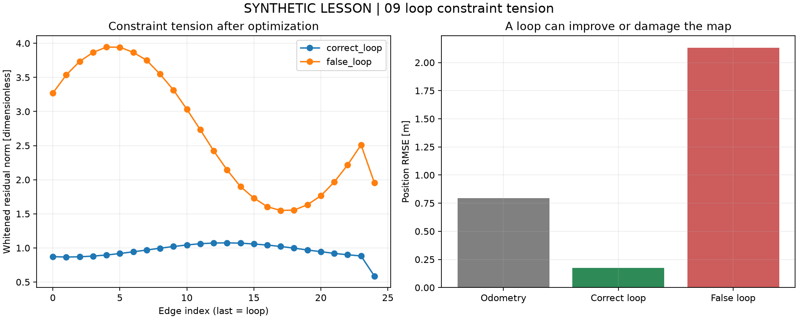

**그림 C7-03. 루프와 오도메트리 제약의 충돌 (합성 교육 모델).** edge별 whitened residual norm과 GT 위치 RMSE. 마지막 edge index=24가 loop다.
Loop가 서로 모순되는 측정들을 조정하도록 graph 전체에 영향을 주는 모습을 보여준다.

<a id="c7-7"></a>

### 7. 합성 루프의 추가 계산 문제

#### 문제 4: 단위가 다른 graph residual과 거짓 루프

Raw residual=(0.04 m,-0.08 m,0.012 rad), sigma=(0.04 m,0.04 m,0.012 rad)의 whitened residual과 cost는?
GT의 마지막 pose=첫 pose인데 loop 측정이 (2 m,-1.5 m,0.45 rad)이면 raw residual은?

**풀이:** 성분별 나눗셈으로 w=(1,-2,1), cost=(1+4+1)/2=3, 둘 다 무차원이다.
실제 상대 pose는 (0,0,0)이므로 false loop residual=(-2,+1.5,-0.45).
강한 loop 가중치는 큰 모순을 줄이려고 경로를 변형시킬 수 있다. 최적화 후 cost 감소만으로 loop가 맞다고 승인하면 안 된다.
`research/camera-backend-lessons/src/test_backend.py:117`, `research/camera-backend-lessons/src/test_backend.py:129`에서 수치·방향을 검사한다.


<a id="c8"></a>

## C8. 직접법: 픽셀 위치 대신 밝기 잔차를 사용하기

**심화 연결:** [D1 방사·영상 형성](#d1), [D3 필터와 복원](#d3), [D12 운동 추정](#d12), [D22 광도와 역그래픽스](#d22)는 밝기 잔차가 성립하는 조건과 깨지는 조건을 각각 계산한다.

C5의 LK가 밝기 기울기로 대응을 찾았다면 직접 VO는 깊이와 자세로 워프한 영상의 밝기를 상태 최적화에 직접 연결한다. 희소·밀집은 관측 밀도의 축이고 특징점·직접법은 잔차의 축이다. 이 장은 문헌과 손계산 수업이며 LSD-SLAM·DSO·LDSO를 실행하지 않았다. [LSD-SLAM](https://cvg.cit.tum.de/research/vslam/lsdslam), [DSO](https://arxiv.org/abs/1607.02565), [LDSO](https://arxiv.org/abs/1808.01111)

<a id="c8-1"></a>

### 1. 직접법의 질문: 대응 픽셀 좌표 대신 밝기를 맞추면 무엇이 달라지는가?

특징점법은 먼저 대응점을 만든 뒤 그 좌표의 기하 오차를 최소화한다.
직접법은 현재 깊이와 pose로 픽셀을 warp하고 대응 위치의 밝기를 비교한다.
"직접"은 모든 픽셀을 사용한다는 뜻이 아니다.
선택한 소수 픽셀만 사용하는 sparse direct 방법도 가능하다.
반대로 dense flow를 먼저 추정한 뒤 좌표 오차를 최적화하면 dense지만 광도 직접법과는 다르다.
밀도 축과 잔차 종류 축을 별도로 분류해야 한다.

기준 영상 i의 픽셀 p와 inverse depth d를 둔다.
depth는 `Z=1/d`이고 d의 단위는 metric 지도에서 1/m다.
`q=K^(-1) p_tilde`이며 마지막 성분이 1인 normalized ray다.
`P_i=q/d`, `P_j=R_ji P_i+t_ji`로 변환한다.
새 픽셀은 `p'=pi(P_j)`다.
단안 임의 scale 지도에서는 d도 그 지도 단위의 역수다.
영상 밖으로 나간 p'나 가려진 점은 정상 밝기 대응이 아니다.

<a id="c8-2"></a>

### 2. 광도 모델과 노출

원시 밝기를 raw image I_raw라고 하자.
카메라 응답함수의 inverse G^(-1), vignetting V(p), 노출시간 tau를 구분한다.
설명용 보정 영상은 `I(p)=G^(-1)(I_raw(p))/V(p)`로 정의한다.
이 정의에서는 노출시간은 아직 나누지 않았으므로 잔차에서 tau 비율을 사용한다.
노출까지 이미 나눈 영상에 다시 tau 비율을 적용하면 중복 보정이다.
영상 i와 j의 affine brightness 상태를 `(a_i,b_i)`, `(a_j,b_j)`라 둔다.

```text
alpha_ji = (tau_j / tau_i) * exp(a_j-a_i)
r_photo = [I_j(p') - b_j] - alpha_ji [I_i(p) - b_i]
```

a와 alpha는 무차원이고 b와 r_photo는 사용 보정 영상의 intensity 단위다.
tau 단위는 s이며 비율에서는 소거된다.
서로 다른 문헌의 I 정의가 같지 않으므로 식만 복사하지 말고 보정 순서를 확인한다.
패치 여러 위치의 잔차를 합치면 한 픽셀보다 정보를 늘릴 수 있다.
그러나 한 패치가 서로 다른 깊이 경계를 가로지르면 같은 기하 모델이 깨질 수 있다.
밝기 변화가 단순 affine가 아닌 반사·그림자·포화는 이 모델에 남는 오차다.

교육용으로 I_i=100, I_j=120, tau_i=tau_j, a_i=a_j=0, b_i=0, b_j=20을 둔다.
보정 잔차는 `(120-20)-1*(100-0)=0`이다.
b_j를 0으로 고정하면 잔차는 20이다.
optimizer가 이 20을 pose 이동으로만 줄이려 하면 실제 운동과 밝기 변화가 섞일 수 있다.

<a id="c8-3"></a>

### 3. 광도 Jacobian과 aperture problem

영상 미분을 `grad I_j = (dI/du,dI/dv)`라고 하자.
단위는 intensity/px다.
warp의 pose 미분은 앞 절의 J_pi와 `[I|-P_j cross]`를 조합한다.

```text
J_photo_pose = grad I_j(p') * J_pi(P_j) * [I | -[P_j]_x]
dP_i/dd = -q/d^2
J_photo_depth = grad I_j(p') * J_pi(P_j) * R_ji * (-q/d^2)
```

pose translation 열 단위는 intensity/m다.
inverse depth 열 단위는 intensity/(1/m)다.
밝기가 일정한 영역은 grad I가 0에 가까워 pose를 거의 제약하지 못한다.
직접법이 코너만 요구하지 않는다는 사실과 완전히 무텍스처에서 운동을 알아낸다는 주장은 다르다.
수직 경계 하나는 주로 경계 법선 방향 이동에 민감하다.
경계 접선 방향 이동은 밝기를 거의 바꾸지 않아 aperture problem이 생긴다.
서로 다른 방향의 gradient를 가진 픽셀들을 공간적으로 분산시키는 이유다.

작은 예로 gradient가 `(4,0) intensity/px`, warp 변화가 `(0.5,2)px`라면 밝기 변화는 2다.
수직 2px 변화는 이 국소 1차 모델에서 보이지 않는다.
최적화 iteration 수를 늘려도 없는 gradient 정보를 새로 만들 수는 없다.
피라미드는 큰 이동을 작은 이동으로 만드는 데 도움을 주지만 깊이·조명 가정의 오류까지 없애지는 않는다.

<a id="c8-4"></a>

### 4. LSD-SLAM과 DSO는 목적과 유지 정보가 다르다

LSD-SLAM의 학습 질문은 반밀집 inverse depth와 scale-aware 전역 그래프를 어떻게 연결하는가다.
DSO의 질문은 활성 window 안에서 geometry·pose·밝기 등을 함께 어떻게 정교하게 추정하는가다.
DSO 결과를 누적해 경로를 그렸다고 자동으로 루프가 닫힌 것은 아니다.
LDSO는 그 부족한 장기 제약을 추가하는 후속 분기다.
따라서 "LSD-SLAM이 오래되었으니 DSO가 모든 기능을 대체했다"는 설명은 틀리다.
직접법 실습에서 기대할 출력은 원본/warp 영상, 광도 잔차, gradient 선택 mask, inverse-depth uncertainty다.
재투영 좌표 오차만 저장하면 photometric calibration 실패를 설명하기 어렵다.
흑백 intensity를 사용했다는 사실만으로 RGB 채널의 모든 정보가 사용되었다고 말하지 않는다.

<a id="c8-5"></a>

### 5. 연습문제와 해설

**문제 8.** gradient `(4,0)`에 warp displacement `(0.5,2)px`가 주어졌다. 1차 밝기 변화는?
**풀이.** 내적 `4*0.5+0*2=2` intensity 단위다.
두 번째 이동 성분은 이 관측 하나로 제약하지 못한다.
두 성분 모두를 추정하려면 다른 gradient 방향 등의 추가 정보가 필요하다.


<a id="c9"></a>

## C9. 시각·관성 추정: 고속 관측과 초기화의 계약

**심화 연결:** [D7 상관된 관측](#d7-10), [D8 필터와 일관성](#d8), [D23 시간·중력·사전적분](#d23-5)을 읽는다. 합성 적분 계산과 실제 OXTS 시간 정렬 완료는 다른 주장이다.

A12의 가속도·각속도 적분을 영상 상태와 결합한다. IMU가 있으면 자동으로 척도가 복원되는 것이 아니라 시간·외부 보정·bias·중력과 운동 excitation이 필요하다. Raw OXTS의 fused GPS/INS pose는 입력 IMU 비력과 다르며 현재 저장소에서는 시간 정렬을 검증한 VIO를 실행하지 않았다. [MSCKF](https://intra.ece.ucr.edu/~mourikis/papers/MourikisRoumeliotis-ICRA07.pdf), [Forster 외 사전적분](https://dellaert.github.io/files/Forster16tro.pdf), [VINS-Mono](https://arxiv.org/abs/1708.03852), [시간 보정](https://arxiv.org/abs/1808.00692)

<a id="c9-1"></a>

### 1. VIO의 상태와 센서 계약

VIO는 Visual-Inertial Odometry, 시각-관성 오도메트리다.
VINS는 Visual-Inertial Navigation System, 시각-관성 항법 시스템을 뜻한다.
최소 교육 상태는 `x_i=(R_WBi,p_WBi,v_WBi,b_gi,b_ai)`다.
R은 body에서 world로의 회전, p는 위치[m], v는 속도[m/s]다.
b_g는 자이로 bias[rad/s], b_a는 가속도 bias[m/s^2]다.
센서 외부변환 `T_BC`와 시간 offset t_d[s]를 고정하거나 추정 상태에 포함할 수 있다.
"외부 보정"은 센서 간 고정 변환이고 매 시점의 세계 pose와 다르다.
내부 카메라 보정, IMU noise density, bias random walk, timestamp clock domain도 필요하다.
이 값들이 없으면 영상과 IMU 숫자를 함께 읽는 것만으로 재현 가능한 VIO 입력이 되지 않는다.

세계 중력은 예를 들어 `g_W=(0,0,-9.81)m/s^2`로 정한다.
측정 가속도는 비력이며 `a_m=R_WB^T(a_W-g_W)+b_a+n_a`다.
회전 측정은 `omega_m=omega+b_g+n_g`다.
정지한 수평 IMU에서 축 정의에 따라 중력 반대 방향의 비력이 나오는 이유를 먼저 확인한다.
g를 두 번 더하거나 빼는 오류는 정지 테스트로 잡을 수 있다.
noise density와 discrete sample variance는 단위와 샘플 간격을 통해 변환해야 한다.
데이터시트의 수치를 단위 확인 없이 covariance 대각에 복사하지 않는다.

<a id="c9-2"></a>

### 2. MSCKF: 점을 상태에 넣지 않고 점의 정보를 쓰는 방법

MSCKF는 Multi-State Constraint Kalman Filter다.
현재 IMU 상태와 여러 과거 카메라 pose clone을 유지한다.
한 정적 feature의 여러 관측을 쌓으면 선형화된 식을 얻는다.

```text
r = H_x delta_x + H_f delta_f + n
```

delta_f는 해당 3D 점 위치의 불확실한 증분이다.
그 점을 영구 상태로 추가하지 않고 제거하고 싶다.
H_f의 left nullspace basis N을 구하면 `N^T H_f=0`이다.
양변에 N^T를 곱한다.

```text
r_o = N^T r = N^T H_x delta_x + N^T n
R_o = N^T R N
```

점 증분은 없어졌지만 여러 pose의 상대 기하 정보는 남는다.
noise가 isotropic이고 N 열이 orthonormal이면 noise 처리가 단순해진다.
일반 covariance에서 projection 후 noise를 원래와 같다고 놓으면 안 된다.
5개 영상에서 한 점을 관측하면 픽셀 잔차는 10차원이다.
H_f rank가 3이면 left nullspace 차원은 7이다.
이는 남는 식 수를 뜻하며 pose의 모든 자유도를 독립적으로 관측했다는 뜻은 아니다.
rank가 다른 퇴화 상황에서는 차원과 정보량을 별도 해석한다.
영구 landmark map을 유지하지 않는 구조와 장소 재방문 기능의 존재는 별도 문제다.
MSCKF라는 이름만으로 loop closure까지 구현되었다고 가정하지 않는다.

<a id="c9-3"></a>

### 3. 사전적분은 IMU를 버리는 것이 아니라 상대 factor로 압축하는 것이다

카메라 i와 j 사이에 고주파 IMU 샘플이 여러 개 있다고 하자.
매 optimization iteration마다 모든 샘플을 세계 좌표에서 재적분하면 계산이 반복된다.
사전적분은 시작 body 좌표에서 상대 회전·속도·위치 변화를 요약한다.
이 절은 구간 내 bias가 일정하다는 1차 교육 모델을 사용한다.
정밀 구현에서는 covariance와 bias Jacobian을 함께 전파한다.

```text
DeltaR_ij = R_i^T R_j
Deltav_ij = R_i^T (v_j-v_i-g_W DeltaT)
Deltap_ij = R_i^T (p_j-p_i-v_i DeltaT-0.5 g_W DeltaT^2)
```

DeltaR은 회전, Deltav는 m/s, Deltap는 m다.
이 식은 참 상태가 만족할 상대량의 정의다.
실제 IMU에서 계산한 hat-Delta와 상태에서 예측한 Delta를 비교해 residual을 만든다.
교육용 discrete 적분은 다음 순서로 설명할 수 있다.

```text
Deltap_next = Deltap + Deltav*dt + 0.5*DeltaR*(a_m-b_a)*dt^2
Deltav_next = Deltav + DeltaR*(a_m-b_a)*dt
DeltaR_next = DeltaR * Exp((omega_m-b_g)*dt)
```

세 식 우변은 같은 이전 step의 DeltaR,Deltav를 사용한다고 정의한다.
실제 midpoint 적분과는 차이가 있는 교육용 전진 모델이다.
샘플 dt가 균일하다고 가정하지 않고 timestamp 차이를 사용한다.
camera interval의 경계에 걸린 IMU 샘플은 보간·분할 정책을 명시한다.

회전 residual은 예를 들어 `r_R=Log(hat_DeltaR^T R_i^T R_j)`로 둔다.
속도 residual은 `r_v=R_i^T(v_j-v_i-g DeltaT)-hat_Deltav`다.
위치 residual도 위 정의에서 hat_Deltap를 뺀다.
이 세 residual의 차원은 각각 3이고, bias 변화 residual을 더하면 흔히 15차원 factor를 구성한다.
회전·속도·위치 오차에는 상관이 생기므로 대각 covariance만 쓰는 것은 추가 근사다.
각 residual을 covariance로 whitening한 뒤 시각 residual과 결합한다.

<a id="c9-4"></a>

### 4. Bias 보정은 왜 필요한가?

사전적분은 기준 bias b0에서 수행된다.
최적화가 bias를 바꾸면 같은 측정의 해석도 달라진다.
작은 delta_b에서는 저장한 Jacobian으로 1차 보정할 수 있다.

```text
Deltav(b0+delta_b) ~= Deltav(b0) + J_v_bg delta_bg + J_v_ba delta_ba
Deltap(b0+delta_b) ~= Deltap(b0) + J_p_bg delta_bg + J_p_ba delta_ba
DeltaR(b0+delta_bg) ~= DeltaR(b0) Exp(J_R_bg delta_bg)
```

큰 bias 변화에서는 이 근사가 부족해 재적분이 필요할 수 있다.
사전적분을 한 번 했으니 bias를 바꾸어도 그대로 써도 된다는 뜻이 아니다.
bias Jacobian은 센서 축과 회전 perturbation 정의에 종속된다.
다른 논문에서 가져온 Jacobian을 좌표계 확인 없이 혼합하지 않는다.

단순 1D 예제로 중력을 이미 제거한 가속도 2m/s^2, dt=0.1s를 두 번 적분한다.
시작 속도와 위치가 0이면 최종 속도는 0.4m/s다.
최종 위치는 `0.5*2*(0.2)^2=0.04m`다.
이는 3D 사전적분을 완전 재현한 것이 아니라 단위와 시간 항의 검산이다.
회전과 bias가 있으면 가속도 방향도 바뀌므로 단순 스칼라 합으로 대체할 수 없다.

<a id="c9-5"></a>

### 5. VINS 초기화: 한꺼번에 모든 미지수를 푸는 문제가 아니다

단안 영상만으로 만든 초기 구조는 scale이 정해지지 않는다.
IMU에는 중력·속도·bias와 외부 보정의 불확실성이 있다.
초기화의 목표는 이 서로 다른 정보를 일관된 metric 상태로 연결하는 것이다.
교육 흐름은 시각 상대 구조 확보, 자이로 bias 검토, scale·중력·속도 정합, 중력 크기 제약과 비선형 refinement다.
이는 이해를 위한 단계화이며 모든 VIO 시스템이 동일한 순서와 식을 쓰는 것은 아니다.
ORB-SLAM3처럼 초기화를 MAP 추정 관점에서 구성하는 분기도 있다.
초기화 성공 여부는 solver return code만으로 판단하지 않는다.
양의 scale, 합리적인 gravity magnitude, bias 크기, residual와 condition을 함께 점검한다.

이를 수식으로 보려면 시각 카메라 중심을 임의 단위의 c_i, scale을 s[m/시각 단위]로 둔다.
외부 lever arm이 0이고 시각 회전이 세계축과 정렬된 교육용 단순화를 가정한다.
그러면 IMU 위치는 `p_i=s*c_i`로 쓸 수 있다.
앞 절의 사전적분 정의를 위치와 속도 갱신식으로 다시 정리한다.

```text
s*(c_j-c_i) = v_i*DeltaT + 0.5*g*DeltaT^2 + R_i*hat_Deltap_ij
v_j-v_i     = g*DeltaT + R_i*hat_Deltav_ij
```

위 식에서 c_i와 회전, 사전적분값을 잠시 고정하면 s, 각 v_i, g에 대해 선형인 부분 문제가 된다.
여러 시간 구간을 쌓아 풀고 gravity 크기 제약을 추가하여 refinement하는 직관을 얻는다.
실제 camera-IMU translation이 있으면 `p_C=p_B+R_WB*t_BC`를 사용해 lever arm을 포함한다.
그때 시각 중심 c와 IMU 위치를 같은 값으로 놓으면 회전 중 위치 오차를 만든다.
bias가 바뀌면 hat-Delta도 보정해야 하므로 이 선형 부분 문제만으로 전체 초기화가 끝나는 것은 아니다.
가속도·자세 변화가 빈약하면 scale과 속도·중력·bias를 구분하는 열들이 약하게 제약될 수 있다.
이것이 초기화 성공 여부를 조건수와 residual로 확인해야 하는 이유다.

별도 검산 예제로 중력이 제거된 1D에서 c_j-c_i=0.5 시각 단위, DeltaT=1s라 하자.
v_i=0m/s가 독립적으로 알려졌고 사전적분 위치 변화가 1m이면 s=2m/시각 단위다.
하지만 v_i도 미지수이면 식은 `0.5*s=v_i+1`뿐이다.
예를 들어 `(s,v_i)=(2,0)`과 `(4,1)`이 모두 성립하므로 이 한 구간만으로 scale을 정할 수 없다.
여러 관측을 추가하는 이유를 "식이 많아진다"보다 "혼동되던 상태를 구분한다"로 설명한다.

운동 excitation은 미지 상태를 구분할 수 있게 충분히 다양한 관측을 만드는 움직임이다.
계속 정지해 있으면 중력 방향 일부를 관찰할 수 있어도 단안 translation scale은 얻기 어렵다.
등속 직선 이동은 다양한 가속 운동에 비해 scale과 bias 분리가 약해질 수 있다.
회전만으로 외부 rotation을 제약할 수 있어도 translation scale의 모든 정보가 생기지는 않는다.
카메라-IMU lever arm이 있으면 회전이 유발하는 운동까지 고려해야 하므로 모든 순수 회전 상황을 같은 식으로 단정하지 않는다.
안전한 소규모 실험에서는 여러 방향의 완만한 회전·이동을 제공하고 excitation 지표를 기록한다.
불충분한 구간을 억지로 초기화하기보다 관측을 더 기다리는 정책도 필요하다.

이상적인 충분한 excitation의 VIO는 metric scale과 gravity 방향을 제약할 수 있다.
외부 절대 위치·방위 정보가 없으면 전역 translation과 gravity축 yaw는 보통 남는다.
gravity alignment 후 4DoF 전역 그래프를 설명하는 배경이다.
여전히 관측되지 않는 자유도를 제거한 covariance를 절대 위치 신뢰도로 해석하지 않는다.

<a id="c9-6"></a>

### 6. 시간 보정은 위치 보정과 다르다

카메라 시각 t_C와 대응 IMU 시각을 `t_I=t_C+t_d`로 정의한다.
t_d의 부호는 이 정의에 묶이며 반대 정의의 구현에 그대로 입력하면 안 된다.
normalized feature q의 시간 미분 q_dot를 알고 있다면 작은 offset에서 `q(t+t_d) ~= q(t)+q_dot*t_d`다.
픽셀 좌표로 쓰면 q_dot 대신 pixel velocity[px/s]를 쓴다.
시간 offset residual Jacobian에는 이 시간 미분이 들어간다.
정지 영상은 시간 이동을 주어도 거의 달라지지 않아 offset을 식별하기 어렵다.
일정한 단순 운동에서는 외부변환이나 bias와 강하게 결합될 수 있다.
따라서 시간 calibration도 관측가능성 문제다.

교육용 feature의 pixel velocity가 `(80,-20)px/s`이고 t_d=0.01s라면 보간 변화는 `(0.8,-0.2)px`다.
예측된 pixel p0와 관측 z에 대해 `r=p0+v_pixel*t_d-z`로 두면 `dr/dt_d=v_pixel`이다.
이 Jacobian의 단위는 px/s다.
앞서 정의한 offset 부호를 바꾸면 보간식과 Jacobian 부호도 함께 바꿔야 한다.
같은 pixel velocity에서 허용 보간 오차 norm을 0.5px로 정한 교육용 기준은 `|t_d|<=0.5/sqrt(80^2+20^2)`다.
약 0.00606s이며 특정 센서의 동기화 합격 기준이 아니라 운동에 따른 예시다.

노출시간, timestamp 기준 시점, rolling shutter row readout, 전송 지연, clock drift는 서로 다르다.
상수 t_d 하나로 모든 시간 오류를 설명하지 못할 수 있다.
하드웨어 동기화가 가능하면 먼저 그것을 검증하고 온라인 추정은 잔여 오차 모델로 본다.
GT 궤적을 가장 잘 맞추는 offset을 고른 뒤 이를 무감독 온라인 성능으로 보고하지 않는다.
그런 정렬은 oracle 또는 calibration 단계로 분리해야 한다.

<a id="c9-7"></a>

### 7. 연습문제와 해설

**문제 9.** 5개 영상의 2D 관측을 쌓은 MSCKF 잔차에서 H_f rank가 3이면 projection 후 최대 잔차 차원은?
**풀이.** 원래 10차원에서 3을 제거하여 7차원이다.
7차원이라는 사실만으로 pose state rank가 7이 되는 것은 아니다.
남은 H_x와 운동 기하를 확인해야 한다.


**문제 10.** 중력을 제거한 2m/s^2 가속도를 0.2s 적분하라. 초기 속도는 0이다.
**풀이.** 속도는 0.4m/s, 위치 변화는 0.04m다.
가속도 bias가 추가로 0.1m/s^2였다면 같은 단순 모델의 위치 오차는 0.002m다.
이는 3D 회전 오차로 중력이 누출되는 경우를 포함하지 않는다.


<a id="c10"></a>

## C10. 학습 대응과 반복 추정: 무엇을 학습하는지 먼저 구분하기

**심화 연결:** [D17–D20](#d17)은 손실 미분, CNN 공간 계산, 인식 평가, attention을 작은 수치 예부터 전개한다. [D9–D12](#d9)의 비학습 대응과 같은 입력·출력 계약으로 비교하되, 사전학습 모델 미실행 경계를 유지한다.

좋은 기술자, 문맥적 매칭, 깊이·자세의 반복 갱신은 서로 다른 교체 지점이다. 기존 ORB 세부 계산을 알고 나면 학습 모델의 입력·출력·전처리 계약을 정확하게 비교할 수 있다. 이 장의 모든 모델은 문헌 학습 대상이며 설치·추론·학습·GPU 성능 측정을 수행하지 않았다. [SuperPoint](https://openaccess.thecvf.com/content_cvpr_2018_workshops/w9/html/DeTone_SuperPoint_Self-Supervised_Interest_CVPR_2018_paper.html), [SuperGlue](https://arxiv.org/abs/1911.11763), [LightGlue](https://arxiv.org/abs/2306.13643), [DROID-SLAM](https://papers.neurips.cc/paper_files/paper/2021/hash/89fcd07f20b6785b92134bd6c1d0fa42-Abstract.html)

<a id="c10-1"></a>

### 1. 학습이 들어갈 위치를 먼저 정한다

첫 층은 detector와 descriptor다.
둘째 층은 두 집합 사이 data association이다.
셋째 층은 여러 시점의 geometry와 pose를 반복 추정하는 구조다.
넷째 층은 map representation과 rendering이다.
다섯째 층은 object/semantic 해석이다.
여섯째 층은 주어진 목표를 행동으로 바꾸는 정책이다.
이 층들은 조합할 수 있지만 입출력 타입이 다르므로 이름만 바꿔 끼우면 안 된다.
논문을 읽을 때 "학습한다"보다 "무엇을 출력하는가?"를 먼저 적는다.

| 방법 | 입력 | 직접 출력 | 별도로 필요한 것 |
|---|---|---|---|
| SuperPoint | 한 영상 | 2D 점·score·descriptor | 대응, pose, map 관리 |
| SuperGlue/LightGlue | 두 영상의 점·descriptor | 대응 index·confidence | 기하 검증, BA, 루프 정책 |
| DROID-SLAM | 영상 시퀀스와 보정 등 | pose·depth 추정 | 환경별 검증, 출력 scale 계약 |
| NICE-SLAM | 선택 구성의 RGB-D 관측 등 | pose와 implicit scene | 실제 센서 정합·자원 검증 |
| 원 3DGS | 보정 영상과 초기 geometry/pose 등 | 장면 appearance 표현 | 미지 pose의 온라인 추적 |
| GS-SLAM 계열 | 시퀀스와 해당 센서 가정 | pose와 Gaussian map | 충돌·물리 모델 검증 |
| semantic mapping | 영상·geometry·분류기 | class 분포가 붙은 지도 | 동적 판정·행동 계획 |
| VLA | 시각·언어·상태 등 모델 입력 | 행동 표현 | actuator 변환·제약·폐루프 검증 |

위 표는 개념 계약이며 각 논문의 모든 입력 조합을 열거한 API 명세가 아니다.

<a id="c10-2"></a>

### 2. SuperPoint의 교체 범위

SuperPoint 출력 점은 여전히 이미지 좌표다.
descriptor가 학습되었다고 점의 metric depth가 자동 생성되는 것은 아니다.
homography augmentation은 대응 일관성 학습을 돕지만 실제 3D 장면의 모든 parallax를 표현하지는 않는다.
원 detector score는 검출 우선순위이며 pose covariance와 같은 확률량이 아니다.
전처리 resize가 있으면 keypoint를 원 영상 좌표로 되돌리거나 K를 같은 비율로 바꿔야 한다.
padding을 추가했다면 주점 offset도 맞춘다.
모델이 어느 해상도에서 출력하는지와 descriptor sampling 위치를 기록한다.
이 정보를 놓치면 좋은 matcher를 써도 PnP residual이 체계적으로 커질 수 있다.
기존 ORB의 binary descriptor와 실수 descriptor의 거리·저장량·검색 구조가 다르다.
descriptor 차원과 normalization 방식은 실제 checkpoint 계약으로 확인한다.

교육용 중간 산출물 L1은 detection heatmap, NMS 전/후 점, descriptor shape, resize transform이다.
비교할 때 점 수를 통제하지 않으면 detector 품질과 단순 관측 수 증가가 섞인다.
특징 개수 증가로 latency가 커졌는지도 함께 기록한다.

<a id="c10-3"></a>

### 3. SuperGlue의 핵심: 독립 최근접 비교에서 문맥적 부분 대응으로

단순 nearest-neighbor matching은 각 descriptor를 따로 비교한다.
문맥적 matcher는 한 영상 안 점들의 관계와 다른 영상의 관계를 함께 사용한다.
self-attention은 같은 집합의 문맥을, cross-attention은 두 집합 사이 정보를 전달하는 관점으로 이해한다.
attention score가 높다고 실제 3D 대응이 보장되지는 않는다.
가림·시야 밖·검출 누락 때문에 모든 점에 짝이 있어야 한다는 가정은 틀리다.
부분 대응 모델은 unmatched를 허용해야 한다.
optimal transport 기반 assignment는 대응의 전체적 일관성을 다루는 수단이다.
dummy 또는 dustbin 항목은 짝이 없는 가능성을 표현하는 데 사용된다.
이런 구조는 descriptor 거리 하나보다 풍부하지만 학습 분포와 반복 패턴의 한계는 남는다.

교육용 2x2 유사도 행렬을 생각한다.
첫 행은 `(0.9,0.8)`, 둘째 행은 `(0.89,0.1)`이다.
독립 argmax는 두 점 모두 첫 열을 선택한다.
일대일 대응 총점을 비교하면 대각 합은 1.0, 반대 대각 합은 1.69다.
공동 assignment가 독립 선택과 다를 수 있음을 보여준다.
이것은 실제 SuperGlue의 optimal transport 계산을 재현한 예제가 아니다.
unmatched 비용과 정규화가 추가되면 결과는 다시 달라질 수 있다.

<a id="c10-4"></a>

### 4. LightGlue: 계산량도 입력에 따라 달라진다

적응형 matcher는 쉬운 pair에 적은 계산, 어려운 pair에 더 많은 계산을 배분할 수 있다.
따라서 평균 latency 하나로 worst-case 동작을 설명하기 어렵다.
교재 실험에서는 point count, image overlap, 실행 layer 수, 제거된 point 수, latency를 같이 기록한다.
early exit threshold를 바꾸면 속도와 대응 품질이 함께 달라진다.
confidence가 낮은 점을 지우는 정책이 작은 정적 배경까지 없애지 않는지 확인한다.
어려운 장면에서 많이 pruning되었다고 계산이 똑똑하게 끝났다는 뜻만은 아니다.
유효 geometry가 부족해진 실패일 수도 있다.
학습 matching 후에도 essential/PnP/RANSAC과 residual 검증이 필요하다.
장소 검색과 tracking의 point 수·시간 예산은 다르므로 동일 설정을 무조건 공유하지 않는다.

<a id="c10-5"></a>

### 5. DROID-SLAM: 기하를 없애는 대신 학습 업데이트와 결합한다

DROID의 수업 목표는 "신경망이 pose를 직접 찍는다"는 단순화를 피하는 것이다.
영상 간 correspondence 관련 정보를 반복 갱신하고, geometry를 만족시키는 BA layer로 pose와 depth를 조정하는 구조를 읽는다.
교육용 목적함수를 다음처럼 추상화할 수 있다.

```text
E(T,d) = sum_(i,j,p) || warp(T_j T_i^(-1),p,d_i(p)) - qhat_ij(p) ||^2_(W_ij(p))
```

여기 T는 이 식 안에서 세계→카메라 변환으로 정의한다.
qhat은 학습 업데이트가 제안한 target coordinate이며 pixel 단위다.
W는 해당 residual의 가중치를 표현한다.
이 식은 전체 네트워크 architecture와 training loss의 완전 전사가 아니라 geometric layer의 교육용 추상화다.
학습 confidence와 통계적으로 calibration된 covariance를 동일시하지 않는다.
단안 입력의 물리적 scale 모호성이 네트워크 이름 때문에 없어지지 않는다.
학습 데이터의 크기 prior를 사용할 수 있다는 것과 새로운 환경에서 metric scale을 관측했다는 것은 다르다.
stereo/depth를 사용하는 구성과 순수 단안 구성을 평가에서 분리한다.

중간 산출물 L2는 frame graph, proposed correspondence, weight map, depth, BA 전후 residual이다.
깊이가 매끈해 보이는지뿐 아니라 depth discontinuity와 motion boundary에서 잔차를 본다.
신경망 출력이 좋지 않을 때 geometry layer가 복구할 수 있는 범위도 초기값과 관측에 제한된다.
저장소에 DROID 코드를 설치하지 않았으므로 KITTI에서 기존 VO보다 나을 것이라고 약속하지 않는다.

<a id="c10-6"></a>

### 6. 자원 요구를 사실과 계획으로 분리한다

공식 DROID-SLAM 구현은 GPU 중심 환경과 별도 연산 의존성을 안내한다. [공식 README](https://github.com/princeton-vl/DROID-SLAM)
2026-11-24 열람한 README의 요구사항은 demo inference에 GPU memory 11G 이상, training에 24G 이상이며 CUDA 설치를 요구한다.
이는 저자 배포 구성의 안내값이다. 모든 sequence의 충분조건이나 이 호스트에서의 실측값이 아니다. [요구사항](https://github.com/princeton-vl/DROID-SLAM#requirements)
공식 NICE-SLAM 구현도 환경 구성과 학습된 구성요소를 제공한다. [공식 구현](https://github.com/cvg/nice-slam)
LightGlue의 adaptive pruning 동작은 point 수와 하드웨어에 따라 달라진다고 공식 README가 설명한다. [공식 설명](https://github.com/cvg/LightGlue/blob/main/README.md)
이 확인은 현재 로컬 호스트에서 실행 가능성을 검증했다는 뜻이 아니다.
특히 CUDA 대상 코드를 macOS arm64에서 같은 속도로 실행할 수 있다고 가정하지 않는다.
CPU fallback이 존재하는지, custom kernel 대체가 있는지, 정확도와 memory 차이가 무엇인지 먼저 확인한다.
설치 가능성과 실시간성은 다른 합격 조건이다.

후속 연구가 남길 resource ledger 항목은 다음과 같다.
- 모델·코드 버전과 checkpoint 식별자, 라이선스.
- 학습 데이터 종류, 평가 데이터와의 중복 여부.
- 입력 해상도, image resize, crop, intrinsics 변환.
- GPU/CPU 모델, RAM/VRAM, precision, batch와 point 수.
- 추론만 실행했는지 학습·미세조정까지 했는지.
- 최초 로딩, warm-up, steady-state latency를 구분한 기록.
- front-end, backend, rendering, disk I/O의 개별 시간.
- peak memory, window와 frame graph 크기, 누적 map 크기.
- 실패 프레임, 재시작, OOM, frame drop과 fallback 정책.

정해진 해상도에서 N개 keypoint를 M개와 모두 비교하면 pair 수는 N*M이다.
교육용으로 N=M=2048이면 pair 수는 4,194,304다.
float32 한 행렬만 저장해도 16,777,216byte, 즉 16MiB다.
실제 네트워크 memory는 feature, 여러 layer, attention, workspace와 gradient 때문에 더 커질 수 있다.
이는 특정 matcher의 실측 VRAM이 아니라 단일 배열 크기 하한 예제다.
해상도나 point 수를 줄이면 자원을 아끼지만 작은 구조와 시야 overlap 정보도 줄어든다.

<a id="c10-7"></a>

### 7. 연습문제와 해설

**문제 15.** 1280x960 영상을 가로·세로 절반으로 줄였다. fx=800px, cx=640px는 어떻게 바꾸는가?
**풀이.** 단순 좌표 scale 정의에서 fx'=400px, cx'=320px다.
u=1000px의 점은 u'=500px다.
pixel-center convention과 crop offset이 있으면 해당 resize API의 정확한 변환을 적용한다.
이미지만 줄이고 원 K를 쓰면 normalized ray가 달라진다.


**문제 16.** 2048x2048 float32 대응 score 행렬 하나의 크기는?
**풀이.** 원소 수는 4,194,304다.
4byte를 곱하면 16,777,216byte, 16MiB다.
이 값은 네트워크 전체 VRAM이 아니며 실제 실행 메모리는 추가 항목이 필요하다.


<a id="c11"></a>

## C11. 밀집·신경·의미 지도: 표면과 행동의 경계

**심화 연결:** [D19 의미 출력](#d19), [D21 거리와 표면](#d21), [D22 렌더링](#d22), [D23 동적 상태](#d23), [D24 배포 검증](#d24)이 이 장의 표현 선택을 구체적인 계산으로 바꾼다.

추정한 자세를 어떤 지도로 저장할 것인가? 치수 측정, 충돌 질의, 사실적 렌더링, 의미 검색은 각각 다른 지도와 검증을 요구한다. RGB-D·TSDF·occupancy·ESDF에서 신경 지도와 Gaussian 표현으로 이어가되, 뒤의 방법이 앞의 목적을 자동으로 대체한다고 보지 않는다. 실제 RGB-D 수집과 이 장의 지도 구현은 수행하지 않았으며 계산 예와 문헌의 구조를 학습한다.

<a id="c11-1"></a>

### 1. RGB-D reconstruction의 목표부터 고른다

RGB-D는 color와 depth 관측을 제공하지만 결과 지도 형식은 따로 선택해야 한다.
점군은 관측된 3D 점의 집합이다.
surfel은 위치·법선·크기·색 등 국소 표면 요소다.
mesh는 정점과 면 연결로 표면을 표현한다.
TSDF는 표면 근처의 signed distance를 voxel에 누적한다.
occupancy는 공간이 점유되었을 확률과 관측 여부를 표현한다.
ESDF는 가까운 장애물/표면까지의 유클리드 거리를 제공한다.
같은 입력으로 여러 지도 레이어를 만들 수 있으며 각 레이어의 목적이 다르다.
"밀집 지도"라는 말만으로 충돌 검사, 렌더링, 치수 측정에 모두 적합하다고 말하지 않는다.

<a id="c11-2"></a>

### 2. Depth 역투영과 RGB 정렬

깊이가 카메라 optical axis의 Z라면 `P_C=Z*K^(-1)p_tilde`다.
센서가 광선을 따른 range를 준다면 ray를 unit length로 정규화해야 한다.
이 두 의미를 혼동하면 영상 가장자리에서 깊이 편향이 생긴다.
raw depth를 m로 바꾸는 scale은 메타데이터로 확인한다.
invalid depth 0, NaN, saturated 값은 실제 표면 0m와 구분한다.
depth와 RGB 해상도가 같아도 시점과 광선이 같지는 않다.
depth 좌표의 점을 `T_color_depth`로 보낸 뒤 color K로 투영해야 색을 붙일 수 있다.
가림 때문에 여러 depth 점이 같은 color pixel로 갈 수 있으므로 z-buffer 같은 visibility 처리가 필요하다.
등록 과정에서 생긴 hole을 임의 보간한 값은 원래 센서 측정과 구분한다.
움직이는 장면에서는 공간 calibration만으로 시간 어긋남을 해결하지 못한다.

예제로 fx=500px, cx=320px, u=420px, Z=2m이면 X=0.4m다.
Z를 range로 오해해 동일 식을 사용하면 원래 정의와 다른 좌표가 된다.
교재에서는 중심 픽셀과 가장자리 픽셀을 둘 다 보여 이 차이를 확인한다.

<a id="c11-3"></a>

### 3. KinectFusion식 연결: 추적한 pose가 다음 지도를 만든다

depth로 만든 현재 vertex/normal과 기존 지도에서 raycast한 표면을 정합한다고 하자.
point-to-plane residual은 `r=n^T(T p-q)`다.
p는 현재 점, q는 예측 표면점, n은 q의 단위 법선이다.
좌표를 m로 두면 residual도 m다.
추정 pose로 현재 depth를 volume에 통합하고 다음 프레임에서 그 volume을 예측에 사용한다.
잘못된 pose가 지도에 들어가면 이후 tracking의 reference도 잘못될 수 있다.
그러므로 tracking 품질이 낮은 프레임은 integration을 보류하는 정책을 검토한다.
특징이 없는 평면은 depth가 있어도 평면 내 이동이나 회전 일부에 약한 기하를 만들 수 있다.
깊이가 있다는 사실이 모든 6DoF를 항상 관측한다는 뜻은 아니다.

중간 산출물 D1은 depth validity, vertex map, normal map, correspondence mask, ICP residual이다.
결과 mesh만 보여주면 추적이 망가진 순간을 찾기 어렵다.
관측 범위와 voxel 크기에 따른 세부 형상 소실도 별도로 기록한다.

<a id="c11-4"></a>

### 4. TSDF의 정의와 가중 적분

TSDF는 Truncated Signed Distance Function이다.
이 절의 부호는 카메라와 관측 표면 사이가 양수, 표면 뒤쪽이 음수다.
voxel 중심 x를 현재 카메라로 보낸 위치의 z를 z_x라 하자.
해당 투영 pixel의 유효 depth가 D(u)이면 projective distance는 `s=D(u)-z_x`다.
truncation 길이 mu[m]를 정한다.

```text
f_obs = clip(s/mu, -1, +1)
F_new = (W_old F_old + w_obs f_obs)/(W_old+w_obs)
W_new = W_old+w_obs
```

F는 이 정규화 정의에서 무차원이다.
미터 단위 TSDF를 저장하는 구현도 있으므로 저장 형식을 확인한다.
s가 -mu보다 훨씬 작은 가려진 표면 뒤 영역을 모든 ray에서 무조건 음수로 갱신하지 않는다.
valid band와 free-space carving 정책을 별도로 정한다.
W는 관측 신뢰도의 누적이며 선택한 weight 모델에 따라 의미가 달라진다.
모든 프레임을 독립 동일 noise 관측으로 보는 것은 실용적 근사다.
최대 weight cap을 쓰면 오래된 지도 적응성이 달라지고 단순 순서 독립성도 달라질 수 있다.

교육용으로 F_old=0.5, W_old=2, f_obs=-0.25, w_obs=1이면 F_new=0.25다.
W_new=3이다.
mu=0.1m라면 같은 정규화 단위의 값 0.25는 0.025m에 대응한다.
하지만 이것을 모든 방향에서의 정확한 최근접 표면거리라고 읽으면 안 된다.
projective signed distance와 Euclidean distance는 기울어진 표면에서 다를 수 있다.
여러 관측의 융합과 truncation도 그 해석에 영향을 준다.

<a id="c11-5"></a>

### 5. TSDF에서 표면을 꺼내는 의미

F=0의 등위면이 표면 후보가 된다.
이웃 voxel의 부호 변화와 interpolation으로 표면 위치를 얻는다.
예로 위치 x0=0m에서 F0=0.2, x1=0.1m에서 F1=-0.3이면 선형 zero crossing은 x=0.04m다.
계산은 `x0+(x1-x0)*F0/(F0-F1)`이다.
이는 해당 두 값 사이 선형 근사이지 원래 실제 표면이 반드시 0.04m라는 보장은 아니다.
메시를 촘촘하게 추출해도 입력 depth 해상도와 pose 정확도가 늘어나는 것은 아니다.
W=0인 미관측 voxel에서 임의 F=0을 표면으로 추출하면 가짜 면이 생긴다.
따라서 값과 observation mask를 함께 저장한다.

그림 D2는 동일 단면에서 F, W, 유효 관측 mask, zero crossing을 나란히 보여준다.
F만 색칠하면 unknown과 실제 표면이 혼동될 수 있다.
voxel 축은 m로 표시하고 voxel size와 mu를 캡션에 적는다.

<a id="c11-6"></a>

### 6. Occupancy와 log-odds

occupancy는 특정 voxel이 점유되었을 확률 p를 표현한다.
확률을 log-odds `l=log(p/(1-p))`로 바꾸면 증거 누적을 덧셈으로 표현할 수 있다.
사전확률 p0의 log-odds를 l0라 하자.

```text
l_t = l_(t-1) + logit(p(m|z_t)) - l0
p_t = 1/(1+exp(-l_t))
```

이 식은 선택한 inverse sensor model과 조건부 독립 근사에 의존한다.
광선 끝점 근처에는 occupied 증거, 그 앞 통과 공간에는 free 증거를 준다.
반환점 뒤는 보지 못했으므로 일반적으로 unknown을 유지한다.
센서 무반환을 무한 거리 free-space 증거로 해석할지는 센서 모델에 따라 달라진다.
검은 물체나 유리에서 무효 depth가 나왔다고 그곳이 비어 있다고 결론내리지 않는다.
Octree는 공간을 8개 자식으로 나누는 계층 표현이다.
occupied 확률의 의미와 공간 압축 구조는 별개의 설계 축이다.

교육용 p0=0.5, hit 모델 0.7이면 log-odds 증분은 약 0.847298이다.
독립 hit를 두 번 받으면 odds는 `(0.7/0.3)^2=49/9`다.
확률은 `49/58 ~= 0.844828`이다.
연속 영상의 비슷한 depth는 상관되어 있으므로 이 숫자를 실제 confidence로 그대로 믿지 않는다.
clamping은 수치 포화와 적응 속도를 조절하지만 상관 문제의 완전한 해결책은 아니다.

<a id="c11-7"></a>

### 7. ESDF는 로봇이 표면에서 얼마나 떨어졌는지 묻는다

ESDF는 Euclidean Signed Distance Field다.
장애물 경계 집합 S에 대해 외부 점의 이상적 거리는 `d(x)=min_(y in S)||x-y||`다.
단위는 m이며 내부/외부를 정의할 수 있을 때 부호를 붙인다.
trajectory optimizer는 이 거리와 gradient를 사용해 장애물에서 떨어지게 만들 수 있다.
TSDF는 표면 reconstruction에 편리하고 ESDF는 거리 질의에 편리하다.
두 표현을 같은 배열이라고 취급하지 않는다.
Voxblox의 학습 핵심은 표면 부근 정보에서 넓은 공간의 distance field를 갱신하는 연결이다.
unknown 영역의 distance를 안전한 양수 거리로 취급하지 않는 정책이 필요하다.

교육용 로봇 반지름 r=0.3m, 여유 margin=0.1m, ESDF 거리 0.35m라면 clearance는 -0.05m다.
공식은 `d-r-margin`이다.
양수가 아니므로 이 단순 구형 모델에서는 요구 여유를 만족하지 못한다.
실제 로봇은 형상·자세·동적 장애물·지도 오차를 포함해야 한다.
이 계산은 비행 제어 안전성을 인증하는 기준이 아니다.

<a id="c11-8"></a>

### 8. 루프 보정 이후 dense map의 수명주기

희소 SLAM은 과거 pose를 수정할 수 있다.
TSDF는 과거 pose로 투영된 depth를 이미 평균에 섞어 두었다.
이때 마지막 pose만 바꾸면 벽의 이중 표면은 그대로 남는다.
원 관측과 적분 정보를 보존했다면 이전 기여 제거 후 새 pose로 재적분할 수 있다.
압축·weight cap·비선형 필터 때문에 정확한 역적분이 항상 간단한 것은 아니다.
다른 선택은 작은 local submap을 만들고 global graph에서는 submap transform을 최적화하는 것이다.
이때 submap 내부 drift와 경계 불일치가 별도 문제가 된다.
표면 deformation은 빠르게 시각적 정합을 고칠 수 있지만 metric 거리와 topology를 다시 확인해야 한다.
각 선택은 저장량, 보정 비용, 원 관측 재사용 가능성의 절충이다.

지도 export에는 world frame ID, scale, 생성 pose 버전, integration 설정을 함께 남긴다.
보정 전 mesh와 보정 후 trajectory를 한 장면에 겹치면 시각화 자체가 거짓 비교가 된다.
같은 지도 버전의 산출물끼리 연결되어야 한다.

<a id="c11-9"></a>

### 9. 실내 Astra와 실외 KITTI의 실험 질문은 다르다

현재 저장소 기록에서 Astra 정확한 모델과 RGB-D streaming은 미확인이다.
따라서 이 절는 거리 범위·정확도·fps·실외 동작 가능성을 제품 실측값처럼 제시하지 않는다.
실내 depth camera 실험에서는 단위·registration·짧은 거리의 표면·가림·반사·무효값을 먼저 본다.
능동 광학 방식이라면 주변 조명과 표면 반사 특성의 영향을 제품별로 확인해야 한다.
모든 Astra 제품이 같은 기술과 같은 sunlight 내성을 가진다고 가정하지 않는다.
KITTI 실외 영상에서는 먼 깊이, 전진 운동, 자동차·보행자, 노출 변화와 stereo disparity 불확실성이 중요하다.
LiDAR 투영 depth는 보통 희소하며 카메라와 위치·시각·가림이 다를 수 있다.
희소 투영을 채워 만든 dense depth는 원래 센서가 모든 pixel을 측정한 것이 아니다.
센서 유래 depth, stereo 추정 depth, 학습 추정 depth, GT depth를 별도 표시한다.

KITTI Odometry 영상 번호와 Raw OXTS를 이름만 보고 결합하지 않는다.
정렬 검증 전에는 입력 IMU라고 주장할 수 없다.
OXTS fused GPS/INS pose를 IMU acceleration처럼 넣으면 평가 정보가 유입될 수 있다.
보유 파일 존재와 알고리즘에 사용할 수 있는 관측 계약 완성은 다른 상태다.
실내 한 방 reconstruction 성능을 실외 자동차 SLAM 성능으로 일반화하지 않는다.

<a id="c11-10"></a>

### 10. 지도와 사실적인 디지털 트윈의 차이

사진처럼 보이는 표면은 visual inspection에 도움이 된다.
하지만 metric 치수, 관통하지 않는 collision mesh, 물리 재질, 관절, 질량, 센서 모델은 별도 요구사항이다.
디지털 트윈이라는 용어를 사용할 때 이 교재는 무엇을 검증한 복제인지 범위를 명시한다.
예를 들어 "시각화용 장면 복원"과 "충돌 검사 가능한 metric 지도"를 다른 결과로 표기한다.
렌더링의 빈틈을 줄이기 위한 보간이 실제 측정된 자유 공간을 늘리는 것은 아니다.
그럴듯한 벽 뒤 geometry는 로봇의 탐색 근거가 될 수 없다.
기하 관측 layer와 시각적 보완 layer를 분리하면 이런 혼동을 줄일 수 있다.

<a id="c11-11"></a>

### 11. 연습문제와 해설

**문제 11.** F_old=0.5, W_old=2, f_obs=-0.25, w=1의 TSDF를 갱신하라.
**풀이.** 분자는 1-0.25=0.75, 분모는 3이다.
F_new=0.25, W_new=3이다.
mu=0.1m이면 정규화 값의 환산은 0.025m지만 ESDF로 해석하지 않는다.


**문제 12.** prior 0.5인 occupancy cell에 독립 hit probability 0.7을 두 번 적용하라.
**풀이.** log-odds가 두 번 더해져 odds=49/9다.
p=49/58=0.844828이다.
같은 depth frame을 두 번 넣었다면 독립 관측이 아니므로 이 confidence 증가는 정당화되지 않는다.


**문제 13.** ESDF d=0.35m, 로봇 반지름 0.3m, margin 0.1m의 clearance는?
**풀이.** 0.35-0.3-0.1=-0.05m다.
요구한 margin을 5cm 부족하게 만족하지 못한다.
지도 오차를 무시한 구형 로봇 교육 모델이라는 한계도 함께 답해야 한다.


**문제 14.** depth가 2m, fx=500px, cx=320px, u=420px일 때 X를 구하라.
**풀이.** optical-axis depth 가정에서 X=(420-320)*2/500=0.4m다.
range depth이면 ray 정규화를 먼저 해야 하므로 같은 공식을 무조건 적용하지 않는다.


<a id="c11-12"></a>

### 12. 신경 implicit 지도: 값은 어디에 저장되는가?

명시적 point map은 각 점 좌표를 직접 저장한다.
implicit representation은 위치 x를 넣으면 geometry/appearance 관련 값을 반환하는 함수로 장면을 표현한다.
함수의 parameter, local feature grid, decoder가 지도 저장 수단이 된다.
NICE-SLAM은 이런 표현에 지역성과 계층 구조를 넣는 분기로 읽는다.
"neural"이라고 해서 센서에서 본 것과 보지 않은 것을 자동으로 구분해 주지는 않는다.
학습 prior가 보이지 않은 면을 그럴듯하게 보완할 수 있지만 그 면은 관측된 truth가 아니다.
출력 함수가 occupancy-like 값인지 SDF인지 density인지 확인한다.
모든 neural field를 signed distance라고 부르면 gradient와 표면 해석이 틀어진다.
rendering을 통한 pose 최적화는 관측과 예측의 차이를 줄이지만 장면과 pose가 함께 틀리는 모호성도 있다.
지도 표현의 유연성이 커질수록 잘못된 pose를 appearance로 흡수할 가능성을 경계한다.

<a id="c11-13"></a>

### 13. 3DGS의 기하와 렌더링

3DGS는 3D Gaussian Splatting이다.
각 Gaussian의 중심 mu는 3D 위치이며 metric 지도라면 m 단위다.
공분산 Sigma는 모양과 방향을 나타내는 3x3 행렬이고 m^2 단위다.
이는 pose 추정 오차 covariance와 다르다.
opacity alpha는 무차원이고 appearance에는 방향 의존 색 계수를 사용할 수 있다.
양의 공분산을 유지하기 위해 scale과 rotation으로 Sigma를 parameterize할 수 있다.
Gaussian 중심을 카메라로 옮기고 projection Jacobian J로 화면상 타원을 근사한다.

```text
Sigma_screen ~= J R Sigma_world R^T J^T
```

J의 단위가 px/m이므로 화면 covariance는 px^2다.
깊이 순서로 정렬된 Gaussian들의 pixel별 alpha를 사용하면 색 합성을 설명할 수 있다.

```text
C = sum_k T_k alpha_k c_k
T_k = product_(l<k) (1-alpha_l)
```

T_k는 앞 Gaussian들을 통과한 잔여 투과율이다.
배경색이 있으면 마지막 남은 투과율에 배경색을 곱해 더한다.
alpha_k에는 해당 pixel의 Gaussian footprint 영향이 포함된다고 정의한다.
이 식은 렌더링 색을 설명하며 TSDF zero level이나 occupancy 확률을 직접 주지 않는다.
Gaussian을 많이 넣어 이미지를 맞춘다고 충돌 면이 자동으로 닫히는 것은 아니다.
반사·투명체 appearance를 표현하는 성공과 실제 두께·재질의 물리적 복원은 다르다.

<a id="c11-14"></a>

### 14. 3DGS와 Gaussian SLAM을 분리해서 읽는다

원 3DGS의 입력 준비에는 알려진 camera pose와 초기 구조가 중요한 역할을 한다.
SLAM에서는 그 pose 자체가 미지수이며 시간에 따라 추정해야 한다.
따라서 online tracking, keyframe selection, visibility, Gaussian 추가·제거와 pose/map 공동 갱신이 추가된다.
Gaussian Splatting SLAM은 이 연결을 연구한 하나의 구체적 시스템이다.
이름이 비슷한 모든 GS 기반 SLAM이 같은 loop closure나 map management를 갖는 것은 아니다.
논문마다 실제 포함된 장기 보정 기능을 읽어야 한다.
사진 같은 결과만으로 "최신이므로 모든 전통 SLAM보다 우수"라고 결론내리지 않는다.
trajectory 오류, geometry 오류, held-out rendering, 메모리와 latency를 각각 평가한다.
학습·최적화에 사용한 같은 시점의 rendering 품질은 novel-view 일반화와 구분한다.

<a id="c11-15"></a>

### 15. Semantic SLAM과 dynamic SLAM은 다른 질문이다

semantic mapping은 각 위치나 object가 무엇인지 추정한다.
dynamic SLAM은 정적 장면 가정이 깨졌을 때 camera motion과 object motion을 구분한다.
"차량"이라는 class는 움직일 수 있다는 prior이지 현재 움직인다는 측정이 아니다.
주차 차량은 현재 정적일 수 있다.
반대로 움직이는 문이나 상자는 detector의 동적 class 목록에 없을 수 있다.
따라서 semantic mask와 geometric motion consistency를 함께 보는 것이 합리적이다.
SemanticFusion은 지도에 의미를 융합하는 분기이고 DynaSLAM은 동적 요소를 처리하는 분기로 배치한다.
하나를 다른 하나의 완전 대체라고 설명하지 않는다.

<a id="c11-16"></a>

### 16. 정적 배경을 고를 때 발생하는 순환 의존

정확한 camera pose가 있어야 움직이는 점을 잘 찾는다.
하지만 움직이는 점을 빼야 camera pose를 잘 추정한다.
초기 pose, 강건 추정, semantic prior, 여러 운동 가설과 시간 일관성을 결합해 이 의존을 완화한다.
큰 이동 차량이 화면 대부분을 차지하면 RANSAC이 그 차량 운동을 선택할 수 있다.
inlier 비율이 높아도 정적 세계 기준 camera motion이 아닐 수 있다.
가림 경계와 depth hole을 동적 물체로 오인하는 경우도 있다.
모든 dynamic-class 픽셀을 삭제하면 static feature가 부족한 장면에서 tracking이 더 나빠질 수 있다.
삭제 정책은 남은 점 수와 공간 분포, pose 관측가능성을 함께 확인한다.

교육용 motion test는 예측 정적 flow와 관측 flow 차이를 비교하는 것이다.
`e_flow = flow_observed - flow_static(T,depth)`로 둔다.
두 항 모두 px/frame 또는 px/s 중 같은 단위를 사용해야 한다.
depth나 pose가 틀려도 이 잔차가 커지므로 큰 잔차를 즉시 실제 물체 운동이라고 확정하지 않는다.
object ID를 시간에 걸쳐 추적하면 단일 프레임 mask보다 풍부한 근거를 얻는다.
object-centric map을 선택하면 물체 pose·shape·수명주기라는 추가 상태가 필요하다.

<a id="c11-17"></a>

### 17. 의미 확률을 합칠 때의 주의

지도점의 class 분포를 p(c)라 하자.
독립 관측이라는 교육용 가정에서 `p_new(c) proportional p_old(c)*p_obs(c)`로 설명할 수 있다.
두 class A,B에 prior `(0.5,0.5)`, 관측 `(0.8,0.2)`를 두 번 사용하면 비정규화 값은 `(0.32,0.02)`다.
정규화하면 `(16/17,1/17)`이다.
연속 영상의 거의 같은 network prediction은 독립이 아니므로 이 방식은 과신을 만들 수 있다.
잘못된 depth registration은 class를 다른 표면에 누적시키는 원인이 된다.
분류 confidence, geometry confidence, temporal consistency를 한 숫자로 무작정 곱하지 않는다.
학습되지 않은 class는 unknown으로 남길 수 있어야 한다.
배경 inpainting으로 채운 texture를 실제 관측된 표면으로 평가하지 않는다.

<a id="c11-18"></a>

### 18. VLM과 VLA의 경계

VLM은 Vision-Language Model, 시각과 언어를 연결하는 모델이다.
장면을 설명하거나 질문에 답하는 출력은 그 자체로 로봇 제어 명령이 아니다.
VLA는 Vision-Language-Action 모델로 행동 표현까지 다룬다.
하지만 action token의 의미는 학습 데이터의 로봇 embodiment와 제어 공간에 묶인다.
예를 들어 end-effector delta pose, 관절 목표값, gripper command는 서로 다른 action이다.
이들의 단위, reference frame, 실행 주기, 범위와 safety constraint가 명시되어야 한다.
언어로 "앞으로 가라"고 말할 수 있다는 이유만으로 motor command가 안전하게 정의되지는 않는다.
RT-2와 OpenVLA는 이 행동 학습 경계를 이해하기 위한 사례다.
SLAM은 상태와 지도를 제공할 수 있지만 VLA 학습에 필요한 행동 supervision을 대신하지 않는다.

VLM이 이미지에서 문을 찾는다고 문까지의 metric collision-free path가 검증되는 것은 아니다.
VLA가 행동을 출력한다고 장기 상태 추정의 모든 문제가 사라지는 것도 아니다.
실제 시스템은 perception, state estimation, planning/policy, control, safety monitoring의 책임을 정의해야 한다.
모든 VLA가 반드시 명시적 SLAM을 요구한다고 단정하는 것도 피한다.
중요한 것은 필요한 정보를 어느 구성요소가 제공하며 오류를 어떻게 검출하는가다.

<a id="c11-19"></a>

### 19. KITTI는 왜 VLA 학습 데이터와 같지 않은가?

여기서 말하는 KITTI는 공식 Raw/Odometry의 기본 배포 범위다.
영상·LiDAR·calibration·pose 또는 OXTS 자료가 있다고 language instruction/action trajectory가 자동으로 존재하지 않는다.
차량 궤적은 관측된 운동 상태이며 조향·가속 actuator 명령과 같은 것이 아니다.
동일한 이동은 서로 다른 제어·마찰·차량 동역학으로 발생할 수 있다.
따라서 pose 차이를 action label로 이름만 바꾸면 원래 제어 문제를 바꾼다.
후속 annotation 데이터셋이 있을 가능성과 현재 보유 자료의 label 존재는 별개다.
자연어 caption을 나중에 붙이는 것은 scene-language 실험에 도움이 될 수 있다.
그러나 원래 운전자의 목표와 수행 행동이 동기화된 demonstration을 복구하는 것과 같지 않다.
KITTI만으로 검증 가능한 주장은 관측·기하·일부 인식 과제의 범위에서 설정해야 한다.
언어 지시 성공률·행동 성공률은 해당 행동과 평가 환경 없이는 측정할 수 없다.

<a id="c11-20"></a>

### 20. 연습문제와 해설

**문제 17.** 두 Gaussian의 pixel alpha가 0.5와 0.4다. 첫 색은 빨강 `(1,0,0)`, 둘째는 파랑 `(0,0,1)`, 배경은 검정이다.
**풀이.** 첫 기여는 `(0.5,0,0)`이다.
둘째에 도달하는 투과율은 0.5이므로 둘째 기여는 `(0,0,0.2)`다.
합은 `(0.5,0,0.2)`이며 남은 투과율은 0.3이다.
이 색만으로 물체의 표면 깊이나 점유 확률을 확정할 수는 없다.


**문제 18.** 주차 차량의 semantic mask가 vehicle이다. 모든 feature를 제거해야 하는가?
**풀이.** class는 잠재 이동성의 prior이지 현재 운동 측정이 아니다.
시간·기하 일관성과 배경 관측 수를 확인해 정책을 정한다.
장기 정적 지도에서 제외할지 현재 tracking에 일시 사용할지도 구분할 수 있다.


**문제 19.** KITTI pose 차이를 action으로 부르고 영상에 자연어 caption을 붙였다. VLA demonstration이 완성되는가?
**풀이.** 아니다. pose 변화는 결과 상태 변화이지 actuator command가 아니다.
명령 공간·주기·차량 동역학·목표 지시와 실제 실행의 대응이 부족하다.
이 데이터는 별도로 정의한 예측 과제에 쓸 수 있지만 원래 VLA 제어 평가와 동일하지 않다.


**문제 20.** 신경 지도의 rendering이 개선되었지만 ATE와 surface error는 악화되었다. SLAM이 개선되었다고 할 수 있는가?
**풀이.** rendering 목표에서는 개선이라고 할 수 있다.
pose와 metric geometry 목표에서는 악화이며 합쳐서 우수하다고 단정할 수 없다.
학습에 사용하지 않은 시점인지, scale alignment가 같은지까지 확인한 뒤 목표별로 보고한다.

<a id="c11-21"></a>

### 21. 표현별 근거와 다음 읽기

표면 통합은 [Curless·Levoy, 1996](https://graphics.stanford.edu/papers/volrange/)과 [KinectFusion, 2011](https://www.cs.jhu.edu/~misha/ReadingSeminar/Papers/Newcombe11.pdf), 공간의 점유와 거리는 [OctoMap](https://www.ipb.uni-bonn.de/wp-content/papercite-data/pdf/hornung13auro.pdf)과 [Voxblox](https://helenol.github.io/publications/iros_2017_voxblox.pdf)로 연결한다. [NICE-SLAM](https://arxiv.org/abs/2112.12130), [3DGS](https://repo-sam.inria.fr/fungraph/3d-gaussian-splatting/), [Gaussian Splatting SLAM](https://openaccess.thecvf.com/content/CVPR2024/html/Matsuki_Gaussian_Splatting_SLAM_CVPR_2024_paper.html)은 각각 신경 표현, 렌더링, 온라인 추정의 차이를 확인하는 읽기다. 의미와 운동은 [SemanticFusion](https://www.imperial.ac.uk/media/imperial-college/research-centres-and-groups/dyson-robotics-lab/mccormac_etal_icra2017.pdf)과 [DynaSLAM](https://arxiv.org/abs/1806.05620), 행동의 경계는 [RT-2](https://proceedings.mlr.press/v229/zitkovich23a.html)와 [OpenVLA](https://arxiv.org/abs/2406.09246)로 읽는다. 이 링크들은 결과의 직접 비교표가 아니라 서로 다른 문제의 1차 근거다.


<a id="c12"></a>

## C12. 실험 계약과 평가: 재현 가능한 주장만 남기기

**심화 연결:** 이 장은 v3 카메라 실행 기록의 계약이다. 신규 교육 실험의 누출·상관·ablation·처리 지연은 [D24](#d24), 정렬의 수치 반례는 [D23](#d23-11), 여섯 파트 재현 진입점은 [통합 재현 명세](#cv-reproduce)에 있다.

이 장의 목적은 알고리즘 이름을 순위로 나열하는 것이 아니라 무엇을 실행했고 어떤 기준을 통과했는지 판정하는 것이다. 원 연구 시작점 f09b08e와 최종 소스 고정 d22a4e8을 구분한다. 실제 KITTI 실험은 00의 [0,200), [400,500)이며 합성 백엔드는 다른 입력·초기화·평가를 사용한다. 같은 시퀀스의 분리 구간은 새로운 도시나 센서의 일반화 시험이 아니다.

<a id="c12-1"></a>

### 1. 평가 지표는 층마다 다르게 둔다

특징 층은 repeatability, match precision, 공간 분포, geometric inlier와 latency를 본다.
pose 층은 trajectory error와 실패율, 복구 시간, 정렬 정책을 본다.
map geometry는 표면 거리·완성도·치수·관측 영역을 본다.
occupancy는 free/occupied/unknown 구분 오류를 본다.
rendering은 관측에 쓰지 않은 시점의 appearance 품질을 본다.
semantic 지도는 class별 오류와 unknown 처리를 본다.
행동 정책은 실제 정의된 task 성공·충돌·제약 위반·복구를 본다.
한 층의 수치를 다른 층의 성공으로 보고하지 않는다.

ATE는 Absolute Trajectory Error, RPE는 Relative Pose Error다.
ATE는 지정한 alignment 이후 대응 pose 차이를 요약하며 RPE는 일정 간격의 상대 운동 오차를 본다.
time association, SE(3)/Sim(3) alignment, 실패 구간 처리와 단위를 명시해야 비교할 수 있다.
영상이 나빠 tracking을 잃은 구간을 삭제하면 평균 오차만 좋아질 수 있다.
완주율과 실패 후 재초기화 여부를 함께 공개한다.
학습 모델의 신뢰도는 in-distribution 평균뿐 아니라 illumination·motion·texture·dynamic 비율 변화로 평가한다.
학습 모델의 ATE·FPS·GPU peak memory는 측정하지 않았다. 아래 표는 독립적인 전통 stereo/mono 연구의 측정이다.

<a id="c12-2"></a>

### 2. 문제·성공 기준과 자원의 경계

기존 운영 단안 VO는 매 상대 이동의 길이를 1로 놓으므로 metric 이동을 얻지 못한다. 가장 작은 확장은 이미 보유한 우측 영상과 알려진 기준선을 사용하는 것이다. 새 특징 검출기나 거대 모델을 먼저 도입하지 않고 기존 OpenCV 추정기로 관측 계약을 검사했다. 정확도 개선은 사전 성공 조건이 아니며, 유한한 평가와 재현 가능한 중간 산출물, GT 격리, 실패 정책의 공개를 목표로 정했다.

| 항목 | 고정 계약 | 판정 |
|---|---|---|
| 입력 | 정류 흑백 좌우 영상, P0/P1; IMU·LiDAR·컬러 미사용 | 영상 번호로 동기화 |
| 구간 | 200/100 자세, 199/99 상대 이동 | 합계 300 자세/298 이동 |
| 추정 | GT 없는 stereo PnP와 mono unit-step | 평가 모듈에서만 GT 읽기 |
| 정렬 | stereo 첫 자세만 일치; mono 구간별 GT Sim(3) | 서로 다른 정확도 순위로 비교 금지 |
| 실행 | 고정 seed 37, OpenCV 단일 thread | hold 수·배열·hash 공개 |
| 그림 | 실제 33개, 합성 카메라 4개 | 원본 NPZ/CSV와 연결 |
| 미보유 정답 | dense depth·flow·동적 mask | 깊이/flow 정답률 주장 금지 |
| 범위 밖 | 지속 지도·키프레임·실제 루프·실시간 인증 | 미구현 유지 |

KITTI 00에는 좌우 각각 4541 PNG가 확인되었다. 본 실험은 그 전체를 평가한 것이 아니다. 보정 fx=fy=718.856px, cx=607.1928px, cy=185.2157px, baseline=0.5371657188644179m를 사용한다. calibration의 길이 기준과 GT의 사후 정렬은 정보 유입 위치가 다르다.

<a id="c12-3"></a>

### 3. 모듈 아키텍처와 GT 격리


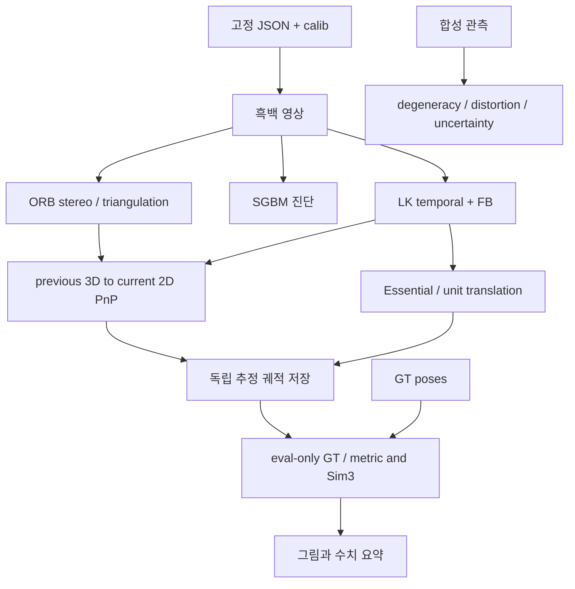


- geometry.py: SE(3) inverse/compose/transform/project, similarity fitting. T_ab는 b 좌표를 a로 변환한다.
- observations.py: ImagePair uint8 HxW, K 3x3 px, baseline m → ORB 좌우 pixels Nx2,
  descriptor Hamming bits, ratio 무차원, disparity px, X_previous Nx3 m, reprojection px.
  LK 입력은 previous ORB pixels, 출력은 current pixels 및 원래 인덱스 유지 mask.
- odometry.py: 영상·보정만 입력. PnP는 X_previous → current pixel로 T_current_previous를 추정한다.
  누적 T_start_current = T_start_previous @ inverse(T_current_previous).
  E도 같은 변환 방향이나 t는 임의 단위. GT 모듈을 import하지 않는다.
- evaluation.py: GT를 읽는 유일한 모듈. 각 구간 GT를 시작 자세로 정규화.
  stereo는 첫 자세 일치만, rigid fit/scale fit 없음. mono는 구간별 Sim3 position fit을 명시.
  ATE m, 1-frame relative translation RMSE m, rotation RMSE deg, endpoint m; 공식 KITTI score 아님.
- diagnostics.py: 실제 한 쌍 정류/게이트/SGBM/LK와 pose-only LM 전후. 깊이 정확도 GT 부재.
- synthetic.py: 알려진 생성 geometry/노이즈에서 퇴화·왜곡·불확실성을 별도 저장.
- figures.py: 저장된 stages에서 재현, 7인치 폭/12pt 이상, 실제와 합성을 제목으로 구분.
- run.py: seed, OpenCV 1 thread, 의존성 검사, 설정 및 입력 hash, 모듈 순차 실행/검증.
- test_invariants.py: 변환·단위·정렬·GT 의존성·hold·projection 불변량.


<a id="c12-4"></a>

### 4. 파라미터를 바꾸기 전에 고정할 표

| 단계 | 이번 설정 | 단위와 의미 |
|---|---|---|
| ORB | 2500 features | 검출 목표 수, 3D 점 수 아님 |
| ratio | d1 < 0.75 d2 | 무차원, d2=0 거절 |
| Hamming | <=64 | 서로 다른 bit 수 |
| 정류 | abs(dy)<=1.5, disparity>1 | px |
| 깊이 | 0<Z<=100 | m |
| LK | 21x21, maxLevel=3, 30회, eps=0.01 | 픽셀 패치·반복 종료 |
| FB | <=1 | px 왕복 오차 |
| PnP | RANSAC 2px + LM | 고정 3D, pose-only |
| PnP 반복·하한 | 최대 200회, 최소 inlier 12개 | 신뢰도 0.999, EPnP 가설 |
| Essential | RANSAC 1px, 신뢰도 0.999 | 최소 입력·수용 하한 12개, 다중 E이면 첫 후보 |
| 삼각측량 재투영 | 최대 1.5 | px, 양안 검사 |
| SGBM | 128 disparities, block=5, uniqueness=10 | 진단용, PnP 입력 아님 |
| SGBM penalty | 200, 800 | 내부 매칭 비용 벌점 |
| SGBM LR | <=1 | px, 우측 음수 disparity |

전체 설정의 진실의 원본은 `research/camera-slam-textbook/configs/experiment.json`이다. 설정 숫자를 같게 유지해도 FB로 입력 집합이 바뀌면 RANSAC 표본과 최종 pose가 달라질 수 있다. 실패 시 상대 pose를 항등으로 저장하고 다음 영상으로 진행한다. 따라서 유실된 이동을 다음 성공 프레임이 복구하지 않는다.

<a id="c12-5"></a>

### 5. 정렬과 지표의 계산식

GT는 각 구간의 첫 자세 역변환으로 시작 좌표계에 정규화한다. stereo에는 추가 fit을 하지 않는다.
ATE는 위치 오차 norm의 RMSE. relative D_i=inverse(T_i)*T_(i+1),
RPE residual=inverse(D_GT)*D_est이며 translation norm과 rotation angle을 각각 집계한다.
mono는 s,R,t로 위치의 제곱오차를 최소화한 Sim3를 평가에서만 사용한다. 한 가지 s는 가변 속도를 복원하지 못한다.
official KITTI 100..800m 구간 평가와 다르다. 구간이 짧고 동일 시퀀스라 광범위 성능 비교를 주장하지 않는다.

```text
ATE_RMSE = sqrt(mean_i ||p_est_i - p_gt_i||^2)
D_i = inverse(T_i) * T_(i+1)
E_i = inverse(D_gt_i) * D_est_i
RPE_translation_RMSE = sqrt(mean_i ||translation(E_i)||^2)
RPE_rotation_RMSE = sqrt(mean_i angle(rotation(E_i))^2)
```

위 회전각은 계산에서 rad이고 표에서는 deg로 변환한다. Stereo의 첫 자세 정규화는 전체 궤적에 최적 강체 정렬을 하는 연산이 아니다. Mono에서는 위치에 맞춘 Sim(3)의 회전·척도를 평가 출력에만 적용한다. 공식 KITTI의 긴 구간 상대 오차와 여기의 1-frame RPE를 혼동하지 않는다. [공식 평가 정의](https://www.cvlibs.net/datasets/kitti/eval_odometry.php)

<a id="c12-6"></a>

### 6. 실제 KITTI 여섯 평가와 음의 ablation


표는 읽기 쉬운 정밀도로 반올림했다. 판정·재계산에는 원본 JSON/CSV의 전체 정밀도를 사용한다. 단위가 같은 값도 정렬 정책이 다르면 직접 순위를 매기지 않는다.

| 구간 (끝 제외) | 방법 / 평가 정책 | ATE RMSE m | endpoint m | 1-frame RPE m | 회전 RPE deg |
|---|---|---:|---:|---:|---:|
| 0:200 | stereo FB, metric, 척도 적합 없음 | 1.7043 | 1.7156 | 0.0335 | 0.0725 |
| 0:200 | stereo forward only, metric | 1.6418 | 1.7462 | 0.0340 | 0.0745 |
| 0:200 | mono unit-step, 평가 전용 GT Sim3 | 5.1499 | 4.6047 | 0.2309 | 0.4292 |
| 400:500 | stereo FB, metric, 척도 적합 없음 | 0.7907 | 1.3389 | 0.0289 | 0.0466 |
| 400:500 | stereo forward only, metric | 0.7547 | 1.3275 | 0.0262 | 0.0472 |
| 400:500 | mono unit-step, 평가 전용 GT Sim3 | 3.1306 | 4.6432 | 0.2282 | 0.9030 |

- GT path length: 144.87855170702335m / 66.40044101005537m.
- mono 사후 fitted scale: 0.7242085489415547 / 0.7065476892909599 m per arbitrary unit.
- 각 방법의 hold=0/199, 0/99. 이는 이 두 구간의 결과일 뿐 robust tracking 인증이 아니다.
- FB는 두 구간 모두 ATE를 악화시켰다. 작은 잘못된 관측을 줄이는 게이트라도 최종 궤적 개선을 보장하지 않는다.
- stereo metric과 mono Sim3의 숫자를 공정한 정확도 순위로 해석하지 않는다. 관측과 정렬 조건이 다르다.
- 전체 숫자: `artifacts/summary.json`, 여섯 평가 행 `artifacts/metrics.csv`.
- 각 프레임의 잔차/오류/수: `artifacts/odometry/<segment>/frames.csv`, `artifacts/evaluation/<segment>/errors.csv`.


<a id="c12-7"></a>

### 7. 개발 구간: 같은 경로에서도 지표는 다른 질문을 한다

[0,200)은 첫 카메라에서 시작한 144.8786m의 GT 경로다. Stereo FB의 ATE는 forward-only보다 크지만 이 구간의 1-frame translation RPE는 조금 작다. 국소 제곱오차와 누적 drift의 방향·상관이 다르므로 모순이 아니다. 그림은 이 차이를 읽기 위한 것이며 일부 유리한 지표만 골라 개선이라고 결론내리지 않는다.


**그림 C12-01. 개발 구간: 미터 스테레오 궤적 (실제 KITTI 00).** 스테레오는 척도 적합 없음. 단안은 GT로 Sim3 적합한 형태 진단이므로 두 그림을 공정한 정확도 순위로 해석하지 않는다.

원본: `artifacts/evaluation/000000_000200/stages.npz`, `artifacts/odometry/000000_000200/frames.csv` (카메라 연구 디렉터리 기준; data/는 저장소 기준).

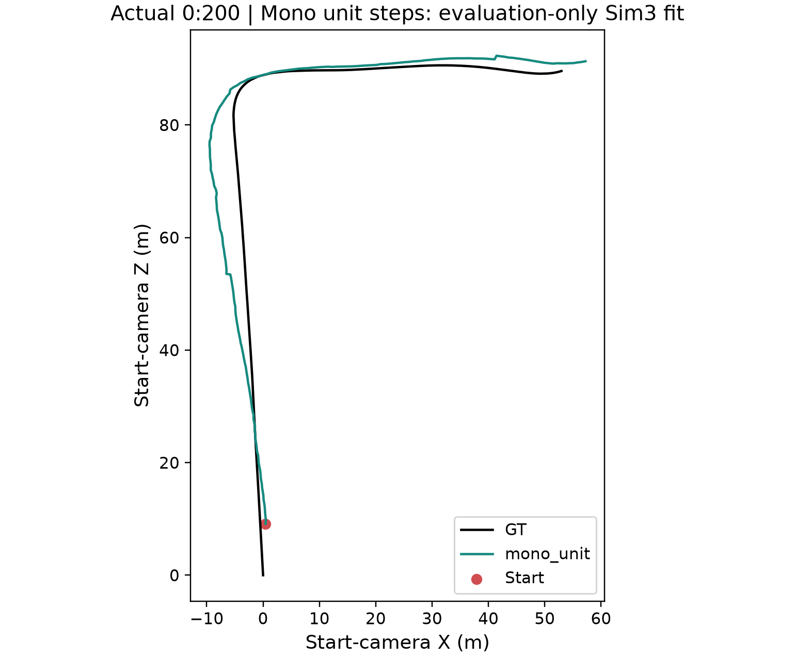

**그림 C12-02. 개발 구간: 평가 전용 Sim(3) 단안 궤적 (실제 KITTI 00).** 스테레오는 척도 적합 없음. 단안은 GT로 Sim3 적합한 형태 진단이므로 두 그림을 공정한 정확도 순위로 해석하지 않는다.

원본: `artifacts/evaluation/000000_000200/stages.npz`, `artifacts/odometry/000000_000200/frames.csv` (카메라 연구 디렉터리 기준; data/는 저장소 기준).

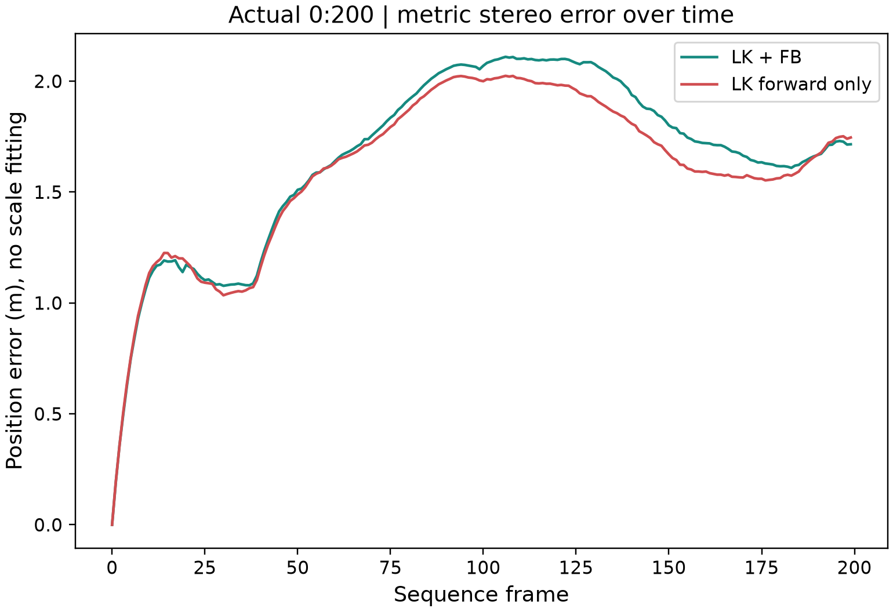

**그림 C12-03. 개발 구간: 미터 위치오차의 시계열 (실제 KITTI 00).** 동일 구간·metric 척도의 FB on/off 비교. 개선 또는 악화를 있는 그대로 표시한다.

원본: `artifacts/evaluation/000000_000200/stages.npz`, `artifacts/odometry/000000_000200/frames.csv` (카메라 연구 디렉터리 기준; data/는 저장소 기준).

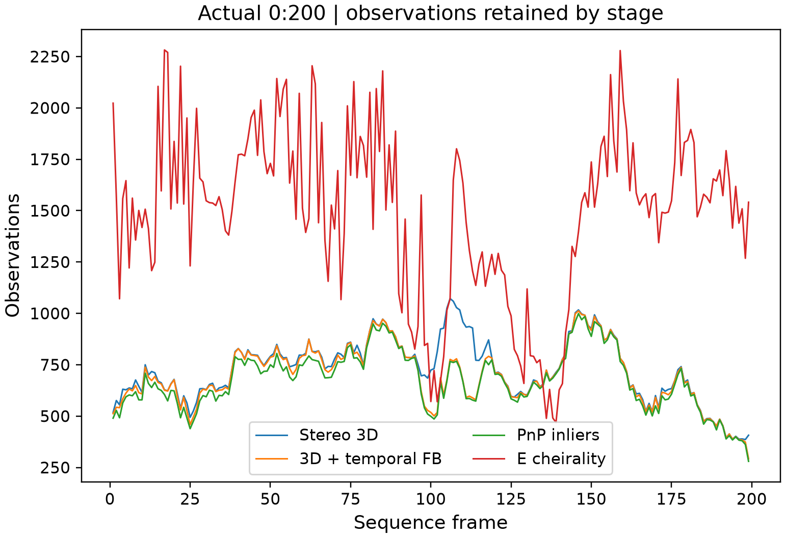

**그림 C12-04. 개발 구간: 서로 다른 관측 집합의 합의 수 (실제 KITTI 00).** E는 전체 ORB의 temporal track, PnP는 stereo 유효 3D 부분집합을 사용한다. 같은 관측 수의 비교가 아니다.

원본: `artifacts/evaluation/000000_000200/stages.npz`, `artifacts/odometry/000000_000200/frames.csv` (카메라 연구 디렉터리 기준; data/는 저장소 기준).


**그림 C12-05. 개발 구간: 프레임별 이동량과 단안 단위 길이 (실제 KITTI 00).** 단안의 성공 이동량은 항상 1이며 실패는 0이다. 하나의 Sim3 scale은 실제 속도 변화나 잃은 이동을 복원하지 못한다.

원본: `artifacts/evaluation/000000_000200/stages.npz`, `artifacts/odometry/000000_000200/frames.csv`, `artifacts/odometry/000000_000200/poses.npz` (카메라 연구 디렉터리 기준; data/는 저장소 기준).

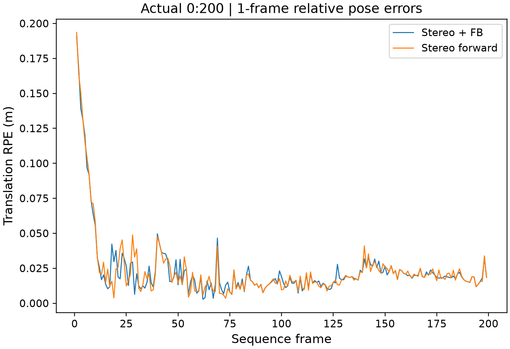

**그림 C12-06. 개발 구간: 한 프레임 상대 이동오차 (실제 KITTI 00).** 1-frame RPE이며 KITTI 공식 100..800m 구간 점수가 아니다. 회전 RPE는 별도 CSV/JSON에 보존한다.

원본: `artifacts/evaluation/000000_000200/stages.npz`, `artifacts/odometry/000000_000200/frames.csv` (카메라 연구 디렉터리 기준; data/는 저장소 기준).


**그림 C12-07. 개발 구간: 전후방 검사의 추가 효과 (실제 KITTI 00).** FB 게이트 외 동일 설정. RANSAC 입력 집합 변화로 결과가 달라진다. 인과적 일반화나 성능 개선 보장은 아니다.

원본: `artifacts/evaluation/000000_000200/stages.npz`, `artifacts/odometry/000000_000200/frames.csv` (카메라 연구 디렉터리 기준; data/는 저장소 기준).

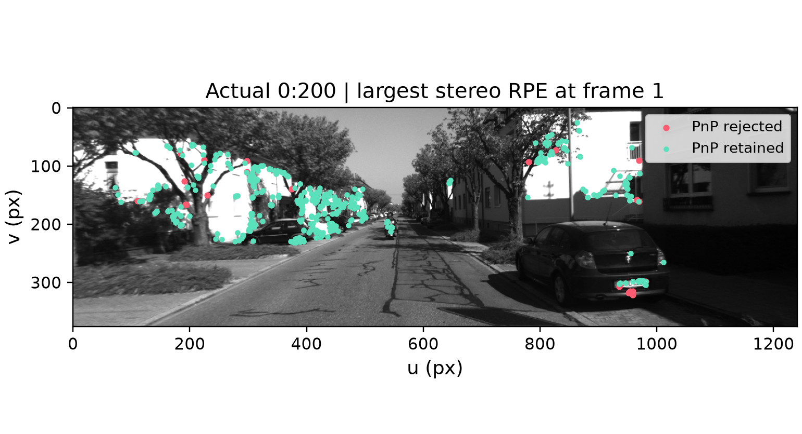

**그림 C12-08. 개발 구간: 최대 상대오차 프레임의 사후 진단 (실제 KITTI 00).** 평가에서 최대 RPE 프레임을 사후 선택한 진단. 동적 객체·가림 여부는 GT mask가 없어 확정하지 않는다.

원본: `artifacts/evaluation/000000_000200/stages.npz`, `artifacts/odometry/000000_000200/frames.csv`, `artifacts/odometry/000000_000200/000001.npz`, `data/kitti/dataset/sequences/00/image_0/000001.png` (카메라 연구 디렉터리 기준; data/는 저장소 기준).

<a id="c12-8"></a>

### 8. 분리 구간: 같은 설정에서도 실패 신호의 관계는 바뀐다

[400,500)은 개발 구간과 겹치지 않는 66.4004m GT 경로다. 이 구간에서도 FB의 ATE가 악화되었으며 translation RPE도 악화되었다. Holdout 결과를 본 뒤 임계값을 튜닝하지 않았다. 같은 시퀀스의 짧은 구간이므로 도시·날씨·카메라 일반화의 증거로 확대하지 않는다.

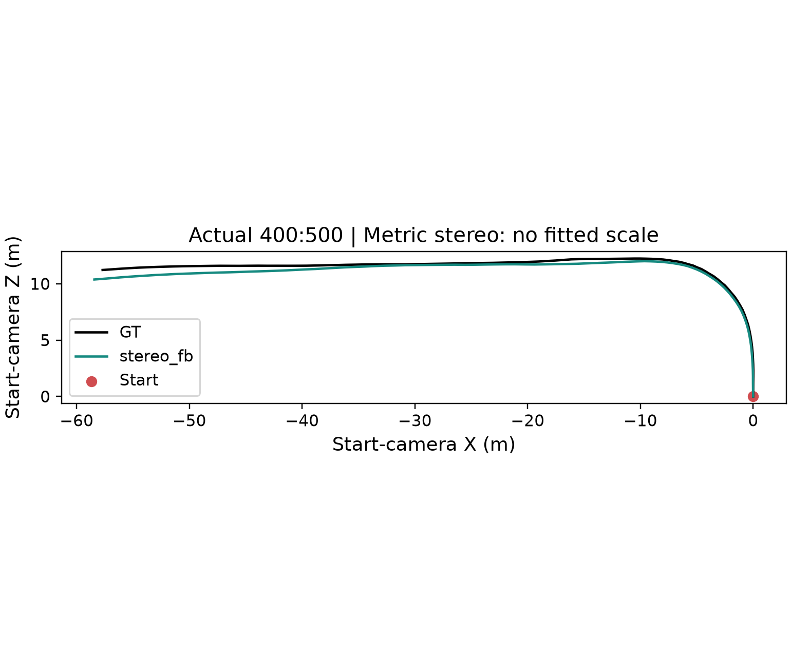

**그림 C12-09. 분리 구간: 미터 스테레오 궤적 (실제 KITTI 00).** 스테레오는 척도 적합 없음. 단안은 GT로 Sim3 적합한 형태 진단이므로 두 그림을 공정한 정확도 순위로 해석하지 않는다.

원본: `artifacts/evaluation/000400_000500/stages.npz`, `artifacts/odometry/000400_000500/frames.csv` (카메라 연구 디렉터리 기준; data/는 저장소 기준).


**그림 C12-10. 분리 구간: 평가 전용 Sim(3) 단안 궤적 (실제 KITTI 00).** 스테레오는 척도 적합 없음. 단안은 GT로 Sim3 적합한 형태 진단이므로 두 그림을 공정한 정확도 순위로 해석하지 않는다.

원본: `artifacts/evaluation/000400_000500/stages.npz`, `artifacts/odometry/000400_000500/frames.csv` (카메라 연구 디렉터리 기준; data/는 저장소 기준).


**그림 C12-11. 분리 구간: 미터 위치오차의 시계열 (실제 KITTI 00).** 동일 구간·metric 척도의 FB on/off 비교. 개선 또는 악화를 있는 그대로 표시한다.

원본: `artifacts/evaluation/000400_000500/stages.npz`, `artifacts/odometry/000400_000500/frames.csv` (카메라 연구 디렉터리 기준; data/는 저장소 기준).

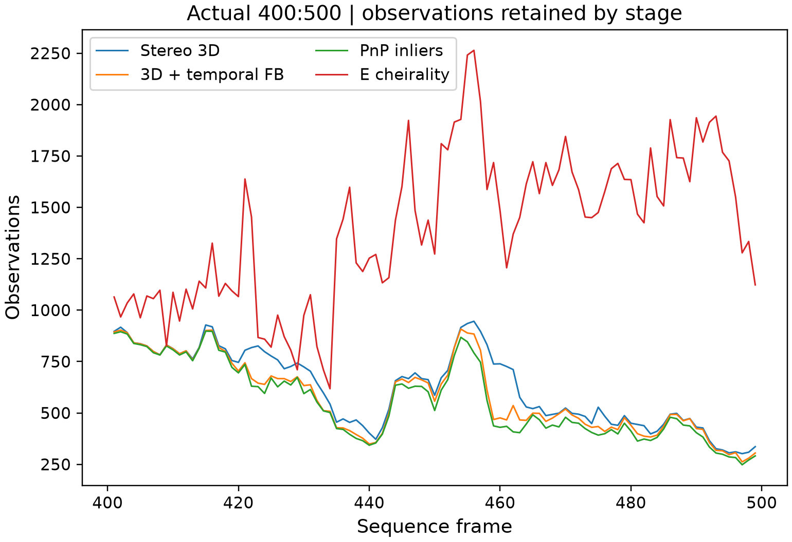

**그림 C12-12. 분리 구간: 서로 다른 관측 집합의 합의 수 (실제 KITTI 00).** E는 전체 ORB의 temporal track, PnP는 stereo 유효 3D 부분집합을 사용한다. 같은 관측 수의 비교가 아니다.

원본: `artifacts/evaluation/000400_000500/stages.npz`, `artifacts/odometry/000400_000500/frames.csv` (카메라 연구 디렉터리 기준; data/는 저장소 기준).


**그림 C12-13. 분리 구간: 프레임별 이동량과 단안 단위 길이 (실제 KITTI 00).** 단안의 성공 이동량은 항상 1이며 실패는 0이다. 하나의 Sim3 scale은 실제 속도 변화나 잃은 이동을 복원하지 못한다.

원본: `artifacts/evaluation/000400_000500/stages.npz`, `artifacts/odometry/000400_000500/frames.csv`, `artifacts/odometry/000400_000500/poses.npz` (카메라 연구 디렉터리 기준; data/는 저장소 기준).


**그림 C12-14. 분리 구간: 한 프레임 상대 이동오차 (실제 KITTI 00).** 1-frame RPE이며 KITTI 공식 100..800m 구간 점수가 아니다. 회전 RPE는 별도 CSV/JSON에 보존한다.

원본: `artifacts/evaluation/000400_000500/stages.npz`, `artifacts/odometry/000400_000500/frames.csv` (카메라 연구 디렉터리 기준; data/는 저장소 기준).


**그림 C12-15. 분리 구간: 전후방 검사의 추가 효과 (실제 KITTI 00).** FB 게이트 외 동일 설정. RANSAC 입력 집합 변화로 결과가 달라진다. 인과적 일반화나 성능 개선 보장은 아니다.

원본: `artifacts/evaluation/000400_000500/stages.npz`, `artifacts/odometry/000400_000500/frames.csv` (카메라 연구 디렉터리 기준; data/는 저장소 기준).

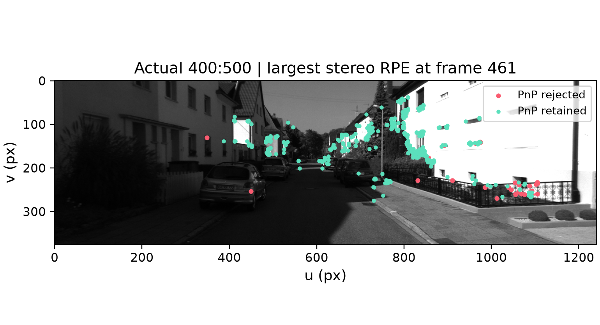

**그림 C12-16. 분리 구간: 최대 상대오차 프레임의 사후 진단 (실제 KITTI 00).** 평가에서 최대 RPE 프레임을 사후 선택한 진단. 동적 객체·가림 여부는 GT mask가 없어 확정하지 않는다.

원본: `artifacts/evaluation/000400_000500/stages.npz`, `artifacts/odometry/000400_000500/frames.csv`, `artifacts/odometry/000400_000500/000461.npz`, `data/kitti/dataset/sequences/00/image_0/000461.png` (카메라 연구 디렉터리 기준; data/는 저장소 기준).

<a id="c12-9"></a>

### 9. 관측 단계의 수치와 분모


| 프레임 | ratio 수 / y<=1.5px 비율 | cross-check 수 / y 비율 | 최종 sparse 3D 수 | LK forward → FB |
|---|---|---|---:|---|
| 0 | 657 / 0.8189 | 1217 / 0.7231 | 518 | 2495 → 2363 |
| 100 | 910 / 0.8615 | 1390 / 0.7986 | 731 | 2462 → 1539 |
| 400 | 1148 / 0.9233 | 1540 / 0.8942 | 897 | 2427 → 2417 |

ratio 뒤 Hamming<=64를 추가해도 세 프레임 모두 제거 수 0이었다. 이 ablation은 실제 무효한 추가 게이트도 공개한다.
ratio와 cross-check 비교는 정류 일관성/개수의 비교이며 정답 대응률이나 전체 VO 정확도 비교가 아니다.
y gate 뒤 y 비율=1은 게이트 정의에 의한 결과이므로 독립 검증 지표로 쓰지 않는다.
frame100의 큰 FB 제거 수는 관측 품질 변화의 신호지만, GT flow/가림 mask가 없어 원인을 확정하지 않는다.

| 프레임 | dense 양의 disparity 비율 | LR 일관 비율 | 깊이 유효 비율 / 수 | LM 전 → 후 RMSE px |
|---|---:|---:|---|---|
| 0 | 0.7453 | 0.6693 | 0.6600 / 307963 | 0.6297 → 0.6176 |
| 100 | 0.8177 | 0.7243 | 0.7173 / 334715 | 0.5516 → 0.4794 |
| 400 | 0.7028 | 0.5900 | 0.5836 / 272311 | 0.4649 → 0.4350 |

모든 dense 비율의 분모는 376*1241 전체 픽셀이다. 코드의 positive는 d>1px이며 수학적 d>0과 구분한다.
SGBM 깊이는 시각화/진단용이며 PnP 입력에 사용하지 않았다. PnP의 3D는 ORB stereo 삼각측량뿐이다.
LM 비교는 동일 RANSAC inlier의 in-sample 오차이다. 추가 일반화·joint BA 성능을 입증하지 않는다.


<a id="c12-10"></a>

### 10. 실패 분류와 결론의 강도


- 0:200의 최대 stereo 1-frame RPE는 frame1, 0.1907563355762054m. PnP 490/512 inlier에도 오차가 있다.
- 400:500의 최대값은 frame461, 0.08910900090936784m. PnP 435/466 inlier.
- 각 구간 상위 5개와 사후 Pearson 상관: `evaluation/<segment>/failures.json`, `worst_frames.csv`.
- feature 수/FB 오차와 RPE의 상관 부호가 구간별로 달라진다. 하나의 quality score로 오류 원인을 단정하지 않는다.
- 실패 프레임을 identity hold하더라도 다음 이미지로 진행하므로 실패 이동은 영구히 빠진다. 재추적 복구가 아니다.
- E가 여러 후보를 반환하면 첫 3x3만 사용한다. 이번 298 transition의 multi-E frame은 0개였다.
- 단안 성공 step=1은 속도 변화 표현 불가. 전체 Sim3가 맞더라도 국소 이동량은 틀릴 수 있다.
- 실제 loop closure, local map, keyframe selection, outlier semantic mask, 누적 BA 없음.


| 실패 분류 | 실제 관찰 또는 모델 | 아직 알 수 없는 것 |
|---|---|---|
| descriptor 모호성 | ratio/cross-check 개수·정류 비율 다름 | 정답 대응 precision |
| 기하 자기일관성 | y gate·재투영·FB 통과 | 물리적 대응의 진실 |
| 낮은 관측 가능성 | 합성 순수 회전에서도 E accepted | 모든 실제 퇴화 자동 검출 |
| 누적 오차 | 두 구간 FB ATE 악화 | 전체 시퀀스·다중 seed 일반화 |
| 지도 수명주기 부재 | 이전 frame 3D만 사용 | 장기 재추적·루프 복구 |
| 모델 불일치 | 동적 물체·블러 등이 가능한 원인 | mask/flow GT 없는 원인 확정 |
| 잘못된 제약 | 합성 false loop로 위치오차 확대 | 실제 loop rejection 성능 |

<a id="c12-11"></a>

### 11. 학습 경로는 교체 사다리가 아니라 분기 그래프다

공통 시작점은 A3/A5/A9/A10/A11과 C6의 재투영·Schur·gauge다.
그 다음 관심 있는 관측과 지도 목적에 따라 갈라진다.
한 분기의 최신 논문을 읽었다고 다른 분기의 기초 문제가 사라지는 것은 아니다.

```text
공통: projection -> residual -> Jacobian -> uncertainty -> gauge
  |
  +-- 희소 장기 지도: PTAM -> ORB-SLAM -> ORB-SLAM2 -> ORB-SLAM3
  |                    |        |
  |                    |        +-- BoW/DBoW2 -> geometric loop -> pose graph
  |                    +-- BA / Schur / map lifecycle
  |
  +-- 광도 관측: LSD-SLAM -> DSO -> LDSO
  |              |          |
  |              +-- Sim3   +-- photometric calibration / marginalization
  |
  +-- 관성 관측: MSCKF -----> nullspace / consistency
  |              Forster --> preintegration -> VINS-Mono / ORB-SLAM3
  |                                             +-- time calibration
  |
  +-- RGB-D 기하: Curless-Levoy -> KinectFusion -> TSDF surface
  |               OctoMap --------------------> occupancy
  |               Voxblox --------------------> ESDF planning distance
  |
  +-- 학습 대응: SuperPoint -> SuperGlue -> LightGlue
  +-- 학습 반복 추정: DROID-SLAM -> geometry + learned update 해석
  +-- 장면 표현: NICE-SLAM / 3DGS -> Gaussian Splatting SLAM
  +-- 의미와 운동: SemanticFusion / DynaSLAM
  +-- 별도 행동 학습: VLM 경계 -> RT-2 / OpenVLA
```

화살표는 이 교재의 읽기 의존성을 뜻하며 논문이 반드시 직접 계승 관계라는 뜻은 아니다.
MSCKF와 optimization VIO는 계산·선형화·상태 유지 방식이 다른 대안이다.
occupancy는 TSDF보다 오래되었다고 쓸모없어진 표현이 아니다.
photorealistic rendering이 필요 없는 navigation에는 ESDF/occupancy가 직접 목적에 맞을 수 있다.
신경 matcher를 쓰지 않는 baseline도 자원·해석 가능성·도메인 적합성 때문에 유효하다.

<a id="c12-12"></a>

### 12. 단계별 읽기 질문과 통과 기준

1. **PTAM + ORB-SLAM:** 키프레임·관측·지도점의 관계를 직접 그린다.
   통과 기준은 frame 삭제와 landmark 삭제가 어떻게 다른지 설명하는 것이다.
2. **BA synthesis:** 재투영 J와 Schur 블록을 손으로 계산한다.
   통과 기준은 residual 부호와 perturbation 방향을 바꾸었을 때 무엇이 달라지는지 말하는 것이다.
3. **DBoW2 + ORB loop:** 검색 점수에서 relative pose까지 필요한 산출물을 나열한다.
   통과 기준은 반복 복도에서 score가 높아도 edge를 거절할 근거를 제시하는 것이다.
4. **LSD-SLAM + DSO + LDSO:** residual 종류와 active/global map을 비교한다.
   통과 기준은 direct와 dense가 다른 축이고 DSO와 loop-SLAM이 다른 범위임을 설명하는 것이다.
5. **MSCKF + Forster:** feature elimination과 IMU factor compression을 구분한다.
   통과 기준은 nullspace projection과 Schur complement의 공통점·차이를 말하는 것이다.
6. **VINS-Mono + temporal calibration + ORB-SLAM3:** 초기화와 observability를 읽는다.
   통과 기준은 정지 구간만으로 모든 calibration을 추정할 수 없는 이유를 설명하는 것이다.
7. **Curless-Levoy + KinectFusion + OctoMap + Voxblox:** 지도 목적을 분리한다.
   통과 기준은 같은 depth에서 TSDF와 occupancy가 어떤 다른 값으로 갱신되는지 계산하는 것이다.
8. **SuperPoint + SuperGlue + LightGlue:** 학습 front-end의 타입 계약을 읽는다.
   통과 기준은 resize와 K, descriptor와 vocabulary, confidence와 covariance를 구별하는 것이다.
9. **DROID + NICE-SLAM + 3DGS + GS-SLAM:** 학습 대상이 update인지 scene인지 식별한다.
   통과 기준은 trajectory·geometry·rendering 평가를 분리하는 것이다.
10. **SemanticFusion + DynaSLAM + RT-2/OpenVLA:** 의미·운동·행동의 경계를 읽는다.
    통과 기준은 KITTI pose를 action label로 대체할 수 없는 이유를 설명하는 것이다.

위 번호는 수업 진행 순서이며 알고리즘의 절대 성능 순위가 아니다.
관성 데이터가 없다면 5~6은 이론 학습으로 남기고 RGB-D 수집 계약을 먼저 검증할 수 있다.
GPU가 없다면 8~9는 입출력·논문 수식·실패 분석을 공부하고 실행 가능성을 별도 검토한다.
실습 자원이 없다는 이유로 미실행 결과를 성공으로 쓰지 않는다.

<a id="c12-13"></a>

### 13. 실행 명령과 산출물의 provenance

저장소 루트에서 실행한다. 아래 명령은 기존 데이터와 연구 가상환경이 있다는 전제다. 실제 입력 영상은 Git에 포함된 코드만으로 대체되지 않는다. 전체 설정과 SHA-256으로 실행 당시의 입력·소스를 식별하고, code freeze는 **d22a4e8**로 기록한다. 초기 실행 manifest의 HEAD가 연구 시작점 또는 중간 커밋인 것은 그 당시 작업 트리에서 생성했기 때문이다. HEAD만으로 미커밋 소스를 식별하지 않고 source hash를 함께 보존했다.

~~~sh
cd /Users/youth/Project/slam-lab
research/20261031_vo-lo-study/.venv/bin/python research/camera-slam-textbook/src/run.py
research/20261031_vo-lo-study/.venv/bin/python research/camera-slam-textbook/src/verify.py --repeat
research/20261031_vo-lo-study/.venv/bin/python -m unittest discover -s research/camera-slam-textbook/src -p test_invariants.py -v
python3 research/camera-slam-textbook/notes/geometry-verification.py
python3 research/camera-slam-textbook/notes/advanced-verification.py
~~~

Python 3.11, NumPy 2.4.6, SciPy 1.17.1, Matplotlib 3.11.1, opencv-python 5.0.0.93 (cv2=5.0.0)을 사용했다. OpenCV 문헌 링크의 4.x API 설명과 실제 5.0 환경을 구분한다. --reuse-estimates는 추정 재실행이 아니라 기존 추정의 평가·그림 재집계다. 마지막 summary의 run_mode가 이 값이어도 독립 반복 검증 결과는 별도 보존한다. runtime은 두 추정기와 ablation을 포함하지만 모든 저장 I/O를 포함하는 end-to-end 처리 시간이 아니므로 실시간 인증에 사용하지 않는다.

| 경로: research/camera-slam-textbook/ 기준 | 산출물과 확인 질문 |
|---|---|
| configs/experiment.json | 구간·seed·게이트·추정기 설정 |
| artifacts/stereo/*.npz | 좌우 픽셀, descriptor 거리, mask, 3D, 재투영 |
| artifacts/dense/*.npz | fixed16 disparity, LR 잔차, 깊이·유효 mask |
| artifacts/tracking/*.npz | 순/역방향 좌표와 status, FB, 밝기 오차 |
| artifacts/reprojection/*.npz | 동일 inlier의 pose-only LM 전후 |
| artifacts/odometry/*/poses.npz | 정렬 전 세 방법의 추정 자세 |
| artifacts/odometry/*/frames.csv | 성공·hold·대응 수·프레임 진단 |
| artifacts/evaluation/*/errors.csv | 평가 전용 GT 연결과 지표 |
| artifacts/evaluation/*/failures.json | 사후 worst frame·상관 진단 |
| artifacts/synthetic/ | 왜곡·깊이 불확실성·퇴화 모델 |
| artifacts/provenance/ | 입력·설정·소스 hash와 환경 |
| artifacts/tests/ | 불변량·독립 반복 검증 |
| figures/figure_manifest.json | 모든 신규 카메라 그림의 원본 배열 연결 |

반복 검증에서 298 transition의 세 방법 자세는 최대 절대차 0이었고, 두 구간 8557+4257=12814개 stage 배열이 NaN 위치를 포함하여 일치했다. 749 산출물과 14 source/config hash를 검증했고 602 입력 hash를 기록했다. 이는 고정 환경에서의 결정적 재현성이지 정확성이나 다른 하드웨어의 bitwise 동일성 보장이 아니다.

19개 실제 연구 불변량 테스트, 15개 합성 백엔드 테스트, 기하 계산 69개와 고급 계산 32개 검사가 통과했다. 서로 다른 검사 묶음을 알고리즘 성공률로 합산하지 않는다. 기하 검사는 22개 본문 계산 예와 연습문제의 산술·행렬 관계를, 고급 검사는 Jacobian·Schur·사전적분·지도 갱신 등 손계산을 검사한다. 이로써 모든 문헌 알고리즘의 구현을 검증한 것은 아니다.

실제 수정한 버퍼 문제도 재현 계약의 일부다. LK status=0의 err는 미정의였고 초기 반복에서 2500개 중 3개가 달랐다. 궤적은 같았지만 이 값들을 정상 관측으로 저장하면 비결정적 진단이 된다. 실패 좌표/오차는 NaN, 왕복 오차는 inf로 정규화하고 raw status를 남긴 뒤 전체 stage 반복 일치를 확인했다. 합성 회전오차도 실패 hold 포함 통계와 성공 조건부 통계를 분리했다.

<a id="c12-14"></a>

### 14. 합성 백엔드의 독립 재현

Repository root에서 실행한다. 기존 venv를 재사용하며 install 명령은 필요 없다.

```sh
cd /Users/youth/Project/slam-lab
env PYTHONDONTWRITEBYTECODE=1 OPENBLAS_NUM_THREADS=1 OMP_NUM_THREADS=1 MPLCONFIGDIR=.cache/matplotlib research/20261031_vo-lo-study/.venv/bin/python research/camera-backend-lessons/src/run.py
env PYTHONDONTWRITEBYTECODE=1 OPENBLAS_NUM_THREADS=1 OMP_NUM_THREADS=1 MPLCONFIGDIR=.cache/matplotlib research/20261031_vo-lo-study/.venv/bin/python research/camera-backend-lessons/src/test_backend.py
```

`research/camera-backend-lessons/src/run.py`가 plotting import 전에 own directory로 이동하므로 상대 MPLCONFIGDIR도 그 안에 생긴다.
입력 seed=20261124, graph seed=20261125. NumPy 2.4.6, SciPy 1.17.1, cv2 5.0.0
(opencv-python distribution 5.0.0.93), Matplotlib 3.11.1을 사용했다.
Direct dependency 목록은 `configs/requirements-observed.txt`이며 전체 transitive lockfile은 아니다.

| 경로 | 내용 |
|---|---|
| `configs/lesson.json` | 모든 실험 noise·baseline·크기·seed·최대 평가 횟수 |
| `research/camera-backend-lessons/src/backend.py` | 원본 모델, analytic/numerical Jacobian 옵션, solver |
| `research/camera-backend-lessons/src/run.py` | 실험 case, 지표·NPZ·그림·manifest 생성 |
| `research/camera-backend-lessons/src/test_backend.py` | 기하·수치미분·수렴 관찰·hash·그림 테스트 |
| `artifacts/ba/module.npz` | GT/초기/각 해의 pose·point·projection·residual, 관측과 mask |
| `artifacts/gauge/module.npz` | free/fixed spectrum, 전역변환, scale별 pixel 변화 |
| `artifacts/pose_graph/module.npz` | GT/초기/각 해, directed edges·측정·sigma·raw/whitened residual |
| 각 모듈 `metrics.json` | 단위가 명시된 RMSE와 solver 상태 |
| `artifacts/manifest.json` | 실행 HEAD·Python·dependency·config, 소스/config와 산출물 SHA-256 |
| `artifacts/tests` | 실행한 unittest 목록·성패, 실패 시 nonzero exit |

NPZ shape/축 순서는 `notes/architecture.md` 참조. Source 위치는 이 수업 버전의 파일 기준이며
정확한 실행본은 manifest SHA-256으로 구분한다. 기존 HEAD만으로 새 미커밋 파일을 식별할 수 없다.

테스트는 finite projection, positive depth, 모든 analytic J 열의 중앙차분 대조,
analytic/numerical solver 비교, anchor 유지, rigid gauge·scale·SVD, seed 반복,
SE(2) compose/relative, loop 방향·정답, 전체 산출물 finite, 두 변수군 갱신, fixed-seed 결과,
source/artifact hash, 그림 개수와 계산 연습문제를 포함한다.
성패는 `artifacts/tests/metrics.json`을 진실의 원본으로 사용한다.

<a id="c12-15"></a>

### 15. 코드에서 다시 찾는 관측과 변환

모든 줄 번호는 d22a4e8의 경로다. 실제 실행본은 manifest의 SHA-256으로도 확인한다.

| 파일:줄 (research/camera-slam-textbook/ 기준) | 책임 |
|---|---|
| src/common.py:47 | 보정·기준선 |
| src/observations.py:8 | ORB stereo·게이트·삼각측량 |
| src/observations.py:45 | LK/FB·실패 버퍼 정규화 |
| src/observations.py:73 | SGBM fixed16/LR/깊이 |
| src/odometry.py:10 | PnP RANSAC·pose-only LM |
| src/odometry.py:38 | E 첫 후보·단위 이동 |
| src/odometry.py:62 | 상대변환 역누적·stage 저장 |
| src/odometry.py:108 | 실패 여부와 별개인 다음 영상 진행 |
| src/evaluation.py:22 | 유일한 GT 읽기·평가 정렬 |
| src/geometry.py:14 | SE(3) 역변환 |
| src/geometry.py:31 | 평가 Sim(3) |
| src/synthetic.py:9 | 성공/hold 분리 통계 |
| src/worked_examples.py:7 | 실제 수치 예 |
| src/verify.py:12 | 독립 재실행과 산출물 확인 |

이 표는 운영 src/vo 경로의 대체 선언이 아니다. 운영 코드에 통합하려면 자료형·실패 정책·시간 정렬·테스트를 별도로 설계해야 하며, 이번 산출물은 보고서 수준에서 그 연결만 제안한다.

<a id="c12-16"></a>

### 16. 기호 색인과 약어: 숫자보다 좌표와 단위를 먼저 확인하기

| 기호·용어 | 뜻과 단위 | 처음 찾아볼 장 |
|---|---|---|
| p=(u,v), q=K^-1 p | 픽셀 px, 정규화 광선 무차원 | C1 |
| K, fx,fy,cx,cy | 내부 보정, 초점거리·주점 px | C1 |
| T_AB, R_AB, t_AB | B→A 변환, 회전 무차원·병진 길이 | A1/C1 |
| C_W=-R_CW^T t_CW | 세계에서 본 카메라 중심 | C1/C5 |
| F / E / H | Fundamental / Essential / Homography | C2 |
| RANSAC | Random Sample Consensus, 오대응 강건 추정 | C2 |
| DLT | Direct Linear Transformation, 동차 선형 추정 | C2 |
| cheirality | 점이 카메라 앞에 있다는 양의 깊이 조건 | C2/C3 |
| gauge | 관측을 바꾸지 않는 좌표계 자유 | C3/C6 |
| B 또는 b, d, Z, rho | 기준선 m, 시차 px, 깊이 m, 역깊이 1/m | C4 |
| ORB / FAST / BRIEF | 방향 보정 특징 / 원형 밝기 검사 / 이진 기술자 | ORB장/C4 |
| SGBM | Semi-Global Block Matching, 조밀 대응 | C4 |
| LK / FB | Lucas–Kanade / Forward–Backward, 시간 추적·왕복 검사 | C5 |
| PnP / EPnP | Perspective-n-Point / Efficient PnP, 3D–2D 자세 | C5 |
| LM | Levenberg–Marquardt, 감쇠 비선형 정련 | A9/C5 |
| BA / J / Sigma | Bundle Adjustment / Jacobian / 공분산 | C6 |
| Schur / marginalization | 한 선형 문제 소거 / 과거 상태의 정보 압축 | C6 |
| BoW / TF-IDF | Bag of Words / Term Frequency–Inverse Document Frequency | C7 |
| SE(3) / Sim(3) | 강체 6자유도 / 척도 포함 유사변환 7자유도 | A10/C7 |
| DN / SSD | Digital Number / Sum of Squared Differences | C5/C8 |
| VIO / IMU / bias | Visual-Inertial Odometry / Inertial Measurement Unit / 편향 | C9 |
| MSCKF | Multi-State Constraint Kalman Filter | C9 |
| TSDF / ESDF | Truncated Signed Distance Function / Euclidean Signed Distance Field | C11 |
| 3DGS | 3D Gaussian Splatting, 장면 렌더링 표현 | C11 |
| VLM / VLA | Vision-Language Model / Vision-Language-Action | C11 |
| ATE / RPE / RMSE | Absolute Trajectory Error / Relative Pose Error / Root Mean Square Error | C12 |

같은 문자라도 관측 모델마다 뜻이 다르다. 보정 P1과 SGBM 벌점 P1, 본질행렬 E와 비용 E, 깊이의 역수 rho와 강건 손실 rho를 문맥·단위로 구분한다. 수식의 전치 T와 변환 T도 마찬가지다. 학습 confidence, 광도 weight, metric 공분산은 이름이 비슷해도 같은 확률량이 아니다.

<a id="c12-17"></a>

### 17. 참고문헌과 판본: 기하·관측의 1차 자료

| ID | 저자·제목·연도 | 확인한 1차 링크와 쓰임 |
|---|---|---|
| S1 | Zhengyou Zhang, *A Flexible New Technique for Camera Calibration*, 2000 | [Microsoft 출판 목록](https://www.microsoft.com/en-us/research/publication/a-flexible-new-technique-for-camera-calibration/), [기술보고서](https://www.microsoft.com/en-us/research/wp-content/uploads/2016/02/tr98-71.pdf): 평면 보정 |
| S2 | Richard I. Hartley, *In Defense of the Eight-Point Algorithm*, 1997 | [원문 사본](https://wcours.gel.ulaval.ca/GIF4105/tps/tp4/hartley.pdf): 정규화 8점법 |
| S3 | David Nistér, *An Efficient Solution to the Five-Point Relative Pose Problem*, 2004 저널판 | [원문 선행판 사본](https://www-users.cse.umn.edu/~hspark/CSci5980/nister.pdf), [저널 DOI](https://doi.org/10.1109/TPAMI.2004.17): 5점 다중 해 |
| S4 | Martin A. Fischler·Robert C. Bolles, *Random Sample Consensus: A Paradigm for Model Fitting with Applications to Image Analysis and Automated Cartography*, 1981 | [SRI 원문](https://www.sri.com/wp-content/uploads/2021/12/ransac-publication.pdf): 강건 추정 |
| S5 | Richard I. Hartley·Peter Sturm, *Triangulation*, 1997 저널판 | [저자 원문](https://users.cecs.anu.edu.au/~hartley/Papers/triangulation/triangulation.pdf): 삼각측량 목적함수 |
| S6 | Andrea Fusiello·Emanuele Trucco·Alessandro Verri, *A compact algorithm for rectification of stereo pairs*, 2000 | [저자 원문](https://fusiello.github.io/papers/00120016.pdf): 정렬 |
| S7 | Vincent Lepetit·Francesc Moreno-Noguer·Pascal Fua, *EPnP: An Accurate O(n) Solution to the PnP Problem*, 2009 권호 | [기관 서지](https://infoscience.epfl.ch/entities/publication/34721c4a-90c2-421c-9df6-15a96127a4a2), [저자 PDF](https://vincentlepetit.github.io/files/papers/comp_lepetit_ijcv08.pdf): PnP |
| S8 | Bruce D. Lucas·Takeo Kanade, *An Iterative Image Registration Technique with an Application to Stereo Vision*, 1981 | [IJCAI](https://ijcai.org/proceedings/1981/127): LK |
| S9 | Simon Baker·Iain Matthews, *Lucas-Kanade 20 Years On: A Unifying Framework*, 2004 | [CMU 기관 페이지](https://publications.ri.cmu.edu/lucas-kanade-20-years-on-a-unifying-framework): 정합 갱신 방식 |
| S10 | Raúl Mur-Artal·J. M. M. Montiel·Juan D. Tardós, *ORB-SLAM: A Versatile and Accurate Monocular SLAM System*, 2015 | [저자 공개본](https://arxiv.org/abs/1502.00956): 초기화·시스템 경계 |
| S11 | Andreas Geiger·Philip Lenz·Christoph Stiller·Raquel Urtasun, *Vision meets Robotics: The KITTI Dataset*, 2013 | [저자 원문](https://www.cvlibs.net/publications/Geiger2013IJRR.pdf): 센서·보정 형식 |
| S12 | Jakob Engel·Vladlen Koltun·Daniel Cremers, *Direct Sparse Odometry*, 2016 사전공개 | [공개본](https://arxiv.org/abs/1607.02565): 광도 관측 모델 |
| S13 | David Schubert·Nikolaus Demmel·Vladyslav Usenko·Jörg Stückler·Daniel Cremers, *Direct Sparse Odometry with Rolling Shutter*, 2018 | [공개본](https://arxiv.org/abs/1808.00558): 행별 시각 |
| S14 | Johannes L. Schönberger·Jan-Michael Frahm, *Structure-from-Motion Revisited*, 2016 | [CVF 학회 원문](https://openaccess.thecvf.com/content_cvpr_2016/html/Schonberger_Structure-From-Motion_Revisited_CVPR_2016_paper.html): SfM |
| S15 | Raúl Mur-Artal·Juan D. Tardós, *ORB-SLAM2: an Open-Source SLAM System for Monocular, Stereo and RGB-D Cameras*, 2016 사전공개 | [공개본](https://arxiv.org/abs/1610.06475): RGB-D의 시스템 위치 |
| S16 | OpenCV 프로젝트, *Camera Calibration and 3D Reconstruction*, 4.13.0 문서 | [공식 문서](https://docs.opencv.org/4.13.0/d9/d0c/group__calib3d.html): API 계약 |
| S17 | COLMAP 프로젝트, *Tutorial*, 열람 2026-11-24 | [공식 문서](https://colmap.github.io/tutorial.html): 희소·밀집 재구성 구별 |

S1의 기술보고서는 1998년부터 수정되었고 저널판은 2000년이다.
S2의 1997년 저널 제목은 Defense와 Eight-Point 표기를 사용하므로 다른 연도의 Defence/8-Point 표기와 구분한다.
S3는 IEEE 페이지가 접근 확인 화면을 반환해 전체 저널판을 직접 읽지 못했다.
읽은 8쪽 공개 원문과 2004년 저널판을 동일 PDF로 표기하지 않았으며, 불일치하는 페이지 범위는 인용에서 제외했다.
S3의 저자·제목·2004년은 [PubMed 서지](https://pubmed.ncbi.nlm.nih.gov/18579936/)와 공개 원문, DOI를 교차 확인했다.
S4의 SRI HTML 소개에는 무관한 사회인지 문장이 섞여 있어 그 소개는 근거로 사용하지 않고 원문 PDF를 확인했다.
S7의 PDF는 2008년 저작권·접수 정보를, 기관 서지는 2009년 권호 출판을 표기하므로 둘을 모순으로 처리하지 않는다.
S8의 IJCAI 판은 674~678쪽이며 다른 워크숍 재수록의 페이지 번호를 혼합하지 않는다.
S12와 S15는 이 교재에서 실제 확인한 사전공개 연도를 명시했으며 최종 저널 출판 연도로 가장하지 않는다.
문헌의 성능 우월성 문구나 논문의 실험 수치는 이 저장소의 성능으로 옮겨 적지 않았다.

Hartley, Richard I.; Zisserman, Andrew. *Multiple View Geometry in Computer Vision*, 2nd ed., Cambridge University Press, 2004. [저자 공식 서지](https://www.robots.ox.ac.uk/~vgg/hzbook/). 이 책은 심화 독서 대상이며 본 교재의 그림이나 문장 원본으로 사용하지 않았다.

<a id="c12-18"></a>

### 18. 참고문헌과 판본: 시스템·관성·지도·학습

아래의 연도는 출판 연도이며 필요할 때 최초 사전공개 연도를 함께 구분한다. 문헌에 보고된 성능을 이 저장소의 측정값으로 전용하지 않았다.

| 번호 | 저자·연도·제목 | 원문과 학습 초점 |
|---|---|---|
| 1 | Georg Klein, David Murray, 2007, **Parallel Tracking and Mapping for Small AR Workspaces**, ISMAR |  추적과 지도 작성을 분리한 키프레임 기반 AR 시스템이다. 논문과 이후 배포 구현의 초기화·재위치추정 구성이 항상 같지는 않다. [논문](https://www.robots.ox.ac.uk/~gk/publications/KleinMurray2007ISMAR.pdf), [저자 프로젝트](https://www.robots.ox.ac.uk/~gk/PTAM/) |
| 2 | Raul Mur-Artal, J. M. M. Montiel, Juan D. Tardos, 2015, **ORB-SLAM: a Versatile and Accurate Monocular SLAM System**, IEEE T-RO |  ORB 특징을 추적·지도 작성·재위치추정·루프 처리에 사용하며 키프레임과 점을 선택적으로 유지한다. [원문](https://arxiv.org/abs/1502.00956) |
| 3 | Raul Mur-Artal, Juan D. Tardos, 2017, **ORB-SLAM2: an Open-Source SLAM System for Monocular, Stereo and RGB-D Cameras**, IEEE T-RO |  단안 외에 stereo/RGB-D 관측을 지원하고 지도 재사용과 루프 후 최적화를 다룬다. arXiv 최초 공개는 2016년이다. [원문](https://arxiv.org/abs/1610.06475), [저자 서지](https://webdiis.unizar.es/~raulmur/) |
| 4 | Carlos Campos, Richard Elvira, Juan J. Gomez Rodriguez, Jose M. M. Montiel, Juan D. Tardos, 2021, **ORB-SLAM3: An Accurate Open-Source Library for Visual, Visual-Inertial and Multi-Map SLAM**, IEEE T-RO |  관성 초기화를 MAP 추정으로 다루고 여러 지도를 유지·병합한다. 최초 프리프린트는 2020년이다. [원문](https://arxiv.org/html/2007.11898v2) |
| 5 | Bill Triggs, Philip McLauchlan, Richard Hartley, Andrew Fitzgibbon, 2000, **Bundle Adjustment - A Modern Synthesis** |  공동 카메라·구조 추정, 희소 최적화, 강건 비용과 gauge를 체계화한다. 1999 워크숍과 2000 출판 연도를 혼동하지 않는다. [저자 보관 원문](https://thoth.inrialpes.fr/people/triggs/pubs/Triggs-hdr-papers.pdf) |
| 6 | Dorian Galvez-Lopez, Juan D. Tardos, 2012, **Bags of Binary Words for Fast Place Recognition in Image Sequences**, IEEE T-RO |  이진 기술자 vocabulary tree와 장소 검색, 기하 대응 가속을 다룬다. DBoW2는 해당 계열의 라이브러리이며 SLAM 전체가 아니다. [저자 서지](https://doriangalvez.com/publications), [공식 구현과 인용 정보](https://github.com/dorian3d/DBoW2) |
| 7 | Jakob Engel, Thomas Schops, Daniel Cremers, 2014, **LSD-SLAM: Large-Scale Direct Monocular SLAM**, ECCV |  직접 영상 정합, 반밀집 깊이와 Sim(3) 키프레임 그래프를 사용한다. [저자 프로젝트](https://cvg.cit.tum.de/research/vslam/lsdslam) |
| 8 | Jakob Engel, Vladlen Koltun, Daniel Cremers, 2018, **Direct Sparse Odometry**, IEEE TPAMI; 프리프린트 2016 |  광도 보정을 포함한 희소 직접 최적화로 pose와 inverse depth 등을 함께 추정한다. 이름 그대로 원 기본 시스템은 VO다. [원문](https://arxiv.org/pdf/1607.02565), [출판 연도 확인용 저자 서지](https://www.cvg.cit.tum.de/publications?key=Engel-et-al-pami2018) |
| 9 | Xiang Gao, Rui Wang, Nikolaus Demmel, Daniel Cremers, 2018, **LDSO: Direct Sparse Odometry with Loop Closure**, IROS |  DSO 계열에 루프 탐지와 pose graph 최적화를 추가한다. [원문](https://arxiv.org/abs/1808.01111) |
| 10 | Anastasios I. Mourikis, Stergios I. Roumeliotis, 2007, **A Multi-State Constraint Kalman Filter for Vision-aided Inertial Navigation**, ICRA |  여러 카메라 pose 관측의 제약을 사용하되 모든 3D feature를 EKF 상태에 넣지 않는다. [저자 원문](https://intra.ece.ucr.edu/~mourikis/papers/MourikisRoumeliotis-ICRA07.pdf) |
| 11 | Christian Forster, Luca Carlone, Frank Dellaert, Davide Scaramuzza, 2017, **On-Manifold Preintegration for Real-Time Visual-Inertial Odometry**, IEEE T-RO |  회전 군에서 사전적분·noise·bias 보정과 factor graph 결합을 유도한다. 프리프린트는 2015년, DOI에는 2016이 들어간다. [저자 원문](https://dellaert.github.io/files/Forster16tro.pdf), [기관 서지](https://infoscience.epfl.ch/entities/publication/a90bb09d-35a8-4d0b-9640-0e64b3fca64d/articledetails) |
| 12 | Tong Qin, Peiliang Li, Shaojie Shen, 2018, **VINS-Mono: A Robust and Versatile Monocular Visual-Inertial State Estimator**, IEEE T-RO |  초기화, tightly coupled 최적화, 재위치추정과 4DoF pose graph를 결합한다. 프리프린트는 2017년이다. [원문](https://arxiv.org/pdf/1708.03852), [저자 서지](https://github.com/HKUST-Aerial-Robotics/VINS-Mono/blob/master/support_files/paper_bib.txt) |
| 13 | Tong Qin, Shaojie Shen, 2018, **Online Temporal Calibration for Monocular Visual-Inertial Systems**, IROS |  시간 offset을 pose·feature 상태와 공동 추정한다. [원문](https://arxiv.org/abs/1808.00692) |
| 14 | Brian Curless, Marc Levoy, 1996, **A Volumetric Method for Building Complex Models from Range Images**, SIGGRAPH |  정렬된 거리 영상을 가중 signed-distance volume으로 누적하고 등위면을 추출한다. [저자 원문 페이지](https://graphics.stanford.edu/papers/volrange/) |
| 15 | Richard A. Newcombe, Shahram Izadi, Otmar Hilliges, David Molyneaux, David Kim, Andrew J. Davison, Pushmeet Kohli, Jamie Shotton, Steve Hodges, Andrew Fitzgibbon, 2011, **KinectFusion: Real-Time Dense Surface Mapping and Tracking**, ISMAR |  depth 기반 추적과 volumetric fusion을 결합한다. 같은 해 제목이 다른 KinectFusion 논문과 구별한다. [저자 논문 사본](https://www.cs.jhu.edu/~misha/ReadingSeminar/Papers/Newcombe11.pdf), [Microsoft Research 출판 목록](https://www.microsoft.com/en-us/research/project/kinectfusion-project-page/publications/) |
| 16 | Armin Hornung, Kai M. Wurm, Maren Bennewitz, Cyrill Stachniss, Wolfram Burgard, 2013, **OctoMap: An Efficient Probabilistic 3D Mapping Framework Based on Octrees**, Autonomous Robots |  occupied/free/unknown 공간을 확률적으로 표현한다. [저자 원문](https://www.ipb.uni-bonn.de/wp-content/papercite-data/pdf/hornung13auro.pdf) |
| 17 | Helen Oleynikova, Zachary Taylor, Marius Fehr, Roland Siegwart, Juan Nieto, 2017, **Voxblox: Incremental 3D Euclidean Signed Distance Fields for On-Board MAV Planning**, IROS |  TSDF에서 ESDF를 증분 구성하여 장애물 거리 질의를 지원한다. 여기 저자 순서는 열린 저자 PDF 표지 기준이다. [저자 원문](https://helenol.github.io/publications/iros_2017_voxblox.pdf) |
| 18 | KITTI 공식 Raw/Odometry 설명은 영상·보정·LiDAR·GPS/IMU 등 제공 항목과 benchmark 구성을 구별한다. 등록된 실내 RGB-D 스트림을 제공하는 카메라와 같은 입력은 아니다. [Raw](https://www.cvlibs.net/datasets/kitti/raw_data.php), [Odometry](https://www.cvlibs.net/datasets/kitti/eval_odometry.php) | 공식 자료 및 입력 경계 |
| 19 | Orbbec 공식 SDK 자료는 제품별 지원을 나눈다. Astra라는 이름만으로 정확한 모델·프로토콜·호스트 지원을 확정할 수 없다. [공식 SDK](https://github.com/orbbec/OrbbecSDK) | 공식 자료 및 입력 경계 |
| 20 | Daniel DeTone, Tomasz Malisiewicz, Andrew Rabinovich, 2018, **SuperPoint: Self-Supervised Interest Point Detection and Description**, CVPR Workshops; 프리프린트 2017 |  영상에서 interest point와 descriptor를 공동 추정하고 homographic adaptation으로 학습 신호를 만든다. [학회 원문](https://openaccess.thecvf.com/content_cvpr_2018_workshops/w9/html/DeTone_SuperPoint_Self-Supervised_Interest_CVPR_2018_paper.html) |
| 21 | Paul-Edouard Sarlin, Daniel DeTone, Tomasz Malisiewicz, Andrew Rabinovich, 2020, **SuperGlue: Learning Feature Matching with Graph Neural Networks**, CVPR; 프리프린트 2019 |  attention 기반 문맥과 optimal transport를 사용해 두 영상 feature의 부분 대응을 추정한다. [원문](https://arxiv.org/abs/1911.11763) |
| 22 | Philipp Lindenberger, Paul-Edouard Sarlin, Marc Pollefeys, 2023, **LightGlue: Local Feature Matching at Light Speed**, ICCV |  매칭 난이도에 맞춘 적응적 계산을 사용한다. [원문](https://arxiv.org/abs/2306.13643), [공식 구현](https://github.com/cvg/LightGlue/blob/main/README.md) |
| 23 | Zachary Teed, Jia Deng, 2021, **DROID-SLAM: Deep Visual SLAM for Monocular, Stereo, and RGB-D Cameras**, NeurIPS |  recurrent update와 dense bundle adjustment layer를 결합한다. [학회 원문](https://papers.neurips.cc/paper_files/paper/2021/hash/89fcd07f20b6785b92134bd6c1d0fa42-Abstract.html), [공식 구현](https://github.com/princeton-vl/DROID-SLAM) |
| 24 | Zihan Zhu, Songyou Peng, Viktor Larsson, Weiwei Xu, Hujun Bao, Zhaopeng Cui, Martin R. Oswald, Marc Pollefeys, 2022, **NICE-SLAM: Neural Implicit Scalable Encoding for SLAM**, CVPR; 프리프린트 2021 |  계층적 지역 표현과 사전학습 geometry prior를 이용한 신경 implicit SLAM이다. [원문](https://arxiv.org/abs/2112.12130), [공식 구현](https://github.com/cvg/nice-slam) |
| 25 | Bernhard Kerbl, Georgios Kopanas, Thomas Leimkuhler, George Drettakis, 2023, **3D Gaussian Splatting for Real-Time Radiance Field Rendering**, ACM TOG |  explicit Gaussian 표현을 최적화해 빠른 novel-view rendering을 수행한다. 원 논문 자체는 미지 camera pose를 실시간 추적하는 완결 SLAM 시스템이 아니다. [저자 프로젝트와 논문](https://repo-sam.inria.fr/fungraph/3d-gaussian-splatting/) |
| 26 | Hidenobu Matsuki, Riku Murai, Paul H. J. Kelly, Andrew J. Davison, 2024, **Gaussian Splatting SLAM**, CVPR; 프리프린트 2023 |  Gaussian 표현을 tracking과 mapping에 연결하는 구체적인 SLAM 확장이다. [학회 원문](https://openaccess.thecvf.com/content/CVPR2024/html/Matsuki_Gaussian_Splatting_SLAM_CVPR_2024_paper.html), [저자 프리프린트](https://arxiv.org/abs/2312.06741) |
| 27 | John McCormac, Ankur Handa, Andrew Davison, Stefan Leutenegger, 2017, **SemanticFusion: Dense 3D Semantic Mapping with Convolutional Neural Networks**, ICRA; 프리프린트 2016 |  여러 시점의 semantic prediction을 dense map에 융합한다. [저자 원문](https://www.imperial.ac.uk/media/imperial-college/research-centres-and-groups/dyson-robotics-lab/mccormac_etal_icra2017.pdf) |
| 28 | Berta Bescos, Jose M. Facil, Javier Civera, Jose Neira, 2018, **DynaSLAM: Tracking, Mapping and Inpainting in Dynamic Scenes**, IEEE RA-L |  동적 요소 검출을 통해 정적 지도를 만들고 배경 복원을 다룬다. [원문](https://arxiv.org/abs/1806.05620), [기관 서지](https://zaguan.unizar.es/record/71183/export/hx) |
| 29 | Brianna Zitkovich 외, 2023, **RT-2: Vision-Language-Action Models Transfer Web Knowledge to Robotic Control**, CoRL |  VLM을 행동 표현으로 확장해 robotic control을 학습한다. proceedings와 arXiv의 저자 나열 순서가 다르므로 여기서는 proceedings를 따른다. [학회 서지·원문](https://proceedings.mlr.press/v229/zitkovich23a.html), [Brohan 외 순서의 arXiv](https://arxiv.org/abs/2307.15818) |
| 30 | Moo Jin Kim 외, 2024, **OpenVLA: An Open-Source Vision-Language-Action Model** |  시각·언어와 로봇 행동 학습을 연결하는 공개 모델이다. 학습 데이터와 행동 인터페이스가 필요하다는 경계 사례로 사용한다. [저자 원문과 전체 저자 목록](https://arxiv.org/abs/2406.09246) |

<a id="c12-19"></a>

### 19. 남은 간극과 다음 연구의 승인 조건

이 교재가 검증한 가장 작은 연결은 실제 stereo 깊이→LK→PnP와 별도 합성 공동 최적화다. 두 경로를 이어 붙였다고 지속 지도·루프 SLAM이 되는 것은 아니다. 다음 연구는 먼저 랜드마크 ID와 관측 수명주기, 키프레임 선택, pose/map 버전 계약을 정의하고 같은 구간에서 고정 3D 대비 지역 공동 BA의 변화를 검증해야 한다. GT를 초기화에 쓰지 않는 실제 영상 BA와 미사용 구간 평가가 별도 통과 기준이다.

장기 루프는 검색 recall만이 아니라 검증된 edge의 precision, 오검출 시 손상, 추적 복구 시간과 지도의 일관성을 평가해야 한다. VIO는 OXTS 시간·축·비력·bias 계약이 검증되기 전에는 실행 단계로 승인하지 않는다. 학습 모델은 설치·checkpoint·전처리·자원·학습 데이터 중복을 먼저 확인한다. 실제 RGB-D는 장치 모델과 스트리밍 계약부터 확정한다. 이 작업들은 후속 제안이며 이번에 수행했다고 표시하지 않는다.

오차가 작다는 결론보다 중요한 것은 그 오차의 단위, 정렬, 분모와 입력 정보가 무엇인지 설명할 수 있는가다. 영상의 외형, 최적화 비용, 지도 표면, 로봇 행동의 성공을 분리할 때 각 연구 결과가 실제로 해결한 문제와 아직 해결하지 못한 문제가 드러난다.


<a id="cv-deep"></a>

## 컴퓨터 비전 심화: 관측에서 계산을 거쳐 검증으로

C1–C12에서 시스템의 자료 흐름을 보았다면 이제 각 화살표 안의 계산을 연다. D1–D4는 픽셀을 만드는 물리와 이산 신호, D5–D8은 그 신호를 해석하는 수치·확률 도구, D9–D12는 대응과 운동, D13–D16은 기하와 복원, D17–D20은 학습과 인식, D21–D24는 지도·렌더링·시간·검증을 다룬다. 각 장은 필요한 정의를 다시 세우되 기존 실험을 새 결과로 세지 않는다. [앞의 선수 지도와 상세 목차](#cv-reading)에서 필요한 지점으로 바로 이동할 수 있다.

<a id="d1"></a>
## D1. 역비전과 영상 형성: 픽셀은 세계가 아니라 측정이다

**책 안의 연결:** [C1](#c1)에서 픽셀을 광선으로 읽었다면 여기서는 그 픽셀값이 만들어지는 측정 연쇄를 읽는다. D1–D4의 출력은 [D9 특징과 대응](#d9)의 입력이 된다. [전체 읽기 지도](#cv-reading).

<a id="d1-problem"></a>
### 1. 문제에서 출발하기: 같은 벽이 왜 다른 숫자가 되는가

로봇이 첫 영상에서 찾은 벽의 작은 무늬를 다음 영상에서 다시 찾는다고 하자.
두 영상의 숫자가 달라졌을 때 곧바로 물체가 움직였다고 결론 내릴 수 없다.
카메라의 위치가 바뀌었을 수도 있지만, 노출 시간이 길어졌거나, 조명이 바뀌었거나, 초점이 어긋났을 수도 있다.
영상 형성은 이 원인들을 관측 숫자까지 연결하는 순방향 문제다.
역비전은 관측으로부터 장면이나 센서 상태를 거꾸로 추정하는 문제다.
두 방향을 구분하지 않으면 영상 정합의 잔차가 무엇을 의미하는지 설명할 수 없다.

이 장의 목표는 카메라 전체를 설계하는 것이 아니다.
픽셀 배열을 입력받는 알고리즘이 무엇을 알고 무엇을 모르는지 정확하게 정하는 것이다.
앞의 투영 기하가 공간의 점을 영상 좌표로 보내는 방법을 다루었다면, 이 장은 그 좌표의 값이 만들어지는 과정을 다룬다.
기하적으로 같은 점을 보더라도 값이 같아야 한다는 보장은 없다.
반대로 값이 같더라도 같은 공간 점이라는 보장은 없다.
이 두 사실은 광도 오차와 대응점 오차를 구분하는 출발점이다.

입력은 세 종류로 나눈다.
첫째는 장면의 빛과 센서를 설명하는 연속적인 물리량이다.
둘째는 센서의 전자 수처럼 표본화되었지만 아직 표시용으로 가공하지 않은 측정이다.
셋째는 저장·보정·표시 과정이 일부 끝난 PNG의 정수 배열이다.
이 장에서 실제로 보유한 데이터는 셋째다.
앞의 두 종류에 관한 수치 예와 그림은 명시적인 합성 모델이다.

<a id="d1-contract"></a>
### 2. 기호와 단위의 계약

같은 문자 I를 광량, 정수 영상, 정규화 영상에 모두 쓰면 계산은 짧아져도 뜻은 불분명해진다.
따라서 필요한 단계에서 이름과 단위를 바꾼다.
아래 표의 단위가 사라지는 연산은 반드시 정규화 상수나 전달 함수를 동반해야 한다.

|기호|뜻|단위 또는 범위|
|---|---|---|
|L(lambda, direction)|파장·방향별 복사휘도|W/(m² sr m), 파장을 m로 적분할 때|
|E(lambda, u, v, t)|센서면의 분광 복사조도|W/(m² m)|
|A|한 화소가 빛을 받는 면적|m²|
|T|노출 시간|s|
|h_P, c|Planck 상수, 광속|J s, m/s|
|eta(lambda)|양자 효율, 입사 광자당 전자 생성 비율|무차원|
|mu_e, N_e|평균 광전자 수, 실제 광전자 수|전자 수 e-|
|sigma_r|읽기 잡음의 표준편차|e-|
|g, b|전체 선형 gain, black offset|DN/e-, DN|
|z|저장 또는 처리된 영상 값|DN, digital number|
|u, v|열·행 방향 영상 좌표|pixel|
|h_PSF|점 퍼짐 함수, point spread function|이산 표현은 합이1인 무차원 가중치|

sr는 steradian, 입체각의 단위다.
DN은 디지털 수치라는 뜻이지 광학 에너지의 단위가 아니다.
픽셀의 기하 좌표와 센서면의 물리 좌표도 다르다.
픽셀 간격이 5 micrometer인 경우 센서면 10 micrometer 이동은 2 pixel이다.
본 실험에서는 센서의 실제 pixel pitch를 추정하지 않으며 배열 간격을 1 pixel로 둔다.
배열은 `image[v,u]`, 가로 u는 오른쪽, 세로 v는 아래쪽으로 증가한다.

<a id="d1-forward"></a>
### 3. 순방향 연쇄를 한 식에 넣기 전에 나누어 보기

빛이 장면에서 나온 뒤 렌즈를 지나 센서에 도달하고, 전자가 생성되고, 전기 신호가 숫자로 바뀐다.
교육용 연쇄는 다음과 같다.
실제 카메라는 색 보정과 잡음 제거의 순서를 다르게 구성할 수 있으므로 고정된 제품 사양으로 해석하지 않는다.

```text
장면의 반사·발광
  -> 렌즈의 투과·초점·공간 퍼짐
  -> 화소 면적과 노출 시간에 걸친 빛의 적분
  -> 광전자 + dark 전자 + read noise
  -> gain + offset + ADC 양자화 + 포화
  -> 선택적 demosaic / white balance / color transform
  -> 응답·tone mapping·정수 저장
```

ADC는 analog-to-digital converter, 아날로그 신호를 이산 숫자로 바꾸는 장치다.
ISP는 image signal processor 또는 그 처리 파이프라인을 뜻한다.
이름만 알면 충분하지 않다. 각 단계가 역변환 가능한지 살펴보아야 한다.
알려진 양수 gain은 포화 전이라면 나누기로 되돌릴 수 있다.
양자화는 한 구간의 여러 값을 같은 정수로 보내므로 일반적으로 되돌릴 수 없다.
포화는 최대치 이상의 모든 값을 같은 값으로 보내므로 더 큰 정보 손실을 만든다.
따라서 저장 영상을 부드럽게 만들었다고 원시 측정이 복원된 것은 아니다.

역문제의 미지수를 장면 x와 센서 파라미터 theta로 모으면 다음처럼 쓸 수 있다.

```text
z = F(x, theta) + n
주어진 것: z
알려졌다고 가정하는 것: theta의 일부, noise n의 분포 일부
구하려는 것: x 또는 x의 일부
```

F가 일대일 함수가 아니면 서로 다른 x가 같은 z를 만들 수 있다.
예를 들어 반사율0.5인 벽에 조도2가 비친 경우와 반사율1인 벽에 조도1이 비친 경우는 단순 곱 모델에서 같다.
하나의 숫자만으로 두 원인을 분리할 수 없다.
이때 prior는 정답을 만들어 주는 마법이 아니라 허용할 해의 범위를 좁히는 추가 가정이다.
여러 관측, 알려진 조명, 알려진 노출, 보정 표적은 각각 다른 모호성을 줄인다.
역비전의 핵심 질문은 계산법보다 먼저 “어떤 모호성을 어떤 관측이 없애는가”다.

<a id="d1-photons"></a>
### 4. 에너지를 광자 수로, 광자 수를 전자로 바꾸기

파장 lambda인 광자 하나의 에너지는 `h_P*c/lambda`다.
분광 복사조도에 면적과 시간을 곱하면 센서가 받은 에너지가 된다.
이를 광자 하나의 에너지로 나누고 양자 효율을 곱하면 평균 광전자 수를 얻는다.
픽셀 내부와 노출 시간 동안 조도가 일정하다는 단순화 아래 다음처럼 정리된다.

```text
에너지 요소 dQ(lambda) = E(lambda) * A * T * d(lambda)
광자 수 요소 dmu_p = dQ / (h_P*c/lambda)
                    = E(lambda)*A*T*lambda/(h_P*c) * d(lambda)
광전자 수 mu_e = integral eta(lambda)*E(lambda)*A*T*lambda/(h_P*c) d(lambda)
```

여기서 적분은 여러 파장의 기여를 더한다는 뜻이다.
E의 단위에 파장당이 포함되어 있고 마지막에 파장 구간을 곱하므로 에너지의 단위가 맞는다.
단색에 가까운 예에서는 적분 대신 전체 입사 에너지를 광자 에너지로 나누면 된다.
광자의 도착 수가 충분히 독립이고 일정한 평균율을 갖는다고 가정하면 전자 수도 Poisson 모형으로 다룰 수 있다.
이 가정에서 평균과 분산은 수치적으로 같다.
평균64 e-이면 표준편차는8 e-이지64 e-가 아니다.

표준편차를 평균으로 나누면 상대 잡음의 크기가 된다.
평균이4배가 되면 Poisson 표준편차는2배가 되므로 상대 잡음은 절반으로 줄어든다.
밝은 영역의 절대 흔들림은 커질 수 있지만 상대 품질은 좋아질 수 있다는 뜻이다.
노출을 늘려 얻는 이 이득은 움직임에 의한 blur와 포화의 손해를 제외한 것이다.
이를 무시하고 “노출을 길게 하면 항상 좋다”고 일반화할 수 없다.
선형 센서의 잡음 구분과 측정 계약은 [EMVA 1288 Release 4.0 Linear, 2021](https://www.emva.org/wp-content/uploads/EMVA1288Linear_4.0Release.pdf)을 따른다.

<a id="d1-noise"></a>
### 5. 잡음 항을 더할 때 분산이 왜 더해지는가

읽기 잡음을 평균0인 확률변수 R로 놓고 광전자 수 N과 독립이라고 하자.
black offset은 우선 알고 있다고 가정한다.
양자화와 포화를 잠시 제외하면 측정은 다음과 같다.

```text
Y = g*(N + R) + b
E[N] = mu, Var[N] = mu
E[R] = 0, Var[R] = sigma_r^2

E[Y] = g*E[N] + g*E[R] + b = g*mu + b
Y-E[Y] = g*(N-mu) + g*R
Var[Y] = E[(g*(N-mu)+g*R)^2]
       = g^2*E[(N-mu)^2] + 2*g^2*E[(N-mu)*R] + g^2*E[R^2]
독립이고 R의 평균이0이면 가운데 항은0
Var[Y] = g^2*(mu + sigma_r^2)
```

독립이라는 말이 실제 계산에서 쓰인 위치는 교차항을0으로 놓은 줄이다.
인접 픽셀이나 같은 행의 읽기 잡음이 상관되어 있다면 같은 단순화가 성립하지 않을 수 있다.
공간 평균을 내서 잡음을 줄일 때도 이 교차항이 남으면 기대만큼 분산이 줄지 않는다.
센서 잡음을 측정할 때 단일 이미지의 전체 분산을 쓰지 않는 이유도 있다.
전체 분산에는 장면의 무늬와 조명 차이가 섞이기 때문이다.
같은 조건의 반복 관측이나 통제된 평탄 표적이 필요하다.

작은 계산을 해 보자.
평균64 e-, 읽기 표준편차3 e-, gain2 DN/e-, offset10 DN이라고 놓는다.

```text
평균 측정값 = 2*64 + 10 = 138 DN
전자 공간 분산 = 64 + 3^2 = 73 (e-)^2
DN 공간 분산 = 2^2*73 = 292 DN^2
DN 공간 표준편차 = sqrt(292) = 17.0880 DN
offset을 뺀 신호 대 잡음 비 = 128/17.0880 = 7.4906
```

SNR은 signal-to-noise ratio, 신호 대 잡음 비다.
위에서는 평균 신호를 표준편차로 나눈 진폭형 비율을 사용했다.
dB로 쓰려면 이 비율에는 `20*log10(SNR)`를 적용한다.
전력 비율을 정의했다면 `10*log10`를 적용한다.
둘을 혼용하면 정확히2배의 dB 오차가 생긴다.
offset10을 신호로 포함하면 물리적으로 신호가 늘지 않았는데 SNR이 좋아진 것처럼 보인다.

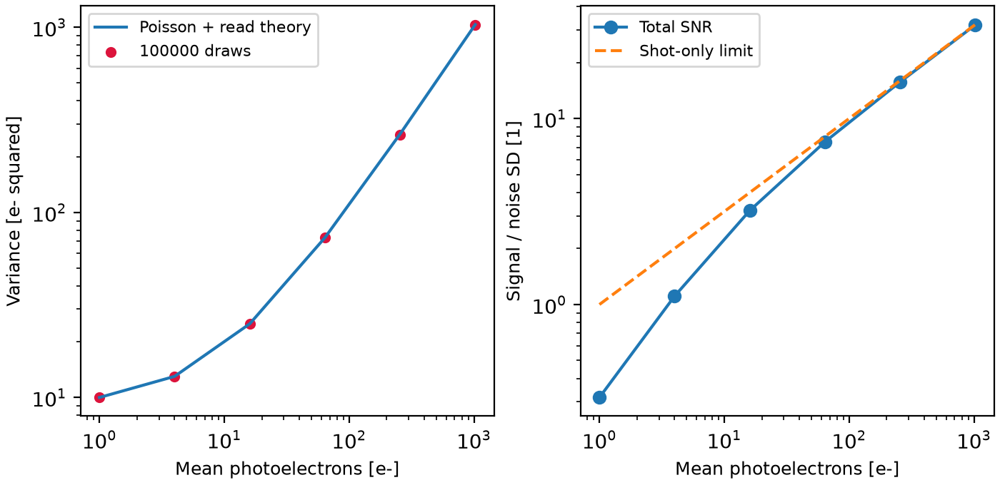

그림 D1-1. 전자 수가1,4,16,64,256,1024인 합성 센서에서 각100,000회 표본을 생성했다. 왼쪽은 가로 평균 전자 수, 세로 분산으로 양축 로그 눈금이며 빨간 표본 분산을 `mu+9` 이론선과 비교한다. 오른쪽은 읽기 잡음3 e-가 포함된 SNR과 광자 잡음만 있을 때의 한계를 비교한다. 실제 KITTI 센서의 보정 곡선이 아니라 seed20261125의 자체 Poisson·Gaussian 실험이다.

실측 표본 분산은10.0478,12.9365,24.9346,73.0728,262.9727,1029.3192였다.
대응하는 이론값은10,13,25,73,265,1033이다.
유한 표본의 차이를 수식 오류로 해석하지 않는다.
표본 수를 늘려도 완전히 같은 값이 되는 것은 아니며 확률적 오차의 크기가 줄어든다.
이 실험의 검사는 특정 난수 배열의 모든 값을 암기하는 대신 평균과 분산 모델이 합리적인 허용 범위에서 맞는지 확인한다.

<a id="d1-exposure"></a>
### 6. 노출, gain, 포화는 같은 밝기 조절이 아니다

노출 시간 T를2배로 늘리면 정적인 조명에서 평균 광전자 수가2배가 된다.
gain을2배로 올리면 이미 생긴 전자 수는 그대로이고 출력의 크기만 달라진다.
이상적인 선형 모델에서 gain은 신호와 앞단 잡음을 함께2배로 키운다.
따라서 양자화나 뒷단 잡음을 제외하면 SNR 자체를 개선하지 않는다.
어두운 사진을 화면에서 더 잘 보이게 만드는 것과 측정 정보가 많아지는 것은 별개다.

포화 상한이255 DN인 단순 저장기를 생각하자.
gain 적용 전120과180이라는 두 값에2를 곱하면240과360이다.
저장 단계에서 clipping을 하면240과255가 된다.
다시2로 나누면120과127.5이며 두 번째 값180은 돌아오지 않는다.
알려진 gain도 포화 뒤에는 역함수가 아니다.
포화 영역은 값의 차이가 줄어들므로 미분과 descriptor가 실제 무늬를 잃는다.

노출을 늘리는 동안 영상이 일정한 속도로 움직인다면 시간 적분은 공간 퍼짐으로 나타난다.
가로 속도가150 pixel/s이고 노출이0.02 s이면 이동 길이는3 pixel이다.
0.1 s이면15 pixel이다.
이 단순 일정속도 모형은 가로 box PSF를 만든다.
실제 회전·깊이 차·rolling shutter가 있으면 모든 픽셀의 PSF가 같지 않을 수 있다.
따라서 아래의15 pixel blur는 운동 관측의 한 교육용 대체이며 KITTI의 실제 노출 시간을 추정한 결과가 아니다.

<a id="d1-psf"></a>
### 7. 점 퍼짐과 면적 적분: 한 픽셀은 한 점이 아니다

이상적인 작은 점 광원이 사진에서는 몇 픽셀에 걸쳐 퍼진다고 하자.
그 퍼진 모양이 PSF다.
공간 위치에 따라 동일한 PSF가 적용된다는 가정 아래, 영상은 이웃의 가중합으로 쓸 수 있다.
가중치의 합이1이면 상수 밝기는 보존된다.
흡수·비네팅·노출 변화가 없다면 이 정규화가 평균 밝기를 유지한다.

```text
J[u,v] = sum_i sum_j h[i,j] * I[u-i,v-j]
sum_i sum_j h[i,j] = 1
I[u,v] = c인 상수라면
J[u,v] = c * sum_i sum_j h[i,j] = c
```

렌즈의 퍼짐 외에도 유한한 화소 면적 위 적분이 존재한다.
연속 영상의 픽셀 중심값만 뽑는 것과 사각 면적을 평균한 뒤 뽑는 것은 다른 연산이다.
가느다란 선이 픽셀 경계 근처에 놓이면 두 모델의 값은 크게 달라질 수 있다.
표본화 이전의 면적 적분은 일부 고주파를 줄이지만 완전한 anti-aliasing을 보장하지는 않는다.
그 조건과 주파수 표현은 D2에서 다룬다.

역문제 관점에서 blur는 정보의 종류마다 다르게 작용한다.
상수 성분은 통과하지만 좁은 줄무늬는 평균되어 대비가 작아진다.
아주 큰 이웃 가중치를 사용하는 필터는 더 넓은 영역의 원인이 하나의 출력에 섞이게 한다.
단순히 가장 밝은 위치를 원래 점으로 정하면 비대칭 PSF나 겹친 점 광원에서 편향될 수 있다.
복원에는 PSF뿐 아니라 잡음 모델과 경계 조건도 필요하다.
D3의 역필터 실험은 나누기만으로 blur를 되돌리려다 잡음이 폭발하는 예를 보여 준다.

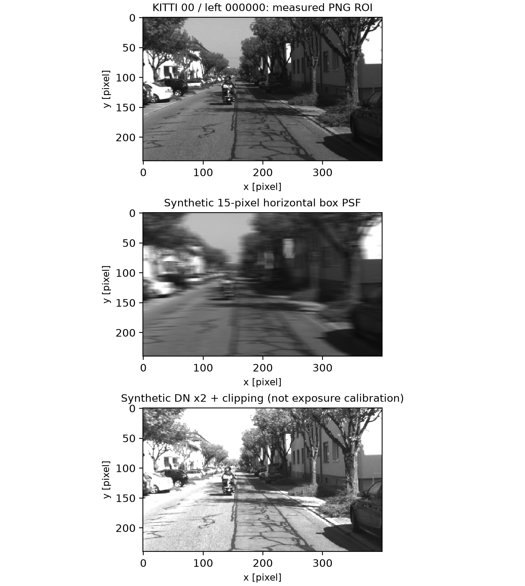

그림 D1-2. KITTI Odometry00 좌측000000의 원본376×1241 중 `(x,y,w,h)=(400,80,400,240)` 영역을 사용했다. 모든 패널의 가로·세로 축은 같은 ROI 내부 pixel, 밝기 범위는0–255 DN이다. 위는 실제 저장 PNG, 가운데는 길이15 pixel의 가로 균등 PSF를 적용한 합성 blur, 아래는 DN을2배로 한 뒤255에 제한한 합성 변환이다. 실제 노출 변경 실험이 아니므로 아래 영상을 “두 배 노출 촬영”이라 부르지 않는다.

원 ROI에서255인 비율은3.8719%였고 합성2배 변환 후에는16.1938%였다.
255가 센서의 물리적 full well 포화를 뜻하는지는 알 수 없다.
이미 저장 처리에서 최대값이 된 비율만 관측했다.
그럼에도 새 변환이 서로 다른 중간값들을 동일한255로 합친다는 사실은 배열만으로 검증할 수 있다.
실제 물리적 원인과 디지털 연산의 결과를 분리한 실패 분석이다.

<a id="d1-quantization"></a>
### 8. 양자화 오차의 분산을 직접 구하기

간격 Delta인 균일 양자화기를 생각하자.
가장 가까운 격자값으로 반올림하면 포화가 없는 구간에서 오차는 대략 `[-Delta/2,Delta/2]`에 있다.
입력이 여러 양자화 구간을 충분히 고르게 지나간다는 가정 아래 오차를 균일분포로 근사한다.
항상 독립 잡음이라는 뜻은 아니다. 상수 입력이나 주기 신호에서는 오차가 입력과 강하게 연관될 수 있다.

```text
e ~ Uniform(-Delta/2, Delta/2)
E[e] = integral e*(1/Delta) de = 0
Var[e] = E[e^2]
       = (1/Delta)*[e^3/3] from -Delta/2 to Delta/2
       = (1/Delta)*(Delta^3/24 + Delta^3/24)
       = Delta^2/12
Delta=1 DN이면 Var[e]=1/12 DN^2, SD=0.288675 DN
```

0–1 범위로 정규화하면8 bit 간격은1/255이다.
범위를256개 값으로 나누는 것과 최대 code255로 나누는 관례를 구별해야 한다.
어느 계약을 사용했는지 쓰고, 두 관례의 식을 섞지 않는 것이 중요하다.
이 장의 정규화는 저장값0을0,255를1로 대응시킨다.
잡음 표준편차15 DN은 정규화 공간에서15/255이며, 분산은225/255²이다.
표준편차만255²로 나누거나 분산만255로 나누면 차원이 맞지 않는다.

정수 영상의 중간 계산은 더 큰 함정이다.
`uint8`에서10에서20을 빼면 표현 범위에 음수가 없으므로 NumPy 배열 연산은246으로 순환할 수 있다.
OpenCV의 일부 정수 출력 연산은 순환 대신 포화시킨다.
둘 다 수학적 차이-10을 표현하지 못한다.
미분이나 잔차는 먼저 float 또는 충분한 signed 타입으로 변환해야 한다.
보기 위한 clipping은 계산이 끝난 뒤 별도의 배열에서 수행한다.

<a id="d1-color"></a>
### 9. 색 채널은 세 파장을 그대로 읽는 장치가 아니다

RGB는 red, green, blue 세 성분의 표기지만 각 채널은 넓은 파장 구간의 가중 적분이다.
필터와 센서 감도가 정한 함수가 다르면 같은 빛을 보아도 camera RGB가 달라질 수 있다.
세 채널 값만으로 전체 연속 스펙트럼을 일반적으로 복원할 수는 없다.
다른 스펙트럼이 같은 세 적분값을 만드는 현상을 생각하면 쉽게 이해할 수 있다.
따라서 RGB를 물체 고유의 색과 즉시 동일시하지 않는다.

Bayer 배열은 한 센서 위치에서 세 채널을 모두 재는 대신 한 색 성분만 측정하는 color filter array다.
CFA는 color filter array의 약자다.
예시 RGGB 타일은 위 행R,G, 아래 행G,B로 구성된다.
녹색 위치가 두 개라는 사실만으로 각 위치에 RGB가 모두 있다고 해석할 수 없다.
demosaicking은 없는 채널을 주변 측정으로 추정하는 과정이다.
그 결과의 상관 구조와 가짜 색은 실제 장면의 성질일 수도, 보간의 산물일 수도 있다.

가장 단순한 수치 예로 빨강 위치의 녹색을 상하좌우 녹색 평균으로 추정하자.
측정값이40,44,42,46이면 추정 녹색은43이다.
한쪽에 밝기 경계가 있어40,40,200,200이라면 같은 규칙은120을 만든다.
경계의 어느 쪽도120이 아닐 수 있다.
이 문제를 줄이는 방법은 다른 채널과 방향 정보를 활용하지만 추가 가정도 필요하다.
[Malvar·He·Cutler, 2004](https://www.microsoft.com/en-us/research/publication/high-quality-linear-interpolation-for-demosaicing-of-bayer-patterned-color-images/)는 선형 demosaicking의 구체적인 후속 읽기다. 이 장의 색 그림은 그 알고리즘 재현이 아니다.

white balance는 조명 때문에 생긴 채널별 불균형을 보정하려는 연산이다.
알려진 중립 표적이 `(50,100,70)`이고 녹색을 기준으로100에 맞춘다면 gain은 `(2,1,10/7)`이다.
같은 gain을 `(20,40,35)`에 적용하면 `(40,40,50)`이 된다.
모든 픽셀을 회색으로 만드는 연산이 아니라 채널에 공통 gain을 적용하는 연산이다.
이 계산은 포화 전 선형 값에서 가장 직접적으로 의미를 갖는다.
알려진 중립 표적이 없는 자동 white balance는 조명과 물체색을 혼동할 수 있다.

<a id="d1-srgb"></a>
### 10. 선형 값과 sRGB: 평균을 내는 위치가 결과를 바꾼다

sRGB는 표준적인 RGB 색 부호화이며 camera raw라는 뜻이 아니다.
각 선형 성분 C와 저장 성분 Cprime의 관계는 단순한 한 개의 지수식이 아니라 구간별 함수다.
여기서는0–1 범위의 성분을 사용한다.
[ICC의 sRGB 등록부](https://registry.color.org/rgb-registry/srgb)에 명시된 전달 함수를 다음과 같이 사용한다.

```text
C <= 0.0031308: Cprime = 12.92*C
C >  0.0031308: Cprime = 1.055*C^(1/2.4)-0.055

Cprime <= 0.04045: C = Cprime/12.92
Cprime >  0.04045: C = ((Cprime+0.055)/1.055)^2.4
```

검정0과 흰색1의 빛을 같은 비율로 섞는다고 하자.
선형 혼합은0.5이며, 이를 sRGB로 부호화하면0.735357이다.
반대로 부호화된0과1을 먼저 평균하면0.5이고, 이를 복호화하면0.214041이다.
같은 “평균”이라는 말이 서로 다른 물리적 결과를 만든다.
blur, 투명도 혼합, 노출 비교에서 값 공간을 명시해야 하는 이유다.
다만 실제 파일이 sRGB인지 모르는데 역함수를 적용하면 또 다른 왜곡을 만들 수 있다.

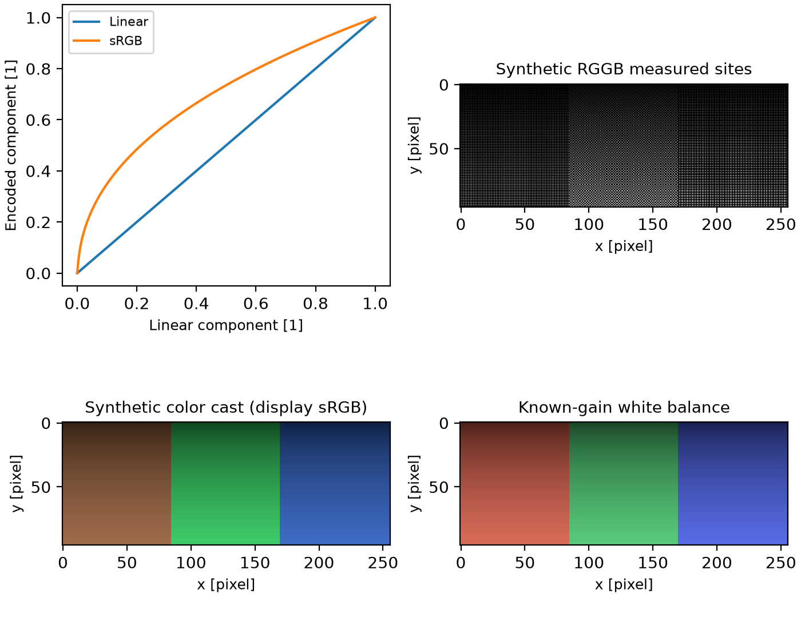

그림 D1-3. 모두 자체 합성 자료다. 왼쪽 위는 가로 선형 성분·세로 부호화 성분의 무차원0–1 곡선이다. 오른쪽 위는 RGGB의 각 위치에서 한 성분만 뽑은96×256 mosaic를 회색으로 표시했다. 아래는 채널 gain `(0.5,1,0.7)`을 적용한 색과 알려진 역gain으로 복원한 색을 sRGB 표시값으로 그렸다. 가로·세로 pixel 축은 합성 배열 좌표이며 KITTI 컬러 촬영이나 demosaicking 평가를 뜻하지 않는다.

일반 회색 변환도 주의해야 한다.
선형 RGB에서 정한 가중합과 비선형 Rprime,Gprime,Bprime의 가중합은 같지 않다.
가중치가 같더라도 연산 순서가 다르면 결과가 다르다.
색 공간과 채널 순서도 계약에 포함한다.
OpenCV로 읽은3채널 배열이 BGR 순서라면 RGB 표시 함수에 그대로 전달하면 빨강과 파랑이 바뀐다.
현재 KITTI 실험은 단일채널 `uint8`이므로 이 문제는 발생하지 않지만, 그 때문에 색 센서의 정보를 이용했다고 말할 수도 없다.

<a id="d1-measured"></a>
### 11. 이상적 모델과 실제 KITTI 사이에 남겨야 할 빈칸

이번 입력의 shape은376행1241열이며 단일채널8 bit 정수다.
좌측·우측의 shape을 모두 확인하고 SHA256를 기록했다.
우측은 입력 계약 확인만 수행했으며 이 장의 그림과 점수는 좌측 ROI에서 생성했다.
KITTI의 gray와 color 카메라 구성은 [공식 sensor setup](https://www.cvlibs.net/datasets/kitti/setup.php)에서 확인할 수 있다.
그 설명이 개별 저장 PNG의 모든 photometric 처리 파라미터를 제공하는 것은 아니다.

알려진 사실은 파일의 숫자와 배열 구조다.
[미확인] 실제 exposure, gain, response function, 읽기 잡음, 광전자 수, black level은 이 실험에서 확인하지 않았다.
그러므로 KITTI PNG의255를 특정 전자 수나 특정 W/m²로 환산하지 않는다.
평평한 도로 부분의 분산을 센서 read noise라고 부르지도 않는다.
그 안에는 실제 표면 질감, 그림자, 압축 이외의 처리 흔적, 공간적 blur가 섞여 있을 수 있다.
이 불확실성은 보고서의 결함이 아니라 관측으로 식별 가능한 범위의 표시다.

장면이 정적이고 노출만 달라진 여러 영상이 있다면 응답 함수를 추정하는 방향으로 확장할 수 있다.
[Debevec·Malik, 1997](https://www.pauldebevec.com/Research/HDR/)은 노출 차이를 활용해 상대 radiance를 구성하는 대표적인 원문이다.
여기서는 해당 입력이 없으므로 HDR 보정을 실행하지 않았다.
HDR은 high dynamic range, 넓은 밝기 범위를 뜻하며 단일 PNG의 대비를 늘리는 것과 같지 않다.
기하가 달라진 프레임을 노출만 다른 동일 영상으로 취급하면 대응 오차가 응답 추정에 섞인다.
후속 방법의 필요 데이터까지 함께 확인해야 한다.

<a id="d1-exercises"></a>
### 12. 연습문제와 완전 해설

**문제 D1-1.** 평균 광전자 수가16 e-, 읽기 표준편차3 e-다. gain을1에서4로 바꿀 때 offset을 제외한 평균, 표준편차, SNR은 어떻게 되는가? 양자화와 포화는 없다고 하라.

**해설.** 전자 공간 분산은16+9=25이므로 표준편차는5다.
gain1에서는 평균16 DN, 표준편차5 DN, SNR3.2다.
gain4에서는 평균64 DN, 분산16×25=400 DN², 표준편차20 DN이다.
SNR은64/20=3.2로 같다.
밝아 보이는 출력과 측정 정보의 개선을 구별하는 계산이다.
gain이ADC 전후 어느 위치에 있는지까지 모델링하면 양자화 영향은 달라질 수 있으나 문제에서는 제외했다.

**문제 D1-2.** 위 센서에서 노출만4배로 늘린다. 평균율이 일정하고 read noise는 그대로라면 SNR을 구하라. gain4배와 비교하라.

**해설.** 평균 광전자 수는64, 분산은64+9=73이다.
표준편차는8.5440 e-, SNR은64/8.5440=7.4906이다.
gain만4배로 한3.2보다 커졌다.
추가 광자를 모았기 때문이다.
다만 긴 노출로 물체가 움직이면 한 위치의 동일 신호를 더 모았다는 가정 자체가 깨진다.
따라서 여기의 수치 이득은 정적·비포화 조건에 한정된다.

**문제 D1-3.** 선형0.2와0.8의 평균을 구하고, gain2 후 clipping한 뒤 역gain한 평균과 비교하라.

**해설.** 원 평균은 `(0.2+0.8)/2=0.5`다.
gain2 후 값은0.4와1.6이며0–1 clipping 뒤0.4와1이다.
역gain을 적용하면0.2와0.5, 평균0.35다.
손실0.15는 수치 반올림 오차가 아니라 여러 입력을1로 합친 포화 때문이다.
알려진 변환도 합성 단계 전체가 가역적이지 않으면 되돌릴 수 없음을 보인다.

**문제 D1-4.** sRGB 저장값0.5를 선형 밝기50%라고 해석해도 되는가? 검정과 흰색을 같은 양의 빛으로 섞은 올바른 저장값을 구하라.

**해설.** 저장값0.5는 선형식의 작은 구간에 속하지 않으므로 `((0.5+0.055)/1.055)^2.4=0.214041`이다.
검정·흰색의 선형 평균은0.5다.
이를 부호화하면 `1.055*0.5^(1/2.4)-0.055=0.735357`이다.
단순 저장값 평균0.5와 다르다.
이 수치는 단위 검사와 함께 `test_srgb_midpoint`, `test_srgb_roundtrip`으로 검산했다.

**문제 D1-5.** 간격2 DN인 양자화 오차를 균일분포로 근사할 때 분산과 표준편차를 구하라. 이를 gain2 DN/e-로 전자 공간에 환산하라.

**해설.** 분산은4/12=1/3 DN², 표준편차는0.577350 DN이다.
표준편차는gain으로 나누어0.288675 e-가 된다.
분산은gain의 제곱으로 나누므로 `(1/3)/4=1/12 (e-)²`다.
분산과 표준편차에 같은 나눗셈을 적용하지 않는다.
균일 오차 모델이 실제 상수 입력의 양자화 오차까지 보장하는 것은 아니다.

<a id="d1-handoff"></a>
### 13. 다음 장에 넘기는 계약

D1의 출력은 “깨끗한 장면”이 아니라 값 공간과 한계가 명시된 배열이다.
이후 장의 실제 영상 계산은 DN 단위의 float64 배열을 기본으로 사용한다.
RGB·Bayer·광전자 실험은 별도의 합성 배열이며 같은 의미로 섞지 않는다.
어떤 영상에 평균 필터를 적용할 때 먼저 그 평균이 광량 평균인지 저장값 평균인지 묻는다.
어떤 영상의 차이를 계산할 때 먼저 두 영상의 노출·응답 계약이 맞는지 묻는다.
이 두 질문을 통과한 뒤에야 표본화, 미분, 대응 오차의 설명이 일관성을 갖는다.

<a id="d2"></a>
## D2. 표본화와 주파수: 보간은 잃은 정보를 되돌리는가

<a id="d2-problem"></a>
### 1. 작은 영상에서 새 무늬가 생기는 문제

큰 사진을 줄였는데 창문의 규칙적인 선이 물결처럼 보인다고 하자.
줄인 영상의 품질을 평가하려고 다시 크게 확대하면 선은 더 부드러워질 수 있다.
그러나 원래의 선 위치가 돌아왔다고 말할 수는 없다.
표본화가 다른 신호를 구분하지 못하게 만든 뒤 보간은 그중 하나를 가정해 채울 뿐이다.
이 장은 이 손실을 배열과 주파수 양쪽에서 계산한다.
피라미드·회전 보정·영상 정합이 모두 이 계약을 사용하므로 단순한 표시 기술이 아니다.

먼저 출력 목표를 정한다.
새 격자의 한 픽셀을 원 격자의 점값으로 정의할 수도 있고, 일정 면적의 평균으로 정의할 수도 있다.
어느 쪽도 이름만으로 정답이 되지는 않는다.
카메라 모델, 저장 방식, 후속 알고리즘이 요구하는 관측 의미와 맞아야 한다.
특히 downsampling과 interpolation은 관련되어 있지만 같은 문제가 아니다.
전자는 표본 수를 줄일 때 무엇을 먼저 제거할지, 후자는 새 위치의 값을 어떻게 추정할지를 묻는다.

<a id="d2-contract"></a>
### 2. 연속 신호, 격자, 주파수의 단위

1차원 신호부터 시작하면 행과 열에 같은 원리를 적용할 수 있다.
연속 좌표를 x, 샘플 간격을 Delta_x, 정수 인덱스를 n이라 놓는다.
이산 신호는 `f[n]=f_c(n*Delta_x)`다.
f_c의 아래첨자 c는 continuous를 뜻한다.
서로 다른 샘플 간격으로 얻은 배열에서 같은 인덱스 차이가 같은 물리 거리를 뜻하지 않는다.

|기호|뜻|단위|
|---|---|---|
|n,m|가로·세로 정수 sample index|무차원 인덱스|
|Delta_x|표본 간격|pixel 또는 m, 선택을 명시|
|f_c(x)|연속 신호|여기서는 DN|
|f[n]|이산 신호|DN|
|nu|공간 주파수|cycles/pixel|
|omega|각주파수|radian/pixel, `omega=2*pi*nu`|
|N|DFT 길이|sample 개수|
|F[k]|복소 Fourier 계수|기본 비정규화에서 DN의 합|
|h[i,j]|필터 가중치|무차원, 미분용은 거리 역단위 포함 가능|

cycle은 밝음에서 어두움을 지나 다시 같은 상태로 돌아오는 한 주기다.
0.25 cycles/pixel은4 pixel마다 한 번 반복하는 무늬다.
주파수를 단순히 “0.25”라고만 쓰면 sample 간격이 달라졌을 때 의미를 잃는다.
4배 줄인 영상의1 pixel은 원본의4 pixel에 대응한다.
따라서 같은 물리 무늬의 cycles/새pixel 수치는 원본의4배가 된다.
이 변환이 Nyquist 한계를 넘기기 쉬운 이유다.

<a id="d2-alias"></a>
### 3. 서로 다른 파동이 같은 배열을 만드는 계산

정수 n에서 cosine을 관측하자.
주파수에 정수1을 더하면 위상에 `2*pi*n`이 더해진다.
cosine의 주기성 때문에 값은 바뀌지 않는다.
이것만으로 이산 표본이 구분하지 못하는 주파수의 동치 관계를 얻는다.

```text
cos(2*pi*(nu+1)*n)
 = cos(2*pi*nu*n + 2*pi*n)
 = cos(2*pi*nu*n), n이 정수일 때

cos(2*pi*0.7*n)
 = cos(2*pi*n - 2*pi*0.3*n)
 = cos(-2*pi*0.3*n)
 = cos(2*pi*0.3*n)
```

마지막 줄은 cosine이 짝함수라는 성질을 사용했다.
0.7과0.3 cycles/pixel은 연속 위치에서는 다르지만 정수 위치에서는 같다.
이 현상이 aliasing이다.
단순히 점수가 조금 나빠지는 문제가 아니라 구분에 필요한 정보가 사라진 것이다.
새로운 prior나 추가 관측 없이 배열만으로 어느 연속 신호였는지 확정할 수 없다.
보간 알고리즘을 더 정교하게 바꾼다고 이 논리적 모호성이 사라지지 않는다.

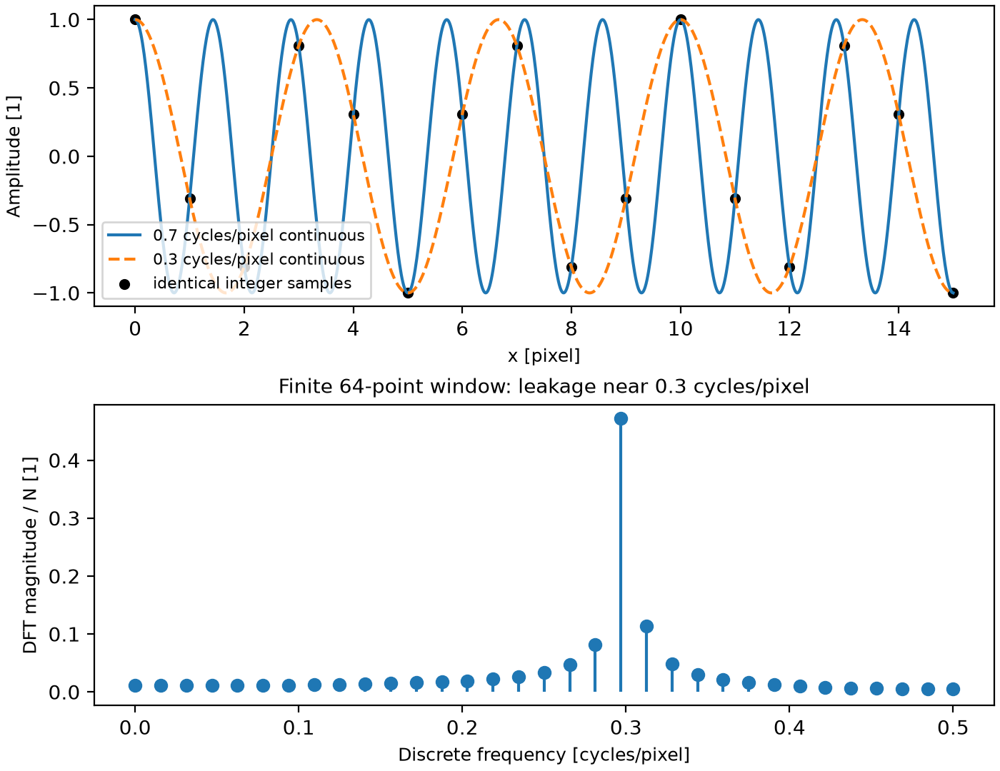

그림 D2-1. 위는 합성 cosine0.7과0.3 cycles/pixel을 연속 x축에 그린 것이다. 검은 점은 정수 좌표의 표본으로 두 파형에서 동일하다. 아래는64개 표본의 DFT 크기를N으로 나눈 값이며 가로축은 cycles/pixel이다. 주파수0.3이64개 격자의 정확한 bin이 아니므로 여러 bin에 에너지가 퍼진다. 이는 유한 구간 누설이며 위의 aliasing과 다른 현상이다. 배열 차이의 최대값은 부동소수점 반올림 수준인2.19×10^-14였다.

샘플 간격이Delta_x이면 샘플링 주파수는 `1/Delta_x`다.
대칭적인 고유 주파수 구간의 끝은 그 절반이다.
원 신호가 이 한계보다 엄격히 낮은 주파수만 갖고 무한한 정확 표본을 제공한다는 조건에서 이상적인 복원 관계를 논할 수 있다.
실제 영상은 유한하고 noise가 있으며 날카로운 경계는 높은 주파수 성분을 가진다.
따라서 “두 점이면 한 파동을 복원한다”는 식의 조건 없는 설명은 부정확하다.
정확히 한계 주파수의 sine이 어떤 위상에서 모두0으로 표본화되는 반례도 생각할 수 있다.

<a id="d2-antialias"></a>
### 4. 축소 전에 blur를 주는 이유와 그 한계

4배 축소는 원본에서4 pixel마다 하나를 보관하는 연산으로 시작할 수 있다.
새 표본 간격이4가 되므로 원본 좌표계의 Nyquist 한계는1/8 cycles/pixel이다.
원본의0.2 cycles/pixel 무늬는 이 한계를 넘는다.
이를 먼저 낮추지 않으면 저주파처럼 보이는 거짓 무늬가 될 수 있다.
축소 전 low-pass filter는 그 가능성을 줄이기 위한 것이다.
low-pass란 낮은 주파수는 상대적으로 유지하고 높은 주파수를 줄이는 연산이다.

Gaussian 필터는 주파수를 갑자기0으로 만들지 않고 부드럽게 줄인다.
따라서 유한 sigma의 Gaussian이 완전한 band limit을 보장하는 것은 아니다.
더 강하게 흐리면 alias 위험이 감소하지만 실제 작은 구조도 사라진다.
원본 정보 모두를 유지하면서 sample 수만 크게 줄이는 것은 일반적으로 불가능하다.
알고리즘의 문제가 아니라 출력 표현의 용량과 관측 계약의 문제다.
압축이나 학습형 super-resolution은 여기에 추가 prior를 도입하는 별도의 문제다.

실험에서는 같은400×240 ROI를 네 가지 방식으로 표시했다.
stride4는 `[::4,::4]`로 원본의정수0,4,8,... 위치를 선택한다.
Gaussian sigma1.6 후 stride4는 같은 위상의 위치를 선택한다.
INTER_AREA는4×4 블록의 평균에 해당하며 블록 중심은 원본의1.5,5.5,... 위치다.
이 phase 차이 때문에 두 방법의 픽셀 차이를 곧바로 aliasing 오차라고 부르면 안 된다.
이 비교는 방법과 계약의 시각화이지 동일한 정답 저해상도 영상에 대한 정확도 순위가 아니다.

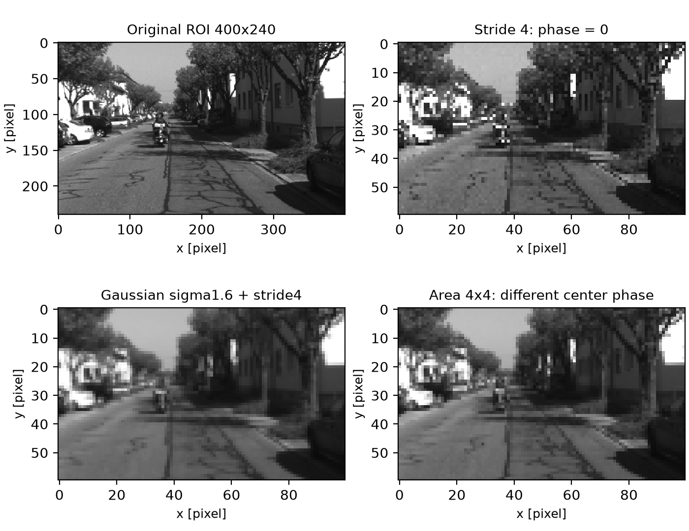

그림 D2-2. 실제 KITTI ROI와 세 축소 연산이다. 원본은400×240, 나머지는100×60이며 각 패널의 축은 자기 배열의 pixel이다. 표시 영역의 크기는 같으므로 형상이 비교되지만 표본 수가 같다는 뜻은 아니다. stride4에는 추가 low-pass가 없고, Gaussian은sigma1.6 pixel로 미리 평활화했으며, area는4×4 면적 평균으로 중심 위상도 다르다. 모두 동일 DN0–255 눈금으로 표시한다. 작은 질감이 줄어드는 현상은 관찰할 수 있으나 실제 저해상도 카메라의 GT는 없다.

직접 축소 영상의 공간 분산은3433.9433 DN², prefilter 영상은2909.2123 DN²였다.
이 수치를 “잡음이15.3% 감소했다”라고 해석하지 않는다.
분산에는 장면의 구조가 포함되어 있기 때문이다.
공간 분산 감소는 필터가 대비를 낮춘 한 기술 통계에 불과하다.
noise 감소를 정량화하려면 반복 영상, 알려진 합성 noise, 또는 검증된 신호 모델이 필요하다.
D3에서는 원 PNG를 고정한 뒤 알려진 잡음을 더하는 통제 실험으로 넘어간다.

<a id="d2-interpolation"></a>
### 5. 보간의 계약: 값이 없는 위치를 어떻게 채우는가

회전·왜곡 보정·정합에서는 출력 픽셀의 원본 위치가 정수가 아닐 수 있다.
순방향으로 원본 픽셀을 던지면 출력 격자에 구멍이 생기기 쉬우므로, 출력 위치에서 원본 좌표를 역으로 찾는 방식을 흔히 쓴다.
이 좌표 계산과 밝기 보간은 서로 다른 단계다.
기하가 정확해도 보간이 다른 결과를 만들 수 있다.
보간의 경계 처리는 원본 좌표가 영상 밖일 때 무엇을 반환할지까지 포함한다.

nearest-neighbor는 가장 가까운 표본 하나를 선택한다.
연산이 간단하고 class label 같은 이산 값에 없는 중간 label을 만들지 않는다.
반면 밝기 영상에서는 이동에 따라 선택 표본이 갑자기 바뀌므로 계단 모양이 생긴다.
선형 보간은 두 이웃 사이에서 위치 비율로 가중합한다.
연속적인 값은 얻지만 실제 연속 신호가 선형이라는 보장은 없다.

```text
x = n + alpha, 0 <= alpha <= 1
f_hat(x) = (1-alpha)*f[n] + alpha*f[n+1]
f[n]=20, f[n+1]=60, alpha=0.25
f_hat=0.75*20+0.25*60=15+15=30 DN
```

2차원 bilinear 보간은 가로와 세로 선형 보간을 조합한다.
왼쪽 위20, 오른쪽 위60, 왼쪽 아래100, 오른쪽 아래140이라고 하자.
가로 비율alpha0.25, 세로 비율beta0.5에서 계산한다.

```text
위 행 가로 보간: 0.75*20 + 0.25*60 = 30
아래 행 가로 보간: 0.75*100 + 0.25*140 = 110
세로 보간: 0.5*30 + 0.5*110 = 70

동일한 네 가중치 표현:
0.375*20 + 0.125*60 + 0.375*100 + 0.125*140
= 7.5 + 7.5 + 37.5 + 17.5 = 70 DN
```

가중치의 합이1이므로 상수 영상은 보존된다.
모든 가중치가 음수가 아니므로 결과는 네 이웃의 최솟값과 최댓값 사이에 있다.
cubic이나 sinc 계열 보간은 음의 가중치를 포함할 수 있어 이 범위를 넘는 overshoot가 가능하다.
경계에서 밝은 테두리가 생겼다고 실제로 더 밝은 구조가 있었다고 해석하면 안 된다.
보간 결과를 바로uint8로 저장하면 overshoot가 clipping되어 원인을 숨길 수도 있다.

<a id="d2-convolution"></a>
### 6. 합성곱을3×3 숫자로 끝까지 계산하기

합성곱 convolution은 한 위치에서 주변 신호와 뒤집힌 커널의 곱을 더하는 선형 연산이다.
상관 correlation은 커널을 뒤집지 않은 형태다.
커널이 중심 대칭이면 두 결과가 같으므로 Gaussian에서는 차이가 잘 보이지 않는다.
미분처럼 부호와 방향이 있는 커널에서는 그 차이가 중요하다.
먼저 대칭 커널로 가중합 자체를 계산하고 이후 비대칭 예로 방향을 확인한다.

```text
입력 patch P           커널 K = 아래 정수행렬 /16
1 2 3                  1 2 1
4 5 6                  2 4 2
7 8 9                  1 2 1

가운데 출력의 분자:
1*1 + 2*2 + 3*1
+4*2 + 5*4 + 6*2
+7*1 + 8*2 + 9*1
=1+4+3+8+20+12+7+16+9=80
출력=80/16=5 DN
```

가중치 합은16/16=1이다.
가운데가5인 선형 ramp에서 대칭 평균은 중앙값5를 유지한다.
이를 “필터가 아무 효과도 없다”라고 해석하면 안 된다.
다른 입력, 예를 들어 가운데만16이고 나머지0이면 출력은4다.
같은 연산자가 입력의 구조에 따라 다른 결과를 만든다.
필터를 이해하려면 한 사진을 보는 것뿐 아니라 상수·impulse·ramp 같은 시험 신호를 함께 사용한다.

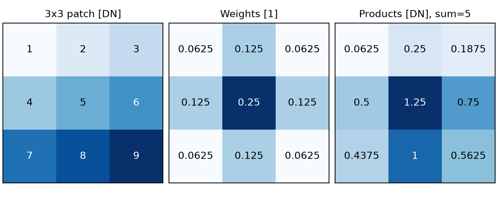

그림 D2-3. 자체 생성한3×3 수치 예다. 왼쪽의 값은DN, 가운데는 합1인 무차원 가중치, 오른쪽은 위치별 곱의 DN 값이다. 오른쪽 아홉 수를 합하면5 DN이다. 이 그림은 실제 영상의 확대가 아니라 작은 입력 전체를 그대로 표시한 교육용 행렬이며, 가운데 kernel이 대칭이라 convolution과 correlation이 일치한다.

이제1차원 kernel `[-1,0,1]`을 생각하자.
입력이 `[10,20,30]`이면 correlation은 `-10+30=20`이다.
convolution은 kernel을뒤집어 `[1,0,-1]`로 적용하므로 `10-30=-20`이다.
한 방향의 부호가 바뀐다.
OpenCV `filter2D`는 이름과 달리 실제로 correlation 계약을 갖는다.
정확한 정의와 border·출력 깊이는 [공식 필터 문서](https://docs.opencv.org/4.x/d4/d86/group__imgproc__filter.html)를 확인하고 실험의 부호 검사도 함께 사용했다.

<a id="d2-separable"></a>
### 7. 분리 가능 커널은 무엇을 줄이는가

위3×3 kernel은 가로 벡터 `[1,2,1]/4`와 같은 세로 벡터의 외적으로 쓸 수 있다.
이때2차원 가중합을 가로1차원 필터와 세로1차원 필터로 나누어 적용할 수 있다.
각 단계는 중간 배열을 만들지만 같은 경계 계약과 정확한 산술 아래 최종 값은 같다.
이 성질을 separability, 분리 가능성이라 부른다.
필터 이름이 Gaussian이라는 이유만으로 모든 변형 커널이 분리 가능해지는 것은 아니다.

```text
K[i,j] = a[i]*b[j]
J[u,v] = sum_i sum_j a[i]*b[j]*I[u-j,v-i]
        = sum_i a[i] * (sum_j b[j]*I[u-j,v-i])
내부 합 = 각 행에 대한 가로 필터
외부 합 = 그 결과에 대한 세로 필터
```

폭k인 일반2차원 커널은 픽셀당 대략k²개의 곱을 요구한다.
분리 가능하면 두 번의 길이k 연산으로 대략2k개가 된다.
k=31이면961대62의 산술 개수 비교가 된다.
이것을 실제 실행시간이15.5배 빨라진다는 보장으로 바꾸지는 않는다.
메모리 접근, SIMD, 스레드, 라이브러리 알고리즘, 영상 크기가 시간을 바꾼다.
본 실험은 `filter2D`와 `sepFilter2D`의 수치 일치를 검사하며 성능 benchmark는 하지 않는다.

SVD로 kernel을 여러 외적의 합으로 근사하는 확장도 가능하다.
그 경우 원 kernel과 근사 kernel의 차이를 따로 검증해야 한다.
rank1 근사는 새로운 연산자를 만든 것이므로 단순 구현 최적화라고만 부를 수 없다.
교육적으로는 먼저 정확히 분리 가능한 경우의 등식을 이해한 뒤 근사 오차를 도입하는 편이 낫다.
여기에서는3×3 binomial kernel만 정확한 분리성 검사에 사용했다.

<a id="d2-boundary"></a>
### 8. 경계는 사소한 구현 세부사항이 아니다

길이3인 신호 `[10,20,30]`의 첫 위치에3점 평균을 적용한다고 하자.
왼쪽 이웃이 없기 때문에 어떤 값을 채울지 정해야 한다.
서로 다른 합리적 선택은 다른 모델을 뜻한다.
아래는 중심을 첫 표본10에 놓았을 때의 결과다.

```text
zero padding:      [0,10,20]  -> 10
replicate:        [10,10,20] -> 40/3 = 13.3333
reflect101:       [20,10,20] -> 50/3 = 16.6667
periodic wrap:    [30,10,20] -> 20
```

zero padding은 영상 밖이 검정이라는 가정을 만든다.
밝은 상수 영상의 가장자리가 어두워질 수 있다.
replicate는 마지막 값을 계속 반복한다.
reflect101은 경계 화소 자체를 반복하지 않고 안쪽을 반사한다.
periodic은 오른쪽 끝과 왼쪽 끝이 이어진다고 가정한다.
실제 거리 장면에서는 대개 참이 아니지만 FFT 계산에서는 기본적으로 등장하기 쉬운 모델이다.

실험의 공간 필터는 가능한 곳에서 `BORDER_REFLECT_101`을 명시했다.
medianBlur의 경계는 라이브러리 계약을 따르므로 Gaussian과 완전히 같다고 주장하지 않는다.
점수를 전체 ROI에서 계산할 때 경계의 작은 차이도 포함된다.
SSIM은11×11 창이 완전히 들어가는 중심만 평균하므로 바깥5 pixel을 제외한다.
이처럼 지표마다 평가 영역이 다르면 같은 이름의 “평균 오차”도 다른 분모를 가진다.
재현 계약은 알고리즘 이름보다 구체적이어야 한다.

<a id="d2-dft"></a>
### 9. Fourier 변환은 무엇을 좌표로 삼는가

영상의 한 행을N개 숫자로 표현하는 대신 N개의 주기 기저에 대한 계수로 표현할 수 있다.
DFT는 discrete Fourier transform, 이산 Fourier 변환이다.
복소수 i는 `i²=-1`을 만족하며 회전과 위상을 간결하게 나타내기 위해 사용한다.
실제 밝기가 복소수라는 뜻은 아니다.
실수 신호에서도 위상을 표현하기 위해 복소 계수가 필요하다.

```text
F[k] = sum_(n=0..N-1) f[n] * exp(-i*2*pi*k*n/N)
f[n] = (1/N)*sum_(k=0..N-1) F[k] * exp(+i*2*pi*k*n/N)
exp(i*theta) = cos(theta) + i*sin(theta)
```

첫 식에서 음의 부호, 둘째 식에서 양의 부호를 쓴다.
앞 변환에 정규화를 넣지 않았으므로 역변환에서1/N을 곱한다.
`norm='ortho'`처럼 양쪽에1/sqrt(N)을 넣는 다른 관례도 있다.
이 장의 FFT 계산은 [SciPy의 기본 backward 정규화 설명](https://docs.scipy.org/doc/scipy/reference/generated/scipy.fft.fft.html)과 같은 관례를 사용한다.
FFT는 fast Fourier transform으로 DFT를 빠르게 계산하는 알고리즘 계열이지 다른 변환의 이름이 아니다.

왜 역변환이 원 신호를 되돌리는지 확인하자.
첫 식을 둘째 식에 대입하면 원래 f[m]에 대한 가중합이 된다.
같은 주파수의 복소 회전은 더해지고 다른 회전은 원을 돌아 상쇄된다.

```text
f_recovered[n]
 = (1/N)*sum_k sum_m f[m]*exp(-i*2*pi*k*m/N)*exp(i*2*pi*k*n/N)
 = sum_m f[m]*(1/N)*sum_k exp(i*2*pi*k*(n-m)/N)

n=m일 때 내부 합은 N
n!=m일 때 내부 합은 0, n,m이0..N-1 범위라면
따라서 f_recovered[n]=f[n]
```

내부 합이0인 이유는 공비r이1이 아닌 등비수열의 합으로 볼 수 있다.
`1+r+...+r^(N-1)=(1-r^N)/(1-r)`이며 여기서r^N=1이다.
분자는0, 분모는0이 아니므로 합은0이다.
이는 Fourier 기저의 직교성이 실제 계산에서 쓰인 곳이다.
샘플이 불규칙하거나 일부만 관측되면 같은 간단한 역변환식이 바로 적용되지 않는다.

<a id="d2-fourpoint"></a>
### 10. 길이4 DFT를 복소수까지 손으로 계산하기

입력은 `[1,2,3,4]`, N=4다.
기본 회전은 `exp(-i*pi/2)=-i`이며 거듭제곱은1,-i,-1,i로 반복된다.
각 k에서 네 개 곱을 모두 적으면 생략할 대수가 없다.

```text
F[0] = 1+2+3+4 = 10
F[1] = 1 + 2*(-i) + 3*(-1) + 4*i
     = 1-3 + (-2+4)*i = -2+2i
F[2] = 1 + 2*(-1) + 3*(1) + 4*(-1)
     = 1-2+3-4 = -2
F[3] = 1 + 2*i + 3*(-1) + 4*(-i)
     = -2-2i
```

F[0]은 합이므로 평균은10/4=2.5다.
실수 입력에서는 F[3]이F[1]의 켤레복소수다.
켤레는 허수부 부호만 바꾸는 연산이다.
이 대칭 때문에 실수 입력용 `rfft`는 중복된 절반을 저장하지 않는다.
중복을 없앤 것과 주파수 성분을 버린 것은 다르다.
원래 길이를 알고 대칭을 복원하면 정보가 유지된다.

역변환에서 n=1을 실제로 확인하자.

```text
f[1] = (F[0] + i*F[1] - F[2] - i*F[3])/4
i*(-2+2i) = -2-2i
-i*(-2-2i) = -2+2i
분자 = 10 + (-2-2i) + 2 + (-2+2i) = 8
따라서 f[1]=2
```

에너지 보존도 검산할 수 있다.
입력 제곱합은1+4+9+16=30이다.
주파수 제곱크기 합은100+8+4+8=120이다.
기본 DFT의 정규화에서는 이를N=4로 나누어30을 얻는다.
이 관계를 Parseval 항등식이라고 부른다.
스펙트럼을 그릴 때 임의로N을 나눈 뒤 에너지 식에서 다시 다른 정규화를 쓰면 값이 맞지 않는다.

<a id="d2-frequencyfilter"></a>
### 11. 합성곱이 주파수에서 곱이 되는 이유

주기 경계를 갖는 길이N 배열에 circular convolution을 정의하자.
인덱스가 범위를 벗어나면 modulo N으로 돌아온다.
이 계약에서 다음 유도가 성립한다.

```text
y[n] = sum_m h[m]*x[(n-m) mod N]
Y[k] = sum_n sum_m h[m]*x[n-m]*exp(-i*2*pi*k*n/N)
q=n-m로 치환하면 n=q+m
Y[k] = sum_m h[m]*exp(-i*2*pi*k*m/N)
       *sum_q x[q]*exp(-i*2*pi*k*q/N)
     = H[k]*X[k]
```

주파수마다 곱하면 되는 이유는 각 주파수 기저가 이 이동 불변 선형 연산의 고유 방향이기 때문이다.
H[k]의 크기는 해당 주파수의 증폭·감쇠, 위상은 그 성분의 위치 변화를 나타낸다.
실수 대칭 blur의 응답은 많은 경우 부드러운 감쇠로 읽을 수 있다.
비대칭 motion PSF에서는 위상과 영점도 중요하다.
H[k]가0이면 그 주파수 성분은 출력에서 사라진다.
0에 가까우면 역으로 나눌 때 잡음이 크게 증폭된다.

유한 영상의 일반 선형 convolution과 circular convolution을 혼동하면 영상 양끝이 서로 섞인다.
길이N과M의 선형 convolution을 FFT로 구할 때 적어도N+M-1 길이로 padding하는 이유다.
필요한 결과 부분을 잘라내는 위치도 kernel 중심 정의와 맞아야 한다.
FFT 결과가 “한 픽셀 밀린 것처럼” 보이면 먼저 kernel 배치·중심·padding을 검사한다.
함수 호출의 이름만 바꾸는 것으로 경계 계약이 맞아지지 않는다.

<a id="d2-leakage"></a>
### 12. 유한 창, 누설, 크기와 위상의 역할

DFT는 관측한N개 표본이 주기적으로 반복된다고 해석할 수 있다.
첫 값과 마지막 값이 매끄럽게 이어지지 않으면 경계에서 인위적인 급변이 생긴다.
정확히bin에 맞지 않는 단일 파동의 에너지가 여러 주파수에 나타나는 이유 중 하나다.
이것을 spectral leakage, 스펙트럼 누설이라 한다.
aliasing은 서로 다른 연속 신호가 같은 표본을 만드는 문제이고, leakage는 유한 구간과 기저의 정렬 문제다.
두 현상을 구별해야 서로 다른 처방을 선택할 수 있다.

window를 곱해 끝부분을 줄이면 불연속을 완화할 수 있다.
그러나 유효 관측 범위가 줄고 주파수 peak가 넓어지며 진폭 보정이 필요할 수 있다.
windowing은 공짜로 정보를 늘리는 연산이 아니다.
이미지 FFT에 로그 크기를 사용하면 약한 성분이 잘 보이지만 에너지 자체를 표시하는 것은 아니다.
`log(1+abs(F))`의 숫자를 원래 DN 진폭으로 읽지 않는다.
시각화 변환과 분석 수치를 별도 배열로 보존하는 이유다.

위상을 버리면 위치 정보도 상당 부분 잃는다.
신호를s개 이동하면 스펙트럼에 `exp(-i*2*pi*k*s/N)`이 곱해진다.
그 크기는1이므로 magnitude만으로는 이 이동을 구분할 수 없다.
영상의 크기 스펙트럼이 같아도 실제 구조 위치는 다를 수 있다.
따라서 blur 비교에서 power spectrum은 유용하지만 대응점 위치의 정답을 대신하지 않는다.
주파수 표현은 정보를 다른 좌표로 옮긴 것이지 장면 이해를 자동으로 수행한 것이 아니다.

<a id="d2-exercises"></a>
### 13. 연습문제와 완전 해설

**문제 D2-1.** 원본 주파수가0.2 cycles/pixel인 cosine을4배 축소한다. 새pixel 단위 주파수와 관측되는 alias 주파수를 구하라.

**해설.** 원본4 pixel이 새1 pixel이므로 새 주파수는0.8 cycles/새pixel이다.
정수 샘플에서cosine0.8은cosine0.2와 같다.
따라서 관측 배열은0.2 cycles/새pixel의 낮은 주파수처럼 보인다.
이를 원본 좌표로 환산하면0.05 cycles/원pixel이다.
원래0.2가0.05로 보이는 거짓 저주파가 생겼다.
방지하려면 축소 전에 원본 주파수0.125보다 높은 성분을 충분히 줄여야 한다.

**문제 D2-2.** patch1부터9와 위3×3 kernel을 사용하되 중앙값5를21로 바꾼다. 중앙 출력은 얼마인가?

**해설.** 기존 출력은5다.
입력 중앙 변화는16이고 가중치는4/16=1/4이다.
선형성에 의해 출력 변화는16×1/4=4다.
새 출력은9다.
모든 곱을 다시 더해도 분자가144가 되어144/16=9다.
이 두 계산의 일치가 선형 필터의 작은 검산법이다.

**문제 D2-3.** `[1,2,3,4]`의 DFT에서 F[1]의 크기와 위상을 구하라. 위상은radian과degree로 표시하라.

**해설.** F[1]=-2+2i이므로 크기는sqrt(4+4)=sqrt8=2.828427이다.
실수부가 음수, 허수부가 양수이므로 제2사분면이다.
`atan2(2,-2)=3*pi/4=2.356194 radian=135 degree`다.
단순atan(2/-2)은-45 degree를 주어 사분면을 잃는다.
위상 계산에atan2를 사용하는 이유다.
DFT 부호 관례를 바꾸면 해당 위상의 부호도 바뀌므로 식의 정의를 먼저 확인한다.

**문제 D2-4.** 길이3 `[10,20,30]`의 첫 위치에서3점 평균을 구한다. reflect101과replicate 결과의 차이를 설명하라.

**해설.** reflect101은 왼쪽을20으로 채우므로 `(20+10+20)/3=16.6667`이다.
replicate는10으로 채우므로 `(10+10+20)/3=13.3333`이다.
차이는10/3 DN이다.
같은kernel이라도 영상 밖을 어떻게 연장하느냐가 바뀌었기 때문이다.
내부 픽셀의 결과가 같다고 전체 영상 계약까지 같다고 판단하지 않는다.

**문제 D2-5.**2×2 patch가20,60/100,140일 때alpha0.25,beta0.5의 bilinear 값을 구하고, 모든값에7을 더한 뒤 보간한 결과와 비교하라.

**해설.** 앞의 계산처럼 값은70이다.
모든값에7을 더하면 가중합은 `70+7*sum(weights)`다.
가중치 합이1이므로77이다.
따라서 상수 offset은 보간과 교환된다.
하지만 gamma 같은 비선형 함수를 각값에 적용한 뒤 보간하면 일반적으로 함수 적용 순서가 교환되지 않는다.
이 차이는 D1의 선형광 평균 문제와 직접 연결된다.

<a id="d2-debug"></a>
### 14. 실패를 재현하는 순서와 다음 계약

필터나 resize 결과가 이상하면 실제 사진부터 추측하지 않는다.
먼저 상수 입력이 유지되는지, impulse의 응답이 kernel과 일치하는지 확인한다.
다음으로 ramp의 기울기 부호와 크기를 확인한다.
그다음 경계에서만 차이가 생기는지, 전체에서 차이가 생기는지 나눈다.
마지막으로 실제 영상의 작은 구조와 spectrum을 비교한다.
이 순서가 타입·부호·정규화 오류를 장면 해석 오류와 분리한다.

이번 검사는 DFT4점, Parseval, alias 동치, 분리 필터 일치, correlation 부호, uint8 순환을 포함한다.
각 검사는 실패 원인이 다른 작은 계약 하나를 겨냥한다.
아주 긴 영상 결과 하나가 비슷해 보인다는 이유로 통과시키지 않는다.
특히0.7과0.3의 동치 예는 어떤 알고리즘도 입력만으로 해결할 수 없는 실패다.
이 한계를 인정한 뒤 D3에서는 신호에 대한 가정과 손실함수를 명시하여 가능한 복원을 선택한다.

<a id="d3"></a>
## D3. 평활화와 복원: 잡음을 줄이는 것과 구조를 지키는 것

<a id="d3-problem"></a>
### 1. 보기 좋은 영상과 좋은 측정의 차이

사진을 부드럽게 만들면 사람이 보기에는 잡음이 줄어든 것처럼 느낄 수 있다.
그러나 얇은 선이 사라졌다면 로봇의 대응점은 오히려 줄어들 수 있다.
평활화 smoothing은 국소 변화량을 줄이는 연산이고, denoising은 관측에서 잡음 없는 신호를 추정하는 문제다.
둘은 관련 있지만 동일하지 않다.
일정한 blur는 잡음과 실제 무늬를 구분하지 않고 함께 줄인다.
이 장에서는 무엇을 정답으로 놓고 어떤 손실을 줄일 것인지부터 정한다.

복원 문제의 가장 작은 모형은 `y=x+n`이다.
x는 모르는 깨끗한 신호, n은 잡음, y는 관측이다.
blur까지 포함하면 `y=H*x+n`으로 바뀐다.
H가 알려졌는지, n의 분포가 알려졌는지, x에 어떤 제약을 둘지에 따라 문제가 달라진다.
추정기 이름만 같은 두 실험도 이 조건이 다르면 직접 비교할 수 없다.
원래 무늬를 손상하지 않는다는 목표는 반드시 측정 가능한 지표와 실패 예로 구체화해야 한다.

<a id="d3-contract"></a>
### 2. 실제 자료를 정답으로 사용할 때의 조건

이번 실제 입력은 D1과 동일한 KITTI 좌측 ROI다.
이 PNG가 잡음 없는 세계의 정답이라는 주장은 하지 않는다.
단지 고정된 원 PNG를 reference로 놓고 알려진 인위적 열화를 더한다.
복원 점수는 인위적 열화를 얼마나 제거하여 그 PNG로 돌아왔는지를 뜻한다.
센서 고유 잡음을 제거했다는 성능과 구별한다.
이 계약은 실험을 단순화하지만 결과의 적용 범위도 좁힌다.

Gaussian noise 실험은 독립인 평균0·표준편차15 DN의 정규 잡음을 더했다.
계산 배열은float이며 음수나255 초과값도 유지했다.
표시할 때만0–255 범위로 제한한다.
잡음을 더한 직후clip하면 어두운 곳과 밝은 곳의 잡음 평균이0이 아니게 되므로 같은 모델이 아니다.
충격 잡음 실험에서는 각 픽셀을 확률0.04로0, 확률0.04로255, 나머지0.92로원값에 두었다.
이 두 오염 모델은 서로 다른 추정기를 유리하게 만들 수 있다.

|변수|뜻|단위·계약|
|---|---|---|
|x,y,xhat|reference, 관측, 복원 추정|DN float|
|sigma_n|추가 Gaussian 잡음 표준편차|15 DN|
|sigma_s|공간 Gaussian 범위|pixel|
|sigma_r|bilateral의 밝기 범위|DN, D1의 read SD와 문맥상 별개|
|MSE|평균 제곱 오차|DN²|
|PSNR|peak signal-to-noise ratio|dB, peak255|
|SSIM|structural similarity index|무차원, 정해진 창 계약|
|K|주파수 역문제의 정규화 상수|여기서는 무차원, transfer가 무차원일 때|

<a id="d3-gaussian"></a>
### 3. Gaussian 평균의 역할과 정규화

Gaussian kernel은 중심에서 멀어질수록 가중치를 지수적으로 줄인다.
공간 표준편차sigma_s가 크면 멀리 있는 픽셀도 더 많이 포함된다.
이 값은 밝기 잡음의 표준편차sigma_n와 단위부터 다르다.
sigma_s=1.2 pixel과sigma_n=15 DN을 서로 교체하면 전혀 다른 연산이 된다.
아래에서는 연속형 kernel을 먼저 쓰고 실제 계산에서는 유한 격자에 표본화하여 합1로 정규화한다.

```text
G(u,v) = exp(-(u^2+v^2)/(2*sigma_s^2)) / (2*pi*sigma_s^2)
이산 가중치 w[i,j] = G(i,j) / sum_(p,q in window) G(p,q)
xhat[u,v] = sum_(i,j) w[i,j]*y[u-i,v-j]
```

유한 창을 잘랐으므로 연속 적분이1이라는 사실만으로 이산 가중합이 정확히1인 것은 아니다.
마지막 정규화가 DC, 즉 상수 성분을 보존한다. DC는 direct current에서 유래한 말로 여기서는 주파수0 성분이다.
kernel size와sigma를 따로 주는 API에서는 양쪽 설정이 서로 맞는지 확인한다.
아주 작은 창에 큰sigma를 쓰면 의도한 넓은 Gaussian이 아니라 거의 균등한 작은 평균이 될 수 있다.
본 실험의 GaussianBlur는 창을 자동 선택하도록 `(0,0)`을 주고 sigma1.2 pixel을 명시한다.
수치 예의 binomial3×3은 Gaussian을 닮은 별도의 정확한 이산 kernel이다.

<a id="d3-variance"></a>
### 4. 평균이 잡음 분산을 줄이는 계산

평평한 영역에서 모든 참값이c라고 가정하자.
관측은 `y_i=c+n_i`, 잡음은 독립·평균0·분산sigma_n²다.
가중치 합이1일 때 추정값의 평균은c다.
그 분산은 가중치 제곱합으로 결정된다.

```text
xhat = sum_i w_i*(c+n_i) = c + sum_i w_i*n_i
E[xhat] = c + sum_i w_i*0 = c
Var[xhat] = E[(sum_i w_i*n_i)^2]
          = sum_i w_i^2*E[n_i^2] + sum_(i!=j) w_i*w_j*E[n_i*n_j]
독립·평균0 가정에서 교차항은0
Var[xhat] = sigma_n^2 * sum_i w_i^2
```

N개 균등평균이면 각 가중치는1/N이다.
제곱합은 N×1/N²=1/N이므로 분산은 원래의1/N, 표준편차는1/sqrt(N)이다.
9개 평균의 표준편차는 1/9이 아니라 1/3이다.
상관된 잡음이면 교차항이 남는다.
예를 들어 모든 픽셀에 같은 행 잡음이 더해지면 공간 평균으로 그 공통 성분은 사라지지 않는다.
가중 평균의 효과를 말할 때 독립성 가정을 반드시 함께 쓴다.

3×3 binomial kernel의 가중치 분자는 첫 행 `(1,2,1)`, 둘째 행 `(2,4,2)`, 셋째 행 `(1,2,1)`이다.
제곱 분자 합은1+4+1+4+16+4+1+4+1=36이다.
분모는 16²=256이므로 가중치 제곱합은 9/64다.
입력 잡음 분산이 16 DN²이면 출력 분산은 16×9/64=2.25 DN², 표준편차는 1.5 DN이다.
단순 9점 평균의 분산 16/9보다 크지만 중심을 더 중요하게 보는 대신이다.
분산만 최소화하면 큰 영역 전체를 평균하는 극단적 해가 좋아 보일 수 있어 구조 손실을 함께 봐야 한다.

<a id="d3-bias"></a>
### 5. bias와 variance를 식으로 분리하기

같은 참값x에서 잡음을 여러번 새로 뽑아 추정기xhat을 실행한다고 생각하자.
추정기의 평균을m이라 놓는다.
오차를 평균 주변의 흔들림과 평균의 치우침으로 나누면 다음과 같다.

```text
xhat-x = (xhat-m) + (m-x)
E[(xhat-x)^2]
 = E[(xhat-m)^2] + 2*(m-x)*E[xhat-m] + (m-x)^2
E[xhat-m]=0이므로
MSE = Var[xhat] + Bias[xhat]^2
Bias[xhat] = m-x
```

이 식은 x를 고정된 참값으로 놓은 반복 잡음 실험의 분해다.
데이터 분포 위에서 다른 정의의 기대값을 취할 때는 조건을 다시 써야 한다.
평탄한 영역에서 합이 1인 평균 필터는 bias가 0일 수 있다.
경계에서는 밝은 쪽과 어두운 쪽을 섞으므로 bias가 생긴다.
sigma_s를 키우면 variance는 줄지만 bias가 커질 수 있다.
하나의 영상 점수가 좋아졌다는 사실만으로 두 항이 모두 좋아졌다고 말할 수 없다.

예를 들어 참값이 `[0,0,100]`인 3점 창의 중심을 평균하면 33.3333이다.
잡음이 전혀 없어도 중심의 참값 0과 차이가 난다.
이 오차는 variance가 아니라 blur가 만든 bias다.
반면 `[50,50,50]`에서는 평균이 50이어서 그런 bias가 없다.
동일 필터가 위치에 따라 다르게 좋고 나쁠 수 있는 가장 작은 반례다.
영상 전체 평균 점수는 이 차이를 숨길 수 있으므로 경계와 평탄 영역을 별도로 살핀다.

<a id="d3-median"></a>
### 6. median은 평균이 아니라 순서를 사용한다

median filter는 창 안의 값을 정렬하여 중앙값을 선택한다.
3×3 창은 9개 값이므로 5번째 값이다.
한두 개 극단값은 순서의 끝으로 가서 출력에 직접 기여하지 않을 수 있다.
이것이 salt-and-pepper형 충격 잡음에서 유리한 이유다.
salt-and-pepper는 밝은 점과 어두운 점이 섞인 모양을 표현하는 관용어이며 물리적 센서 원인을 정의하는 말은 아니다.
median은 선형 필터가 아니므로 합성곱의 주파수 곱 관계를 그대로 적용하지 않는다.

```text
관측9개: 10,10,10,10,10,10,10,10,255
mean = (80+255)/9 = 37.2222
median = 정렬후5번째 = 10
```

절대오차 합을 최소화하는 값과 median의 관계를 살펴보자.
어떤 후보 a를 조금 오른쪽으로 옮기면 왼쪽 관측들과의 거리 합은 증가하고 오른쪽 관측들과의 거리 합은 감소한다.
왼쪽에 있는 관측 수가 더 많으면 오른쪽 이동이 불리하다.
오른쪽이 더 많으면 왼쪽 이동이 불리하다.
양쪽 수가 균형을 이루는 중앙 순서에서 최솟값이 생긴다.
짝수 개에서는 중앙 두 값 사이의 구간 전체가 같은 최솟값을 가질 수 있다.

mean은 제곱오차 합의 최소해다.
`sum(y_i-a)^2`를 a로 미분하면 `-2*sum(y_i-a)=0`이고 `a=sum(y_i)/N`을 얻는다.
median과 mean은 서로 다른 오차 모형을 선택한 결과다.
그렇다고 median이 모든 outlier를 제거하지는 않는다.
작은 실제 점이나 얇은 선이 창의 소수라면 그 구조도 함께 제거한다.
한 줄짜리 문자 획을 충격 잡음과 구분할 추가 맥락이 없는 단순 창의 한계다.

<a id="d3-bilateral"></a>
### 7. bilateral: 공간거리와 밝기거리의 두 문턱

bilateral filter는 가까운 위치라는 조건에 값도 비슷하다는 조건을 추가한다.
bilateral의 bi는 두 종류의 가중을 결합한다는 의미로 읽으면 이해하기 쉽다.
공간적으로 가까워도 밝기가 크게 다르면 경계 너머라고 보고 기여를 줄인다.
반대로 밝기가 같아도 아주 멀리 있으면 공간 가중치가 작아진다.
이 아이디어의 원문은 [Tomasi·Manduchi, 1998](https://users.cs.duke.edu/~tomasi/papers/tomasi/tomasiIccv98.pdf)이다.
아래의 숫자와 실패 예는 이 교재에서 별도로 구성했다.

```text
s(p,q) = exp(-||p-q||^2/(2*sigma_s^2))
r(p,q) = exp(-(y[p]-y[q])^2/(2*sigma_r^2))
w(p,q) = s(p,q)*r(p,q)
Z(p) = sum_q w(p,q)
xhat[p] = sum_q w(p,q)*y[q] / Z(p)
```

p,q는 픽셀 좌표, sigma_s는 pixel, sigma_r는 DN이다.
중심값도 참여하고 유한 파라미터에서 그 가중치는 1이므로 일반적인 창에서는 Z가 양수다.
Z로 나누지 않으면 전체 가중치가 작은 경계에서 밝기가 어두워진다.
Gaussian 평균과 달리 가중치가 관측 y에 의존하므로 비선형 연산이다.
따라서 가중치가 고정이라고 가정한 앞의 분산 공식을 그대로 정확한 결과로 사용하면 안 된다.

같은 공간 거리의 값 50과 150 중 중심 50의 이웃을 고른다고 하자.
sigma_r=20이면 밝기 차 0의 범위 가중치는 1이다.
밝기 차 100의 범위 가중치는 `exp(-10000/800)=exp(-12.5)`로 약 3.73×10^-6이다.
큰 경계를 거의 섞지 않는 효과가 있다.
하지만 중심이 255의 충격 잡음이라면 주변의 참값 50이 전부 “다른 값”으로 배제될 수 있다.
보존해야 할 경계와 제거해야 할 outlier를 중심값 하나로 구별할 수 없기 때문이다.

sigma_r가 매우 커지면 range 가중치가 거의 1이 되어 공간 평균에 가까워진다.
sigma_r가 매우 작아지면 거의 같은 값만 남아 잡음이 잘 줄지 않을 수 있다.
sigma_s를 크게 해도 sigma_r가 작아 유효 이웃이 없다면 기대한 평균 효과가 생기지 않는다.
파라미터 하나를 크게 하면 무조건 더 많이 흐려진다는 직관도 항상 맞지 않는다.
실제 출력과 잔차를 보면서 유효한 이웃이 무엇인지 생각해야 한다.

<a id="d3-results"></a>
### 8. 같은 필터를 두 잡음 모델에 적용한 실제 결과

비교 대상은 입력 그대로, Gaussian sigma1.2 pixel, 3×3 median, bilateral이다.
bilateral은 지름9 pixel, sigmaColor30 DN, sigmaSpace3 pixel이다.
두 잡음 실험에서 설정을 바꾸지 않았다.
이것은 최적 파라미터 경쟁이 아니라 같은 설정의 모델 불일치를 관찰하는 통제 실험이다.
아래 점수는 원 KITTI PNG ROI를 reference로 사용한다.
모든 수치는 직접 실행한 `artifacts/d3/metrics.json`에서 가져왔다.

|추가잡음|방법|PSNR dB|SSIM|
|---|---|---|---|
|Gaussian15 DN|입력|24.6443|0.5549|
|Gaussian15 DN|Gaussian평활화|25.6592|0.7745|
|Gaussian15 DN|median3|26.9419|0.7306|
|Gaussian15 DN|bilateral|29.5728|0.7993|
|충격확률0.08|입력|15.7766|0.2933|
|충격확률0.08|Gaussian평활화|23.2134|0.6005|
|충격확률0.08|median3|27.8810|0.8693|
|충격확률0.08|bilateral|15.8972|0.2512|

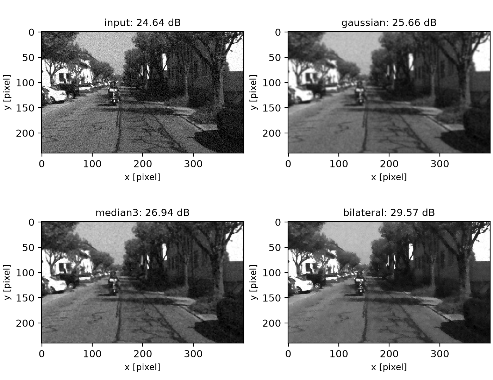

그림 D3-1. 실제 KITTI 400×240 ROI에 합성 독립 Gaussian 잡음 SD15 DN을 더한 결과와 세 필터다. 축은 ROI pixel, 표시 범위는 공통 0–255 DN이며 계산은 범위 밖 float 값도 유지했다. 제목의 dB는 원 PNG 대비 PSNR이다. 도로의 평탄 영역과 얇은 그림자를 함께 보며 잡음 제거와 blur를 구분한다. 원 PNG 자체가 잡음 없는 세계라는 뜻은 아니다.

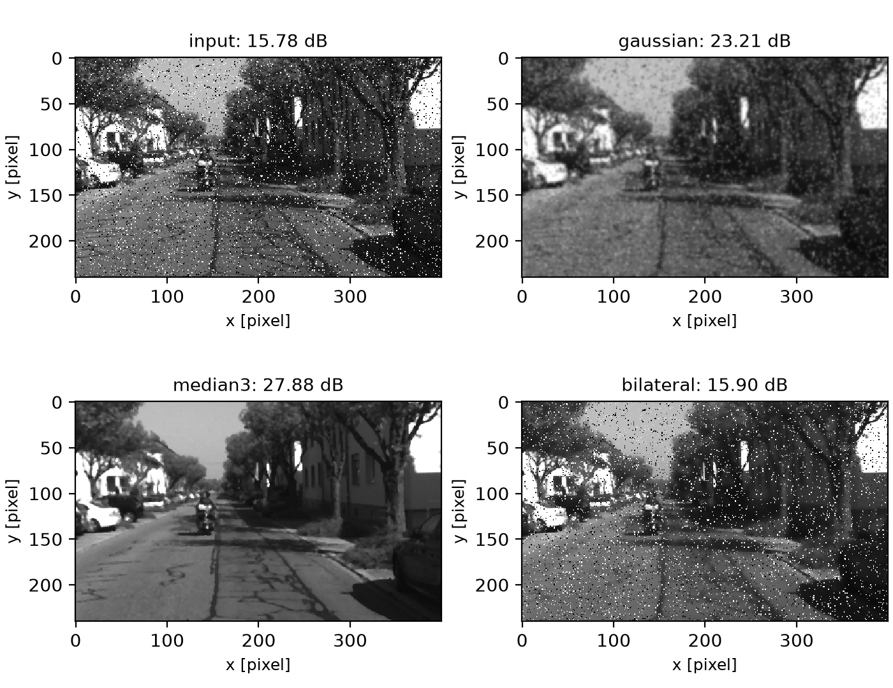

그림 D3-2. 동일한 실제 ROI에서 합성 확률0.04의 0값과 0.04의 255값을 삽입했다. 나머지 실험 조건과 표시 단위는 D3-1과 같다. median은 고립된 극단값을 제거하지만 bilateral은 밝기 차가 큰 충격을 경계처럼 보존하는 경우가 보인다. 이 실험에서 bilateral의 SSIM은 입력보다 낮았다. 한 영상·한 설정의 음의 결과이며 모든 bilateral 변형에 대한 보편적 순위는 아니다.

Gaussian 잡음에서는 median의 PSNR이 Gaussian 평균보다 높지만 SSIM은 더 낮다.
어느 지표를 선택하느냐에 따라 순위가 바뀌는 예다.
지표 하나를 “화질”의 완전한 정의로 쓰면 이 차이를 설명할 수 없다.
충격 잡음에서 bilateral의 PSNR은 아주 조금 좋아졌지만 SSIM은 0.2933에서 0.2512로 낮아졌다.
큰 오차 몇 개와 국소 구조의 영향을 지표가 다르게 집계하기 때문이다.
이 차이를 관찰했지만 최종 SLAM 추적 성능과의 인과관계는 실험하지 않았다.

<a id="d3-psnr"></a>
### 9. MSE와 PSNR의 분모와 범위를 고정하기

MSE는 mean squared error, 평균 제곱 오차다.
N개 픽셀에서 잔차를 제곱한 뒤 N으로 나눈다.
독립 잡음의 분산을 추정하려는 표본분산과 목적이 다르므로 여기서는 N-1로 나누지 않는다.
PSNR은 정해진 최대 표현값 L²을 MSE로 나눈 전력비의 로그다.
L은 해당 이미지에서 관측된 최댓값을 매번 사용하는 것이 아니라 계약상 peak 값이다.

```text
MSE = (1/N)*sum_p (xhat[p]-x[p])^2
PSNR = 10*log10(L^2/MSE)
여기서는L=255 DN
MSE=0이면PSNR은+infinity
```

잔차가 3과 4 DN인 두 픽셀 예를 계산하자.
제곱합은 9+16=25, MSE는 12.5 DN²다.
255²=65025이므로 비율은 5202다.
PSNR은 `10*log10(5202)=37.1617 dB`다.
입력을 0–1로 정규화하면 MSE도 255²로 나뉘고 L=1이 되므로 같은 PSNR을 얻는다.
MSE만 정규화하고 L을 255로 두면 부정확하게 큰 점수가 나온다.

PSNR이 음수가 될 수 있는지도 확인하자.
MSE가 L²보다 크면 비율이 1보다 작아 로그가 음수다.
복원이 범위 밖으로 폭발하는 역필터에서는 가능하다.
이를 억지로 0 dB에 제한하면 실패의 크기를 숨긴다.
반대로 보여 주기 위해 clip한 영상을 평가하면 폭발이 완화된 것처럼 점수가 달라진다.
계산용 배열과 시각화용 배열을 분리하는 이유가 여기에도 있다.

<a id="d3-ssim"></a>
### 10. SSIM의 국소 통계와 해석 한계

SSIM은 structural similarity index, 구조적 유사도 지표다.
참조 영상과 비교 영상의 국소 평균·분산·공분산을 조합한다.
단순 픽셀 오차와 다른 측면을 보려는 지표이지 모든 시각 과제를 대신하는 정답은 아니다.
원문의 정의와 참조 구현은 [Wang·Bovik·Sheikh·Simoncelli, 2004](https://www.cns.nyu.edu/~lcv/ssim/)에서 확인했다.
실험에서는 아래의 완전히 명시된 단일 스케일 계약을 사용했다.

```text
mu_x = sum_i w_i*x_i, mu_y = sum_i w_i*y_i
var_x = sum_i w_i*x_i^2 - mu_x^2
var_y = sum_i w_i*y_i^2 - mu_y^2
cov_xy = sum_i w_i*x_i*y_i - mu_x*mu_y

SSIM_local = ((2*mu_x*mu_y+C1)*(2*cov_xy+C2))
             /((mu_x^2+mu_y^2+C1)*(var_x+var_y+C2))
C1=(0.01*L)^2, C2=(0.03*L)^2
```

w는 11×11 Gaussian 창, sigma1.5 pixel, 합1이다.
분산은 위 식의 population moment이며 표본 수 보정은 넣지 않았다.
각 창의 중심에서 계산한 후 바깥5 pixel을 제외한 중심들만 평균한다.
분모가 작아지는 평탄 영역에서도 안정적으로 정의되도록 C1,C2를 넣는다.
완전히 같은 영상이면 분자와 분모가 일치하여 1이다.
부동소수점 오차로 아주 작은 음의 분산이 나오면 0으로 제한한다.

밝기 offset은 평균 항에 영향을 주고 contrast 차이는 분산 항에 영향을 준다.
공간 정렬이 틀려도 국소 공분산이 바뀐다.
따라서 SSIM 점수가 높다고 물체의 정체·위치·깊이가 정확하다는 의미는 아니다.
값 범위 L, 창 크기, 경계, 다중 스케일 여부를 바꾸면 숫자도 바뀐다.
다른 라이브러리의 SSIM과 비교할 때 함수 이름만 맞추지 말고 계약을 맞춘다.
본 교육 구현이 특정 외부 benchmark의 공식 평가 전체를 재현한다는 주장은 하지 않는다.

<a id="d3-inverse"></a>
### 11. 역필터의 폭발을 주파수 하나에서 이해하기

D2의 주파수 표현에서 blur 관측은 `Y=H*X+N`이다.
H가 알려지고 0이 아니면 단순 역은 `Xhat=Y/H`다.
이를 원식에 대입하면 신호와 잡음이 어떻게 되는지 명확해진다.

```text
Xhat = (H*X+N)/H = X + N/H
H=1이면 잡음이 그대로
H=0.1이면 잡음 진폭10배
H=0.001이면 잡음 진폭1000배
H=0이면 원칙적으로 나눌 수 없음
```

blur가 약하게 남긴 성분을 다시 키우는 것은 그 성분에 섞인 잡음도 키우는 일이다.
분모에 작은 epsilon을 더하는 실무적 방법은 0 나누기를 피하지만 정답을 보장하지 않는다.
epsilon 값이 얼마인지에 따라 해가 크게 바뀌므로 명시적인 정규화 문제로 보는 편이 낫다.
특히 실제 PSF가 조금 틀린 경우 오차가 고주파에서 커질 수 있다.
이번 실험은 실제 카메라 PSF 추정이 아니라 알려진 합성 주기 blur를 사용하여 문제를 분리했다.

각 주파수에서 복소수 z에 대해 다음 목적함수를 최소화하자.
첫 항은 관측과의 적합도, 둘째 항은 추정의 크기를 제한한다.

```text
J(z) = |H*z-Y|^2 + K*|z|^2
     = (|H|^2+K)*|z|^2 - 2*Re(conj(H)*Y*conj(z)) + |Y|^2
최소조건: (|H|^2+K)*z = conj(H)*Y
z = conj(H)*Y / (|H|^2+K)
```

conj는 켤레복소수, Re는 실수부다.
실수·허수 두 변수로 각각 미분해도 같은 정규방정식을 얻는다.
H가 작아져도 분모에 K가 남아 증폭을 억제한다.
대신 잡음 없는 경우에도 일부 신호가 줄어들어 bias가 생긴다.
K가 너무 크면 관측보다 0에 가까운 해를 선호하여 영상 대비까지 낮춘다.
안정성과 복원 충실도의 교환이다.

<a id="d3-wiener"></a>
### 12. Wiener 해석: 정규화 상수는 어디서 오는가

Wiener filtering을 주파수별 선형 최소 평균 제곱 오차 추정으로 이해할 수 있다.
신호와 잡음이 평균0이고 서로 상관없으며 주파수별 전력 S_x,S_n을 안다고 가정한다.
`Xhat=A*Y` 형태의 복소 계수 A를 선택한다.
오차를 전개하면 다음과 같다.

```text
Xhat-X = (A*H-1)*X + A*N
E[|Xhat-X|^2] = |A*H-1|^2*S_x + |A|^2*S_n
상관없음으로 교차항은0
최소해 A = conj(H)*S_x / (|H|^2*S_x + S_n)
S_x>0이면 A = conj(H) / (|H|^2 + S_n/S_x)
```

앞의 상수 K를 주파수별 noise-to-signal 전력비로 대체한 형태다.
실제 영상에서 S_x를 정확히 아는 경우는 드물다.
이상적인 Wiener 해석과 실무의 고정 K 필터를 구분해야 한다.
실험의 K0.01은 알려진 참 전력비를 추정한 결과가 아니라 명시한 교육용 설정이다.
따라서 이를 oracle 최적 Wiener라고 부르지 않고 정규화 역필터라고 표시한다.
평탄한 영역에서의 국소 Wiener 필터와 전체 주파수 복원도 입출력 계약이 다른 방법이다.

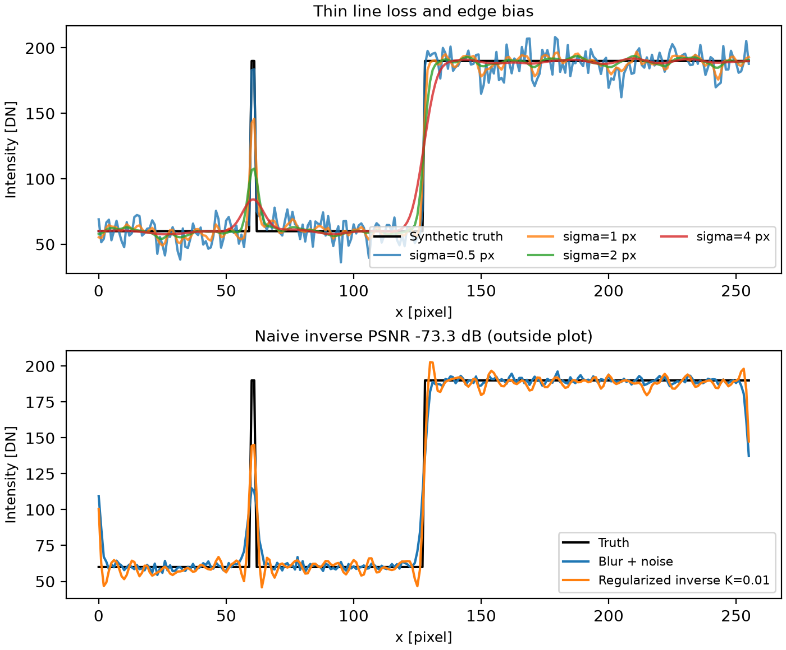

그림 D3-3. 모두 합성 128×256 영상의 0기반 행 인덱스64다. 가로축은 pixel, 세로축은 DN이다. 위는 60/190 DN 계단과 폭2 pixel의 얇은 밝은 선에 SD15 DN 잡음을 더한 뒤 sigma0.5,1,2,4 pixel로 평활화한 값이다. 아래는 주기 경계 Gaussian 전달 함수 sigma1.8 pixel과 SD2 DN 잡음의 관측, K0.01 정규화 역필터를 비교한다. 단순 역은 값이 수백만 DN으로 폭발하므로 선형축 패널에 겹치지 않고 제목에 PSNR을 명시했다. 원시 배열은 NPZ에 보존한다.

합성 sigma sweep의 PSNR은 0.5에서28.3441, 1에서31.8868, 2에서30.2509, 4에서28.1072 dB였다.
이 신호·잡음·한 난수 표본에서는 sigma1이 네 설정 중 가장 높았다.
큰 sigma가 항상 좋지 않다는 반례이며 전역 최적 sigma를 구한 실험은 아니다.
역문제의 관측은29.0953 dB, epsilon 바닥1e-6을 사용한 단순 역은-73.2667 dB, 정규화 역은30.8606 dB였다.
단순 역 출력의 최대 절대값은 4,652,261.7753 DN이었다.
이를 clip하지 않고 기록함으로써 실패를 수치적으로 드러냈다.

<a id="d3-successors"></a>
### 13. 국소 평균 이후의 선택과 검증 공백

국소 필터는 한 창 안에서만 정보를 사용한다.
같은 질감이 다른 위치에 반복될 때 그 정보를 활용하려면 더 넓은 관측 모델이 필요하다.
Non-Local Means는 픽셀값 하나 대신 주변 patch의 유사성을 이용하는 후속 읽기다.
[Buades·Coll·Morel, 2011의 논문과 공개 구현](https://www.ipol.im/pub/art/2011/bcm_nlm/)은 재현 조건을 함께 확인하기 좋다.
여기서는 학습 모델이나 NLM을 실행하지 않았으며 위 표에 점수를 추가하지 않았다.
원문이 보고한 숫자를 이 KITTI 실험의 성능으로 대체하지 않는다.

patch 반복성도 항상 참은 아니다.
유일한 작은 표지, 반사광, 움직이는 물체처럼 비슷한 patch가 없을 수 있다.
비슷해 보이는 다른 물체를 평균하면 가짜 구조가 생길 수 있다.
학습형 복원은 데이터에서 얻은 prior를 사용하므로 분포가 다른 센서에 적용할 때 검증이 필요하다.
아름다운 복원과 기하 측정의 충실도가 같은 목표인지 확인해야 한다.
복원 전후의 특징점 재검출성·정합 오차·동적 영역 오대응은 별도의 후속 실험이다.

<a id="d3-exercises"></a>
### 14. 연습문제와 완전 해설

**문제 D3-1.** 독립 잡음의 분산이16 DN²일 때 3×3 균등평균과 binomial 평균의 출력 분산을 구하라. 어느 쪽이 더 작다고 모든 영상에 더 좋다고 할 수 있는가?

**해설.** 균등평균은 가중치 제곱합1/9이므로16/9=1.7778 DN²다.
binomial은 제곱합9/64이므로2.25 DN²다.
평탄한 참 신호와 독립 잡음에서는 균등평균의 variance가 더 작다.
하지만 경계의 bias는 별도이므로 이 값만으로 전체 MSE 순위를 정할 수 없다.
두 필터의 공간 가중 형태가 다르다는 사실을 함께 보아야 한다.

**문제 D3-2.** 참값0인 중심을 포함한 창이 `[0,0,100]`이다. 잡음은 없다. 3점 평균의 bias와 MSE를 구하라.

**해설.** 출력은100/3, 참값은0이다.
매번 같은 값이므로 variance는0이다.
bias는100/3 DN, MSE는10000/9=1111.1111 DN²다.
잡음 없는 관측에서도 잘못된 국소 평탄 가정은 오차를 만든다.
필터를 적용했다는 사실이 복원을 개선했다는 뜻은 아니다.

**문제 D3-3.** bilateral의 중심50 DN, 이웃70 DN, sigma_r20 DN이다. 공간 가중치가0.5일 때 두 값만으로 계산한 출력을 구하라.

**해설.** 밝기 차20의 범위 가중치는 exp(-1/2)=0.606531이다.
이웃 전체 가중치는0.303265, 중심 가중치는1이다.
정규화 분모는1.303265다.
분자는50+70×0.303265=71.2286이다.
출력은54.6539 DN이다.
분모로 나누지 않은71.2286은 상수 보존도 하지 못하는 잘못된 계산이다.

**문제 D3-4.** 주파수 하나에서 H0.1, Y2, K0.01일 때 단순 역과 정규화 역을 구하라. 왜 두 값이 다른가?

**해설.** 단순 역은2/0.1=20이다.
정규화 역은 `(0.1*2)/(0.1²+0.01)=0.2/0.02=10`이다.
정규화는 관측을 완벽히 설명하는 것보다 추정 크기를 줄이는 항도 함께 최소화한다.
그러므로 차이를 구현 오류라고 부르지 않는다.
참 X가 알려지지 않았다면 어느 결과가 더 정확한지는 이 세 숫자만으로 확정할 수 없다.

**문제 D3-5.** 잔차3,4 DN의 PSNR을 구하고, 잔차를255로 나눈 뒤 L1로 계산해 같은지 확인하라.

**해설.** 원 MSE는12.5, 비율은65025/12.5=5202, PSNR은37.1617 dB다.
정규화 MSE는12.5/65025다.
L1일 때 비율은1/(12.5/65025)=5202로 같다.
따라서 단위를 일관되게 바꾸면 PSNR은 변하지 않는다.
단순히 배열만0–1로 바꾸고 peak255를 유지하면 같은 실험이 아니다.

<a id="d3-handoff"></a>
### 15. 미분 단계로 넘길 때 보존할 정보

다음 장에서는 밝기 변화의 위치를 찾기 위해 미분한다.
미분은 작은 고주파 변화도 증폭하므로 평활화의 선택이 출력 경계의 개수와 위치를 바꾼다.
Gaussian sigma, 값 범위, 경계 정책을 gradient 단계까지 같이 전달해야 한다.
이미 평활화된 영상인지 모르고 다시 평활화하면 의도보다 큰 scale을 사용하게 된다.
두 Gaussian의 연속 모형 합성에서는 분산이 더해지므로 sigma가 직접 더해지는 것도 아니다.
sigma1과 sigma2를 연속 적용하면 합성 sigma는 sqrt(sigma1²+sigma2²)이며 유한 이산 kernel에서는 근사 정도를 확인한다.

보존할 산출물은 원 관측, 복원 영상, 잔차, 파라미터, 지표의 평가 영역이다.
화면에 보여 준 clip된 PNG만 남기면 실패를 재현하기 어렵다.
이번 실험은 NPZ에 중간 float 배열을 보존하고 JSON에 점수와 설정·hash를 남겼다.
그림만 보고 성능을 말하지 않고, 숫자만 보고 구조 보존을 말하지 않는 것이 이 장의 마지막 계약이다.

<a id="d4"></a>
## D4. 미분에서 경계와 영역으로: 검출의 의미를 단계마다 지키기

<a id="d4-problem"></a>
### 1. 변화가 큰 곳을 찾는 것과 물체를 찾는 것은 다르다

도로 사진에서 경계를 찾으면 건물 윤곽뿐 아니라 그림자, 차선, 반사, 나뭇잎의 질감도 나타난다.
경계 검출기는 밝기의 변화에 반응할 뿐 그 변화가 물체의 외곽인지 바로 알지 못한다.
검출된 선이 많다고 더 많은 물체를 정확하게 이해했다는 뜻도 아니다.
이 장의 최종 목표는 미분값, 가는 경계, 이진 영역, 연결요소를 서로 다른 자료형으로 구분하는 것이다.
그 계약이 있어야 후속 특징점·분할·추적 알고리즘에 무엇을 전달할지 정할 수 있다.

흐름은 먼저 밝기의 변화율을 구하고, 그중 위치가 분명한 후보를 고른 뒤, 약한 후보의 연결 관계를 판단하는 순서다.
영역을 나누려면 별도의 threshold나 다른 분할 모델이 필요하다.
이미지가 Boolean 배열이 되었다고 의미가 동일해지는 것은 아니다.
edge mask의1은 경계 위치, object mask의1은 물체 내부를 뜻할 수 있다.
같은 connectedComponents 함수를 적용해도 그 label의 해석은 완전히 달라진다.
함수 입출력 shape뿐 아니라 값의 의미를 명시해야 한다.

<a id="d4-contract"></a>
### 2. 좌표와 부호, 미분 크기의 단위

이 장도 배열 `[v,u]`, u는오른쪽, v는아래쪽을 사용한다.
입력 I는 float DN이며 픽셀 간격을1 pixel로 둔다.
gradient는 밝기가 가장 빨리 증가하는 방향과 그 속도를 나타내는 벡터다.
경계의 진행 방향은 보통 gradient와 수직이다.
이 둘을 혼동하면 NMS에서 비교해야 할 이웃을 잘못 선택한다.

|기호|뜻|단위|
|---|---|---|
|I_s|공간 평활화된 영상|DN|
|g_u,g_v|가로·세로1차 미분 근사|DN/pixel|
|M|gradient magnitude, `sqrt(g_u²+g_v²)`|DN/pixel|
|theta|gradient 방향, `atan2(g_v,g_u)`|radian|
|L|Laplacian, 두 축2차 미분의 합|DN/pixel²|
|T_low,T_high|Canny 교육 단계의 크기 문턱|DN/pixel|
|B|이진 mask|0또는1|
|S|형태학의 구조 요소|픽셀 offset의 집합|
|C,Holes|연결요소 수, 구멍 수|개수|

정수 kernel을 그대로 쓰면 출력 크기에 별도의 scale이 곱해진다.
따라서 미분 단위를 표시하려면 kernel의 정규화도 함께 정해야 한다.
Sobel3×3을 기본 정수값으로 사용한 결과와1/8로 정규화한 결과는8배 차이가 난다.
threshold 숫자20은 두 결과에서 같은 뜻이 아니다.
이 장의 교육 경로는 ramp의 기울기를 정확히 재는1/8 정규화를 사용한다.
OpenCV Canny 비교에서는 그 차이를 고려해 문턱을8배로 주되 세부 구현까지 같다고 주장하지 않는다.

<a id="d4-difference"></a>
### 3. 차분을 Taylor 전개에서 유도하기

연속 신호 f를 x 주위에서 전개한다.
작은 거리 h에서 앞으로 간 값과 뒤로 간 값을 각각 적는다.
짝수 차수 항은 두 식의 차에서 사라진다.
이를2h로 나누면 중앙 차분을 얻는다.

```text
f(x+h) = f(x) + h*f'(x) + h^2*f''(x)/2 + h^3*f'''(x)/6 + ...
f(x-h) = f(x) - h*f'(x) + h^2*f''(x)/2 - h^3*f'''(x)/6 + ...
두 식의 차 = 2*h*f'(x) + h^3*f'''(x)/3 + ...
(f(x+h)-f(x-h))/(2*h) = f'(x) + O(h^2)
```

O(h²)는 생략한 항의 크기가 충분히 매끄러운 함수에서 h²에 비례하는 차수라는 뜻이다.
날카로운 불연속에서 같은 매끄러움 가정을 그대로 사용할 수 없다.
픽셀 간격 h=1이면 correlation kernel은 `[-1,0,1]/2`다.
선형 ramp `f[n]=3*n+7`에 적용하면 `(3(n+1)+7-3(n-1)-7)/2=3`이다.
상수7은 사라지고 기울기3 DN/pixel만 남는다.
이것이 본 실험의 ramp 단위 검사다.

한편 noise가 독립이고 분산sigma_n²이면 중앙 차분의 잡음 분산은sigma_n²/2다.
원 신호의 변화율이 작으면 그 잡음만으로도 가짜 gradient가 크게 보일 수 있다.
다른 간격 h를 사용하면 분산은sigma_n²/(2h²)가 된다.
큰 h는 noise 영향은 줄이지만 더 넓은 구간을 섞어 작은 구조를 놓칠 수 있다.
미분 전에 smoothing을 하는 이유는 신호와 잡음이 어느 scale에서 구별되는지 가정하는 것이다.

<a id="d4-sobel"></a>
### 4. Sobel과 Scharr를 숫자와 정규화로 읽기

Sobel3×3은 한 방향의 중앙 차분과 직각 방향의 가중 평균을 결합한다.
가로 미분 kernel을 correlation 관례로 쓰면 다음과 같다.
세로 방향 `[1,2,1]/4`의 평활화와 가로 `[-1,0,1]/2`의 외적이다.

```text
K_u = (1/8) * [ -1  0  1
                 -2  0  2
                 -1  0  1 ]
K_v = transpose(K_u)
g_u = correlate(I_s, K_u)
g_v = correlate(I_s, K_v)
```

세 행이 모두 `[10,20,30]`이라면 정수 kernel의 합은20+40+20=80이다.
1/8을 곱하면10 DN/pixel이다.
실제 한 pixel당10 증가하는 ramp와 맞는다.
세로 kernel은 각 열의 위아래가 같으므로0이다.
gradient 벡터는 `(10,0)`, 크기10, 방향0 radian이다.
이 결과는 밝기가 오른쪽으로 증가한다는 뜻이며 수직 경계를 따라가는 방향은 아니다.

Scharr3×3은 Sobel과 다른 직각 방향 가중치를 사용한다.
정규화된 가로 kernel은 다음과 같다.
두 kernel 모두1차 미분의 작은 근사이지만 방향에 따른 응답 특성이 같지 않다.

```text
K_scharr_u = (1/32) * [ -3   0   3
                       -10   0  10
                        -3   0   3 ]
```

정수 Scharr를 정수 Sobel과 그대로 크기 비교하면 정규화부터 틀리다.
같은 ramp에서 분모32를 적용해야 단위가 맞는다.
여기서는 Scharr가 항상 더 정확하다는 광범위한 성능 주장을 하지 않는다.
두 필터의 실제 배열을 저장하고, OpenCV 연산 규약은 [공식 미분·필터 문서](https://docs.opencv.org/4.x/d4/d86/group__imgproc__filter.html)에 연결한다.
방향 오차 평가가 필요하면 여러 각도의 알려진 연속 신호를 별도로 표본화하여 비교해야 한다.

<a id="d4-second"></a>
### 5. Laplacian, LoG, DoG를 서로 구분하기

2차 미분은 기울기가 어떻게 변하는지 측정한다.
앞의 Taylor 두 식을 이번에는 더한 뒤2f(x)를 빼면 다음과 같다.

```text
f(x+h)+f(x-h)-2*f(x) = h^2*f''(x) + O(h^4)
f''(x) ~= (f(x+h)-2*f(x)+f(x-h))/h^2
```

2차원 Laplacian은 가로2차 미분과 세로2차 미분의 합이다.
h=1에서 가장 단순한4이웃 kernel은 다음과 같다.

```text
L = d2I/du2 + d2I/dv2
K_L = [ 0  1  0
        1 -4  1
        0  1  0 ]
```

상수 입력에서는 가중치 합0이므로 출력이0이다.
선형 ramp도 내부에서는0이다.
가운데만100이고 주변0이면 중앙 출력은-400이며 주변에는 양의 응답이 생긴다.
양수와 음수가 공존하므로 uint8 출력이나 절대값 표시만으로 원래 부호를 분석할 수 없다.
영점교차는 부호가 바뀌는 위치를 뜻하며 작은 noise에도 생길 수 있다.
영점교차의 개수만 세어 의미 있는 경계라고 판단하지 않는다.

LoG는 Laplacian of Gaussian이다.
먼저 Gaussian으로 평활화하고 Laplacian을 적용하거나, 조건이 맞으면 Gaussian의 Laplacian kernel을 합성곱한다.
DoG는 Difference of Gaussians로 서로 다른 sigma의 평활화 영상을 뺀다.
두 단어의 비슷한 모양과 달리 완전히 같은 연산은 아니다.
일정 조건에서 DoG가 scale-normalized LoG와 연결된다는 근사를 유도할 수 있다.

```text
G(r,sigma) = exp(-r^2/(2*sigma^2))/(2*pi*sigma^2)
dG/dsigma = (-2/sigma + r^2/sigma^3)*G
Laplacian(G) = (r^2/sigma^4 - 2/sigma^2)*G
따라서 dG/dsigma = sigma*Laplacian(G)

G(k*sigma)-G(sigma)
 ~= (k-1)*sigma*(dG/dsigma)
 = (k-1)*sigma^2*Laplacian(G), k가1에가까울때
```

차이 DoG의 단위는 DN, Laplacian 영상은 DN/pixel²다.
sigma²를 곱하면 단위가 맞는다.
k=1.6은 무한소 차이가 아니므로 등호가 아닌 근사라는 점을 유지해야 한다.
실험은 sigma1.6 평활화에서 sigma1 평활화를 뺀 DoG를 저장했다.
부호 관례를 반대로 잡으면 DoG 부호도 반대가 된다.
다중 scale의 경계 표현은 [Marr·Hildreth, 1980, Theory of edge detection](https://www.med.harvard.edu/bss/neuro/bornlab/qmbc/beta/day4/marr-hildreth-edge-prsl1980.pdf)에서 이어 읽을 수 있다.

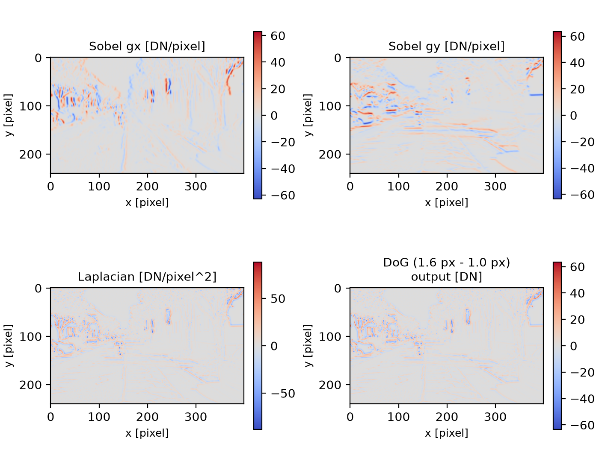

그림 D4-1. 실제 KITTI ROI를 공간 sigma1.2 pixel로 평활화한 뒤 계산한 Sobel 가로·세로 미분과 Laplacian, 별도로 sigma1.6과1.0의 차를 구한 DoG다. 가로·세로 축은 ROI pixel이다. 각 colorbar는 자기 패널의 양·음 대칭 범위이며 Sobel은 DN/pixel, Laplacian은 DN/pixel², DoG는 DN이다. 파랑과 빨강은 부호가 다른 응답을 뜻한다. 패널별 자동 범위가 다르므로 색의 진함만으로 서로 다른 연산의 수치 크기를 비교하지 않는다.

<a id="d4-canny"></a>
### 6. Canny의 문제 정의와 교육 구현 경계

Canny는 강한 밝기 변화를 찾는 것에 더해 위치를 잘 맞추고 한 경계에 중복 응답을 줄이는 문제를 다룬다.
원문은 [John Canny, 1986, A Computational Approach to Edge Detection](https://www.cse.ust.hk/~quan/comp5421/notes/canny1986.pdf)다.
이 교재는 원문의 모든 최적화·다중 scale 절차를 완전히 재현하지 않는다.
Gaussian, Sobel, 4방향 NMS, 8연결 hysteresis로 이루어진 교육 경로의 배열을 공개한다.
OpenCV Canny는 별도로 실행해 출력을 비교한다.
교육 단계 그림을 OpenCV 내부 디버그 배열이라고 표시하지 않는다.

```text
float DN 입력
 -> Gaussian sigma=1.2 pixel
 -> normalized Sobel gu,gv [DN/pixel]
 -> magnitude M, direction theta
 -> 4방향 non-maximum suppression
 -> strong M>=20, eligible M>=8
 -> eligible 안에서 strong에 8연결된 모든 pixel
 -> Boolean edge mask
```

각 단계는 전 단계에서 없어진 정보를 다시 생성하지 않는다.
평활화에서 사라진 얇은 선은 threshold를 내려도 정확히 돌아오지 않는다.
NMS에서 잘못 제거한 위치는 hysteresis가 새롭게 만들지 않는다.
연결 단계는 후보 중 무엇을 남길지 결정할 뿐이다.
실패를 추적할 때 최종 edge만 보지 않고 어느 단계에서 후보가 사라졌는지 확인해야 한다.

<a id="d4-nms"></a>
### 7. 방향에 따른 비최대 억제

NMS는 non-maximum suppression, 비최대 억제다.
gradient가 큰 띠에서 대표 위치를 남기기 위해 변화 방향의 양옆과 크기를 비교한다.
경계선을 따라 옆 점을 비교하는 것이 아니라 경계에 수직인 방향을 비교한다.
예를 들어 수직 벽 경계는 가로 방향 밝기 변화이므로 좌우 이웃을 비교한다.
가로 경계는 상하 이웃을 비교한다.

theta를0 이상180도 미만으로 접어 네 방향0,45,90,135도로 양자화한다.
부호 반대의 gradient도 같은 선상의 양쪽 비교를 하므로180도 주기면 충분하다.
영상 좌표 v가 아래로 증가하기 때문에+45도는 오른쪽 아래 방향이다.
수학 좌표의 위쪽 양수 관례를 그대로 복사하면 대각 비교가 뒤집힐 수 있다.

```text
방향0도:   (u-1,v),   (u+1,v)
방향45도:  (u-1,v-1), (u+1,v+1)
방향90도:  (u,v-1),   (u,v+1)
방향135도: (u+1,v-1), (u-1,v+1)

중심 M이 두 비교값보다 작지 않으면 유지, 아니면0
가장자리1 pixel은 교육 구현에서0
```

예를 들어 가로 비교 크기가 `[3,8,5]`이면 중심8은 유지된다.
`[9,8,5]`이면 중심8은 제거된다.
`[8,8,8]`처럼 plateau이면 현재 `>=` 정책은 여러 점을 남길 수 있다.
따라서 이 교육 NMS가 항상 엄밀한1 pixel 두께를 보장한다고 쓰면 틀리다.
tie-breaking, 방향 보간, subpixel 위치 추정은 각각 추가 계약이다.
방향 양자화 경계 부근에서도 작은 noise가 비교 방향을 바꿀 수 있다.

<a id="d4-hysteresis"></a>
### 8. 두 문턱과 그래프 도달성

hysteresis는 상태 결정이 단일 현재값만이 아니라 연결된 강한 증거에도 의존한다는 뜻으로 읽을 수 있다.
높은 문턱 이상은 strong, 낮은 문턱 이상은 eligible로 정한다.
strong은 eligible의 부분집합이어야 하므로 `0<T_low<=T_high`를 검사한다.
그 후 eligible 격자에서 strong으로부터 도달 가능한 모든 점을 남긴다.
이는 단순히 strong의 바로 옆 약한 점을 한 번 붙이는 연산과 다르다.

한 줄의 NMS값이 `[0,10,5,5,5,0,5]`, low4, high9라고 하자.
10은 strong, 연속된 세 개의5는 그10에 연결되어 있다.
마지막5는0으로 끊겨 있으므로 제거된다.
한 번의 이웃 검사만 하면10 옆의 첫5만 남을 수 있지만 도달성 계산은 연결 사슬 전체를 남긴다.
실험은 SciPy `binary_propagation`으로 이 연결 문제를 해결한다.
직접 작성한 재귀함수의 깊이 제한이나 스택 오류를 피하고 검증된 연결 연산을 사용한다.

그래프로 보면 eligible 픽셀이 정점이고8이웃 접촉이 간선이다.
strong이 하나 이상 있는 연결성분을 모두 선택하는 것과 같다.
8이웃은 상하좌우와 네 대각을 포함한다.
좁은 틈을 대각선으로 건너뛰는 연결도 가능하므로4이웃과 결과가 다를 수 있다.
이것은 나중의 형태학과 연결요소 정의까지 일관되게 관리해야 할 선택이다.

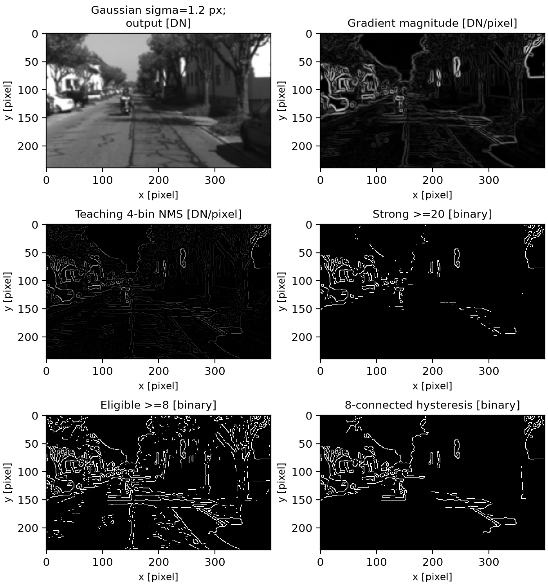

그림 D4-2. 실제 KITTI ROI에서 직접 저장한 교육용 여섯 단계다. 왼쪽 위의 sigma1.2는 공간 단위 pixel이며 출력 밝기는 DN이다. gradient와 NMS 패널은 같은0–80 DN/pixel 범위다. strong,eligible,hysteresis는 이진0/1이다. 모든 공간축은 ROI pixel이다. 낮은 문턱을 통과한 모든 점이 최종 결과에 남는 것이 아니라 strong으로 이어지는 부분만 남는지 세 번째 행을 비교한다. 이 배열은 OpenCV Canny 내부를 추출한 것이 아니다.

<a id="d4-thresholds"></a>
### 9. 문턱 숫자와 라이브러리 결과를 비교하는 방법

교육 경로의 low/high를3/8,8/20,16/40 DN/pixel로 바꾸었다.
같은 Gaussian sigma와 같은 ROI에서 다른 것은 문턱뿐이다.
최종 edge 픽셀 수는 각각12,389,3,950,1,735였다.
문턱을 올리면 더 적게 남는다는 예상과 맞지만, 적게 남았다고 정확도가 높아졌다는 뜻은 아니다.
실제 KITTI 물체 경계 GT를 사용하지 않았으므로 precision이나 recall을 이 숫자에서 계산하지 않는다.

OpenCV 비교는 먼저 같은 평활화 결과를 반올림하여 uint8로 바꾼다.
그 뒤 `Canny(...,64,160,L2gradient=True)`를 실행했다.
64와160은 교육 경로의8과20에 정수 Sobel의 scale8을 곱한 것이다.
L2gradient는 Euclidean 크기 sqrt(gx²+gy²)를 선택한다.
L1형 크기 abs(gx)+abs(gy)와 문턱을 그대로 공유하면 각도에 따라 검출이 달라질 수 있다.
예를 들어 gx3,gy4일 때 L2는5, L1은7이다.

OpenCV 출력의 edge 픽셀 수는3,957이었다.
교육 경로3,950과 가깝지만 동일한 위치라는 뜻도, 내부가 같다는 뜻도 아니다.
입력 정수화, 경계 처리, NMS의 비교 세부, 연결 정책의 차이가 남아 있다.
비교 그림의 목표는 교과 절차가 어떤 종류의 결과를 만드는지 보는 것이다.
완전 동등성 검증이 필요하면 픽셀별 차이, 타이 정책, 라이브러리 소스와 버전까지 추적해야 한다.

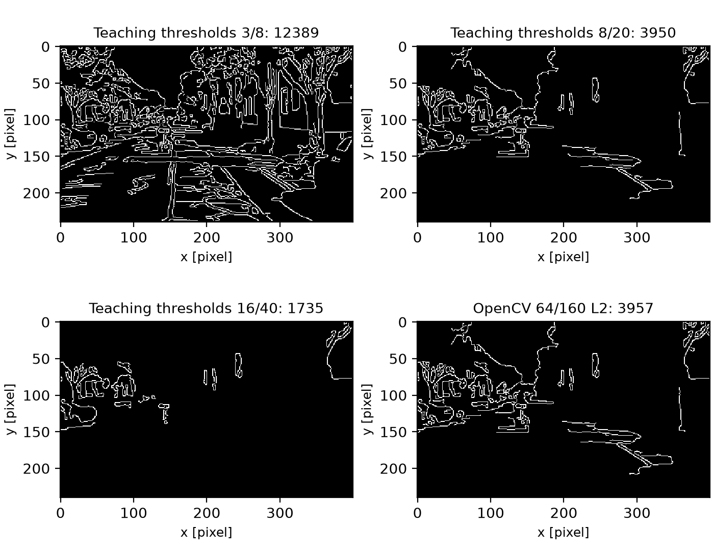

그림 D4-3. 왼쪽 위부터 교육용low/high3/8,8/20,16/40 DN/pixel과 별도OpenCV64/160 L2gradient 결과다. 공간축은 같은 ROI pixel, 모든 패널은 이진 경계다. 문턱이 낮으면 나무·그림자의 복잡한 변화까지 남고 높으면 약한 구조가 끊긴다. 마지막 패널은 정수Sobel scale을 고려한 비교이지 동일 내부 구현의 증거가 아니다. 제목의 개수는 검출량이며 정답과 비교한 정확도가 아니다.

<a id="d4-otsu"></a>
### 10. Otsu: 밝기 군집을 나누는 목적함수

Canny의 문턱은 미분 크기에 적용되었다.
영역 분할의 문턱은 원래 밝기값에 적용할 수 있다.
같은 threshold라는 이름이라도 단위와 뜻이 다르다.
Otsu는 밝기 histogram을 두 집단으로 나누는 문턱을 군간 분산 최대화로 선택한다.
원문은 [Nobuyuki Otsu, 1979](https://skynet.ecn.purdue.edu/~ace/vip/A_Threshold_Selection_Method_from_Gray-Level_Histograms_otsu.pdf)다.
아래 유도와 작은 histogram은 별도로 구성한 학습 예다.

밝기 i의 확률을 p_i, 문턱 t 이하 집단을0, 초과 집단을1이라 한다.
각 집단의 비중 w와 평균 mu를 정의한다.
빈 집단은 평균을 계산할 수 없으므로 후보에서 제외한다.

```text
w0 = sum_(i<=t) p_i, w1=1-w0
mu0 = sum_(i<=t) i*p_i / w0
mu1 = sum_(i>t) i*p_i / w1
muT = w0*mu0+w1*mu1
sigma_B^2 = w0*(mu0-muT)^2 + w1*(mu1-muT)^2
```

mu0-muT에 위의 muT를 대입하면 w1(mu0-mu1)이다.
mu1-muT는 w0(mu1-mu0)이다.
따라서 제곱항의 공통 인자를 모으면 다음과 같다.

```text
sigma_B^2 = w0*w1^2*(mu0-mu1)^2 + w1*w0^2*(mu1-mu0)^2
          = w0*w1*(w0+w1)*(mu0-mu1)^2
          = w0*w1*(mu0-mu1)^2
```

전체 분산은 군내 분산과 군간 분산의 합이다.
각 관측의 전체 평균 잔차를 자기 집단 평균 잔차와 집단 평균의 차로 분리하면 D3의 bias 분해처럼 교차항이0이 된다.
전체 분산은 문턱과 무관하므로 군간 분산 최대화는 군내 분산 최소화와 같다.
여기에는 공간 배치나 물체 정체가 들어가지 않는다.
동일 histogram을 가진 두 영상은 픽셀을 어떻게 섞어도 같은 Otsu 문턱을 얻는다.
밝기 분리가 잘된다는 사실과 의미 분할이 잘된다는 사실은 다르다.

<a id="d4-otsuexample"></a>
### 11. 작은 histogram과 실제 실패를 함께 계산하기

밝기0,1,2,3,4의 빈도가 각각2,2,0,2,2라고 하자.
전체8개, 평균은2다.
t=1에서는 왼쪽 비중0.5, 평균0.5이고 오른쪽 비중0.5, 평균3.5다.
군간 분산은0.5×0.5×(0.5-3.5)²=2.25다.
t=0에서는 비중0.25와0.75, 평균0과8/3이므로 군간 분산은4/3이다.
따라서 t=1이 더 좋다. t=2도 같은 분할이므로 동률이며 첫 최대값을 선택하는 검사에서는1이다.

실패 예는128×192 합성 영상에 원형 물체와 가로 조명 기울기를 겹쳐 만들었다.
좌표 x에서 배경은25+0.9x DN, 원 안쪽은 여기에55 DN을 더했다.
물체 반지름은30 pixel, 중심은(96,64), 경계 조건은 거리 제곱900 미만이다.
참 물체 mask를 알고 있으므로 이 실험에서는 정확도 분석이 가능하다.
Otsu는112 DN을 선택했고 물체의 모든 픽셀을 포함했지만 밝은 오른쪽 배경도 대량으로 포함했다.

```text
TP=2809, FP=10716, FN=0, TN=11051
precision = TP/(TP+FP) = 2809/13525 = 0.207689
recall = TP/(TP+FN) = 2809/2809 = 1
IoU = TP/(TP+FP+FN) = 2809/13525 = 0.207689
```

TP는 true positive, 참인 물체를 물체라고 한 수다.
FP는 false positive, 배경을 물체라고 잘못한 수다.
FN은 false negative, 물체를 놓친 수이며 TN은 true negative, 배경을 배경이라고 한 수다.
precision은 양성 판정 중 얼마나 맞는지, recall은 참 물체 중 얼마나 찾았는지를 묻는다.
IoU는 intersection over union, 예측과 정답의 교집합을 합집합으로 나눈 값이다.
recall이1이어도 정밀도가 낮을 수 있다는 완전한 수치 반례다.

국소 adaptive threshold를 사용하면 조명 기울기의 일부 영향을 줄일 수 있다.
하지만 window 안에 물체가 대부분을 차지하거나 contrast가 약하면 또 다른 실패가 생긴다.
Otsu보다 “항상 더 좋은” 새 이름으로 교체하는 것이 아니라 배경 변화와 물체 크기를 새 가정에 맞추는 문제다.
이 실험에서는 adaptive 방법의 성능을 측정하지 않았다.
문턱 방법을 추가하기 전에 어떤 정답 mask와 어떤 오류 비용을 쓸지 정해야 한다.

<a id="d4-morphology"></a>
### 12. 형태학: 이진 집합의 크기와 연결을 바꾸기

형태학 morphology는 구조 요소라 부르는 작은 모양으로 집합의 형상을 조작한다.
구조 요소 S는 현재 중심에 대한 offset 집합이다.
3×3 사각형은8이웃과 중심을 포함한다.
같은 크기의 십자형은 대각을 포함하지 않으므로 결과가 다르다.
아래 설명은 중심 대칭 구조 요소에 대한 이진 연산이다.

```text
dilation: 중심 주변 S의 어느 위치라도1이면 출력1
erosion:  중심 주변 S의 모든 위치가1이어야 출력1
opening:  erosion 후 dilation
closing:  dilation 후 erosion
```

dilation은 작은 틈을 연결할 수 있지만 이웃한 별개 물체도 합칠 수 있다.
erosion은 고립된 점을 없앨 수 있지만 얇은 실제 구조도 지운다.
opening은 선택한 구조 요소보다 작은 돌출이나 고립 구조를 없애는 방향이다.
closing은 작은 구멍이나 틈을 메우는 방향이다.
어느 연산도 원래의 의미적 물체 수를 보존한다는 보장은 없다.
후처리가 깔끔해 보인다고 정답에 가까워졌다는 결론을 내리지 않는다.

일관된 무한 격자·경계 계약에서 opening을 한 번 한 뒤 다시 해도 같다.
이를 idempotence, 멱등성이라 한다.
closing도 같은 성질을 갖는다.
이 성질은 kernel 크기를 바꾸거나 iteration 수를 변경한 연산과 동일하다는 뜻이 아니다.
erosion을 두 번 한 뒤 dilation을 두 번 하는 것은 원 opening을 두 번 하는 것과 다른 설정이다.
연산 순서를 기록해야 재현할 수 있다.

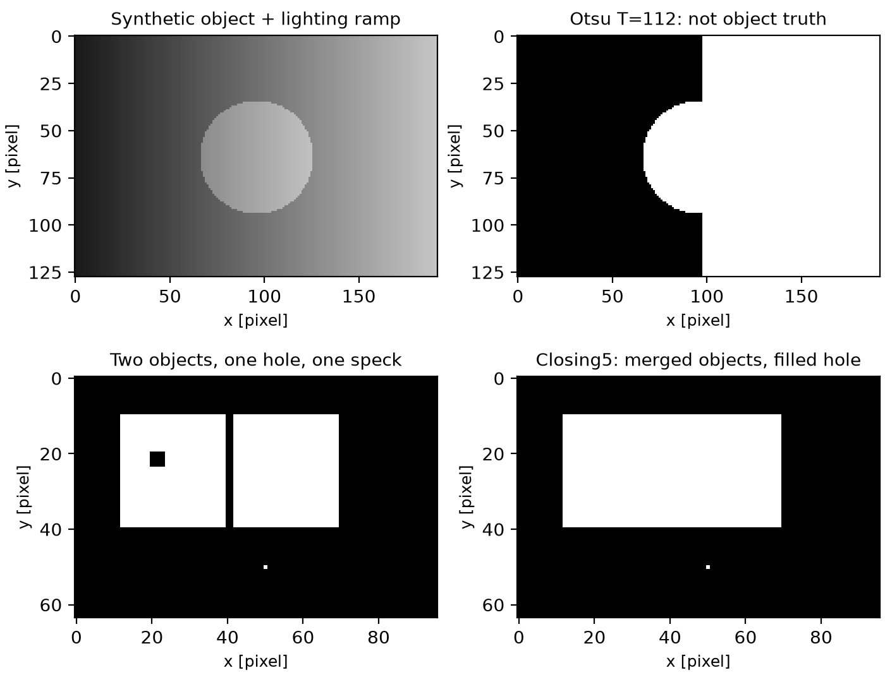

그림 D4-4. 위는 자체 합성 원형물체와 조명기울기, Otsu112 DN의 이진 결과다. 축은 pixel이며 왼쪽 밝기는0–255 DN이다. 오른쪽은 원형 외에 밝은 배경까지 선택한다. 아래는 별도의64×96 합성 mask로, 두 사각형·작은 구멍·고립점과5×5 closing 결과를 보여 준다. closing은 구멍을 메웠지만 두 사각형도 합쳤다. 원형물체 분할과 사각형 topology는 서로 다른 합성 실험이며 실제KITTI GT가 아니다.

<a id="d4-topology"></a>
### 13. 연결요소와 구멍: 픽셀 개수만으로는 알 수 없는 구조

connected component는 선택한 이웃 관계로 서로 도달 가능한 픽셀들의 최대 집합이다.
label image의 숫자1,2,3은 보통 구성요소 식별자일 뿐 밝기나 분류 확률이 아니다.
같은 물체가 그림자나 얇은 틈 때문에 여러 성분으로 나뉠 수 있다.
반대로 두 물체가 붙으면 한 성분이 될 수 있다.
연결요소 분석은 이진 mask를 해석하는 도구이지 의미적 물체 검출의 완성은 아니다.

3×3 단위행렬처럼 대각선에만1이 있는 mask를 생각하자.
4연결에서는 세 점이 모두 분리되어3개 성분이다.
8연결에서는 대각이 이어져1개 성분이다.
단 하나의 픽셀도 바꾸지 않고 이웃 정의만 바꾸어 개수가 달라졌다.
따라서 논문이나 코드에서 “연결요소 수”를 보고하려면 connectivity를 반드시 명시한다.

구멍을 셀 때 배경의 연결 정의도 함께 정해야 한다.
전경과 배경을 모두 같은 대각 연결로 처리하면 디지털 경계의 분리성 해석이 모호해질 수 있다.
전경8연결·배경4연결처럼 상보적인 선택을 명시하는 것이 한 방법이다.
평면의 Euler 특성은 여기서 성분 수 C에서 구멍 수 Holes를 뺀 `chi=C-Holes`로 읽는다.
단순 면적 변화가 작더라도 가는 다리 하나가 생기면 C가 바뀔 수 있다.
작은 구멍 하나를 메우면 Holes가 바뀌므로 topology도 바뀐다.

실험 mask는 원래8연결 성분3개다.
두 사각형이2개, 고립점이1개이며 사각형 안의 구멍은 전경 성분을 늘리지 않는다.
3×3 opening 뒤에는 고립점이 사라져 성분2개다.
5×5 closing 뒤에도 성분은2개이지만 이때는 합쳐진 사각형1개와 남은 고립점1개다.
같은 “2개”라도 어떤 객체가 남았는지는 다르다.
면적·bounding box·구멍·원영상 overlay를 함께 봐야 하는 이유다.

<a id="d4-exercises"></a>
### 14. 연습문제와 완전 해설

**문제 D4-1.** 세 행이 모두 `[10,20,30]`인 patch의 정수 Sobel 가로값, 정규화값, 세로값을 계산하라.

**해설.** 가로 정수 합은 `(-10+30)+(-20+60)+(-10+30)=80`이다.
1/8을 곱하면10 DN/pixel이다.
세로는 윗행과 아랫행이 같으므로0이다.
gradient 방향은 오른쪽, 크기는10이다.
이 patch의 경계 접선 방향은 gradient와 수직인 세로 방향이다.

**문제 D4-2.** gradient가 `(3,4)`이고 문턱이6일 때 L1과 L2 크기를 사용한 판정은 같은가?

**해설.** L1은 abs3+abs4=7이므로 통과한다.
L2는 sqrt(9+16)=5이므로 탈락한다.
같은 문턱 숫자를 썼지만 norm이 달라 판정이 다르다.
OpenCV의 L2gradient 설정을 바꾸면 문턱도 다시 검토해야 한다.
scale이나 dtype가 달라진 경우도 별도의 계약 변경이다.

**문제 D4-3.** NMS값 `[0,10,5,5,5,0,5]`에 low4,high9를 적용한다. 한 번의 팽창과 완전한 hysteresis가 왜 다른지 설명하라.

**해설.** strong은 값10인 두 번째 위치다.
eligible은10과 네 개의5다.
strong 바로 옆만 한 번 선택하면 첫 번째5까지만 추가된다.
도달성을 끝까지 계산하면 연속된 세 개의5가 모두 선택된다.
마지막5는0으로 분리되어 남지 않는다.
최종 선택 수는4개이며 검사 `test_hysteresis_path`가 같은 연결 사슬을 검증한다.

**문제 D4-4.** histogram `[2,2,0,2,2]`에서 t=1과 t=0의 Otsu 군간 분산을 구하라.

**해설.** t=1은 w0=w1=0.5, mu0=0.5, mu1=3.5이므로2.25다.
t=0은 w0=0.25,w1=0.75,mu0=0,mu1=(2+6+8)/6=8/3이다.
군간 분산은 `(1/4)*(3/4)*(64/9)=4/3`이다.
따라서 t=1이 더 크다.
빈 bin2를 포함하는 t=2도 같은 분할이며 동률이다.
문턱 정수의 차이와 실제 이진 mask의 차이를 구별해야 한다.

**문제 D4-5.** 정답 `[1,1,0,0]`, 예측 `[1,0,1,0]`의 precision,recall,IoU를 구하라.

**해설.** 첫 항은 TP, 둘째는 FN, 셋째는 FP, 넷째는 TN으로 각1개다.
precision은1/(1+1)=0.5, recall도0.5다.
IoU는1/(1+1+1)=1/3이다.
정답 양성 수나 전체 픽셀 수를 IoU의 분모로 쓰지 않는다.
특히 배경이 대부분인 영상에서 accuracy만 높다는 것이 물체 분할이 좋다는 증거가 아닐 수 있다.

<a id="d4-reproduction"></a>
### 15. D1–D4 실행 계약과 산출물 찾아가기

연구 루트는 `research/computer-vision-textbook/imaging/`이다.
`notes/inventory.md`는 보유 자료와 미보유 보정값, `notes/prior_work.md`는 확인한 원문과 적용 판단, `notes/architecture.md`는 모듈 계약을 기록한다.
설정은 `configs/default.json`, 핵심 교육 연산은 `src/imaging.py`, 실험 실행은 `src/run.py`, 수치 검사는 `src/test_imaging.py`다.
정본과 생산 모듈을 수정하지 않는 독립 실험이다.
실행 시 GPU나 새 학습 모델을 필요로 하지 않는다.

```text
research/20261031_vo-lo-study/.venv/bin/python \
  research/computer-vision-textbook/imaging/src/run.py

research/20261031_vo-lo-study/.venv/bin/python -m unittest discover \
  -s research/computer-vision-textbook/imaging/src -p 'test_*.py' -v
```

난수 seed는20261125이며 OpenCV 스레드는1로 설정했다.
모든 그림은7 inch 폭·200 dpi로 저장하여 가로1400 pixel이다.
배열은 `artifacts/d1`부터 `artifacts/d4`의 `arrays.npz`, 수치는 각 `metrics.json`에 저장한다.
manifest에는 입력·설정·소스·그림·배열의 SHA256와 의존성 버전·실행시간·기반 commit을 기록한다.
초기 실행 환경은 Python3.11.14, NumPy2.4.6, SciPy1.17.1, OpenCV5.0.0, Matplotlib3.11.1이다.
인용한 OpenCV 공개 문서는4.x 계열이므로 설치된5.0.0의 모든 내부 세부를 보증하는 자료로 사용하지 않았다. 실제 실행값과41개 단위 검사가 이 환경의 사용 계약을 별도로 확인한다.
실행시간은 그림 생성을 포함한 로컬 측정이며 프레임 실시간성 benchmark가 아니다.

기반 commit은 `75f7140d0dec421971c9b13d088e1967ebe124d5`다.
좌측 입력 SHA256는 `8c450b500f3feea6675c968bc9c46431aa5c7c4bbda47e3f486f9bbdc197515d`다.
우측은 `ae17796da40fc877ddfa8564b5ab57e46e776937c79fdbfe5d7aa9f9110da98f`다.
해시는 파일 동일성을 확인하는 값이지 데이터의 물리적 정확성을 보증하는 인증서가 아니다.
코드를 수정해 재실행하면 소스 hash와 runtime을 새로 기록하고 수치표가 같은지 확인한다.
교육 계산의 단위·불변량·작은 예제 검사는 실행 완료 후 별도 기록한다.

<a id="d4-limits"></a>
### 16. 이 네 장을 넘어서기 전에 확인할 질문

픽셀값을 광량으로 해석할 근거가 있는가, 아니면 저장 DN만 알고 있는가?
축소한 영상의 한 pixel은 점값인가 면적평균인가, 원본의 어느 좌표에 대응하는가?
잡음 제거 점수는 실제 무잡음 정답에 대한 것인가, 원 PNG에 추가한 합성 열화의 복원인가?
gradient의 정규화와 문턱 단위가 맞는가, 음수 미분을 정수 타입으로 잃지 않았는가?
edge mask와 object mask를 구분했는가, 연결요소의 이웃 관계와 배경 정의를 명시했는가?
이 질문에 답할 수 있어야 그 위의 특징점·광류·기하 추정에서 실패 원인을 층별로 구분할 수 있다.

이 실험에서 확인하지 않은 것은 실제 센서 보정, 실제 PSF 추정, 광전자 정답, 색 카메라 복원, 의미 경계 GT 성능, 전체 시퀀스 일반화다.
작은 독립 실험이 이 범위를 완료했다고 확장해 주장하지 않는다.
확인한 것은 단위가 맞는 수치 계약, 재현 가능한13개 그림, 직접 실행한 통제 실패와 배열이다.
후속 방법은 잃은 정보를 자동으로 되살리는 마술이 아니라 관측·prior·목적함수를 바꾸는 선택이다.
그 선택의 성공 조건을 설명하는 능력이 함수 이름을 많이 외우는 것보다 중요하다.

<a id="d5"></a>

## D5. 선형대수: 좌표를 바꾸는 일과 정보를 얻는 일은 다르다

**책 안의 연결:** [A1–A6](#foundations)의 최소 계산에서 출발해, [C2 두 시점](#c2)와 [C6 BA](#c6)가 실제로 요구하는 rank·분해·조건수를 심화한다. D5–D8은 [D13–D16 기하](#d13)와 [D17 학습](#d17)의 공통 계산 기반이다. [전체 읽기 지도](#cv-reading).

<a id="d5-1"></a>

### D5.1 문제에서 출발하기: 작은 잔차가 정확한 해를 보장하는가

두 카메라 광선이 거의 평행하면 영상의 작은 오차가 깊이의 큰 오차가 된다.
최소제곱 프로그램이 정상 종료하고 잔차가 작아도 이 현상은 사라지지 않는다.
이 장의 목표는 행렬 계산법을 암기하는 것이 아니라, 관측이 어떤 방향을 얼마나 구속하는지 읽는 것이다.
기저는 좌표의 뜻을, 특잇값은 관측 민감도를, 영공간은 전혀 구속되지 않은 변화를 알려준다.
계산 순서는 물리량 정의, 좌표 계약, 선형 모델, 분해, 오차 해석이다.

여기서 선형 모델은 `b = A x + e`다.
x는 알아낼 상태, b는 이미 측정한 관측, A는 상태 변화가 관측에 나타나는 방식, e는 모델과 관측의 차이다.
행의 수 m은 관측 수, 열의 수 n은 상태 성분 수다.
영상의 점 개수가 많다고 독립적인 제약도 반드시 많은 것은 아니다.
같은 방향의 행을 반복하면 m은 커지지만 독립적인 방향 수인 rank는 늘지 않을 수 있다.

| 기호 | 크기 | 뜻과 단위 |
|---|---|---|
| x | n×1 | 상태; 위치라면 m, 각도라면 rad |
| b | m×1 | 관측; 영상 잔차라면 px |
| A | m×n | A_ij의 단위는 b_i의 단위/x_j의 단위 |
| e | m×1 | 관측 오차, b와 같은 단위 |
| B | n×n | 기저 벡터를 열로 쌓은 변환 |
| Q,U,V | 문맥별 | 직교 열 벡터, 무차원 좌표 예에서 무차원 |
| sigma_i | scalar | 상태와 관측의 수치 스케일에 의존하는 특잇값 |
| kappa_2 | scalar | 동일한 단위 정규화 아래의 2-노름 조건수 |

이 장의 작은 행렬 예는 명시하지 않으면 무차원이다.
실제 위치와 각도를 한 벡터에 섞을 때는 상태 스케일을 먼저 정의해야 한다.
미터를 밀리미터로 바꾸는 것만으로 열 크기와 조건수가 바뀔 수 있다.
따라서 조건수를 센서 배치의 물리적 품질과 곧바로 동일시하지 않는다.

<a id="d5-2"></a>

### D5.2 벡터 자체와 좌표 숫자를 분리하기

물리적 평면의 점 p를 표준 기저로 쓰면 `[3,2] m`라고 하자.
새 기저의 첫 축은 `[1,0]`, 둘째 축은 `[1,1]`이다.
두 축은 독립적이지만 직교하지 않는다.
기저 행렬 B의 열이 축이라는 약속을 지키면 다음처럼 계산한다.

```text
B = [1 1]       c = [c1]       p = B c
    [0 1]           [c2]

p1 = c1 + c2 = 3
p2 =      c2 = 2
따라서 c2 = 2, c1 = 1

c = B^-1 p = [ 1 -1 ] [3] = [1]
               [ 0  1 ] [2]   [2]
```

좌표 c의 두 숫자를 제곱해서 더하면 5지만 실제 길이 제곱은 13이다.
이것은 벡터가 늘어난 것이 아니라 좌표축 사이 각도를 무시한 오류다.
비직교 기저에서는 기저의 내적을 모은 Gram 행렬 G가 필요하다.

```text
G = B^T B = [1 0][1 1] = [1 1]
              [1 1][0 1]   [1 2]

||p||^2 = p^T p
        = (B c)^T (B c)
        = c^T B^T B c
        = c^T G c
        = [1 2][3] = 13 m^2
                 [5]
```

G는 좌표에서 길이와 각도를 재는 계량이다.
B가 직교행렬이면 `B^T B=I`이므로 일반적인 제곱합을 그대로 써도 된다.
회전행렬에서 역행렬 대신 전치를 쓸 수 있는 이유도 이 조건이지, 모든 변환이 그런 것은 아니다.
카메라 내부 행렬 K나 원근 투영 행렬에는 이 규칙을 적용할 수 없다.

기저 B에서 D로 좌표를 바꿀 때 물리 벡터는 동일해야 한다.
따라서 `B c_B = D c_D`이고 왼쪽에 `D^-1`을 곱하면 `c_D=D^-1 B c_B`다.
반대로 원래 좌표로 돌아가면 `c_B=B^-1 D c_D`다.
좌표변환 방향을 이름 없이 기억하는 대신 이 등식에서 다시 도출하면 전치·역행렬 실수를 줄인다.

선형 연산 T 자체도 입력·출력 기저에 따라 표현이 달라진다.
같은 기저 B를 양쪽에 쓰면 `T_B=B^-1 T B`다.
입력을 먼저 물리 좌표로 옮기는 B가 오른쪽에 있고, 결과를 새 좌표로 읽는 `B^-1`이 왼쪽에 있다.
이것은 물체를 실제로 회전시키는 능동 변환과 좌표 눈금을 바꾸는 수동 변환을 구분하는 가장 작은 계산 예다.


그림 D5-1. 왼쪽은 좌표 성분의 단위 원, 오른쪽은 같은 성분에 B를 적용한 물리 평면이다.
가로·세로 축은 이 교육 예에서 m이고, 양쪽 축 범위와 종횡비를 같게 유지했다.
오른쪽이 타원이 되는 것은 비직교 기저의 단순 성분 제곱합이 물리 길이를 보존하지 않기 때문이다.
NumPy로 생성한 합성 도형이며 실제 카메라 영상이나 보정 결과가 아니다.

<a id="d5-3"></a>

### D5.3 내적·외적·노름: 같은 곱셈 기호가 아닌 세 가지 질문

내적 `a^T b`는 한 벡터가 다른 벡터 방향으로 얼마나 놓였는지를 묻는다.
단위 벡터 u에 대한 a의 정사영 계수는 `u^T a`다.
u가 단위가 아니면 길이 제곱으로 나누어야 한다.
계수 alpha로 `alpha u`를 만들고 a와의 제곱거리를 최소화하면 이를 직접 얻는다.

```text
E(alpha) = (a-alpha u)^T(a-alpha u)
         = a^T a - 2 alpha u^T a + alpha^2 u^T u
dE/dalpha = -2 u^T a + 2 alpha u^T u = 0
alpha = (u^T a)/(u^T u)
projection = u (u^T a)/(u^T u)
```

`a=[3,2]`, `u=[1,1]`이면 alpha는 5/2이고 투영은 `[2.5,2.5]`다.
남은 벡터 `[0.5,-0.5]`와 u의 내적은 0이다.
이 직교성은 뒤에서 최소제곱의 정규방정식으로 확장된다.

외적은 3차원 방향 두 개에 수직인 방향과 평행사변형 면적을 함께 표현한다.
오른손 좌표계를 약속하고 다음 순서를 쓴다.

```text
a x b = [a2 b3-a3 b2,
         a3 b1-a1 b3,
         a1 b2-a2 b1]^T

a=[1,2,0], b=[0,1,3]
a x b=[6,-3,1]
a^T(a x b)=6-6+0=0
b^T(a x b)=0-3+3=0
```

a와 b가 길이 m인 변이면 외적의 단위는 m²다.
정규화한 법선은 무차원이고 외적의 노름은 면적이다.
거의 평행한 두 벡터의 외적은 작으므로 정규화 과정이 오차를 크게 증폭한다.
법선을 계산할 수 있다는 사실과 법선 방향을 안정적으로 알 수 있다는 사실은 다르다.

1-노름은 절댓값 합, 2-노름은 제곱합의 제곱근, 무한대 노름은 최대 절댓값이다.
`[3,-4]`의 값은 각각 7, 5, 4다.
행렬의 유도 2-노름은 단위 입력을 가장 크게 늘리는 배율이다.
이 배율은 가장 큰 특잇값과 같지만, 행렬 원소 제곱합의 제곱근인 Frobenius 노름과는 다르다.
`diag(3,4)`의 유도 2-노름은 4이고 Frobenius 노름은 5다.
오차 상계를 어떤 노름으로 쓰는지 명시해야 수치 비교가 의미를 갖는다.

<a id="d5-4"></a>

### D5.4 양의 준정부호와 고유분해: 제곱합의 곡률을 읽기

대칭행렬 C가 모든 v에 대해 `v^T C v >= 0`이면 양의 준정부호다.
영어 positive semidefinite를 줄여 PSD라고 한다.
0이 아닌 모든 v에서 엄격히 양수이면 양의 정부호, positive definite다.
공분산이 PSD여야 하는 이유는 임의 방향으로 본 확률 변수의 분산이 음수일 수 없기 때문이다.
최소제곱에서 `A^T A`가 PSD인 이유는 더 직접적이다.

```text
v^T A^T A v = (A v)^T(A v) = ||A v||^2 >= 0
```

A의 영공간에 0이 아닌 v가 있으면 위 값이 0이 되므로 정부호는 아니다.
즉 곡률이 0인 방향은 상태를 움직여도 잔차가 바뀌지 않는 방향이다.
관측 불가능성을 수치적으로 매우 작은 양수로 바꾸어 출력했다고 정보가 생기지는 않는다.

대칭행렬의 고유분해를 `C=V diag(lambda_i) V^T`라고 쓰자.
V의 열은 서로 직교하는 단위 고유벡터이고 lambda_i는 그 방향의 배율이다.
다음 2×2 예는 행렬식을 실제로 전개할 수 있다.

```text
C = [2 1]
    [1 2]

det(C-lambda I) = (2-lambda)^2 - 1
               = lambda^2 - 4 lambda + 3
               = (lambda-1)(lambda-3)

lambda=3: (C-3I)v=0 -> -v1+v2=0
          v_plus=[1,1]/sqrt(2)
lambda=1: (C-I)v=0 -> v1+v2=0
          v_minus=[1,-1]/sqrt(2)
```

두 고유값이 양수이므로 C는 정부호다.
`v_plus` 방향의 분산이 3, `v_minus` 방향의 분산이 1인 공분산으로도 해석할 수 있다.
타원의 반축 길이는 고유값 자체가 아니라 제곱근에 비례한다.
반대로 목적함수 곡률 행렬이면 큰 고유값 방향이 더 가파른 방향이다.
같은 행렬 수학이라도 공분산과 정보행렬의 해석은 서로 역수 관계다.

비대칭행렬에 이 대칭 고유분해를 그대로 쓰지 않는다.
고유값이 복소수일 수 있고 고유벡터가 직교하지 않을 수 있으며 충분한 고유벡터가 없을 수도 있다.
직사각 관측행렬을 다루는 일반적인 도구는 다음의 특잇값 분해다.

<a id="d5-5"></a>

### D5.5 SVD, rank, 영공간을 하나의 분해로 보기

특잇값 분해는 Singular Value Decomposition의 약자로 SVD다.
실수 m×n 행렬 A를 `A=U Sigma V^T`로 나타낸다.
U와 V의 열은 관측 공간과 상태 공간의 직교 방향이고 Sigma에는 음수가 아닌 특잇값이 놓인다.
이 분해의 의미는 입력 직교변환, 축별 스케일, 출력 직교변환의 세 단계다.
직교변환은 회전뿐 아니라 반사를 포함할 수 있으므로 U,V를 항상 순수 회전으로 부르지 않는다.

```text
x --V^T--> 상태의 독립 방향 좌표
  --Sigma--> 각 방향을 sigma_i 배로 확대/축소
  --U--> 관측 좌표로 조합

A v_i = sigma_i u_i
A^T A v_i = sigma_i^2 v_i
```

양수인 특잇값 개수가 정확 산술의 rank다.
sigma_i가 0인 오른쪽 특이벡터 v_i는 `A v_i=0`을 만족한다.
이것이 영공간, nullspace다.
열이 n개이면 rank와 영공간 차원의 합은 n이다.
full SVD와 economy SVD의 배열 크기를 혼동하면, 과소결정 문제에서 영공간 열을 놓칠 수 있다.

하나의 관측 `x1+x2=2`를 예로 들면 A는 `[1,1]`이다.
관측되는 방향은 `[1,1]/sqrt(2)`이고 관측되지 않는 방향은 `[1,-1]/sqrt(2)`다.
특잇값은 sqrt(2) 하나다.
모든 해는 `[1,1]+t[1,-1]`이고 t는 임의의 실수다.
상태 숫자 두 개가 출력되었다고 두 성분을 독립적으로 측정한 것은 아니다.

유한정밀도에서는 0과 아주 작은 특잇값을 구분하는 임계값이 필요하다.
예를 들어 `tau=max(m,n)*machine_epsilon*sigma_max` 형태는 수치 rank의 기준이 될 수 있다.
그러나 센서 잡음이 그보다 훨씬 크면 수치적으로 0이 아니어도 통계적으로 쓸모없는 방향일 수 있다.
수치 rank는 계산 형식의 기준이고 유효 관측성은 잡음·스케일·모델까지 포함한 기준이다.
두 판단을 하나의 tolerance에 숨기지 않는다.

<a id="d5-6"></a>

### D5.6 최소제곱: 정규방정식은 유도식이지 필수 구현법이 아니다

관측이 상태보다 많고 오차가 있으면 `A x=b`를 정확하게 만족시키지 못한다.
그때 목적함수를 다음처럼 정의한다.

```text
E(x) = 1/2 ||A x-b||^2
     = 1/2 (x^T A^T A x - 2 x^T A^T b + b^T b)

gradient E = A^T A x - A^T b
stationary condition: A^T A x = A^T b
equivalently: A^T(A x-b)=0
```

마지막 식은 잔차가 A의 모든 열에 직교한다는 뜻이다.
즉 b를 A의 열공간에 정사영한 점이 `A x_hat`이다.
A가 full column rank이면 `A^T A`가 정부호이고 해가 유일하다.
rank가 부족하면 최소 잔차를 만드는 해가 여러 개일 수 있다.

직선 `b_i=a+c t_i`를 관측 `[1,2,2]`와 시간 `[0,1,2]`에 맞추자.
a의 단위는 m, c의 단위는 m/s이고 이 예의 시간 간격은 1s다.

```text
A = [1 0]       b=[1]
    [1 1]         [2]
    [1 2]         [2]

A^T A = [3 3]     A^T b=[5]
        [3 5]           [6]

3a+3c=5
3a+5c=6
두 식의 차: 2c=1 -> c=1/2
3a=5-3/2=7/2 -> a=7/6

prediction=[7/6,10/6,13/6]
residual prediction-b=[1/6,-2/6,1/6]
잔차 합=0, 시간 가중 잔차 합=0
```

이 예는 손계산에 정규방정식이 편리하다는 사실을 보여준다.
하지만 구현에서 A의 전치와 A를 곱하는 순간 작은 특잇값이 제곱된다.
정확한 해의 수학적 유도와 안정적인 수치 알고리즘의 선택을 분리해야 한다.

<a id="d5-7"></a>

### D5.7 QR과 의사역행렬: 역행렬을 만들지 않고 해 구하기

QR 분해는 A를 직교 열을 가진 Q와 위삼각 R의 곱으로 쓴다.
full column rank인 m≥n 문제에서 economy 형태의 Q는 m×n, R은 n×n이다.
b를 Q의 열공간 성분과 그 직교 성분으로 나누면 목적함수는 다음처럼 분리된다.

```text
b = Q Q^T b + (I-Q Q^T)b
A x-b = Q(Rx-Q^T b) - (I-Q Q^T)b

두 항은 직교한다.
||Ax-b||^2 = ||Rx-Q^T b||^2 + ||(I-Q Q^T)b||^2

두 번째 항은 x와 무관하므로
R x = Q^T b 를 뒤에서부터 푼다.
```

위 직선 예에서 첫 열의 길이는 sqrt(3)이다.
두 번째 열 `[0,1,2]`에서 첫 방향 성분 `[1,1,1]`을 빼면 `[-1,0,1]`이 된다.
그 길이는 sqrt(2)이므로 다음 값을 얻는다.

```text
q1=[1,1,1]/sqrt(3), q2=[-1,0,1]/sqrt(2)
R=[sqrt(3) sqrt(3)]
  [0       sqrt(2)]
Q^T b=[5/sqrt(3),1/sqrt(2)]

sqrt(2)c=1/sqrt(2) -> c=1/2
sqrt(3)(a+c)=5/sqrt(3) -> a=7/6
```

이 설명은 기하를 보여주는 작은 Gram–Schmidt 계산이다.
실제 실험은 SciPy의 QR을 호출하며 이 손계산 반복을 대규모 구현으로 사용하지 않는다.
rank가 부족하면 피벗 QR이나 SVD로 독립 방향을 구분해야 한다.
LAPACK은 full-rank QR/LQ와 rank-deficient SVD 계열의 용도를 구분한다. [LAPACK 공식 문서](https://netlib.org/lapack/lug/node27.html)

SVD 의사역행렬은 양수인 특잇값만 역수로 바꾼다.
`A^+=V Sigma^+ U^T`이고 `x_hat=A^+b`다.
이것은 최소 잔차 해 중 유클리드 노름이 가장 작은 해를 선택한다.
앞의 `x1+x2=2`에서는 `[1,1]`을 선택한다.
그 선택은 두 성분이 실제로 같다는 측정 결과가 아니라 추가적인 최소 노름 규약이다.

작은 특잇값을 자르는 truncated SVD는 안정성을 얻는 대신 일부 정보를 버린다.
Tikhonov 정규화는 `||Ax-b||²+lambda||x||²`를 최소화하여 연속적으로 작은 방향을 억제한다.
SVD 방향 i에서 무정규화 배율이 `1/sigma_i`라면 정규화 배율은 `sigma_i/(sigma_i²+lambda)`다.
lambda가 커지면 분산은 줄 수 있지만 해가 0 쪽으로 편향된다.
규제항을 넣었다면 그 prior와 단위를 실험 계약에 밝혀야 한다.

<a id="d5-8"></a>

### D5.8 조건수 실패 실험: 같은 입력, 다른 계산 경로

가역행렬에서 상대 입력 오차가 해에 얼마나 증폭될 수 있는지를 조건수로 요약한다.
2-노름 조건수는 `kappa_2(A)=sigma_max/sigma_min`이다.
이는 최악 방향의 상계이지 모든 입력 오차가 그만큼 커진다는 예언은 아니다.
A가 rank deficient이면 가장 작은 특잇값이 0이고 역문제 조건수는 무한대다.

```text
Ax=b, A(x+dx)=b+db -> A dx=db
||dx|| <= ||A^-1|| ||db||
||b|| = ||Ax|| <= ||A|| ||x||
따라서 ||dx||/||x|| <= kappa(A) ||db||/||b||

sigma_i(A^T A)=sigma_i(A)^2
kappa_2(A^T A)=kappa_2(A)^2
```

합성 실험은 30×2 행렬의 직교 방향을 고정하고 특잇값을 `[1,1/k]`로 설정한다.
진실값은 `[1,-2]`, 관측은 잡음을 더하지 않은 `b=A x_true`다.
k를 10에서 10¹⁰까지 바꾸고 float64 정규방정식, QR, SVD를 비교한다.
외부 센서 잡음이 없으므로 이 실험은 계산 경로의 차이를 분리한다.
단, b를 만드는 곱셈 자체에도 유한정밀도 반올림이 있다는 점은 남는다.


그림 D5-2. 가로축은 무차원 조건수, 세로축은 진실값에 대한 해의 상대 2-노름 오차이며 둘 다 로그 축이다.
세 곡선은 같은 합성 행렬·관측을 서로 다른 분해로 푼 실제 NumPy/SciPy 결과다.
정규방정식에서 특이행렬 오류가 난 지점은 숫자로 덮지 않고 배열의 NaN 및 metrics의 실패 목록으로 남긴다.
이 그림은 특정 하드웨어의 반올림 결과이며 QR이 불량한 관측 기하 자체를 고친다는 뜻은 아니다.

여기서 ablation은 A와 b를 고정하고 해법만 바꾼 것이다.
QR/SVD의 상대오차가 더 작아도 새 측정 정보를 만든 것은 아니다.
입력 b에 실제 잡음을 더하면 안정적인 해법도 작은 특잇값 방향에서 큰 상태 오차를 피할 수 없다.
해결책은 계산 경로 변경과 관측 설계 변경을 구분하는 것이다.
전자는 QR/SVD·스케일 조정, 후자는 시차 추가·다른 방향의 센서·정당한 prior다.

<a id="d5-9"></a>

### D5.9 PCA: 가장 큰 분산이 항상 원하는 구조는 아니다

Principal Component Analysis, 주성분 분석을 PCA라고 한다.
데이터를 평균 중심으로 이동한 뒤 가장 큰 분산 방향을 찾는다.
중심화된 행렬 X의 행에 점을 놓고 표본 수를 N이라고 하자.
이 절의 유도에서는 분모 N을 사용하는 경험적 이차 모멘트 `C=X^T X/N`을 쓴다.
실험 그림의 `np.cov`는 분모 N-1을 쓰며 방향은 같고 고유값 스케일만 달라진다.

```text
단위 방향 v의 투영값: Xv
투영 분산: (Xv)^T(Xv)/N = v^T C v
제약: v^T v=1

L(v,lambda)=v^T C v-lambda(v^T v-1)
dL/dv=2Cv-2lambda v=0
Cv=lambda v
```

가장 큰 고유값을 고르면 가장 큰 투영 분산을 얻는다.
점들을 그 축에 투영하고 다시 복원할 때 버려지는 제곱오차도 최소가 된다.
이 두 해석의 연결은 총 에너지가 방향별 제곱합으로 분리되기 때문이다.
`||X||_F²`는 고정이고 복원된 에너지는 `||Xv||²`이므로 버려진 에너지를 최소화하는 것은 보존 에너지를 최대화하는 것과 같다.

작은 예로 네 점 `[-2,-1],[-1,0],[1,0],[2,1]`은 이미 중심화되어 있다.
행렬 곱을 성분별로 계산하면 다음과 같다.

```text
sum x_i^2 = 4+1+1+4 = 10
sum y_i^2 = 1+0+0+1 = 2
sum x_i y_i = 2+0+0+2 = 4
C = [2.5 1.0]
    [1.0 0.5]

det(C-lambda I)=lambda^2-3lambda+0.25
lambda=(3 +/- sqrt(8))/2
```

분산이 큰 방향은 점군의 길쭉한 축을 설명한다.
그러나 다른 단위의 feature를 섞으면 큰 숫자 단위가 PCA를 지배할 수 있다.
표준화는 이 문제를 줄이지만 분석 질문도 바꾼다.
원래 물리 에너지를 최대화할지, 각 feature의 표준편차를 같게 볼지 먼저 정해야 한다.


그림 D5-3. 두 축은 합성 점 위치 m이고 파란 점은 상관 Gaussian에서 뽑은 400개 표본이다.
같은 `[12,-12] m` 점을 25회 추가한 후 주축을 다시 구하여 깨끗한 PCA 주축과 비교했다.
멀리 떨어진 점은 제곱거리 기여가 커서 적은 수라도 분산 방향을 바꾼다.
반복 이상치는 실제 센서의 발생률 모형이 아니라 PCA의 영향력을 드러내기 위해 의도적으로 만든 실패 조건이다.

이 실패의 후속 선택은 무엇이 이상치인지에 달려 있다.
알려진 혼합집단이면 각 집단을 모델링하고, 드문 큰 오차이면 robust 공분산이나 기하 검증을 검토한다.
PCA 축을 삭제하기 전에 멀리 떨어진 점이 실제로 중요한 구조인지 확인해야 한다.
수학적으로 큰 분산을 찾는 목적과 의미론적으로 중요한 구조를 찾는 목적은 같지 않다.

<a id="d5-10"></a>

### D5.10 해설 연습문제: 좌표·제약·오차를 연결하기

문제 D5-1. B의 열이 `[1,0]`, `[1,1]`이고 새 좌표가 `[1,2]`일 때 물리 좌표와 길이를 구하라.
성분 제곱합 sqrt(5)가 잘못인 이유도 설명하라.

해설. `B[1,2]=[3,2]`이고 물리 길이는 sqrt(13)m이다.
새 좌표의 Gram 행렬은 `[[1,1],[1,2]]`이므로 `[1,2]G[1,2]^T=13`이다.
sqrt(5)는 두 기저축이 직교 단위축이라고 잘못 가정한 값이다.
검사는 `test_basis_metric`이 수행한다.

문제 D5-2. `x1+x2=2`의 최소 노름 해를 구하고, `x=[2,0]`이 같은 관측을 만드는지 확인하라.

해설. 해를 `[1+t,1-t]`로 쓰면 길이 제곱은 `2+2t²`다.
t=0일 때 최소이므로 `[1,1]`이 선택된다.
`[2,0]`은 t=1이고 같은 관측을 만든다.
최소 노름은 관측성의 회복이 아니라 해 선택 규약이다.
검사는 `test_pseudoinverse_nullspace`가 수행한다.

문제 D5-3. 시간 `[0,1,2]s`, 위치 `[1,2,2]m`에 직선을 맞춘 뒤 잔차의 직교성을 확인하라.

해설. `a=7/6m`, `c=1/2m/s`이고 잔차는 `[1,-2,1]/6m`다.
첫 열과 내적은 `(1-2+1)/6=0`, 둘째 열과 내적은 `(0-2+2)/6=0`이다.
모든 잔차가 0일 필요는 없고 열공간 방향의 추가 이동으로 줄일 수 없어야 한다.
검사는 `test_qr_least_squares`가 수행한다.

문제 D5-4. `A=diag(3,0.1)`의 조건수와 정규방정식 행렬의 조건수를 구하라.

해설. 특잇값이 3과 0.1이므로 A의 조건수는 30이다.
`A^T A=diag(9,0.01)`의 조건수는 900이다.
이 숫자는 최악 방향 증폭을 비교하며 모든 b에 대해 실제 오차가 900배라고 말하지 않는다.
검사는 `test_svd_condition_square`가 수행한다.

<a id="d5-11"></a>

### D5.11 재현과 다음 장의 경계

이 장은 `src/experiments.py`의 d5가 생성하며 원배열은 `artifacts/d5/arrays.npz`에 있다.
손계산과 실행의 연결은 단위 검사 이름으로 표시했다.
역행렬을 명시적으로 만드는 식은 유도용이며 실제 큰 시스템에서는 분해 후 solve를 우선한다.
다음 장에서는 비선형 잔차를 한 점에서 선형화하여 이 장의 해법으로 푸는 과정을 다룬다.
그때 A의 역할을 Jacobian이 이어받지만, 선형화 유효 범위라는 새로운 실패 원인이 추가된다.

<a id="d6"></a>

## D6. 미분과 최적화: 비선형 모델을 어디까지 믿고 움직일 것인가

<a id="d6-1"></a>

### D6.1 최적화의 계약: 답보다 먼저 잔차를 정의한다

카메라 자세를 조금 바꾸면 투영 픽셀이 움직인다.
관측 픽셀과 예측 픽셀의 차이를 줄이려면 어떤 상태 방향으로 얼마나 움직여야 하는지 알아야 한다.
미분은 그 국소 민감도를 계산하고, 최적화는 국소 예측을 실제 목적함수와 비교하며 이동을 결정한다.
미분값이 정확하다는 것과 큰 이동이 안전하다는 것은 다른 문제다.
이 장에서는 기하 모델 자체보다 그 모델을 푸는 공통 계산 구조에 집중한다.

상태를 x, 측정 벡터를 z, 예측 함수를 h(x), 잔차를 `r(x)=h(x)-z`로 고정한다.
반대 부호를 선택해도 제곱 목적함수는 같지만 Jacobian과 우변 부호를 함께 바꿔야 한다.
이 장의 기본 목적함수는 `E(x)=1/2 r(x)^T r(x)`다.
서로 단위가 다른 잔차는 먼저 표준편차로 나누거나 공분산으로 whitening한다.
그 후 E는 무차원이다.

| 기호 | 크기 | 의미 |
|---|---|---|
| x | n×1 | 현재 상태, 성분마다 물리 단위를 가질 수 있음 |
| delta | n×1 | 상태 증분, x와 같은 단위 |
| r | m×1 | whitening 전 관측 단위, 이후 무차원 |
| J | m×n | J_ij=dr_i/dx_j, 잔차 단위/상태 단위 |
| g | n×1 | 목적함수 gradient, E 단위/상태 단위 |
| H | n×n | Hessian, E 단위/(상태_i 단위×상태_j 단위) |
| D | n×n | 상태 스케일의 역수를 담는 대각행렬 |
| lambda | scalar | 감쇠 계수, 스케일 정의와 함께 해석 |
| Delta | scalar | 정규화한 상태 공간의 신뢰영역 반경 |

입력은 함수와 미분 또는 미분 계산 규칙, 시작 상태, 허용오차, 스케일이다.
출력에는 최종 상태뿐 아니라 종료 이유·목적함수·gradient 크기·반복 수가 포함되어야 한다.
반복 한도에 도달한 결과를 수렴한 최적해로 표시하지 않는다.
비선형 최소제곱의 국소해는 전역해 보증이 아니며, 잘못된 대응점은 미분이 정확해도 잘못된 해를 만든다.

<a id="d6-2"></a>

### D6.2 편미분과 전미분: 무엇을 고정했는지 말하기

함수 `f(x,y)=x²+xy`를 생각하자.
x만 조금 바꾸고 y를 고정한 변화율은 `df/dx=2x+y`라는 편미분이다.
y만 바꾸면 `df/dy=x`다.
둘이 동시에 변할 때 첫째 차수 변화는 두 기여의 합이다.

```text
f(x+dx,y+dy)
 = (x+dx)^2 + (x+dx)(y+dy)
 = x^2+xy + (2x+y)dx + x dy + dx^2+dx dy

df = (2x+y)dx + x dy
높은 차수 나머지 = dx^2+dx dy
```

편미분 두 개를 쌓은 열벡터가 gradient다.
상태 공간에 유클리드 계량과 같은 단위의 좌표를 쓸 때 gradient는 가장 빠르게 증가하는 방향을 가리킨다.
좌표 단위를 바꾸면 수치 gradient도 바뀌므로 이 설명을 무조건 물리 공간의 방향이라고 해석하지 않는다.
길이와 각도를 섞은 상태에서는 스케일 행렬을 명시하는 것이 중요하다.

벡터 함수의 편미분들을 행별로 쌓으면 Jacobian이다.
첫 행은 첫 출력의 gradient를 전치한 것이고 열은 입력 성분을 뜻한다.
`f:R^n -> R^m`이면 J는 m×n이다.
`df=J dx`의 곱셈 크기를 확인하면 행·열 전치 오류를 쉽게 찾는다.

<a id="d6-3"></a>

### D6.3 다변수 연쇄법칙을 중간 변수까지 전개하기

중간 함수 `u=g(x)`와 출력 `y=f(u)`의 합성에서는 먼저 dx가 du로 어떻게 전달되는지 쓴다.
`du=J_g dx`이고 `dy=J_f du`이므로 `dy=J_f J_g dx`다.
곱셈 순서는 계산 그래프에서 마지막 함수의 Jacobian이 왼쪽에 온다.
행렬은 일반적으로 교환되지 않으므로 순서를 암기 대신 크기로 확인한다.

스칼라 출력의 구체적인 예를 끝까지 계산하자.
`q=x y+sin(x)`, `E=q²`, 평가점은 `(x,y)=(2,3)`이다.

```text
dq/dx = y+cos(x)
dq/dy = x
dE/dq = 2q

dE/dx = 2(xy+sin x)(y+cos x)
dE/dy = 2(xy+sin x)x

x=2, y=3:
q = 6+sin(2)
gradient E = 2(6+sin 2)[3+cos 2, 2]^T
```

여기서 sin의 입력은 rad로 표현한 무차원 각도여야 한다.
위 예는 x,y가 모두 무차원인 교육 함수이므로 합과 곱의 단위 충돌이 없다.
실제 시스템에서 `xy+sin x`를 쓰려면 xy도 무차원인지 확인해야 한다.
수학 라이브러리가 숫자를 반환하는 것은 물리 단위가 맞다는 검증이 아니다.

카메라 투영의 간단한 연결도 보자.
`u=f X/Z+c`에서 f,c,u는 px, X,Z는 m다.
X와 Z에 대한 편미분은 `du/dX=f/Z`, `du/dZ=-fX/Z²`이며 단위는 px/m다.
3D 점이 다른 상태 theta의 함수이면 `du/dtheta=[f/Z,0,-fX/Z²] dP/dtheta`다.
Z가 0에 가까우면 민감도가 커져 선형화와 수치 계산이 동시에 불안정해진다.
미분을 잘 계산해도 분모의 물리적 퇴화는 제거되지 않는다.

<a id="d6-4"></a>

### D6.4 Taylor 전개와 Hessian: 선형 근사의 오차를 눈에 보이게 하기

충분히 매끄러운 스칼라 함수의 한 점 주변 전개는 다음과 같다.

```text
E(x+delta)
 = E(x) + g(x)^T delta
   + 1/2 delta^T H(x) delta + R3

g_i = dE/dx_i
H_ij = d^2E/(dx_i dx_j)
R3는 매끄러움 가정 아래 ||delta||^3 크기의 나머지
```

Hessian은 gradient가 상태에 따라 바뀌는 속도다.
혼합 편미분이 연속이면 H는 대칭이다.
양의 정부호이면 그 점 부근 이차모델이 모든 방향으로 위로 굽는다.
음의 고유값이 있으면 그 방향으로 아래로 굽어, stationary point가 최소라는 보장이 없다.
gradient가 0이라는 조건만으로 최소를 선언할 수 없는 이유다.

2변수 함수 `E=x²+xy+2y²`에서는 `g=[2x+y,x+4y]`이고 `H=[[2,1],[1,4]]`다.
원점에서 g=0이며 H의 첫 주행렬식 2와 determinant 7이 양수이므로 정부호다.
이 함수는 정확한 이차식이라 Taylor의 나머지가 0이다.
반대로 `E=x²-y²`는 원점 gradient가 0이지만 y 방향으로 감소하므로 안장점이다.

제곱 잔차에서는 Hessian을 직접 전개하는 것이 Gauss–Newton의 가정을 드러낸다.

```text
E=1/2 sum_i r_i^2
g_j=sum_i r_i (dr_i/dx_j)

H_jk=sum_i [(dr_i/dx_k)(dr_i/dx_j)
           +r_i(d^2r_i/dx_k dx_j)]

H = J^T J + sum_i r_i H_i
H_i는 i번째 잔차 자체의 Hessian
```

Gauss–Newton을 줄여 GN이라고 쓰며, 이 방법은 두 번째 항을 생략한다.
잔차가 작거나 잔차 함수가 거의 선형이면 합리적일 수 있다.
하지만 큰 잔차에서는 곡률을 크게 잘못 볼 수 있다.
`r(x)=x²-4`에서 x=1이면 r=-3, J=2다.
따라서 `J^T J=4`지만 정확한 Hessian은 `4+(-3)*2=-2`다.
이 차이는 단순 반올림이 아니라 모델 근사 자체의 차이다.

<a id="d6-5"></a>

### D6.5 수치 미분: h를 작게 할수록 정확하다는 착각

전진차분은 `(f(x+h)-f(x))/h`로 미분을 근사한다.
Taylor 전개를 대입하면 다음 오차를 얻는다.

```text
f(x+h)=f(x)+h f'(x)+h^2 f''(x)/2+O(h^3)
forward = f'(x)+h f''(x)/2+O(h^2)

f(x-h)=f(x)-h f'(x)+h^2 f''(x)/2-h^3 f'''(x)/6+...
central = [f(x+h)-f(x-h)]/(2h)
        = f'(x)+h^2 f'''(x)/6+O(h^4)
```

이 식만 보면 h가 작을수록 좋아 보인다.
하지만 컴퓨터의 f(x+h)와 f(x)에는 반올림이 있고 두 비슷한 수를 빼면 유효숫자가 사라진다.
대략적인 총오차는 전진차분에서 `C1 h+C2 epsilon/h`, 중앙차분에서 `C3 h²+C4 epsilon/h`다.
계수는 함수와 좌표 스케일에 의존하므로 하나의 h를 모든 변수에 적용하는 것은 위험하다.
위 모델을 최소화하면 전진차분의 적정 크기는 sqrt(epsilon), 중앙차분은 epsilon^(1/3) 정도로 나타난다.
이는 스케일이 1 부근인 함수에 대한 크기 추정이지 보편적인 최적값이 아니다.

복소수 단계는 해석적인 함수에서 `imag(f(x+i h))/h`를 사용한다.
실수 두 개의 뺄셈이 없어서 작은 h에서도 cancellation이 덜하다.
하지만 abs, 조건 분기, 실수로 강제 변환, 정렬 같은 비해석적 연산이 들어가면 이 성질이 깨진다.
복소 입력을 지원하지 않는 영상 라이브러리 경로에 무조건 적용할 수 없다.


그림 D6-1. `sin(x)`를 x=1에서 미분하고 정확한 `cos(1)`과 비교했다.
가로축 h와 세로축 절대 미분 오차는 무차원 로그 축이다.
계산상 0인 오차는 그림에만 10⁻¹⁸로 표시하고 원배열의 0은 보존했다.
전진·중앙차분의 U자형 변화는 절단오차와 반올림의 경쟁이며, 합성 함수의 NumPy float64 실행 결과다.

이 실행에서 최소 관측 오차의 h는 전진차분 약 7.56×10⁻⁹, 중앙차분 약 5.72×10⁻⁶이었다.
이 값은 설정한 100개 h 격자 중 최솟값이며 연속적인 최적 h를 증명한 것이 아니다.
미분 검증은 한 h에서 맞는지 보는 대신 여러 크기에서 예상한 오차 감소가 나타나는지 확인하는 편이 낫다.
상태 성분별 기준 크기 s_j를 두고 `h_j=eta max(|x_j|,s_j)`처럼 조정할 수 있다.
불연속점에서는 차분 검사가 실패해도 구현 버그가 아니라 미분 자체가 정의되지 않은 경우가 있다.

<a id="d6-6"></a>

### D6.6 자동미분의 전방 모드: 값과 방향미분을 함께 운반하기

자동미분은 수치 차분이나 거대한 기호식을 만드는 방식과 다르다.
기본 연산의 정확한 미분 규칙을 프로그램의 실행 경로를 따라 조합한다.
Automatic Differentiation을 줄여 AD라고 하며, 이 분류와 전방·역방향의 차이는 Baydin 등(2018)의 정리와 일치한다.
여기서는 범용 AD 엔진을 새로 구현하지 않고 연산 그래프를 손으로 추적한다. [Baydin 등, 2018](https://www.jmlr.org/papers/v18/17-468.html)

`f=(xy)(x+y)`를 x=2,y=3에서 계산하자.
중간 변수 t=xy=6, u=x+y=5, f=tu=30이다.
전방 모드에서는 각 값에 점(dot)을 붙인 방향미분을 함께 저장한다.
x 방향을 알고 싶으면 시작값을 `xdot=1, ydot=0`으로 둔다.

```text
t = x*y
tdot = xdot*y + x*ydot = 1*3+2*0 = 3

u = x+y
udot = xdot+ydot = 1

f = t*u
fdot = tdot*u+t*udot = 3*5+6*1 = 21
```

y 방향에서는 `xdot=0,ydot=1`을 넣으면 tdot=2, udot=1, fdot=16이다.
임의 방향 `[a,b]`를 시작값으로 넣으면 `fdot=21a+16b`를 한 번에 얻는다.
이것이 Jacobian-vector product, Jv다.
입력 차원이 작고 출력이 많으면 각 입력 방향을 전파하는 전방 모드가 자연스럽다.
이 계산은 작은 h를 선택하지 않지만 원래 부동소수점 연산의 반올림까지 없애는 것은 아니다.

<a id="d6-7"></a>

### D6.7 역방향 모드: 출력의 기여를 되돌리되 반드시 더하기

역방향 모드는 먼저 순방향 값을 저장한 뒤 출력에 대한 각 중간 변수의 민감도를 뒤로 전파한다.
막대(bar)는 최종 f에 대한 편미분을 뜻한다.
출력 자체의 민감도 fbar는 1로 시작한다.

```text
f=t*u:
tbar += fbar*u = 5
ubar += fbar*t = 6

t=x*y:
xbar += tbar*y = 15
ybar += tbar*x = 10

u=x+y:
xbar += ubar = 6
ybar += ubar = 6

최종 xbar=21, ybar=16
```

중요한 기호는 대입이 아니라 `+=`다.
x는 t와 u 두 경로에 영향을 주므로 두 기여를 더해야 한다.
한 경로의 값을 다른 값으로 덮어쓰면 공유된 중간 변수에서 gradient가 틀린다.
단일 스칼라 목적함수에서 입력이 많을 때 한 번의 역방향 전파로 모든 성분을 얻는 장점이 있다.
대신 중간 값 저장이나 재계산이 필요하므로 시간과 메모리의 교환이 생긴다.

역방향은 일반적으로 vector-Jacobian product, `v^T J`를 계산한다.
큰 Jacobian 전체가 필요 없는 최적화에서 Jv와 `J^T v`만으로 반복 선형 해법을 구성할 수 있다.
이때 희소성은 단순히 행렬을 0으로 채우는 것이 아니라, 어떤 잔차가 어떤 상태 블록에 의존하는지에서 나온다.
자동미분이 정확해도 잘못된 좌표변환·단위·잔차 정의를 미분하면 잘못된 문제를 정확하게 푼다.
미분 검증과 모델 검증은 별도의 검사여야 한다.

<a id="d6-8"></a>

### D6.8 Gauss–Newton의 선형 시스템을 처음부터 만들기

현재 x에서 잔차를 선형화한다.
`r(x+delta)≈r+J delta`이고 이 근사 잔차의 제곱을 최소화한다.

```text
m(delta)=1/2(r+J delta)^T(r+J delta)
        =1/2 r^T r + delta^T J^T r
         +1/2 delta^T J^T J delta

dm/ddelta = J^T r + J^T J delta
J^T J delta = -J^T r
```

해를 구한 뒤 x에 delta를 더한다.
실제 회전 상태처럼 manifold 위에 있으면 단순 덧셈 대신 정의한 국소 갱신 연산을 사용한다.
이 장의 합성 예는 유클리드 공간이므로 덧셈이 정확한 계약이다.
가중 잔차에서는 whitening한 J와 r에 같은 유도를 적용한다.

작은 2×2 예를 손으로 풀어보자.

```text
J=[1  1]     r=[-1]
  [1 -1]       [-3]

J^T J=[2 0]     -J^T r=[4]
      [0 2]             [-2]
delta=[2,-1]

검산: r+J delta=[-1,-3]+[1,3]=[0,0]
```

선형화 모델의 잔차가 0이 되는 것은 실제 비선형 잔차가 0이라는 뜻이 아니다.
이 차이를 가장 간단히 보여주는 예가 다음의 두 잔차다.
`r1=10(y-x²)`, `r2=1-x`로 놓고 시작점을 `[-1.2,1]`로 둔다.
현재 잔차는 `[-4.4,2.2]`, 목적함수는 12.1이다.
Jacobian 첫 행은 `[-20x,10]=[24,10]`, 둘째 행은 `[-1,0]`다.

```text
-delta_x = -2.2 -> delta_x=2.2
24 delta_x + 10 delta_y = 4.4
52.8 + 10 delta_y = 4.4 -> delta_y=-4.84

x_new=1, y_new=-3.84
r1_new=10(-3.84-1)=-48.4
r2_new=0
E_new=48.4^2/2=1171.28
```

선형 모델은 완벽한 감소를 예측했지만 실제 비용은 약 97배가 되었다.
이는 GN의 수식 오류가 아니라 선형화 범위를 벗어난 이동의 실패다.
같은 함수에 대한 SciPy 최소제곱 해법은 이 실험에서 `[1,1]`을 얻었다.
이 사실을 모든 초기값에서 전역 수렴한다는 보증으로 확대하지 않는다.

<a id="d6-9"></a>

### D6.9 감쇠·경사하강·신뢰영역을 구분하기

경사하강은 `delta=-alpha g`를 사용한다.
한 번의 방향 계산은 단순하지만 길고 좁은 골짜기에서는 큰 곡률 방향에 맞춘 작은 alpha 때문에 느릴 수 있다.
이차 목적함수 `E=1/2 x^T H x`에서 고유방향 i의 상태는 한 단계마다 `(1-alpha lambda_i)`배가 된다.
모든 양의 고유값 방향에서 줄어들려면 `0<alpha<2/lambda_max`가 필요하다.
큰 조건수에서는 작은 고유값 방향이 매우 천천히 줄어든다.

Levenberg–Marquardt, LM은 선형화 문제에 감쇠를 더해 이동을 제한한다.
정규화 스케일 D를 포함하면 다음처럼 쓸 수 있다.

```text
min_delta 1/2||r+J delta||^2 + lambda/2||D delta||^2

(J^T J + lambda D^T D)delta=-J^T r
```

lambda가 작고 rank가 충분하면 GN에 가깝다.
lambda가 크면 `delta≈-(1/lambda)(D^T D)^-1 g`가 되어 스케일 조정된 경사하강에 가깝다.
D=I를 무조건 쓰면 위치 m와 각도 rad를 같은 숫자 크기로 취급하는 문제가 있다.
Moré의 1977 기술보고서는 LM 구현에서 변수 스케일과 감쇠 선택의 중요성을 다룬다. [기관 보관본](https://digital.library.unt.edu/ark:/67531/metadc1448594/)

신뢰영역은 선형·이차 근사가 믿을 만한 범위 안에서만 움직인다는 별도의 해석이다.
`||D delta||<=Delta` 제약 아래 m(delta)를 줄이고 실제 감소를 비교한다.
비율 rho는 확률의 상관계수와 다른 기호이며 여기서는 모델의 예측 품질을 뜻한다.

```text
predicted = m(0)-m(delta)
actual = E(x)-E(x+delta)
rho = actual/predicted       (predicted > 0일 때)

rho가 음수: 실제로 악화 -> 이동 거절, 영역 축소
rho가 작은 양수: 모델이 과신 -> 영역 축소 검토
rho가 1 부근: 예측 신뢰 가능 -> 이동 수용, 확장 검토
```

감쇠항을 넣는다는 사실만으로 신뢰영역 구현이 완성되는 것은 아니다.
수용·거절, 스케일, 감쇠 조절, 종료 기준이 함께 있어야 한다.
이 실험의 damped 경로는 비용 감소가 나올 때까지 lambda를 10배씩 늘리는 교육용 규칙이다.
SciPy 내부 LM 또는 trust-region 알고리즘의 반복 궤적을 재현했다고 주장하지 않는다.


그림 D6-2. 등고선은 `1/2[100(y-x²)²+(1-x)²]`의 합성 무차원 비용이다.
점을 이은 경로는 동일 초기값에서 고정 간격 경사하강, full GN, 교육용 감쇠 반복을 실제 실행한 결과다.
GN 첫 점의 큰 이동이 원래 골짜기를 벗어나는지 읽는다.
경사하강은 120회, 나머지는 15회이므로 점 개수를 계산시간이나 공정한 성능 순위로 해석하지 않는다.

<a id="d6-10"></a>

### D6.10 희소 연산: 잔차의 의존 관계가 메모리를 결정한다

연속 상태 x0부터 x5까지 있고 상대 관측은 이웃 두 상태의 차이를 측정한다고 하자.
잔차 `r_i=x_(i+1)-x_i-z_i`의 Jacobian 행은 두 위치에만 -1과 1이 있다.
어떤 상태와 무관한 잔차의 미분은 정확히 0이다.
한 anchor와 두 장거리 제약을 추가하면 일부 행의 비제로 위치만 늘어난다.
이 구조는 값의 크기와 별개로 알려져 있으므로 symbolic sparsity를 재사용할 수 있다.


그림 D6-3. 왼쪽은 합성 8×6 Jacobian의 비제로 위치, 오른쪽은 `J^T J`의 비제로 위치다.
축은 상태 열 번호와 잔차 또는 상태 행 번호이며 물리 단위가 없는 인덱스다.
파란 사각형은 값의 크기가 아니라 의존 관계의 존재를 나타낸다.
이 예는 실제 SLAM Hessian이 아니라 인접·장거리 제약의 패턴을 설명하는 작은 배열이다.

J가 희소하다고 소거 과정도 같은 정도로 희소한 것은 아니다.
한 변수를 제거하면 그 변수에 연결된 이웃 사이에 새 항이 생기는 fill-in이 발생한다.
변수 순서가 분해 메모리와 연산량에 영향을 주는 이유다.
대규모 문제에서는 sparse QR, Cholesky, 반복법 중 문제 구조와 안정성 요구에 맞는 해법을 선택한다.
이 장은 그 선택을 이해하는 기초이며 실제 대규모 sparse backend 성능을 측정하지 않았다.

<a id="d6-11"></a>

### D6.11 해설 연습문제: 미분이 맞아도 이동은 틀릴 수 있다

문제 D6-1. `f=(xy)(x+y)`의 x=2,y=3에서 gradient를 전방·역방향으로 각각 구하라.

해설. 순방향 값 t=6,u=5를 먼저 계산한다.
x 방향은 `tdot=3,udot=1`이므로 21, y 방향은 `tdot=2,udot=1`이므로 16이다.
역방향에서는 `tbar=5,ubar=6`이고 x에는 15+6, y에는 10+6이 누적된다.
두 방법은 `[21,16]`으로 일치해야 한다.
검사는 `test_forward_reverse_value`가 수행한다.

문제 D6-2. `E=1/2(x²-4)²`의 x=1에서 정확한 Hessian과 GN 근사를 비교하라.

해설. r=-3, r'=2, r''=2다.
정확한 E''는 `(r')²+r r''=4-6=-2`이고 GN 근사는 4다.
양수 감쇠는 선형 시스템을 안정화할 수 있지만 생략한 비선형 곡률을 정확하게 복원하는 것은 아니다.
검사는 `test_hessian_exact`가 수행한다.

문제 D6-3. `J=[[1,1],[1,-1]]`, `r=[-1,-3]`에서 GN 증분을 구하라.

해설. `J^T J=2I`, `-J^T r=[4,-2]`이므로 delta는 `[2,-1]`이다.
`r+J delta=0`으로 검산한다.
J가 실제 잔차의 전역 선형 모델일 때만 이 한 번의 이동으로 실제 잔차도 정확히 0이다.
검사는 `test_gn_step`이 수행한다.

문제 D6-4. 왜 중앙차분 h를 10⁻¹⁶으로 줄이는 것이 10⁻⁵보다 나쁠 수 있는가?

해설. 중앙차분의 절단오차는 h²로 줄지만 반올림 항은 epsilon/h로 커진다.
float64에서 x=1 주변의 x±h가 같은 표현값으로 반올림되면 분자가 0이 될 수도 있다.
이때 미분이 실제로 0인 것이 아니라 두 입력을 구별하지 못한 것이다.
수치 근거는 `artifacts/d6/arrays.npz`의 h·central 배열에 남아 있다.

<a id="d6-12"></a>

### D6.12 종료 조건과 다음 장으로 넘어가는 질문

상태 변화가 작음, gradient가 작음, 비용 변화가 작음은 서로 다른 종료 조건이다.
스케일이 불량하거나 감쇠가 너무 크면 optimum이 멀어도 이동이 작을 수 있다.
잔차가 큰데 gradient가 작은 경우는 잘못된 국소해나 퇴화일 수 있다.
최적화 보고에는 어떤 조건으로 멈췄는지와 사용한 좌표 스케일을 남긴다.
다음 장은 그 잔차의 제곱합이 왜 등장하는지, 무엇을 믿을 때 합리적인지, 이상치와 상관에서 어떻게 달라지는지를 확률로 설명한다.

<a id="d7"></a>

## D7. 확률과 통계: 오차를 숫자 하나가 아니라 분포로 설명하기

<a id="d7-1"></a>

### D7.1 문제와 계약: 여러 관측을 합치면 정말 더 정확해지는가

같은 위치를 두 센서가 측정했다면 평균을 내면 될 것처럼 보인다.
하지만 두 센서가 같은 시간 오차나 공통 보정 오차를 공유하면 독립적인 정보 두 개가 아니다.
평균값은 맞아도 불확실성을 절반으로 줄였다는 보고가 틀릴 수 있다.
이 장은 관측의 분포를 정의하고, 상관과 이상치를 포함한 모델에서 추정식을 직접 만든다.
모델은 현실 자체가 아니라 확인 가능한 가정의 묶음이다.

확률 변수 X와 관측된 숫자 x를 구분한다.
대문자는 시행마다 달라지는 대상이고 소문자는 한 번 실현된 값이다.
모수 theta는 분포를 지정하는 미지의 상수로 볼 수도 있고 prior를 부여한 확률 변수로 볼 수도 있다.
관점이 바뀔 때 어떤 것을 조건부로 고정했는지 써야 한다.

| 기호 | 의미 | 단위 |
|---|---|---|
| p(x) | 연속 변수의 확률밀도 | x 단위의 역수 |
| P(A) | 사건 A의 확률 | 무차원, 0부터 1 |
| mu | 평균 | 변수와 같은 단위 |
| Sigma_ij | 공분산 | x_i 단위×x_j 단위 |
| rho_ij | 상관계수 | 무차원 |
| L(theta) | 고정 관측에 대한 likelihood | 밀도 단위 유지 가능 |
| Lambda | 정보행렬 Sigma의 역 | 공분산 단위의 역 |
| w_i | robust 또는 혼합 가중치 | 정의에 따라 무차원 |

목표는 평균뿐 아니라 추정의 불확실성과 모델의 실패 조건까지 출력하는 것이다.
이 장의 합성 데이터는 정확한 생성 분포를 알고 있으므로 잘못된 가정을 의도적으로 제거해 비교할 수 있다.
실제 영상에서 잔차가 Gaussian인지, 독립인지, 같은 분산인지 검증한 실험은 아니다.
그 일반화는 별도 자료와 진단을 요구한다.

<a id="d7-2"></a>

### D7.2 밀도와 확률: 점의 높이는 확률이 아니다

연속 변수는 정확히 한 점을 가질 확률이 0일 수 있지만 그 주변 구간 확률은 양수다.
밀도 p(x)는 구간에 대해 적분할 때 확률이 된다.
`P(a<=X<=b)=integral_a^b p(x) dx`이고 전체 적분은 1이다.
밀도의 높이는 1보다 클 수 있다.
예를 들어 폭 0.2m 구간에 균일한 변수의 밀도는 5/m다.
높이 5라는 숫자는 확률 500%를 뜻하지 않는다.

단위를 바꾸면 밀도 값도 바뀐다.
위치 x를 m로 표현하고 y=100x를 cm로 표현하면 같은 사건의 확률은 같아야 한다.

```text
p_X(x) dx = p_Y(y) dy
dy = 100 dx
p_Y(y) = p_X(y/100)/100
```

다차원 가역변환에서는 이 배율이 Jacobian determinant의 절댓값으로 일반화된다.
이는 D6의 미분이 단지 최적화뿐 아니라 확률 질량 보존에도 필요하다는 연결이다.
비가역 투영에서는 이 공식을 무조건 쓸 수 없고 소실된 변수에 대해 적분해야 한다.
같은 평균과 분산을 갖는 분포도 꼬리나 여러 봉우리 구조가 다를 수 있다.
따라서 평균·공분산은 분포의 요약이지 항상 분포 전체는 아니다.

기댓값은 가능한 값들을 확률로 가중한 평균이다.
연속 변수에서 `E[X]=integral x p(x) dx`이고 분산은 `E[(X-mu)²]`다.
전개하면 `Var(X)=E[X²]-mu²`다.
표본 평균은 기댓값의 추정량이지 기댓값 자체와 항상 같지 않다.
Monte Carlo 실험에서 표본 수와 난수 seed를 함께 기록하는 이유다.

<a id="d7-3"></a>

### D7.3 결합·조건부·Bayes: 데이터가 상태를 어떻게 바꾸는가

두 사건 또는 확률 변수의 결합을 조건부와 주변으로 분해하면 Bayes 규칙을 얻는다.

```text
p(x,z)=p(z|x)p(x)=p(x|z)p(z)
p(x|z)=p(z|x)p(x)/p(z)
p(z)=integral p(z|x)p(x) dx
```

prior p(x)는 관측 z 이전의 믿음이다.
likelihood p(z|x)는 상태를 고정했을 때 그 관측이 나올 모형이다.
posterior p(x|z)는 관측 후의 믿음이다.
evidence p(z)는 posterior의 적분을 1로 맞추며, 다른 모델을 비교할 때는 생략할 수 없다.
같은 모델 안에서 x에 대한 최대점만 찾을 때에는 x와 무관한 정규화 상수로 생략할 수 있다.

숫자가 있는 이산 예를 먼저 보자.
참 상태 A의 prior 확률이 0.2, 상태 B가 0.8이라고 하자.
양성 관측의 확률이 A에서는 0.9, B에서는 0.1이다.

```text
P(positive)=0.9*0.2+0.1*0.8=0.26
P(A|positive)=0.18/0.26=9/13
```

양성 관측이 A에서 자주 나온다는 사실만으로 posterior가 0.9인 것은 아니다.
prior 빈도와 B에서도 관측될 가능성이 함께 들어간다.
시각 대응에서 descriptor 유사도가 높다는 사실과 두 점이 같은 물리 점일 posterior는 같은 숫자가 아니다.
데이터 연관은 관측 모델뿐 아니라 후보 수와 오검출 모형에도 의존한다.

독립과 조건부 독립도 구분한다.
두 센서 z1,z2가 상태 x를 공유하면 주변적으로 상관될 수 있다.
하지만 x를 고정한 뒤 오차가 독립이라면 `p(z1,z2|x)=p(z1|x)p(z2|x)`를 쓸 수 있다.
공통 보정 오차 b가 남아 있다면 x만 조건으로 두고 이 분해를 쓰는 것이 틀릴 수 있다.
그 경우 b를 상태에 포함하거나 결합 공분산을 모델링해야 한다.

<a id="d7-4"></a>

### D7.4 다변량 Gaussian: 타원의 방향과 면적까지 들어가는 모형

n차원 Gaussian의 밀도는 평균 mu와 정부호 공분산 Sigma로 정의한다.
모든 변수 단위를 정한 후 다음 수치식을 적용한다.

```text
p(x) = exp[-1/2 (x-mu)^T Sigma^-1 (x-mu)]
       /[(2*pi)^(n/2) sqrt(det(Sigma))]

negative log p(x)
 = 1/2 (x-mu)^T Sigma^-1 (x-mu)
   +1/2 log det(Sigma)+n/2 log(2*pi)
```

첫 항은 평균에서 얼마나 멀리 떨어졌는지를 분산 방향에 맞추어 측정한다.
둘째 항은 분포가 넓어질 때 밀도의 높이가 낮아지도록 정규화한다.
Sigma가 상태나 학습할 모수에 의존하면 log determinant 항을 버리면 안 된다.
그 항을 버리고 분산을 마음대로 키우면 모든 잔차 비용을 줄이는 잘못된 최적화가 가능해진다.

공분산의 대각은 각 성분의 분산이고 비대각은 함께 변하는 정도다.
`Sigma_ij=E[(X_i-mu_i)(X_j-mu_j)]`다.
상관계수는 `rho_ij=Sigma_ij/(sigma_i sigma_j)`로 표준화한다.
서로 다른 단위를 갖는 공분산 값은 직접 크기 비교가 어렵지만 상관계수는 무차원이다.
다만 상관 0이 일반적으로 독립을 뜻하지는 않는다.
공동 Gaussian일 때에만 상관 0과 독립이 연결된다.

Mahalanobis 거리 제곱을 `d²=(x-mu)^T Sigma^-1(x-mu)`라 한다.
Cholesky 분해 `Sigma=L L^T`를 사용하면 `e_white=L^-1(x-mu)`이고 `d²=||e_white||²`다.
이 whitening은 단위와 상관을 동시에 제거한다.
대각 표준편차로 나누기만 하면 비대각 상관은 남는다.
실제 구현에서는 L의 역행렬을 만들지 않고 삼각 solve를 사용한다.

퇴화 Gaussian에서 Sigma가 특이하면 일반적인 n차원 밀도식의 determinant가 0이다.
그 분포는 더 낮은 차원 부분공간에 놓일 수 있다.
작은 대각값을 임의로 더하는 것은 편리한 수치 보정이지만 새로운 잡음 가정을 추가하는 것이다.
추가한 크기와 이유를 기록하지 않으면 공분산 해석이 불가능해진다.

<a id="d7-5"></a>

### D7.5 조건부 Gaussian: 상관이 있어야 다른 변수를 알게 된다

공동 Gaussian `[X,Y]`를 평균 `[mu_x,mu_y]`와 블록 공분산으로 쓰자.

```text
Sigma = [A C]
        [C^T B]

e = X-mu_x-C B^-1(Y-mu_y)
Cov(e,Y) = C-C B^-1 B = 0
Cov(e) = A-C B^-1 C^T
```

e와 Y는 공동 Gaussian이고 상관이 0이므로 독립이다.
따라서 Y=y가 알려져도 e의 분포는 바뀌지 않는다.
X를 다시 풀어 쓰면 조건부 평균과 공분산이 바로 나온다.

```text
E[X|Y=y] = mu_x+C B^-1(y-mu_y)
Cov(X|Y=y) = A-C B^-1 C^T
```

스칼라 X,Y의 평균을 0, `A=4m²`, `B=1m²`, `C=1.2m²`라고 하자.
Y=2m를 관측하면 X의 조건부 평균은 2.4m다.
조건부 분산은 `4-1.2²/1=2.56m²`로 줄어든다.
Y의 값이 양수일 때 X도 양수일 경향이 있다는 상관이 평균을 이동시킨다.
C=0이면 평균도 분산도 바뀌지 않는다.
이 계산은 D8의 Kalman 갱신을 한 번에 이해하는 핵심이다.

이 조건부 계산과 Y를 적분해 없애는 주변화는 다르다.
주변 X의 공분산은 원래 A=4m²다.
조건부에서는 Y가 정확히 알려져 2.56m²지만 주변화에서는 Y의 불확실성이 남는다.
상태를 메모리에서 지운다고 그 상태가 정확히 알려진 것이 아니다.
이 구분은 factor graph에서 변수를 제거할 때 다시 중요해진다.

<a id="d7-6"></a>

### D7.6 Gaussian 전파와 선형화의 한계

선형 변환 `Y=A X+b`에서 평균과 공분산은 정확히 전파된다.
이 결과는 평균·공분산의 계산 자체에는 Gaussian 가정이 필요하지 않다.
분포가 Gaussian으로 유지된다는 결론에는 Gaussian 입력이 필요하다.

```text
mu_y=E[A X+b]=A mu_x+b
Y-mu_y=A(X-mu_x)
Sigma_y=E[A(X-mu_x)(X-mu_x)^T A^T]
       =A Sigma_x A^T
```

독립 잡음 v가 더해지면 공분산에 `Sigma_v`를 더한다.
상관이 있으면 `A Cov(X,v)+Cov(v,X) A^T`도 남는다.
잡음이라는 이름만으로 독립을 가정할 수 없다.
같은 이전 상태나 같은 영상에서 추출한 두 관측은 상관을 가질 수 있다.

비선형 h에서는 `h(X)≈h(mu)+J(X-mu)`로 근사한다.
평균을 h(mu), 공분산을 `J Sigma J^T`로 계산하지만 이것은 일반적으로 정확하지 않다.
`h(x)=x²`, `X~N(0,s²)`이면 h(mu)=0인 반면 실제 평균은 s²다.
J=2mu=0이므로 일차 전파는 분산도 0이라 예측한다.
실제 분산은 `E[X⁴]-E[X²]²=3s⁴-s⁴=2s⁴`다.
비선형성은 평균도 이동시키므로 공분산만 크게 조정하는 임시방편으로 모든 문제를 고칠 수 없다.

<a id="d7-7"></a>

### D7.7 MLE와 MAP: 제곱 잔차는 가정에서 나온다

Maximum Likelihood Estimation은 최대가능도추정, MLE다.
고정된 관측 z가 가장 그럴듯해지는 모수 x를 고른다.
Maximum A Posteriori는 최대사후확률추정, MAP이며 prior까지 곱한 posterior의 최대점을 고른다.
둘 모두 평균 추정과 항상 같지 않다.
대칭 단봉 Gaussian에서는 평균·최빈값이 일치하지만 비대칭 또는 다봉 분포에서는 달라질 수 있다.

독립 Gaussian 오차 `z_i=h_i(x)+e_i`, `e_i~N(0,sigma_i²)`를 가정하자.

```text
L(x)=product_i [1/(sqrt(2*pi)*sigma_i)]
               exp[-(z_i-h_i(x))^2/(2 sigma_i^2)]

-log L(x)=sum_i (z_i-h_i(x))^2/(2 sigma_i^2)+constant
```

분산이 x와 무관할 때 상수항을 버리면 가중 최소제곱이다.
관측을 두 번 넣으면 likelihood를 두 번 곱해 다른 문제를 푸는 셈이다.
독립이 아닌 관측을 독립이라고 가정하면 정보가 중복 계산된다.
오차의 꼬리가 Gaussian보다 두꺼우면 큰 잔차의 영향이 과도해질 수 있다.
이것이 최소제곱과 확률 모형의 연결이며 손실함수 선택의 출발점이다.

스칼라 prior `x~N(mu,P)`와 관측 `z=x+v`, `v~N(0,R)`에서 MAP를 유도한다.

```text
E(x)=1/2(x-mu)^2/P+1/2(z-x)^2/R
dE/dx=(x-mu)/P+(x-z)/R=0
x(1/P+1/R)=mu/P+z/R

P_post=1/(1/P+1/R)
mu_post=P_post(mu/P+z/R)
```

mu=0m,P=4m²,z=3m,R=1m²이면 정보는 0.25와 1이다.
posterior 분산은 0.8m², 평균은 2.4m다.
단순 산술 평균 1.5m와 달리 더 정확한 관측 쪽으로 이동한다.
prior가 실제 독립 정보가 아니라 같은 관측에서 계산된 값이면 이 곱셈은 중복 사용이 된다.
Bayes 공식 자체가 데이터 출처의 중복을 자동으로 알아내지는 않는다.

<a id="d7-8"></a>

### D7.8 Laplace 근사: 최적화 곡률을 불확실성으로 읽는 조건

posterior가 복잡하면 최대점 x_star 주변의 음의 로그를 이차식으로 근사할 수 있다.
그 점에서 gradient가 0이고 Hessian H가 정부호라고 하자.

```text
-log p(x|z)
 ≈ constant+1/2(x-x_star)^T H(x-x_star)

p(x|z) ≈ Gaussian(mean=x_star, covariance=H^-1)
```

이것이 Laplace 근사의 핵심이다.
모든 최적화 Hessian의 역이 자동으로 참 공분산이 되는 것은 아니다.
확률 모델, 단위, whitening, prior, 국소 근사의 타당성이 모두 맞아야 한다.
잔차 제곱합에서 `J^T J`만 쓰면 정확한 Hessian 대신 GN 근사를 사용한 추가 근사다.
관측 불가능한 gauge 방향이 있으면 H가 특이하여 일반 역행렬을 만들 수 없다.

다봉 posterior에서 한 봉우리 주변의 작은 공분산은 다른 봉우리의 존재를 표현하지 못한다.
반복 무늬에서 두 위치가 모두 가능한 경우가 대표적이다.
최적화가 한 위치에 수렴했다고 다른 위치의 확률이 0이 된 것은 아니다.
불확실성을 하나의 타원으로 전달하는 인터페이스의 한계를 명시해야 한다.
이 장의 EM 예와 다음 장의 sigma-point 예는 서로 다른 방식으로 그 한계를 보여준다.

<a id="d7-9"></a>

### D7.9 Robust IRLS: 큰 잔차의 영향력을 제한하기

이상치 하나가 평균을 크게 움직이는 이유는 제곱 손실의 미분이 잔차 크기에 비례하기 때문이다.
Huber 손실은 작은 잔차에 이차식, 큰 잔차에 선형식을 사용한다.
위치 추정의 robust 접근은 Huber의 1964 논문에 역사적 근거를 둔다.
아래 계산과 합성 오염 실험은 본 교재가 별도로 구성한 예다. [Huber, 1964](https://doi.org/10.1214/aoms/1177703732)

```text
rho_delta(r) = r^2/2                     if |r|<=delta
             = delta|r|-delta^2/2        otherwise

psi(r)=d rho/dr = r                      if |r|<=delta
                = delta sign(r)         otherwise

w(r)=psi(r)/r = 1                        if |r|<=delta
              = delta/|r|                otherwise
```

r=0에서는 연속 극한에 따라 w=1로 정의한다.
실제 복합 잔차는 먼저 단위와 잡음 스케일을 맞춰 threshold를 해석해야 한다.
이 장의 위치 예에서는 r와 delta 모두 m라서 rho의 단위는 m²다.
whitening된 잔차를 쓰면 r와 delta는 무차원이다.

Iteratively Reweighted Least Squares, 반복 재가중 최소제곱을 IRLS라고 한다.
현재 잔차에서 w_i를 계산하고 고정한 뒤 가중 최소제곱을 풀며 반복한다.
스칼라 위치 x에 대한 잔차를 `x-y_i`로 두면 갱신식은 다음과 같다.

```text
고정 w에서 E=1/2 sum_i w_i(x-y_i)^2
dE/dx=sum_i w_i(x-y_i)=0
x_new=sum_i w_i y_i / sum_i w_i
```

가중치는 이전 추정에서 계산한 값이므로 새 x에서 다시 평가해야 한다.
임의의 손실과 임의 갱신이 항상 단조감소를 보장하는 것은 아니다.
또한 robust 가중치가 작다는 것은 오차가 크다는 의미이지 대응이 틀렸다는 완전한 증명은 아니다.
좋은 초기화와 잔차 스케일을 함께 확인해야 한다.

관측 `[0,0,0,4]m`, delta=1m의 손계산을 보자.
해가 0과 1 사이에 있다고 가정하면 앞의 세 잔차는 x, 마지막 잔차는 x-4라서 영향력이 -1로 포화된다.

```text
stationary equation: 3x-1=0
x=1/3 m
가정 확인: 0<=1/3<=1, |1/3-4|>1

산술 평균은 1m
Huber 해는 1/3m
```

Huber는 이상치의 영향력을 제한하지만 완전히 제거하지 않는다.
한 방향의 이상치가 늘면 제한된 힘도 누적되어 추정이 움직인다.
레버리지가 큰 설명변수의 이상치는 단순 위치 예보다 더 까다롭다.
따라서 robust loss를 모든 잘못된 대응의 대체 검증으로 사용하지 않는다.


그림 D7-1. 왼쪽은 참 위치 0m에서 표준편차 0.25m인 합성 정상 관측 80개와 4m 이상치 20개다.
가로축은 관측 m, 세로축은 개수이며 평균과 delta=0.5m Huber 해를 수직선으로 표시했다.
오른쪽은 정상 표본을 고정한 채 같은 방향 이상치 수만 늘린 ablation으로, 가로축은 이상치 비율이고 세로축은 추정 m다.
실행값은 평균 0.7838m, Huber 0.1078m이며 실제 센서 성능 수치가 아니다.
오른쪽 끝의 50% 오염에서는 두 집단 사이에서 영향력 합이 0인 평평한 최소 구간이 생길 수 있다.
그 구간 안의 특정 출력은 초기값·종료 규칙에도 의존하므로 끝점의 급변을 유일한 물리 전이로 해석하지 않는다.

<a id="d7-10"></a>

### D7.10 상관을 지우는 ablation: 평균은 같아도 자신감이 틀리다

두 센서 오차의 분산이 각각 1m²이고 상관계수가 rho라고 하자.
평균 오차 `e_bar=(e1+e2)/2`의 분산을 성분별로 전개한다.

```text
Var(e_bar)=E[(e1+e2)^2]/4
          =(Var(e1)+2Cov(e1,e2)+Var(e2))/4
          =(1+rho)/2 m^2

rho=0 -> 0.5 m^2
rho=0.9 -> 0.95 m^2
rho=1 -> 1 m^2
```

rho=1이면 두 관측은 같은 오차를 반복하므로 평균을 내도 분산이 줄지 않는다.
독립이라고 잘못 보고한 0.5m²는 실제 0.95m²에 비해 과도하게 작다.
평균 추정 자체는 두 경우 모두 산술 평균으로 동일하다.
따라서 평균 오차만 비교하는 평가로는 이 오류를 놓칠 수 있다.


그림 D7-2. 왼쪽은 상관 0.9인 합성 센서 오차 쌍 중 1,000개를 m 축에 표시했다.
오른쪽은 30,000개 쌍의 평균 오차 밀도이며 가로축 m, 세로축 1/m다.
같은 평균값에 대해 독립 가정의 분산 0.5와 올바른 분산 0.95를 비교했다.
실제 표본 분산은 0.9550m²였고, 이 그림은 데이터는 그대로 두고 공분산의 비대각만 무시한 실패를 보여준다.

공통 오차를 b, 독립 오차를 eta_i라 하여 `e_i=b+eta_i`로 쓸 수도 있다.
n개 평균의 분산은 `Var(b)+Var(eta)/n`이다.
n을 늘려도 공통 오차 항은 사라지지 않는다.
반복 관측 수만 늘려 확신도를 무한히 높이는 시스템은 이 바닥 오차를 놓칠 수 있다.
같은 영상 패치, 같은 지도점, 같은 보정값에서 파생된 측정의 정보 중복을 추적해야 하는 이유다.

<a id="d7-11"></a>

### D7.11 혼합 Gaussian과 EM: 모르는 소속을 확률로 나누기

관측이 두 집단에서 섞여 왔다면 하나의 Gaussian은 두 봉우리 사이에 평균을 놓을 수 있다.
혼합 모델은 잠재 소속 c_i를 도입한다.
혼합 가중치 pi_k는 집단 k를 뽑을 확률이고 합이 1이다.

```text
p(y_i)=sum_k pi_k N(y_i;mu_k,sigma_k^2)
log L=sum_i log[sum_k pi_k N(y_i;mu_k,sigma_k^2)]
```

log 밖의 합 때문에 각 집단의 평균을 한 번의 분리된 평균 계산으로 구할 수 없다.
Expectation–Maximization, 기대값–최대화 알고리즘을 EM이라고 한다.
Dempster, Laird, Rubin(1977)은 불완전 데이터 likelihood에 대한 일반적 틀을 제시했다.
이 절은 그 틀을 분산이 알려진 두 1차원 집단의 작은 계산으로 제한한다. [출판사 원문](https://academic.oup.com/jrsssb/article/39/1/1/7027539)

E 단계에서는 현재 모수로 각 관측의 소속 확률을 구한다.
이를 responsibility gamma_ik라고 한다.

```text
gamma_ik = P(c_i=k | y_i)
         = pi_k N(y_i;mu_k,sigma_k^2)
           /sum_l pi_l N(y_i;mu_l,sigma_l^2)

각 i에서 sum_k gamma_ik=1
```

M 단계는 이 소속 확률을 고정하고 기대 완전자료 로그가능도를 최대화한다.
평균에 대한 관련 항만 남기면 가중 제곱합이다.

```text
Q_mu = -1/2 sum_i gamma_ik (y_i-mu_k)^2/sigma_k^2
dQ_mu/dmu_k = sum_i gamma_ik(y_i-mu_k)/sigma_k^2=0

N_k=sum_i gamma_ik
mu_k_new=sum_i gamma_ik y_i/N_k
pi_k_new=N_k/N
```

분산까지 추정하면 `sigma_k²_new=sum_i gamma_ik(y_i-mu_k_new)²/N_k`가 추가된다.
그러나 자유 분산 Gaussian mixture는 한 성분이 한 표본에 붕괴하며 likelihood가 커질 수 있다.
이 실험은 분산을 0.7²m²로 고정하여 그 별도 문제를 제거했다.
따라서 실행 결과를 범용 Gaussian mixture fitting 구현으로 해석하지 않는다.

작은 숫자 예에서 pi1=pi2=1/2, mu1=-1, mu2=1, sigma=1, 관측 y=0이면 두 밀도가 같아 gamma가 각각 1/2다.
y=1이면 첫 성분과 둘째 성분 밀도 비는 exp(-2):1이다.
따라서 둘째 responsibility는 `1/(1+exp(-2))≈0.8808`이다.
hard assignment처럼 무조건 1을 주지 않고 불확실성을 남긴다.

<a id="d7-12"></a>

### D7.12 EM이 단조로워도 좋은 분리를 보장하지 않는 이유

E 단계의 분포를 q(c)라 쓰면 log evidence를 하한과 차이로 나눌 수 있다.
이 전개는 로그 안의 합을 다루는 이유를 보여준다.

```text
log p(y|theta)
 = sum_c q(c) log[p(y,c|theta)/q(c)]
   + sum_c q(c) log[q(c)/p(c|y,theta)]

첫 항: lower bound
둘째 항: KL divergence >= 0
```

KL은 Kullback–Leibler divergence, 두 확률 분포의 차이를 재는 발산이다.
거꾸로 분포 순서를 바꾸면 값이 같지 않을 수 있으므로 대칭적인 거리와 구분한다.
E 단계는 현재 posterior를 q로 택해 차이를 0으로 만든다.
M 단계가 그 q를 고정한 하한을 증가시키면 원래 likelihood도 감소하지 않는다.
그러나 이 논리는 전역 최대점에 도달한다는 보장이 아니다.
초기값에 따라 다른 stationary point나 대칭 상태에 머무를 수 있다.
수치 구현에서는 log-sum-exp로 작은 확률의 underflow를 피해야 한다.


그림 D7-3. 왼쪽은 -2m 부근 180개와 2m 부근 120개를 섞은 합성 자료의 밀도다.
분리된 초기 평균 `[-2,2]`와 동일한 초기 평균 `[0,0]`을 비교했으며 분산은 두 경우 모두 0.49m²로 고정했다.
오른쪽은 반복 번호와 로그가능도이다.
두 성분을 똑같이 시작하면 responsibility와 갱신도 같아 두 평균이 모두 -0.3856m에 남았고, 분리된 시작은 약 -2.0000m와 2.0212m를 얻었다.

이 실패는 나쁜 난수 하나를 선택한 사례가 아니라 대칭 갱신의 구조적 결과다.
처음 두 평균·분산·가중치가 같으면 모든 관측에 대한 responsibility가 같고 다음 평균도 같아진다.
작은 비대칭 초기화나 여러 시작점은 이 문제를 줄일 수 있지만 전역 보증은 여전히 없다.
두 집단의 label을 바꾸어도 같은 밀도이므로 모수 오차를 비교할 때 label permutation도 고려해야 한다.
이 실험은 장면 의미 분할이나 실제 다중 물체 추적의 정확도를 측정하지 않았다.

<a id="d7-13"></a>

### D7.13 해설 연습문제: 분포의 계약을 수치로 검사하기

문제 D7-1. 평균 0의 결합 Gaussian에서 `Var(X)=4`, `Var(Y)=1`, `Cov(X,Y)=1.2`일 때 Y=2의 조건부 X를 구하라.

해설. 평균은 `1.2*2=2.4`, 분산은 `4-1.2²=2.56`이다.
Y를 적분해 지운 주변 X의 분산 4와 혼동하지 않는다.
검사는 `test_conditional_gaussian`이 수행한다.

문제 D7-2. prior 평균 0m·분산 4m²와 관측 3m·분산 1m²를 독립 Gaussian으로 결합하라.

해설. 총 정보는 `1/4+1=1.25/m²`, 정보 가중값은 `0/4+3=3/m`다.
분산은 0.8m², 평균은 2.4m다.
독립 가정이 틀리면 이 정보 덧셈도 다시 유도해야 한다.
검사는 `test_map`이 수행한다.

문제 D7-3. 분산이 각각 1이고 상관이 0.9인 두 측정 평균의 분산을 구하라.

해설. 가중치 벡터 w=[1/2,1/2]로 쓰면 `Var=w^T Sigma w`다.
대각 기여 1/4+1/4에 교차 기여 0.9/2를 더해 0.95를 얻는다.
비대각을 버리면 0.5가 되어 과신한다.
검사는 `test_correlated_mean`이 수행한다.

문제 D7-4. `[0,0,0,4]m`의 delta=1m Huber 위치 해가 1/3m임을 확인하라.

해설. 0과 1 사이에서는 앞의 세 influence가 x, 마지막은 -1이다.
합이 0인 `3x-1=0`을 풀고 가정 범위를 확인한다.
IRLS로 구한 값도 이 해와 10⁻¹⁰m 이내에서 일치한다.
검사는 `test_huber_worked`가 수행한다.

<a id="d7-14"></a>

### D7.14 모델 선택의 경계와 재현 산출물

Gaussian, robust loss, mixture는 서로 다른 실패를 다룬다.
상관은 joint covariance의 문제이고 큰 이상치는 꼬리의 문제이며 여러 가능한 상태는 다봉성의 문제다.
하나의 기법으로 셋을 모두 해결했다고 주장하지 않는다.
합성 입력·responsibility 실험·상관 표본은 `artifacts/d7/arrays.npz`, 수치 요약은 같은 폴더의 metrics.json에 있다.
다음 장은 이 확률 계산을 시간 방향으로 반복하여 상태와 공분산을 함께 유지하는 방법을 다룬다.

<a id="d8"></a>

## D8. 상태 추정: 평균·불확실성·시간·관측 가능성을 함께 유지하기

<a id="d8-1"></a>

### D8.1 무엇을 추정하는가: 현재 위치만 맞추면 충분하지 않다

센서는 현재 위치를 시끄럽게 측정하고 운동 모델은 이전 상태에서 다음 상태를 예측한다.
어느 쪽을 얼마나 믿을지는 고정 가중치가 아니라 예측 오차와 관측 오차의 공분산으로 결정된다.
더 중요한 것은 추정 결과가 얼마나 틀릴 수 있다고 보고하는지도 실제 오차와 맞아야 한다는 점이다.
이 장은 Kalman Filter, 칼만 필터를 KF로 줄여 부르고 조건부 Gaussian의 시간 재귀로 유도한다.
비선형 근사·정보형·smoothing·관측성까지 같은 계약 위에서 연결한다.

이 장의 실제 실행은 1차원 위치와 속도의 2상태 합성 시스템이다.
위치 p의 단위는 m, 속도 v의 단위는 m/s, 시간 간격 dt는 1s다.
입력은 관측 z와 알려진 F,H,Q,R, 초기 평균·공분산이다.
생성기의 진실값은 평가에만 전달하며 필터 갱신에는 들어가지 않는다.
영상, 관성계, 시각 관성 오도메트리 전체 또는 완전한 SLAM을 구현한 실험이 아니다.

| 기호 | 크기 | 뜻과 단위 |
|---|---|---|
| x_t=[p_t,v_t] | 2×1 | 위치 m와 속도 m/s |
| F | 2×2 | 시간 전이, F_12의 단위는 s |
| H | 1×2 | 위치 선택, `[1,0]` |
| Q | 2×2 | 과정 잡음 공분산, 항마다 m²·m²/s·m²/s² |
| R | 1×1 | 관측 잡음 분산 m² |
| m_t^-,P_t^- | 상태 크기 | 관측 전 예측 평균·공분산 |
| m_t^+,P_t^+ | 상태 크기 | 현재 관측 후 평균·공분산 |
| nu_t,S_t | 관측 크기 | innovation m와 그 분산 m² |
| K_t | 2×1 | 상태별 관측 보정량, 두 행 단위가 다름 |

위첨자 -와 +는 음수·양수가 아니라 갱신 전·후라는 시간 계약이다.
초기 시점 이후 먼저 예측하고 그 시점의 관측을 갱신한다.
관측이 이전 시각의 값이면 이 식에 그대로 넣어서는 안 된다.
시간 지연을 상태·버퍼·재전파로 처리하거나 정렬된 관측이라는 가정을 명시해야 한다.

<a id="d8-2"></a>

### D8.2 Bayes filtering의 두 적분에서 선형 KF로 내려오기

상태가 1차 Markov라는 것은 현재 상태를 알면 다음 상태 분포가 그보다 과거 상태와 조건부 독립이라는 뜻이다.
관측은 현재 상태가 주어졌을 때 과거 관측과 조건부 독립이라고 가정한다.
이 두 가정에서 filtering 재귀가 나온다.

```text
prediction:
p(x_t|z_1:t-1)
 = integral p(x_t|x_t-1) p(x_t-1|z_1:t-1) dx_t-1

update:
p(x_t|z_1:t)
 proportional to p(z_t|x_t) p(x_t|z_1:t-1)
```

첫 단계는 이전 불확실성을 운동 모델로 전달한다.
둘째 단계는 새 관측과 양립하는 상태의 상대 확률을 키운다.
일반 비선형·비Gaussian 모델에서 이 분포는 유한한 평균·공분산만으로 표현되지 않을 수 있다.
선형 Gaussian 모델이면 두 연산 후에도 Gaussian이어서 평균과 공분산의 닫힌 재귀가 된다.
Kalman(1960)은 상태공간과 오차 공분산 재귀에 기초한 선형 추정의 원문이다. [Kalman, 1960](https://cs-www.cs.yale.edu/homes/yry/readings/general/Kalman1960.pdf)

Gaussian 가정을 빼도 알려진 이차 모멘트 아래 선형 최소평균제곱 추정으로 해석할 수 있다.
그러나 그 경우 같은 평균·공분산이 posterior 전체를 정확히 표현한다고 말할 수 없다.
이 장의 chi-square 일관성 검사는 더 강한 Gaussian·독립·정확한 모델 가정을 사용한다.
추정식의 성립 조건과 진단 통계량의 분포 조건을 분리해야 한다.

<a id="d8-3"></a>

### D8.3 예측 단계: 평균뿐 아니라 교차 공분산이 생긴다

선형 상태 모델을 다음처럼 둔다.
제어 입력 u가 있으면 알려진 `B u`를 더할 수 있지만 이 합성 실험에서는 생략한다.

```text
x_t=F x_t-1+w_t
E[w_t]=0, Cov(w_t)=Q
w_t는 이전 상태 오차와 독립

m_t^-=F m_t-1^+
P_t^-=F P_t-1^+ F^T+Q
```

예측 오차는 `F(x-m)+w`다.
그 외적의 기대를 전개하면 `F P F^T`, Q, 그리고 두 교차항이 생긴다.
독립·영평균 가정 때문에 교차항이 0인 것이다.
과정 잡음이 이전 추정과 상관되어 있다면 그 항을 지우면 안 된다.

등속도 모델의 F는 `[[1,dt],[0,1]]`이다.
속도의 불확실성이 다음 위치에 누적되므로 처음에 위치·속도 공분산이 0이어도 다음에는 상관이 생긴다.
이 상관 때문에 위치만 측정해도 속도를 보정할 수 있다.
공분산의 비대각을 단순히 매번 0으로 만드는 것은 이 정보 경로를 끊는다.

손계산은 dt=1s, 초기 평균 `[0,1]`, 초기 P=I, Q=diag(0.25,0.25)를 사용한다.
P=I라는 표기는 수치 행렬이며 두 대각의 물리 단위는 각각 m²와 (m/s)²다.
이 Q는 손계산을 위한 독립 위치·속도 과정 잡음이고, 뒤의 Monte Carlo 가속도 Q와 구분한다.

```text
F=[1 1]      m^+=[0]
  [0 1]          [1]

m^-=[1,1]^T
F P F^T = [1 1][1 0] = [2 1]
          [0 1][1 1]   [1 1]
P^-=[2.25 1.00]
    [1.00 1.25]
```

위치 예측은 1m이고 속도 예측은 1m/s다.
두 상태의 공분산 1m²/s는 위치 오차가 양수일 때 속도 오차도 양수일 경향을 표현한다.
이것은 실제 운동 방향이 양수라는 뜻이 아니라 추정 오차 사이의 통계적 관계다.
공분산과 상태 값을 같은 의미로 읽지 않는다.

<a id="d8-4"></a>

### D8.4 갱신 단계의 유도 1: 결합 Gaussian을 조건부로 만들기

관측 모델은 `z=H x+v`, v의 공분산은 R이고 상태 예측 오차와 독립이라고 하자.
innovation은 실제 관측에서 예측 관측을 뺀 `nu=z-Hm^-`다.
상태 예측 오차 e=x-m^-와 innovation을 함께 쓰면 다음 공분산을 얻는다.

```text
nu=H e+v
Cov(e,nu)=E[e(H e+v)^T]=P^- H^T
S=Cov(nu)=H P^- H^T+R

Cov([e,nu]) = [P^-       P^- H^T]
              [H P^-    S      ]
```

D7의 조건부 Gaussian 식에 `A=P^-`, `C=P^-H^T`, `B=S`를 대입한다.
그 결과가 Kalman gain과 갱신이다.

```text
K=P^- H^T S^-1
m^+=m^-+K nu
P^+=P^- - P^- H^T S^-1 H P^-
   =P^- - K S K^T
```

K는 관측을 무조건 믿는 고정 비율이 아니다.
예측이 불확실할수록 관측 쪽으로, 관측이 불확실할수록 예측 쪽으로 움직이는 행렬이다.
상태마다 관측과의 교차 공분산이 다르므로 보정량이 다르다.
보이지 않는 상태도 다른 상태와 상관되어 있으면 간접적으로 업데이트될 수 있다.

위 손계산에 위치 관측 z=2m, R=1m²를 추가한다.
H=[1,0]이므로 innovation은 1m이고 S=2.25+1=3.25m²다.

```text
K=[2.25,1]^T/3.25=[9/13,4/13]^T

m^+=[1,1]+[9/13,4/13]
    =[22/13,17/13]

P^+=P^- - (1/3.25)[2.25][2.25 1]
                       [1   ]
    =[9/13  4/13 ]
      [4/13 49/52]
```

위치 평균은 약 1.6923m, 속도는 약 1.3077m/s다.
속도를 직접 측정하지 않았는데도 위치가 예측보다 멀다는 관측이 속도를 올렸다.
이는 예측에서 만든 위치·속도 교차 공분산을 통한 보정이다.
초기 공분산과 운동 모델이 틀리면 같은 관측을 잘못된 속도 변화로 해석할 수도 있다.

<a id="d8-5"></a>

### D8.5 갱신 단계의 유도 2: Joseph 형태와 수치 안정성

평균 갱신식을 참 상태에서 빼면 새 오차를 직접 구할 수 있다.
`e^+=x-m^+=e^- - K(H e^-+v)`다.

```text
e^+=(I-KH)e^- - K v

P^+=(I-KH)P^-(I-KH)^T+K R K^T
```

이것이 Joseph 형태다.
두 항이 모두 PSD의 합이므로 유한정밀도에서 단순 뺄셈형보다 공분산 구조를 보존하기 유리하다.
정확 산술에서 최적 K를 대입하면 앞의 `P^- - K S K^T`와 같다.
큰 수 두 개를 빼서 작은 분산을 만드는 과정은 반올림에 취약할 수 있다.
행렬을 대칭화하는 것만으로 음의 고유값 문제가 항상 해결되는 것은 아니다.

실제 구현에서는 S의 역을 만들지 않고 `S K^T=H P^-`를 푼다.
S가 정부호라면 Cholesky 계열 solve를 사용할 수 있다.
공분산이 매우 나쁜 조건이면 square-root filtering처럼 인자를 직접 유지하는 접근을 검토한다.
이 실험은 Joseph 갱신을 사용한 작은 dense 교육 구현이며 square-root filter까지 구현하지 않았다.
단순 업데이트와 Joseph 형태가 완전히 다른 확률 모델인 것은 아니다.

<a id="d8-6"></a>

### D8.6 정보형: 관측 추가는 더하기, 예측은 그렇지 않다

정보행렬을 `Lambda=P^-1`, 정보벡터를 `eta=Lambda m`으로 정의한다.
Gaussian의 음의 로그를 전개하면 상수를 제외하고 `1/2 x^T Lambda x-eta^T x`다.
선형 관측 likelihood를 추가하면 다음 항이 더해진다.

```text
1/2(z-Hx)^T R^-1(z-Hx)
 =1/2 x^T H^T R^-1 H x-x^T H^T R^-1 z+constant

Lambda^+=Lambda^-+H^T R^-1 H
eta^+=eta^-+H^T R^-1 z
m^+=solve(Lambda^+,eta^+)
```

독립 관측을 여러 개 더할 때 정보형은 구조가 단순하다.
하지만 독립이 아닌 관측에 같은 덧셈을 적용하면 D7의 과신 문제가 그대로 생긴다.
또한 과정 예측은 `P^-=F P F^T+Q`의 역을 취해야 하므로 정보행렬을 단순히 `F Lambda F^T`로 전파하지 않는다.
행렬 역과 덧셈은 서로 교환되지 않는다.
정보형이 모든 단계에서 더 싸다는 주장은 문제 구조를 보고 판단해야 한다.

앞의 2상태 손계산에 정보형 갱신을 적용해도 평균 `[22/13,17/13]`을 얻는다.
이 동치는 `test_information_equivalence`가 검사한다.
서로 다른 구현에서 평균만 아니라 공분산도 비교해야 한다.
평균이 같아도 off-diagonal을 잘못 보존한 구현은 이후 단계에서 달라질 수 있다.

<a id="d8-7"></a>

### D8.7 EKF: 평균에서 선형화한 모델은 참 분포가 아니다

Extended Kalman Filter, 확장 칼만 필터를 EKF라고 한다.
비선형 모델 `x_t=f(x_t-1)+w`, `z_t=h(x_t)+v`를 현재 평균 주변에서 선형화한다.
F와 H는 고정 행렬 대신 해당 지점의 Jacobian이 된다.

```text
m_t^-=f(m_t-1^+)
F_t=df/dx evaluated at m_t-1^+
P_t^-=F_t P_t-1^+ F_t^T+Q

nu=z_t-h(m_t^-)
H_t=dh/dx evaluated at m_t^-
S=H_t P_t^- H_t^T+R
K=P_t^- H_t^T S^-1
m_t^+=m_t^-+K nu
```

핵심 차이는 예측 평균에 f를 적용하고 innovation에는 h를 적용한다는 것이다.
`F m`이나 `H m`을 비선형 예측 자체 대신 쓰면 상수항을 빠뜨릴 수 있다.
Jacobian은 작은 오차의 전달을 위한 것이고 함수값은 실제 예측을 위한 것이다.
이 둘을 코드 인터페이스에서 분리하면 흔한 오류를 줄일 수 있다.

예측 평균이 잘못된 봉우리에 있거나 불확실성이 넓으면 한 점의 선형화가 분포를 대표하지 못한다.
특히 `h(x)=x²`, 평균 0에서는 H=0이므로 측정이 x의 크기에 정보를 주어도 일차 선형화는 민감도를 보지 못한다.
회전은 manifold에 있으므로 오류 상태의 정의와 tangent 공간 Jacobian을 별도로 정해야 한다.
이 장은 회전 EKF나 전체 VIO를 구현하지 않으며 유클리드 스칼라 반례로 근사 한계를 설명한다.

<a id="d8-8"></a>

### D8.8 UKF와 sigma point: 평균 하나 대신 분포의 대표점을 변환하기

Unscented Kalman Filter, UKF는 시그마점을 이용해 비선형 변환의 평균·공분산을 근사한다.
Unscented Transform, UT가 그 모멘트 변환 단계다.
Julier와 Uhlmann(2004)은 이 접근의 동기와 모멘트 전파를 정리한다.
아래 실험은 전체 UKF 추적기가 아니라 UT 한 단계의 수치 확인이다. [Julier·Uhlmann, 2004](https://www.cs.ubc.ca/~murphyk/Papers/Julier_Uhlmann_mar04.pdf)

n차원 평균 m, 공분산 P에 대해 스케일 매개변수 alpha,beta,kappa를 정한다.
lambda라는 이름은 D6의 LM 감쇠와 무관한 시그마점 스케일이다.

```text
lambda=alpha^2(n+kappa)-n
C C^T=(n+lambda)P

X0=m
Xi=m+C_column_i             i=1,...,n
X_i+n=m-C_column_i

W0_mean=lambda/(n+lambda)
W0_cov=W0_mean+(1-alpha^2+beta)
Wi_mean=Wi_cov=1/[2(n+lambda)]
```

각 점을 비선형 함수 h로 보낸 뒤 가중 평균과 가중 공분산을 계산한다.
평균과 공분산의 중앙점 가중치가 다를 수 있다는 것이 중요하다.
가중치가 음수가 되는 설정도 있어 수치 안정성과 PSD를 주의해야 한다.
시그마점은 무작위 표본이 아니며 개수가 적다고 Monte Carlo 표본이라고 부르지 않는다.

1차원 `X~N(0,s²)`에 alpha=1,beta=2,kappa=0을 사용하면 lambda=0이다.
시그마점은 `[0,s,-s]`, 평균 가중치는 `[0,1/2,1/2]`, 공분산 가중치는 `[2,1/2,1/2]`다.
이를 `h(x)=x²`에 통과시킨다.

```text
Y=[0,s^2,s^2]
mean=0*0+(1/2)s^2+(1/2)s^2=s^2

Y-mean=[-s^2,0,0]
variance=2(s^2)^2+(1/2)*0+(1/2)*0=2s^4
```

s=0.8m이면 평균은 0.64m², 분산은 0.8192m⁴다.
이 특정 이차 변환에서는 정확한 Gaussian 모멘트와 일치한다.
그렇다고 모든 비선형 함수·고차원 상관에서 정확하다는 뜻은 아니다.
평균·공분산이 맞아도 출력 분포가 Gaussian이 된다는 뜻도 아니다.
x²의 출력은 음수가 될 수 없고 오른쪽 꼬리가 긴 분포다.


그림 D8-1. 합성 `X~N(0,0.64m²)`의 100,000개 표본에 x²를 적용한 밀도를 그렸다.
가로축은 m², 세로축은 1/m²이며 0–4m² 구간을 보여준다.
EKF 일차 평균 0과 UT 평균 0.64m²를 수직선으로 비교했다.
표본 평균 0.6411m²·분산 0.8282m⁴는 유한 표본 결과이고, 이론값 0.64·0.8192와 구분한다.

이 사례의 실패 조건은 “Jacobian이 0이라 정보가 없다”는 성급한 결론이다.
일차 민감도가 0이어도 이차 변화에는 정보가 있을 수 있다.
다만 x²만 관측하면 양수 x와 음수 x를 구분하지 못하므로 상태 posterior는 두 봉우리를 가질 수 있다.
UT가 변환 모멘트를 잘 근사해도 부호 모호성까지 제거하지는 않는다.
입자나 mixture 같은 다봉 표현이 필요한 문제와 모멘트 근사 문제가 서로 다름을 기억한다.

<a id="d8-9"></a>

### D8.9 filtering과 smoothing: 미래 관측이 과거를 고칠 수 있는가

filtering은 시각 t까지의 관측으로 x_t를 추정한다.
smoothing은 더 나중 T까지의 관측으로 과거 x_t를 다시 추정한다.
실시간 현재 출력과 오프라인 궤적 최적화는 정보 조건이 다르므로 같은 정확도 숫자를 직접 비교하면 안 된다.
fixed-lag smoothing은 최근 일정 길이의 과거만 유지하여 지연과 계산량을 제한한다.

선형 Gaussian 시스템의 후방 보정은 조건부 Gaussian으로 유도할 수 있다.
필터가 알고 있는 x_t와 다음 예측 x_(t+1)의 교차 공분산은 `P_t^+ F^T`다.
다음 상태가 달라졌을 때 현재 상태를 얼마나 고칠지 나타내는 smoother gain C_t는 다음과 같다.

```text
C_t=P_t^+ F^T (P_t+1^-)^-1

m_t^smooth=m_t^+ + C_t(m_t+1^smooth-m_t+1^-)
P_t^smooth=P_t^+ + C_t(P_t+1^smooth-P_t+1^-)C_t^T
```

마지막 시점 T에서는 미래가 없으므로 smoother와 filter가 같다.
T-1부터 역순으로 보정하면 다음 상태에 들어온 미래 정보를 현재로 전달한다.
이 재귀는 Rauch–Tung–Striebel의 이름을 따 RTS smoother라고 부른다.
여기서는 선형 조건부식에서 직접 유도하고 작은 교육 구현으로 실행했다.
비선형 상태에서 같은 형태를 쓰려면 추가 선형화 계약이 필요하다.


그림 D8-2. 같은 합성 시퀀스 한 개에서 filter와 선형 RTS smoother의 위치 오차 및 보고 표준편차를 비교했다.
가로축은 1s 간격 step, 세로축은 m다.
오차 곡선은 부호가 있고 표준편차 곡선은 항상 음수가 아니므로 서로 다른 종류의 값을 구분해 읽는다.
미래 관측을 쓰는 smoother의 공분산 감소를 확인하는 그림이지 모든 시점의 실제 오차가 반드시 더 작다는 주장은 아니다.

평균제곱오차의 기대값을 줄이는 조건부 추정도 개별 표본에서는 오차가 커질 수 있다.
따라서 한 궤적에서 일부 구간이 나빠졌다고 곧바로 smoothing 이론이 틀렸다고 판단하지 않는다.
반대로 한 궤적의 예쁜 곡선만으로 모델의 일관성을 증명하지도 않는다.
뒤의 Monte Carlo 일관성 검사는 독립적인 여러 시행을 같은 시각에서 비교한다.

<a id="d8-10"></a>

### D8.10 factor graph: 확률의 곱이 희소 제곱합이 되는 과정

상태 x0,...,xT와 관측 z1,...,zT의 posterior를 시간 모델로 분해한다.

```text
p(x0:T|z1:T)
 proportional to p(x0)
   * product_t p(x_t|x_t-1)
   * product_t p(z_t|x_t)
```

각 항은 연결된 변수에만 의존하는 factor다.
변수 노드와 factor 노드가 번갈아 연결되는 이분 그래프를 factor graph라 한다.
Gaussian 잡음의 음의 로그를 취하면 prior, motion, observation 잔차의 제곱합이 된다.
상대 상태 잔차는 이웃 두 상태에만 의존하므로 D6의 희소 Jacobian 구조가 나온다.
그래프는 장식이 아니라 조건부 독립과 선형 시스템의 구조를 표현한다.

선형 Gaussian에서 전체 batch 문제를 푼 뒤 최신 상태의 주변을 구하는 것과 올바르게 실행한 KF는 같은 정보를 사용한다.
과거 변수들을 어떤 순서로 제거하고 무엇을 유지하는지가 계산 방법을 바꾼다.
비선형에서는 선형화 시점과 재선형화 정책 때문에 결과가 달라질 수 있다.
그래프 표현과 sparse elimination의 관계는 Dellaert와 Kaess(2017)의 저자 자료에서 확인할 수 있다. [Dellaert·Kaess, 2017](https://www.cs.cmu.edu/~kaess/pub/Dellaert17fnt.html)

그래프에 연결선을 추가했다고 모두 유효한 정보가 되는 것은 아니다.
잘못된 loop correspondence는 잘못된 factor를 추가한다.
같은 관측을 독립 factor 두 개로 중복하면 과신한다.
연결 구조뿐 아니라 각 factor의 측정 출처·시간·단위·독립 가정을 추적해야 한다.
최적화 backend는 잘못된 데이터 계약을 자동으로 교정하지 않는다.

<a id="d8-11"></a>

### D8.11 주변화의 Schur complement를 완전제곱으로 유도하기

없앨 변수 a와 남길 변수 b를 정보형 이차식으로 나누자.
정보행렬은 `[[A,B],[B^T,C]]`, 정보벡터는 `[eta_a,eta_b]`다.
A는 이 절에서 가역 정부호라고 가정한다.

```text
E(a,b)=1/2 a^T A a+a^T B b+1/2 b^T C b
       -eta_a^T a-eta_b^T b

q=eta_a-B b
1/2 a^T A a-q^T a
 =1/2(a-A^-1 q)^T A(a-A^-1 q)
  -1/2 q^T A^-1 q
```

a를 적분하면 첫 완전제곱의 적분은 b와 무관한 상수다.
남는 두 번째 항을 b에 대해 전개한다.

```text
q^T A^-1 q
 =eta_a^T A^-1 eta_a
  -2 b^T B^T A^-1 eta_a
  +b^T B^T A^-1 B b

Lambda_marg=C-B^T A^-1 B
eta_marg=eta_b-B^T A^-1 eta_a
```

이것이 Schur complement다.
Gaussian에서는 a를 최적값으로 대입하여 profile 비용을 만들 때도 b의 같은 이차항을 얻는다.
하지만 일반 비Gaussian에서 적분과 최대화가 같다고 확대하면 안 된다.
또한 A가 b에 의존하면 적분 정규화에서 나오는 determinant가 상수가 아닐 수 있다.

작은 정보행렬 `[[2,-1],[-1,2]]`에서 첫 변수를 주변화하면 남은 정보는 `2-(-1)²/2=1.5`다.
따라서 남은 분산은 2/3이다.
행과 열을 삭제해 2만 남기면 분산 1/2가 되어 과신한다.
행·열 삭제는 첫 변수를 정확히 안다고 조건화한 것과 연결되며 주변화가 아니다.
수치 검사는 `test_schur_marginal`이 수행한다.

<a id="d8-12"></a>

### D8.12 소거가 만드는 fill-in과 재선형화 경계

상태 a가 여러 b 변수와 연결되어 있으면 `B^T A^-1 B`가 그 b들 사이에 새 결합을 만든다.
이것이 소거 fill-in이다.
원래 그래프에 직접 관측 edge가 없던 두 상태도 제거된 변수를 통해 상관되어 남는다.
이 항을 무시하면 단순 메모리 절약이 아니라 다른 근사 posterior를 만드는 것이다.
근사를 한다면 정보 손실과 일관성 영향을 따로 평가해야 한다.

비선형 sliding window에서는 제거한 변수를 다시 원래 잔차로 재선형화할 수 없다.
남은 prior는 제거 시점의 선형화와 좌표 원점에 묶인다.
현재 상태 좌표를 바꾸면서 prior의 선형 항·상수항·Jacobian 기준을 그대로 두면 잘못된 정보를 더할 수 있다.
선형화점 보존, 오류 상태 정의, nullspace 보존은 실무상 별도 계약이다.
이 장은 이를 구현했다고 주장하지 않고 선형 Schur 예가 보장하는 범위를 명확히 제한한다.

<a id="d8-13"></a>

### D8.13 관측 가능성과 gauge: 숫자 해가 있어도 물리 원점은 모를 수 있다

선형 무잡음 시스템에서 초기 상태 x0가 출력에 어떻게 나타나는지 쌓아보자.
시간 불변 F,H를 가정하면 `z0=H x0`, `z1=H F x0`, `z2=H F² x0`다.

```text
stacked_z = O x0
O=[H; H F; H F^2; ...]

rank(O)=state dimension -> 선택한 시간 구간에서 관측 가능
O v=0인 v!=0 존재 -> 그 초기 상태 변화는 출력에 보이지 않음
```

등속도 상태에서 H=[1,0], F=[[1,dt],[0,1]]이면 두 시각의 O는 `[[1,0],[1,dt]]`다.
dt가 0이 아니면 determinant가 dt라서 위치·속도를 함께 구분할 수 있다.
dt가 매우 작으면 정확한 rank는 2여도 속도를 추정하는 수치 조건과 잡음 증폭은 나쁠 수 있다.
관측 가능 여부와 충분히 정확하게 관측되는지는 구분해야 한다.

상대 위치만 있는 세 상태의 잔차를 보자.
`r1=x1-x0-z01`, `r2=x2-x1-z12`다.

```text
J=[-1  1  0]
  [ 0 -1  1]

J [1,1,1]^T = 0
```

모든 위치에 같은 상수 c를 더해도 잔차가 바뀌지 않는다.
이 공통 이동은 gauge 자유도다.
한 상태를 0으로 고정하면 수치 해를 선택할 수 있지만 절대 위치 센서를 새로 얻은 것은 아니다.
gauge 고정은 좌표 규약이고 실제 외부 prior는 추가 물리 정보다.
공분산을 해석할 때 이 두 경우를 구분한다.

세 상태의 정보행렬을 실제로 곱하면 gauge가 어느 고유방향인지도 확인할 수 있다.

```text
L=J^T J=[ 1 -1  0]
        [-1  2 -1]
        [ 0 -1  1]

L[1,1,1]^T=[0,0,0]^T
L[1,0,-1]^T=[1,0,-1]^T
L[1,-2,1]^T=[3,-6,3]^T=3[1,-2,1]^T

세 벡터는 서로 직교한다.
고유값은 0,1,3이고 첫 고유방향만 관측되지 않는다.
```

상대 관측이 z01=1m,z12=2m이면 일반해는 `[c,c+1,c+3]m`다.
anchor x0=0을 쓰면 `[0,1,3]m`, 최소 노름 규약을 쓰면 c=-4/3으로 `[-4/3,-1/3,5/3]m`다.
두 해의 절대 숫자는 다르지만 상대 관측 1m와 2m는 같다.
이 3×3 예의 고유분해·의사역행렬 결과는 `test_three_state_gauge_solution`이 검사한다.

정규화나 감쇠로 Hessian을 가역으로 만들면 소프트웨어는 숫자를 반환한다.
그 숫자에는 인위적인 prior가 포함될 수 있다.
관측 불가능한 방향을 실제로 잘 아는 것처럼 보고하면 filter consistency가 깨진다.
비선형 선형화 과정에서도 본래 불변이어야 하는 방향에 가짜 정보가 생길 수 있다.
이 장의 실험은 gauge가 없는 위치 관측 시스템이므로 이러한 전체 SLAM 비일관성을 직접 측정한 것은 아니다.

<a id="d8-14"></a>

### D8.14 innovation: 잔차와 추정 오차는 서로 다르다

innovation nu는 관측에서 예측 관측을 뺀 값이다.
이를 계산하는 데 참 상태는 필요 없다.
상태 오차 e는 참 상태에서 추정 평균을 뺀 값으로, 실제 시스템에서는 일반적으로 정확히 알 수 없다.
관측 잔차가 작다는 것만으로 상태 오차가 작거나 공분산이 정확하다고 결론내릴 수 없다.
잘못된 모델이 관측에 과도하게 맞춰지면 작은 잔차와 큰 상태 오차가 공존할 수 있다.

정확한 선형 Gaussian 모델에서 예측 innovation의 공분산은 S다.
whitening한 innovation의 제곱합을 Normalized Innovation Squared, NIS라 한다.

```text
NIS_t=nu_t^T S_t^-1 nu_t
관측 차원 m이면 이상적 분포는 chi-square(m)
E[NIS_t]=m
```

참 상태가 있는 합성 또는 신뢰할 만한 GT 평가에서는 상태 오차도 정규화할 수 있다.
Normalized Estimation Error Squared, NEES는 다음과 같다.

```text
NEES_t=e_t^T P_t^-1 e_t
상태 차원 n이면 이상적 분포는 chi-square(n)
E[NEES_t]=n
```

NIS는 관측 공간, NEES는 상태 공간의 진단이다.
둘 다 무차원이며 값이 너무 크면 오차에 비해 불확실성을 작게 보고했을 가능성이 있다.
너무 작으면 과도하게 보수적이거나 데이터 처리·차원·상관 가정이 잘못되었을 수 있다.
이 통계량 하나만으로 어떤 원인이 틀렸는지 식별할 수는 없다.

<a id="d8-15"></a>

### D8.15 Monte Carlo 일관성: 시간 샘플을 독립 시행으로 착각하지 않기

한 시각 t에서 독립 실험 M개를 수행하면 NIS 합은 가정 아래 chi-square(Mm)이다.
평균 NIS의 95% 구간은 해당 분위수를 M으로 나눈 것이다.
NEES도 자유도 Mn으로 같은 계산을 한다.

```text
lower_NIS=chi2_quantile(0.025,M*m)/M
upper_NIS=chi2_quantile(0.975,M*m)/M

lower_NEES=chi2_quantile(0.025,M*n)/M
upper_NEES=chi2_quantile(0.975,M*n)/M
```

이 실험은 M=600, 관측 차원 1, 상태 차원 2다.
NIS 시각별 ensemble 평균 구간은 약 [0.8900,1.1163]이다.
NEES 구간은 약 [1.8431,2.1632]다.
여러 시각을 동시에 보는 family-wise 보정 구간은 아니므로 일부 점의 이탈만으로 즉시 실패를 선언하지 않는다.
시간에 따른 NEES 값은 상관될 수 있으므로 600×60개를 모두 독립 표본으로 보고 같은 공식을 적용하지 않는다.

초기 진실 상태는 필터가 가진 prior `N([0,1],diag(1,0.25))`에서 독립적으로 뽑는다.
초기 진실 상태를 prior 평균에 고정하면 초기 공분산과 실제 오차 분포가 불일치하는 다른 실험이 된다.
과정은 매 step 독립 가속도 a를 표준편차 0.15m/s²로 뽑아 더한다.
관측 위치 잡음 표준편차는 0.7m다.

```text
G=[dt^2/2,dt]^T
x_next=F x+G a
Q=sigma_a^2 G G^T

dt=1s, sigma_a=0.15m/s^2:
Q=[0.005625 0.01125]
  [0.01125  0.02250]
R=0.49m^2
```

이 Q는 각 구간에서 일정한 무작위 가속도를 하나 뽑는 이산 모형이다.
연속 white acceleration의 spectral density를 적분한 `[[dt³/3,dt²/2],[dt²/2,dt]]` 모형과 다르다.
두 행렬을 시간 간격만 맞춰 혼용하면 단위와 잡음 해석이 달라진다.
Q가 rank 1인 것은 한 구간의 같은 가속도 잡음이 위치와 속도를 함께 바꾸기 때문이다.
전체 예측 P는 초기 불확실성과 시간 누적 때문에 정부호일 수 있다.

<a id="d8-16"></a>

### D8.16 정상·과신 필터 ablation의 실제 결과

같은 진실 궤적과 같은 관측을 두 필터에 입력한다.
정상 필터는 생성기와 같은 Q,R을 사용한다.
실패 필터는 Q를 그대로 두고 R만 실제의 0.04배로 보고한다.
즉 위치 센서 표준편차를 실제 0.7m 대신 0.14m로 믿는다.
데이터·초기 prior·시간 간격·진실값 평가를 고정하므로 바뀐 것은 관측 신뢰도 한 가지다.


그림 D8-3. 합성 시행 한 개의 위치 오차를 두 필터에서 비교했다.
가로축은 1s 간격 step, 세로축은 m이며 음영은 필터가 보고한 ±2 표준편차다.
아래 필터의 좁은 대역은 더 정확해졌다는 뜻이 아니라 R을 과소 보고한 결과다.
동일 관측을 썼으므로 공분산 설정이 추정과 자신감에 미치는 차이를 읽을 수 있다.


그림 D8-4. 각 시각에서 독립 600회 시행의 NIS와 NEES를 평균했다.
가로축은 step, 세로축은 무차원 통계량이며 회색 띠는 해당 차원의 시각별 95% ensemble 구간이다.
정상 설정은 각각 1과 2 주변, R 과소 보고는 훨씬 큰 값으로 나타났다.
전체 시계열의 평균을 구간 검정의 독립 표본 수로 재해석하지 않는다.

| 설정 | 평균 NIS | 평균 NEES | 위치 RMSE |
|---|---:|---:|---:|
| 생성기와 일치한 Q,R | 1.0024 | 2.0140 | 0.4927m |
| R만 실제의 0.04배 | 16.4022 | 30.5845 | 0.5856m |

RMSE는 Root Mean Square Error, 평균제곱오차의 제곱근이다.
위 표는 600×60 위치 오차의 제곱을 평균한 뒤 제곱근을 취했다.
NIS/NEES 숫자는 같은 배열 전체의 기술통계 평균이며 앞의 시각별 검정과 구분한다.
실패 필터의 RMSE 악화보다 정규화 통계량의 변화가 훨씬 커서 과신을 명확히 드러낸다.
이 값은 이 합성 모델의 실행 결과일 뿐 실제 SLAM 센서 튜닝 기준값이 아니다.

후속 진단은 innovation 평균, 시차 상관, 방향별 분산, 입력 시각을 함께 본다.
R 과소 추정, Q 과소 추정, 동기화 오류, bias, 잘못된 대응은 모두 큰 NIS를 만들 수 있다.
R만 키워 숫자를 1에 맞추는 것이 원인 해결이라는 보장은 없다.
GT가 있는 실험에서는 NEES와 실제 오차도 확인하고, GT가 없는 환경에서는 모델 가정과 외부 검증을 분리한다.
본 파트는 자동 Q/R 학습이나 실제 센서의 통계 동정까지 수행하지 않았다.

<a id="d8-17"></a>

### D8.17 데이터 연관 게이트: 가까운 점과 그럴듯한 점은 다르다

관측 후보가 여러 개이면 각 후보의 innovation을 계산할 수 있다.
유클리드 거리 게이트는 모든 방향의 불확실성이 같다고 가정한다.
Mahalanobis 게이트는 예측 공분산과 관측 잡음을 합친 S로 방향별 불확실성을 반영한다.

```text
d^2=nu^T S^-1 nu
accept candidate if d^2 <= chi2_quantile(p,m)
```

관측 차원이 2이고 p=0.95이면 문턱은 약 5.9915다.
정확한 대응과 Gaussian 모델 아래 약 95%가 통과하도록 정한 게이트다.
게이트 안에 들어왔다고 그 후보가 참 대응일 확률이 95%라는 뜻은 아니다.
배경 오검출의 밀도와 후보 수, 다른 후보와의 경쟁이 posterior에 영향을 준다.
선택 후 잔차는 게이팅으로 잘렸으므로 원래 chi-square 분포와 달라진다.

S를 `[[4,1.2],[1.2,1]]m²`로 두면 determinant는 2.56m⁴다.
역행렬과 후보 거리 계산을 직접 쓰면 다음과 같다.

```text
S^-1=(1/2.56)[1   -1.2]
              [-1.2 4  ]

nu=[2,0]m -> d^2=4/2.56=1.5625
nu=[0,2]m -> d^2=16/2.56=6.25
```

두 후보의 유클리드 거리는 모두 2m지만 첫 후보는 통과하고 둘째는 탈락한다.
첫 방향의 불확실성이 더 크고 상관 방향까지 반영되기 때문이다.
추가 후보 `[4,1]`은 d²=4.0625, `[1,0.5]`는 0.3125다.
가장 작은 d² 후보가 항상 참인 것은 아니며, 게이트는 계산량을 줄이는 필요조건 검사에 가깝다.


그림 D8-5. 두 축은 합성 innovation의 성분 m이고 타원은 2차원 95% chi-square 게이트다.
점 옆 숫자는 후보 번호와 계산한 Mahalanobis 거리 제곱이다.
초록은 게이트 통과, 붉은색은 탈락이며 같은 2m 거리의 두 축 후보가 다르게 처리되는지 읽는다.
이 그림은 실제 특징점 대응 정확도를 측정한 것이 아니라 공분산 기반 plausibility 검사를 설명한다.

<a id="d8-18"></a>

### D8.18 해설 연습문제: 필터의 숫자와 의미를 함께 검산하기

문제 D8-1. dt=1, 초기 평균 `[0,1]`, P=I, Q=0.25I, H=[1,0], R=1, z=2에서 한 번의 KF를 계산하라.

해설. 예측 평균은 `[1,1]`, 예측 공분산은 `[[2.25,1],[1,1.25]]`다.
innovation 1, S=3.25, K=`[9/13,4/13]`을 구한다.
갱신 평균은 `[22/13,17/13]`, 공분산은 `[[9/13,4/13],[4/13,49/52]]`다.
위치 관측이 속도를 바꾸는 이유는 교차 공분산 1 때문이다.
검사는 `test_kf_numeric`이 수행한다.

문제 D8-2. 정보행렬 `[[2,-1],[-1,2]]`에서 첫 변수를 없앨 때 남은 분산을 구하라.

해설. 주변 정보는 `2-1/2=3/2`, 분산은 2/3이다.
단순 행·열 삭제는 정보 2, 분산 1/2를 주므로 다른 확률 연산이다.
직접 전체 역행렬의 둘째 대각을 확인해도 2/3이다.
검사는 `test_schur_marginal`이 수행한다.

문제 D8-3. `h(x)=x²`, `X~N(0,0.64)`의 EKF와 UT 모멘트를 비교하라.

해설. EKF는 h(0)=0,H=0이므로 평균·분산을 모두 0으로 예측한다.
시그마점 `[0,0.8,-0.8]`, 평균 가중치 `[0,1/2,1/2]`에서 변환 평균은 0.64다.
공분산 가중치 `[2,1/2,1/2]`를 쓰면 분산은 `2*0.64²=0.8192`다.
이는 이차 함수에 대한 모멘트 일치이며 posterior의 부호 모호성 해결이 아니다.
검사는 `test_unscented_square`가 수행한다.

문제 D8-4. 상대 위치만 있는 세 상태에 같은 상수를 더할 때 왜 잔차가 변하지 않는가?

해설. `(x1+c)-(x0+c)=x1-x0`이며 둘째 상대 잔차도 동일하다.
Jacobian에 `[1,1,1]`을 곱하면 0이므로 rank는 2이고 한 자유도가 남는다.
anchor는 좌표 선택이고 절대 측정의 획득이 아니다.
검사는 `test_gauge`가 수행한다.

문제 D8-5. 2차원 게이트에서 후보 `[0,2]`, S=`[[4,1.2],[1.2,1]]`의 통과 여부를 구하라.

해설. determinant 2.56, d²=16/2.56=6.25다.
95% 문턱 5.9915보다 커서 탈락한다.
탈락은 해당 모델과 통계 문턱에 비추어 드물다는 뜻이며 물리적으로 불가능하다는 뜻은 아니다.
검사는 `test_gate`가 수행한다.

<a id="d8-19"></a>

### D8.19 재현 명령·검증 범위·산출물의 책임

아래 명령은 저장소 루트에서 실행한다.
정규 보고서나 tools, 생산 알고리즘에는 쓰지 않고 담당 연구 폴더만 갱신한다.
NumPy/SciPy의 분해·solve·최소제곱·통계 함수를 사용하며 GPU 학습이나 모델 다운로드는 없다.

```text
research/20261031_vo-lo-study/.venv/bin/python \
  research/computer-vision-textbook/mathematics/src/experiments.py

research/20261031_vo-lo-study/.venv/bin/python \
  research/computer-vision-textbook/mathematics/src/test_experiments.py
```

설정은 `configs/experiment.json`, 난수 seed는 20261125다.
의존성은 Python 3.11.14, NumPy 2.4.6, SciPy 1.17.1, Matplotlib 3.11.1이다.
그림은 모두 가로 7in, 200dpi PNG이며 영문 축을 한글 캡션에서 해설했다.
원배열은 각 장의 `artifacts/d5`부터 `artifacts/d8`에 NPZ로 보존한다.
수치 요약은 각 폴더의 metrics.json이다.

`artifacts/provenance.json`에는 실행 커밋, 소스·설정·생성 NPZ의 SHA256, 버전, 실행시간이 있다.
실행시간은 로컬 전체 교육 실험의 시간이며 센서 주기 또는 실시간 처리 성능이 아니다.
모든 데이터가 합성이므로 원본 이미지 hash는 없고 생성 입력을 포함한 NPZ hash가 데이터 provenance다.
같은 배열이라도 압축 컨테이너나 라이브러리 버전에 따라 파일 hash가 달라질 가능성을 구분한다.
과학적 재현 검사는 배열의 수치값과 통계량을 우선하고 hash는 파일 동일성을 확인한다.

검증에는 기저 계량, 외적, PSD 고유값, QR 최소제곱, 의사역행렬, 조건수 제곱, PCA 손계산이 포함된다.
미분 연쇄법칙, 정확 Hessian, GN 증분, 전방·역방향 미분값도 검사한다.
조건부 Gaussian, MAP, 상관 분산, Huber 손계산, EM 단조성·대칭 실패를 검사한다.
KF 손계산, 정보형 동치, Schur 주변화, 관측성, gauge, UT, 게이트, 저장된 Monte Carlo의 기본 일관성도 검사한다.
각 검사는 작은 교육 계약의 정확성을 확인하며 실제 SLAM 전체의 검증을 대신하지 않는다.

<a id="d8-20"></a>

### D8.20 네 장을 다시 연결하는 읽기 경로

D5의 영공간은 D8에서 gauge와 관측 불가능성으로 나타난다.
D5의 작은 특잇값은 D6에서 불안정한 증분, D7에서 큰 공분산 방향이 된다.
D6의 Jacobian은 D7의 일차 확률 전파와 D8의 EKF에 쓰인다.
D7의 조건부 Gaussian은 KF 갱신과 RTS 후방 보정의 공통 계산이다.
같은 Schur complement는 선형 방정식 소거와 확률 주변화에 동시에 등장한다.

따라서 좋은 상태 추정기의 조건은 잔차를 작게 만드는 것 하나가 아니다.
좌표와 단위가 명시되어야 하고, 관측이 실제로 제약하는 방향만 정보로 세어야 한다.
미분·선형화·분해가 수치적으로 검증되어야 하며, 확률 모델의 상관과 꼬리를 숨기지 않아야 한다.
마지막으로 평균 오차와 보고 공분산이 함께 평가되어야 한다.
이 네 장의 실험은 그 계약을 작은 재현 가능한 문제에서 확인하는 출발점이다.

<a id="d8-21"></a>

### D8.21 원문 출처와 이 교재가 새로 계산한 범위

아래 원문은 알고리즘의 출처와 용어를 확인하는 데 사용했다.
본문의 작은 행렬·수치 예·합성 생성기·그림은 본 파트에서 구성하고 실행한 것이며 원문의 예제나 그림을 복사하지 않았다.
원문 성능 수치를 인용하거나 완전한 논문 재현이라고 주장하지 않는다.

| 출처 | 서지와 연결 | 이 파트에서 확인한 범위 |
|---|---|---|
| LAPACK | Users' Guide, Third Edition, 1999, Linear Least Squares Problems. [공식 문서](https://netlib.org/lapack/lug/node27.html) | QR/LQ와 rank-deficient SVD 드라이버의 구분 |
| 자동미분 | A. G. Baydin, B. A. Pearlmutter, A. A. Radul, J. M. Siskind, 2018, Automatic Differentiation in Machine Learning: a Survey. JMLR 18(153), 1–43. [출판사](https://www.jmlr.org/papers/v18/17-468.html) | AD의 정의·분류; 전방/역방향 손계산은 별도 구성 |
| LM | J. J. Moré, 1977 기술보고서, Levenberg–Marquardt algorithm: implementation and theory. [기관 보관본](https://digital.library.unt.edu/ark:/67531/metadc1448594/) | 변수 스케일·감쇠의 역할; 1978 책 장 판본과 구분 |
| Robust | P. J. Huber, 1964, Robust Estimation of a Location Parameter. Annals of Mathematical Statistics 35(1),73–101. [원문 DOI](https://doi.org/10.1214/aoms/1177703732) | 서지 교차 확인; 원문 웹 뷰어 접근 제한, 정리의 상세 보증은 인용하지 않음 |
| EM | A. P. Dempster, N. M. Laird, D. B. Rubin, 1977, Maximum Likelihood from Incomplete Data via the EM Algorithm. JRSS B 39(1). [원문 스캔](https://jhanley.biostat.mcgill.ca/bios601/Likelihood/EM-DemsterLairdRubin1977.pdf) | E/M 정의와 likelihood 증가; 본문 1–22쪽, 토론 포함 스캔 1–38쪽의 서지 차이 |
| KF | R. E. Kalman, 1960, A New Approach to Linear Filtering and Prediction Problems. Journal of Basic Engineering 82(1),35–45. [원문 보관본](https://cs-www.cs.yale.edu/homes/yry/readings/general/Kalman1960.pdf) | 검색 원문에서 상태공간·공분산 재귀 확인; 직접 fetch는 timeout |
| UT/UKF | S. J. Julier, J. K. Uhlmann, 2004, Unscented Filtering and Nonlinear Estimation. Proceedings of the IEEE 92(3),401–422. [원문](https://www.cs.ubc.ca/~murphyk/Papers/Julier_Uhlmann_mar04.pdf) | 선형화 한계·sigma-point 모멘트 전파 |
| Factor graph | F. Dellaert, M. Kaess, 2017, Factor Graphs for Robot Perception. Foundations and Trends in Robotics 6(1–2),1–139. [저자 페이지](https://www.cs.cmu.edu/~kaess/pub/Dellaert17fnt.html) | 희소 그래프와 선형 시스템 소거 관점 |

RTS라는 명칭은 H. E. Rauch, F. Tung, C. T. Striebel의 1965년 논문 Maximum likelihood estimates of linear dynamic systems에 대응한다.
[출판사 DOI](https://doi.org/10.2514/3.3166)는 확인했으나 직접 본문 요청은 403으로 제한되었다.
따라서 위 후방 보정식은 본문에서 조건부 Gaussian으로 직접 유도한 식이며, 접근하지 못한 원문 세부 내용을 읽었다고 주장하지 않는다.

<a id="d9"></a>
## D9. 국소 특징: 다시 찾을 위치와 구별할 표현을 분리한다

**책 안의 연결:** [D1–D4](#d1)의 측정·표본화·미분에서 출발해 [ORB 상세](#orb)의 검출과 기술을 넓힌다. D9–D12에서 정한 대응의 좌표·유효성·가시성은 [C2 기하](#c2), [C5 추적](#c5), [D13–D16 복원](#d13)의 입력 계약이다. [전체 읽기 지도](#cv-reading).

<a id="d9-1"></a>
### 1. 시스템 문제: 선명한 점이라고 좋은 대응점은 아니다

카메라가 움직였을 때 같은 물체의 같은 부분을 다시 찾는 것이 이 장의 목표다.
첫 영상에서 눈에 잘 띄는 점을 많이 고르는 것만으로 목표를 달성할 수 없다.
다음 영상에서 그 점이 사라지거나, 창문 열 개가 모두 비슷하게 보이거나, 관측 위치가 경계선을 따라 미끄러지면 대응은 불안정하다.
따라서 검출기에는 재검출 가능성을, 기술자에는 다른 위치와의 구별 가능성을 따로 요구한다.
검출 위치와 기술자가 모두 좋아도 가림 때문에 정답 대응 자체가 없을 수 있다는 조건은 D10에서 다룬다.

특징점의 계약은 좌표 두 개만이 아니다.
이 장에서는 한 관측을 위치, 지지 영역의 크기, 기준 방향, 응답, 기술자의 묶음으로 본다.
지지 영역은 기술자가 실제로 읽는 주변 영상이며, 점처럼 표시되더라도 계산은 넓은 영역을 사용한다.
모서리 바로 안쪽의 점도 지지 영역 일부가 영상 밖이면 좋은 기술자를 만들기 어렵다.
특징 개수 제한은 계산량 계약이고, 어떤 점을 남기는지는 공간 분포와 관측 가능성의 계약이다.

| 기호 | 뜻과 형태 | 단위 또는 범위 |
|---|---|---|
| I(x,y) | 좌표에서 읽은 회색조 영상 | DN 또는 명시한 정규화 밝기 |
| x,y | 오른쪽·아래쪽을 양으로 한 픽셀 중심 | px |
| g=[Ix,Iy]^T | 공간 밝기 미분 | DN/px |
| M | 국소 기울기 외적의 가중합, 2×2 | DN²/px², 가중치 합 1일 때 |
| sigma | Gaussian 표준편차, 영상 척도 | 해당 레벨 px |
| theta | 기술자 기준 방향 | rad, 라이브러리 출력은 degree일 수 있음 |
| d | 국소 기술자 | 실수 벡터 또는 비트열 |
| H | 원본 점을 합성 대상 점으로 보내는 행렬 | 동차좌표 사상 |
| e | H로 보낸 위치와 검출 위치 사이 거리 | 대상 영상 px |

DN은 digital number, 즉 저장된 밝기 코드값이다.
8비트 영상에서 DN 범위는 0–255이지만 광자 수나 물리적 복사휘도와 같지는 않다.
실험의 OpenCV 입력은 uint8이며, Gaussian 차분 교육 배열만 255로 나눈 실수값을 쓴다.
두 범위의 미분 임계값을 그대로 공유하면 결과가 달라진다.
이 장의 도출과 작은 배열은 교육용 계산이고, 실제 라이브러리 내부 배열을 덤프한 것이라고 주장하지 않는다.

<a id="d9-2"></a>
### 2. 이동했을 때 밝기가 얼마나 달라지는가: 구조 행렬의 유도

작은 패치를 모든 방향으로 조금씩 옮겨 보자.
평탄한 벽에서는 어떤 방향으로 옮겨도 거의 같고, 긴 직선 경계에서는 경계에 평행한 이동이 거의 보이지 않는다.
두 방향 모두에서 밝기가 바뀌면 이동량 두 성분을 구분하기 쉽다.
이 설명을 계산으로 바꾸려면 이동 u=[u,v]^T에 대한 밝기 차이의 제곱합을 만든다.
아래에서 p는 패치 안의 픽셀 위치이고 w(p)는 음수가 아닌 가중치다.

```text
E(u) = sum_p w(p) [I(p+u)-I(p)]²

I(p+u) = I(p) + Ix(p)u + Iy(p)v + 높은 차수 항
I(p+u)-I(p) ≈ g(p)^T u

[g^T u]² = (u^T g)(g^T u) = u^T [g g^T] u

E(u) ≈ sum_p w(p) u^T [g(p)g(p)^T] u
     = u^T [sum_p w(p) g(p)g(p)^T] u
     = u^T M u

M = [[sum w Ix²,  sum w Ix Iy],
     [sum w Ix Iy, sum w Iy²]]
```

u는 합의 인덱스 p와 무관하므로 합 밖으로 뺄 수 있다.
M이 대칭인 이유는 두 교차 항이 같은 곱 IxIy이기 때문이다.
임의의 벡터 z에 대해 z^T M z는 음수가 아닌 제곱합이므로 M은 양의 준정부호다.
고유값이 음수로 크게 나온다면 입력 타입, 누적 계산 또는 수치 구현을 의심해야 한다.
두 고유값 중 작은 값은 가장 관측하기 어려운 이동 방향의 밝기 변화량을 나타낸다.

실제 손계산을 위해 가중치 1인 세 위치의 기울기를 택한다.
이 숫자는 KITTI에서 측정한 것이 아니라, 교차 항의 역할을 드러내도록 만든 합성 배열이다.

```text
G = [[1,0],
     [0,2],
     [1,1]]

G^T G = [[1²+0²+1², 1*0+0*2+1*1],
         [1*0+0*2+1*1, 0²+2²+1²]]
      = [[2,1],
         [1,5]] = M

det(M-lambda I) = (2-lambda)(5-lambda)-1
               = lambda²-7lambda+9
lambda = (7 ± sqrt(49-36))/2
       = (7 ± sqrt(13))/2
lambda_min = 1.697224..., lambda_max = 5.302776...
```

두 값이 모두 양수이므로 이 패치는 두 축의 이동을 구분할 수 있다.
그러나 고유값만으로 패치의 세계적 유일성을 증명할 수는 없다.
동일한 패치가 영상의 다른 곳에 반복되면 각 패치는 국소적으로 잘 관측되면서도 서로 혼동된다.
이것이 검출 점수와 매칭 성공률을 분리해야 하는 첫 이유다.

<a id="d9-3"></a>
### 3. Harris와 Shi–Tomasi: 같은 행렬을 다른 질문에 사용한다

Harris–Stephens는 국소 변화 행렬의 행렬식과 대각합을 조합한 응답을 제안했고,
Shi–Tomasi는 추적에서 이동을 안정적으로 구할 수 있는 특징 선택을 다뤘다.
이름은 저자들의 성이며 약자가 아니다.
[Harris·Stephens, 1988](https://www.bmva-archive.org.uk/bmvc/1988/avc-88-023.html),
[Shi·Tomasi, 1994](https://scholars.duke.edu/publication/802423).

이제 앞의 합성 M에 두 기준을 직접 적용한다.
Harris의 k는 무차원 조절값이고 여기서는 0.04를 사용한다.
trace는 대각합이며 고유값 합과 같고, determinant는 고유값 곱과 같다.

```text
R = det(M) - k trace(M)²
  = 9 - 0.04*7²
  = 9 - 1.96 = 7.04

Shi-Tomasi score = min(lambda1,lambda2) = 1.697224...

평탄 예: M=[[0,0],[0,0]] -> R=0, min eigenvalue=0
경계 예: M=[[9,0],[0,0]] -> R=-3.24, min eigenvalue=0
균형 예: M=[[4,0],[0,4]] -> R=13.44, min eigenvalue=4
```

R이 양수이면 두 방향 변화가 있다는 해석은 가능하지만, 임계값의 단위를 무시해서는 안 된다.
밝기를 I'=aI+b로 바꾸면 상수 b의 미분은 0이고 기울기는 a배가 된다.
따라서 M'=a²M이며 Harris 응답은 a⁴배, 최소 고유값은 a²배다.
밝기 대비가 두 배가 되면 Harris 응답은 열여섯 배가 된다.
이때 점의 기하학적 질이 열여섯 배 좋아졌다고 말하면 잘못이다.

고정 임계값 대신 영상 내 최대 응답의 비율을 쓰면 전역 대비 변화의 일부를 상쇄한다.
그러나 영상의 한 영역만 강한 반사광을 받으면 최대값 자체가 바뀌므로 약한 영역의 점이 사라질 수 있다.
영역별 점 개수 제한, 최소 간격, 타일별 선택은 이런 공간적 편중을 줄이는 정책이다.
정책을 추가했다면 검출기의 원래 점수와 후처리 선택을 구분해 기록해야 한다.

비최대 억제, NMS(non-maximum suppression)는 근방에서 가장 큰 응답만 남기는 과정이다.
응답이 큰 점 하나 주변에 여러 픽셀이 비슷하게 높을 때 모두 남기면 측정이 중복된다.
동점 처리, 억제 반경, 영상 가장자리 처리에 따라 출력 개수가 바뀔 수 있다.
NMS는 점을 공간적으로 분리하지만, 서로 다른 건물의 반복 창문이 같은 기술자를 갖는 문제는 해결하지 못한다.


그림 D9-1. 실제 KITTI odometry 00의 `000000.png`를 800×242 px로 축소한 회색조 영상 위에 각 검출 위치를 표시했다.
가로·세로 축은 축소 영상 px이고 초록 점이 OpenCV 출력이다.
Harris와 Shi–Tomasi는 최대 500개와 최소 간격 7 px, FAST는 임계값 20 DN, SIFT는 최대 1,200개라는 서로 다른 선택 계약을 사용한다.
따라서 점 개수를 승패로 읽지 말고 하늘·도로·건물 경계에서의 공간 분포를 비교한다.
그림의 색은 표시용이며 원본 RGB 관측이 아니다.

<a id="d9-4"></a>
### 4. FAST의 원형 검사: 빠른 결정과 좋은 위치의 차이

FAST는 Features from Accelerated Segment Test라는 명칭으로 알려진 코너 검출 계열이다.
중심과 주변 원형 픽셀의 연속 구간을 비교하는 것이 핵심이며, 학습된 결정 구조는 검사 순서를 효율화한다.
원형 검사와 학습 기반 가속을 구분해야 한다.
[Rosten·Drummond, 2006 저자 자료](https://www.edwardrosten.com/work/rosten_2006_machine_poster.pdf).

교육용 FAST-9 판정을 직접 써 보자.
중심 밝기를 c=100 DN, 임계값을 t=20 DN으로 두면 밝은 조건은 I>120, 어두운 조건은 I<80이다.
원 위 16개 위치를 시계 방향으로 번호 붙이고 조건을 만족하는 연속 9개가 있는지 검사한다.
원형이므로 인덱스 15 다음은 0이며, 배열 끝에서 시작으로 이어지는 구간도 검사한다.

```text
중심 c=100, t=20
원 밝기 = [130,132,131,129,128,134,133,127,
           126,100,101,99,98,100,100,100]

밝음 여부 = [1,1,1,1,1,1,1,1,1,0,0,0,0,0,0,0]
0..8의 9개가 모두 1 -> 후보 통과

원 밝기[4]를 120으로 변경:
엄격한 '>' 기준에서 120은 120보다 크지 않음
연속 구간이 끊어짐 -> 이 배열에서는 FAST-9 조건 실패
```

이 예는 경계값 한 DN 차이가 후보를 바꿀 수 있음을 보여 준다.
실수 영상과 uint8 영상의 반올림도 경계값을 움직인다.
FAST 후보가 여러 개 붙어 있으면 후속 NMS와 점수 정책이 필요하며, 코너 조건을 만족했다는 사실이 부분픽셀 위치를 제공하지는 않는다.
회전하면 원 샘플의 실제 표면 위치가 격자에 대해 달라지고, 축소하면 같은 구조가 다른 반경으로 나타난다.
피라미드와 방향 보상은 이러한 문제에 대한 후속 장치이지 원형 검사 자체의 완전한 불변성이 아니다.

<a id="d9-5"></a>
### 5. 척도 공간: 물체가 커지면 어떤 크기의 이웃을 읽을 것인가

작은 창문과 큰 창문이 같은 구조를 나타내려면 고정 크기 패치만으로는 부족하다.
척도 공간은 영상을 여러 정도로 평활화해 구조가 어느 크기에서 안정적으로 나타나는지 찾는 방법이다.
SIFT(scale-invariant feature transform)는 척도 공간의 극점, 위치 정제, 방향 부여, 기술자 생성으로 구성된다.
역사적 알고리즘의 단계는 Lowe의 원문으로 확인하고, 아래 수치는 별도의 교육용 계산으로 전개한다.
[Lowe, 2004](https://www.cs.ubc.ca/~lowe/papers/ijcv04.pdf).

2차원 등방성 Gaussian은 중심에서 멀어질수록 작아지는 정규화 커널이다.
sigma는 표준편차이며 픽셀 단위를 가진다.
합성곱은 각 위치 주변의 밝기를 이 커널로 가중 평균하는 연산이다.

```text
G(x,y;sigma) = exp(-(x²+y²)/(2sigma²)) / (2pi sigma²)
L(x,y;sigma) = G(sigma) * I

같은 octave에서 s개의 척도 간격을 사용:
k = 2^(1/s)
sigma_i = sigma0 * k^i

s=3, sigma0=1.6일 때:
k=1.259921...
sigma=[1.6000,2.0159,2.5398,3.2000,4.0317,5.0797]
```

octave는 척도가 두 배가 되는 구간을 뜻한다.
새 octave에서 영상 폭·높이를 절반으로 줄이면 그 레벨의 1 px가 이전 레벨의 2 px에 해당한다.
원본 좌표와 레벨 좌표를 혼용하면 위치가 맞더라도 패치 범위가 두 배씩 틀어진다.
다운샘플링 전 평활화는 높은 공간 주파수가 낮은 주파수로 접혀 들어오는 앨리어싱을 줄이기 위해 필요하다.
이때 카메라의 실제 이동 거리 척도와 영상 피라미드 척도는 전혀 다른 개념이다.

이미 sigma_a로 흐려진 영상을 sigma_b까지 흐리려면 sigma_b를 다시 적용하지 않는다.
Gaussian 합성곱에서는 분산이 더해지므로 추가 커널의 분산을 빼서 구한다.

```text
sigma_b² = sigma_a² + sigma_add²
sigma_add = sqrt(sigma_b²-sigma_a²)

sigma_a=1.6, sigma_b=2.01587368...
sigma_add=sqrt(4.06374669...-2.56)
         =1.22627350... px
```

표준편차 자체를 빼서 0.4159 px로 처리하면 목표 평활화에 도달하지 않는다.
입력 영상의 선행 블러가 알려져 있지 않다면 절대 sigma의 물리적 해석에는 한계가 있다.
실험에서 만든 Gaussian 배열은 원본의 광학적 블러를 추정하지 않았고, 추가한 디지털 필터의 sigma만 정확히 안다.

<a id="d9-6"></a>
### 6. DoG와 극점: 공간 두 축에 척도 한 축을 더한다

DoG는 difference of Gaussians, 인접 Gaussian 영상의 차이다.
각 차분은 같은 격자에서 빼야 하며, 다른 octave의 크기가 다른 영상을 그대로 빼지 않는다.
단순 밝기값이 아니라 평활화 정도를 바꿀 때 응답이 어떻게 변하는지를 살핀다.
Gaussian의 열방정식 관계를 이용하면 작은 척도 간격에서 차분이 정규화 Laplacian과 연결됨을 계산할 수 있다.

```text
D(sigma) = L(k sigma)-L(sigma)

sigma 방향 Taylor 전개:
L(k sigma) ≈ L(sigma) + (k-1)sigma * dL/dsigma
Gaussian 관계: dL/dsigma = sigma * (Lxx+Lyy)

D(sigma) ≈ (k-1)sigma² (Lxx+Lyy)
```

Lxx와 Lyy는 공간 2차 미분이다.
sigma²를 곱하면 구조 크기에 따라 미분 크기가 변하는 효과를 조절한다.
위 식은 k가 1에 가까울 때의 근사이며 모든 이산 필터에서 완전한 등식이 아니다.
척도 간격을 촘촘히 하면 근사는 좋아질 수 있지만 계산량이 늘고, 격자·블러·노이즈가 만드는 한계는 남는다.

한 후보는 현재 차분 영상의 주변 8개, 위 척도의 9개, 아래 척도의 9개와 비교할 수 있다.
총 26개 이웃보다 크거나 작은 위치를 후보로 삼는다는 뜻이다.
인접 밝기값보다 크다는 조건과 인접 DoG 응답보다 크다는 조건을 혼동하지 않는다.
원래 영상에서 밝은 평탄 영역 한가운데라고 해서 DoG 극점이 되는 것은 아니다.


그림 D9-2. 위 행은 같은 축 범위 안에 octave 0·1·2 영상을 그려 실제 배열 크기가 800×242, 400×121, 200×61 px로 줄어드는 것을 숨기지 않았다.
아래 행은 원본 축소 영상의 동일 ROI(x=300–440, y=75–155 px)에서 추가 Gaussian 평활화 정도를 바꾼 DoG다.
색은 0–1 정규화 밝기의 차이이며 모든 패널에 같은 -0.09–0.09 범위를 썼다.
실제 KITTI 픽셀에서 계산했지만, 위 octave 예와 아래 단일 격자 DoG는 교육용 배열이며 OpenCV SIFT 내부 추적 결과가 아니다.

<a id="d9-7"></a>
### 7. 부분픽셀 위치: 격자에서 고른 후보를 이차식으로 정제한다

격자에서 가장 큰 값을 고르는 것과 연속 위치의 극점을 구하는 것은 다르다.
한 차원에서 실제 꼭짓점이 10.3 px라면 정수 후보는 10 px이지만 주변 값의 비대칭으로 0.3을 추정할 수 있다.
여기서는 z=[x,y,s]^T로 공간·척도 좌표를 묶고, s를 척도 레벨 인덱스로 사용한다.
그러면 이동량의 앞 두 성분은 px, 마지막은 레벨 간격이다.
세 성분의 단위가 같다고 암묵적으로 가정하면 Hessian의 의미를 잘못 읽게 된다.

```text
D(z+delta) ≈ D(z) + g^T delta + 0.5 delta^T B delta
g = dD/dz, B = d²D/dz²

delta로 미분:
dD/d(delta) ≈ g + B delta
극점 조건 0 = g+B delta
B delta = -g
delta = -solve(B,g)

D_hat = D(z)+g^T delta+0.5 delta^T B delta
B delta=-g를 대입:
D_hat = D(z)+0.5 g^T delta
```

B는 이차 근사의 Hessian이고, 앞서 밝기 기울기의 외적합으로 만든 M과 다른 행렬이다.
M은 2×2 양의 준정부호지만 DoG의 B는 3×3이며 극대점에서는 음의 정부호일 수 있다.
같은 문맥에서 둘 다 H라고 부르기보다 이 장처럼 문자를 분리하는 편이 안전하다.
실제 구현은 역행렬을 명시적으로 만들기보다 선형계를 푼다.

```text
D0=0.8
g=[0.2,-0.4,0.1]^T
B=diag(-2,-4,-1)

B delta=-g=[-0.2,0.4,-0.1]^T
delta=[0.1,-0.1,0.1]^T
g^T delta=0.02+0.04+0.01=0.07
D_hat=0.8+0.5*0.07=0.835
```

delta가 후보 격자에서 너무 멀면 이차식의 국소 근사를 신뢰하기 어렵다.
이 경우 이웃 후보로 옮겨 반복하거나 후보를 버리는 정책이 필요하다.
부분픽셀 좌표라는 출력 형식 자체가 부분픽셀 정확도를 보장하지 않는다.
실제로 위치 오차는 노이즈, 영상 보간, 선행 블러, 패치 모양의 변화에도 영향을 받는다.

경계 위의 극점은 경계에 수직인 곡률만 크고 접선 방향 위치가 불안정할 수 있다.
공간 2×2 Hessian의 고유값을 alpha,beta라 하면 곡률 비율 조건을 행렬식과 trace로 바꿀 수 있다.
양의 행렬식인 경우 다음 계산이 가능하다.

```text
r=alpha/beta, alpha>=beta>0인 크기 비교 예
(alpha+beta)²/(alpha beta) = (r+1)²/r

r=10 -> (11²)/10 = 12.1
trace(Bxy)²/det(Bxy)가 너무 크면 한 축에 치우친 곡률
det(Bxy)<=0이면 이 비율로 안정된 같은 부호 곡률을 판단할 수 없음
```

이 검사는 단순히 밝기가 강한 경계를 남기는 것이 아니라 위치가 불안정한 경계성 후보를 제거하는 장치다.
Harris에서 경계를 약하게 평가하는 이유와 목적은 유사하지만, 사용 행렬과 응답 공간은 다르다.

<a id="d9-8"></a>
### 8. 방향과 기술자: 좌표계를 먼저 맞춘 뒤 분포를 요약한다

방향 정규화의 목적은 물체 회전으로 생긴 좌표계 차이를 기술자 비교 전에 줄이는 것이다.
패치의 기울기 크기를 방향 히스토그램에 누적해 지배 방향을 얻고, 그 방향을 기준으로 공간 좌표와 기울기 방향을 함께 바꾼다.
한 위치에 강한 방향이 둘 있으면 방향별 관측이 생길 수 있으므로 키포인트 개수와 고유 위치 개수는 같지 않을 수 있다.
방향값만 빼고 공간 격자를 돌리지 않으면 회전한 구조의 공간 배치가 달라져 완전한 정규화가 되지 않는다.

```text
gx = I(x+1,y)-I(x-1,y)
gy = I(x,y+1)-I(x,y-1)
m = sqrt(gx²+gy²)
theta = atan2(gy,gx)

기준 방향 theta0, 기준 척도 sigma에서:
q = R(-theta0) (p-p0) / sigma
phi = theta-theta0
```

atan2는 gx=0인 경우도 포함하여 사분면을 결정한다.
영상의 y축은 아래를 향하므로 화면에서 보이는 회전과 수학 교과서의 위쪽 y축 회전이 다를 수 있다.
OpenCV 키포인트 angle의 degree를 삼각함수에 바로 넣지 말고 rad로 변환해야 한다.
이 장의 수식은 좌표계가 명시된 추상 변환이며 실제 라이브러리의 모든 방향 보간 세부를 재구현한 것은 아니다.

방향 bin 사이에 값을 나누어 넣는 이유도 손으로 볼 수 있다.
bin 중심이 0도와 45도이고 기울기 방향이 10도, 가중 크기가 9라면 선형 보간을 적용한다.

```text
t = 10/45 = 2/9
0도 bin에 9*(1-t)=7
45도 bin에 9*t=2
합=9
```

가장 가까운 bin 하나에 전부 넣으면 방향이 경계를 조금 넘는 순간 기술자가 급변한다.
공간 셀 경계에서도 같은 문제가 생기므로 인접 셀과 방향 bin으로 값을 분배한다.
이는 정보의 일부를 부드럽게 만드는 대신 작은 위치·방향 오차에 대한 민감도를 낮추는 선택이다.
전형적인 4×4 공간 셀과 8개 방향 bin을 사용하면 128차원이다.
128은 물리 차원 수가 아니라 분포를 저장하는 좌표 수다.

L2 정규화는 벡터 길이를 1로 맞춘다.
전체 대비가 양의 상수배로 변해 모든 기울기 크기가 같이 커졌다면 이 배율이 소거된다.
큰 성분 제한과 재정규화는 일부 강한 경계가 벡터 전체를 지배하는 것을 줄이는 목적을 갖는다.
포화, 그림자 경계 이동, 비선형 밝기 변환은 모든 성분을 같은 비율로 바꾸지 않으므로 이 처리로 완전히 제거되지 않는다.

<a id="d9-9"></a>
### 9. RootSIFT: 검출기를 바꾸지 않고 비교 공간을 바꾼다

RootSIFT는 비음수 SIFT 성분을 L1 정규화한 뒤 성분별 제곱근을 적용하는 표현이다.
히스토그램에 대한 Hellinger 계열 비교를 Euclidean 거리로 계산할 수 있게 한다.
새 검출기를 학습하는 방법은 아니다.
[Arandjelović·Zisserman, 2012](https://www.robots.ox.ac.uk/~vgg/publications/2012/Arandjelovic12/arandjelovic12.pdf).

비음수 벡터 h에서 합이 양수라고 가정하자.
p_i=h_i/sum h_i로 두면 p는 합이 1인 분포다.
r_i=sqrt(p_i)의 L2 길이는 자동으로 1이 된다.
두 분포의 거리 관계를 한 줄씩 전개하면 다음과 같다.

```text
sum_i r_i² = sum_i p_i = 1

||sqrt(p)-sqrt(q)||²
 = sum_i [p_i+q_i-2sqrt(p_i q_i)]
 = sum p_i + sum q_i - 2 sum sqrt(p_i q_i)
 = 2 - 2 sum sqrt(p_i q_i)
```

이는 L1 정규화 후 작은 성분에도 상대적으로 더 큰 비중을 주는 변환이다.
예를 들어 h=[1,3], j=[3,1]을 직접 계산한다.

```text
p=[0.25,0.75], q=[0.75,0.25]
sqrt(p)=[0.5,0.8660254...]
sqrt(q)=[0.8660254...,0.5]

거리² = 2*(0.3660254...)²
       = 2-sqrt(3)
       = 0.26794919...
```

모든 성분이 0인 기술자는 합으로 나눌 수 없다.
실험 함수는 분모에 작은 하한을 두어 0 벡터를 유지하지만, 0 벡터를 유효하고 구별력 있는 특징으로 인정하지는 않는다.
부호가 있는 임의의 신경망 특징에 동일한 제곱근을 적용하는 것도 허용되지 않는다.
입력의 비음수 히스토그램 계약이 먼저다.

본 실험의 RootSIFT는 SIFT 검출 결과와 원 기술자 배열을 캐시에서 그대로 가져온다.
따라서 SIFT와 RootSIFT의 위치·개수·방향·척도는 같으며, 재현율 차이가 있다면 구현 계약 위반이다.
차이가 날 수 있는 것은 최근접 순서, 비율 검사, 남는 대응의 기하 오차다.
이 분리는 검출과 기술자 변화가 섞인 비교보다 원인 해석이 쉽다.

<a id="d9-10"></a>
### 10. 실험: 같은 영상의 알려진 변환에서 무엇이 실제로 달라졌는가

입력은 KITTI odometry 00의 첫 회색조 영상 한 장이다.
원본 1241×376을 OpenCV INTER_AREA로 800×242로 축소하고, 이 축소 좌표계에서 변환을 정의했다.
가로 배율 800/1241과 세로 배율 242/376은 반올림 때문에 정확히 같지 않다.
정답 H는 축소 뒤에 만들었으므로 측정 오차는 이 작업 좌표계의 px다.
실제 연속 프레임의 정답 대응이나 깊이는 사용하지 않았다.

변환은 중심 기준 25도 회전, 0.75배 축소, 1.25배 확대, 25도 회전 후 sigma=3 px 추가 블러다.
모든 방법은 최대 특징 수 1,200을 요청했지만 실제 검출 수는 달라질 수 있다.
검출 임계값의 조정까지 동일하게 만들었다는 주장은 하지 않는다.
SIFT·RootSIFT는 L2, ORB는 Hamming 거리로 비교했다.
ORB는 oriented FAST and rotated BRIEF라는 명칭이며 여기서는 재구현 대신 실제 OpenCV 결과를 사용한다.

```text
q_i = project(H,p_i)
V = {i: q_i가 대상의 16px 안쪽 경계 안에 있음}

방향성 위치 재현율
 = count(i in V: min_j ||q_i-p'_j|| < 3px) / |V|

선택 대응 = V에 속하면서 d1/d2 < 0.75인 후보
정답 대응 = 선택 대응 중 ||project(H,p_i)-p'_j|| < 3px
정밀도 = 정답 대응 수 / 선택 대응 수
```

이 위치 재현율은 일대일 할당을 강제하지 않는다.
여러 원본 점이 같은 대상 점의 3 px 안에 들어가면 모두 성공으로 센다.
또 척도와 지지 영역의 겹침을 직접 평가하는 정식 영역 반복성 지표도 아니다.
그러므로 표 제목을 단순한 방향성 위치 재현율로 제한한다.
16 px 경계는 지지 영역 전체가 반드시 유효하다는 증명이 아니라 평가용 보수적 공간 제한이다.

| 합성 조건 | 방법 | 방향성 위치 재현율 | 선택/정답 수 | 정밀도 | 선택 오차 중앙값 px |
|---|---|---:|---:|---:|---:|
| 회전 25도 | SIFT | 0.8603 | 577/568 | 0.9844 | 0.1822 |
| 회전 25도 | RootSIFT | 0.8603 | 583/580 | 0.9949 | 0.1822 |
| 회전 25도 | ORB | 0.8306 | 491/479 | 0.9756 | 0.7285 |
| 축소 0.75 | SIFT | 0.6617 | 530/519 | 0.9792 | 0.1392 |
| 축소 0.75 | RootSIFT | 0.6617 | 538/533 | 0.9907 | 0.1400 |
| 축소 0.75 | ORB | 0.9497 | 468/455 | 0.9722 | 0.7080 |
| 확대 1.25 | SIFT | 0.8544 | 562/559 | 0.9947 | 0.1630 |
| 확대 1.25 | RootSIFT | 0.8544 | 566/562 | 0.9929 | 0.1641 |
| 확대 1.25 | ORB | 0.8507 | 540/500 | 0.9259 | 0.9243 |
| 회전+블러 | SIFT | 0.1236 | 61/34 | 0.5574 | 1.7762 |
| 회전+블러 | RootSIFT | 0.1236 | 53/36 | 0.6792 | 1.4900 |
| 회전+블러 | ORB | 0.3867 | 119/82 | 0.6891 | 1.7709 |


그림 D9-3. 위에서부터 방향성 위치 재현율, 비율 0.75 미만 대응의 정밀도, 정답 대응 개수를 읽는다.
가로축은 같은 KITTI 픽셀에서 만든 네 합성 조건이고, 앞 두 세로축은 무차원 비율, 마지막은 개수다.
정답은 합성 H이며 실제 KITTI 시간 대응 정답이 아니다.
SIFT와 RootSIFT의 위쪽 곡선이 겹치는 것은 같은 검출 위치를 사용하기 때문이고, 블러에서 세 방법 모두 약화되는 것이 주된 실패 관측이다.

축소에서 ORB의 위치 재현율이 높아도 정답 대응 수가 SIFT보다 많지는 않다.
가까운 검출 위치가 있다는 사실과 기술자로 그 위치를 고른다는 사실이 다르기 때문이다.
블러에서는 SIFT 대상 검출 수가 133개로 줄었고 ORB는 329개였다.
RootSIFT는 사라진 검출점을 복구하지 못하지만 남은 기술자의 선택 순서는 바꿀 수 있다.
이 표를 모든 장면·영상 크기·시점 변화에 대한 순위로 확대하지 않는다.

실행 시간은 단일 호출의 진단 로그만 저장했다.
초기 호출, 캐시, 다른 연구 작업의 동시 실행 영향을 분리하지 않았으므로 속도 비교나 실시간성 주장을 하지 않는다.
특히 RootSIFT의 기록은 이미 계산된 SIFT 배열에 대한 정규화 시간으로 검출기 호출 시간과 비교할 수 없다.
배포 판단에는 같은 기기에서 워밍업, 반복 횟수, 스레드, 입력 크기, 특징 수, 지연 분포를 고정한 별도 실험이 필요하다.

<a id="d9-11"></a>
### 11. 실패를 다음 방법으로 연결한다

Harris·Shi–Tomasi의 작은 고유값은 한 방향 정보가 부족함을 알려 주지만, 커다란 시점 변화에 대한 표현은 제공하지 않는다.
FAST는 후보 검출을 효율화하지만 척도·회전·기술자 식별을 모두 해결하는 단일 단계가 아니다.
SIFT는 척도와 방향을 정규화해 비교 문제를 줄이지만, 강한 블러로 사라진 구조를 되살릴 수는 없다.
RootSIFT는 거리 공간을 바꾸지만 검출점 가림이나 깊이 경계에서의 지지 영역 혼합을 해결하지 않는다.

한 패치 안에 전경 차량과 배경 건물이 함께 들어가면 두 표면은 다음 프레임에서 다른 양만큼 이동한다.
단일 방향·척도 정규화로 둘을 동시에 맞추기는 어렵다.
한 건물의 반복 창문은 올바른 정규화 뒤에도 서로 유사할 수 있다.
이 경우 D10의 문맥적 대응, D11의 기하 검증, D12의 시간 일관성이 추가 정보를 제공한다.
어느 한 모듈의 점수를 최종 진실로 취급하지 않는 것이 전체 시스템 계약이다.

<a id="d9-12"></a>
### 12. 연습문제와 완전 해설

**문제 D9-1.** G의 세 행이 [1,0], [0,2], [1,1]일 때 M, Harris R, 최소 고유값을 구하라.
밝기가 두 배가 되면 각각 무엇이 바뀌는가?

**해설.** 외적을 합하면 M=[[2,1],[1,5]]다.
행렬식은 2×5-1×1=9, trace는 7이므로 k=0.04에서 R=9-0.04×49=7.04다.
특성방정식 lambda²-7lambda+9=0의 작은 근은 (7-sqrt(13))/2=1.697224...다.
밝기 두 배는 G 두 배, M 네 배를 만들며 R은 열여섯 배인 112.64다.
최소 고유값은 네 배인 6.788897...가 된다.
검증은 `test_harris_and_shi`, `test_contrast_scaling`에 포함되어 있다.

**문제 D9-2.** sigma=1.6에서 한 octave를 세 간격으로 나눌 때 다음 sigma와 추가 평활화 sigma를 계산하라.
두 sigma를 그냥 빼면 왜 틀리는가?

**해설.** k=2^(1/3)이므로 다음 sigma는 1.6k=2.01587368... px다.
추가 분산은 (1.6k)²-1.6²=1.50374669... px²다.
제곱근을 취하면 추가 sigma는 1.22627350... px다.
Gaussian 합성에서는 표준편차가 아니라 분산이 더해지므로 단순 차이 0.41587368...은 목표 블러를 만들지 못한다.
`test_incremental_sigma`가 이 숫자를 확인한다.

**문제 D9-3.** D0=0.8, g=[0.2,-0.4,0.1], B=diag(-2,-4,-1)에서 정제 이동과 응답을 구하라.

**해설.** 세 식 -2delta_x=-0.2, -4delta_y=0.4, -delta_s=-0.1을 각각 풀면 [0.1,-0.1,0.1]이다.
내적 g^Tdelta는 0.2×0.1+(-0.4)×(-0.1)+0.1×0.1=0.07이다.
정제 응답은 0.8+0.5×0.07=0.835다.
이동의 척도 성분 0.1은 여기서 픽셀이 아니라 레벨 인덱스 간격이다.
`test_dog_localization`이 선형계와 응답을 함께 확인한다.

**문제 D9-4.** h=[1,3], j=[3,1]의 RootSIFT 거리 제곱과 L2 길이를 구하라.
그 결과로 검출점의 재현율이 변한다고 말할 수 있는가?

**해설.** 각각 합 4로 나누고 제곱근을 취하면 [0.5,sqrt(3)/2]와 [sqrt(3)/2,0.5]다.
각 길이 제곱은 1/4+3/4=1이다.
차이의 제곱합은 2(0.5-sqrt(3)/2)²=2-sqrt(3)=0.26794919...다.
기술자의 비교 표현만 바꿨으므로 위치가 동일하다면 위치 재현율은 바뀌지 않는다.
`test_rootsift_kernel`은 거리와 길이를, `test_rootsift_zero`는 0 벡터 처리를 확인한다.

<a id="d10"></a>
## D10. 대응의 결정: 최근접 후보에서 부분 할당과 문맥으로

<a id="d10-1"></a>
### 1. 문제와 계약: 모든 점에 짝을 주는 것이 목표가 아니다

두 영상에 점이 각각 M개, N개 있다고 하자.
카메라가 움직이면 일부 점은 화면 밖으로 나가고, 차량 뒤로 가려지고, 검출 임계값 아래로 내려간다.
따라서 올바른 출력은 모든 점의 강제 대응이 아니라 일부 점의 대응과 미대응 판정이다.
후속 기하 추정은 이 출력에서 틀린 연결에 민감하므로 개수만 늘리는 목적은 적절하지 않다.
특히 한 대상 특징을 여러 원본 특징이 동시에 독점하려는 충돌을 어떻게 처리하는지 계약에 포함해야 한다.

| 입력·출력 | 배열과 뜻 | 주의할 단위 |
|---|---|---|
| X_A, X_B | M×2, N×2 위치 | 같은 명세의 영상 px |
| D_A, D_B | M×d, N×d 기술자 | float 표현 또는 binary 표현 |
| S 또는 C | M×N 유사도 또는 비용 | 커질수록 좋은지 먼저 정의 |
| pair(i,j) | 원본 인덱스와 대상 인덱스 | 좌표값이 아니라 배열 인덱스 |
| unmatched | 대응하지 않은 인덱스 집합 | 실패와 가림을 아직 구분하지 않음 |
| confidence | 방법이 출력한 점수 | 검증 없이는 정답 확률 아님 |

기술자 배열 순서를 바꾸었다면 대응 인덱스도 같은 순서로 바꾸어야 한다.
점수로 상위 특징을 고른 뒤 위치 배열만 정렬하고 기술자 배열을 그대로 두는 오류는 매우 위험하다.
모든 배열의 행은 동일한 관측 ID를 참조해야 한다.
대응의 유효성 검사는 기술자 거리, 일대일 조건, 기하학적 잔차, 시간 일관성으로 나눌 수 있으며 각 검사는 서로 다른 질문에 답한다.

<a id="d10-2"></a>
### 2. 최근접 거리: 숫자 표현의 타입이 먼저다

NN은 nearest neighbor, 최근접 이웃을 뜻한다.
실수 기술자 a,b의 L2 거리는 성분 차이 제곱합의 제곱근이다.
반면 binary 기술자의 Hamming 거리는 서로 다른 비트 수다.
비트열을 uint8 배열로 저장했다는 이유로 byte 숫자 사이의 L2를 구하면 다른 거리가 된다.

```text
실수 a=[1,2], b=[4,6]
d_L2=sqrt((1-4)²+(2-6)²)=sqrt(9+16)=5

비트 a=00001111, b=11110000
a XOR b=11111111
d_Hamming=8

byte 숫자 15와 240의 차이=225
225는 이 두 비트열의 Hamming 거리가 아님
```

XOR는 두 비트가 다르면 1인 논리 연산이고 popcount는 결과의 1 개수를 센다.
기술자의 저장 dtype과 비교 공간을 구분해야 하는 이유다.
L2 정규화된 실수 벡터라면 내적과 거리의 관계도 유도할 수 있다.
단위벡터 조건이 없으면 마지막 등식은 성립하지 않는다.

```text
||a-b||² = (a-b)^T(a-b)
          = a^Ta+b^Tb-2a^Tb
||a||=||b||=1이면:
||a-b||² = 2-2a^Tb
```

따라서 단위벡터에서 내적 최대화는 거리 최소화와 같은 순서를 준다.
그러나 정규화되지 않은 특징에서는 큰 벡터 길이 자체가 높은 내적을 만들 수 있다.
학습 매처가 길이를 신뢰도 표현에 사용한다면 임의로 단위화하는 것은 모델의 의미를 바꾼다.
입력 기술자 정규화와 매처 내부 표현 정규화를 같은 연산으로 취급하지 않는다.

<a id="d10-3"></a>
### 3. 비율 검사: 가까움보다 모호함을 묻는다

한 원본 점에서 가장 가까운 대상과 두 번째 대상의 거리를 d1,d2라 하자.
두 번째 후보까지 비슷하게 가깝다면 첫 후보의 절대 거리가 작아도 식별이 모호할 수 있다.
Lowe 계열 비율 검사는 d1/d2가 임계값보다 작은지 확인한다.
이는 실제 정답 확률을 계산하는 공식이 아니라 후보 간 상대적 분리도를 보는 정책이다.

```text
후보 A: d1=3, d2=5 -> ratio=0.6
후보 B: d1=3, d2=3.2 -> ratio=0.9375

임계값 tau=0.7이면 A는 통과, B는 거절
두 경우의 d1은 같지만 경쟁 후보와의 간격이 다름
```

거리 제곱을 반환하는 검색 함수에서는 임계값도 제곱해야 한다.
양수 조건에서 양변을 제곱하면 다음과 같다.

```text
d1/d2 < tau
d1²/d2² < tau²

3/5 < 0.7  <=> 9/25 < 0.49
9/25 < 0.7로 검사하면 원래보다 느슨해짐
```

d2=0이면 두 후보가 모두 동일한 표현일 수 있다.
0/0을 좋은 대응으로 처리하면 반복 구조나 중복 기술자가 오히려 높은 신뢰도를 얻는다.
본 실험은 분모가 0인 경우 ratio=1로 두어 엄격한 비율 검사에서 거절한다.
대상 점이 하나뿐이면 두 이웃이 없으므로 비율 검사를 정의할 수 없다.
절대 거리 검사로 대체하려면 별도의 정책임을 기록한다.

비율 검사는 후보 집합에도 의존한다.
두 번째 실제 경쟁 후보가 검색 범위 밖으로 빠지면 d2가 커져 잘못된 첫 후보도 쉽게 통과한다.
검색 반경, 에피폴라 게이트, 타일 제한을 바꾸면 같은 기술자의 비율 분포도 달라질 수 있다.
따라서 어떤 자료에서 정한 0.75를 다른 거리 공간과 후보 정책에 무조건 옮기지 않는다.

<a id="d10-4"></a>
### 4. 상호 검색과 충돌: 양방향 최근접도 완전한 할당은 아니다

상호 최근접 검사는 A의 i가 B의 j를 선택하고, B의 j도 A의 i를 선택할 때만 남긴다.
이 조건은 하나의 대상 점을 여러 원본 점이 차지하는 충돌을 줄인다.
하지만 두 영상에 동일한 반복 구조가 있으면 서로 잘못된 짝을 확신할 수 있다.
양방향성이 기하학적 진실과 같지는 않다.

```text
비용 C, 행은 A의 점, 열은 B의 점:
C = [[1.0,1.2],
     [1.1,9.0]]

행 최근접: A0->B0, A1->B0
열 최근접: B0->A0, B1->A0
상호 최근접: A0<->B0 하나만 남음

전역 일대일 최소 비용:
대각 선택 비용=1.0+9.0=10.0
교차 선택 비용=1.2+1.1=2.3
전역 최소는 교차 선택
```

상호 최근접은 전역 할당 문제를 풀지 않는다.
전역 할당은 합계 비용을 최소화하지만, 미대응 선택이 없으면 나쁜 대응도 강제로 만든다.
따라서 최소 비용이라는 말만으로 출력이 적절한지 판단할 수 없다.
허용 가능한 대응, 미대응 비용, 일대일 제약이 함께 정의되어야 한다.
객체 ID를 다루는 D12의 Hungarian 알고리즘에서도 같은 문제가 다시 등장한다.

<a id="d10-5"></a>
### 5. 정밀도·회수량·확률 보정을 분리해서 읽는다

정밀도는 선택한 대응 중 정답 비율이다.
선택을 한 개로 줄이면 높은 정밀도를 얻을 수 있지만 자세 추정에 필요한 공간적 지지를 잃을 수 있다.
반대로 회수량을 늘리면 반복 구조의 오대응이 늘어 강건 추정 비용이 커질 수 있다.
따라서 하나의 정밀도 숫자보다 선택 수와 기하 오차 분포를 함께 본다.

본 실험의 정답은 D9의 알려진 25도 합성 회전 H이며 허용 오차는 3 px다.
정밀도 계산에는 대상의 16 px 안쪽에 투영되는 원본 특징만 포함했다.
이 결과는 실제 KITTI 연속 영상의 대응 정답을 뜻하지 않는다.
학습 또는 검증용 데이터셋을 새로 구성했다는 주장도 하지 않는다.

| 방법과 조건 | 선택 수 | 합성 GT 정밀도 |
|---|---:|---:|
| SIFT, ratio<0.50 | 515 | 1.0000 |
| SIFT, ratio<0.75 | 577 | 0.9844 |
| SIFT, ratio<0.95 | 677 | 0.8700 |
| SIFT, ratio<0.75 + 상호 검색 | 559 | 0.9982 |
| RootSIFT, ratio<0.75 | 583 | 0.9949 |
| RootSIFT, ratio<0.75 + 상호 검색 | 571 | 1.0000 |
| ORB, ratio<0.75 | 491 | 0.9756 |
| ORB, ratio<0.75 + 상호 검색 | 455 | 0.9824 |


그림 D10-1. 왼쪽 위는 비율 임계값에 따른 정밀도, 오른쪽 위는 선택 개수다.
실선은 단방향 비율 검사, 점선은 상호 검색을 추가한 경우다.
아래 히스토그램은 무차원 d1/d2의 분포를 합성 H 오차 3 px 미만과 이상으로 나누며, 세로축은 후보 개수다.
실제 KITTI 영상에서 추출한 기술자이지만 대상 영상과 정답 변환은 합성이다.
낮은 비율에서도 오대응이 완전히 사라진다고 일반화할 수 없고, 높은 임계값에서 두 분포가 겹치는 것이 실패 해석의 핵심이다.

점수 보정, calibration은 예측 점수 0.8인 집합에서 실제 정답 비율도 약 0.8인지 묻는다.
비율 0.2를 confidence=0.8로 바꾸는 산술은 보정을 수행한 것이 아니다.
보정을 하려면 독립된 정답 자료에서 점수 구간별 정답 비율을 추정하고 다른 자료에서 다시 확인해야 한다.
영상 쌍이 같은 원본을 변환한 자료에만 의존하면 실제 가림·시점·반복 구조의 분포를 반영하지 못한다.

예를 들어 어떤 독립 검증 자료에서 confidence 0.8–0.9 구간의 100개 중 62개만 정답이면 이 구간은 과신한다.
그 숫자는 여기서 측정한 결과가 아니라 보정의 정의를 설명하는 합성 예다.
정답 62개를 세는 기준도 3 px인지, 에피폴라 거리인지, 실제 표면 ID인지 명시해야 한다.
본 실험은 비율별 정밀도 곡선까지만 측정했고 보정된 확률 모델을 학습하지 않았다.

<a id="d10-6"></a>
### 6. kd-tree와 FLANN: 검색의 근사가 의사결정까지 바꾼다

BF는 brute force, 모든 후보와 직접 거리를 계산하는 방식이다.
M×N개 쌍을 d차원에서 비교하면 대략 MNd에 비례하는 거리 연산이 필요하다.
kd-tree는 k차원 공간을 축 방향으로 나눠 가까울 수 없는 영역을 가지치기하는 자료구조다.
여기서 k는 최근접 이웃 개수 k와 우연히 같은 문자일 뿐이며 다른 개념이다.

2차원 사각형 영역까지의 최소 거리를 손으로 구할 수 있다.
질의점 q=(5,3), 영역 x∈[0,2], y∈[1,4]라면 x 방향 최소 차이는 3이고 y 방향 최소 차이는 0이다.
따라서 이 영역의 어떤 점도 거리 3보다 가깝지 않다.
이미 거리 2의 후보를 찾았다면 이 영역은 더 좋은 후보를 줄 수 없어 생략할 수 있다.
고차원에서는 많은 영역의 하한 거리가 비슷해져 가지치기의 이득이 줄 수 있다.

FLANN은 Fast Library for Approximate Nearest Neighbors로, 근사 최근접 검색의 구현과 구성 선택을 다룬다.
무작위 kd-tree와 계층적 군집 검색 등 검색 예산과 정확도 사이의 절충이 핵심이다.
본 실험은 자동 선택 전체가 아니라 OpenCV의 명시적인 kd-tree 설정을 사용했다.
[Muja·Lowe, 2009](https://www.scitepress.org/PublishedPapers/2009/17878/pdf/index.html).

검사 예산이 작으면 실제 최근접을 방문하지 못할 수 있다.
더 미묘하게는 첫 이웃을 맞히고 두 번째 이웃을 놓칠 수도 있다.
이 경우 근사 d2가 커지면 ratio=d1/d2가 작아져 모호한 대응이 통과한다.
따라서 최근접 인덱스 일치율뿐 아니라 최종 비율 판정의 변화도 검사한다.

| FLANN checks | 정확 BF의 첫 인덱스와 일치율 | ratio<0.75 판정 불일치 수 |
|---:|---:|---:|
| 1 | 0.5408 | 207 |
| 8 | 0.7442 | 41 |
| 32 | 0.8592 | 12 |
| 128 | 0.9517 | 1 |

각 행은 트리 수 4, SIFT 원본 질의 1,200개, 같은 합성 대상 특징을 사용한 실행 결과다.
인덱스 일치율은 기하 정답 정밀도가 아니라 정확 검색 결과와의 일치율이다.
대상이 없는 원본 특징도 이 검색 정확도 검사에는 포함하므로 앞의 가시성 제한 정밀도와 분모가 다르다.
검색 시간이 작게 기록되었다고 전체 특징 파이프라인이 더 빠르다는 결론을 내리지 않는다.
단일 호출의 생성+검색 시간만 진단 로그에 남겼고 동시 실행 영향을 통제하지 않았다.

binary ORB를 float로 바꿔 같은 kd-tree에 넣는 것은 Hamming 검색을 재현하지 않는다.
binary에 맞는 거리·인덱스가 필요하며, 자료형 변환으로 의미를 바꾸는 해결책을 피해야 한다.
검색 근사 정도는 배포 정책에 속하므로 재현 설정에 반드시 포함한다.

<a id="d10-7"></a>
### 7. SuperPoint: 검출과 표현을 하나의 영상 계산에서 만든다

SuperPoint는 전체 영상의 공유 encoder에서 검출과 기술자 출력을 함께 만드는 신경망이다.
원문의 검출 head는 1/8 격자마다 8×8 위치 후보와 미검출 항을 표현하는 65개 채널을 사용하고,
기술자 head는 낮은 해상도에서 계산한 벡터를 영상 위치로 보간해 정규화한다.
Homographic Adaptation은 알려진 영상 변환 아래의 검출을 모아 학습 신호를 개선하는 절차다.
[DeTone·Malisiewicz·Rabinovich, 2018; 프리프린트 2017](https://arxiv.org/abs/1712.07629).

네트워크가 출력한 점수 배열을 좌표로 바꾸는 계약을 작은 예로 계산한다.
입력 640×384는 둘 다 8로 나누어지므로 낮은 격자는 80×48이다.
한 셀의 64개 위치 채널은 원본 영상의 8×8 위치를 나타낸다.
채널 번호 r=8dy+dx라고 정했다면 dy=floor(r/8), dx=r mod 8이다.

```text
입력 크기: H=384, W=640
낮은 격자: Hc=48, Wc=80
검출 logits: 48 x 80 x 65

셀 (cx,cy)=(10,4), 채널 r=19
dy=floor(19/8)=2
dx=19 mod 8=3
원본 픽셀 (x,y)=(8*10+3,8*4+2)=(83,34)
```

reshape 순서를 잘못 잡으면 점수는 자연스럽게 보이면서 위치가 규칙적으로 뒤섞인다.
높이·너비·채널 순서와 x·y 순서는 별개의 계약이다.
패딩을 넣어 입력 크기를 맞췄다면 점을 원본 범위로 돌려놓는 단계도 필요하다.
카메라 내부 행렬 K를 사용하는 후속 기하 모듈에는 원본 좌표 또는 이에 일치하게 변경된 K를 전달한다.

각 셀에서 softmax의 분모에는 미검출 채널도 포함한다.
미검출 항을 제거한 뒤 나머지를 다시 합 1로 만들면 의미가 달라질 수 있다.
특징이 전혀 없는 셀의 낮은 위치 확률을 강제로 크게 만들 수 있기 때문이다.
마지막 NMS와 점수 임계값도 좌표 출력의 일부다.

descriptor 보간 역시 위치 정렬이 중요하다.
벡터 네 개를 bilinear로 섞은 뒤 L2 정규화하는 계산과, 원문이 설명한 보간 방식 및 특정 배포 구현은 같지 않을 수 있다.
이 장에서는 작은 보간 배열로 좌표 계약을 설명할 뿐 특정 가중치의 구현 세부를 대체하지 않는다.
학습 데이터에 있었던 질감과 카메라 분포가 현재 회색조 KITTI와 같다는 보장은 없으며, 모델을 설치·실행하지 않았으므로 검출 품질 숫자를 제시하지 않는다.

<a id="d10-8"></a>
### 8. 문맥적 대응과 attention: 비슷한 창문 주변의 관계를 읽는다

독립 기술자 비교는 한 점의 주변 패치만 본다.
비슷한 창문 여러 개가 있으면 창문의 상대 배치나 독특한 문 옆에 있다는 문맥이 추가 단서가 될 수 있다.
attention은 어떤 특징에서 어떤 다른 특징의 정보를 얼마나 모을지 가중치를 계산하는 연산이다.
같은 영상 안의 정보를 모으면 self-attention, 다른 영상에서 모으면 cross-attention이다.
attention의 가중치가 크다는 사실만으로 그 두 점이 최종 대응이라고 해석하지 않는다.

SuperGlue는 위치·검출 점수·기술자의 문맥을 결합하고 self/cross attention을 거친 뒤 부분 대응을 추정한다.
최종적으로 미대응을 허용하는 수송 문제를 풀어 특징 집합 사이의 충돌을 다룬다.
[Sarlin·DeTone·Malisiewicz·Rabinovich, 2020; 프리프린트 2019](https://arxiv.org/abs/1911.11763).
아래는 학습 가중치가 없는 독립적인 두 차원 attention 교육 예제다.

query q는 정보를 요청하는 표현, key k는 관련성을 계산하는 표현, value v는 실제로 모을 정보다.
일반적인 scaled dot-product 형식에서는 내적을 sqrt(d)로 나누고 softmax를 적용한다.
행별로 가장 큰 값을 빼고 지수화하면 overflow 위험을 줄이면서 같은 softmax를 얻는다.

```text
Q = [[1,0], [0,1]]
K = [[1,0], [0,1], [1,1]]
V = [[2,0], [0,2], [1,1]]
d=2

Q K^T = [[1,0,1],
         [0,1,1]]

첫 행 logits=[1/sqrt(2),0,1/sqrt(2)]
exp logits=[2.028115,1,2.028115]
합=5.056230
첫 행 weights=[0.401112,0.197776,0.401112]

message0 = 0.401112*[2,0]
         + 0.197776*[0,2]
         + 0.401112*[1,1]
         = [1.203336,0.796664]
```

세 value의 가중 평균이므로 message0의 좌표합은 2로 유지된다.
이 예는 가중치가 대응 확률이 아님을 잘 보여 준다.
하나의 query가 첫 번째와 세 번째 key를 같은 비율로 읽었지만 두 개에 동시에 대응하겠다는 선언은 아니다.
모은 메시지를 원 특징과 결합해 새 표현을 만들고, 그 뒤 별도 할당 규칙을 적용해야 한다.

attention 행렬이 M×N이면 모든 쌍 점수를 보관하는 메모리는 MN에 비례한다.
M=N=2,000, float32이면 점수 행렬 하나만 4,000,000×4=16,000,000 byte다.
여러 head, layer, 학습의 역전파 버퍼, 특징 텐서는 여기에 추가된다.
특징 수를 두 배로 늘리면 양쪽이 함께 두 배일 때 쌍 점수는 네 배가 된다.
이 산술은 모델 런타임 측정이 아니라 배열 크기의 계약이다.

<a id="d10-9"></a>
### 9. Sinkhorn: 행과 열의 요구량을 동시에 만족시킨다

독립적인 행 softmax는 각 원본 점이 총량 1을 나누도록 하지만, 여러 원본 점이 같은 대상 열에 몰리는 것은 막지 못한다.
수송 행렬 P는 행 요구량 a와 열 요구량 b를 동시에 만족시키는 비음수 배열이다.
양의 kernel K에 대각 스케일을 좌우로 곱해 P를 만들고, 행·열 합을 번갈아 보정하는 것이 Sinkhorn 반복의 핵심이다.
이 절의 숫자는 실제 SuperGlue 점수도, 학습된 매칭 결과도 아니다.

```text
P_ij >= 0
sum_j P_ij = a_i
sum_i P_ij = b_j
sum_i a_i = sum_j b_j

P = diag(u) K diag(v)
u_i = a_i / sum_j K_ij v_j
v_j = b_j / sum_i K_ij u_i
```

한 단계에서 행 합을 맞추면 다음 열 보정이 그 행 합을 다시 바꿀 수 있다.
한 번씩 정규화했다고 양쪽이 모두 정확해지는 것은 아니다.
수렴 판정은 행 합과 열 합의 최대 오차를 함께 본다.
지수 kernel이 매우 크거나 작을 때 실제 구현은 log-domain의 log-sum-exp를 써 수치 범위를 관리할 수 있다.

두 실제 점과 하나의 미대응 bin을 둔 작은 배열을 계산한다.
마지막 행·열은 여러 점을 받아야 하므로 요구량을 2로 둔다.
총 질량은 1+1+2=4다.

```text
K = [[8,2,1],
     [2,8,1],
     [1,1,4]]
a=b=[1,1,2]

처음 행 합=[11,11,6]
행 보정 뒤:
P = [[8/11,2/11,1/11],
     [2/11,8/11,1/11],
     [1/3, 1/3, 4/3]]

이때 열 합=[41/33,41/33,50/33]
열 배율=[33/41,33/41,66/50]

열 보정 뒤:
P = [[24/41, 6/41, 3/25],
     [6/41, 24/41, 3/25],
     [11/41,11/41,44/25]]
```

열 합은 이제 정확히 [1,1,2]다.
하지만 첫 행 합은 약 0.8517이고 마지막 행 합은 약 2.2966이므로 반복이 더 필요하다.
100회 반복한 실제 교육 배열은 다음과 같다.

```text
P = [[0.6538048,0.1634512,0.1827440],
     [0.1634512,0.6538048,0.1827440],
     [0.1827440,0.1827440,1.6345120]]

행 합=[1,1,2], 열 합=[1,1,2]
```

마지막 원소 1.6345가 1보다 커도 오류가 아니다.
이 배열은 전체 합 1인 확률표가 아니라 지정된 요구량을 가진 수송 질량표다.
실제 점의 행 합 1과 bin 행 합 2를 같은 방식으로 확률이라고 부르면 혼란이 생긴다.
bin을 제거한 2×2 부분만 보면 실제 점이 상대 영상에 주는 질량이 1보다 작아 미대응 여지가 남아 있다.


그림 D10-2. 왼쪽은 직접 지정한 Q,K,V에서 계산한 attention 가중치, 가운데는 3×3 양의 kernel에서 계산한 수송 질량이다.
행·열 축은 특징 인덱스이고 오른쪽은 반복 횟수에 따른 요구량 오차의 로그축이다.
모든 수치는 무차원 합성 배열이며 사전학습 모델의 출력이 아니다.
가운데 마지막 행·열은 용량 2인 미대응 bin이라 값이 1을 넘을 수 있다는 점을 먼저 확인한다.

엔트로피가 있는 부드러운 할당은 학습에서 미분할 수 있지만, 최종 점 대응은 보통 임계값·상호 선택 등으로 이산화한다.
부드러운 할당을 그 자체로 모든 기하 잔차의 가중치로 사용할 경우 어떤 확률·오차 모델에 근거하는지 따로 정해야 한다.
수송 제약은 충돌을 관리할 뿐, 잘못된 문맥이나 반복 구조를 물리적으로 불가능하다고 증명하지 않는다.

<a id="d10-10"></a>
### 10. LightGlue: 표현, 대응 가능성, 계산 종료를 나누어 본다

LightGlue는 SuperGlue의 문맥적 매칭을 재설계하면서 위치 부호화, 가벼운 할당 head, 층별 예측을 사용한다.
대응 유사도와 matchability를 분리하고, 충분히 확신하는 특징을 바탕으로 조기 종료하거나 확실히 대응 불가능한 점을 줄인다.
최종 학습 정확도와 각 층의 결론이 최종 결론과 같을 가능성은 다른 예측 대상이다.
[Lindenberger·Sarlin·Pollefeys, 2023](https://arxiv.org/abs/2306.13643).

이 차이를 교육용 숫자로 읽어 보자.
행·열 softmax의 곱은 서로가 서로를 선호하는 정도를 결합하고, 두 점의 matchability는 대응 자체가 존재할 가능성에 관한 별도 인자다.
이 계산은 Sinkhorn과 달리 지정된 행·열 합을 반드시 만족시키지 않는다.

```text
유사도 logits = [[log(8),log(2)],
                 [log(2),log(8)]]

행 softmax = 열 방향 softmax = [[0.8,0.2],
                               [0.2,0.8]]
원소별 곱 = [[0.64,0.04],
             [0.04,0.64]]

원본 matchability=[0.9,0.5]
대상 matchability=[0.8,0.7]

P00=0.64*0.9*0.8=0.4608
P01=0.04*0.9*0.7=0.0252
P10=0.04*0.5*0.8=0.0160
P11=0.64*0.5*0.7=0.2240
```

높은 유사도만으로 모든 점을 강제로 연결하지 않는 구조를 볼 수 있다.
그러나 이 P 값도 실제 카메라 데이터에서 보정된 정답 확률이라고 자동 해석하지 않는다.
조기 종료는 계산량 정책이며, 이미 틀리게 확신한 대응을 기하적으로 옳게 바꾸는 단계가 아니다.
반복 구조, 낮은 겹침, 모델이 학습하지 않은 센서 조건에서는 보수적인 검증과 미대응 처리가 여전히 필요하다.

학습 매처를 사용한다면 최종 H, F 또는 E 추정의 입력 계약은 그대로 남는다.
좌표 원점, 크기 변경, 점 순서, confidence 의미, 미대응 표시, 추론 실패를 명확히 정의해야 한다.
신경망이 좋은 특징을 제공한다는 기대와 현재 저장소에서 검증된 구현이라는 사실은 구분한다.
본 장은 SuperPoint·SuperGlue·LightGlue 가중치를 내려받거나 추론하지 않았다.

<a id="d10-11"></a>
### 11. 대응선을 읽는 순서와 기하 검증으로의 인계


그림 D10-3. 왼쪽 실제 KITTI 영상과 오른쪽 합성 25도 회전 영상을 가로로 이어 붙였다.
축은 연결 캔버스의 px이며 오른쪽 x좌표에는 원본 폭 800을 더했다.
비율 검사와 가시성 조건을 통과한 SIFT 대응 중 일정 간격으로 추린 선만 그렸고, 초록은 알려진 H 오차 3 px 미만, 주황은 이상이다.
선을 적게 그린 것은 가독성을 위한 표시 정책이며 표의 정밀도는 표시된 일부가 아니라 전체 선택 대응에서 계산했다.

좋은 대응선 그림도 오류를 숨길 수 있다.
많은 초록 선이 특정 건물에만 몰리면 호모그래피는 그 건물 주변에서는 안정적이지만 다른 영역으로 외삽할 때 취약할 수 있다.
이미지 연결 그림에서 선이 교차하는 것은 회전·시점 변화 때문일 수 있으므로 교차 자체가 오대응 판정은 아니다.
반대로 선들이 평행하고 예뻐도 반복 구조 때문에 일정한 오프셋으로 모두 틀릴 수 있다.
최종 인계에는 원본 좌표, 대상 좌표, 선택 규칙, 개수, 공간 분포, 잔차를 함께 넘긴다.

실패 대응 하나를 단순히 삭제하는 것보다 왜 통과했는지 분류하는 편이 개선에 유용하다.
첫 후보가 진짜 두 번째 후보보다 가까웠는지, 근사 검색이 경쟁 후보를 놓쳤는지, 상호 검색도 같은 반복 구조에 갇혔는지 구분한다.
그 뒤 D11의 강건한 기하 모델에 전달한다.
강건 추정이 잘 동작하더라도 모든 오대응이 무해해지는 것은 아니며, 정답 비율이 낮으면 필요한 반복 수가 급증한다.

<a id="d10-12"></a>
### 12. 연습문제와 완전 해설

**문제 D10-1.** L2 거리 3과 5에 비율 임계값 0.7을 적용하라.
검색 함수가 제곱 거리 9와 25를 반환한다면 같은 판정의 임계값은 얼마인가?

**해설.** 3/5=0.6<0.7이므로 통과다.
같은 조건을 제곱하면 9/25=0.36<0.49가 된다.
제곱 거리에 0.7을 그대로 쓰면 허용 L2 비율이 sqrt(0.7)=0.83666...까지 커진다.
`test_ratio_squared_threshold`는 양쪽 표현의 일치 여부를 확인한다.

**문제 D10-2.** Q의 첫 행 [1,0], 세 key [1,0],[0,1],[1,1], d=2에서 attention 가중치와 value 평균을 구하라.
value는 [2,0],[0,2],[1,1]이다.

**해설.** 내적은 [1,0,1], sqrt(2)로 나눈 뒤 지수는 [2.028115,1,2.028115]다.
합 5.056230으로 나누면 [0.401112,0.197776,0.401112]다.
첫 성분은 2×0.401112+0+0.401112=1.203336이다.
둘째는 0+2×0.197776+0.401112=0.796664이며 둘의 합은 2다.
`test_attention_message`와 `artifacts/toys/arrays.npz`가 계산을 보존한다.

**문제 D10-3.** 본문의 K와 요구량 [1,1,2]에 대해 한 번의 행·열 보정으로 수렴했다고 판단할 수 있는가?

**해설.** 첫 행 보정의 합은 요구량과 같지만 열 합은 [41/33,41/33,50/33]다.
열 보정을 하면 열 합은 [1,1,2]가 되지만 첫 행 합은 24/41+6/41+3/25=0.851707...이다.
요구량 1과 약 0.1483 차이가 있으므로 수렴하지 않았다.
행과 열의 최대 절대 오차를 동시에 확인해야 한다.
`test_transport_marginals`는 100회 뒤 두 합이 모두 허용 오차 안에 들어오는지 검증한다.

**문제 D10-4.** 근사 검색이 실제 d1=4,d2=5 중 첫 이웃은 찾았지만 둘째 대신 거리 8을 반환했다.
tau=0.75에서 정확 검색과 근사 검색의 판정은 어떻게 다른가?

**해설.** 정확 ratio=4/5=0.8이므로 거절이다.
근사 ratio=4/8=0.5이므로 통과다.
첫 최근접 인덱스가 정확해도 비율 판정은 틀릴 수 있다.
따라서 FLANN 검증에서 첫 인덱스 일치율만으로 downstream 결정의 동일성을 증명할 수 없다.
이 실패 구조가 본 실험의 `ratio_decision_disagreement`를 별도로 저장한 이유다.

<a id="d11"></a>
## D11. 영상 정합: 좌표를 맞추는 문제와 밝기를 맞추는 문제

<a id="d11-1"></a>
### 1. 무엇을 같은 것으로 만들 것인가

정합, registration 또는 alignment는 두 관측의 좌표계를 연결하는 작업이다.
서로 다른 프레임을 겹쳐 보거나, 문서 사진을 정면으로 펴거나, 영상 모자이크를 만들 때 필요하다.
그러나 한 장면의 모든 픽셀에 같은 변환이 적용된다는 가정은 일반적인 3차원 이동에서 성립하지 않는다.
깊이가 다른 표면은 카메라 병진에 대해 다른 시차를 만들기 때문이다.
이 장은 평면 또는 적절한 회전 모델로 설명할 수 있는 정합과, 그 모델이 실패할 때의 진단을 구분한다.

특징 기반 정합은 대응점의 위치 오차를 줄인다.
직접 정합은 변환한 영상의 밝기 오차 또는 상관도를 개선한다.
두 목적함수는 서로 관련되지만 같지 않다.
점 위치가 정확해도 노출 변화로 밝기 차이는 클 수 있고, 평탄한 하늘에서는 위치가 틀려도 밝기 차이가 작을 수 있다.
따라서 기하 잔차가 작다는 것과 광도 잔차가 작다는 것을 따로 보고한다.

| 기호 | 계약 | 단위 |
|---|---|---|
| p=(x,y), q=(u,v) | 원본·대상 영상 점 | 각 영상 px |
| p_h=[x,y,1]^T | 동차 표현 | 마지막 성분은 좌표척도 |
| H | 원본에서 대상으로 보내는 3×3 사상 | 전체 상수배는 동일 사상 |
| W(p;theta) | 파라미터 theta의 warp | px→px |
| r_g | 예측 점과 관측 점의 차 | px |
| r_I | 대응 위치의 밝기 차 | DN 또는 정규화 밝기 |
| a,b | 밝기 gain·bias | a 무차원, b 밝기 단위 |
| tau | 강건 추정의 거리 경계 | 선택한 잔차와 같은 단위 |

이 장의 H와 D9의 Hessian B는 다른 행렬이다.
H의 행렬 원소는 좌표 단위에 따라 서로 다른 차원을 가질 수 있으므로 원소 오차를 그대로 합산해 평가하지 않는다.
평가에는 영상 영역의 점을 변환했을 때 발생하는 픽셀 차이를 사용한다.
배율이 다른 H와 2H가 같은 정합을 나타내는 성질도 이 평가에 자연스럽게 반영된다.

<a id="d11-2"></a>
### 2. 호모그래피에서 비동차 좌표까지 한 단계씩 내려간다

호모그래피는 평면의 점과 점을 연결하는 가역적인 사영 변환이다.
대응 조건 q_h∝Hp_h는 두 벡터가 같다는 뜻이 아니라 같은 방향의 동차 벡터라는 뜻이다.
동차좌표의 마지막 성분으로 나누면 실제 픽셀 위치를 얻는다.
분모가 0에 가까우면 유한한 영상 좌표가 매우 멀리 이동할 수 있어 외삽이 불안정하다.

```text
H = [[h11,h12,h13],
     [h21,h22,h23],
     [h31,h32,h33]]

[a,b,c]^T = H[x,y,1]^T
a=h11*x+h12*y+h13
b=h21*x+h22*y+h23
c=h31*x+h32*y+h33

u=a/c, v=b/c
```

전체 H에 2를 곱하면 a,b,c가 모두 두 배가 되어 u,v는 같다.
따라서 행렬 원소는 아홉 개지만 전체 배율 하나를 제외한 자유도는 여덟이다.
h33=1로 고정하는 표현은 h33이 0이 아닌 경우에만 사용할 수 있다.
이 장의 합성 변환은 그 조건을 만족하지만 일반적인 모든 사영 사상에 대해 보장되는 것은 아니다.

직접 수치 예를 계산한다.
아래 행렬은 단순 이동에 분모 변화가 추가된 교육 예다.

```text
H=[[1,0,2],
   [0,1,1],
   [0.1,0,1]]
p=(2,3)

a=1*2+0*3+2=4
b=0*2+1*3+1=4
c=0.1*2+0*3+1=1.2
q=(4/1.2,4/1.2)=(3.333333...,3.333333...)
```

행렬 곱의 앞 두 성분 [4,4]만 사용하면 잘못된 위치를 얻는다.
분모를 빼먹은 구현은 affine 변환에서만 우연히 작동할 수 있다.
정합 실패를 디버깅할 때 점 하나의 곱셈과 나눗셈을 직접 검산하는 이유다.

<a id="d11-3"></a>
### 3. DLT: 비선형 나눗셈을 동차 선형계로 옮긴다

DLT는 direct linear transform, 직접 선형 변환 추정이라는 이름이다.
각 대응에서 u=a/c, v=b/c의 분모를 곱해 없애면 미지수 h에 대해 선형인 식을 얻는다.
단, 이 선형식의 잔차가 실제 픽셀 거리와 같아지는 것은 아니다.
우선 초기 사상을 구하는 계산으로 이해하고, 뒤에서 기하 잔차로 정제한다.

```text
u(h31*x+h32*y+h33)=h11*x+h12*y+h13
v(h31*x+h32*y+h33)=h21*x+h22*y+h23

왼쪽으로 모으기:
-x*h11-y*h12-h13+u*x*h31+u*y*h32+u*h33=0
-x*h21-y*h22-h23+v*x*h31+v*y*h32+v*h33=0

h=[h11,h12,h13,h21,h22,h23,h31,h32,h33]^T

한 점의 두 행:
[-x,-y,-1, 0,0,0, u*x,u*y,u] h=0
[0,0,0, -x,-y,-1, v*x,v*y,v] h=0
```

각 점은 독립적인 제약 두 개를 제공하므로 최소 네 대응이 필요하다.
그러나 네 개라는 개수만 만족하면 충분한 것은 아니다.
모든 점이 한 직선에 있으면 직선 밖의 사상을 결정할 수 없다.
일반 위치의 최소 집합에서는 원본·대상에서 세 점이 일직선으로 놓이는 경우도 주의해야 한다.
중복 점, 거의 일직선인 점, 매우 좁은 영역의 점은 수치적인 불안정을 만든다.

앞의 p=(2,3), q=(10/3,10/3)을 대입한 두 행을 확인한다.

```text
row1=[-2,-3,-1, 0,0,0, 20/3,10,10/3]
row2=[0,0,0, -2,-3,-1, 20/3,10,10/3]

h=[1,0,2,0,1,1,0.1,0,1]^T

row1*h = -2-2+(20/3)*0.1+10/3
       = -4+2/3+10/3=0
row2*h = -3-1+2/3+10/3=0
```

행을 쌓으면 A는 2n×9가 된다.
잡음 없는 경우 Ah=0의 비영 해를 찾고, 잡음이 있으면 ||h||=1 제약 아래 ||Ah||를 최소화한다.
모든 h=0이 항상 선형식을 만족하므로 길이 제약이 필요하다.
SVD는 singular value decomposition, 특이값 분해다.

```text
A=U diag(sigma1,...,sigma9) V^T
h=V의 마지막 열

||Ah||² = h^T A^T A h
가장 작은 특이값 방향이 최소 잔차 방향
```

최소 네 점이면 A는 8×9다.
이때 축약 SVD가 8개의 우측 벡터만 반환하면 필요한 1차원 nullspace 벡터를 빠뜨릴 수 있다.
교육 코드의 `full_matrices=True`는 이 경우 9×9 V^T를 확보하기 위한 명시적인 선택이다.
SVD 함수의 기본값을 외우기보다 입력·출력 shape를 검사하는 습관이 중요하다.

<a id="d11-4"></a>
### 4. 정규화: 큰 좌표값이 선형계의 특정 열을 지배하지 않게 한다

x가 수백 또는 수천이면 ux 같은 곱은 수십만 이상이고 상수 열은 1이다.
같은 A 안에 크기가 크게 다른 열이 섞이면 반올림과 잡음에 대한 수치 특성이 나빠질 수 있다.
중심을 원점으로 옮기고 평균 거리를 일정하게 만드는 좌표 정규화는 이런 크기 차이를 줄인다.
이는 카메라 내부 행렬의 역으로 광선 좌표를 만드는 보정과 다른 연산이다.

```text
c=(mean x, mean y)
dbar = mean_i ||p_i-c||
s = sqrt(2)/dbar

T = [[s,0,-s*cx],
     [0,s,-s*cy],
     [0,0,1]]

p_n=T p_h
q_n=T' q_h
q_n ∝ H_n p_n

T' q_h ∝ H_n T p_h
q_h ∝ inv(T') H_n T p_h
H = inv(T') H_n T
```

마지막 식의 순서가 중요하다.
원본을 정규화하는 T가 오른쪽, 대상을 원래 좌표로 돌리는 inv(T')가 왼쪽이다.
행벡터 코드를 사용할 경우 전치와 곱셈 순서를 일관되게 바꿔야 한다.
정규화 뒤 구한 H_n을 원본 픽셀 좌표에 바로 적용하면 잘못된다.

네 점 (0,0),(2,0),(2,2),(0,2)를 계산하면 중심은 (1,1)이다.
모든 점의 중심 거리는 sqrt(2)이므로 s=1이다.
정규화 점은 (-1,-1),(1,-1),(1,1),(-1,1)이다.
이 예에서는 이동만으로 목표 평균 거리가 맞지만, 일반 데이터에서는 배율도 바뀐다.
모든 점이 같아 dbar=0이면 정규화 자체가 정의되지 않으며 추정 이전에 실패를 반환해야 한다.


그림 D11-1. 800×242 px 작업 영역에서 생성한 100개 합성 점에 알려진 사영 변환과 표준편차 0.5 px 잡음을 적용했다.
오대응을 섞지 않은 이 자료의 DLT 행렬 특이값을 정규화 전후로 표시했다.
가로축은 특이값 순서, 세로축은 로그 크기다.
가장 큰 값/가장 작은 값의 관측 비는 약 5,681,540.94에서 1,067.13으로 줄었지만, 이 비를 곧바로 기하 정확도나 퇴화 여부의 확률로 해석하지 않는다.
잡음 없는 계에서는 마지막 특이값이 0에 가까워지는 것이 정상일 수 있으며, nullspace와 나머지 방향의 분리도 함께 읽어야 한다.

정규화는 관측 정보를 새로 만들지 않는다.
점이 모두 좁은 직선 주변에 모여 있으면 숫자 크기를 조절해도 직선 밖의 사상은 약하게 제약된다.
따라서 수치적 전처리와 기하학적 식별 가능성을 구별한다.
정규화가 잘 되었다는 이유로 외삽 오차 검사를 생략하면 안 된다.

<a id="d11-5"></a>
### 5. RANSAC: 틀린 연결을 모두 평균내지 않는다

RANSAC은 random sample consensus, 무작위 최소 표본에서 모델을 만들고 지지 집합을 찾는 강건 추정 방식이다.
소수의 매우 큰 오류가 최소제곱 결과를 크게 바꾸는 문제를 다루기 위해 제안되었다.
[Fischler·Bolles, 1981](https://www.cs.cmu.edu/~motionplanning/papers/sbp_papers/f/p381-fischler.pdf).
이 절의 반복 수와 실패 예는 원문 성능 표를 옮긴 것이 아니라 독립적인 확률 계산과 로컬 실험이다.

표준적인 교육 절차는 다음과 같다.
최소 표본 네 점을 뽑고 퇴화를 검사한다.
그 네 점으로 H를 추정한 뒤 모든 대응의 픽셀 오차를 계산한다.
임계값 이하의 지지 수를 세고 더 좋은 모델을 보존한다.
충분히 반복한 뒤 지지 집합으로 재추정하거나 비선형 정제한다.
실제 라이브러리에는 표본화·검증·종료·정제의 세부 차이가 있으므로 이 절차를 모든 구현의 내부 trace라고 부르지 않는다.

inlier 비율을 w, 최소 표본 크기를 s라 하자.
독립 추출 근사에서 모두 inlier인 표본의 확률은 w^s다.
한 번도 그런 표본을 못 뽑을 확률을 계산하면 필요한 반복 수를 얻는다.

```text
한 표본 실패 확률 = 1-w^s
N회 모두 실패 확률 = (1-w^s)^N
적어도 한 번 성공 확률 = 1-(1-w^s)^N

원하는 확률 p를 만족:
1-(1-w^s)^N >= p
(1-w^s)^N <= 1-p
N log(1-w^s) <= log(1-p)

log(1-w^s)<0이므로 나누면 부등호 반전:
N >= log(1-p)/log(1-w^s)
```

w=0.5, s=4, p=0.99이면 한 표본 성공 확률은 1/16이다.
N은 ceil(log(0.01)/log(15/16))=72다.
w=0.8이면 ceil(log(0.01)/log(1-0.8^4))=9다.
D10에서 정밀도를 높이는 정책이 후속 추정의 반복 예산에 영향을 주는 이유다.

이 확률은 올바른 자세가 99% 정확하다는 뜻이 아니다.
모든 inlier 표본이 비퇴화이고 모델이 맞으며 오차 경계가 적절하다는 추가 조건이 필요하다.
유한 집합에서 중복 없이 뽑을 때 정확한 all-inlier 확률은 조합 비율 C(n_in,s)/C(n,s)다.
표본들이 상관되거나 같은 좁은 영상 영역에 몰리면 w^s 근사가 현실적 성공률을 과대평가할 수 있다.
반복 수 계산은 종료 예산의 근거이지 관측 가능성 증명이 아니다.

임계값 tau=3 px는 어떤 좌표 해상도인지 반드시 지정한다.
800 px 폭에서의 3 px와 원본 1241 px 폭에서의 3 px는 다른 각도 오차다.
정규화 좌표로 평가한다면 같은 수치를 그대로 쓸 수 없다.
또 점 검출의 불확실성이 위치마다 다르면 하나의 고정 임계값보다 공분산을 고려한 잔차가 자연스러울 수 있다.

<a id="d11-6"></a>
### 6. 실제 오염 대응 실험과 거의 일직선인 점의 실패

재현 실험은 seed=2306으로 작업 영상 영역 내부의 100개 점을 생성했다.
진짜 사상은 다음 H이며 대응마다 표준편차 0.5 px의 독립 Gaussian 잡음을 추가했다.
그중 첫 30개의 대상 좌표를 영상 내 무작위 점으로 교체했다.
이 점 실험은 KITTI의 픽셀을 추적한 결과가 아니라 같은 크기 영역의 완전 합성 기하 자료다.

```text
H_gt = [[1.02,0.03,12],
        [-0.015,0.98,6],
        [0.00005,-0.00008,1]]

학습/추정 대응: 100개, 그중 교체 오대응 30개
독립 평가 격자: 25 x 12 = 300개
오차: ||project(H_est,p)-project(H_gt,p)|| [px]
```

정규화 DLT를 모든 오염 대응에 그대로 적용한 모델의 평가 격자 중앙값 오차는 601.5599 px였다.
OpenCV RANSAC, 3 px 경계, confidence=0.999, maxIters=10,000에서는 70개 지지를 얻었고 중앙값 오차는 0.1743 px였다.
이 결과는 정규화가 오대응을 제거하는 기능이 아니라는 점을 보여 준다.
선형계의 크기 문제와 대응의 오염 문제는 다른 축이다.

다음으로 원본 점을 y=100 px 주변 표준편차 0.05 px의 얇은 띠에 모았다.
대상 점에는 동일한 0.5 px 잡음을 주고 DLT를 계산했다.
훈련 점이 있는 띠 주변의 관계만으로 영상 전체를 외삽한 결과, 평가 격자 중앙값 오차는 1,075.5862 px였다.
해가 수치적으로 반환되었다는 사실과 전체 영상의 사상이 식별되었다는 사실은 다르다.
점의 분포가 넓은 영역을 지지하는지 확인해야 한다.


그림 D11-2. 위 패널은 합성 대응의 대상 좌표이며 초록 70개는 잡음만 더한 좌표, 주황 30개는 무작위로 바꾼 좌표다.
축은 작업 영역 px다.
아래는 추정에 쓰지 않은 300개 격자의 사상 오차를 로그 px 축으로 비교한다.
상자 밖의 극단점은 가독성 때문에 생략했으므로 최대 오차를 나타내는 그림은 아니다.
오대응 DLT와 거의 일직선 DLT의 큰 오차는 각각 오염과 관측 분포 실패이며, 실측 카메라 궤적 오차가 아니다.

이 실험의 RANSAC이 정확히 70개를 찾았다는 사실도 일반 보장이 아니다.
잡음 크기, 경계값, 표본, 사상, 영역을 바꾸면 결과가 바뀐다.
정답 H를 모델 선택에 사용하지 않았고 오직 합성 생성과 사후 평가에 사용했다.
알고리즘이 정답을 보고 inlier를 고르게 해 놓고 강건성 결과라고 부르는 누출을 피했다.

<a id="d11-7"></a>
### 7. M-estimation: inlier도 모두 같은 무게일 필요는 없다

RANSAC으로 거친 지지 집합을 찾은 뒤 남은 대응에 잡음이나 경계성 오류가 있을 수 있다.
M-estimation은 잔차 제곱 대신 증가가 완만한 손실을 사용하여 큰 잔차의 영향력을 줄인다.
잔차가 큰 점을 반드시 버리는 이진 결정과 다르게, 연속적인 가중치를 사용할 수 있다.
단, 초기 모델이 매우 나쁘면 모든 진짜 점이 큰 잔차를 가져 정제가 잘못된 해에 머물 수 있다.

스칼라 잔차 r에 대한 Huber 손실을 직접 미분해 보자.
delta는 잔차와 같은 단위의 경계값이다.

```text
rho(r) = 0.5*r²                  if |r|<=delta
       = delta*(|r|-0.5*delta)    if |r|>delta

psi(r)=d rho/dr
      = r                       if |r|<=delta
      = delta*sign(r)            if |r|>delta

w(r)=psi(r)/r
    = 1                         if |r|<=delta
    = delta/|r|                 if |r|>delta
```

r=0에서는 비율식 대신 연속 극한 w=1을 사용한다.
delta=1일 때 잔차 [0,0.5,2,-4]의 가중치는 [1,1,0.5,0.25]다.
잔차 4의 제곱은 16으로 커지지만 선형 영역에서의 영향력 크기는 delta로 제한된다.
IRLS는 iteratively reweighted least squares, 반복 재가중 최소제곱이다.
현재 잔차로 가중치를 만들고 가중 최소제곱을 푼 뒤 잔차를 다시 계산한다.

```text
r(theta+Delta) ≈ r+J Delta
min_Delta sum_i w_i (r_i+J_i Delta)²

J^T W J Delta = -J^T W r
```

2차원 점 잔차를 하나의 관측으로 취급하려면 좌표 성분 각각이 아니라 잔차 norm에 강건 손실을 적용할 수 있다.
이 경우 한 점의 x,y 성분에 같은 가중치가 적용되어 회전 방향에 대한 편향을 줄인다.
공분산 Sigma가 있으면 e²=r^T Sigma^-1 r로 먼저 표준화한 뒤 무차원 경계를 적용할 수도 있다.
어떤 방식을 썼는지 적지 않은 delta=1은 단위와 의미가 불분명하다.

<a id="d11-8"></a>
### 8. 재투영 정제의 Jacobian: 분모까지 미분해야 한다

h33=1로 두고 여덟 파라미터를 theta로 묶자.
예측 q_hat=(u_hat,v_hat)와 관측 q의 차를 r=q_hat-q로 정의한다.
Gauss–Newton 갱신의 부호는 이 잔차 정의에서 결정된다.
분자만 미분하고 분모를 상수로 취급하면 사영 성분의 갱신이 틀린다.

```text
a=h11*x+h12*y+h13
b=h21*x+h22*y+h23
c=h31*x+h32*y+1
u_hat=a/c, v_hat=b/c

d(a/c)/dh = [(da/dh)c-a(dc/dh)]/c²

theta=[h11,h12,h13,h21,h22,h23,h31,h32]

J_u=[x/c,y/c,1/c,0,0,0,-a*x/c²,-a*y/c²]
   =[x/c,y/c,1/c,0,0,0,-u_hat*x/c,-u_hat*y/c]

J_v=[0,0,0,x/c,y/c,1/c,-v_hat*x/c,-v_hat*y/c]
```

각 점의 두 행을 쌓고 현재 잔차에 대해 선형계를 푼다.
큰 갱신은 선형 근사를 깨므로 감쇠 또는 선 탐색이 필요할 수 있다.
Levenberg–Marquardt 형태라면 대각 감쇠를 추가해 불안정한 방향의 과도한 이동을 줄인다.
좌표 정규화를 이미 했더라도 잔차를 원본 px로 평가할지 정규화 좌표로 평가할지 일관되게 선택한다.

```text
(J^T W J + lambda D) Delta = -J^T W r
theta_new = theta + Delta

후보 비용이 실제로 줄었는지 비선형 warp로 재평가
비용 증가 -> 갱신 거절 또는 감쇠 증가
```

대칭 transfer error는 원본→대상 오차와 대상→원본 오차를 함께 고려한다.
두 영상 해상도가 다르면 두 방향 px의 단위가 다르므로 합산 전에 척도 또는 불확실성을 고려해야 한다.
원소별 H 차이는 전체 배율과 좌표계에 민감하므로 주 평가 지표로 적합하지 않다.
본 실험은 알려진 H에 대한 독립 격자 사상 오차를 사용해 이 문제를 피했다.

<a id="d11-9"></a>
### 9. warp와 보간: 점의 이동 방향과 영상 샘플링 방향은 반대다

H가 원본 점 p를 대상 q로 보낸다고 하자.
원본 픽셀마다 q를 구해 대상 배열에 쓰는 forward splatting은 빈칸과 충돌을 만든다.
일반적인 inverse sampling은 대상 픽셀 q마다 원본 위치 H^-1q를 계산해 밝기를 읽는다.
픽셀의 기하 방향이 원본→대상이라고 해서 영상 샘플링도 같은 방향으로 해야 하는 것은 아니다.

```text
점 사상: q = project(H,p)
대상 영상 생성: J(q) = I(project(inv(H),q))

H가 오른쪽 3px 이동이면:
J(x,y)=I(x-3,y)
```

원본 위치가 정수가 아니면 보간이 필요하다.
bilinear interpolation은 사각형 네 꼭짓점의 밝기를 x와 y 방향으로 선형 결합한다.
밝기 0은 유효한 검은 픽셀일 수 있으므로 warp의 유효 영역을 밝기값으로 판정하면 안 된다.
별도의 마스크를 같은 사상으로 옮겨 어디서 샘플을 얻었는지 기록한다.

```text
I00=10, I10=20
I01=30, I11=40
local x=0.25, local y=0.5

윗행 보간 = 0.75*10+0.25*20=12.5
아랫행 보간 = 0.75*30+0.25*40=32.5
세로 보간 = 0.5*12.5+0.5*32.5=22.5
```

정합 후 다시 원래 위치로 warp한다고 원본이 완전히 복원되는 것은 아니다.
두 번의 보간은 고주파 구조를 더 평활화하고 영상 밖으로 나간 정보는 복구하지 못한다.
정합 결과의 흐림을 알고리즘의 위치 오차와 분리해 보려면 점 좌표 평가와 픽셀 차이 평가를 함께 사용한다.
확대된 영상의 정밀한 픽셀 수가 원래 영상의 새로운 정보량을 뜻하지도 않는다.

<a id="d11-10"></a>
### 10. 직접 정합과 inverse composition의 갱신 부호

template T(x)와 target I(W(x;p))를 비교한다고 하자.
forward additive 방식은 현재 warp의 파라미터를 직접 더하며 target 기울기로 미분한다.
inverse compositional 방식은 template 쪽 작은 warp를 선형화하고 그 역변환을 현재 warp에 합성한다.
갱신 방식과 근사 위치를 구분하는 틀은 Baker–Matthews의 정리로 확인할 수 있다.
[Baker·Matthews, 2004](https://publications.ri.cmu.edu/storage/publications/pub_files/pub3/baker_simon_2004_1/baker_simon_2004_1.pdf).

우선 forward additive 잔차를 r=I(W(x;p))-T(x)로 정의한다.
chain rule에 의해 밝기 기울기와 warp Jacobian을 곱한다.

```text
I(W(x;p+Delta)) ≈ I(W(x;p)) + grad I * dW/dp * Delta
J = grad I(W(x;p)) * dW/dp
r_new ≈ r + J Delta

J^T J Delta = -J^T r
p <- p+Delta
```

inverse compositional에서는 반대로 T(W(x;Delta))를 현재 warped target과 비교한다.
identity warp 근처에서 template의 미분을 계산한다.

```text
min_Delta sum_x [T(W(x;Delta))-I(W(x;p))]²
T(W(x;Delta)) ≈ T(x)+J_T Delta
r = I(W(x;p))-T(x)

잔차 ≈ J_T Delta-r
J_T^T J_T Delta = J_T^T r

새 warp = 현재 warp compose inverse(증분 warp)
H_new = H_current * inverse(H_increment)
```

오른쪽의 부호가 양수라고 현재 파라미터에 그대로 더하면 안 된다.
translation에서는 합성 역변환이 p_new=p-Delta가 되어 forward 표현과 일관된 방향으로 움직인다.
일반 homography에서는 파라미터 벡터를 단순히 빼는 것과 행렬 합성이 같지 않다.
행렬을 곱한 뒤 선택한 배율 규약으로 정규화해야 한다.

template 기울기와 identity에서의 Jacobian이 고정되면 J_T^TJ_T를 미리 계산하는 이점이 있다.
그러나 가림 마스크, 강건 가중치, 조명 파라미터가 매 반복마다 바뀌면 모든 항을 고정할 수 있는 것은 아니다.
미리 계산 가능하다는 설명을 어떤 직접법에도 무조건 적용하지 않는다.
두 영상이 너무 멀리 떨어져 초기 선형 근사가 맞지 않으면 어떤 갱신 방식도 좋은 시작점이나 피라미드 없이는 실패할 수 있다.

<a id="d11-11"></a>
### 11. ECC와 밝기 변화: 상관도가 높아도 잔차 단위는 남는다

ECC는 enhanced correlation coefficient다.
Evangelidis–Psarakis는 밝기 왜곡에 강한 상관도 기반 파라미터 정합 목적함수와 반복 계산을 제시했다.
본 실험은 OpenCV의 `findTransformECC`를 호출하며 내부 알고리즘을 새로 구현하지 않는다.
[Evangelidis·Psarakis, 2008](https://www.researchgate.net/profile/Emmanouil-Psarakis/publication/23171525_Parametric_Image_Alignment_Using_Enhanced_Correlation_Coefficient_Maximization/links/09e41512d0d8ea67c8000000/Parametric-Image-Alignment-Using-Enhanced-Correlation-Coefficient-Maximization.pdf),
[OpenCV tracking API](https://docs.opencv.org/4.13.0/dc/d6b/group__video__track.html).

전역 gain·bias가 상관도에 어떻게 영향을 주는지는 별도로 유도할 수 있다.
벡터 t에서 평균을 빼면 t_c=t-mean(t)1이다.
j=at+b1이고 a>0이면 j_c=a t_c가 된다.
이상적인 같은 위치·가림 없는 경우 정규화 내적을 계산한다.

```text
corr(t,j) = t_c^T j_c / (||t_c|| ||j_c||)
          = a ||t_c||² / (||t_c|| |a| ||t_c||)
          = 1, a>0일 때
```

밝기 차이 j-t는 0이 아닐 수 있지만 상관도는 1이다.
이 결과는 상수 영역처럼 ||t_c||=0인 경우에는 정의되지 않는다.
또 공간별 조명 변화, 포화, 가림은 단일 a,b 모델을 깨므로 같은 불변성을 기대할 수 없다.
높은 상관도가 기하적으로 유일한 해를 보장하는 것도 아니다.

실험에서는 KITTI 축소 영상에 (3,-2) px의 합성 이동을 적용하고 J=0.7I_warp+30 DN을 만들었다.
uint8 반올림과 영상 경계가 있으므로 완전한 실수 등식은 아니다.
identity 초기값에서 translation ECC를 실행한 결과 이동은 (3.0225,-2.0523) px, ECC 값은 0.9993이었다.
그 뒤 영상의 20 px 안쪽 영역에서 정합된 영상과 template 사이 gain·bias를 최소제곱으로 맞췄다.

```text
정합된 영상 J_i ≈ a I_i+b
X의 행 = [I_i,1]
beta=[a,b]^T
min ||X beta-J||²

추정 gain=0.6983437, bias=29.6955320 DN
보정 영상=(J-b)/a
```

보정 파라미터는 같은 영상 쌍에서 추정했으므로 독립 검증 성능이 아니다.
단지 기하 정합과 밝기 정합이 별개임을 보여 주는 진단이다.
평균 절대 밝기 차이는 정합 전 27.4199 DN, 기하만 맞춘 뒤 18.1176 DN, gain·bias까지 보정한 뒤 0.6870 DN이었다.
기하가 맞았는데도 18 DN가 남는다고 해서 이동 추정이 실패했다고 결론 내리면 안 된다.


그림 D11-3. 위는 원본 KITTI 픽셀과 합성 이동·노출 영상을 ECC로 맞추고 gain·bias를 보정한 뒤 32 px 체커보드로 교차 표시한 결과다.
아래 두 행은 기하만 맞췄을 때와 광도까지 보정했을 때의 절대 밝기 차이다.
축은 작업 영상 px, 색 막대는 같은 0–50 DN 범위다.
경계 픽셀은 warp의 유효 범위 영향을 받으므로 본문의 평균은 20 px 안쪽에서 계산했다.
이 그림은 전역 밝기 모델이 맞는 합성 예이며 실제 자동 노출·그림자 전체에 대한 성공 보장이 아니다.

<a id="d11-12"></a>
### 12. 모자이크: 좌표 캔버스와 가시성 정책까지 정합의 일부다

두 영상을 같은 캔버스에 놓으려면 대상 영상의 네 모서리뿐 아니라 변환된 원본 모서리의 범위를 계산해야 한다.
최솟값이 음수이면 이를 양수로 옮기는 캔버스 translation C를 추가한다.
표시 사상은 CH가 되고, 각 영상의 유효 마스크도 같은 캔버스로 보낸다.
픽셀값이 0인지 여부로 유효성을 구분하면 검은 물체를 잘못 지운다.

겹치는 부분에서는 간단한 가중 평균을 할 수 있다.
I_A,I_B가 같은 캔버스에 있고 w_A,w_B가 유효 영역과 경계 거리를 반영하는 가중치라 하자.

```text
I_mosaic = (w_A I_A+w_B I_B)/(w_A+w_B)
w_A+w_B=0인 위치는 미관측으로 별도 표시
```

이 혼합은 정합 오차를 고치지 않는다.
두 차량 위치가 다르면 평균 영상에 반투명 차량 두 개가 나타날 수 있다.
깊이가 다른 물체를 하나의 H로 맞출 수 없는 경우에도 경계 혼합이 문제를 숨길 뿐 제거하지 못한다.
seam 선택이나 다중 대역 혼합을 추가하더라도 기하 모델의 한계를 명시해야 한다.
본 실험은 체커보드 정합 진단까지 수행했으며 실제 장거리 모자이크나 움직이는 객체 제거를 구현했다고 주장하지 않는다.

직접 정합이 실패하면 특징 기반 H로 초기화할 수 있고, 특징이 부족하면 조명 모델과 직접 잔차를 검토할 수 있다.
두 접근을 조합하더라도 비평면 시차, rolling shutter, 독립 객체 운동에는 별도의 모델이나 영역 분리가 필요하다.
모든 잔차를 더 강하게 최소화하는 것이 아니라 모델이 설명할 수 있는 관측인지 먼저 확인한다.

<a id="d11-13"></a>
### 13. 연습문제와 완전 해설

**문제 D11-1.** 점 (2,3)을 본문의 사영 H로 옮기고, DLT의 첫 행에 h를 대입해 0이 되는지 확인하라.

**해설.** 행렬 곱은 [4,4,1.2]^T이며 동차 나눗셈으로 (10/3,10/3)을 얻는다.
첫 행은 [-2,-3,-1,0,0,0,20/3,10,10/3]이다.
h를 곱하면 -2-2+(20/3)×0.1+10/3=-4+2/3+10/3=0이다.
앞 두 성분 [4,4]를 그대로 쓰면 이 대응식이 성립하지 않는다.
`test_projective_division`과 `test_dlt_exact_four_points`가 관련 계약을 검사한다.

**문제 D11-2.** 사각형 (0,0),(2,0),(2,2),(0,2)의 정규화 T를 구하고, 일반적인 H의 복원 순서를 설명하라.

**해설.** 중심은 (1,1), 평균 중심 거리는 sqrt(2)이므로 s=1이다.
T=[[1,0,-1],[0,1,-1],[0,0,1]]이며 네 점의 평균은 정규화 뒤 0이다.
q_n=H_n p_n, p_n=T p, q_n=T' q를 대입하면 T'q=H_nTp다.
왼쪽에 inv(T')를 곱해 H=inv(T')H_nT를 얻는다.
`test_normalization_contract`가 중심과 평균 거리를 검증한다.

**문제 D11-3.** inlier 비율 0.5와 0.8에서 네 점 표본으로 적어도 한 번 순수 표본을 얻을 목표 확률이 0.99일 때 필요한 반복 수를 비교하라.

**해설.** 0.5에서는 순수 표본 확률이 0.0625, 실패가 0.9375다.
N>=log(0.01)/log(0.9375)이므로 올림하여 72회다.
0.8에서는 순수 확률 0.4096, 실패 0.5904이며 같은 식의 올림은 9회다.
이는 독립·비퇴화 표본 근사에 대한 결과이고 모델이 실제 장면을 설명한다는 보장은 아니다.
`test_ransac_iterations`가 두 정수를 확인한다.

**문제 D11-4.** Huber 경계 1에서 잔차 0,0.5,2,-4의 가중치를 구하고, 네 밝기 [10,20;30,40]의 위치 (0.25,0.5)를 보간하라.

**해설.** |r|<=1이면 1, 그렇지 않으면 1/|r|이므로 [1,1,0.5,0.25]다.
보간의 윗행 값은 0.75×10+0.25×20=12.5다.
아랫행은 0.75×30+0.25×40=32.5이고 세로 중간은 22.5다.
가중치는 강건 추정의 영향력을, 보간은 실제 샘플 값을 결정하는 서로 다른 연산이다.
`test_huber_weights`와 `test_bilinear_interpolation`이 각각 검사한다.

<a id="d12"></a>
## D12. 움직임의 표현: 광류, 가림, 객체 ID를 혼동하지 않는다

<a id="d12-1"></a>
### 1. 같은 픽셀 패턴, 같은 표면, 같은 객체는 다른 계약이다

연속 영상에서 밝기 패턴이 얼마나 옮겨졌는지 구하는 것이 광류, optical flow의 출발점이다.
표면의 물리적 운동이 아니라 영상의 겉보기 변위라는 점이 중요하다.
반사광은 표면과 다른 방향으로 움직일 수 있고, 균일한 물체는 움직여도 밝기 패턴이 그대로일 수 있다.
카메라가 움직이면 정지한 배경에도 큰 광류가 생긴다.
따라서 큰 광류를 곧바로 움직이는 물체라고 분류하거나 m/s로 읽으면 안 된다.

객체 추적, tracking은 다른 문제다.
검출된 상자에 시간에 따라 같은 ID를 부여하려면 객체 수준의 관측, 운동 예측, 데이터 연관이 필요하다.
차량 안의 수백 픽셀 광류를 구했다고 차량 ID가 유지되는 것은 아니다.
반대로 상자 ID가 유지되어도 상자 안 픽셀의 정확한 이동장을 알 수 있는 것은 아니다.
이 장은 두 문제를 연결하되 출력 타입과 검증 수준을 분리한다.

| 기호 | 의미 | 단위·배열 |
|---|---|---|
| I0,I1 | 선택한 두 시점 영상 | H×W, uint8 DN |
| f(p)=[u,v]^T | p에서 다음 영상 위치까지의 변위 | px/선택한 프레임 간격 |
| p1=p+f(p) | 다음 영상의 대응 위치 | px |
| Ix,Iy | 공간 밝기 미분 | DN/px |
| It | 두 시점 사이 밝기 변화 | DN/프레임 간격 |
| e_EPE | 예측·정답 변위 벡터 차이의 길이 | px |
| e_FB | 정방향 후 역방향으로 돌아온 오차 | px |
| x,P | 객체 운동 상태와 공분산 | 상태 성분별 단위 |
| z,R | 검출 관측과 공분산 | 관측 성분별 단위 |
| C_ij | track i와 detection j의 연관 비용 | 명세에 따른 무차원 또는 정규화량 |

EPE는 endpoint error, 광류 끝점의 오차다.
FB는 forward–backward, 정방향·역방향 왕복을 뜻한다.
프레임 간격을 실제 초로 나눠 px/s로 바꾸려면 정확한 timestamp가 필요하다.
깊이, 카메라 보정, 카메라 운동이 추가되어야 영상 변위를 세계의 미터 속도로 연결할 수 있다.
이 실험은 그 변환을 수행하지 않는다.

<a id="d12-2"></a>
### 2. 밝기 보존식에서 한 개의 운동 제약을 얻는다

같은 표면 패턴의 밝기가 짧은 시간 동안 유지된다고 가정하자.
I(x,y,t)=I(x+dx,y+dy,t+dt)를 현재 위치 주변에서 Taylor 전개한다.
dx,dy,dt가 작을 때 높은 차수 항을 버리는 것이 미분 기반 광류의 근사다.
이 가정은 그림자, 가림, 큰 변위, 회전한 표면의 반사 변화에서 깨질 수 있다.

```text
I(x+dx,y+dy,t+dt)
≈ I(x,y,t)+Ix*dx+Iy*dy+It*dt

밝기 보존으로 양쪽 I를 지우면:
Ix*dx+Iy*dy+It*dt ≈ 0

dt로 나누고 u=dx/dt, v=dy/dt:
Ix*u+Iy*v+It ≈ 0
```

이 식에는 미지수 u,v 두 개와 방정식 하나가 있다.
기울기 g=[Ix,Iy]에 수직인 변위 성분은 이 한 식에 나타나지 않는다.
예를 들어 Ix=2,Iy=0,It=-4라면 2u=4라서 u=2는 알지만 v는 아무 값이나 가능하다.
긴 세로 경계를 작은 창으로 보면 경계가 위아래로 얼마나 움직였는지 알기 어렵다는 aperture problem, 개구 문제다.
노이즈가 적다고 없어지는 문제가 아니라 관측식의 자유도 문제다.

두 영상 사이 변위를 직접 다룰 때는 dt=1 프레임 간격으로 놓는다.
이때 u,v는 시간 미분 속도라기보다 선택한 쌍 사이의 변위 근사다.
동일한 u=2라도 프레임 간격이 0.1초인지 1초인지에 따라 px/s는 다르다.
본 장의 실측 표는 모두 px 변위 기준으로 유지한다.

<a id="d12-3"></a>
### 3. Lucas–Kanade: 여러 픽셀에 같은 작은 이동을 가정한다

Lucas–Kanade, LK는 국소 영상 정합을 기울기로 반복 계산하는 접근이다.
단일 픽셀의 부족한 식을 주변 패치의 관측으로 보완한다.
원 논문은 정합과 stereo 응용을 다루며, 아래는 그 아이디어를 설명하는 별도의 작은 최소제곱 유도다.
[Lucas·Kanade, 1981](https://ijcai.org/proceedings/1981/127).

패치 안 모든 픽셀이 같은 이동 delta를 갖는다고 가정한다.
현재 추정 이동 u0에서 target을 읽고 잔차 r_p=I1(p+u0)-I0(p)를 만든다.
작은 증분 delta에 대한 기울기는 현재 target 샘플 위치에서 계산한다.

```text
r_p(u0+delta) ≈ r_p(u0)+Ix_p*delta_x+Iy_p*delta_y

J = [[Ix_1,Iy_1],
     [Ix_2,Iy_2],
     ...]
r=[r_1,r_2,...]^T

E(delta)=0.5*(r+J delta)^T W (r+J delta)

미분:
dE/d(delta)=J^T W (r+J delta)
0=J^T W r+J^T W J delta

(J^T W J) delta=-J^T W r
u_new=u0+delta
```

J^TWJ는 D9에서 얻은 구조 행렬과 같은 형태다.
따라서 최소 고유값이 작으면 그 방향 이동이 불안정하다.
코너를 고르는 작업과 LK의 선형계를 푸는 작업이 수학적으로 연결되는 지점이다.
큰 창은 더 많은 식을 제공하지만 한 창 안의 운동이 같다는 가정은 더 쉽게 깨질 수 있다.
전경·배경 경계에서 창을 무작정 키우면 서로 다른 운동을 평균내게 된다.

세 픽셀 예를 끝까지 계산한다.
모든 가중치는 1이고, 기울기는 D9의 배열과 같은 숫자를 사용하되 여기서는 실제 이동을 푸는 역할이다.

```text
J=[[1,0],
   [0,2],
   [1,1]]
r=[1,-2,0]^T

J^T J=[[2,1],[1,5]]
J^T r=[1,-4]^T

2delta_x+delta_y=-1
delta_x+5delta_y=4

첫 식에서 delta_y=-1-2delta_x
둘째 식에 대입:
delta_x+5(-1-2delta_x)=4
-9delta_x=9 -> delta_x=-1
delta_y=-1+2=1
```

다시 잔차를 확인하면 J[-1,1]^T=[-1,2,0]^T라서 r+Jdelta=0이다.
이 예는 선형 근사가 정확하게 맞도록 만든 합성 배열이다.
실제 영상에서는 기울기·보간·밝기 변화 때문에 한 번으로 잔차가 0이 되지 않으며 반복마다 target을 새로 읽는다.
`status=1`은 라이브러리의 계산 유효성 조건을 통과했다는 뜻이지 실제 같은 표면을 찾았다는 증명은 아니다.

조건수가 커지는 이유도 볼 수 있다.
J의 두 열이 거의 비례하면 J^TJ의 작은 고유값이 0에 가까워진다.
잔차의 작은 잡음이 약한 방향의 큰 변위로 증폭된다.
단순한 sigma²(J^TJ)^-1 형태의 공분산 근사는 독립·동분산·올바른 선형 모델 가정에서만 의미가 있다.
가림으로 생긴 큰 잔차는 Gaussian 밝기 잡음으로 설명할 수 없다.

<a id="d12-4"></a>
### 4. 피라미드: 큰 이동을 작은 잔차 이동으로 바꾼다

Taylor 근사는 현재 대응 위치 근처에서만 유효하다.
24 px 떨어진 패턴을 처음부터 원래 해상도의 기울기 하나로 따라가려 하면 다른 국소 최소점에 도달할 수 있다.
피라미드는 낮은 해상도에서 먼저 큰 이동을 구하고 높은 해상도로 올리며 잔차를 정제한다.
영상 크기 변화와 변위 벡터의 단위 변화가 함께 일어난다.

```text
레벨 l의 픽셀은 원본에서 대략 2^l px
원본 변위 f0=24px이면 레벨3 변위는 f3=24/8=3px

coarse -> fine 초기값:
f_(l-1)(x) = 2 * upsample(f_l)(x)
그 뒤 finer level에서 잔차 delta를 구해 더함
```

배율 2를 빠뜨리면 가장 거친 레벨에서 맞춘 3 px를 원본에서도 3 px로 해석해 실패한다.
홀수 영상 크기에서는 각 레벨 shape의 반올림과 좌표 convention도 확인해야 한다.
`maxLevel=3`은 통상 레벨 0을 포함하여 최대 네 해상도를 허용한다는 뜻이다.
창 크기와 영상 크기에 따라 실제 사용 가능한 레벨은 제한될 수 있으므로 라이브러리 계약을 확인한다.

이 실험은 동일한 원본 점 집합을 사용해 maxLevel=0과 3만 바꿨다.
창은 21×21 px, 최대 반복 40, 종료 epsilon=0.001이다.
대상은 원본을 (dx,2) px만큼 옮긴 합성 영상이며 dx는 2,8,24다.
정답 위치가 대상 영상의 25 px 안쪽인 점만 평가한다.
정방향과 역방향 LK가 모두 status 성공인 집합을 `n_status`로 저장했으며, 정방향 status만을 뜻하지 않는다.

<a id="d12-5"></a>
### 5. 왕복 검사와 꼬리 오차: 돌아왔다고 정답인 것은 아니다

정방향 광류 f01(p)를 따라 q=p+f01(p)로 간 뒤, q에서 역방향 광류 f10(q)를 읽는다.
완전히 일관되면 다시 p로 돌아오므로 두 변위의 합이 0이어야 한다.
역방향 값을 p에서 읽으면 다른 위치의 운동을 섞는 오류다.
희소 LK에서는 추적한 q를 역방향 시작점으로 사용하고, 밀집 광류에서는 q에서의 보간이 필요하다.

```text
q = p+f01(p)
p_back = q+f10(q)
e_FB = ||p_back-p||
     = ||f01(p)+f10(p+f01(p))||

f01=[4,-2], f10(q)=[-3.7,2.4]
합=[0.3,0.4]
e_FB=sqrt(0.09+0.16)=0.5px
```

반복 무늬에서 앞뒤로 같은 잘못된 이동을 선택하면 FB는 작아도 정답 위치는 틀릴 수 있다.
반대로 실제 가림이 생기면 역방향 대응 자체가 존재하지 않아 FB가 커지는 것이 자연스럽다.
FB는 시간적 자기 일관성 검사이지 ground truth, GT의 대용물이 아니다.
따라서 합성 GT 오차와 FB를 서로 다른 열에 보존한다.

| dx px | 최대 레벨 | 가시 점 | 양방향 status 성공 | FB<1 px 잔존 | status 평균 EPE px | FB 평균 EPE px |
|---:|---:|---:|---:|---:|---:|---:|
| 2 | 0 | 501 | 501 | 501 | 2.580e-4 | 2.580e-4 |
| 2 | 3 | 501 | 501 | 501 | 1.410e-4 | 1.410e-4 |
| 8 | 0 | 508 | 508 | 314 | 3.5885 | 0.9967 |
| 8 | 3 | 508 | 504 | 504 | 1.450e-4 | 1.450e-4 |
| 24 | 0 | 520 | 505 | 78 | 20.9532 | 8.6378 |
| 24 | 3 | 520 | 505 | 502 | 1.390e-4 | 1.400e-4 |

매우 작은 오차는 동일 영상의 정수 translation이라는 쉬운 합성 조건에서 나왔다.
새 센서 잡음, 실제 시점 변화, 움직이는 그림자, 깊이 경계 변화가 포함되지 않는다.
실제 KITTI의 부분픽셀 정확도를 이 숫자로 주장할 수 없다.
기계 정밀도에 가까운 합성 결과를 실제 시스템의 보장 성능으로 오해하지 않도록 단위를 유지했다.

24 px, 단일 레벨에서 FB를 통과한 78점의 중앙값 EPE는 약 0.000569 px다.
하지만 같은 집합의 평균은 8.6378 px다.
절반 이상은 잘 맞고 일부는 매우 크게 틀리는 꼬리 분포가 남았다는 뜻이다.
중앙값만 보고 왕복 검사가 실패를 모두 제거했다고 말하면 결론이 뒤집힌다.
또 가시 점 520개에서 78개만 남았으므로 정밀도와 별개로 회수량 손실도 크다.


그림 D12-1. 가로축은 합성 수평 이동량 px이며 수직 이동은 2 px로 고정했다.
위 세로축은 GT endpoint error 평균의 로그 px 축, 실선은 양방향 status 성공 집합, 점선은 여기에 FB<1 px를 더한 집합이다.
아래는 전체 가시 점 중 양방향 status 성공이면서 GT EPE<1 px인 비율이다.
원본 텍스처는 실제 KITTI지만 변위 정답은 합성 translation이다.
단일 레벨의 큰 이동에서 평균 오차와 유효 회수량이 함께 악화되며, FB만으로 큰 꼬리 오차가 완전히 사라지지 않는다는 점을 읽는다.

<a id="d12-6"></a>
### 6. Horn–Schunck: 부족한 관측을 공간적 매끄러움으로 보완한다

LK가 작은 창 안에서 같은 이동을 가정한다면 Horn–Schunck는 영상 전체의 광류가 대체로 부드럽다는 정규화를 사용한다.
밝기 보존식 하나로는 두 성분을 결정할 수 없으므로 이웃 사이의 연결 제약을 더하는 것이다.
부드러움은 측정 사실이 아니라 모델 가정이며 운동 경계에서는 틀릴 수 있다.
[Horn·Schunck, 1981](https://doi.org/10.1016/0004-3702(81)90024-2).

연속식의 데이터 항과 정규화 항을 나눠 쓰면 다음과 같다.
alpha는 밝기 미분의 스케일과 정규화 강도의 균형을 정한다.
밝기를 255로 나누면 데이터 항 크기가 달라지므로 같은 alpha를 그대로 사용하면 상대 정규화가 달라진다.

```text
E = integral [(Ix*u+Iy*v+It)²
             +alpha²*(ux²+uy²+vx²+vy²)] dxdy

첫 항: 밝기 보존식의 위반
둘째 항: 이웃 위치 사이 광류 변화에 대한 벌점
```

이산 교육 모델에서는 현재 픽셀 주변의 평균 광류를 u_bar,v_bar로 놓고 국소 갱신을 구할 수 있다.
정규화의 이웃 수와 가중치 상수는 alpha에 흡수했다고 명시한다.
주변 평균을 잠시 고정하면 작은 2변수 문제다.

```text
E_local=(Ix*u+Iy*v+It)²
       +alpha²*((u-u_bar)²+(v-v_bar)²)

e=Ix*u+Iy*v+It
u로 미분하여 2를 나눔:
Ix*e+alpha²*(u-u_bar)=0
v로 미분:
Iy*e+alpha²*(v-v_bar)=0

u=u_bar-Ix*e/alpha²
v=v_bar-Iy*e/alpha²
```

이 두 식을 e의 정의에 대입해 e 자체를 풀 수 있다.
단순히 결과 공식을 외우기보다 분모가 왜 생기는지 확인한다.

```text
e=Ix*u_bar+Iy*v_bar+It-(Ix²+Iy²)*e/alpha²
e*[1+(Ix²+Iy²)/alpha²]=Ix*u_bar+Iy*v_bar+It

e/alpha²=(Ix*u_bar+Iy*v_bar+It)/(alpha²+Ix²+Iy²)

u_new=u_bar-Ix*(Ix*u_bar+Iy*v_bar+It)/(alpha²+Ix²+Iy²)
v_new=v_bar-Iy*(Ix*u_bar+Iy*v_bar+It)/(alpha²+Ix²+Iy²)
```

Ix=2,Iy=1,It=-3,alpha=1,평균 광류=(0,0)이면 공통 분모는 1+4+1=6이다.
분자는 -3이므로 u_new=1,v_new=0.5다.
밝기 보존 잔차는 2×1+1×0.5-3=-0.5이며 정규화와 타협해 0이 아닐 수 있다.
이는 실행한 숫자 단위검사이며 Horn–Schunck 전체 영상 최적화 성능 실험은 수행하지 않았다.

평탄 영역에서는 Ix=Iy≈0이므로 갱신은 이웃 평균에 가까워진다.
데이터가 알려 주지 못하는 곳을 이웃 가정으로 채우는 것이다.
전경 차량과 배경 건물의 경계까지 동일한 매끄러움을 강제하면 운동이 번질 수 있다.
강건한 또는 경계 인지 정규화는 이 한계를 다루는 방향이지만, 어떤 경계를 보존할지에 대한 추가 가정이 필요하다.

<a id="d12-7"></a>
### 7. Farnebäck: 이차 다항식의 계수 변화를 이동량으로 바꾼다

Farnebäck는 국소 밝기를 이차 다항식으로 근사하고, 이동 전후 계수 관계에서 변위를 추정하는 접근이다.
라이브러리는 여러 위치·척도의 정보를 결합해 밀집 광류를 계산한다.
여기서는 정확한 이차식이 이동했을 때의 관계만 직접 유도한 뒤 실제 계산에는 OpenCV를 사용한다.
[Farnebäck, 2003](https://www.ida.liu.se/ext/WITAS-ev/Computer_Vision_Technologies/Papers/scia03_farneback.pdf).

A는 대칭 2×2, b는 길이 2, c는 스칼라라고 하자.
원본 밝기 f1(x)=x^TAx+b1^Tx+c1을 d만큼 옮기면 target은 f2(x)=f1(x-d)다.
같은 값을 얻기 위해 원본에서 x-d를 읽는다는 점은 D11의 inverse sampling과 같다.

```text
f2(x)=(x-d)^T A (x-d)+b1^T(x-d)+c1
     =x^T A x-x^T A d-d^T A x+d^T A d
      +b1^T x-b1^T d+c1

A가 대칭이면 x^T A d=d^T A x
교차 항 합=-2d^T A x

f2(x)=x^T A x+(b1-2Ad)^T x
      +(d^T A d-b1^T d+c1)

b2=b1-2Ad
2Ad=b1-b2
d=solve(2A,b1-b2)
```

A가 특이하면 한 위치의 다항식만으로 모든 이동 성분을 구할 수 없다.
국소 이차 근사도 질감·경계·조명 변화에 의해 부정확해질 수 있다.
따라서 실제 알고리즘은 한 픽셀의 식 하나만 푸는 방식보다 주변 증거와 반복·피라미드 처리가 중요하다.
손계산 예에서는 정확한 계수를 골라 관계를 확인한다.

```text
A=[[2,0.5],[0.5,1]]
b1=[1,-1], d=[3,-2]
Ad=[2*3+0.5*(-2),0.5*3+1*(-2)]=[5,-0.5]
2Ad=[10,-1]
b2=b1-2Ad=[-9,0]

b1-b2=[10,-1]
solve([[4,1],[1,2]],[10,-1])=[3,-2]
```

실제 실험의 Farnebäck 설정은 pyr_scale=0.5, levels=4, winsize=25, iterations=5다.
다항식 이웃 poly_n=7, poly_sigma=1.5, flags=0을 사용했다.
출력은 242×800×2 float 배열이며 원본에서 대상까지의 변위다.
이 설정을 다른 해상도나 장면의 최적값이라고 주장하지 않는다.

<a id="d12-8"></a>
### 8. 밀집 출력의 빈약한 영역: 값이 있다고 관측된 것은 아니다

같은 KITTI 영상을 (8,2) px 옮겨 만든 깨끗한 합성 대상에서 Farnebäck를 실행했다.
경계 영향을 줄이기 위해 원본 좌표의 x>30, x<폭-40, y>30, y<높이-30인 131,949개 픽셀을 평가했다.
GT 광류는 이 영역에서 모두 [8,2]다.
평균 EPE는 1.1924 px, 중앙값은 0.0150 px였다.
대부분 잘 맞아도 일부 저질감 영역이 큰 오차를 만드는 분포다.

Sobel x,y 응답 제곱합이 100보다 작은 평가 픽셀의 평균 EPE는 2.9748 px였다.
이 임계값은 uint8 입력에 대한 OpenCV 기본 Sobel 응답의 제곱 단위이며, 정규화된 물리 기울기 값이 아니다.
저질감 영역에서 값이 채워졌다는 사실을 강한 관측 증거라고 해석할 수 없음을 보여 준다.
Sobel 조건 자체가 모든 불확실성을 판정하는 최적 분류기라는 뜻은 아니다.

두 번째 대상에서는 x∈[330,455), y∈[70,165) 영역을 127 DN 사각형으로 덮었다.
이 합성 가림 영역에 도달하는 원본 픽셀은 실제 대응 밝기를 잃으므로 정답 광류 오차 평가에서 제외했다.
사각형 밖의 가시 평가 픽셀 120,074개에서 평균 EPE는 1.3927 px였다.
가려진 내부의 원래 이동을 알고 있다는 이유로 대응이 여전히 존재한다고 취급하지 않았다.


그림 D12-2. 위는 실제 KITTI 픽셀을 합성 이동한 뒤 회색 사각형으로 가린 대상 영상이다.
중간은 깨끗한 합성 이동의 EPE, 아래는 가림을 추가한 뒤 가시 평가 영역에만 표시한 EPE다.
좌표 축은 px, 두 색 막대는 동일한 0–10 px 오차 범위다.
아래의 미표시 영역은 제외 마스크이며 성공 오차 0을 뜻하지 않는다.
이 그림의 정확도는 알려진 합성 translation에 대한 것이며 실제 KITTI flow benchmark가 아니다.

가림 경계 주변은 창 안에 두 종류의 증거가 섞인다.
가려진 픽셀을 평균에서 빼도 창의 주변 영향이 가시 영역으로 번질 수 있다.
정답을 평가할 때의 마스크와 알고리즘이 사용하는 관측 영역은 서로 다르기 때문이다.
이 차이를 이해해야 제외 마스크를 사용한 평가가 모든 가림 영향을 제거했다고 오해하지 않는다.

<a id="d12-9"></a>
### 9. RAFT: 모든 쌍의 유사도와 반복 갱신을 분리한다

RAFT는 Recurrent All-Pairs Field Transforms다.
영상 특징을 추출하고 모든 위치 쌍의 상관 volume을 만든 뒤, 현재 광류 위치 주변의 정보를 읽어 recurrent unit으로 광류를 반복 갱신한다.
상관 피라미드는 두 번째 영상의 위치 축을 축소하며 첫 번째 영상의 위치 식별은 유지한다.
[Teed·Deng, 2020](https://arxiv.org/abs/2003.12039).
본 장에서는 구조와 배열 크기만 다루며 모델 가중치 다운로드·추론·성능 비교는 수행하지 않았다.

특징 F1,F2의 shape가 h×w×d라면 각 원본 위치와 모든 대상 위치 사이 내적을 계산한다.
원본 위치를 i, 대상 위치를 j로 펼치면 행렬 곱으로 표현할 수 있다.

```text
F1_flat: (h*w) x d
F2_flat: (h*w) x d
C_flat=F1_flat @ F2_flat^T
C_flat: (h*w) x (h*w)

C(y1,x1,y2,x2)=sum_c F1(y1,x1,c) F2(y2,x2,c)
C shape=h x w x h x w
```

한 원본 픽셀에 해당하는 C의 한 행은 대상 영상 전체에 대한 유사도 지도다.
이 단계에서 가장 큰 값의 위치를 곧바로 최종 광류로 택하는 것과 반복 추정 구조는 다르다.
현재 추정 q=p+f(p) 주변의 여러 해상도 상관값을 읽고, 문맥과 이전 hidden state를 함께 사용한다.
따라서 모든 쌍을 계산하는 범위와 한 번의 갱신에서 조회하는 범위를 구분해야 한다.

작은 2차원 특징 예에서 두 원본 특징 [1,0],[0,1]과 세 대상 특징 [1,0],[0,1],[1,1]의 내적 행렬은 [[1,0,1],[0,1,1]]이다.
첫 원본은 대상 0과 2를 같은 값으로 본다.
이 동률은 상관 최대값 하나만으로 대응이 결정되지 않는 예다.
D10의 attention에서 쓴 같은 숫자라도 여기서는 밀집 영상 위치들의 후보 유사도라는 역할을 가진다.
추가 문맥과 반복 갱신이 필요한 이유를 보여 줄 뿐 학습 모델의 실제 내부 특징은 아니다.

recurrent unit의 개념도 일반적인 gate 식으로 볼 수 있다.
hidden state h는 이전까지 모은 정보를 저장하고 입력 x는 현재 문맥·광류·상관 조회를 묶은 것으로 생각한다.
아래는 특정 RAFT 가중치가 아니라 convolutional GRU 계열의 정보 흐름을 설명하는 형식이다.

```text
z=sigmoid(Wz * [h,x])       # 갱신 비율
r=sigmoid(Wr * [h,x])       # 이전 상태의 선택
h_candidate=tanh(Wh * [r*h,x])
h_new=(1-z)*h+z*h_candidate
delta_flow=head(h_new)
flow_new=flow+delta_flow
```

여기서 별표는 해당 문맥의 convolution, 대괄호는 채널 결합이다.
요소별 곱 r*h와 convolution을 같은 곱셈으로 해석하지 않는다.
이 구조가 반복 최적화와 닮았다고 해서 각 갱신이 명시적 물리 손실의 하강 방향이라는 보장은 없다.
학습 목표, 가중치, 입력 분포에 의존하는 추정기다.

메모리 계약은 실제 숫자로 검산할 수 있다.
640×384 입력을 1/8로 줄이면 특징 격자는 80×48이고 위치 수는 3,840이다.
all-pairs 배열에는 3,840²=14,745,600개의 값이 있다.
float32라면 58,982,400 byte, 즉 56.25 MiB다.
상관 피라미드, 특징, hidden state, 중간 buffer는 이 값에 추가되며 실제 peak memory는 따로 측정해야 한다.

학습 광류도 가려진 표면의 실제 관측이 없다는 사실을 바꾸지는 않는다.
문맥으로 그럴듯한 움직임을 예측할 수 있지만 관측과 사전 지식에 의한 보완을 구분해야 한다.
이 교재의 합성 classical 실험과 문헌의 RAFT 결과를 한 표에서 동일 조건 성능으로 비교하지 않는다.
회색조를 세 채널로 복제하는 방법을 사용하더라도 원래 RGB 관측을 보유하게 되는 것은 아니다.

<a id="d12-10"></a>
### 10. 실제 시간 영상: GT가 없을 때 무엇까지 말할 수 있는가

KITTI odometry 00의 `000000.png`와 `000001.png`를 같은 800×242 작업 크기로 바꿔 LK와 Farnebäck를 실행했다.
Shi–Tomasi 초기 점은 662개였고, 양방향 status·영상 범위·FB<1 px 조건 뒤 551개가 남았다.
남은 점의 FB 오차 중앙값은 0.02757 px였다.
이 값은 왕복 자기 일관성이지 실제 광류 정확도다.
선택한 odometry 영상에 정답 flow 주석을 불러오지 않았으므로 EPE는 보고하지 않는다.


그림 D12-3. 위는 실제 연속 회색조 영상 00/000000→000001에서 FB 검사를 통과한 LK 화살표를 첫 영상에 표시한 것이다.
화살표 길이는 작업 영상 px 변위이며 임의 확대하지 않았다.
아래는 같은 실제 영상 쌍의 Farnebäck 변위 크기이고 색 단위는 px/프레임 쌍이다.
색 막대의 상한 20은 표시 범위이며 참값이나 오류 경계가 아니다.
실제 움직임의 시각화와 정답 없는 영역의 추정 패턴을 살피는 그림으로, 정확도·물체 속도·동적 객체 분할 결과로 읽지 않는다.

카메라가 전진하면 정지 배경도 영상 중심에서 바깥으로 움직이는 패턴을 만들 수 있다.
가까운 표면은 더 큰 변위를 만들 수 있지만 회전·깊이·독립 운동이 섞여 있어 이 그림 하나로 깊이나 속도를 단정할 수 없다.
저질감 하늘의 매끄러운 색은 강한 측정 증거가 아니라 알고리즘의 주변 정보 결합 결과일 수 있다.
따라서 downstream에서 광류를 사용할 때는 유효성, 가림, 불확실성, 운동 모델을 함께 고려한다.

<a id="d12-11"></a>
### 11. 다중 객체 추적: 검출 상자에서 지속적인 ID까지

MOT는 multi-object tracking, 다중 객체 추적이다.
전형적인 tracking-by-detection은 각 프레임의 검출 상자를 기존 track에 연결한다.
검출기 출력에는 위치, 크기, 분류, 점수가 포함되고, tracker는 운동 예측과 연관 정책으로 ID를 유지한다.
객체를 새로 만들지, 잠시 보류할지, 끝낼지에 대한 lifecycle도 알고리즘의 일부다.
본 절은 검출기나 실제 MOT benchmark를 실행하지 않고 작은 상태·비용 배열로 계산을 검증한다.

상자를 [x1,y1,x2,y2]로 쓸지 [cx,cy,w,h]로 쓸지 먼저 정해야 한다.
포함 끝점 규약과 면적 정의가 다르면 IoU도 달라진다.
IoU는 intersection over union, 겹침 면적을 합집합 면적으로 나눈 비율이다.
연속 좌표 상자에서는 폭 x2-x1을 쓰는 것이 자연스럽고, 정수 픽셀을 포함하는 별도 규약과 혼용하지 않는다.

```text
A=[0,0,10,10], B=[2,0,12,10]
intersection width=8, height=10 -> area=80
area(A)=100, area(B)=100
union=100+100-80=120
IoU=80/120=2/3
cost=1-IoU=1/3
```

IoU는 작은 이동에 민감한 정도가 상자 크기에 따라 달라진다.
작은 상자는 몇 픽셀만 움직여도 겹침이 크게 줄고, 큰 상자는 다른 객체와도 상당히 겹칠 수 있다.
빠른 이동이나 누락 이후에는 겹침만으로 연관하기 어렵다.
이때 운동 예측과 외형 정보가 추가 단서가 된다.

SORT는 Simple Online and Realtime Tracking으로 Kalman 운동 예측과 상자 연관을 결합한 간결한 접근이다.
DeepSORT는 외형 임베딩을 연관에 추가해 가림 후 재연결에 활용한다.
ByteTrack은 높은 점수 검출과 낮은 점수 검출을 단계적으로 활용해 기존 track의 회복을 돕는다.
[Bewley 외, 2016](https://arxiv.org/abs/1602.00763),
[Wojke·Bewley·Paulus, 2017](https://arxiv.org/abs/1703.07402),
[Zhang 외, 2022; 프리프린트 2021](https://arxiv.org/abs/2110.06864).

이 이름들이 모두 같은 상태 벡터나 동일한 검출기·점수 임계값을 사용한다는 뜻은 아니다.
SORT의 원형은 중심·면적·비율과 일부 속도 성분을 쓰며, DeepSORT 계열에서는 중심·종횡비·높이와 속도 표현이 널리 쓰인다.
배포 구현의 상태 정의와 process noise는 코드·설정을 확인해야 한다.
이 교재에서는 혼동을 피하려고 다음 절에서 위치와 속도만 가진 1차원 교육 상태를 사용한다.

<a id="d12-12"></a>
### 12. Kalman 예측과 갱신: 평균뿐 아니라 공분산도 이동한다

교육 상태를 x=[위치,속도]^T로 둔다.
시간 단위는 한 프레임이며 위치는 px, 속도는 px/frame이다.
상태 공분산 P의 대각 원소는 각 단위의 제곱이고 교차 원소는 위치×속도 단위다.
검출은 위치 하나만 관측한다고 가정한다.

```text
x=[10,2]^T
P=[[4,0],[0,1]]
F=[[1,1],[0,1]]
Q=[[0.25,0],[0,0.25]]
C=[1,0], R=1, 관측 z=13

예측 평균 x_minus=F x=[12,2]^T
```

공분산은 평균에 F만 곱하는 것과 다르게 양쪽에서 F와 F^T를 곱한다.
서로 독립이던 위치와 속도도 이동 후에는 상관될 수 있다.

```text
F P=[[4,1],[0,1]]
F P F^T=[[5,1],[1,1]]
P_minus=F P F^T+Q=[[5.25,1],[1,1.25]]

innovation nu=z-C x_minus=13-12=1
S=C P_minus C^T+R=5.25+1=6.25

K=P_minus C^T / S
 =[5.25,1]^T/6.25
 =[0.84,0.16]^T

x_plus=x_minus+K nu=[12.84,2.16]^T
```

위치만 관측했는데 속도도 2에서 2.16으로 바뀐다.
예측 공분산의 교차 항 1이 위치 오차와 속도 오차의 관련성을 표현하기 때문이다.
공분산을 대각으로만 강제로 유지하면 이 정보 전달을 없앨 수 있다.
최종 공분산의 계산도 명시한다.

```text
P_plus=P_minus-K C P_minus
      =[[5.25,1],[1,1.25]]
       -[[0.84],[0.16]] * [5.25,1]
      =[[0.84,0.16],[0.16,1.09]]
```

실험 코드는 수치적 대칭성과 양의 준정부호 보존에 유리한 Joseph 형태를 사용한다.
정확한 산술에서는 위 식과 같지만 부동소수점의 오차 특성이 다를 수 있다.

```text
P_plus=(I-KC)P_minus(I-KC)^T+K R K^T
```

Q는 이 예에서 직접 정한 독립 process noise다.
연속 백색 가속도 모델에서 유도한 모든 물리적 상수를 의미하지 않는다.
프레임 간격이 바뀌면 F와 Q의 의미도 함께 재설계해야 한다.
이 단순 예측 모델은 급회전, 급가속, 카메라 운동에 의해 틀릴 수 있으므로 잔차와 공분산을 점검한다.

<a id="d12-13"></a>
### 13. 게이트와 Hungarian: 작은 비용의 개별 선택보다 전체 충돌을 본다

예측 관측 평균 y와 공분산 S가 있을 때 innovation nu=z-y를 표준화할 수 있다.
Mahalanobis 거리 제곱 d²=nu^T S^-1 nu는 각 방향의 불확실성을 고려한다.
큰 공분산 방향에서는 같은 픽셀 차이를 덜 놀라운 관측으로 본다.
어떤 통계적 경계값을 사용할지는 차원과 분포 가정에 따라 달라지므로 숫자 하나를 무조건 복사하지 않는다.

앞의 1차원 예에서는 d²=1²/6.25=0.16이다.
이것은 작은 innovation이지만 해당 검출의 객체 ID까지 증명하지 않는다.
서로 가까운 두 객체가 모두 같은 gate 안에 들어올 수 있다.
게이트는 명백히 불가능한 조합을 제외하고, 남은 조합은 할당으로 처리한다.

Hungarian 계열의 선형 할당은 각 행·열을 중복 사용하지 않는 전체 비용 최소화를 다룬다.
본 실험은 SciPy `linear_sum_assignment`로 다음 합성 행렬을 푼다.
이 함수 사용을 특정 실제 MOT 구현 전체의 재현으로 부르지 않는다.

```text
운동 비용 C=[[0.10,0.20],
             [0.11,0.90]]

탐욕 선택: 첫 행에서 0.10 선택
남은 둘째 행은 0.90 -> 합=1.00

전역 교차 선택: 0.20+0.11=0.31
0.31<1.00이므로 전체 최소는 교차 연결
```

전역 최소가 실제 ID 정답이라는 뜻도 아니다.
운동 비용이 객체의 실제 외형·가림 상황을 반영하지 못하면 최소 비용 해가 틀릴 수 있다.
교육용 외형 비용 A를 더해 어떤 정보가 결론을 바꾸는지 비교한다.

```text
A=[[0.05,0.90],
   [0.80,0.02]]

C+A=[[0.15,1.10],
     [0.91,0.92]]
대각 합=1.07, 교차 합=2.01
이제 전체 최소는 대각 연결
```

이 행렬은 대각 외형이 더 유사하도록 사람이 만든 합성 예다.
DeepSORT가 실제 영상에서 ID switch를 얼마나 줄였다는 실험이 아니다.
거리 척도가 다른 운동 비용과 외형 비용을 그냥 더하는 것도 일반적인 최적 해법은 아니다.
실제 시스템은 비용의 범위·게이트·가중치·우선순위·최근 관측 시점을 함께 설계한다.


그림 D12-4. 왼쪽 두 패널은 직접 지정한 2×2 운동 비용과 운동+외형 비용이며 원이 SciPy가 고른 전역 할당이다.
행은 기존 track, 열은 새 검출 인덱스이고 비용은 무차원 합성값이다.
오른쪽은 1차원 위치 예측·관측·사후 평균과 각각의 표준편차이며 세로축은 px다.
이 그림에는 실제 객체 검출이나 GT ID가 없으며 SORT·DeepSORT·ByteTrack benchmark가 아니다.

미대응 선택 없이 모든 행을 강제로 연결하면 나쁜 조합도 할당된다.
dummy 행·열 또는 미대응 비용을 추가하거나, 게이트를 최적화 전에 반영해 허용 집합을 정의해야 한다.
할당 후 잘못된 연결만 버리는 정책은 미리 금지했을 때의 전체 최적 선택과 다를 수 있다.
프레임별 최적화만으로 긴 가림 동안 ID가 유지되는 것도 아니므로 track 수명과 재활성화 정책이 필요하다.

<a id="d12-14"></a>
### 14. 낮은 검출 점수와 가림: ByteTrack의 질문을 일반화한다

검출 점수가 낮다는 것은 반드시 배경이라는 뜻은 아니다.
기존 객체가 부분 가림을 겪으면 상자는 여전히 올바른 위치에 있지만 점수만 낮아질 수 있다.
높은 임계값으로 일괄 삭제하면 track이 끊기고 새 ID가 만들어질 가능성이 커진다.
낮은 점수 검출을 기존 track과의 관계에서 다시 판단하는 것이 두 단계 연관의 동기다.

교육 시나리오에서 한 track의 예측 x=100, 높은 점수 검출은 다른 객체 x=180뿐이고 낮은 점수 검출이 x=102에 있다고 하자.
높은 점수 검출 단계에서 기존 track은 미대응으로 남는다.
두 번째 단계에서 낮은 점수 x=102가 운동·겹침 조건을 만족하면 기존 track을 이어갈 수 있다.
반대로 멀리 있는 낮은 점수 검출까지 모두 새 track으로 만들면 거짓 양성이 늘어난다.
기존 track의 회복과 새 객체의 출생은 다른 문턱을 사용할 수 있다.

외형 기반 재식별도 만능은 아니다.
같은 색 차량, 유사한 옷, 조명 변화, 뒷모습과 앞모습의 차이는 외형 비용을 혼동시킬 수 있다.
카메라가 급회전하면 단순 영상 좌표의 일정 속도 예측도 틀릴 수 있다.
따라서 SORT·DeepSORT·ByteTrack의 차이를 한 줄 성능 순위로 읽기보다 어떤 관측과 가정으로 연관을 보완하는지 본다.

| 접근 | 추가로 사용하는 핵심 단서 | 대표적으로 남는 실패 |
|---|---|---|
| 기본 운동·IoU 연관 | 다음 위치 예측과 상자 겹침 | 큰 이동·가림 뒤 무겹침 |
| 외형 연관 | 객체 표현의 유사성 | 비슷한 외형·도메인 변화 |
| 낮은 점수의 후속 연관 | 기존 track과 약한 검출의 일관성 | 잘못된 약한 검출·예측 실패 |

실제 MOT 평가에는 프레임별 GT 상자와 동일 객체의 GT ID가 필요하다.
검출 precision, identity switch, track fragmentation, 전체 연관 지표는 서로 다른 실패를 센다.
본 실험은 그런 주석을 사용하지 않았으므로 실제 MOT 성능 숫자를 제시하지 않는다.
광류의 synthetic EPE를 객체 ID 정확도로 바꿔 말하는 것도 허용되지 않는다.

<a id="d12-15"></a>
### 15. 재현 계약과 산출물 읽기

이 네 장의 실험은 생산 코드와 분리된 `research/computer-vision-textbook/correspondence/` 안에서 실행한다.
설정은 `configs/experiment.json`, 계산은 `src/experiment.py`, 수치 검증은 `src/test_experiment.py`다.
데이터 경로와 seed=2306을 설정에 고정했으며 OpenCV는 한 스레드로 실행한다.
의존성 버전, 플랫폼, 원본·작업 shape, 실제 resize 배율, 입력·코드·설정의 SHA256, 실행 시간을 manifest에 남긴다.

```text
research/20261031_vo-lo-study/.venv/bin/python \
  research/computer-vision-textbook/correspondence/src/experiment.py

research/20261031_vo-lo-study/.venv/bin/python \
  research/computer-vision-textbook/correspondence/src/test_experiment.py
```

| 모듈 | 중간 산출물 | 확인할 계약 |
|---|---|---|
| features | 키포인트, 후보 인덱스, 거리, ratio, GT 오차 NPZ | SIFT/RootSIFT 위치 공유, visible 분모 |
| scale_space | sigma와 DoG 배열, 검출 위치 NPZ | 교육 배열과 실제 SIFT 내부 구분 |
| matching | ratio·mutual 결과, FLANN JSON | 정확 검색 일치와 기하 정답 구분 |
| alignment | 원본·오염·정답 점, H, 격자 오차 NPZ | 정규화·outlier·퇴화 실패 분리 |
| motion | 희소 EPE·status·FB, dense flow·mask NPZ | 가림 제외, 실영상 GT 미사용 |
| toys | attention·message·transport 배열 NPZ | 합성 연산, 학습 모델 미실행 |
| tracking | 비용·예측·gain·사후 공분산 NPZ | 합성 할당, 실제 MOT 아님 |

실행 환경에서 확인한 버전은 NumPy 2.4.6, SciPy 1.17.1, OpenCV 5.0.0, Matplotlib 3.11.1이다.
문헌 확인에 사용한 OpenCV 웹 문서는 4.13.0이므로 실행 버전과 동일하다고 적지 않는다.
API 계약과 실제 실행 결과를 각각 기록했으며 버전 차이에 따른 재현 변화는 manifest로 추적한다.
원본 데이터와 생성된 NPZ는 운영 알고리즘에 통합하지 않고 연구 산출물로 유지한다. 교재에 필요한 PNG는 출판 자산으로 보존하며, 그림의 저장과 운영 추정기의 기능 통합을 구분한다.

시간 기록은 전부 진단용이다.
여러 연구 작업이 동시에 실행되는 환경에서 단일 호출을 측정했고 반복·워밍업·부하 통제를 수행하지 않았다.
RootSIFT는 SIFT 위치·기술자를 재사용하므로 그 기록의 계산 범위도 다르다.
본 원고에는 알고리즘 속도 순위나 실시간성의 우열을 보고하지 않았다.

실험의 검증은 작은 수치 예, 입력 타입, exact DLT, 퇴화 거절, 수송 요구량, 강건 실패 비교를 포함한다.
SIFT·RootSIFT·ORB와 OpenCV 정합·광류는 실제 라이브러리 호출 결과다.
Harris 손계산, DoG Taylor 배열, Sinkhorn·attention·Kalman 예는 교육용 계산이다.
SuperPoint·SuperGlue·LightGlue·RAFT와 실제 SORT·DeepSORT·ByteTrack pipeline은 문헌 대상이며 실행하지 않았다.
이 구분을 그림과 표의 성능 해석에서도 그대로 유지한다.

<a id="d12-16"></a>
### 16. 연습문제와 완전 해설

**문제 D12-1.** J=[[1,0],[0,2],[1,1]], r=[1,-2,0]에서 LK 증분을 구하고 새 선형 잔차를 검산하라.

**해설.** J^TJ=[[2,1],[1,5]], -J^Tr=[-1,4]다.
두 식 2dx+dy=-1, dx+5dy=4에서 dy=-1-2dx를 대입하면 -9dx=9다.
따라서 dx=-1,dy=1이다.
Jdelta=[-1,2,0]이므로 r+Jdelta=[0,0,0]이다.
실제 영상에서는 선형 근사 오차 때문에 반복이 필요하며 `test_lk_normal_equations`는 이 합성 계산만 검증한다.

**문제 D12-2.** Horn–Schunck 한 갱신에서 Ix=2,Iy=1,It=-3,alpha=1,이웃 평균=(0,0)일 때 출력과 데이터 잔차를 구하라.

**해설.** 분모는 1²+2²+1²=6, 공통 분자는 -3이다.
u=0-2×(-3/6)=1, v=0-1×(-3/6)=0.5다.
밝기 보존 잔차는 2×1+1×0.5-3=-0.5다.
정규화 항과 데이터 항을 함께 최소화하므로 데이터 잔차만 0으로 만드는 해와 다를 수 있다.
`test_horn_schunck_one_update`가 두 성분을 확인한다.

**문제 D12-3.** A=[[2,0.5],[0.5,1]], b1=[1,-1], b2=[-9,0]에서 다항식 이동을 복원하라.

**해설.** b1-b2=[10,-1]이고 2A=[[4,1],[1,2]]다.
4dx+dy=10, dx+2dy=-1에서 dy=10-4dx를 대입하면 dx+20-8dx=-1이다.
-7dx=-21이므로 dx=3이고 dy=-2다.
`test_farneback_polynomial`은 계수 생성과 역복원을 함께 검사한다.
이 정확한 배열 검증과 실제 영상의 근사 다항식 정확도는 별개다.

**문제 D12-4.** 정방향 변위 [4,-2], 대응 위치에서 읽은 역방향 [-3.7,2.4]의 FB 오차를 구하라.
FB<1 px이면 실제 대응이 맞다고 결론 낼 수 있는가?

**해설.** 합은 [0.3,0.4]이고 길이는 sqrt(0.3²+0.4²)=0.5 px다.
따라서 정책상 통과하지만 반복 무늬의 일관된 오대응은 여전히 가능하다.
실험의 24 px 단일 레벨에서는 FB를 통과한 집합의 중앙값과 평균이 크게 달랐다는 반례가 있다.
`test_forward_backward_sign`은 덧셈 부호를 검증하며 정답 여부를 보증하는 검사는 아니다.

**문제 D12-5.** 운동 비용 [[0.10,0.20],[0.11,0.90]]의 최소 일대일 할당을 구하라.
외형 비용 [[0.05,0.90],[0.80,0.02]]를 더하면 어떻게 바뀌는가?

**해설.** 대각 비용은 1.00, 교차 비용은 0.31이므로 처음에는 교차가 최소다.
외형을 더하면 대각은 0.15+0.92=1.07, 교차는 1.10+0.91=2.01이므로 대각이 최소다.
어떤 정보로 비용을 만들었는지가 전체 할당의 의미를 바꾼다.
이 예에는 실제 객체 GT가 없으므로 두 정책의 MOT 성능을 비교한 결과가 아니다.
`test_assignment_not_greedy`와 tracking NPZ가 합성 할당을 보존한다.

**문제 D12-6.** 예측 상태 [12,2], 예측 공분산 [[5.25,1],[1,1.25]], 위치 관측 13과 R=1에서 사후 상태를 구하라.

**해설.** innovation은 1, S는 6.25다.
gain=[5.25,1]^T/6.25=[0.84,0.16]^T이며 사후 평균은 [12.84,2.16]이다.
사후 공분산은 [[5.25,1],[1,1.25]]-[[0.84],[0.16]]×[5.25,1]=[[0.84,0.16],[0.16,1.09]]다.
위치 관측이 속도까지 바꾼 것은 예측 공분산의 교차 항 때문이다.
`test_kalman_example`이 평균과 공분산을 검사한다.

**문제 D12-7.** 640×384 입력의 1/8 특징에 대해 모든 위치 쌍 상관 배열 하나의 float32 메모리를 계산하라.

**해설.** 특징 격자는 80×48, 위치 수는 3,840이다.
모든 쌍은 3,840×3,840=14,745,600개이며 값당 4 byte를 곱하면 58,982,400 byte다.
1 MiB=1,048,576 byte로 나누면 56.25 MiB다.
피라미드·특징·hidden state·실행 buffer를 더한 peak memory와는 다르다.
`test_raft_cost_volume_memory`는 배열 한 개의 산술만 확인한다.

<a id="d13"></a>
## D13. 사영 기하와 보정: 영상에서 무엇이 보존되고 무엇이 사라지는가

**책 안의 연결:** [D9–D12](#d9)에서 얻은 대응을 공간 제약으로 바꾼다. [C1–C3](#c1)의 응용 흐름을 이미 읽었다면 필요한 대수는 [D5](#d5), 미분과 확률은 [D6–D8](#d6)에서 찾아가며 아래 유도를 따라간다. [전체 읽기 지도](#cv-reading).

<a id="d13-1"></a>
### D13.1 문제와 계약: 픽셀을 자로 쓰기 전에

사진 속 바닥 타일은 멀어질수록 작아지고 평행한 줄은 한 점으로 모인다.
그렇다고 실제 타일의 길이나 각도가 변한 것은 아니다.
영상은 3차원 위치를 2차원으로 보내면서 깊이 하나를 버린다.
따라서 영상에서 직접 측정할 수 있는 양과 추가 가정이 있어야 복원되는 양을 먼저 분리해야 한다.
이 장의 목표는 사진을 보기 좋게 펴는 작업이 아니라, 어떤 변환 아래에서 어떤 측정이 정당한지 설명하는 것이다.

입력은 점 좌표, 직선 관측, 알려진 평면 패턴의 치수와 카메라 영상이다.
출력은 좌표 변환 H, 카메라 행렬 P, 내부 파라미터 K, 왜곡 계수 및 이 추정이 성립하는 조건이다.
한 장의 임의 영상에서 아무 추가 정보 없이 절대 길이를 복원하는 기능은 제공하지 않는다.
보정판의 크기가 m로 주어지면 외부 이동도 m 기준이 되지만, 보정판을 단위 없는 격자로만 주면 이동도 격자 단위다.

| 기호 | 정의 | 차원과 단위 |
|---|---|---|
| p=(u,v,1) | 영상 점의 동차 대표 | 3벡터; u,v는 px |
| X=(X,Y,Z,1) | 공간 점의 동차 대표 | 4벡터; 앞 세 성분 m |
| l=(a,b,c) | au+bv+c=0인 영상 직선 | 3벡터; 전체 배율 임의 |
| H | 평면 사이 사영 변환 | 3×3, 가역, 배율 임의 |
| P=K[R t] | 공간에서 영상으로 가는 카메라 | 3×4, 배율 임의 |
| R,t | 세계 좌표를 카메라 좌표로 변환 | R 무차원, t m |
| f_x,f_y,c_x,c_y,s | 초점 거리·주점·skew | px |
| x_n,y_n | 광선의 정규화 영상 좌표 | 무차원 |

여기서 동차 벡터의 성분마다 물리 단위를 동일하게 해석하면 혼란이 생긴다.
마지막 좌표는 공간의 새 물리 축이 아니라 나눗셈을 표현하는 장치다.
행렬의 각 열이 서로 다른 단위의 계수를 포함할 수 있으므로 식 전체의 입출력 단위를 확인한다.
카메라 좌표는 x가 오른쪽, y가 아래, z가 전방인 규약으로 고정한다.
모든 예제는 세계에서 카메라로 가는 변환을 사용하며, 카메라 중심은 t가 아니라 -Rᵀt다.

<a id="d13-2"></a>
### D13.2 동차 좌표: 나눗셈을 뒤로 미루면 생기는 구조

유클리드 점 (2,3)을 (2,3,1)로 쓰자.
(4,6,2), (-2,-3,-1)도 마지막 성분으로 나누면 같은 점이다.
즉 한 점은 영벡터를 제외한 모든 배수의 집합이다.
다음의 물결표는 성분이 같다는 뜻이 아니라 같은 점을 표현한다는 뜻이다.

```text
(u,v,w) ~ lambda (u,v,w), lambda != 0
Euclidean(p) = (u/w, v/w), w != 0
(2,3,1) ~ (4,6,2)
```

w=0인 벡터는 이 나눗셈으로 유한 좌표를 만들 수 없다.
이를 무한원점으로 부르며, 평행선의 공통 방향을 하나의 점으로 표현한다.
(1,0,0)은 수평 방향, (0,1,0)은 수직 방향이다.
무한원점은 구현의 overflow나 NaN이 아니다.
그 점을 유한 좌표로 바꾸려는 연산이 정의되지 않는 것이다.
따라서 마지막 성분이 작다고 무조건 큰 픽셀 좌표를 출력하는 대신 상태를 구분해야 한다.

평행선 y=1과 y=3을 동차 직선 l₁=(0,1,-1), l₂=(0,1,-3)으로 적자.
교점은 두 직선의 외적이다.

```text
p = l1 cross l2
  = (1*(-3)-(-1)*1, (-1)*0-0*(-3), 0*1-1*0)
  = (-2,0,0)
  ~ (1,0,0)
```

평행하므로 교점이 없다는 유클리드 표현과, 무한원점에서 만난다는 사영 표현은 모순이 아니다.
후자는 좌표 공간을 확장해 교차 연산을 통일한 것이다.
픽셀을 사용하는 계산에서도 점을 w=1로 정규화할 수 없는 경우가 있다는 점이 중요하다.
정확한 평행 대신 매우 작은 각도로 교차하면 교점은 멀리 있으며 잡음에 극도로 민감하다.
이 민감도는 뒤의 소실점 추정과 작은 시차의 삼각측량에서 같은 형태로 나타난다.

<a id="d13-3"></a>
### D13.3 점·직선·평면의 쌍대성과 변환 규칙

두 점 p,q를 지나는 직선은 l=p×q다.
외적 결과가 두 입력에 모두 수직이므로 lᵀp=lᵀq=0이 성립한다.
여기서 벡터의 수직이라는 계산과 영상 직선의 수직이라는 기하를 혼동하지 않는다.
동차 벡터 내적 0은 입사 관계, 즉 점이 직선 위에 있다는 뜻이다.

예를 들어 p=(1,2,1), q=(3,4,1)이면 다음과 같다.

```text
l = (2*1-1*4, 1*3-1*1, 1*4-2*3)
  = (-2,2,-2) ~ (1,-1,1)
l^T p = 1-2+1 = 0
l^T q = 3-4+1 = 0
line: v=u+1
```

점의 변환이 p'=Hp일 때 직선은 H로 곱하면 안 된다.
원래 입사 관계를 새 좌표에서도 보존해야 하므로 역행렬이 등장한다.

```text
l^T p = 0
p = H^-1 p'
l^T H^-1 p' = 0
(H^-T l)^T p' = 0
l' = H^-T l
```

이것이 점과 직선의 쌍대성이다.
점은 H로, 점을 제한하는 선형 방정식은 H의 역전치로 변한다.
공간의 평면도 같다.
평면 π=(n_x,n_y,n_z,d)는 nᵀX+d=0을 나타낸다.
공간 동차 변환 T에서 X'=TX이면 π'=T⁻ᵀπ다.
두 평면의 교선은 공간 직선이지만 4차원 벡터 외적 하나로 얻는다고 일반화하면 안 된다.
이 장에서는 평면 계수 행렬의 영공간으로 교선 위 점들의 집합을 표현한다.

점/직선 검출의 불확실성도 서로 다르게 전달된다.
멀리 떨어진 두 점으로 만든 선은 방향이 비교적 안정하지만, 가까운 두 점은 작은 픽셀 잡음으로 방향이 크게 변한다.
거의 평행한 두 선의 교점은 불안정하다.
외적 공식이 짧다고 결과의 통계적 품질까지 보장되는 것은 아니다.
정규화 전에 벡터 크기가 극도로 작으면 두 입력이 거의 같은 점 또는 같은 선인지 검사한다.

<a id="d13-4"></a>
### D13.4 사영·아핀·유사 변환의 계층

일반적인 2차원 H는 9개 성분을 가지지만 전체 배율 하나는 의미가 없으므로 자유도는 8이다.
직선은 직선으로 보내지만 길이, 각도, 평행성은 일반적으로 보존하지 않는다.
마지막 행이 (0,0,1)이 되면 아핀 변환이다.
그때 좌표 분모가 위치에 따라 달라지지 않아 평행선은 평행선으로 남는다.

```text
Projective: p' ~ H p, H invertible                     8 DOF
Affine:     x' = A x + t, A invertible                6 DOF
Similarity: x' = s R x + t, R^T R=I, det R=1          4 DOF
Rigid 2D:   x' = R x + t                              3 DOF
```

DOF는 degree of freedom, 독립적으로 정할 수 있는 매개변수 수다.
이 표는 반사를 제외한 유사/강체 변환을 사용한다.
아핀 변환은 같은 선 위 길이 비율을 보존하지만 서로 다른 방향의 길이 비율은 바꿀 수 있다.
예를 들어 diag(2,1)은 x방향만 두 배 늘린다.
사각형의 평행성은 유지되지만 정사각형은 직사각형이 되고, 대각선과 변의 각도도 바뀐다.
유사 변환은 모든 길이를 같은 s로 바꾸므로 각도와 모든 길이 비율이 보존된다.


그림 D13-1. 왼쪽은 단위 없는 합성 평면 격자, 오른쪽은 동일 점에 H를 적용하고 마지막 좌표로 나눈 결과다.
두 그림의 축은 임의 좌표 단위이며 실제 KITTI 영상이 아니다.
오른쪽에서 선이 곧게 유지되지만 간격과 교차각이 달라지는 것을 읽는다.
원본 H와 그림 생성 코드는 `geometry/artifacts/projective/arrays.npz`, `geometry/src/experiment.py`에 있다.
색은 두 좌표계를 구분할 뿐 오차를 표시하지 않는다.

H를 맞추기 위한 네 대응점은 아무 네 점이면 충분한 것이 아니다.
세 점이 한 직선 위에 있는 등의 특수 배치에서는 8개 방정식이 독립이 아닐 수 있다.
실제 추정에서는 많은 점, 좌표 정규화, 이상치 제거와 재투영 개선이 필요하다.
반대로 평면이 아닌 장면의 모든 점을 한 H로 설명하려고 하면 행렬 계산이 성공해도 모델이 잘못된다.
모델 선택은 solver 반환값과 다른 층위의 판단이다.

<a id="d13-5"></a>
### D13.5 교차비: 사영에도 남는 네 점의 관계

직선 위 네 점의 순서 있는 좌표를 a,b,c,d라 하자.
이 장에서 교차비는 다음 규약을 사용한다.
문헌마다 순서를 바꾸므로 값만 비교하지 말고 정의를 비교한다.

```text
CR(a,b;c,d) = [(c-a)/(c-b)] / [(d-a)/(d-b)]
```

직선에 제한된 사영 변환은 x'=(αx+β)/(γx+δ) 꼴이다.
두 점의 차를 직접 전개하면 불변성의 이유가 보인다.

```text
x'-y' = [(αx+β)(γy+δ)-(αy+β)(γx+δ)]
        /[(γx+δ)(γy+δ)]
      = [αγxy+αδx+βγy+βδ
         -αγxy-αδy-βγx-βδ] / denominator
      = (αδ-βγ)(x-y)/[(γx+δ)(γy+δ)]
```

이를 교차비의 네 차에 대입하면 행렬식 αδ-βγ와 각 점의 분모가 모두 약분된다.
따라서 유한점에서 정의되는 경우 원래 교차비와 변환 후 교차비가 같다.
무한원점이 포함되면 극한이나 동차 행렬식 표현을 사용하며, 0으로 나누는 숫자 계산을 강행하지 않는다.

자체 예제로 a=0,b=1,c=3,d=5를 사용하자.
CR=(3/2)/(5/4)=6/5=1.2다.
변환 x'=(2x+1)/(0.2x+1)을 적용하면 1,2.5,4.375,5.5를 얻는다.
새 교차비는 (3.375/1.875)/(4.5/3)=1.8/1.5=1.2다.
세 점 간 단순 거리 비는 바뀌었는데 네 점을 조합한 값은 남는다.
`test_cross_ratio`가 이 예를 직접 검산한다.

실제 단일 영상 측정에 교차비를 쓰려면 점들이 같은 공간 직선 위에 있다는 가정이 필요하다.
영상에서 우연히 일직선처럼 보인다는 사실만으로는 충분하지 않다.
기준 길이나 무한원점 위치가 있어야 미지 길이를 계산할 수 있다.
픽셀 위치의 잡음이 분모를 작게 만들면 교차비가 매우 불안정해진다.
불변량이라는 말은 정확한 모델에서 값이 보존된다는 뜻이지, 잡음에 강하다는 뜻이 아니다.

<a id="d13-6"></a>
### D13.6 소실점과 아핀 정류: 평행성을 먼저 되찾는다

공간의 방향 d를 따라 X(λ)=X₀+λd인 직선을 생각하자.
λ가 매우 커지면 시작점 X₀와 카메라 이동 t보다 λRd가 지배적이다.
투영점은 KRd 방향으로 수렴한다.
따라서 같은 공간 방향을 가진 평행선들은 영상에서 v~KRd라는 소실점을 공유한다.
소실점의 마지막 성분이 0이면 영상에서도 평행하게 보인다.

평면 위 독립적인 두 방향의 소실점 v₁,v₂를 알면 그 평면의 소실선은 l∞=v₁×v₂다.
정류는 이 소실선을 표준 무한원선 (0,0,1)로 보내는 변환을 찾는 일이다.
현재 영상의 소실선을 (l₁,l₂,l₃)로 두고 l₃≠0인 좌표 patch에서 다음을 고를 수 있다.

```text
H_A = [1  0  0
       0  1  0
       l1/l3  l2/l3  1]

H_A^-T l_infinity ~ (0,0,1)
```

왜 마지막 행을 소실선으로 택하는가?
새 점의 마지막 좌표는 l∞ᵀp에 비례한다.
원래 소실선 위 모든 점에서 그 값이 0이므로 새 좌표에서는 무한원점이 된다.
그 결과 원래 평면의 평행 방향들이 다시 평행해진다.
하지만 H_A 뒤에 임의의 아핀 변환을 곱해도 평행성은 그대로다.
그러므로 이 단계만으로 직각이나 정사각형을 복원했다고 말할 수 없다.

소실선이 영상 내부를 통과하면 H_A 분모가 0인 영역이 생긴다.
영상 전체를 같은 유한 출력 사각형으로 무리하게 warp하면 엄청난 확대와 aliasing이 발생한다.
관심 평면의 유효 영역만 지정하고 출력 해상도와 보간 규칙을 별도로 정해야 한다.
기하 정류는 샘플링 문제를 해결하지 않는다.
원본의 한 픽셀이 새 영상에서 수십 픽셀로 늘어나도 새 세부 정보가 생기는 것은 아니다.

<a id="d13-7"></a>
### D13.7 계량 정류와 원뿔곡선: 직각을 되찾는 추가 정보

아핀 정류 후 좌표 y가 원래 계량 좌표 x와 y=A x로 연결된다고 하자.
평행이동은 방향 차분에서 사라지므로 여기서는 생략한다.
원래 직각인 두 방향 dx,ex는 dxᵀex=0이다.
영상 방향 dy=A dx, ey=A ex를 대입하면 다음과 같다.

```text
dx = A^-1 dy, ex = A^-1 ey
0 = dy^T A^-T A^-1 ey
M = A^-T A^-1 = [m11 m12; m12 m22]
0 = m11*dy_x*ey_x
  + m12*(dy_x*ey_y+dy_y*ey_x)
  + m22*dy_y*ey_y
```

대칭 M은 3성분이지만 배율 하나는 미정이므로 두 개의 독립적인 직각 제약이 필요하다.
같은 두 방향을 반복 관측하는 것은 독립적인 두 제약이 아니다.
M이 양의 정부호이면 M=LᵀL로 분해할 수 있다.
새 좌표 z=L y에서 두 방향 내적은 dyᵀM ey가 되어 직각이 회복된다.
여전히 전체 회전·이동·공통 배율은 정해지지 않는다.
절대 길이가 필요하면 추가 기준 길이로 배율을 정한다.

원뿔곡선은 pᵀCp=0인 대칭 3×3 행렬 C로 표현한다.
원·타원·포물선·쌍곡선을 하나의 식으로 다루며, 행렬 전체 배율은 의미가 없다.
점 p'=Hp를 대입하면 C'=H⁻ᵀCH⁻¹이 된다.
비퇴화 C의 접선은 점 p에서 l=Cp에 비례한다.
이 식은 pᵀCp를 p에 대해 미분하면 기울기 2Cp가 나온다는 사실로 확인할 수 있다.
직선 l이 접선일 조건은 쌍대 원뿔곡선 C*=C⁻¹을 사용해 lᵀC*l=0으로 쓸 수 있다.

계량 정보와 관련된 무한원 원점들은 실수 영상에 보이는 실제 점이 아니다.
평면 유클리드 좌표의 복소 점 (1,i,0), (1,-i,0)은 모든 원이 공유하는 대수적 구조다.
이를 직접 특징점처럼 검출한다고 해석하면 안 된다.
실제 계산은 직각·원·알려진 종횡비 등 실수 관측으로 그 구조에 대한 제약을 얻는다.
절대 원뿔곡선의 영상 ω=K⁻ᵀK⁻¹ 역시 실제 물체의 원 테두리와 다르다.
다음 보정에서는 같은 대칭 행렬이 회전 열의 직교성을 통해 등장한다.

<a id="d13-8"></a>
### D13.8 카메라 DLT: 대응점을 선형식으로 바꾸기

DLT는 direct linear transform, 직접 선형 변환이다.
정확한 투영 모델은 λp=PX이며 λ가 점마다 다르다.
λ를 미지수로 모두 추가하기보다 p×PX=0으로 제거한다.
P의 세 행을 p₁ᵀ,p₂ᵀ,p₃ᵀ라 하면 유한 관측 u,v에 대해 다음이 성립한다.

```text
u = (p1^T X)/(p3^T X)
v = (p2^T X)/(p3^T X)
p1^T X - u*p3^T X = 0
p2^T X - v*p3^T X = 0

A_i = [X^T  0 0 0 0  -u*X^T
       0 0 0 0  X^T  -v*X^T]
```

각 점은 독립적인 두 식을 준다.
P는 12성분에서 배율을 뺀 11자유도이므로 일반 위치의 6점 이상이 필요하다.
모든 점이 한 평면 위에 있으면 일반 3D 카메라의 모든 성분을 분리할 수 없다.
예를 들어 Z=0이면 P의 Z열이 식에 전혀 나타나지 않는다.
평면 보정은 이 부족한 열을 무시하는 것이 아니라, 여러 자세의 동일 K와 R의 직교 제약을 추가해 해결한다.

Ap=0에서 영해를 피하려고 ||p||=1을 둔다.
최소화 문제는 ||Ap||²=pᵀAᵀAp이며 최소 고유값의 고유벡터가 해다.
하지만 실제 구현은 AᵀA를 직접 만드는 대신 A의 특이값 분해를 사용한다.
AᵀA는 조건수를 제곱하므로 유효 숫자를 더 잃기 쉽다.
SVD는 singular value decomposition이며 A=UΣVᵀ로 분해한다.
가장 작은 특이값에 대응하는 V 열, 즉 Vᵀ의 마지막 행을 선택한다.

대수 오차 ||Ap||는 픽셀 재투영 오차와 같지 않다.
특히 P의 배율이나 좌표 단위에 따라 의미가 달라질 수 있다.
DLT는 초기값으로 쓰고 최종적으로 관측 픽셀과 project(P,X)의 차를 최소화한다.
정규화와 denormalization을 명시하지 않으면 결과가 좌표 원점 선택에 지나치게 민감해질 수 있다.
P의 왼쪽 3×3을 RQ 분해하면 K와 R을 얻지만, 대각 부호·det(R)·K₃₃ 규약을 일관되게 맞춰야 한다.

<a id="d13-9"></a>
### D13.9 Zhang 보정: 한 평면이 주는 두 식을 모두 전개한다

Zhang의 방법은 알려진 평면 패턴을 여러 자세에서 관찰해 내부 보정을 초기화하고 재투영 오차로 개선한다.
여기서는 논문의 성능 수치를 가져오지 않고, 동일한 직교 제약을 자체 기호와 작은 예제로 전개한다.
원문은 2000년 논문과 1998년 기술보고서의 갱신본을 구분해 확인했다.
[Zhang 원문](https://www.microsoft.com/en-us/research/wp-content/uploads/2016/02/tr98-71.pdf)

보정판 좌표를 (X,Y,0)으로 정하면 H=K[r₁ r₂ t]에 비례한다.
추정된 H의 배율이 알려지지 않았으므로 r₁=λK⁻¹h₁, r₂=λK⁻¹h₂로 쓴다.
회전 열은 서로 직교하고 길이가 같으므로 λ를 제거할 수 있다.

```text
r1^T r2 = lambda^2 h1^T K^-T K^-1 h2 = 0
r1^T r1 - r2^T r2
  = lambda^2(h1^T K^-T K^-1 h1 - h2^T K^-T K^-1 h2) = 0
B = K^-T K^-1
h1^T B h2 = 0
h1^T B h1 - h2^T B h2 = 0
```

B의 독립 성분을 b=(B₁₁,B₁₂,B₂₂,B₁₃,B₂₃,B₃₃)로 놓는다.
h_i=(h₁i,h₂i,h₃i)라 할 때 곱을 성분별로 전개한다.

```text
h_i^T B h_j =
  h1i*h1j*B11
  + (h1i*h2j+h2i*h1j)*B12
  + h2i*h2j*B22
  + (h3i*h1j+h1i*h3j)*B13
  + (h3i*h2j+h2i*h3j)*B23
  + h3i*h3j*B33
= v_ij^T b

Per image: [v_12^T; (v_11-v_22)^T] b = 0
Stack all images: V b = 0
```

일반적인 K는 skew까지 포함해 5자유도다.
B도 6성분에서 배율을 뺀 5자유도이므로 일반적으로 독립적인 3자세가 필요한 계산이다.
skew=0 같은 추가 제약을 사용하면 필요한 정보 수가 달라진다.
사진 수가 세 장이라는 사실만으로 V의 유효 rank가 보장되지는 않는다.
보정판이 거의 같은 법선 방향이면 같은 정보를 반복할 수 있다.
사진 수보다 특이값 구조와 자세 다양성을 검사하는 이유다.

<a id="d13-10"></a>
### D13.10 B에서 K를 꺼내고 외부 자세를 복원한다

B=K⁻ᵀK⁻¹이 양의 정부호이면 Cholesky 분해 B=LLᵀ를 사용할 수 있다.
K⁻ᵀ=L, 즉 K=L⁻ᵀ로 두고 K₃₃=1이 되도록 정규화한다.
단, SVD로 구한 B의 전체 부호는 임의이므로 먼저 양의 정부호가 가능한 부호를 고른다.
둘 다 불가능하면 잡음·퇴화·모델 불일치를 의심하며 음의 값을 제곱근에 넣지 않는다.

주점과 skew가 어떻게 얽히는지 확인하려면 성분식도 유용하다.
K=[[α,γ,u₀],[0,β,v₀],[0,0,1]]로 놓으면 다음 복원식이 나온다.
아래 λ_B는 H의 배율 λ와 다른, B 정규화용 스칼라다.

```text
den = B11*B22 - B12^2
v0 = (B12*B13 - B11*B23)/den
lambda_B = B33 - [B13^2 + v0*(B12*B13-B11*B23)]/B11
alpha = sqrt(lambda_B/B11)
beta  = sqrt(lambda_B*B11/den)
gamma = -B12*alpha^2*beta/lambda_B
u0 = gamma*v0/beta - B13*alpha^2/lambda_B
```

이 식의 분모 den이 작거나 제곱근 안이 음수이면 계산을 계속할 이유가 없다.
이는 정수 연산 오류가 아니라 해당 데이터와 모델이 안정적인 계량 보정을 지지하는지의 문제다.
초기 K를 얻으면 각 H에서 λ=1/||K⁻¹h₁||로 스케일을 정한다.
r₁,r₂를 계산하고 r₃=r₁×r₂, t=λK⁻¹h₃를 만든다.
잡음 때문에 조합한 R이 정확히 직교하지 않으므로 SVD R=UΣVᵀ 후 U diag(1,1,det(UVᵀ))Vᵀ로 회전군에 투영한다.
보정판 점들이 카메라 앞에 있도록 전체 부호 후보도 검사한다.

자체 수치 설정은 f_x=700 px, f_y=720 px, 주점 (320,240) px, skew=0이다.
예를 들어 정면 보정판에서 t=(0,0,2 m)이면 H=K[첫 열,둘째 열,t]는 다음과 같다.

```text
H = [700  0  640
      0 720  480
      0  0    2]
pattern point (0.1,0.2,1) -> (710,624,2) -> (355,312) px
```

이 한 H만으로 f와 거리 2 m를 분리할 수 있다고 결론내리면 안 된다.
f와 t_z를 함께 배율 변경하면 같은 격자 크기를 만들 수 있기 때문이다.
기울어진 여러 자세의 직교성이 그 모호성을 줄인다.
이 장의 OpenCV 실험은 왜곡을 고정하고 8개 보정판 자세를 비교한다.
완전한 실제 렌즈 보정 실험이 아니라 자세 관측 가능성만 분리한 합성 ablation이다.

<a id="d13-11"></a>
### D13.11 왜곡 모델과 잘못된 보정의 낮은 잔차

핀홀 정규화 좌표 x=X_c/Z_c, y=Y_c/Z_c에 대해 r²=x²+y²라 하자.
방사 왜곡과 접선 왜곡을 함께 쓰는 대표적인 다항식은 다음과 같다.
여기서는 k₁,k₂,k₃,p₁,p₂가 무차원이며 pixel 좌표에 직접 같은 계수를 적용하지 않는다.

```text
g = 1 + k1*r^2 + k2*r^4 + k3*r^6
x_d = x*g + 2*p1*x*y + p2*(r^2+2*x^2)
y_d = y*g + p1*(r^2+2*y^2) + 2*p2*x*y
u = fx*x_d + s*y_d + cx
v = fy*y_d + cy
```

x=0.5,y=0,k₁=-0.2이고 다른 계수가 0이면 g=0.95, x_d=0.475다.
f_x=800 px라면 이상적인 주점 상대 위치 400 px가 380 px로 이동한다.
차이는 -20 px지만, k₁ 자체가 -20 px인 것은 아니다.
정규화 좌표·픽셀 좌표·왜곡 계수의 단위를 섞으면 초점 거리가 바뀔 때 왜곡도 엉뚱하게 바뀐다.
역왜곡은 일반적으로 이 다항식을 단순히 부호 반전하는 연산이 아니며 반복 풀이를 쓴다.


그림 D13-2. y=0인 합성 광선에서 x와 왜곡 후 x_d의 관계를 그렸다.
가로·세로 축은 모두 무차원 정규화 좌표다.
그림은 k₁=-0.25이며 바로 앞의 손계산 k₁=-0.2와 의도적으로 다른 시각 예제다.
두 선의 차가 중심보다 가장자리에서 커지는 것을 읽는다.
실제 렌즈 측정이 아니며 `src/experiment.py`의 다항식에서 직접 생성했다.


그림 D13-3. 가로축은 큰 순서의 특이값 번호, 세로축은 행을 정규화한 V의 특이값이다.
단위는 없으며 로그 축이다. 10⁻¹⁸보다 작은 값은 표시 하한 10⁻¹⁸에 놓았고 원본 특이값은 NPZ에 그대로 보존했다.
기울어진 합성 보정판과 정면 평행 보정판을 비교한다.
모든 경우 마지막 scale 영공간은 존재하지만, 정면 배치에서는 추가적인 정보 부족이 나타난다.
값이 작다는 사실을 곧바로 픽셀 오차로 해석하지 않는다. 원본은 `artifacts/projective/arrays.npz`다.

동일 seed의 실제 실행에서 기울어진 보정판은 RMS 0.2084 px, f_x=691.1972 px를 얻었다.
정면 평행 보정판은 RMS 0.2034 px로 오히려 조금 작지만 f_x=5838.1412 px였다.
실제 합성 정답은 700 px다.
RMS는 root mean square, 제곱 평균의 제곱근이며 이 값은 학습 관측의 재투영 적합도다.
잔차가 작다고 내부 파라미터가 맞는 것은 아니라는 실패 사례다.
수치는 이 seed·8자세·0.15 px 코너 잡음·왜곡 고정 설정에만 해당한다.
실제 카메라에서 같은 수치가 재현된다는 주장이 아니다.

보정 실패를 줄이는 다음 단계는 더 복잡한 모델을 무조건 추가하는 것이 아니다.
먼저 기울기와 영상 내 위치를 다양화하고, 보정판 평면성·정확한 칸 크기·코너 순서를 확인한다.
보지 않은 자세의 재투영과 직선의 잔여 휨을 평가한다.
광각 렌즈에서 다항식이 부족하면 적합한 광각 투영 모델을 검토하지만, 계수 수 증가로 퇴화를 숨기지 않는다.
보정은 대응점의 픽셀 좌표를 광선으로 바꾸는 계약이므로 D14의 모든 E·삼각측량에 영향을 준다.

<a id="d13-12"></a>
### D13.12 풀이가 포함된 연습문제

**문제 1. 동차 점과 직선.** p=(2,4,2), q=(3,4,1)을 지나는 직선을 구하고 p의 유한 좌표를 구하라.

풀이: p의 유한 좌표는 (1,2)다.
p×q=(4-8,6-2,8-12)=(-4,4,-4)로, (1,-1,1)에 비례한다.
직선 식은 u-v+1=0이다.
p를 원래 동차 형태로 대입해도 2-4+2=0이며 q에서도 3-4+1=0이다.
동차 대표를 먼저 정규화하든 나중에 하든 같은 직선을 얻는다.

**문제 2. 교차비.** 0,1,3,5의 교차비와 x'=(2x+1)/(0.2x+1) 변환 후 값을 계산하라.

풀이: 원래 값은 (3/2)/(5/4)=1.2다.
변환 결과는 1,2.5,4.375,5.5이므로 (3.375/1.875)/(4.5/3)=1.2다.
거리 1과 2의 비는 그대로 유지되지 않지만 교차비는 유지된다.
`test_cross_ratio`가 두 식을 독립 계산한다.

**문제 3. 평면 DLT의 미관측 열.** 모든 보정점이 Z=0일 때 일반 3×4 카메라 P의 어느 열이 식에 나타나지 않는가?

풀이: PX는 P[:,0]X+P[:,1]Y+P[:,2]Z+P[:,3]이다.
Z=0이므로 세 번째 열 P[:,2]가 사라진다.
점 개수를 늘려도 이 열에 대한 정보가 생기지 않는다.
여러 자세에서 같은 K와 회전 직교 제약을 사용하는 것은 다른 조건을 추가하는 해결책이다.

**문제 4. 왜곡 단위.** x=0.5,y=0,k₁=-0.2,f_x=800 px일 때 주점으로부터의 픽셀 위치 변화를 계산하라.

풀이: r²=0.25, g=1-0.05=0.95, x_d=0.475다.
이상적 위치는 800×0.5=400 px, 왜곡 위치는 800×0.475=380 px다.
차이는 -20 px다. 주점 c_x는 두 위치 모두에 더해져 차분에서 사라진다.
계수 k₁의 단위는 px가 아니라 무차원이라는 점까지 답해야 한다.

**장 마무리.** 불변량·정류·보정은 모두 잃어버린 정보를 어떤 가정으로 다시 제한하는가의 문제다.
직선 보존만 필요하면 사영 모델, 평행성까지 필요하면 아핀 구조, 각도·길이 비가 필요하면 계량 정보가 필요하다.
재투영 잔차 하나로 그 가정이 맞는지 판단하지 않는다.
다음 장에서는 두 영상이 추가될 때 새로 생기는 제약과 여전히 남는 거리 배율을 분리한다.

<a id="d14"></a>
## D14. 다중 시점의 제약과 불확실성: 대응점에서 안정적인 깊이까지

<a id="d14-1"></a>
### D14.1 두 영상이 추가해 주는 것과 주지 못하는 것

한 픽셀은 공간의 한 점이 아니라 카메라 중심에서 나가는 광선이다.
두 영상에서 같은 물체점을 찾으면 두 광선의 교차로 깊이를 제한할 수 있다.
그러나 두 광선이 거의 평행하면 교차 위치는 작은 픽셀 잡음에도 멀리 움직인다.
따라서 대응점 수, 재투영 오차, 양의 깊이 비율, 시차각을 함께 봐야 한다.
이 장은 F/E/H를 한 번 구하는 수준을 넘어, solver가 풀고 있는 오차와 실제 필요한 오차의 차이를 계산한다.

입력 계약은 왜곡이 제거된 대응 픽셀 a_i,b_i, 내부 보정 K₁,K₂의 유무, 잡음 가정이다.
출력은 F 또는 E, 후보 상대 자세, 양의 깊이·시차 검사, 3D 점과 불확실성이다.
동일한 프레임 ID·카메라 ID·좌표계의 대응이어야 한다.
왜곡 영상의 점을 이상적인 핀홀 식에 넣는 경우에는 모델 불일치가 남는다.
rolling shutter, 움직이는 물체, 시간 동기화 오차는 여기서 실행한 정적 두 시점 모델의 범위 밖이다.

| 기호 | 의미 | 단위 |
|---|---|---|
| a,b | 두 영상의 동차 픽셀 좌표 | u,v 성분 px |
| x₁=K₁⁻¹a,x₂=K₂⁻¹b | 정규화 광선 대표 | 무차원 |
| R,t | 첫 카메라 좌표에서 둘째 좌표로 변환 | R 무차원, t 거리 |
| E=[t]×R | essential matrix, 본질 행렬 | 전체 배율 임의 |
| F=K₂⁻ᵀEK₁⁻¹ | fundamental matrix, 기본 행렬 | 전체 배율 임의 |
| λ₁,λ₂ | 광선 위 점의 깊이 배율 | 현재 거리 단위 |
| ρ=1/Z | 역깊이 | 1/m 또는 임의 거리 역수 |
| σ_u,σ_d | 픽셀·시차 표준편차 | px |

절대 baseline이 알려지지 않은 두 단안 영상에서는 t의 길이가 정해지지 않는다.
||t||=1로 반환된 이동은 1 m라는 측정이 아니라 좌표 기준 선택이다.
점과 이동을 모두 같은 양수로 곱해도 영상은 바뀌지 않는다.
이 장의 합성 실험은 baseline을 m로 명시했으므로 깊이도 m로 평가한다.
실제 단안 초기화에 그 숫자를 그대로 옮기는 것은 금지한다.

<a id="d14-2"></a>
### D14.2 에피폴라 식을 세 벡터의 공면성에서 만든다

첫 카메라 좌표의 점을 X₁=λ₁x₁, 둘째 좌표의 점을 X₂=λ₂x₂라 하자.
좌표 변환 계약은 X₂=RX₁+t다.
따라서 λ₂x₂=λ₁Rx₁+t이며 x₂,Rx₁,t 세 벡터는 하나의 평면에 있다.
세 벡터의 스칼라 삼중곱은 0이다.

```text
x2^T (t cross R*x1) = 0
[t]_x = [ 0   -tz   ty
          tz   0   -tx
         -ty   tx   0 ]
E = [t]_x R
x2^T E x1 = 0
```

내부 보정을 대입하면 픽셀 좌표에서 같은 조건을 얻는다.

```text
x1 = K1^-1 a, x2 = K2^-1 b
0 = (K2^-1 b)^T E (K1^-1 a)
  = b^T K2^-T E K1^-1 a
F = K2^-T E K1^-1
b^T F a = 0
```

Fa는 둘째 영상의 직선 계수다.
따라서 첫 영상의 점 a가 정해지면 둘째 영상의 대응 b는 그 선 위에 있어야 한다.
이것은 대응 후보의 2차원 탐색을 1차원 선 탐색으로 줄이는 기하 제약이다.
선 위의 어느 위치인지는 밝기·특징·깊이 가설이 추가로 결정한다.
직선 위에 있다는 사실만으로 같은 물체점이라고 확정할 수는 없다.

둘째 영상에서 첫 카메라 중심의 영상이 에피폴 e₂다.
첫 카메라 중심 X₁=0을 둘째 좌표로 바꾸면 X₂=t이므로 e₂~K₂t다.
모든 에피폴라 선은 e₂를 지나므로 e₂ᵀF=0이다.
첫 영상의 에피폴 e₁은 Fe₁=0을 만족한다.
왼쪽 영공간과 오른쪽 영공간을 바꾸면 그림에서 선이 다른 점으로 모이는 오류가 생긴다.

순수 회전이면 t=0이고 E=0이다.
그 경우 대응은 깊이에 무관한 H=K₂RK₁⁻¹로 설명되지만, 이동 방향과 삼각측량 깊이는 관측되지 않는다.
회전이 잘 추정된다고 깊이도 잘 추정됐다고 말할 수 없는 가장 직접적인 예다.
solver가 잡음에서 비영 E를 만들어낼 수 있으므로 반환 여부가 아니라 모델 경쟁과 시차를 확인한다.

<a id="d14-3"></a>
### D14.3 8점법의 행렬 구성과 full SVD 함정

F를 행 우선으로 펼친 벡터 f=(F₁₁,F₁₂,F₁₃,F₂₁,...,F₃₃)로 정한다.
a=(u,v,1), b=(u',v',1)을 대입해 곱을 모두 펼치면 다음과 같다.

```text
b^T F a =
u'*u*F11 + u'*v*F12 + u'*F13
+ v'*u*F21 + v'*v*F22 + v'*F23
+ u*F31 + v*F32 + F33 = 0

A_i = [u'u, u'v, u', v'u, v'v, v', u, v, 1]
A f = 0
```

서로 다른 책의 A행 순서가 다르더라도 F를 펼치는 순서가 함께 다르면 동일한 계산이다.
한쪽은 열 우선, 다른 쪽은 행 우선을 쓰는 혼합이 오류다.
코드에서 `einsum`으로 b aᵀ를 만든 뒤 행 우선으로 펼쳐 정의를 고정했다.
f는 ||f||=1 아래에서 ||Af||를 최소화하는 마지막 오른쪽 특이벡터다.

정확히 8개 대응을 넣으면 A는 8×9다.
일반적인 rank는 8이므로 영공간 차원은 1이다.
여기서 reduced SVD를 사용하면 Vᵀ가 8×9여서 영공간의 아홉 번째 행을 반환하지 않을 수 있다.
마지막 행을 선택해도 가장 작은 비영 특이값의 벡터이지 필요한 영공간 벡터가 아니다.

```text
A.shape = (8,9)
full_matrices=False -> Vt.shape = (8,9)
full_matrices=True  -> Vt.shape = (9,9)
needed vector = Vt[8] in the full decomposition
```

이 함정은 9개 이상 대응에서는 우연히 드러나지 않을 수 있다.
그래서 단위시험은 반드시 정확히 8개, 잡음 없는 일반 위치 대응을 사용한다.
`test_exact_eight_full_svd`는 Sampson 제곱 오차가 10⁻²⁰보다 작은지 확인한다.
이는 floating point 검산 기준이며 실제 영상에서 달성해야 할 성능 기준이 아니다.
rank-2 투영 후의 F도 같은 epipolar 제약을 만족하는지 함께 검사한다.

선형 해 F는 잡음 때문에 rank가 3일 수 있다.
F=U diag(s₁,s₂,s₃)Vᵀ에서 s₃을 0으로 바꾼다.
이 조작은 해당 좌표에서 Frobenius 행렬 거리 기준 가장 가까운 rank-2 행렬을 찾는다.
픽셀의 최적 재투영 오차를 직접 최소화한 것은 아니다.
따라서 8점법은 유용한 선형 초기화이지 모든 관측 잡음에 대해 최적인 최종 추정기가 아니다.

<a id="d14-4"></a>
### D14.4 정규화는 카메라 보정과 다르다

8점법의 수치 정규화는 점들의 중심을 원점으로 옮기고 평균 반경을 √2로 맞춘다.
이는 K⁻¹로 광선을 만드는 카메라 보정과 다른 연산이다.
보정 정보를 몰라도 수치 정규화는 할 수 있으며, 수치 정규화만 했다고 E를 추정한 것은 아니다.
각 영상에 대해 중심 c와 평균 거리 r̄을 구한다.

```text
c = (1/N) sum_i (u_i,v_i)
r_bar = (1/N) sum_i ||(u_i,v_i)-c||
s = sqrt(2)/r_bar
T = [s 0 -s*c_u; 0 s -s*c_v; 0 0 1]
a_hat = T1 a, b_hat = T2 b
```

정규화된 점으로 F_hat을 구했다면 다음 관계로 원래 좌표로 돌아온다.

```text
0 = b_hat^T F_hat a_hat
  = b^T T2^T F_hat T1 a
F = T2^T F_hat T1
```

가운데 좌표에서 rank-2를 강제한 뒤 이 식으로 되돌린다.
동차 행렬의 임의 배율을 마지막에 Frobenius norm 등으로 고정해 저장할 수 있다.
F₃₃이 0에 가까운 경우도 정당하므로 무조건 F₃₃으로 나누지 않는다.
모든 점이 한 위치에 있으면 평균 반경이 0이며, 이는 정규화 예외가 아니라 입력 퇴화다.
운영 코드라면 명확한 실패 상태를 반환해야 한다.

Hartley는 8점법에서 입력 좌표 정규화의 중요성을 분석했다.
이 장의 그림은 논문의 benchmark를 복사하지 않고, 별도 seed의 합성 카메라와 점으로 만든 비교다.
[Hartley, ICCV 1995 저자 원문](https://users.cecs.anu.edu.au/~hartley/Papers/fundamental/ICCV-final/fundamental.pdf)


그림 D14-1. 두 방법은 동일한 120개 합성 대응에 0.5 px 표준편차 잡음을 넣어 추정했다.
세로축은 잡음 없는 참 대응에서 계산한 Sampson 거리의 제곱근이며 px 단위다.
학습 잔차가 아니라 알려진 참 대응으로 평가했다는 점을 읽는다.
원시 픽셀 좌표의 중앙값은 7.4132 px, 정규화 후는 0.0398 px였다.
이 한 seed의 비교를 모든 장면의 개선 배수로 일반화하지 않는다.
`artifacts/multiview/arrays.npz`에 입력·카메라·3D 정답을 저장했다.

같은 실행에서 A의 가장 큰 특이값을 가장 작은 반환 특이값으로 나눈 비는 원시 좌표 약 1.6039×10⁷, 정규화 약 1223.8540이었다.
여기서는 120×9의 잡음 있는 A라서 9개 특이값이 반환된다.
정확한 기하에서는 마지막 영공간 특이값이 0이므로 전체 조건수를 그대로 비교하는 해석은 달라진다.
큰 조건수 감소는 수치 스케일 개선의 진단이지 곧바로 pose 정확도의 배율이 아니다.
특히 정규화를 해도 평면·공선·순수 회전이라는 기하 퇴화는 사라지지 않는다.

<a id="d14-5"></a>
### D14.5 Sampson 오차를 1차 제약 보정으로 유도한다

스칼라 대수 잔차 e=bᵀFa는 F의 배율에 따라 바뀐다.
픽셀 잡음과 연결하려면 관측 z=(u,v,u',v')를 조금 수정해 제약을 만족시키는 거리를 생각한다.
g(z)=bᵀFa라 하고 δz에 대해 1차 전개한다.

```text
g(z+delta) ~= g(z) + J delta = 0
minimize ||delta||^2 subject to J delta = -g
L(delta,lambda) = delta^T delta + 2*lambda*(J delta+g)
dL/ddelta = 2*delta + 2*J^T lambda = 0
delta = -J^T lambda
-J J^T lambda = -g
lambda = g/(J J^T)
||delta||^2 = g^2/(J J^T)
```

J의 네 성분은 (Fᵀb)의 앞 두 성분과 (Fa)의 앞 두 성분이다.
따라서 분모는 이 네 값의 제곱합이 된다.
이것이 Sampson 제곱 거리이며 F 배율은 분자와 분모에서 약분된다.
등방성·동일 분산의 작은 픽셀 잡음에서 이해하기 좋은 1차 근사다.
잔차가 크거나 에피폴 근처의 특수 배치에서는 정확한 기하 거리와 차이가 커질 수 있다.

관측 공분산 Σ가 같지 않으면 최소화할 양은 δᵀΣ⁻¹δ다.
같은 라그랑주 계산을 하면 분모는 JΣJᵀ가 된다.
특징점의 방향별 불확실성을 고려하는 경로다.
하지만 임의로 작은 Σ를 넣으면 모델이 맞는 것처럼 점수가 부풀려진다.
공분산은 검출기·스케일·보정 오차를 포함한 실제 오차 모델과 연결되어야 한다.

실무의 threshold도 제곱 여부를 구분해야 한다.
Sampson 제곱값에 1 px라는 임계값을 그대로 넣는 것은 단위가 맞지 않는다.
함수마다 반환값과 내부 threshold 의미가 다르므로 공식 API 계약을 확인한다.
논문 식이 같아 보여도 구현이 대칭 점-선 거리나 정규화 광선 오차를 쓸 수 있다.
이 실험의 그림은 명시적으로 sqrt(Sampson)를 사용했다.

<a id="d14-6"></a>
### D14.6 5점법: 선형 영공간 뒤에 다항식이 필요한 이유

E는 9개 성분처럼 보이지만 회전 3자유도와 이동 방향 2자유도만 가진다.
이동 크기는 제거되므로 일반 상대 자세의 자유도는 5다.
따라서 보정된 다섯 대응은 최소 문제를 만들 수 있다.
다만 선형 epipolar 식 5개만으로 9성분을 정하는 것은 불가능하다.
필요한 나머지 정보는 E의 특이값 구조에 있다.

```text
E = [t]_x R
E E^T = [t]_x [t]_x^T = ||t||^2 I - t t^T
eigenvalues(E E^T) = (||t||^2, ||t||^2, 0)
singular values(E) = (s,s,0)
```

따라서 E는 rank 2일 뿐 아니라 두 비영 특이값이 같아야 한다.
이를 성분 다항식으로 쓰면 det(E)=0과 다음 cubic 제약이 된다.

```text
2 E E^T E - trace(E E^T) E = 0
```

다섯 선형 식의 4차원 영공간 기저를 E₁,E₂,E₃,E₄라 하자.
한 계수를 1로 고정할 수 있는 좌표 patch에서 E=xE₁+yE₂+zE₃+E₄로 둔다.
이를 cubic 식에 넣으면 x,y,z의 다항식들이 나온다.
소거로 후보를 생성하고 실수해·잔차·회전 조건을 검증한다.
Nistér의 2004년 방법은 10차 다항식을 통한 효율적인 해법을 제시한다.
이 장은 그 소거 템플릿을 새로 구현하지 않고 구조만 설명한다.
[Nistér 원문](https://engineering.purdue.edu/~jshan/publications/2023/An_efficient_solution_to_the_five-point_relative_pose_problem.pdf)

왜 5점법을 선형 5점 SVD로 대체하면 안 되는가?
영공간 안의 임의 행렬은 두 특이값이 같다는 E 제약을 만족하지 않기 때문이다.
나중에 특이값을 (s,s,0)으로 바꾸면 원래 다섯 선형 식을 더 이상 정확히 만족하지 않을 수 있다.
최소 solver의 여러 후보도 정상적인 현상이다.
추가 대응을 이용한 강건 평가와 자세 선택이 필요하며, 첫 번째 후보를 무조건 쓰지 않는다.

최소 표본 수가 작으면 outlier 비율이 높을 때 무작위 표본 추출의 성공확률에 유리할 수 있다.
그러나 보정 K가 틀리면 5점 모델 자체가 잘못된다.
8점 F는 보정을 요구하지 않지만 더 큰 최소 표본과 다른 자유도를 가진다.
어느 방법이 항상 정확하다는 단정 대신, 보정 신뢰도·표본 분포·잡음·퇴화를 함께 판단한다.
이 연구의 실행 수치는 교육용 8점법과 OpenCV 삼각측량에 관한 것이며 5점법 benchmark는 수행하지 않았다.

<a id="d14-7"></a>
### D14.7 E 분해, cheirality, 그리고 모델 선택

E=U diag(s,s,0)Vᵀ라 하자.
U,V의 부호를 조정해 회전 후보의 determinant가 +1이 되도록 한다.
W=[[0,-1,0],[1,0,0],[0,0,1]]를 사용하면 두 회전 후보는 UWVᵀ와 UWᵀVᵀ다.
이동 방향은 U의 세 번째 열과 그 음수다.
따라서 일반적으로 네 조합을 삼각측량해 양의 깊이 조건을 확인한다.

cheirality는 점이 카메라 앞에 있어야 한다는 방향성 조건이다.
첫 카메라에서 Z₁>0이고 둘째 카메라에서 (RX+t)_z>0인지를 검사한다.
픽셀 재투영이 같더라도 뒤쪽 광선에 있는 점은 물리적으로 받아들일 수 없다.
다만 매우 먼 점이나 작은 시차 점은 깊이 부호가 잡음에 민감하므로, 양의 깊이 수만으로 후보를 고르면 불안정하다.
최소 시차·재투영·깊이 범위·충분한 점 분포를 함께 사용한다.

평면 장면은 X가 평면 식을 만족하므로 두 영상이 하나의 H로 연결된다.
그때 여러 F가 같은 평면 대응을 설명할 수 있어 일반 3D 복원에 필요한 정보가 약해진다.
순수 회전도 H를 만든다.
따라서 H가 잘 맞는다는 사실만으로 평면이라고 결론내리거나, F inlier가 많다는 사실만으로 깊이가 관측된다고 결론내리지 않는다.
H/F/E 모델의 잔차, 자유도, 관측 분포와 실제 시차를 함께 비교한다.

모델별 inlier 개수만 그대로 비교하는 것은 공정하지 않을 수 있다.
서로 다른 오차 정의와 threshold를 쓰면 동일 픽셀 잡음도 다른 표를 얻는다.
예를 들어 H는 양방향 transfer error, F는 Sampson error를 사용할 수 있다.
둘 다 같은 관측 잡음 모델로 정규화하고 복잡도 또는 held-out 예측을 고려해야 한다.
이 장에서는 특정 모델 선택 점수의 우월성을 실험하지 않았다.

구체적인 실패 반환 계약은 다음처럼 설계할 수 있다.
`rotation_only`는 회전은 지지되지만 깊이는 보류한다.
`low_parallax`는 대응이 많아도 지도점 생성을 늦춘다.
`planar_ambiguous`는 평면 가설과 모호성을 기록한다.
`invalid_calibration`은 normalized residual의 공간 패턴이 보정 불일치를 의심하게 한다.
이 상태 이름은 문서상의 제안이며 운영 시스템에 새 기능을 구현했다는 뜻은 아니다.

<a id="d14-8"></a>
### D14.8 선형 삼각측량과 픽셀 최적 삼각측량

카메라 P₁,P₂와 대응 (u₁,v₁),(u₂,v₂)가 주어졌다고 하자.
각 투영 식에서 분모를 곱해 없애면 동차 3D 점 X_h에 대한 4행 선형계를 얻는다.

```text
A = [u1*P1_row3 - P1_row1
     v1*P1_row3 - P1_row2
     u2*P2_row3 - P2_row1
     v2*P2_row3 - P2_row2]
A X_h = 0
X = X_h[0:3]/X_h[3]
```

이 DLT 해는 빠르고 여러 뷰로 확장하기 쉽다.
그러나 각 행의 크기가 카메라 행렬 배율과 깊이에 영향을 받아, 최소화하는 대수 오차는 픽셀 오차와 다르다.
P₁의 모든 성분을 100배 해도 같은 카메라인데 DLT의 두 행 가중치는 달라진다.
반면 π(P₁X)의 픽셀 값은 변하지 않는다.
이 차이가 초기값과 최종 목적함수를 분리해야 하는 이유다.

픽셀 Gaussian 모델에서 원하는 목적은 다음과 같다.

```text
min_X sum_j || z_j - pi(P_j X_h) ||^2 / sigma_j^2
subject to positive depth in accepted cameras
```

π는 앞 두 성분을 세 번째로 나누는 투영 함수다.
DLT 해로 초기화해 비선형 최소제곱을 수행할 수 있다.
하지만 일반적인 지역 optimizer가 전역 최적해를 보장하는 것은 아니다.
Hartley와 Sturm은 두 시점 영상 오차에 대한 최적 삼각측량 문제를 다룬다.
여기서 실행한 OpenCV `triangulatePoints` 결과를 그 최적 알고리즘의 실행 결과라고 부르지 않는다.
[Hartley·Sturm 원문](https://users.cecs.anu.edu.au/~hartley/Papers/triangulation/triangulation.pdf)

한 번의 비선형 개선을 직접 이해해 보자.
점 X=(X,Y,Z), 초점 f에 대해 u=fX/Z+c_x다.
미분은 ∂u/∂X=f/Z, ∂u/∂Y=0, ∂u/∂Z=-fX/Z²다.
v의 행은 (0,f/Z,-fY/Z²)다.
두 카메라의 Jacobian을 쌓아 Jδ≈관측-예측을 풀고 점을 갱신한다.
양의 깊이와 너무 큰 업데이트를 검사하며, 분모 Z≈0에서는 선형화 자체가 불안정하다.

<a id="d14-9"></a>
### D14.9 작은 시차: 낮은 재투영 오차가 숨기는 깊이 실패

평행·정류된 두 카메라에서 왼쪽 중심을 0, 오른쪽 중심을 (b,0,0)으로 두자.
동일 초점 f와 주점을 사용하면 u_L=fX/Z+c_x, u_R=f(X-b)/Z+c_x다.
두 식을 빼면 X와 주점이 사라진다.

```text
d = u_L-u_R = f*b/Z
Z = f*b/d
dZ/dd = -f*b/d^2 = -Z^2/(f*b)
sigma_Z ~= Z^2/(f*b) * sigma_d
```

f=700 px,b=0.54 m,Z=20 m이면 d=18.9 px다.
σ_d=0.5 px라면 σ_Z≈400/378×0.5=0.5291 m다.
Z=80 m에서는 같은 σ_d로 약 8.4656 m가 된다.
깊이가 4배 멀어지자 표준편차는 16배 커진다.
이 계산은 작은 오차의 1차 근사이며 시차가 0 근처로 가면 Gaussian 깊이 모델이 나빠진다.


그림 D14-2. 왼쪽은 합성 120점의 깊이 절대오차 중앙값(m), 오른쪽은 첫 영상 재투영 잔차 중앙값(px)이다.
가로축은 알려진 baseline(m)이며 로그 간격이다.
각 baseline에서 독립 0.5 px Gaussian 관측 잡음을 사용했으므로 한 표본의 단조성까지 보장하는 실험은 아니다.
0.02 m에서는 깊이 중앙 오차 8.2958 m인데 재투영은 0.2370 px다.
0.54 m에서는 깊이 0.2981 m, 재투영 0.2675 px였다.
작은 영상 잔차만으로 지도점 품질을 판단할 수 없음을 읽는다.

큰 baseline이 언제나 좋다는 결론도 틀리다.
실제 영상에서는 시점 차이·가림·반사·descriptor 변화로 대응 성공률이 떨어질 수 있다.
합성 실험은 올바른 대응을 제공했기 때문에 그 비용을 포함하지 않는다.
실제 초기화는 충분한 overlap과 충분한 시차 사이의 절충이다.
정량 기준은 단순 프레임 간격보다 실제 광선 각도와 관측 분포에 연결해야 한다.

깊이 불확실성의 3D 모양은 보통 구가 아니라 광선 방향으로 긴 타원체다.
작은 baseline에서는 횡방향 위치는 비교적 잘 정해져도 깊이 방향은 약하다.
JᵀΣ⁻¹J의 작은 고유값이 이 약한 방향을 나타낸다.
역행렬로 공분산을 계산하려면 gauge·퇴화·잡음 모델을 먼저 해결해야 한다.
행렬이 거의 특이한데 작은 diagonal을 더해 숫자를 출력했다고 실제 정보가 생기지는 않는다.

<a id="d14-10"></a>
### D14.10 역깊이 표현과 무한원점의 자연스러운 한계

Z 대신 ρ=1/Z를 쓰면 정류 stereo에서 ρ=d/(fb)다.
시차 잡음이 Gaussian이면 역깊이는 그 선형 변환이므로 Gaussian 근사가 자연스럽다.
미분 dρ/dd=1/(fb)는 깊이에 무관하다.
반면 Z=1/ρ는 ρ=0에서 발산한다.

```text
rho = d/(f*b)
sigma_rho = sigma_d/(f*b)
for f*b=378 px*m and sigma_d=0.5 px:
sigma_rho = 0.0013227513 1/m
```

anchor 카메라의 방향 q=(x_n,y_n,1)을 고정해 점을 X_anchor=q/ρ로 표현할 수 있다.
다른 카메라로 보내면 X_j=R q/ρ+t다.
투영에서는 전체 배율 1/ρ가 사라지므로 π(Rq+ρt)로 계산할 수 있다.
ρ→0에서 π(Rq)로 이어져 무한히 먼 점도 유한한 영상 예측을 가진다.
이는 먼 점의 방향 정보는 남지만 이동에 대한 정보는 약해진다는 사실을 드러낸다.


그림 D14-3. 알려진 깊이 5,20,80 m에 대해 시차 잡음 0.5 px를 30000회씩 생성했다.
왼쪽 가로축은 추정 깊이(m), 오른쪽은 역깊이 오차(1/m)다.
세로축은 각각 밀도 1/m, m 단위이며 확률 자체가 아니다.
왼쪽은 표시 범위를 0–120 m로 제한했고, 오른쪽은 깊이별 폭이 거의 같은 것을 읽는다.
실제 센서의 오차분포 측정이 아니라 합성 시차 모델의 변수 변환 실험이다.

역깊이도 모든 문제를 해결하지 않는다.
anchor pose가 틀리면 점 전체가 함께 이동하고, 깊이와 anchor 자세의 상관이 생긴다.
anchor를 바꾸거나 marginalize할 때 점의 매개변수와 공분산을 일관되게 변환해야 한다.
ρ가 음수가 되는 큰 잡음은 양의 깊이 조건과 충돌한다.
이때 음수를 작은 양수로 잘라 그럴듯한 점을 만드는 대신 미성숙 점 또는 거부 상태를 기록한다.

<a id="d14-11"></a>
### D14.11 에피폴라 정류와 출력 좌표의 계약

정류는 두 영상의 에피폴라 선을 같은 수평 행으로 보내는 warp다.
보정된 stereo에서는 baseline 방향을 새 x축으로 정하고 두 카메라가 공통 방향을 보게 회전한다.
새 내부 행렬 K'도 선택해야 하므로 원본 focal과 출력 focal이 항상 같은 것은 아니다.
출력 영상에서 수평 시차로 깊이를 구하려면 그 출력 좌표에 맞는 P₁',P₂' 또는 Q를 사용한다.
원본 K와 정류 후 disparity를 섞으면 scale·주점 오차가 생긴다.

예를 들어 새 주점이 c_L,c_R로 다르면 d=u_L-u_R는 단순 fb/Z에 상수 차를 더한 값이다.

```text
d = f*b/Z + c_L-c_R
Z = f*b/[d-(c_L-c_R)]
```

보통 정류 옵션이 주점을 일치시키기도 하지만 이를 가정으로 숨기지 않는다.
영상 crop은 주점을 이동시키고 resize는 초점·주점·시차를 스케일한다.
왼쪽과 오른쪽에 다른 crop을 적용하면 disparity offset도 달라진다.
정류 뒤 유효 영역 밖의 검은 픽셀은 물체의 검은 표면이 아니므로 matching mask로 제외해야 한다.
interpolation의 경계 처리도 cost volume에 영향을 준다.

비보정 정류는 F를 이용해 에피폴을 무한원으로 보낼 수 있지만, 그 결과가 metric stereo가 되는 것은 아니다.
시각적으로 수평 대응이 만들어져도 baseline과 내부 보정이 없으면 절대 깊이를 바로 계산할 수 없다.
정류의 성공 지표는 수직 대응 잔차, 유효 영역, 왜곡 정도와 downstream matching 품질이다.
정류 함수가 실행됐다는 사실과 올바른 calibration이라는 주장은 분리한다.
다음 장은 이 계약이 지켜진 좌우 영상에서 시차를 찾는 문제를 다룬다.

<a id="d14-12"></a>
### D14.12 풀이가 포함된 연습문제

**문제 1. 8×9 SVD.** rank 8인 A의 영공간 차원과 reduced SVD의 위험을 설명하라.

풀이: rank-nullity에 의해 영공간 차원은 9-8=1이다.
reduced Vᵀ는 8행만 반환할 수 있어 필요한 아홉 번째 영공간 벡터가 빠진다.
full Vᵀ의 마지막 행을 사용해야 한다.
`test_exact_eight_full_svd`는 정확히 8개 관측으로 이 경우를 검사한다.

**문제 2. 거리와 불확실성.** f=700 px,b=0.54 m,d=18.9 px,σ_d=0.5 px일 때 Z와 σ_Z를 계산하라.

풀이: fb=378 px·m, Z=378/18.9=20 m다.
|dZ/dd|=378/18.9²=1.0582011 m/px다.
σ_Z≈1.0582011×0.5=0.5291005 m다.
두 값은 `test_depth_example`, `test_uncertainty_example`으로 확인한다.

**문제 3. 순수 회전.** R은 임의 회전이고 t=0일 때 E와 관측 가능한 영상 변환을 구하라.

풀이: E=[0]×R=0이다.
X₂=RX₁이므로 b~K₂RK₁⁻¹a다.
깊이 λ₁은 양변 투영에서 약분된다.
따라서 회전 homography는 추정할 수 있어도 같은 두 영상만으로 유한 깊이와 이동 방향을 복원할 수 없다.

**문제 4. 주점 차이.** f=700 px,b=0.54 m,c_L-c_R=4 px,측정 disparity=22.9 px일 때 깊이는 얼마인가?

풀이: 실제 기하 시차는 22.9-4=18.9 px다.
Z=378/18.9=20 m다.
주점 차이를 무시하면 378/22.9≈16.5066 m로 잘못 계산한다.
정류 후 P행렬의 계약을 보존하는 일이 matching 알고리즘 선택만큼 중요하다.

**장 마무리.** epipolar 제약은 대응을 제한하지만 깊이 품질을 보증하지 않는다.
정규화는 수치 문제를 줄이고, 보정은 광선 의미를 정하며, 시차는 깊이 관측 가능성을 정한다.
이 셋을 분리해서 검사해야 작은 재투영 오차 뒤에 숨은 불안정한 지도를 찾을 수 있다.


<a id="d15"></a>
## D15. 스테레오와 다중 영상 밀집 복원: 비용에서 표면까지

<a id="d15-1"></a>
### D15.1 문제를 네 층으로 분리한다

정류된 좌우 영상이 있다고 해서 깊이가 자동으로 생기지는 않는다.
한 픽셀이 오른쪽 영상의 어느 픽셀과 같은 표면을 보는지 결정해야 한다.
질감 없는 벽은 후보가 모두 비슷하고, 반복 무늬는 여러 후보가 모두 좋으며, 가려진 점은 정답 후보 자체가 없다.
따라서 밀집 stereo는 모든 위치에 argmin을 찍는 작업이 아니라 관측 증거·공간 가정·유효성·기하 변환을 구분하는 추정 문제다.

첫째 층은 matching cost다. 두 패치가 같은 표면을 본다는 증거를 숫자로 만든다.
둘째 층은 aggregation/regularization이다. 주변 픽셀과 시차의 관계를 사용한다.
셋째 층은 confidence와 occlusion 검사다. 숫자가 출력됐다는 사실과 믿을 수 있다는 사실을 분리한다.
넷째 층은 disparity-to-depth와 fusion이다. 보정·가시성·좌표계에 맞게 3D로 바꾸고 중복 관측을 합친다.
한 층의 성능을 다른 층이 해결했다고 표현하지 않는다.

입력은 같은 시각의 정류 grayscale I_L,I_R, 유효 영역 mask, disparity 범위, 출력 카메라 행렬이다.
이 장의 실제 영상은 KITTI 00의 frame 000000이며 uint8 밝기다.
색 정보를 사용하지 않고, disparity 정답도 사용하지 않는다.
출력은 disparity(px), 유효 mask, confidence 진단과 필요 시 깊이(m)다.
값이 없는 픽셀을 0 m 표면으로 바꾸지 않는다.

| 기호 | 정의 | 단위 |
|---|---|---|
| p=(u,v) | 왼쪽 영상 위치 | px |
| d=u_L-u_R | 왼쪽 기준 disparity | px |
| W_p | p 주변 지원 창 | 픽셀 집합 |
| C(p,d) | unary matching cost | 비용 정의에 따름 |
| P₁,P₂ | 작은 변화·큰 변화 penalty | C와 같은 비용 단위 |
| L_r(p,d) | 방향 r의 누적 경로 비용 | 비용 단위 |
| f,b | 정류 초점·baseline | px,m |
| n,h | reference 평면 nᵀX=h | n 단위벡터, h m |

unary는 한 픽셀의 시차 가설에 직접 연결된 비용이라는 뜻이다.
pairwise는 인접한 두 픽셀의 시차 조합에 연결된 비용이다.
두 종류는 근거가 다르다. unary는 영상 관측, pairwise는 표면의 공간적 성질에 대한 가정이다.
큰 smoothness penalty로 빈 벽을 채웠다면 그 깊이는 직접 관측보다 이웃 가정에 더 의존한다.
이를 confidence에 반영하지 않으면 시각적으로 매끈하지만 과신하는 지도가 된다.

<a id="d15-2"></a>
### D15.2 SAD와 SSD: 밝기 차이가 의미를 가지는 조건

SAD는 sum of absolute differences, 절대 차의 합이다.
SSD는 sum of squared differences, 제곱 차의 합이다.
정류 후 왼쪽 패치의 위치 q=(u_q,v_q)에 대해 오른쪽 후보는 (u_q-d,v_q)다.

```text
SAD(p,d) = sum_(q in Wp) |I_L(q)-I_R(q-(d,0))|
SSD(p,d) = sum_(q in Wp) [I_L(q)-I_R(q-(d,0))]^2
```

밝기 값을 0–255로 두면 SAD는 gray-level 단위의 합, SSD는 gray-level²의 합이다.
0–1로 정규화하면 값의 scale이 달라지므로 penalty도 함께 바꿔야 한다.
패치 크기가 커질수록 합 비용도 커진다.
평균 비용으로 나누는 구현과 합 비용 구현은 같은 P₁,P₂를 그대로 공유할 수 없다.
알고리즘 이름이 같아도 비용 단위가 다르면 parameter 비교는 무의미하다.

자체 예제로 왼쪽 패치 [10,20,30]을 생각하자.
후보 A=[12,19,29], 후보 B=[10,20,40]이면 다음과 같다.

```text
A differences = [-2,1,1]
SAD_A=2+1+1=4, SSD_A=4+1+1=6
B differences = [0,0,-10]
SAD_B=10, SSD_B=100
```

SSD는 큰 차 하나를 더 강하게 벌한다.
밝기 오차가 독립 Gaussian이면 제곱 오차는 음의 log likelihood와 연결된다.
하지만 가림·반사·포화처럼 큰 차가 생기는 이유가 단순 Gaussian 잡음이 아닐 수 있다.
창을 크게 하면 잡음 평균화에는 유리하지만 깊이 경계에서 서로 다른 표면을 섞는다.
창을 작게 하면 경계를 보존하지만 반복 무늬와 무질감 영역에서 ambiguity가 커진다.

밝기 일정 가정도 조건부다.
자동 노출, 비네팅, 카메라 응답 차이, specular reflection은 같은 표면의 밝기를 바꾼다.
그렇다고 비용을 복잡하게 만들면 모든 문제가 사라지는 것은 아니다.
다음의 정규화와 순서 비교는 특정 종류의 밝기 변화만 제거한다.
각 비용의 불변성을 실제 failure mode에 맞춰 선택해야 한다.

<a id="d15-3"></a>
### D15.3 ZNCC: 평균과 contrast를 없애는 대신 잃는 정보

ZNCC는 zero-mean normalized cross-correlation, 평균 제거 정규화 상관이다.
두 패치 a,b의 평균을 μ_a,μ_b라 하고 중심화 벡터를 a₀=a-μ_a, b₀=b-μ_b라 하자.
상관은 두 중심화 벡터 사이 각도의 cosine이다.

```text
ZNCC(a,b) = (a0^T b0) / (||a0|| ||b0||)
cost = 1-ZNCC
```

b=αa+β이고 α>0이면 μ_b=αμ_a+β다.
따라서 b₀=αa₀, 분자는 α||a₀||², 분모도 α||a₀||²이므로 ZNCC=1이다.
양의 선형 밝기 변화에 불변인 이유다.
α<0인 contrast 반전에서는 -1이 되며, 임의의 비선형 단조 변화에까지 정확히 불변인 것은 아니다.
분산이 0인 상수 패치는 분모가 0이므로 상관이 정의되지 않는다.

예제로 a=[10,20,30], b=[30,50,70]=2a+10이다.
평균은 20과 50, 중심화 벡터는 [-10,0,10],[-20,0,20]이다.
내적 400, norm 곱 √200×√800=400이므로 ZNCC=1이다.
반면 SAD는 |10-30|+|20-50|+|30-70|=90이다.
어느 비용이 좋은가의 답은 노출 변화가 nuisance인지, 밝기 자체가 판별 정보인지에 따라 달라진다.

분모에 ε를 더해 NaN을 막는 것은 필요할 수 있지만 관측 정보를 만드는 행위는 아니다.
상수 패치에 대해 안정적인 숫자가 나왔다고 confidence를 높여서는 안 된다.
창의 최소 분산 조건을 따로 기록하고 무질감 영역을 표시하는 편이 해석 가능하다.
경계의 두 표면을 섞은 패치는 높은 상관을 만들면서도 잘못된 disparity를 선호할 수 있다.
광도 불변성과 기하적 정확성은 서로 다른 속성이다.

<a id="d15-4"></a>
### D15.4 Census: 값 대신 순서를 비교한다

Census는 중심 픽셀보다 주변 픽셀이 작은지 큰지를 bit로 기록한다.
주변 위치 순서를 고정하고 각 위치 q에 대해 b_q=1[I(q)<I(p)]로 정의하자.
두 패치의 bit string을 XOR한 뒤 1의 개수를 세면 Hamming distance다.
이 장의 bit 규약은 작으면 1이며, 반대 규약도 양쪽이 같으면 같은 거리 계산을 한다.

```text
neighbors = [8,12,9,15], center=10
bits = [1,0,1,0]
candidate bits = [1,1,1,0]
XOR = [0,1,0,0]
Hamming cost = 1
```

모든 밝기에 엄격히 증가하는 함수 g를 적용하면 I(q)<I(p)와 g(I(q))<g(I(p))가 동치다.
따라서 순서가 유지되는 밝기 변화에 불변이다.
하지만 양자화·포화·잡음은 순서를 바꿀 수 있고, 같은 값의 tie 처리도 영향을 준다.
중심 픽셀 자체가 오염되면 여러 bit가 함께 뒤집힌다.
불변성이 있다는 이유만으로 가림이나 모든 방사 변화에 강건하다고 말하지 않는다.

Zabih와 Woodfill의 1994년 연구는 rank/census 같은 비모수 지역 변환을 대응에 사용하는 접근을 제시했다.
여기서는 그 논문 수치를 재사용하지 않고 위의 4-neighbor 예제와 단조 변환 unit test만 사용한다.
[저자 논문 목록](https://www.cs.cornell.edu/rdz/rdz-papers.html), [원문](https://courses.cs.duke.edu/spring06/cps296.1/handouts/Zabih%20Woodfill%201994.pdf)

실제 census 비용은 bit 수에 따라 최대값이 정해진다.
5×5 창에서 중심을 제외하면 24bit이고 최대 Hamming 거리는 24다.
이를 SSD 비용의 scale과 그대로 비교하면 안 된다.
다른 비용과 섞을 때는 각 비용의 scale·outlier 특성·가중치 의미를 명시한다.
본 연구의 OpenCV StereoSGBM 출력이 이 교육용 census 계산을 내부적으로 사용한다고 주장하지 않는다.

<a id="d15-5"></a>
### D15.5 Cost volume: 모든 가설을 보존해야 ambiguity가 보인다

영상 크기가 H×W이고 후보 disparity가 D개이면 C는 H×W×D 배열이다.
각 픽셀에서 가장 작은 비용의 d만 저장하면 두 번째 후보와 비용 곡선의 모양을 잃는다.
넓은 바닥의 최소값, 여러 비슷한 최소값, 뾰족한 단일 최소값은 신뢰도가 다르다.
따라서 cost volume은 단순 구현 중간값이 아니라 모호성을 관찰하는 도구다.

예를 들어 한 픽셀의 비용이 [9,5,2,3,8]이면 d=2가 최선이다.
[9,2,2.1,2.2,8]도 argmin은 d=1이지만 주변 값이 거의 같아 작은 잡음으로 해가 바뀐다.
[2,9,2,9,2]는 반복 무늬를 나타낼 수 있다.
최소 비용 값만 threshold하면 이 세 상황을 구별하지 못한다.
비용 gap과 곡률, 좌우 일관성, 질감 및 주변 지지를 함께 기록한다.

메모리도 실제 계약이다.
1241×376×96의 float32 cost volume은 원소 수 44,795,136개에 4 byte를 곱해 약 179 MB다.
추가 방향 누적 비용을 모두 저장하면 그 배수가 필요하다.
streaming·줄 단위 처리·정수 cost·disparity 축소는 메모리를 줄이지만 오버플로와 경계 처리에 주의한다.
이 장의 작은 1D 실험은 160×24 배열로 recurrence를 볼 수 있게 한 toy이며 전체 2D 구현이 아니다.


그림 D15-1. 가로축은 합성 scanline 위치 x(px), 세로축은 disparity(px), 색은 인공 unary 비용이다.
청록 선은 생성 시 알고 있는 참 disparity이며 실제 영상에서 얻은 정답이 아니다.
x=28–47에는 무질감 구간을 흉내 낸 무작위 비용, x=60–99에는 깊이 전경, x=66–71에는 잘못된 저비용 후보를 넣었다.
색 범위는 25에서 잘라 작은 비용 구조를 보이게 했으며 비용 단위는 임의 단위다.
`artifacts/stereo/arrays.npz`의 cost와 gt 배열이 그림 원본이다.

잘못된 후보의 비용이 낮다는 사실은 관측 모델이 틀릴 수 있음을 보여준다.
regularization은 주변의 일관성을 빌려 그 후보를 배제할 수 있다.
하지만 실제로 좁은 물체가 있을 때도 같은 논리로 지워버릴 수 있다.
평균 오차 하나뿐 아니라 경계와 얇은 구조의 손실을 따로 검사해야 한다.
전체 image benchmark가 없는 이 toy의 평균값을 KITTI 정확도로 해석하지 않는다.

<a id="d15-6"></a>
### D15.6 SGM 경로 recurrence를 목적함수에서 읽는다

SGM은 semi-global matching, 여러 방향의 경로 최적화를 조합하는 방식이다.
Hirschmüller의 2008년 논문은 경로별 누적을 통한 효율적인 근사와 stereo 후처리를 설명한다.
아래는 그 구조를 이해하기 위한 한 경로의 자체 수치 전개이며 논문의 전체 재현이 아니다.
[Hirschmüller 저자 기관 원문 기록](https://elib.dlr.de/55367/)

전역 목표의 한 형태는 unary 비용과 이웃 시차 변화 penalty의 합이다.

```text
E(D) = sum_p C(p,Dp)
     + sum_(p,q neighbors) [P1*1(|Dp-Dq|=1)
                           +P2*1(|Dp-Dq|>1)]
P2 >= P1 >= 0
```

2D grid에서 모든 이웃 의존성을 동시에 고려하기는 어렵다.
한 방향 r의 경로만 보면 이전 위치 p-r의 시차 k에서 현재 d로 오는 최소 비용을 계산할 수 있다.
변화가 0,±1,그 이상인 경우를 나누면 k 전체를 매번 순회할 필요가 없다.

```text
L_r(p,d) = C(p,d) + min(
  L_r(p-r,d),
  L_r(p-r,d-1)+P1,
  L_r(p-r,d+1)+P1,
  min_k L_r(p-r,k)+P2
) - min_k L_r(p-r,k)
```

마지막 최소값을 빼는 이유는 경로가 길어질 때 공통 상수가 누적되어 값이 커지는 것을 막기 위해서다.
모든 d에 같은 수를 빼므로 해당 픽셀에서 argmin은 바뀌지 않는다.
다음 단계에서도 이전 비용의 상대 차만 중요하므로 같은 최적 시차 경로를 유지한다.
disparity 범위 밖의 d-1,d+1은 비용 무한대로 취급한다.
경로 첫 픽셀은 L=C로 초기화한다.

수치 예제로 이전 L=[4,1,3], 현재 C=[2,0,4], P₁=1,P₂=3을 사용하자.
이전 최소값은 1이다.

```text
d=0: min(4, inf, 1+1, 1+3)=2 -> L=2+2-1=3
d=1: min(1, 4+1, 3+1, 1+3)=1 -> L=0+1-1=0
d=2: min(3, 1+1, inf, 1+3)=2 -> L=4+2-1=5
new L = [3,0,5]
```

여러 방향의 L을 합하면 긴 경로의 정보를 빌릴 수 있다.
하지만 이는 2D 전역 에너지의 정확한 최소해를 보장하는 방식이 아니다.
방향 수·비용 중복 계산·경계 처리·후처리가 결과에 영향을 준다.
본 toy는 양방향 1D 경로를 합한 뒤 C를 한 번 빼 unary를 한 번만 세는 자체 정의다.
OpenCV의 전체 SGBM 구현과 동일한 내부 배열이라고 부르지 않는다.

<a id="d15-7"></a>
### D15.7 Penalty ablation: 매끄러움의 이득과 편향

P₁은 완만한 기울기의 이웃 disparity 변화를 허용하는 비용이다.
P₂는 갑작스러운 큰 점프를 억제한다.
둘 다 너무 작으면 무질감 영역의 시차가 들쭉날쭉해지고, 너무 크면 경계가 사라진다.
사진의 밝기 경계에서 P₂를 낮추는 방법은 색 경계와 깊이 경계가 어느 정도 일치한다는 추가 가정을 쓴다.
그림자 경계나 같은 색의 다른 깊이에서는 그 가정이 깨질 수 있다.


그림 D15-2. 가로축 x(px), 세로축 disparity(px)이며 점선은 합성 정답이다.
동일 cost volume에 P₂=0,4,40을 적용했고 P₁=min(1,P₂)로 설정했다.
평균 절대 시차 오차는 각각 2.0125,1.0563,0.7063 px였다.
이 설정에서는 강한 penalty가 전체 평균을 줄였지만, 점프 경계와 무질감 구간의 형태도 함께 읽어야 한다.
본 그래프는 2D SGM 성능표가 아니라 160픽셀 toy의 실제 실행 결과다.

여기서 “P₂를 크게 할수록 좋다”는 결론을 내릴 수 없다.
합성 unary는 정답 주변에 강한 quadratic 비용을 넣었으므로 큰 전경 구간은 비교적 보호된다.
실제 얇은 전경이나 낮은 contrast에서는 penalty가 관측보다 우세해질 수 있다.
평가 대상 분포를 바꾸지 않은 한 작은 실험의 최적 parameter는 그 생성 모델에 대한 최적값일 뿐이다.
일반화 검증에는 서로 다른 질감·가림·기울기·노출 조건이 필요하다.

P₂=0이면 P₁=0이고 recurrence에서 이전 최소값이 더해졌다가 빠진다.
따라서 L=C로 돌아가며 각 픽셀의 독립 argmin과 같다.
`test_path_no_penalty`가 이 경계 조건을 검증한다.
모든 C에 10을 더하면 L에도 10이 더해질 뿐 argmin은 바뀌지 않아야 한다.
`test_path_offset_invariance`는 이 수치 안정화 성질을 검사한다.

<a id="d15-8"></a>
### D15.8 Subpixel 보간: 포물선의 꼭짓점을 직접 구한다

정수 disparity의 최솟값 d₀ 근처 세 비용을 c₋,c₀,c₊라 하자.
상대 좌표 t=d-d₀에서 q(t)=at²+bt+c를 맞춘다.
t=0에서 c=c₀, t=-1과 +1에서 다음 식이 된다.

```text
a-b+c0=c_minus
a+b+c0=c_plus
2a=c_minus-2*c0+c_plus
2b=c_plus-c_minus
t_star=-b/(2a)
      =(c_minus-c_plus)/[2*(c_minus-2*c0+c_plus)]
d_subpixel=d0+t_star
```

예를 들어 (5,2,3)이면 a=2,b=-1,c=2다.
꼭짓점은 t=0.25이므로 d=d₀+0.25 px다.
`test_subpixel`은 이 값을 검산한다.
분모가 작으면 비용 곡선이 평평하므로 추정이 불안정하다.
최소점이 탐색 범위 끝이면 좌우 이웃이 없어 같은 공식을 적용할 수 없다.

포물선 보간은 새로운 독립 관측을 추가하지 않는다.
이미 계산한 비용의 모양에 매끈함을 가정해 분해능을 높이는 것이다.
반복 무늬의 잘못된 최소점을 골랐다면 그 주변을 정교하게 보간해도 여전히 잘못된 대응이다.
subpixel 숫자의 소수 자릿수와 실제 정확도는 다르다.
OpenCV 정수 출력의 1/16 px 저장 scale 역시 정확도가 항상 1/16 px라는 보증이 아니다.

<a id="d15-9"></a>
### D15.9 좌우 일관성, 가림, confidence의 계약

왼쪽 disparity d_L(u,v)=u_L-u_R로 두자.
오른쪽에서도 같은 부호 규약 d_R(u_R,v)=u_L-u_R를 저장한다고 명시하면 일관성은 다음과 같다.

```text
u_R = u_L-d_L(u_L,v)
|d_L(u_L,v)-d_R(u_R,v)| < tau
```

일부 구현은 오른쪽 disparity를 u_R-u_L로 저장하므로 그 경우 합을 검사해야 한다.
공식의 부호보다 실제 배열 규약이 우선이다.
u_R이 정수가 아니면 보간하고, 유효 영역 밖이면 invalid다.
가림에서는 대응이 존재하지 않으므로 일관성 실패가 자연스럽다.
이를 모두 작은 disparity로 채우면 실제보다 먼 가짜 표면이 생긴다.

confidence는 단일 숫자일 수 있지만 그 구성 근거를 보존하는 것이 좋다.
최소와 두 번째 최소의 차는 ambiguity를 나타내고, 곡률은 국소 민감도를 나타낸다.
좌우 일관성은 다른 방향의 관측과 충돌하는지 확인한다.
작은 연결 성분 제거는 speckle을 줄이지만 실제 얇은 물체도 지울 수 있다.
여러 지표가 서로 독립이라는 보장이 없으므로 무작정 곱해 확률이라고 부르지 않는다.

실제 오차 확률로 confidence를 쓰려면 정답 데이터에서 calibration을 검증해야 한다.
예를 들어 confidence 0.9인 픽셀 집합이 실제 90% 정확한지 검사한다.
이 연구에는 해당 disparity GT가 없으므로 이런 확률 보정은 미수행이다.
유효 픽셀 비율이 높다는 사실을 정확도가 높다는 말로 바꾸지 않는다.
invalid를 많이 남긴 보수적 방법과 모든 픽셀을 채운 방법은 coverage와 error를 함께 비교해야 한다.


그림 D15-3. 위는 KITTI Odometry 00, frame 000000의 실제 왼쪽 uint8 grayscale 영상이다.
아래는 같은 프레임 좌우 영상을 OpenCV StereoSGBM에 넣은 출력이며 색은 disparity(px)다.
가로·세로 축은 원본 픽셀 u,v이고, 0 이하 disparity는 mask 처리했다.
numDisparities=96, blockSize=5, P₁=200,P₂=800, uniquenessRatio=10이다.
양의 disparity 비율은 0.7858이지만 정답 없는 coverage 진단이며 정확도 점수가 아니다.
원본 영상 SHA256과 출력 배열은 `artifacts/stereo/metrics.json`, `arrays.npz`에 저장했다.

<a id="d15-10"></a>
### D15.10 깊이 변환과 오차의 단위

정류 카메라의 주점 차이가 보정된 유효 disparity d_eff라면 Z=fb/d_eff다.
3D 점은 X=(u-c_x)Z/f_x,Y=(v-c_y)Z/f_y로 복원한다.
f_x=f_y를 가정하지 않고 각 축을 따로 사용한다.
깊이는 카메라 z축 거리이며 카메라 중심에서 점까지의 Euclidean range와 다르다.
range는 √(X²+Y²+Z²)다.

예를 들어 Z=10 m, x_n=0.6,y_n=0.8이면 X=6,Y=8 m다.
range=√(36+64+100)=√200≈14.1421 m다.
LiDAR range와 camera depth를 비교할 때 이 차이를 무시하면 주변부에서 체계적인 차이가 생긴다.
동일 좌표로 변환하고 가시성을 맞춘 후 비교해야 한다.
깊이 지도라는 단어만으로 값의 물리 정의가 같다고 가정하지 않는다.

baseline과 focal의 보정 오차도 깊이에 전달된다.
Z=fb/d의 상대 미분을 취하면 dZ/Z=df/f+db/b-dd/d다.
독립 작은 오차를 가정하면 상대 분산은 각 상대 분산의 합으로 근사된다.
하지만 실제 calibration의 f와 b가 상관되면 공분산 항이 필요하다.
matching의 σ_d만 넣은 오차막대는 보정 불확실성을 포함하지 않는다.

센서 융합에서는 깊이를 믿을 때보다 깊이의 실패 상태를 전달할 때 더 많은 계약이 필요하다.
음의 disparity, 범위 밖, 가림, low texture, 불일치, 추정 없음은 서로 다르다.
어떤 상태가 필터에서 거부됐는지 기록하면 나중에 개선해야 할 모듈을 찾을 수 있다.
모든 실패를 NaN 하나로만 저장하면 원인 분석이 어려워진다.
반대로 수치 배열과 별도의 status bitmask를 사용하면 계산과 해석을 함께 보존할 수 있다.

<a id="d15-11"></a>
### D15.11 Plane sweep: 깊이 가설을 평면 warp로 바꾼다

여러 뷰가 있으면 한 reference 픽셀에 대해 다른 영상들의 광도 증거를 모을 수 있다.
plane sweep는 reference 카메라 앞에 여러 평면 가설을 두고 각 source 영상을 warp해 비용을 비교한다.
여기서 평면은 reference 좌표에서 nᵀX=h로 정의한다.
다른 규약 nᵀX+d=0을 쓰면 h=-d이므로 식의 부호도 바뀐다.

reference 광선 q=K_ref⁻¹p 위 점은 X=λq다.
평면 식에 넣으면 λ nᵀq=h, 따라서 λ=h/(nᵀq)다.
source 좌표 변환 X_s=RX+t에 대입한다.

```text
X_s = R*[h*q/(n^T q)] + t
    = [h/(n^T q)] * [R + t*n^T/h] q
p_s ~ K_s [R + t*n^T/h] K_ref^-1 p_ref
H_plane = K_s [R + t*n^T/h] K_ref^-1
```

전체 배율 h/(nᵀq)는 투영에서 사라진다.
frontoparallel 평면은 n=(0,0,1)이며 h=Z다.
역깊이 간격으로 plane을 샘플링하면 정류 stereo에서 disparity 간격과 직접 연결된다.
균일 Z 간격은 가까운 물체에서는 큰 disparity 간격, 먼 물체에서는 매우 촘촘한 disparity 간격을 만든다.
계산 예산을 어떤 범위에 배분하는지 결정하는 설계다.

여러 source의 비용을 단순 평균하면 일부 뷰에서 가려진 점이 전체를 망칠 수 있다.
최소값만 쓰면 우연히 비슷한 한 뷰가 잘못된 깊이를 지지할 수 있다.
상위 일부 뷰 평균, visibility 모델, 각도·baseline 가중치가 필요한 이유다.
다만 많은 뷰를 사용한다고 정보가 독립적으로 늘어나는 것은 아니다.
거의 같은 위치의 영상은 강하게 상관된 증거를 준다.

<a id="d15-12"></a>
### D15.12 PatchMatch stereo: 시차 하나 대신 기울어진 평면

고정 창에서 모든 픽셀에 같은 d를 적용하면 창 안의 표면이 frontoparallel이라는 암묵적 가정이 생긴다.
기울어진 평면에서는 d(u,v)=au+bv+c처럼 disparity가 위치에 따라 변한다.
한 픽셀의 가설을 숫자 d가 아니라 평면 매개변수로 두면 창 안 각 위치를 다른 disparity로 warp할 수 있다.
이는 창을 크게 쓸 때 생기는 frontoparallel 편향을 줄이는 방향이다.

PatchMatch 계열은 좋은 가설이 이웃에서도 유용하다는 점을 이용해 전파하고, 무작위 후보를 추가해 탐색한다.
stereo의 평면 가설에서는 이웃 평면을 현재 픽셀로 가져와 현재 비용을 다시 평가해야 한다.
평면의 기준점 표현을 바꾸지 않고 disparity 숫자만 복사하면 같은 평면이 아니라 다른 평면이 될 수 있다.
후보는 depth positivity와 유효 warp 영역을 만족해야 한다.
Bleyer·Rhemann·Rother의 2011년 연구는 기울어진 지원 창과 plane propagation을 다룬다.
[저자 기관 원문 소개](https://www.microsoft.com/en-us/research/publication/patchmatch-stereo-stereo-matching-with-slanted-support-windows/)

교육용 절차를 단계별로 적으면 다음과 같다.
먼저 각 픽셀에서 허용 깊이와 법선 범위 안의 초기 평면을 만든다.
다음으로 인접 픽셀의 평면을 현재 위치에서 평가하고 더 낮은 비용이면 교체한다.
현재 평면 주변의 깊이·법선을 여러 크기로 흔들어 random refinement한다.
스캔 방향을 바꿔 정보가 한 방향으로만 흐르는 편향을 줄인다.
여러 뷰에서는 source 선택과 기하 일관성을 추가한다.

이 장은 PatchMatch의 전체 구현이나 benchmark를 실행하지 않았다.
설명한 후보 생성·평가·전파 계약은 구현을 읽기 위한 알고리즘 구조다.
무작위 탐색은 전역 최적 보장이 아니며 초기화·반복 수·seed에 영향을 받는다.
반복 무늬와 반사 표면은 더 좋은 표면 모델을 써도 대응 ambiguity가 남는다.
평면 가정 자체가 곡면과 깊이 경계에서는 근사라는 점도 잊지 않는다.

<a id="d15-13"></a>
### D15.13 가시성 검사와 다중 깊이 융합

reference에서 추정한 3D 점 X를 source에 투영했을 때 source 깊이 D_s와 비교하자.
예측 z_s가 D_s보다 충분히 크면 reference 점 앞에 다른 표면이 있는 가림 가능성이 크다.
예측 z_s가 작으면 source 깊이와 서로 충돌하며, noise·잘못된 대응·동적 물체 등을 검토해야 한다.
단순히 두 depth의 절대 차만 계산하면 가림 방향성을 잃는다.
reference→source→reference 재투영 일관성도 함께 검사할 수 있다.

같은 좌표계의 두 독립 unbiased 깊이 추정 z₁,z₂와 분산 σ₁²,σ₂²가 있으면 정보 가중 평균은 다음과 같다.

```text
w1=1/sigma1^2, w2=1/sigma2^2
z_fused=(w1*z1+w2*z2)/(w1+w2)
sigma_fused^2=1/(w1+w2)
```

예를 들어 10.0±0.2 m와 10.3±0.3 m이면 가중치는 25와 11.1111이다.
융합값은 (250+114.4444)/36.1111≈10.0923 m, 표준편차는 약 0.1664 m다.
이 숫자는 독립·같은 표면·편향 없음이라는 가정 아래의 손계산이다.
같은 원본 영상에서 나온 강하게 상관된 두 깊이를 독립으로 취급하면 과신한다.
가려진 서로 다른 표면을 평균하면 실제로 존재하지 않는 중간 표면을 만든다.

point cloud fusion은 보통 위치·법선·색·관측 수·confidence를 함께 관리한다.
TSDF 같은 체적 표현에서는 관측 ray의 앞뒤와 truncation 범위를 사용하지만, 그 업데이트도 가시성과 noise 계약에 의존한다.
밀집 재구성의 완성도와 pose의 정확도는 서로 영향을 준다.
잘못된 pose로 warp한 영상은 cost를 악화시키고, 잘못된 depth를 pose 최적화에 넣으면 다시 pose를 오염시킨다.
다음 장의 SfM/BA는 이 결합을 희소 점과 카메라 수준에서 다룬다.

<a id="d15-14"></a>
### D15.14 풀이가 포함된 연습문제

**문제 1. 비용 단위.** a=[10,20,30], b=[12,19,29]의 SAD,SSD를 구하고 두 밝기를 1/255로 정규화했을 때 scale을 설명하라.

풀이: 차는 [-2,1,1]이므로 SAD=4,SSD=6이다.
정규화 후 SAD는 4/255,SSD는 6/255²다.
같은 regularization 비율을 유지하려면 penalty도 해당 비용 scale에 맞춰 조정해야 한다.
둘 다 “차이 비용”이라고 해서 같은 parameter 숫자를 공유할 수 없다.

**문제 2. Census와 노출.** 중심 10, 이웃 [8,12,9,15]의 bit string을 구하고 I'=3I+7에서 바뀌는지 설명하라.

풀이: 작으면 1이라는 규약에서 [1,0,1,0]이다.
3I+7은 엄격히 증가하므로 모든 비교의 참·거짓이 유지된다.
중심은 37, 이웃은 [31,43,34,52]이며 같은 bit다.
단, 실제 uint8 clipping이 생기면 엄격한 순서가 사라질 수 있다.

**문제 3. SGM 한 단계.** 이전 L=[4,1,3], C=[2,0,4],P₁=1,P₂=3에서 새 L을 구하라.

풀이: 이전 최소는 1이다.
d=0의 최소 전이 2에 C=2를 더하고 1을 빼면 3이다.
d=1은 1+0-1=0, d=2는 2+4-1=5다.
따라서 [3,0,5]이며 현재 최선 disparity는 1이다.

**문제 4. Subpixel.** d₀=12이고 주변 비용 (5,2,3)이면 보간 disparity와 f b=378 px·m에서 깊이를 계산하라.

풀이: t=(5-3)/(2(5-4+3))=2/8=0.25다.
d=12.25 px, Z=378/12.25≈30.8571 m다.
정수 12 px만 쓰면 31.5 m지만, 보간값이 실제로 더 정확한지는 정답으로 검증해야 한다.
이 문제는 포물선 가정 아래의 계산을 묻는 것이지 정확도 보증을 묻는 것이 아니다.

**문제 5. 융합의 함정.** 10.0±0.2 m와 10.3±0.3 m를 융합하되 두 값이 서로 다른 표면이면 어떻게 해야 하는가?

풀이: 독립 같은 표면 가정에서는 10.0923±0.1664 m다.
그러나 서로 다른 표면이면 그 가정이 깨지므로 평균을 채택하지 않는다.
가시성·재투영·법선·공간 거리로 대응 여부를 먼저 검사하고, 가림이면 별도 표면 또는 거부로 처리한다.
불확실성 가중 평균은 data association의 대체물이 아니다.

**장 마무리.** 밀집 깊이는 관측 비용과 공간 가정, 실패 판정이 연결된 결과다.
예쁜 disparity 색상만으로 품질을 판단하지 말고 invalid·coverage·경계·거리별 오차를 함께 평가한다.
실행한 KITTI 예시는 실제 입력의 출력 확인이며, 합성 toy에서 측정한 오차와 명확히 구분한다.


<a id="d16"></a>
## D16. SfM에서 시각 SLAM으로: 희소 최적화의 계산과 시스템 계약

<a id="d16-1"></a>
### D16.1 문제: 정확한 두 시점 해를 오래 유지하는 일

두 영상의 상대 자세를 구하는 것과 수천 영상의 일관된 지도를 유지하는 것은 다른 문제다.
작은 오차가 누적되고, 새 영상은 기존 지도 일부만 보며, 같은 특징이 다시 나타나거나 가려진다.
어느 관측을 같은 3D 점으로 묶는지, 어느 상태를 고정하는지, 언제 재최적화하는지가 결과를 바꾼다.
이 장은 SfM의 입력부터 희소 선형계와 marginalization까지 연결한다.
새 production SLAM 시스템을 구현했다는 주장이 아니라 solver와 시스템 사이의 계약을 배우는 장이다.

SfM은 structure from motion, 여러 시점의 영상에서 구조와 카메라 운동을 함께 복원하는 문제다.
SLAM은 simultaneous localization and mapping, 순차 관측으로 위치와 지도를 함께 추정하는 시스템 문제다.
두 분야는 기하·BA를 공유하지만 지연, 재방문, 지도 수명, 실시간 실패 복구에 대한 요구가 다르다.
오프라인 SfM이 모든 영상을 다시 읽을 수 있다고 해서 실시간 SLAM이 같은 비용을 허용하는 것은 아니다.
루프 후보를 찾는 기능과 검증된 전역 제약을 추가하는 기능도 구분한다.

| 객체 | 필수 내용 | 금지되는 혼동 |
|---|---|---|
| image observation | image ID, feature ID, pixel, covariance | descriptor가 같다고 같은 3D 점 확정 |
| track | 여러 영상의 동일 물체점 가설 | 모든 pairwise match의 무조건 합집합 |
| camera state | R,t,K,시각,좌표 규약 | t를 카메라 중심으로 해석 |
| landmark | 위치/역깊이, 관측 목록, 상태 | 2D keypoint를 3D 지도점이라 부름 |
| residual block | 관측·상태·noise·loss 연결 | 낮은 잔차를 독립 검증으로 해석 |
| map version | pose와 landmark의 일관된 버전 | 새 pose와 옛 점을 섞어 투영 |

이 장의 실행 실험은 선형 Schur 수치 예, translation gauge의 정보행렬, 잘못된 loop의 1D chain이다.
이 실험은 pose/point coupling과 강건 추정의 한계를 분리해서 보여주는 작은 모델이다.
실제 영상의 전체 incremental SfM, global rotation averaging, 장기 loop SLAM은 실행하지 않았다.
앞 장의 KITTI stereo 출력과 이 합성 backend를 연결해 새 SLAM 성능이라고 주장하지 않는다.
실행 범위를 먼저 고정해야 수식 이해와 성능 주장이 섞이지 않는다.

<a id="d16-2"></a>
### D16.2 증분 SfM의 순서와 각 단계의 실패 반환

증분 방식은 좋은 두 시점에서 시작해 카메라와 점을 조금씩 추가한다.
Schönberger와 Frahm의 2016년 연구는 이미지 등록·삼각측량·필터링·BA가 반복되는 재구성 절차를 다룬다.
여기서는 그 시스템 성능 수치를 인용하지 않고, 단계별 계약을 우리 문제에 맞게 풀어 쓴다.
[Schönberger·Frahm 원문](https://openaccess.thecvf.com/content_cvpr_2016/papers/Schonberger_Structure-From-Motion_Revisited_CVPR_2016_paper.pdf)

먼저 특징과 대응을 만들고, pairwise geometry로 틀린 대응을 걸러 view graph를 구성한다.
view graph의 노드는 영상, edge는 검증된 두 영상 관계다.
track graph의 노드는 개별 feature observation이며 같은 점 가설을 연결한다.
두 그래프를 혼동하면 영상끼리 연결됐다는 이유만으로 모든 특징이 같은 landmark로 합쳐지는 오류가 생긴다.
한 track에 같은 영상의 서로 다른 feature가 동시에 들어오면 모순 여부를 검사한다.

seed pair는 대응 수뿐 아니라 시차·공간 분포·보정 신뢰도로 선택한다.
두 pose를 초기화하고 충분한 양의 깊이·시차를 가진 점만 만든다.
다음 영상은 기존 3D 점을 얼마나 넓게 관측하는지 기준으로 선택한다.
PnP로 pose를 등록하고, 아직 3D가 없는 track을 새로 삼각측량한다.
지역 BA 후 outlier와 약한 점을 제거하거나 보류하고, 필요할 때 전역 BA를 수행한다.

실패 시 모든 단계를 억지로 전진시키지 않는다.
새 영상의 PnP inlier가 적거나 한 작은 영역에 몰리면 등록을 보류한다.
새 점의 시차가 작으면 임시 track으로 유지한다.
BA가 큰 비용 감소 없이 경계값으로 이동하면 모델과 correspondence를 재검사한다.
재삼각측량은 더 좋은 pose·더 긴 baseline 관측이 생겼을 때 초기의 약한 점을 개선할 수 있다.

관측을 추가할 때 ID 안정성이 중요하다.
feature index는 영상 내부의 지역 번호이고 landmark ID는 여러 영상에 걸친 지속 객체다.
검출기를 다시 실행하면 feature 순서가 달라질 수 있으므로 저장된 관측과 descriptor를 함께 관리한다.
지도점 병합은 두 ID를 합친다는 데이터 조작뿐 아니라 그 모든 관측이 한 3D 위치로 설명되는지의 검증이다.
잘못된 병합은 국소 outlier보다 훨씬 넓은 최적화 영역을 오염시킬 수 있다.

<a id="d16-3"></a>
### D16.3 PnP는 지도점이 맞다는 조건 아래의 카메라 등록

PnP는 perspective-n-point, 알려진 3D 점과 그 영상 관측에서 카메라 자세를 구하는 문제다.
입력 X_j와 z_j, K를 받아 z_j≈π(K(RX_j+t))를 만족하는 R,t를 찾는다.
이는 두 영상에서 F를 구하는 문제와 다르다.
3D 점의 scale이 이미 정해져 있으면 새 t도 같은 scale을 따른다.
하지만 단안 SfM의 임의 scale 지도를 넣었다면 PnP의 이동도 임의 단위다.

최소 solver는 여러 pose 후보를 가질 수 있으며 강건 표본 평가가 필요하다.
추가 대응으로 후보를 평가하고 양의 깊이 및 재투영을 검사한다.
최종 pose는 inlier 관측으로 재최적화할 수 있다.
사용하는 OpenCV solver flag와 점 배열 타입, 왜곡 여부, 초기값 사용 여부를 기록해야 한다.
공식 API 계약은 설치 버전에서 다시 확인하며 이 장은 특정 PnP 방법의 benchmark를 실행하지 않았다.

점의 기하 배치도 중요하다.
한 선 위에 가깝거나 영상의 작은 구역에만 몰리면 일부 자세 방향이 약하다.
멀리 있는 점만 있으면 회전은 잘 보이지만 이동은 약할 수 있다.
3D 지도점에 큰 불확실성이 있는데 고정 정답처럼 다루면 pose uncertainty가 과소평가된다.
PnP 이후 BA로 카메라와 점을 함께 조정하는 이유 중 하나다.

관측 픽셀 residual을 정의할 때 부호를 고정한다.
이 장에서는 r=예측-관측으로 두고 선형화 r(x+δ)≈r+Jδ를 사용한다.
정규방정식의 우변은 -Jᵀr가 된다.
반대 residual 규약도 가능하지만 Jacobian과 우변을 함께 바꿔야 한다.
부호 혼합은 첫 반복부터 비용이 증가하는 흔한 원인이다.

<a id="d16-4"></a>
### D16.4 BA의 목적함수와 whitening

BA는 bundle adjustment, 카메라에서 점으로 향하는 광선 다발이 관측과 맞도록 카메라와 점을 함께 조정하는 최적화다.
카메라 변수 c_i, 지도점 X_j, 관측 z_ij에 대해 재투영 residual을 쓴다.
가시성 집합 O에 실제로 관측된 조합만 포함한다.

```text
r_ij(c_i,X_j) = pi(K_i [R_i|t_i] X_j_h) - z_ij
min_(c,X) sum_((i,j) in O) rho( r_ij^T Sigma_ij^-1 r_ij )
```

Σ_ij는 픽셀 오차 공분산이며 px² 단위다.
LᵀL=Σ⁻¹인 square-root information L을 곱하면 e=Lr는 무차원이다.
이 whitening 뒤에 robust loss를 적용해야 threshold가 noise scale과 연결된다.
단순히 octave가 높다는 이유로 임의 가중치를 주는 대신 검출 오차 모델과 연결해야 한다.
서로 다른 센서 residual을 섞을 때는 단위를 없애는 이 과정이 특히 중요하다.

예를 들어 수평 표준편차 2 px, 수직 표준편차 1 px이고 상관이 없다면 L=diag(1/2,1)이다.
r=(2,1) px는 e=(1,1), 제곱 norm 2가 된다.
같은 픽셀 residual이라도 r=(1,2)는 e=(0.5,2), 제곱 norm 4.25다.
오차가 작은 방향에서 더 크게 어긋났으므로 더 강하게 벌한다.
비등방성 noise를 isotropic으로 바꾸면 이 정보가 사라진다.

robust loss는 큰 residual의 영향력을 줄이지만 correspondence의 의미를 검증하지 않는다.
오류 관측이 다수이거나 잘못된 loop가 전체 상태를 움직여 residual을 작게 만들면 강건 손실도 실패할 수 있다.
또한 robust weighting은 반복마다 residual에 따라 바뀌므로 최종 Hessian의 해석이 단순한 고정 Gaussian과 다르다.
“BA 공분산”이라는 숫자를 출력할 때 무엇을 고정하고 어떤 선형화에서 계산했는지 기록해야 한다.
기본 이론과 희소 구조의 문헌 근거는 Triggs 등의 종합 논문이다.
[Triggs·McLauchlan·Hartley·Fitzgibbon, 2000](https://lear.inrialpes.fr/people/triggs/pubs.html)

<a id="d16-5"></a>
### D16.5 회전을 9개 숫자로 더하지 않고 접공간에서 갱신한다

회전행렬 R은 9성분이지만 RᵀR=I,det(R)=1 제약을 가진 3자유도 객체다.
R에 임의 3×3 행렬을 더하면 회전군을 벗어난다.
작은 회전 벡터 δθ∈R³의 skew 행렬 [δθ]×와 matrix exponential을 사용하면 제약을 보존할 수 있다.
이 장은 세계→카메라 변환 T에 왼쪽 perturbation T'=Exp(δξ^)T를 사용한다.
δξ=(δv,δθ)이며 이동 성분은 m, 회전 성분은 rad다.

현재 카메라 점 Y=RX+t에 작은 왼쪽 perturbation을 적용해 1차까지 남기자.

```text
Y' ~= (I+[delta_theta]_x)Y + delta_v
   = Y + delta_v + delta_theta cross Y
   = Y + delta_v - [Y]_x delta_theta
dY/d(delta_xi) = [I, -[Y]_x]
```

왜 -[Y]×인가?
외적의 반교환성 δθ×Y=-Y×δθ 때문이다.
오른쪽 perturbation T'=T Exp(δξ^)을 쓰면 Jacobian이 달라진다.
둘 중 하나가 틀린 것이 아니라 perturbation이 어느 좌표계에서 정의되는지가 다르다.
논문·라이브러리·자체 코드 사이에서 이를 확인하지 않으면 수치 미분 검증이 실패한다.

투영 Jacobian은 skew=0일 때 다음과 같다.

```text
J_pi = [fx/Z  0     -fx*X/Z^2
        0     fy/Z  -fy*Y/Z^2]
J_pose = J_pi [I, -[Y]_x]
J_point = J_pi R
```

픽셀 residual이면 단위는 이동 열 px/m, 회전 열 px/rad다.
whitening 후에는 각각 1/m,1/rad가 된다.
이 서로 다른 scale 때문에 단순한 동일 damping을 모든 변수에 넣으면 업데이트 균형이 달라질 수 있다.
변수 scaling 또는 Hessian diagonal 기반 damping의 의미를 이해해야 한다.
이 장의 선형 toy는 모든 변수를 무차원으로 두어 이 복잡성을 분리했다.

수치 예로 f=700 px,Y=(1,0,10 m)이면 J_pi 첫 행은 (70,0,-7) px/m다.
순수 x이동 0.01 m는 u를 약 0.7 px 바꾼다.
z이동 0.01 m는 u를 약 -0.07 px 바꾼다.
같은 이동 크기라도 영상 민감도가 방향에 따라 다르다.
회전 열은 이 위치와 깊이에서 다르게 결합되므로 큰 깊이에서 이동/회전 구분이 어려워질 수 있다.

<a id="d16-6"></a>
### D16.6 Gauss–Newton 한 번의 의미와 damping

모든 whitened residual을 e로 쌓고 Jacobian J를 만들자.
현재 상태 주변에서 e(x⊕δ)≈e+Jδ다.
제곱 비용의 미분을 0으로 두면 다음과 같다.

```text
Q(delta) = (e+J delta)^T(e+J delta)
         = e^T e + 2 delta^T J^T e + delta^T J^T J delta
dQ/ddelta = 2 J^T e + 2 J^T J delta = 0
H delta = -g
H=J^T J, g=J^T e
```

Gauss–Newton은 residual의 2차 미분 항을 생략한 근사다.
현재 상태가 해에서 멀거나 residual이 매우 비선형이면 큰 step이 비용을 늘릴 수 있다.
Levenberg–Marquardt 계열은 H+λD로 step을 제한하고 실제 비용 감소를 확인한다.
λ가 크면 더 작은 보수적 이동, 작으면 Gauss–Newton에 가까워진다.
새 상태에서 실제 residual을 다시 계산해 채택 여부를 판단해야 한다.

선형 모델이 예측한 감소와 실제 감소의 비가 나쁘면 λ를 늘리거나 step을 거부한다.
이때 robust weight를 언제 고정하고 언제 갱신하는지도 구현 계약이다.
고정 linearization에서의 소거는 정확하지만, 원래 비선형 문제의 global optimum을 보장하는 것은 아니다.
종료 조건은 비용 변화뿐 아니라 gradient·step·반복 제한·유효성 상태를 포함해야 한다.
solver가 종료했다는 사실과 물리적으로 올바른 reconstruction이라는 사실은 다르다.

<a id="d16-7"></a>
### D16.7 희소 블록 구조와 Schur 소거를 끝까지 전개한다

한 관측은 보통 한 카메라와 한 점에만 의존한다.
따라서 Jacobian에는 많은 0이 있고, 점-점 Hessian 블록은 점별로 독립적인 작은 블록들이 된다.
카메라 증가량 δc와 점 증가량 δp로 나누면 다음 정규방정식을 얻는다.

```text
[A B ; B^T D] [delta_c; delta_p] = -[g_c; g_p]
A delta_c + B delta_p = -g_c
B^T delta_c + D delta_p = -g_p
```

D가 가역인 각 점 블록에 대해 둘째 식을 풀어 첫째 식에 대입한다.

```text
delta_p = -D^-1 g_p - D^-1 B^T delta_c
A delta_c - B D^-1 g_p - B D^-1 B^T delta_c = -g_c
(A-B D^-1 B^T) delta_c = -g_c+B D^-1 g_p
S = A-B D^-1 B^T
```

S가 Schur complement다.
카메라 step을 구한 뒤 앞 식으로 점 step을 back-substitution한다.
동일한 선형계에 대해 full solve와 정확히 같은 결과를 주며 정보를 버리는 근사가 아니다.
하지만 명시적 inverse를 만들 필요는 없다.
`solve(D,B.T)`와 `solve(D,g_p)`를 사용하고 점 블록별 분해를 재사용한다.

점이 충분히 관측되지 않으면 D가 특이하거나 나쁠 수 있다.
한 영상만 보는 자유 3D 점은 광선 깊이가 정해지지 않는다.
damping은 계산을 가능하게 할 수 있지만 관측 정보가 생겼다는 뜻은 아니다.
미성숙 점 보류, 역깊이 표현, 더 긴 track 확보가 구조적인 해결책이다.
약한 점을 계속 넣으면 카메라 Schur 시스템도 나빠질 수 있다.

<a id="d16-8"></a>
### D16.8 숫자로 검산하는 결합된 Schur step

자체 선형 예제는 카메라 변수 두 개 c₁,c₂와 점 변수 하나 p를 가진다.
모든 변수는 이 예제에서 무차원이며 실제 SE(3) BA를 축소한 대수 모델이다.
다섯 residual의 Jacobian과 현재 residual을 다음처럼 정한다.

```text
J = [ 1  0  1
      0  1  1
      1  0 -1
      0  1 -1
      1 -1  1 ]
r = [-1,-2,0,1,0.5]^T
H = J^T J = [3 -1  1; -1 3 -1; 1 -1 5]
g = J^T r = [-0.5,-1.5,-3.5]^T
```

H₁₃=1, H₂₃=-1이므로 카메라와 점이 실제로 결합되어 있다.
카메라 블록 A=[[3,-1],[-1,3]], B=[1,-1]ᵀ,D=5다.
소거 항과 우변을 직접 계산한다.

```text
B D^-1 B^T = (1/5)*[1 -1; -1 1]
S = [2.8 -0.8; -0.8 2.8]
-g_c + B D^-1 g_p
  = [0.5,1.5]^T + [1,-1]^T*(-3.5/5)
  = [-0.2,2.2]^T

2.8*dc1 - 0.8*dc2 = -0.2
-0.8*dc1 + 2.8*dc2 = 2.2
```

두 식을 더하면 2(dc₁+dc₂)=2이므로 합은 1이다.
둘째에서 첫째를 빼면 3.6(dc₂-dc₁)=2.4이므로 차는 2/3이다.
따라서 dc₁=1/6,dc₂=5/6이다.
점 step은 dp=(-g_p-Bᵀdc)/D=(3.5-(1/6-5/6))/5=5/6이다.
full 3×3 solve와 같은 [0.1666667,0.8333333,0.8333333]을 얻는다.


그림 D16-1. 왼쪽은 위 선형 예제의 J, 가운데는 H=JᵀJ, 오른쪽은 점 변수를 소거한 S다.
축은 행·열 index이고 셀 숫자는 무차원 계수다.
색은 부호와 크기를 표시하며 관측 영상이 아니다.
S의 대각·비대각이 A와 달라지는 것은 점의 자유를 고려한 결과다.
`artifacts/sfm/arrays.npz`에 full step과 Schur step을 모두 저장하며 둘의 norm 차이는 수치 정밀도 수준이다.

카메라를 고정하고 점만 풀거나, 점을 고정하고 카메라만 푸는 방식은 같은 step이 아니다.
예를 들어 dp=0으로 고정하면 Aδc=-g_c를 풀어 [0.375,0.625]가 된다.
joint 해의 [1/6,5/6]과 다르다.
고정된 지도가 정확하다는 조건부 추정과 지도도 함께 움직이는 추정을 구분해야 한다.
이 차이는 pose-only refinement와 bundle adjustment를 같은 이름으로 부르면 안 되는 이유다.

<a id="d16-9"></a>
### D16.9 Gauge: 좌표 기준의 자유와 실제 퇴화는 다르다

모든 카메라와 점에 같은 세계 좌표 변환을 적용하면 재투영이 그대로인 경우가 있다.
이것은 데이터 부족으로 생긴 우연한 오류가 아니라 문제 정의의 대칭성이다.
보정된 단안 reconstruction은 일반적으로 전역 회전 3,이동 3,scale 1의 similarity gauge를 가진다.
metric stereo처럼 scale 기준이 있으면 scale 자유는 제거되지만 전역 좌표 기준 자유는 남는다.
첫 pose 고정과 scale 기준 설정은 이 자유를 선택하는 방법이다.

간단한 1D chain은 z_i=x_{i+1}-x_i를 관측한다.
모든 x에 상수 a를 더해도 차분은 바뀌지 않는다.
Jacobian J의 각 행은 인접 위치에 -1,+1을 가진다.
J1=0이므로 H1=JᵀJ1=0이고 정보행렬에 영고유값이 생긴다.

```text
r_i = (x_(i+1)-x_i)-z_i
x'_i=x_i+a
r'_i=(x_(i+1)+a-x_i-a)-z_i=r_i
null direction = [1,1,...,1]^T
```

첫 위치 x₀=0을 고정하면 이 translation gauge가 사라진다.
하지만 새 관측을 얻은 것은 아니라 좌표 원점을 정한 것이다.
이에 비해 순수 회전에서 점 깊이가 보이지 않는 것은 장면의 관측 가능성 부족이다.
gauge 하나를 고정해도 그런 추가 퇴화는 남는다.
Hessian의 작은 고유값이 모두 같은 원인이라고 해석하지 않는다.


그림 D16-2. 12개 1D 위치의 인접 차분 관측에서 만든 합성 정보행렬이다.
가로축은 고유값 index, 세로축은 단위 분산 1 m² 가정의 정보 고유값(1/m²)이다.
원점을 고정하지 않은 경우 0에 해당하는 방향이 있고, 첫 상태를 제거하면 그 자유가 사라진다.
고정 후 행렬 크기는 11이므로 두 곡선의 점 개수가 다르다.
이 그림은 실제 궤적 정확도가 아니라 선형 관측 구조를 시각화한다.

임의의 작은 diagonal prior로 gauge를 막으면 그 prior가 공분산에 들어간다.
이를 센서가 제공한 확실성이라고 해석하면 안 된다.
평가 정렬에서도 같은 문제가 생긴다.
단안 궤적에 Sim(3) 정렬을 사용하면 scale 오류를 제거한 shape 평가이며 metric 정확도 평가가 아니다.
정렬 정책과 고정 기준을 먼저 적어야 오차 수치가 의미를 가진다.

<a id="d16-10"></a>
### D16.10 Global rotation averaging: 쌍별 회전을 전체로 맞추기

증분 방식은 초기 seed와 등록 순서에 영향을 받는다.
global 방식은 여러 쌍의 상대회전을 view graph에서 함께 조정해 일관된 절대 회전을 구한다.
세계→카메라 회전을 R_i로 정의하면 i에서 j로의 상대회전은 R_ji=R_jR_iᵀ다.
추정 상대회전 Rhat_ji와 예측의 차를 회전군 log로 벡터화할 수 있다.

```text
e_ij = Log( Rhat_ji^T R_j R_i^T )
min_(R_i) sum_(i,j) rho( ||e_ij||^2 )
fix R_0=I to remove global rotation gauge
```

Log는 3×3 회전을 작은 3벡터 회전으로 보내며 rad 단위다.
큰 회전에서 branch와 π 근처의 수치 처리를 고려해야 한다.
3×3 성분을 단순 평균하면 직교성이 깨지므로 회전군 구조나 projection이 필요하다.
Chatterjee와 Govindu의 2013년 연구는 강건한 대규모 rotation averaging을 다룬다.
이 장은 개념과 계약만 설명하며 해당 solver의 실행 성능은 측정하지 않았다.
[Chatterjee·Govindu 학회 원문](https://openaccess.thecvf.com/content_iccv_2013/papers/Chatterjee_Efficient_and_Robust_2013_ICCV_paper.pdf)

작은 1D 회전각 toy에서는 문제가 더 쉽게 보인다.
θ₂-θ₁=a,θ₃-θ₂=b,θ₃-θ₁=c라는 관측이 있다고 하자.
완전히 일관되려면 a+b=c다.
예를 들어 a=10°,b=12°,c=25°이면 cycle 오차가 -3°다.
θ₁=0으로 고정하고 동일 가중 최소제곱을 풀면 θ₂=11°,θ₃=24°가 되어 residual은 각각 1°,1°,-1°다.
이는 3D 회전의 비가환성을 생략한 교육용 scalar 예제다.

회전이 정해져도 이동 방향만으로 카메라 위치를 복원하는 일은 별도 문제다.
상대 이동의 길이가 없고, 잘못된 edge와 약한 graph 연결이 영향을 준다.
회전 averaging의 성공을 전체 metric SfM 성공으로 표현하지 않는다.
또한 cycle consistency만 만족하는 잘못된 edge 집합도 존재할 수 있다.
graph 검사와 영상 기반 검증을 함께 사용해야 한다.

<a id="d16-11"></a>
### D16.11 Marginalization: 같은 Schur 식, 다른 수명

한 번의 BA 선형계에서 점을 소거한 뒤 다시 복원하는 것은 계산 순서 변경이다.
sliding window에서 오래된 상태를 제거하고 요약 prior만 남기는 marginalization은 정보 표현의 수명을 바꾸는 일이다.
두 경우 모두 Schur 식을 쓰지만 후자는 원래 비선형 residual을 다시 선형화하지 못할 수 있다.
이 차이를 명시하지 않으면 “소거는 정확하다”는 설명이 지나치게 일반화된다.

유지 변수 x와 제거 변수 y의 현재 quadratic 근사를 다음처럼 쓰자.

```text
Q(dx,dy)=const + 2*g_x^T dx + 2*g_y^T dy
        + dx^T A dx + 2*dx^T B dy + dy^T D dy
dy_star(dx)=-D^-1(g_y+B^T dx)
Q_marg(dx)=const' + 2*g_m^T dx + dx^T H_m dx
H_m=A-B D^-1 B^T
g_m=g_x-B D^-1 g_y
```

Gaussian 모델에서 적분하여 y를 제거해도 x에 대한 quadratic 부분은 같다.
정규화 상수에는 determinant 항이 들어가지만 현재 고정 선형화에서 x 최적화의 위치를 바꾸지 않는다.
H_m=J_priorᵀJ_prior, g_m=J_priorᵀr_prior로 square-root prior를 저장할 수 있다.
H_m이 양의 준정부호이고 rank가 부족하면 eigen/SVD 기반으로 관측된 부분공간만 표현해야 한다.
무조건 Cholesky가 성공한다고 가정하지 않는다.

prior는 현재 선형화 기준 x₀에서 δx=x⊖x₀를 입력으로 받는다.
상태가 크게 움직인 뒤에도 같은 prior를 아무 기준 없이 재사용하면 의미가 달라진다.
특히 회전의 tangent 좌표, anchor 변경, gauge 방향이 일관되어야 한다.
오래된 관측을 버린 이상 정확한 원래 비선형 비용으로 돌아갈 수 없다는 한계가 있다.
일관된 선형화 정책과 재선형화 가능 범위를 문서화하는 것이 solver 선택보다 먼저다.

소거 순서는 fill-in에도 영향을 준다.
제거 변수를 함께 관측하던 유지 변수들 사이에 새 연결이 생긴다.
짧은 관측 residual 몇 개가 조밀한 prior 하나로 바뀔 수 있다.
window를 작게 유지해도 prior가 조밀하면 계산 비용과 메모리가 증가한다.
어떤 상태를 오래 유지하고 어떤 상태를 제거할지 정보와 계산량을 함께 고려한다.

<a id="d16-12"></a>
### D16.12 잘못된 loop는 강건 손실만으로 해결되지 않는다

재방문 후보는 외관이 비슷하다는 증거다.
기하 검증된 loop constraint는 동일 장소·일관된 상대 변환이라는 더 강한 주장이다.
후보를 바로 pose graph edge로 넣으면 전체 지도가 잘못 접힐 수 있다.
robust loss는 방어층이지만 검증을 대신하지 않는다.

자체 실험은 12개 위치 x₀,...,x₁₁의 1D chain이다.
참 위치는 0,1,...,11 m이고 인접 이동에 σ=0.03 m 잡음을 넣었다.
x₀=0으로 고정하고, 마지막 위치가 4 m라는 잘못된 loop를 추가했다.
모든 residual은 동일 가중이며 L2와 Huber loss를 비교했다.
이는 SE(3) pose graph가 아니라 false loop의 영향력을 분리한 교육 모델이다.


그림 D16-3. 가로축은 상태 index, 세로축은 위치(m)다.
참 경로, odometry만의 누적, 잘못된 loop를 넣은 L2, 같은 loop에 Huber를 쓴 결과를 비교한다.
x₁...x₁₁의 위치 RMSE는 각각 odometry 0.0979 m, L2 3.9681 m, Huber 0.7751 m였다.
Huber는 큰 손상을 줄였지만 loop 없는 baseline보다 나빴다.
이 수치는 seed 13141516의 작은 합성 chain에 한정되며 실제 SLAM의 개선율이 아니다.

Huber의 작은 residual 영역은 quadratic, 큰 residual 영역은 linear다.
큰 오류 하나의 영향력을 제한하지만 0으로 만들지는 않는다.
chain의 여러 edge를 조금씩 늘이거나 줄이면 loop residual과 타협할 수 있다.
어떤 edge가 틀렸는지에 대한 의미 정보 없이 robust objective만으로 항상 정답을 선택할 수는 없다.
강건 loss scale을 줄이면 다른 noise와의 균형도 바뀐다.

후속 방어는 독립적인 기하 검증, 충분한 inlier 분포, 시간 일관성, 중복 loop의 상호 일치, edge 활성화 상태 관리다.
검증 실패 loop를 보류하거나 제거하는 정책도 필요하다.
loop 최적화 후에는 pose와 landmark를 함께 일관되게 갱신하고 tracking이 사용할 map version을 전환한다.
카메라만 옮기고 점은 옛 좌표에 남기면 재투영이 깨진다.
이 장에서는 그런 운영 동시성 기능을 구현하지 않고 계약만 제안한다.

<a id="d16-13"></a>
### D16.13 불확실성과 일반화: 낮은 학습 잔차 이후의 질문

고정된 gauge와 올바른 Gaussian 모델 아래에서 local covariance를 H⁻¹로 근사할 수 있다.
하지만 관측 선택·outlier 제거·robust loss·보정 편향이 들어가면 해석이 더 복잡해진다.
점들을 고정한 pose covariance는 점도 불확실한 joint covariance보다 낙관적일 수 있다.
Schur 시스템의 역행렬은 joint 선형 Gaussian 모델에서 점을 marginalize한 카메라 공분산과 연결된다.
어떤 조건부 분포를 계산했는지 먼저 말해야 한다.

작은 재투영 residual은 잘못된 calibration이나 flexible geometry가 오차를 흡수한 결과일 수 있다.
D13의 정면 보정판 실패가 그 예다.
짧은 baseline에서 점이 멀리 움직여도 영상은 거의 바뀌지 않는 D14의 실패도 같은 경고다.
따라서 보지 않은 영상에 대한 예측, 독립 scale 기준, 거리별 오차, 관측 가능성 진단이 필요하다.
training residual만으로 일반화 성능을 보고하지 않는다.

평가 구간 선택도 결과를 바꾼다.
초기화가 성공한 짧은 구간만 골라 평가하면 실패율을 숨긴다.
실패 이후 재시작을 허용했는지, scale 정렬을 어디서 했는지, GT가 초기화나 parameter 선택에 사용됐는지 적는다.
GT로 scale을 맞춘 실험은 oracle 또는 사후 정렬로 명시한다.
단안 방향 경로를 metric stereo 경로와 같은 단위로 비교하려면 정렬 정책이 필요하다.

SLAM으로 연결할 때 최소 인터페이스는 관측 ID, pose frame, timestamp, map version, landmark status, covariance convention이다.
처리 지연과 dropout은 알고리즘 밖의 장식이 아니라 사용 가능한 관측 집합을 바꾸는 요소다.
local BA와 loop 최적화가 동시에 실행되면 snapshot과 commit 정책이 필요하다.
이 프로젝트의 기존 운영 모듈을 변경하지 않고, 이러한 접점은 후속 설계 제안으로만 남긴다.
교재의 계산 실험과 production 시스템의 신뢰성을 같은 완료 항목으로 묶지 않는다.

<a id="d16-14"></a>
### D16.14 풀이가 포함된 연습문제

**문제 1. Whitening.** Σ=diag(4,1) px²이고 residual r=(2,1) px일 때 whitened 제곱 오차를 구하라.

풀이: Σ⁻¹=diag(1/4,1)이므로 rᵀΣ⁻¹r=4/4+1=2다.
square root information은 L=diag(1/2,1), e=Lr=(1,1)이다.
eᵀe=2로 같고 단위는 사라진다.
공분산과 표준편차를 혼동해 1/4를 L에 넣으면 잘못된 값이 된다.

**문제 2. Schur step.** 본문의 H,g에서 카메라 step과 점 step을 계산하라.

풀이: S=[[2.8,-0.8],[-0.8,2.8]], 우변 [-0.2,2.2]다.
합 식으로 dc₁+dc₂=1, 차 식으로 dc₂-dc₁=2/3이다.
dc=(1/6,5/6), dp=(3.5-(1/6-5/6))/5=5/6이다.
원래 H에 대입하면 첫 행 0.5,둘째 1.5,셋째 3.5로 -g와 일치한다.

**문제 3. Gauge.** 인접 차분만 관측하는 세 위치의 J=[[-1,1,0],[0,-1,1]]에서 영공간 방향을 구하라.

풀이: J(1,1,1)ᵀ=(0,0)ᵀ다.
rank는 2이고 미지수는 3개이므로 공통 translation 자유 1개가 남는다.
x₀=0을 정하면 두 차분으로 나머지 위치를 구할 수 있다.
원점을 고정한 것은 추가 센서 측정이 아니다.

**문제 4. Rotation averaging toy.** 상대각 10°,12°,25°를 동일 가중으로 설명하는 θ₂,θ₃를 θ₁=0에서 구하라.

풀이: 비용은 (θ₂-10)²+(θ₃-θ₂-12)²+(θ₃-25)²다.
θ₂ 미분에서 2θ₂-θ₃+2=0, θ₃ 미분에서 2θ₃-θ₂-37=0이다.
첫 식 θ₃=2θ₂+2를 대입하면 3θ₂=33이므로 θ₂=11°,θ₃=24°다.
residual은 1°,1°,-1°다. 실제 SO(3)에서는 각도의 단순 덧셈이 일반적으로 성립하지 않는다.

**문제 5. Pose-only와 joint.** 본문에서 점 step을 0으로 고정하면 왜 [0.375,0.625]가 나오는가?

풀이: A=[[3,-1],[-1,3]], -g_c=[0.5,1.5]다.
두 식을 더하면 dc₁+dc₂=1, 빼면 dc₂-dc₁=0.25다.
따라서 dc₁=0.375,dc₂=0.625다.
점도 자유롭게 움직이는 joint 해와 다른 것은 오류가 아니라 서로 다른 조건부 문제를 풀었기 때문이다.

<a id="d16-15"></a>
### D16.15 이 파트의 재현 계약과 미수행 범위

네 장의 연구 경로는 `research/computer-vision-textbook/geometry/`다.
`notes/inventory.md`, `prior_work.md`, `architecture.md`는 구현 전 조사와 선택을 기록한다.
`configs/experiment.json`은 seed=13141516, focal=700 px, baseline=0.54 m, 200 dpi를 고정한다.
`src/experiment.py`는 NumPy/SciPy/OpenCV로 계산하고 네 모듈의 NPZ·JSON과 12개 PNG를 만든다.
`src/test_geometry.py`는 동차 좌표·교차비·full SVD·보정 제약·깊이·경로 DP·Schur·gauge를 검산한다.
최종 22개 단위시험은 모두 통과했으며, 완전 풀이 연습문제는 네 장 합계 18개다.

```text
research/20261031_vo-lo-study/.venv/bin/python \
  research/computer-vision-textbook/geometry/src/test_geometry.py
research/20261031_vo-lo-study/.venv/bin/python \
  research/computer-vision-textbook/geometry/src/experiment.py
```

실행 환경은 Python 3.11.14, NumPy 2.4.6, SciPy 1.17.1, OpenCV 5.0.0, Matplotlib 3.11.1이다.
버전은 실제 import한 값이며, 웹의 OpenCV 4.x 문서와 설치 버전이 다르다는 점을 보존한다.
사용한 기본 API 호출은 로컬 실행으로 확인했지만 내부 solver가 문헌 알고리즘과 모든 세부에서 같다고 주장하지 않는다.
`artifacts/manifest.json`은 실제 실행 시간·플랫폼·기준 commit·소스/설정 SHA256을 기록한다.
데이터 hash는 stereo 모듈의 metrics.json에 있고, generated artifact는 version control에서 제외한다.

수치 성능 주장은 이 원고에 적은 합성 설정과 실제 실행 결과에 한정한다.
KITTI disparity 정확도, 5점법 비교, 전체 PatchMatch MVS, full incremental/global SfM, 생산 SLAM 지연과 장기 안정성은 미수행이다.
이 연구의 통합 접점은 정본의 설명과 그림이며 기존 운영 모듈은 변경하지 않았다.
그림 경로는 정본 `docs/` 기준이며 새 PDF의 출판 검사는 수치시험과 별도다.
독자는 이 범위를 통해 계산을 재현할 수 있지만 실험하지 않은 시스템 성능을 추론해서는 안 된다.

<a id="d17"></a>
## D17. 학습 문제를 계약으로 만들기: 데이터에서 확률과 미분까지

**책 안의 연결:** [C10](#c10)이 학습 모듈을 어디에 놓을지 물었다면 D17–D20은 손실과 출력이 무엇을 뜻하는지 계산한다. [D6 미분](#d6)과 [D7 확률](#d7)을 이용하되, [D13–D16](#d13)의 기하 단위와 관측 가능성이 학습으로 자동 사라지지 않음을 유지한다. [전체 읽기 지도](#cv-reading).

<a id="d17-1"></a>

### D17.1 문제: 정답을 많이 맞히는 것만으로 충분한가

카메라 영상으로 움직이는 물체를 제외하려 한다고 하자.
운영 시스템은 픽셀 또는 영역마다 '정적일 확률'을 요구한다.
분류기는 입력을 보고 수를 출력하지만, 그 수의 뜻은 우리가 정한 데이터와 손실에 달려 있다.
학습에 사용한 도로에서 잘 맞는다는 사실과 새로운 도로에서도 맞는다는 주장은 다르다.
또한 0.9라는 출력을 낸 사례 중 실제로 90%가 맞는다는 주장도 별개다.
이 장은 네트워크 이름보다 먼저 이 세 가지 계약을 분리한다.

첫 계약은 **예측 대상**이다.
정적/동적, 자동차/보행자, 깊이, 변위는 서로 다른 정답 공간을 갖는다.
둘째 계약은 **표본을 얻는 과정**이다.
한 주행의 연속 프레임은 서로 닮았으므로 독립 표본처럼 무작위 분리하면 평가가 쉬워진다.
셋째 계약은 **결정을 내리는 비용**이다.
정적 배경을 버리는 오류와 움직이는 물체를 지도에 넣는 오류의 비용은 같지 않을 수 있다.
확률, 임계값, 후속 기하 검증을 분리하면 어떤 오류를 줄였는지 설명할 수 있다.

이 장의 실험은 실제 동적 물체 검출이 아니다.
두 개의 무차원 입력으로 만든 합성 분류 문제와 합성 확률 표본을 사용한다.
목표는 손실의 미분, 모델 표현력, 확률 교정의 차이를 직접 계산하는 것이다.
실제 KITTI 검출 라벨이나 학습된 가중치는 이 실험에 없다.

<a id="d17-2"></a>

### D17.2 표본·라벨·텐서의 계약

표본 수를 N, 특징 차원을 D, 클래스 수를 C라 하자.
X의 행 하나는 표본 하나이며, 열 하나는 입력 특징 하나다.
영상이면 보통 배치·채널·높이·너비 또는 배치·높이·너비·채널 순서의 네 축을 사용한다.
축 순서를 파일에 기록하지 않고 shape만 적으면, RGB 채널과 공간축을 뒤바꾸는 오류를 놓치기 쉽다.
본 장의 작은 신경망은 X가 N×2인 float64 배열이다.

```text
표본: (x_i, y_i), i = 1,...,N
x_i: 길이 D의 열벡터, 각 성분의 단위는 별도 명시
y_i: 이진 분류에서는 0 또는 1
theta: 학습할 모든 가중치와 편향
z_i = f_theta(x_i): logit, 무차원 실수
p_i = sigmoid(z_i): y_i=1의 모델 확률
L(theta): 표본 손실의 평균, 자연로그 사용 시 nat
```

logit은 log-odds에서 이름을 이해할 수 있다.
어떤 사건의 확률이 p이면 odds는 p/(1-p), log-odds는 ln[p/(1-p)]다.
p=0.8이면 odds=4이고 logit은 ln4≈1.3863이다.
logit이 0인 것은 확률 0이 아니라 두 사건의 확률이 같은 p=0.5라는 뜻이다.
가중치의 단위는 입력 단위의 역수여서 내적이 무차원이 되도록 해석할 수 있다.
픽셀값을 0–255에서 0–1로 바꾸면 같은 함수를 표현하는 가중치의 크기도 바뀐다.

라벨은 자연의 절대 진실이 아니라 관측·주석 규약의 결과다.
가려진 물체를 전체 상자로 표시하는지, 보이는 영역만 표시하는지에 따라 정답이 달라진다.
ignore 라벨은 배경 라벨과 다르다.
모르는 픽셀을 배경으로 학습시키면 모르는 것을 확신하는 모델을 만들 수 있다.
정답이 없는 표본을 손실에서 제외한다면 분모도 유효 표본 수여야 한다.

<a id="d17-3"></a>

### D17.3 train·validation·test와 누출

훈련 집합 train은 가중치를 갱신한다.
검증 집합 validation은 학습률, 모델 크기, 종료 시점, 확률 교정 온도 같은 선택에 쓴다.
시험 집합 test는 그 선택이 끝난 뒤 한 번의 평가 대상으로 남겨 둔다.
시험 결과를 보고 다시 설정을 고르면 시험 집합은 사실상 검증 집합 역할을 한 것이다.
이름이 test인 디렉터리가 있다고 해서 독립성이 생기지 않는다.

주행 데이터에서는 분리의 단위를 먼저 정한다.
프레임 단위 분리, 주행 단위 분리, 장소 단위 분리는 서로 다른 질문을 답한다.
같은 도로의 다음 프레임을 맞히려는 목적과 새로운 도시로 일반화하려는 목적은 다르다.
카메라 장치, 날씨, 날짜, 운전자까지 공유하는지 기록해야 한다.
여러 프레임에 같은 물체가 나타나면 물체 identity 역시 분리 기준이 될 수 있다.

정규화도 데이터 누출 경로가 된다.
시험 영상의 평균·표준편차를 포함하여 전역 정규화 통계를 구하면, 시험 분포 정보가 학습 파이프라인으로 들어온다.
라벨을 쓰지 않았으므로 괜찮다는 주장은 배포 계약에 따라 달라진다.
배포 중 입력 배치의 통계를 사용할 계획이라면 그 자체를 적응 규약으로 명시해야 한다.
일반적인 고정 모델 평가에서는 훈련 통계만 적합하고 검증·시험에는 그 값을 적용한다.

```text
mu_j = (1/N_train) sum_i X_train[i,j]
var_j = (1/N_train) sum_i (X_train[i,j] - mu_j)^2
s_j = sqrt(var_j + epsilon)
X_normalized[i,j] = (X[i,j] - mu_j) / s_j
```

epsilon은 분산이 거의 0인 열에서 0으로 나누는 것을 막는다.
분산의 단위가 입력 단위의 제곱이므로 epsilon도 그 단위에 맞춰 해석한다.
정규화 후 값은 무차원이다.
훈련 값 [2,4,6]의 평균은 4, 모집단 분산은 8/3이다.
표준편차는 약 1.6330이며 새 값 8의 정규화 결과는 약 2.4495다.
새 값을 평균 계산에 섞으면 다른 변환이 되므로 이미 학습한 모델의 입력 계약을 깨뜨린다.

불균형 클래스는 단순 정확도를 오도한다.
양성 비율이 1%인 데이터에서 항상 음성을 내는 모델도 정확도 99%다.
그러나 양성 recall은 0이다.
이것은 모델 성능 향상이 아니라 평가 질문의 잘못된 선택이다.
클래스별 confusion matrix와 precision·recall을 함께 봐야 하며 그 계산은 D19에서 다룬다.

<a id="d17-4"></a>

### D17.4 경험 위험과 손실을 확률에서 유도하기

모집단의 분포를 P라 하면 원하는 것은 새로운 표본의 기대 손실이다.
P 전체를 모르므로 훈련 표본의 평균으로 근사한다.
이 평균을 경험 위험이라 한다.
최소화되는 것은 우리가 정한 표본 평균이지 모든 환경의 성능이 아니다.

```text
R(theta) = E_(x,y)~P [ell(f_theta(x), y)]
R_hat(theta) = (1/N) sum_i ell(f_theta(x_i), y_i)
objective = R_hat(theta) + lambda * Omega(theta)
```

정규화 항 Omega는 데이터로부터 온 오차가 아니라 추가 제약이다.
lambda가 커지면 훈련 오차를 조금 허용하면서 더 작은 가중치 등을 선호한다.
손실을 합으로 쓰는지 평균으로 쓰는지에 따라 같은 lambda의 의미가 달라진다.
배치 크기를 바꿀 때 평균/합을 혼동하면 학습률과 정규화 강도가 함께 바뀐다.

이진 라벨 y가 Bernoulli 분포를 따른다고 모델링하자.
확률 질량은 p^y(1-p)^(1-y)이다.
y=1이면 p이고 y=0이면 1-p이므로 한 식으로 두 경우를 나타낸다.
독립 표본의 우도를 곱한 뒤 음의 로그를 취하면 binary cross-entropy가 나온다.
BCE는 binary cross-entropy, 이진 교차 엔트로피의 약자다.

```text
P(y|x,theta) = p^y (1-p)^(1-y)
ln P = y ln p + (1-y) ln(1-p)
ell = -ln P = -y ln p - (1-y) ln(1-p)
p = 1/(1+exp(-z))
ell(z,y) = ln(1+exp(z)) - yz
```

마지막 형태는 logit을 바로 받는 구현에 적합하다.
z가 매우 크면 exp(z)가 overflow하므로 ln(1+exp(z))도 그대로 계산하지 않는다.
안정적인 형태는 max(z,0)+ln(1+exp(-abs(z)))다.
실험 코드는 NumPy의 logaddexp(0,z)를 사용한다.
확률을 임의의 작은 값으로 자르는 방식은 편리하지만, 잘못 자르면 손실과 미분이 일치하지 않을 수 있다.

<a id="d17-5"></a>

### D17.5 logistic 회귀의 미분을 빠짐없이 따라가기

선형 logit z=w^T x+b를 사용하면 logistic 회귀다.
회귀라는 이름과 달리 여기서는 이진 분류 확률을 예측한다.
sigmoid 함수의 미분부터 계산하자.

```text
p = (1+exp(-z))^(-1)
dp/dz = -(1+exp(-z))^(-2) * (-exp(-z))
      = exp(-z)/(1+exp(-z))^2
      = [1/(1+exp(-z))] * [exp(-z)/(1+exp(-z))]
      = p(1-p)

dell/dp = -y/p + (1-y)/(1-p)
        = [-y(1-p) + (1-y)p] / [p(1-p)]
        = (p-y) / [p(1-p)]
dell/dz = (dell/dp)(dp/dz) = p-y
dell/dw_j = (p-y)x_j
dell/db = p-y
```

복잡해 보이는 로그와 지수 함수가 결합되어 최종 오차 신호가 p-y로 단순해진다.
이 단순함은 어떤 손실과 활성화에도 적용되는 규칙이 아니다.
예를 들어 sigmoid 뒤에 제곱 오차를 붙이면 p(1-p)가 추가로 남는다.
따라서 자동미분을 쓰더라도 출력 활성화와 손실을 어떤 쌍으로 사용하는지 이해해야 한다.

계산 예로 x=(2,-1), w=(0.1,0.2), b=0, y=1을 사용한다.
z=0.1×2+0.2×(-1)=0이다.
p=0.5이고 손실은 -ln0.5≈0.6931이다.
가중치 미분은 (-0.5)×(2,-1)=(-1,0.5), 편향 미분은 -0.5다.
학습률 eta=0.1이면 새 가중치는 (0.2,0.15), 편향은 0.05다.
같은 입력의 새 logit은 0.4-0.15+0.05=0.3이며 확률은 약 0.5744다.
정답이 1인 이 표본의 손실은 약 0.5544로 줄어든다.
단 한 표본의 개선이 전체 집합의 개선을 보장하지는 않는다.

<a id="d17-6"></a>

### D17.6 다중 클래스 softmax와 교차 엔트로피

클래스가 서로 배타적이면 logit C개를 softmax로 정규화한다.
동시에 여러 클래스가 참일 수 있는 multi-label 문제라면 독립 sigmoid C개가 더 알맞은 계약일 수 있다.
자동차와 빨간색은 동시에 참일 수 있지만, 동일한 분류 체계에서 자동차와 자전거 중 정확히 하나를 고르는 문제는 다르다.
softmax는 합이 1이라는 제약을 강제한다.

```text
S = sum_k exp(z_k)
p_j = exp(z_j)/S
ell = -sum_j y_j ln p_j
sum_j y_j = 1

dp_j/dz_k = p_j * (delta_jk - p_k)
dell/dz_k = -sum_j y_j/p_j * p_j(delta_jk-p_k)
          = -y_k + p_k sum_j y_j
          = p_k-y_k
```

delta_jk는 두 첨자가 같으면 1, 다르면 0인 Kronecker delta다.
정답 one-hot 벡터는 정답 클래스 위치만 1인 벡터다.
soft label을 사용하더라도 합이 1이면 위 미분은 유지된다.
label smoothing은 정답에 1을 모두 주지 않고 일부 질량을 다른 클래스에 나누는 방식이다.
이는 손실의 목표 분포를 바꾸는 것이며 실제 빈도 분포를 측정했다는 뜻은 아니다.

logit (0,ln2,ln3)을 사용하면 지수는 (1,2,3), 합은 6이다.
확률은 (1/6,1/3,1/2)이고 정답이 세 번째이면 손실은 ln2다.
미분은 (1/6,1/3,-1/2)이며 성분의 합은 0이다.
모든 logit에 같은 상수를 더해도 확률이 변하지 않는 자유도와 대응한다.
실제 구현에서는 최대 logit m을 빼서 exp(z_j-m)을 계산한다.
분자와 분모에 같은 exp(-m)을 곱한 것이므로 확률은 정확히 같다.

<a id="d17-7"></a>

### D17.7 MLP와 역전파: 행렬 크기로 오류 찾기

MLP는 multilayer perceptron, 여러 층을 연결한 전결합 신경망이다.
이 장에서는 두 입력, 12개 tanh 은닉 유닛, 하나의 logit을 사용한다.
네트워크를 크게 만드는 대신 모든 중간 배열의 크기를 확인할 수 있는 모델을 선택했다.
tanh는 출력 범위가 -1부터 1이며 미분은 1-tanh(a)^2다.

```text
X: N×D, W: D×H, b: H, v: H, c: scalar
A = XW + b                         # N×H
Hmat = tanh(A)                      # N×H
z = Hmat v + c                     # N
L = mean(BCE(z,y))                  # scalar
g_z = (sigmoid(z)-y)/N              # N
g_v = Hmat^T g_z                    # H
g_c = sum_i g_z[i]                  # scalar
g_H[i,j] = g_z[i] v[j]              # N×H
g_A = g_H * (1-Hmat*Hmat)           # elementwise
g_W = X^T g_A                       # D×H
g_b = sum_rows(g_A)                 # H
```

같은 기호 H를 은닉 크기와 배열 이름으로 혼동하지 않도록 배열은 Hmat라 썼다.
별표는 행렬 곱이 아니라 성분별 곱이다.
편향은 모든 표본에 공유되므로 역전파에서 표본 방향으로 합한다.
N으로 나누는 위치는 g_z 한 곳이다.
그 뒤 각 층에서 또 나누면 실제 미분보다 작은 값이 되어 학습률 문제처럼 보인다.

역전파는 연쇄 법칙을 그래프의 뒤쪽부터 재사용하는 계산 방법이다.
은닉 유닛 하나가 많은 출력에 영향을 주면 그 경로의 기여를 모두 더한다.
분기된 그래프에서는 미분을 덮어쓰지 않고 누적해야 한다.
자동미분도 이 규칙을 계산하지만, 잘못 정의한 그래프의 의미를 수정해 주지는 않는다.
예를 들어 라벨을 실수로 입력에 넣으면 정확한 미분으로 누출을 학습한다.

<a id="d17-8"></a>

### D17.8 수치 미분은 정답지가 아니라 검사 도구다

중앙 차분은 파라미터 하나를 앞뒤로 조금 움직여 손실 변화율을 근사한다.
해석적 미분과 비교하면 부호·축·평균 오류를 찾을 수 있다.
하지만 아주 작은 epsilon이 항상 좋은 것은 아니다.
함수 근사 오차는 줄어드는 반면 가까운 두 수를 빼는 부동소수점 오차가 커질 수 있다.

```text
g_numeric[j] = (L(theta+epsilon e_j)-L(theta-epsilon e_j))/(2epsilon)
absolute_error[j] = abs(g_numeric[j]-g_analytic[j])
relative_error[j] = absolute_error[j] / max(1,abs(g_numeric[j]),abs(g_analytic[j]))
```

ReLU의 꺾이는 점처럼 미분 불가능한 지점에서는 중앙 차분과 선택된 부분미분이 다를 수 있다.
dropout처럼 매 호출마다 난수가 바뀌면 서로 다른 함수를 비교하게 된다.
검사 시 난수 마스크를 고정하거나 결정적 모델을 사용해야 한다.
본 실험은 매끄러운 tanh와 float64를 사용하고 초기 가중치를 고정한다.


그림 D17-1은 합성 표본 15개에 대한 첫 가중치 행렬의 최대 절대 미분 오차다.
가로축 epsilon과 세로축 오차는 모두 무차원이고 로그 축이다.
seed 1729의 NumPy 교육용 MLP를 실제 실행했으며 pretrained 모델 검사가 아니다.
epsilon=10^-5에서 최대 오차는 약 1.01×10^-11이었다.
테스트에서는 별도의 작은 입력으로 모든 층의 가중치·편향 미분도 확인한다.

<a id="d17-9"></a>

### D17.9 SGD·momentum·Adam을 같은 미분에서 비교하기

SGD는 stochastic gradient descent, 확률적 경사 하강법이다.
미니배치를 뽑아 전체 평균 미분을 근사하므로 갱신에 표본 잡음이 있다.
본 실습의 MLP는 해석을 단순하게 하기 위해 훈련 표본 전체 400개를 매번 사용한다.
따라서 실험 곡선은 미니배치 SGD가 아니라 full-batch gradient descent다.
아래 SGD 설명과 구동한 설정을 혼동하지 않아야 한다.

```text
SGD:
g_t = gradient of current minibatch mean loss
theta_(t+1) = theta_t - eta g_t

momentum (one explicit convention):
v_t = beta v_(t-1) + g_t
theta_(t+1) = theta_t - eta v_t

Adam:
m_t = beta1 m_(t-1) + (1-beta1) g_t
v_t = beta2 v_(t-1) + (1-beta2) (g_t*g_t)
mhat_t = m_t/(1-beta1^t)
vhat_t = v_t/(1-beta2^t)
theta_(t+1) = theta_t - eta mhat_t/(sqrt(vhat_t)+epsilon)
```

momentum에서 미분에 1-beta를 곱하는 규약도 있다.
그 규약은 누적 벡터의 크기를 바꾸므로 동일한 학습률을 기계적으로 비교하면 안 된다.
Adam은 일차·이차 모멘트를 추정하고 초기 0 상태의 편향을 보정한다.
Adam이라는 이름은 adaptive moment estimation, 적응적 모멘트 추정에서 이해할 수 있다.
이차 모멘트는 분산과 같지 않으며 평균 제곱을 추정하는 항이다.
Adam의 원문은 Kingma와 Ba의 ICLR 2015 논문이며 preprint는 2014년이다.
[Adam 원문](https://arxiv.org/abs/1412.6980)

첫 미분이 g=2, beta1=0.9, beta2=0.999라고 하자.
m_1=0.2, v_1=0.004이다.
편향 보정 후 mhat_1=2, vhat_1=4가 된다.
epsilon을 무시할 만큼 작게 두면 첫 이동량은 eta×2/2=eta다.
반면 SGD의 첫 이동량은 2eta다.
이는 첫 스텝의 계산 예일 뿐 Adam이 언제나 더 좋은 방향으로 움직인다는 증거는 아니다.

<a id="d17-10"></a>

### D17.10 정규화·dropout·batch normalization

가중치 제곱 정규화 Omega=||W||²/2의 미분은 W다.
따라서 SGD 갱신은 W_new=(1-eta lambda)W-eta g_data가 된다.
이때만 단순한 weight decay와 같은 모양이다.
좌표별로 다른 크기의 전처리를 하는 optimizer에서는 손실의 L2 항과 별도 감쇠를 동일시하지 않는다.
정규화는 데이터 부족을 해결하는 마법이 아니라 선호하는 해를 바꾸는 장치다.

dropout은 훈련 중 일부 활성값을 확률적으로 0으로 만든다.
keep probability를 q라 하고 마스크 m을 Bernoulli(q)로 뽑는다.
inverted dropout은 h_tilde=m h/q로 정의하여 기대값을 h로 유지한다.
추론 시에는 마스크를 제거하고 h 자체를 사용한다.
이 방식의 목적과 대표 원문은 Srivastava 등의 JMLR 2014 논문에서 확인할 수 있다.
[Dropout 원문](https://jmlr.org/papers/v15/srivastava14a.html)

```text
E[m h/q] = h E[m]/q = h
E[(m h/q)^2] = h^2 E[m^2]/q^2 = h^2/q
Var[m h/q] = h^2/q - h^2 = h^2(1-q)/q
```

기대값이 같아도 비선형 함수 뒤의 기대값까지 같은 것은 아니다.
E[f(h_tilde)]와 f(E[h_tilde])는 일반적으로 다르다.
따라서 dropout을 켠 훈련 손실과 끈 추론 손실은 같은 계산 그래프의 수치가 아니다.
평가 모드를 빼먹으면 시험 결과가 호출마다 흔들릴 수 있다.

batch normalization은 배치 통계로 중간 특징을 정규화한 뒤 학습 가능한 scale과 shift를 적용한다.
BN은 batch normalization의 약자다.
원문은 Ioffe와 Szegedy, 2015년이며 제목의 'internal covariate shift'는 저자의 설명 동기다.
그 제목만으로 모든 최적화 효과의 유일한 원인을 증명했다고 해석하지 않는다.
[Batch Normalization 원문](https://arxiv.org/abs/1502.03167)

```text
mu_B = mean(x_i)
var_B = mean((x_i-mu_B)^2)
xhat_i = (x_i-mu_B)/sqrt(var_B+epsilon)
y_i = gamma*xhat_i + beta
```

여기서 beta는 optimizer의 momentum 계수와 다른 학습 가능한 이동 파라미터다.
CNN에서는 보통 같은 채널의 배치·공간 위치에 대해 통계를 모은다.
추론에는 누적한 running 통계를 사용하므로 훈련과 추론 계산이 다르다.
작은 배치, 강한 시간 상관, 장치별 분포 변화는 이 계약을 불안정하게 만들 수 있다.
이번 MLP에는 BN이나 dropout을 넣지 않았으므로 이들의 개선 효과를 실험했다고 주장하지 않는다.

<a id="d17-11"></a>

### D17.11 실제 실행: 표현력과 일반화의 분리

합성 입력 두 좌표의 곱이 양수이면 라벨 1, 아니면 0으로 만든다.
동일 부호의 두 사분면을 한 클래스에 넣는 XOR형 문제다.
전체 600개 중 앞 400개를 훈련, 뒤 200개를 held-out으로 사용한다.
이 자료는 독립 난수 생성이므로 주행 분리 문제를 재현하지는 않는다.
라벨을 6% 확률로 뒤집어 완벽히 분리되지 않게 했다.
이 200개는 구조나 학습률을 조정하는 데 사용하지 않은 고정 확인 집합이며 실제 벤치마크 test가 아니다.


그림 D17-2의 왼쪽은 갱신 직후 같은 시점의 평균 BCE를 비교한다.
가로축은 full-batch 갱신 횟수, 세로축은 nat 단위 손실이다.
오른쪽 배경은 두 무차원 좌표에 대한 MLP 확률이고 점은 held-out 라벨이다.
모든 데이터와 배경은 합성이며 실제 물체 인식 결과가 아니다.
선형 logit은 한 직선 경계만 만들 수 있어 이 배치를 잘 표현하지 못한다.

500회, 학습률 0.1, 은닉 크기 12의 실행 결과는 artifacts/results.json에 저장된다.
최종 갱신 직후 MLP 훈련 BCE는 0.4313, held-out BCE는 0.4545, 선형 훈련 BCE는 0.6920이었다.
MLP와 선형 모델은 같은 훈련 표본과 같은 갱신 수를 사용한다.
MLP가 더 작은 손실을 얻어도 파라미터 수와 최적화 구조가 다르므로 '같은 계산 비용' 비교는 아니다.
이 실험이 보여 주는 것은 이 구성에서 선형 경계가 부족하다는 사실이다.
어떤 이미지 분류 모델이 더 우수한지에 대한 근거가 아니다.

실패를 읽는 순서가 중요하다.
훈련과 검증 손실이 모두 크면 모델 표현력, 입력 정보, 최적화를 의심한다.
훈련만 낮고 검증이 높으면 분포 차이와 과적합을 조사한다.
둘 다 낮아도 표본이 중복되었다면 성공이라고 결론내릴 수 없다.
손실 곡선을 보기 전에 데이터 분리 계약을 검사해야 하는 이유다.

<a id="d17-12"></a>

### D17.12 확률 교정과 의사결정 비용

확률 교정 calibration은 예측 신뢰도와 관측 정답 빈도의 일치를 묻는다.
상위 확률 0.8 부근인 표본이 많이 모였을 때 그중 약 80%가 맞는지 확인한다.
정확도는 argmax 결과만 보므로 같은 정확도라도 교정 상태가 다를 수 있다.
온도 보정은 logit을 양수 T로 나누어 softmax 또는 sigmoid에 넣는다.
T>1이면 분포가 완만해지고 T<1이면 더 뾰족해진다.
Guo 등의 ICML 2017 논문은 신경망 교정과 temperature scaling을 다룬다.
[확률 교정 원문](https://proceedings.mlr.press/v70/guo17a.html)

양수 온도는 logit의 순서를 바꾸지 않으므로 다중 클래스 argmax는 그대로다.
이진 분류에서도 0.5 임계값의 결정은 바뀌지 않는다.
따라서 정확도 변화 없이 negative log-likelihood가 줄어들 수 있다.
NLL은 negative log-likelihood, 음의 로그 우도다.
검증 집합에서 T를 선택하고 시험 집합에서 고정해야 한다.


그림 D17-3은 5,000개 합성 표본 중 앞 2,500개로 T를 맞추고 뒤 2,500개로 그린 reliability diagram이다.
가로축은 confidence 구간 안 평균 확률, 세로축은 그 구간의 정답 비율이며 둘 다 0–1이다.
실제 생성 logit을 세 배로 부풀린 과신 출력을 비교한다.
대각선은 이상적인 교정이며, 점 위치만으로 각 구간의 표본 수를 알 수 없으므로 배열의 count 열도 확인해야 한다.
학습된 온도는 약 2.9971, held-out NLL은 0.6976에서 0.4901로 감소했다.
이는 설계상 온도 교정에 적합한 합성 오류이며 임의의 실제 분포 이동을 고쳤다는 뜻이 아니다.

교정과 공정한 결정도 구분한다.
거짓 양성 비용 C_FP, 거짓 음성 비용 C_FN을 지정하면 양성 결정의 기대 비용은 C_FP(1-p), 음성 결정의 비용은 C_FN p다.
양성을 선택할 조건을 정리하면 p>C_FP/(C_FP+C_FN)이다.
미분 가능한 손실을 잘 최소화한 뒤에도 운영 임계값을 따로 정해야 한다.
클래스별 reweighting을 학습에 사용하면 원래 모집단 확률과 출력 확률의 관계가 변할 수 있으므로 다시 교정해야 한다.

<a id="d17-13"></a>

### D17.13 연습문제와 완전 풀이

**문제 D17-A: 한 번의 logistic 갱신.**
x=(2,-1), w=(0.1,0.2), b=0, y=1, eta=0.1일 때 새 파라미터와 손실을 구하라.

**풀이.**
내적은 0이므로 p=1/2다.
logit 미분은 -1/2이고 가중치 미분은 (-1,1/2)다.
w_new=(0.1,0.2)-0.1(-1,1/2)=(0.2,0.15)다.
b_new=0-0.1(-1/2)=0.05다.
새 z=0.3, 손실 ln(1+exp(-0.3))≈0.554355다.
정답 확률이 커지는 방향으로 갱신되었는지까지 확인한다.

**문제 D17-B: softmax의 이동 불변성.**
logit (0,ln2,ln3)에 1,000을 더하면 왜 안정화가 필요한가? 정답이 세 번째일 때 미분은?

**풀이.**
각 지수에 exp(1000)이 공통으로 곱해지므로 수학적으로는 (1,2,3)/6이다.
그러나 부동소수점에서 exp(1000)은 표현 범위를 넘을 수 있다.
최대값을 빼면 분자·분모의 공통 배율을 먼저 소거하여 overflow를 피한다.
확률은 (1/6,1/3,1/2), 미분은 (1/6,1/3,-1/2)다.
합이 0인 것도 검사할 수 있다.

**문제 D17-C: dropout의 분산.**
h=4, q=0.8일 때 inverted dropout의 가능한 출력, 평균, 분산을 구하라.

**풀이.**
확률 0.8로 4/0.8=5, 확률 0.2로 0이 나온다.
평균은 0.8×5=4다.
제곱의 평균은 0.8×25=20이다.
분산은 20-4²=4다.
평균 보존이 잡음 제거를 의미하지 않음을 수치로 확인했다.

**문제 D17-D: 비용에 맞는 임계값.**
거짓 양성 비용이 2, 거짓 음성 비용이 8이면 p=0.3에서 어떤 결정을 내리는가?

**풀이.**
양성 결정의 비용은 2×0.7=1.4다.
음성 결정의 비용은 8×0.3=2.4다.
양성 결정이 더 작다.
공식 임계값은 2/(2+8)=0.2이므로 같은 결론이다.
이 계산은 p가 해당 모집단의 적절한 확률 추정이라는 가정에 의존한다.

<a id="d17-14"></a>

### D17.14 이 장의 한계와 다음 선택

합성 XOR는 이미지의 공간 구조와 의미를 담지 않는다.
MLP의 입력을 모든 픽셀로 확장할 수는 있지만, 위치마다 다른 가중치를 학습하면 자료 효율과 크기 문제가 생긴다.
다음 장에서는 공간적으로 같은 필터를 공유하는 CNN을 도입한다.
그 전에 이 장에서 얻은 계약은 유지된다.
모델이 바뀌어도 train/validation/test, 손실의 단위, 미분 검사, 확률 교정은 사라지지 않는다.
실제 도로 적용에는 라벨 정책, 장소 분리, 작은 배치의 통계, 불균형 비용을 별도로 검증해야 한다.

<a id="d18"></a>
## D18. CNN의 공간 계산: 필터, 수용 영역, 잔차와 다중 해상도

<a id="d18-1"></a>

### D18.1 문제: 픽셀마다 다른 가중치가 필요한가

영상의 왼쪽에서 수직 경계를 찾는 계산은 오른쪽에서도 유용하다.
각 위치에서 완전히 다른 선형 분류기를 학습하면 같은 모양을 위치마다 다시 배워야 한다.
반대로 한 필터를 여러 위치에 공유하면 입력 크기가 커져도 필터 파라미터 수는 유지된다.
이것이 CNN, convolutional neural network의 핵심적인 공간 가정이다.
공유 자체가 물체 의미를 주는 것은 아니지만, 영상의 국소적인 반복 구조를 이용하는 출발점이 된다.

이 장의 목적은 유명한 네트워크 구조를 외우는 것이 아니다.
한 출력값이 어느 입력 픽셀을 사용했는지, 공간 크기가 왜 줄었는지, 역전파가 어느 경로를 지나는지 계산하는 것이다.
그 계산을 할 수 있어야 검출 상자를 원영상으로 옮기거나 깊이 지도의 경계를 해석할 수 있다.
분류에서 유용한 위치 불변성이 정밀한 위치 추정에서는 손실이 될 수 있다는 점도 함께 살핀다.

실제 영상 그림에는 KITTI 00의 왼쪽 첫 프레임을 쓴다.
이 영상에는 OpenCV의 고정 Gaussian·Sobel 필터만 적용한다.
CNN을 학습하거나 pretrained feature를 추출한 것이 아니다.
고정 필터는 합성곱의 공간 계약을 관찰하는 교육용 baseline이다.

<a id="d18-2"></a>

### D18.2 합성곱 층의 입력과 출력

배치 축을 잠시 생략하고 입력 X의 크기를 C_in×H×W라 하자.
필터 Wgt의 크기는 C_out×C_in×K_h×K_w다.
출력 채널 하나는 모든 입력 채널의 국소 값을 가중 합한 결과다.
따라서 색 채널마다 독립적으로 계산한 뒤 끝나는 연산이 아니다.
채널을 섞는 방식과 공간을 섞는 방식을 구분해야 한다.

```text
Y[o,u,v] = bias[o]
           + sum_c sum_a sum_b
             Wgt[o,c,a,b] * X[c, u*s_h+a*d_h-p_h,
                                   v*s_w+b*d_w-p_w]

o: 출력 채널, c: 입력 채널
bias[o]: 출력 채널 o의 학습 가능한 편향
u,v: 출력 행/열 인덱스
a,b: 커널 행/열 인덱스
s: stride, 출력 표본 간 입력 인덱스 간격
p: padding, 양쪽에 덧붙인 픽셀 수
d: dilation, 커널 원소 사이의 입력 간격
```

이 표기는 커널을 뒤집지 않는 cross-correlation이다.
딥러닝에서 convolution이라고 부르는 층은 일반적으로 이런 방향의 연산을 사용한다.
수학적 합성곱은 커널을 뒤집지만, 필터를 학습한다면 학습 가능한 함수 집합의 차이가 핵심은 아니다.
고정 방향 필터를 그대로 옮길 때는 부호와 방향이 바뀔 수 있으므로 중요하다.
이 장의 Sobel x 출력은 x 방향 밝기 변화이며 y 방향 변화와 혼동하지 않는다.

영상 좌표는 x가 오른쪽, y가 아래쪽으로 증가한다.
배열 인덱스는 보통 [y,x] 순서다.
이 둘을 한 식에서 혼용하면 그림을 전치하거나 gradient 방향을 바꾸는 오류가 난다.
합성곱의 출력 채널은 보통 길이·밝기 같은 물리 단위가 명확한 측정량이 아니다.
정규화된 입력에 학습된 가중치를 적용한 잠재 특징으로 해석한다.

<a id="d18-3"></a>

### D18.3 출력 크기를 부등식에서 유도하기

1차원 입력 길이를 H라 하고 양쪽에 p만큼 padding을 붙이면 사용할 수 있는 길이는 H+2p다.
커널 크기 K와 dilation d가 차지하는 실제 폭은 d(K-1)+1이다.
첫 커널 시작점을 0으로 놓고 출력 u의 시작점은 us다.
마지막 커널 원소가 입력 범위를 벗어나지 않아야 한다.

```text
effective_kernel = d(K-1)+1
u*s + effective_kernel <= H+2p
u <= (H+2p-effective_kernel)/s
u_max = floor((H+2p-effective_kernel)/s)
H_out = u_max+1
      = floor((H+2p-d(K-1)-1)/s)+1
```

예를 들어 H=32, K=3, p=1, d=1, s=2이면 H_out=floor(31/2)+1=16이다.
stride가 1이고 K=3, p=1이면 출력 길이는 원래 길이와 같다.
하지만 같은 shape를 갖는다고 가장자리의 통계까지 같지는 않다.
0 padding은 바깥이 검정이라는 계산상의 가정을 넣는다.
reflect padding은 경계를 반사하고 replicate padding은 끝값을 반복한다.
각 방식은 경계 응답을 다르게 만든다.

좌우 padding이 다르면 p를 2p가 아니라 p_left+p_right로 바꿔야 한다.
'same'이라는 이름만으로 좌표 중심이 동일하다고 단정하면 안 된다.
짝수 커널이나 홀수 크기의 입력에서 한쪽 padding이 더 많을 수 있다.
원영상으로 좌표를 복원하려면 크기뿐 아니라 첫 출력 중심의 위치도 추적해야 한다.
특히 segmentation에서 한 픽셀의 shift는 경계 오차를 체계적으로 만들 수 있다.

<a id="d18-4"></a>

### D18.4 작은 패치의 순전파와 역전파

직접 계산할 수 있는 3×3 입력과 2×2 커널을 사용한다.
padding 0, stride 1이면 출력은 2×2다.
커널은 두 대각선 값을 빼는 연산이다.

```text
X = [1 2 3]       K = [ 1  0]
    [4 5 6]           [ 0 -1]
    [7 8 9]

Y[0,0] = 1*1 + 2*0 + 4*0 + 5*(-1) = -4
Y[0,1] = 2*1 + 3*0 + 5*0 + 6*(-1) = -4
Y[1,0] = 4*1 + 5*0 + 7*0 + 8*(-1) = -4
Y[1,1] = 5*1 + 6*0 + 8*0 + 9*(-1) = -4
```

손실 L을 네 출력의 합으로 정하면 각 출력에 대한 미분은 1이다.
커널의 한 원소는 모든 위치에서 공유되므로 해당 입력 패치 원소를 합해서 미분한다.
K[0,0]의 미분은 1+2+4+5=12다.
K[0,1]은 2+3+5+6=16, K[1,0]은 4+5+7+8=24, K[1,1]은 5+6+8+9=28이다.
이것이 weight sharing이 역전파에 나타나는 방식이다.

입력 X[1,1]=5는 네 출력에 등장한다.
그 계수는 순서대로 -1,0,0,1이므로 미분의 합은 0이다.
입력이 여러 출력에 영향을 주면 각 기여를 더해야 한다는 D17의 규칙이 공간적으로 적용된 것이다.
계산을 패치 행렬로 펼치는 im2col 방식은 같은 연산을 큰 행렬 곱으로 바꾼다.
그러나 펼친 배열은 메모리를 많이 사용할 수 있어 구현 성능은 FLOP 수만으로 결정되지 않는다.

<a id="d18-5"></a>

### D18.5 실제 영상의 고정 필터를 학습 특징과 구분하기


그림 D18-1의 위 행은 KITTI odometry 00, image_0/000000.png의 실제 흑백 입력이다.
가로·세로 축은 원영상 픽셀이고 밝기는 uint8을 255로 나눈 0–1 값이다.
중간은 sigma=1픽셀, 5×5 Gaussian 필터이며 아래는 OpenCV Sobel x를 8로 나눈 부호 있는 응답이다.
아래 색은 밝기 변화의 부호와 크기이며 물체 클래스나 깊이가 아니다.
필터가 도로의 일부 경계에 반응해도 '도로를 인식했다'는 의미는 없다.
모든 행은 동일한 좌표 범위를 사용하므로 필터에 의한 경계 변화와 공간 대응을 직접 비교할 수 있다.

필터는 한 종류의 국소 변화에 민감하다.
같은 수직 밝기 변화라도 자동차 경계, 창문, 그림자가 모두 반응할 수 있다.
분류에는 여러 채널과 비선형 조합이 필요하지만 그것만으로 의미가 보장되지는 않는다.
지도학습에서는 최종 손실이 중간 필터를 과제에 맞게 바꾼다.
고정 Sobel 응답은 이 학습 과정을 생략한 교육용 관찰값이다.

이미지가 uint8일 때 음수 필터 결과를 uint8에 저장하면 음수가 잘리거나 감긴다.
따라서 먼저 float64로 변환한다.
그림마다 자동 contrast를 적용하면 작은 응답도 크게 보여 강도를 비교하기 어렵다.
이 그림은 입력·blur에 0–1, Sobel에 -0.5–0.5 범위를 명시했다.
시각화 범위 역시 결과 계약의 일부다.

<a id="d18-6"></a>

### D18.6 비선형성과 pooling의 정보 손실

연속된 선형 층은 합쳐서 하나의 선형 층으로 표현할 수 있다.
두 행렬 W2(W1x+b1)+b2는 (W2W1)x+(W2b1+b2)다.
층 수만 늘리고 비선형 함수를 넣지 않으면 표현되는 함수의 종류가 크게 늘지 않는다.
ReLU는 rectified linear unit이며 max(0,x)로 정의한다.
양수 구간의 미분은 1, 음수 구간은 0이다.
0에서의 미분은 정의되지 않으므로 구현에서 특정 값을 선택한다.

max pooling은 작은 영역의 최댓값 하나를 남긴다.
역전파에서는 그 최댓값 위치로 미분을 전달한다.
동률이면 구현의 tie 규약이 필요하다.
average pooling은 영역 평균을 남기며 미분을 원소 수로 나눠 전달한다.
두 방식 모두 공간 해상도를 줄이고 되돌릴 수 없는 정보를 버릴 수 있다.

예를 들어 패치 [1,0;0,0]과 [0,1;0,0]은 2×2 max pooling 뒤 둘 다 1이다.
활성값의 존재는 유지되지만 위치는 사라진다.
분류에는 작은 위치 변화에 둔감한 것이 유용할 수 있다.
그러나 물체 경계나 키포인트를 정밀하게 찾는 문제에서는 이 손실을 보완해야 한다.
후반의 U-Net과 FPN이 높은 해상도의 정보를 연결하는 이유를 이 예에서 이해할 수 있다.

<a id="d18-7"></a>

### D18.7 stride와 aliasing: downsampling이 곧 요약은 아니다

stride 2는 입력 위치 두 칸마다 한 번 계산한다.
고주파 패턴을 적절히 저역통과시키지 않고 줄이면 aliasing이 생긴다.
이는 학습 모델만의 문제가 아니라 샘플링의 문제다.
학습된 필터가 항상 적절한 anti-alias filter가 된다고 보장할 수는 없다.
작은 평행 이동에 출력이 크게 달라지는 이유 중 하나가 될 수 있다.


그림 D18-2는 32×32 합성 0/1 체크보드다.
모든 패널의 축은 원래 입력 픽셀 범위 0–32이며, 가운데와 오른쪽은 16×16 값을 같은 공간 범위에 표시했다.
직접 stride 2로 뽑으면 선택 위상에서 모두 0이 되어 원래 평균 0.5를 잃는다.
오른쪽은 sigma=0.9픽셀, 5×5 Gaussian 뒤 같은 subsampling을 적용했다.
이는 CNN 정확도가 아니라 합성 고주파에 대한 실제 OpenCV 전처리 ablation이다.

원래 평균 0.5를 기준으로 한 출력 평균 제곱 오차는 직접 추출에서 0.25였다.
prefilter 뒤에는 약 6.57×10^-7이었다.
하지만 이 숫자를 모든 downsampling의 품질 점수로 사용하면 안 된다.
평균 보존만 보면 경계를 지나치게 흐리는 필터도 유리하다.
정밀 위치, 작은 물체, 신호 대 잡음비를 함께 평가해야 한다.

같은 입력을 한 픽셀 옮긴 뒤 직접 stride하면 모두 1이 될 수 있다.
출력 크기는 같지만 의미가 반대로 바뀌는 극단적인 예다.
translation equivariance는 입력 이동이 출력 이동으로 대응하는 성질이다.
stride와 경계 처리 때문에 모든 한 픽셀 이동에 대해 그대로 유지되지는 않는다.
translation invariance는 아예 출력이 변하지 않는 성질이므로 equivariance와 다르다.

<a id="d18-8"></a>

### D18.8 수용 영역과 출력 격자의 간격

수용 영역 receptive field는 한 출력이 영향을 받을 수 있는 입력 범위다.
이론적 수용 영역과 실제 미분이 크게 분포하는 effective receptive field는 구분한다.
전자는 구조로 계산할 수 있지만 후자는 가중치와 입력에 따라 달라진다.
이 장의 그림은 이론적 범위만 계산한다.
학습된 중요도 지도를 측정한 것은 아니다.

층 l의 입력 좌표 기준 출력 간격을 j_l, 수용 영역 폭을 r_l이라 하자.
처음에는 r_0=1, j_0=1이다.
다음 커널의 양끝 원소 사이 간격은 (K_l-1)d_l j_(l-1)이다.
각 원소가 이미 r_(l-1) 폭을 보고 있으므로 다음 식이 된다.

```text
r_l = r_(l-1) + (K_l-1)d_l j_(l-1)
j_l = s_l j_(l-1)
```

3×3 stride1을 통과하면 r=3, j=1이다.
이어 3×3 stride2이면 r=5, j=2다.
다음 3×3 stride1이면 r=9, j=2다.
마지막 3×3 dilation2, stride1이면 r=17, j=2다.
공간 출력은 두 픽셀 간격이지만 한 출력의 가능한 입력 범위는 17픽셀이다.

```text
첫 출력 중심 a_0 = 0.5  (픽셀 경계를 정수로 둘 때)
a_l = a_(l-1) + ((K_l-1)d_l/2 - p_l) j_(l-1)
출력 인덱스 u의 입력 중심 = a_l + u*j_l
```

이 중심 위치 공식을 함께 추적하면 padding 때문에 생긴 offset을 알 수 있다.
단지 원영상 크기/출력 크기를 곱하는 방식은 offset이 있는 구조에서 틀릴 수 있다.
dilation은 파라미터 수를 유지하면서 수용 영역을 넓히지만 입력을 성기게 볼 수 있다.
연속 층에서 특정 간격만 반복하면 격자 같은 빈틈이 생길 수 있다.
더 넓은 범위를 본다는 사실과 그 범위의 모든 정보를 잘 사용하는 것은 다르다.

<a id="d18-9"></a>

### D18.9 잔차 연결의 gradient 경로

ResNet의 잔차 블록은 출력 y=x+F(x)로 쓸 수 있다.
원하는 변환 전체를 새로 만들기보다 입력에 더할 보정 F를 학습한다.
He·Zhang·Ren·Sun의 CVPR 2016 논문이며 preprint는 2015년이다.
여기서는 원문 성능 수치를 인용하지 않고 계산 경로만 살펴본다.
[ResNet 원문](https://arxiv.org/abs/1512.03385)

```text
y = x + F(x;theta)
dy/dx = I + J_F
dL/dx = (I+J_F)^T dL/dy
       = dL/dy + J_F^T dL/dy
```

첫 항은 F의 미분을 지나지 않는 직접 경로다.
하지만 I가 있다고 항상 gradient가 보존되는 것은 아니다.
J_F가 -I에 가까우면 두 항이 상쇄될 수 있다.
여러 블록의 곱이 커지거나 작아질 수도 있다.
따라서 잔차 연결은 학습을 돕는 구조이지 수렴이나 안정성의 보증서는 아니다.

입출력 채널이나 해상도가 다르면 x와 F(x)를 그대로 더할 수 없다.
shortcut에도 projection 또는 downsampling을 적용하여 shape를 맞춘다.
그 경우 직접 경로의 미분은 I가 아니라 projection의 Jacobian이다.
'skip이 있으므로 identity'라는 설명은 shape가 같은 identity shortcut에만 정확하다.


그림 D18-3의 왼쪽은 위 네 층에 대한 입력 픽셀 단위의 수용 영역 폭과 출력 간격이다.
오른쪽은 실제 ResNet이 아니라 각 층 미분이 0.9인 스칼라 연쇄와 1+0.01인 잔차 연쇄를 계산한 합성 예다.
세로축은 미분 절댓값의 로그 축, 가로축은 층 수다.
0.9^50은 작아지고 1.01^50은 커지는 것을 직접 비교한다.
이 그림은 identity 경로가 곱셈 구조를 바꾼다는 설명이지 실제 모델에서 측정한 gradient 분포가 아니다.

<a id="d18-10"></a>

### D18.10 U-Net: 위치를 되살리는 연결

분할은 출력 픽셀마다 라벨이 필요하므로 마지막에 공간 해상도를 회복해야 한다.
encoder는 해상도를 줄이며 문맥을 모으고 decoder는 해상도를 키우며 위치별 출력을 만든다.
U-Net은 낮은 해상도의 문맥과 높은 해상도의 특징을 연결하는 대표 구조다.
줄어들었다가 다시 커지는 배치가 U 모양이어서 이 이름을 사용한다.
Ronneberger·Fischer·Brox의 MICCAI 2015 논문은 생의학 영상 분할을 대상으로 한다.
[U-Net 원문](https://arxiv.org/abs/1505.04597)

```text
encoder feature E_l: H_l × W_l × C_l
decoder coarse D_(l+1): H_(l+1) × W_(l+1) × C_d
U_l = upsample(D_(l+1), target=(H_l,W_l))
Z_l = concatenate_channels(U_l, E_l)
D_l = local_convolutions(Z_l)
```

연결은 덧셈이 아니라 채널 방향 concat일 수 있다.
concat이면 채널 수가 합쳐지므로 뒤 필터의 입력 채널 수가 달라진다.
원래 U-Net의 유효 합성곱과 crop 세부 규약을 현대 구현의 same-padding 버전과 동일시하지 않는다.
구조 이름보다 실제 tensor shape와 crop 위치를 확인해야 한다.
높은 해상도 skip은 이미 버린 정보를 마술처럼 복원하는 것이 아니라 별도 경로로 보존한 정보를 가져오는 것이다.

upsampling에는 nearest, bilinear, learned transposed convolution 등 서로 다른 방법이 있다.
bilinear는 이웃 값의 선형 가중 평균으로 새 격자 값을 만든다.
transposed convolution은 forward 합성곱 행렬의 전치에 해당하는 연산이지 일반적인 역행렬이 아니다.
downsampling 과정이 정보를 버렸으면 유일한 역연산이 존재하지 않는다.
겹치는 횟수가 위치마다 다르면 checkerboard 형태의 출력 패턴이 생길 수 있으므로 균일 입력 응답을 점검한다.

<a id="d18-11"></a>

### D18.11 FPN: 객체 크기에 맞는 다중 해상도

FPN은 feature pyramid network다.
한 입력 영상의 서로 다른 층에서 얻은 특징을 위에서 아래로 전달하고 옆 경로로 결합한다.
Lin 등의 CVPR 2017 논문이며 preprint는 2016년이다.
이미지 자체를 여러 크기로 반복 추론하는 image pyramid와 내부 feature pyramid는 다른 계산이다.
[FPN 원문](https://arxiv.org/abs/1612.03144)

```text
C_l: backbone의 l번째 공간 해상도 특징
L_l = Conv1x1(C_l)                  # 채널 수 맞춤
P_l = Conv3x3(L_l + upsample(P_(l+1)))
```

1×1 합성곱은 공간 이웃을 넓히지 않지만 채널을 섞는다.
위 식의 덧셈은 두 항의 공간 크기와 채널 수가 같아야 한다.
고해상도 층에는 작은 객체의 위치 정보가 많이 남고 저해상도 층에는 더 넓은 문맥이 들어갈 수 있다.
그러나 작은 물체가 전처리에서 이미 사라졌다면 pyramid가 그것을 복원할 수 없다.
입력 해상도·augmentation·최소 객체 크기까지 함께 계약해야 한다.

예를 들어 원영상에서 폭 12픽셀인 물체는 stride 4 층에서 폭 약 3셀이다.
stride 16 층에서는 한 셀보다 작다.
높은 의미 수준의 feature가 있어도 위치를 안정적으로 회귀하기 어려운 조건이다.
반대로 큰 물체를 너무 작은 수용 영역으로 보면 일부 질감만 보고 전체를 판단할 수 있다.
다중 스케일은 이 tradeoff를 완화하지만 모든 크기에서 동일한 정보를 보장하지 않는다.

<a id="d18-12"></a>

### D18.12 전이학습과 augmentation의 라벨 변환

전이학습은 이미 학습한 표현을 새 과제의 초기값이나 고정 특징으로 사용하는 방법이다.
feature extractor를 고정하고 새 head만 학습하면 필요한 갱신 수와 자유도가 줄어든다.
전체를 fine-tune하면 새 분포에 맞출 수 있지만 작은 자료에서 기존 표현을 망가뜨릴 수도 있다.
고정할 파라미터뿐 아니라 BN 통계를 갱신할지 여부도 명시해야 한다.
'backbone frozen'이라고 적고 running statistics를 계속 바꾸면 완전 고정 모델이 아니다.

augmentation은 입력만 바꾸는 작업이 아니다.
기하 변환을 적용하면 상자·마스크·키포인트·카메라 파라미터도 같은 좌표 규약으로 변환해야 한다.
색 변환은 분류 라벨을 유지할 수 있지만 색 자체가 정답인 과제에서는 잘못된 라벨을 만들 수 있다.
수평 반전은 도로 장면의 handedness나 텍스트 의미를 바꿀 수 있다.
증강이 과제의 어떤 불변성을 가정하는지 먼저 적는다.

```text
원영상 연속 좌표 박스: [x1,y1,x2,y2), 영상 폭 W
수평 반전 박스: [W-x2, y1, W-x1, y2)
정수 픽셀 중심 인덱스 반전: x' = W-1-x
```

두 식의 W와 W-1 차이는 실수가 아니라 좌표 계약 차이다.
연속 경계 좌표와 픽셀 중심을 섞으면 한 픽셀 오류가 생긴다.
resize에서 배율 s_x,s_y가 다르면 박스의 x와 y를 각각 곱한다.
crop은 원점을 이동시키고 영상 밖을 clip한 뒤 남은 객체를 어떻게 처리할지 정한다.
분할 라벨은 범주 번호이므로 일반적인 bilinear 보간으로 새 클래스 번호를 만들면 안 된다.

기하학 과제에서는 더 조심해야 한다.
영상 resize는 카메라 초점거리와 principal point를 같은 규약으로 바꿔야 한다.
양안 영상에서 한쪽만 임의 crop하면 원래 rectification 관계를 깨뜨릴 수 있다.
depth 값은 이미지 크기를 바꾼다고 미터 단위가 곱해지는 것이 아니다.
flow는 픽셀 변위이므로 resize 배율에 따라 변위 값도 변한다.
이 차이는 학습 손실보다 앞선 물리량 계약이다.

<a id="d18-13"></a>

### D18.13 파라미터·연산·압축의 계산

일반 합성곱 파라미터 수는 C_out(C_in K_h K_w+1)이다.
편향을 쓰지 않으면 마지막 +1이 사라진다.
출력 위치당 multiply-accumulate 수는 C_out C_in K_h K_w다.
전체 공간 크기를 곱하면 총 MAC 수를 얻는다.
MAC 하나를 FLOP 두 개로 세는지 한 개로 세는지 보고서에 적어야 한다.
FLOP은 floating-point operation, 부동소수점 연산 한 회를 뜻한다.

입력 채널 32, 출력 채널 64, 3×3 커널이면 편향 제외 가중치는 18,432개다.
depthwise 합성곱은 입력 채널마다 공간 필터 하나를 사용하므로 32×9=288개다.
뒤 1×1 pointwise로 채널을 섞으면 32×64=2,048개가 추가되어 총 2,336개다.
파라미터 수 감소가 실제 지연 시간 감소와 동일하지는 않다.
메모리 접근, 커널 호출, 하드웨어의 벡터화가 영향을 준다.

pruning은 연결 또는 채널을 제거하고, quantization은 값의 표현 비트 수를 줄인다.
Han·Mao·Dally의 Deep Compression은 pruning·양자화·부호화를 연결한 연구다.
Jacob 등의 CVPR 2018 연구는 정수 연산 추론을 위한 양자화와 학습을 다룬다.
여기서는 그 논문의 압축률이나 속도를 재현하지 않았다.
[Deep Compression](https://arxiv.org/abs/1510.00149), [정수 양자화 원문](https://arxiv.org/abs/1712.05877)

```text
q = clip(round(x/s) + z0, q_min, q_max)
x_reconstructed = s*(q-z0)
s: 실수 값의 한 정수 단계당 간격
z0: 실수 0을 나타내는 정수 zero-point
```

반올림만 있고 clipping이 없다면 절대 오차는 대체로 s/2 이하다.
그러나 범위를 벗어난 값은 clipping 오차가 커질 수 있다.
calibration 자료에 없던 밝기나 activation outlier가 배포 중 나타나면 문제가 된다.
D17의 확률 calibration과 여기의 quantization calibration은 서로 다른 뜻이다.
전자는 확률 신뢰도를, 후자는 수치 표현 범위를 맞춘다.

distillation은 작은 student가 teacher의 출력 분포나 중간 표현을 따라 배우게 하는 방법이다.
Hinton·Vinyals·Dean의 2015 preprint를 대표 근거로 삼는다.
teacher의 soft target은 클래스 간 상대 관계를 전달할 수 있지만 teacher의 오류도 전달할 수 있다.
teacher의 출력을 정답으로 이름 바꾸어 시험 집합에 섞어서는 안 된다.
[Knowledge distillation 원문](https://arxiv.org/abs/1503.02531)

압축 검증에는 정확도뿐 아니라 p50·p95 지연, peak 메모리, batch 크기, warm-up, 장치와 정밀도를 기록해야 한다.
파일 크기가 작다고 실시간 시스템이 된 것은 아니다.
이번 교육 실험은 압축 모델을 배포하지 않았으므로 속도 개선 수치를 제시하지 않는다.
후속 작업으로 선정한다면 원래 모델과 압축 모델을 같은 입력·전처리·장치에서 비교해야 한다.

<a id="d18-14"></a>

### D18.14 연습문제와 완전 풀이

**문제 D18-A: 출력 크기와 파라미터.**
입력 32×32×3, 출력 채널 8, 커널 3×3, stride2, padding1, dilation1일 때 출력과 파라미터 수를 구하라.

**풀이.**
공간 크기는 floor((32+2-3)/2)+1=16이다.
출력은 16×16×8이다.
채널당 가중치는 3×3×3=27개이고 편향 하나를 더하면 28개다.
총 파라미터는 8×28=224개다.
편향을 제외한 MAC은 16×16×8×27=55,296이다.

**문제 D18-B: 공유 커널의 미분.**
D18.4 입력에서 L=sum(Y)일 때 K[1,1]과 중앙 입력 X[1,1]의 미분을 구하라.

**풀이.**
K[1,1]은 각 패치의 오른쪽 아래 원소와 곱해진다.
그 값은 5,6,8,9이므로 미분 합은 28이다.
중앙 입력은 네 패치에서 각각 계수 -1,0,0,1과 곱해진다.
각 출력의 상위 미분이 모두 1이므로 합은 0이다.
공유 파라미터와 공유 입력 모두 경로별 기여를 합한다는 같은 원리다.

**문제 D18-C: 수용 영역의 누적.**
3×3 stride1, 3×3 stride2, 3×3 stride1, 3×3 dilation2 stride1을 차례로 통과할 때 r과 j를 구하라.

**풀이.**
처음 (r,j)=(1,1)이다.
첫 층은 (3,1), 둘째는 (5,2)다.
셋째는 r=5+2×2=9, j=2다.
넷째는 r=9+2×2×2=17, j=2다.
실험 test_receptive는 이 마지막 쌍을 검사한다.

**문제 D18-D: 양자화와 좌표 반전.**
s=0.1,z0=0인 정수 양자화에서 x=0.26의 복원값은? 폭 100의 연속 박스 [10,20,30,40)는 반전 후 무엇인가?

**풀이.**
0.26/0.1=2.6을 반올림하면 q=3이다.
복원은 0.3이며 절대 오차는 0.04로 s/2=0.05 이하다.
박스는 [100-30,20,100-10,40)=[70,20,90,40)다.
픽셀 중심 인덱스 x=10의 반전은 89이지만 박스 왼쪽 경계를 같은 식으로 계산하지 않는다.
표현 계약을 구분하면 두 결과가 모순되지 않는다.

<a id="d18-15"></a>

### D18.15 실패에서 후속 구조로

고정 필터는 의미를 모르고, 작은 수용 영역은 문맥이 부족하며, 큰 stride는 작은 물체의 위치를 잃는다.
잔차 연결은 최적화 경로를 보강하지만 영상의 라벨 부족을 해결하지 않는다.
U-Net과 FPN은 해상도 경로를 결합하지만 잘못된 좌표 복원이나 augmentation 라벨 오류를 고쳐 주지 않는다.
이제 필요한 것은 더 많은 구조 이름이 아니라 출력 계약에 맞는 평가다.
다음 장에서는 분류·검출·분할의 정답 공간을 구분하고 같은 예측도 지표 규약에 따라 점수가 달라지는 이유를 계산한다.

<a id="d19"></a>
## D19. 인식의 출력과 평가: 분류에서 집합 검출과 픽셀 분할까지

<a id="d19-1"></a>

### D19.1 문제를 출력 공간으로 구분하기

영상에 자동차가 있다는 사실, 자동차의 상자, 자동차의 픽셀, 개별 자동차의 identity는 서로 다른 출력이다.
분류 classification은 영상 또는 crop에 클래스 점수를 붙인다.
위치 추정 localization은 대상의 위치를 상자나 점으로 출력한다.
검출 detection은 개수가 알려져 있지 않은 여러 대상의 클래스와 위치를 함께 출력한다.
분할 segmentation은 픽셀 수준의 영역을 출력한다.
어떤 출력이 필요한지 정하지 않고 모델을 먼저 고르면 불필요한 계산이나 부족한 정보를 얻기 쉽다.

SLAM에서 움직이는 영역을 제외하려면 클래스 상자만으로 충분하지 않을 수 있다.
자동차라는 클래스는 움직임 상태와 같지 않다.
주차된 자동차는 정적일 수 있고 사람 모양이 아닌 물체도 움직일 수 있다.
객체 분할과 실제 운동 추정은 서로 보완적이지만 동일한 문제는 아니다.
이 장은 의미 예측의 평가를 다루며 동적 SLAM을 구현했다고 주장하지 않는다.

정답과 예측을 비교하기 전에 라벨의 공간과 매칭 규칙을 정의해야 한다.
분류는 한 표본에 한 정답이면 직접 비교할 수 있다.
검출은 예측 상자와 정답 상자 사이에 대응을 정해야 한다.
분할은 ignore 영역과 빈 클래스를 어떻게 처리할지 정해야 한다.
동일한 배열도 이 규약에 따라 다른 점수를 받는다.

<a id="d19-2"></a>

### D19.2 혼동 행렬과 threshold

이진 분류에서 예측 양성·음성과 실제 양성·음성을 교차하면 네 경우가 생긴다.
TP는 true positive, FP는 false positive, FN은 false negative, TN은 true negative다.
positive는 본래 관심 대상으로 지정한 클래스이며 가치 판단이 아니다.
예를 들어 '동적'을 양성으로 둘지 '사용 가능한 정적 특징'을 양성으로 둘지 먼저 정한다.

```text
precision = TP/(TP+FP)
recall = TP/(TP+FN)
specificity = TN/(TN+FP)
accuracy = (TP+TN)/(TP+FP+FN+TN)
F1 = 2*precision*recall/(precision+recall)
   = 2TP/(2TP+FP+FN)
```

precision은 선택한 것 중 맞는 비율, recall은 실제 대상 중 찾아낸 비율이다.
임계값을 높이면 일반적으로 선택하는 수가 줄지만 precision이 반드시 단조 증가하는 것은 아니다.
점수 순서가 잘못되어 있으면 높은 점수 영역에도 오답이 많을 수 있다.
표본이 작으면 한두 개의 오류로 비율이 크게 달라진다.
분모가 0일 때 0으로 둘지, 제외할지, 정의되지 않았다고 표시할지 평가 규약을 고정한다.

TP=8, FP=2, FN=4이면 precision=8/10=0.8이다.
recall=8/12=2/3이고 F1=16/(16+2+4)=8/11≈0.7273이다.
accuracy를 계산하려면 TN도 알아야 한다.
precision과 recall만으로 정확도를 복원할 수 없다.
검출에서는 배경 후보를 무한히 만들 수 있어 TN을 세는 방식이 자연스럽지 않다는 점도 중요하다.

<a id="d19-3"></a>

### D19.3 상자의 좌표와 IoU

이 장은 상자를 [x1,y1,x2,y2)라는 연속 경계 좌표로 표현한다.
x는 오른쪽, y는 아래쪽이며 단위는 픽셀이다.
폭은 x2-x1이고 높이는 y2-y1이다.
정수 인덱스의 양끝을 모두 포함하는 규약에서 쓰는 +1을 여기에는 넣지 않는다.
IoU는 intersection over union, 교집합 넓이를 합집합 넓이로 나눈 값이다.

```text
left = max(A.x1, B.x1)
right = min(A.x2, B.x2)
top = max(A.y1, B.y1)
bottom = min(A.y2, B.y2)
intersection = max(0,right-left)*max(0,bottom-top)
area_A = max(0,A.x2-A.x1)*max(0,A.y2-A.y1)
area_B = max(0,B.x2-B.x1)*max(0,B.y2-B.y1)
union = area_A + area_B - intersection
IoU = intersection/union
```

넓이는 픽셀 제곱이지만 비율에서는 단위가 소거된다.
두 상자가 완전히 같고 면적이 양수이면 1, 겹치지 않으면 0이다.
면적이 0인 상자는 유효 객체 상자로 받아들이지 않는 것이 일반적이다.
교육 함수는 0/0을 피하려고 둘 다 빈 경우 0을 반환하지만 production 평가에서는 입력 유효성 검사가 먼저다.

A=[0,0,4,4), B=[1,0,5,4)를 계산하자.
교집합 폭은 3, 높이는 4이므로 넓이는 12다.
각 상자의 넓이는 16이며 합집합은 16+16-12=20이다.
IoU=12/20=0.6이다.
겹치는 비율을 한 상자 넓이로 나누면 0.75가 나오지만 그것은 IoU가 아니다.

IoU는 작은 물체에 더 엄격하게 작용할 수 있다.
동일한 한 픽셀 이동이라도 폭 4인 상자에는 큰 비율이고 폭 400인 상자에는 작다.
따라서 크기별 성능을 나누면 평균에서 보이지 않던 실패가 드러난다.
회전된 물체를 축 정렬 상자로 표현하면 배경을 많이 포함할 수 있다.
상자 IoU가 높다고 실제 물체 경계가 정확하다는 뜻은 아니다.

<a id="d19-4"></a>

### D19.4 NMS: 중복을 지우면서 진짜 대상을 잃는 이유

NMS는 non-maximum suppression, 높은 점수 주변의 겹치는 후보를 억제하는 후처리다.
가장 높은 점수의 상자를 선택하고 그 상자와 너무 많이 겹치는 나머지를 제거한다.
남은 상자 중 다시 가장 높은 점수를 선택하며 반복한다.
전역 최적화를 푸는 것이 아니라 순차적인 greedy 선택이다.
점수의 작은 변화가 남는 상자의 조합을 바꿀 수 있다.

```text
remaining = score 내림차순 후보 목록
keep = []
while remaining is not empty:
    best = remaining의 첫 후보
    keep에 best 추가
    remaining에서 best 제거
    remaining에서 IoU(best, candidate) > tau인 후보 제거
```

이 장은 '>'를 사용하므로 IoU가 threshold와 정확히 같으면 남긴다.
다른 구현의 '>='와 경계 결과가 다를 수 있다.
클래스별 NMS와 class-agnostic NMS도 구분해야 한다.
다른 클래스를 동시에 비교하면 한 물체에 대한 잘못된 중복 라벨을 줄일 수 있지만, 서로 겹친 다른 종류의 객체를 지울 수 있다.
NMS threshold는 정답 매칭용 IoU threshold와 다른 설정이다.


그림 D19-1은 실제 검출 결과가 아니라 세 개의 합성 연속 좌표 상자다.
가로·세로축은 픽셀, 상자 안 숫자는 후보 ID와 무차원 점수다.
후보 0과 1의 IoU는 0.6이며 NMS threshold 0.5에서 점수 0.8인 후보 1이 제거된다.
남은 ID는 [0,2]다.
이 두 상자가 같은 물체의 중복이면 유용하지만, 서로 가까운 별도 물체의 정확한 예측이었다면 하나를 놓친 것이다.

이 실패는 NMS 알고리즘이 잘못 계산되었기 때문이 아니다.
겹침을 중복의 대리 기준으로 사용하는 가정이 군중 상황에서 맞지 않는 것이다.
threshold를 높이면 진짜 물체가 덜 지워질 수 있지만 중복도 늘어난다.
점수를 부드럽게 낮추는 방법이나 집합 수준의 학습은 다른 선택지다.
그러나 어떤 후처리를 쓰든 정답 중복 매칭과 recall 변화를 함께 봐야 한다.

<a id="d19-5"></a>

### D19.5 검출의 TP는 정답과의 일대일 대응이다

같은 자동차를 향한 상자 다섯 개가 모두 충분히 겹친다고 해서 TP 다섯 개가 되면 안 된다.
일반적인 검출 평가는 클래스별로 점수순 후보를 처리하면서 아직 매칭되지 않은 정답에 대응시킨다.
한 정답에 첫 성공만 TP이고 나머지는 중복 FP가 된다.
ignore와 crowd 등의 특수 라벨은 별도 규칙이 있어 공식 evaluator가 필요하다.
이 장의 작은 예는 그런 특수 라벨을 포함하지 않는다.

```text
한 클래스, 한 IoU threshold에서:
1. 모든 영상의 후보를 점수순으로 정렬한다.
2. 각 후보의 영상 안에서 호환 가능한 정답을 찾는다.
3. 아직 사용하지 않은 정답과 IoU 기준을 만족하면 TP.
4. 그렇지 않으면 FP.
5. 매칭되지 않은 정답은 최종 FN.
```

훈련 중 Hungarian assignment와 이 평가 규약을 같은 것으로 생각하면 안 된다.
훈련 매칭은 손실을 구성하기 위한 최적 할당이고, 평가 매칭은 benchmark가 정한 점수 집계 절차다.
DETR처럼 집합 예측으로 학습하더라도 평가할 때는 지정된 데이터셋 evaluator를 따른다.
학습 내부의 매칭 비용이 낮다는 사실은 AP가 높다는 사실과 다르다.

점수의 크기보다 순서가 AP에 직접 영향을 준다.
모든 점수에 엄격히 증가하는 변환을 적용하면 순서가 같아 AP가 유지될 수 있다.
그런데 0.9라는 숫자의 실제 확률 의미는 달라질 수 있다.
따라서 D17의 calibration과 D19의 ranking 평가는 서로 대체할 수 없다.
같은 AP를 갖는 두 모델의 임계값 운영은 전혀 다를 수 있다.

<a id="d19-6"></a>

### D19.6 PR 곡선과 AP를 손으로 계산하기

PR은 precision–recall의 약자다.
점수 threshold를 높은 곳에서 낮추며 후보를 하나씩 포함할 때 precision과 recall을 계산한다.
AP는 average precision이며, 이름은 같아도 보간 규약에 따라 수치가 달라질 수 있다.
이 장의 함수는 모든 recall 변화 구간에서 보간 precision envelope의 면적을 합하는 교육용 규약이다.
VOC·COCO 공식 결과와 동일하다고 이름 붙이지 않는다.

정답이 세 개이고 점수순 판정이 [TP,FP,TP,FP,TP]라고 하자.
누적 TP는 [1,1,2,2,3]이다.
누적 후보 수는 [1,2,3,4,5]다.
따라서 다음 표를 얻는다.

| 후보까지 포함 | 누적 TP | precision | recall |
|---|---:|---:|---:|
| 1 | 1 | 1 | 1/3 |
| 2 | 1 | 1/2 | 1/3 |
| 3 | 2 | 2/3 | 2/3 |
| 4 | 2 | 1/2 | 2/3 |
| 5 | 3 | 3/5 | 1 |

동일 recall에서도 precision은 달라질 수 있다.
FP를 추가하는 순간 recall은 그대로이고 precision만 낮아진다.
보간 precision은 해당 recall 이상에서 달성한 가장 높은 precision을 택한다.
이 envelope는 원래 operating point를 잇는 선과 다르다.

```text
p_interp(r) = max_{r' >= r} p(r')
AP = sum_over_recall_jumps (r_next-r_prev)*p_interp(r_next)

AP_A = (1/3)*1 + (1/3)*(2/3) + (1/3)*(3/5)
     = 1/3 + 2/9 + 1/5
     = 34/45 = 0.755555...
```

후보 집합의 TP 수는 같지만 순서를 [FP,TP,FP,TP,TP]로 바꾸면 어떻게 될까?
precision은 [0,1/2,1/3,1/2,3/5]다.
오른쪽 최대값을 취하면 유효 recall 구간의 envelope가 모두 3/5가 된다.
따라서 AP_B=0.6이다.
최종 recall=1, 최종 precision=0.6이 같아도 AP는 다르다.


그림 D19-2의 점과 옅은 선은 순서 A의 원래 operating point이며 계단선은 AP에 사용하는 보간 envelope다.
가로축 recall과 세로축 precision은 모두 무차원 비율이다.
합성 TP/FP 배열을 실제 계산했으며 물체 검출기를 실행한 결과가 아니다.
원래 점을 잇는 선의 면적을 AP라고 읽으면 안 된다.
순서 A의 AP는 0.7556, 순서 B는 0.6000으로, 같은 TP 개수라도 앞부분 순위 오류가 비용을 만든다.

<a id="d19-7"></a>

### D19.7 VOC와 COCO: AP라는 이름 뒤의 규약

PASCAL VOC의 오래된 평가에서 쓰인 11-point AP와 이후 all-points 계산은 구분해야 한다.
VOC는 visual object classes, COCO는 common objects in context라는 데이터셋 명칭의 약자다.
VOC2010 공식 페이지는 AP 계산 방식의 변경을 안내한다.
따라서 단지 'VOC AP'라고 쓰지 말고 연도·코드 버전·IoU threshold를 적는다.
이 연구에서는 VOC devkit PDF 접근 오류가 있었지만 공식 2010 안내 페이지는 확인했다.
[VOC2010 공식 안내](https://www.robots.ox.ac.uk/~vgg/projects/pascal/VOC/voc2010/index.html)

COCO 기본 box 평가의 공식 코드에는 IoU threshold 0.50부터 0.95까지 0.05 간격, recall 101개 지점이 지정되어 있다.
기본 최대 검출 수, 객체 크기 범위, ignore/crowd 처리도 결과에 영향을 준다.
AP50과 AP75는 한 IoU threshold의 값이며 여러 threshold를 평균한 기본 AP와 다르다.
마스크 AP와 상자 AP도 같은 이름으로 섞으면 안 된다.
[COCO 공식 evaluator](https://github.com/cocodataset/cocoapi/blob/master/PythonAPI/pycocotools/cocoeval.py)

클래스별 AP를 평균하면 mAP, mean average precision이라 부른다.
하지만 평균에 들어가는 클래스와 결측 클래스의 처리 정책을 함께 기록해야 한다.
객체 수가 많은 클래스가 자동으로 더 큰 가중치를 갖는 micro 평균과 클래스별 동일 가중의 macro 평균은 다르다.
기본 COCO AP는 클래스·IoU 등 여러 축의 규약을 포함하므로 한 줄짜리 면적 공식만으로 대체하지 않는다.
이 장의 0.7556은 세 정답의 교육용 all-points AP이며 COCO score가 아니다.

시험 영상의 주석이 일부 빠져 있으면 올바른 검출도 FP로 세어질 수 있다.
반대로 쉬운 객체만 주석되면 recall의 의미가 달라진다.
공식 주석 규약과 evaluator는 모델 코드만큼 중요한 실험 자원이다.
수치 비교에는 같은 데이터 split, 라벨, 크기 필터, 최대 후보 수가 필요하다.
다른 조건의 AP 두 개를 나란히 쓰고 우열을 결론내리면 근거가 부족하다.

<a id="d19-8"></a>

### D19.8 proposal 기반 검출: R-CNN에서 Faster R-CNN으로

검출은 어디를 볼지와 무엇인지의 결합 문제다.
R-CNN은 region proposal을 얻고 영역별 CNN 특징을 사용하는 흐름을 대표한다.
R-CNN은 regions with CNN features라는 지역 기반 특징 사용을 나타내는 이름이다.
Girshick·Donahue·Darrell·Malik의 CVPR 2014 논문이며 preprint는 2013년이다.
Faster R-CNN은 공유 feature 위에 region proposal network를 두어 후보 생성도 학습하는 구조다.
Ren·He·Girshick·Sun의 2015년 논문이다.
[R-CNN 원문](https://arxiv.org/abs/1311.2524), [Faster R-CNN 원문](https://arxiv.org/abs/1506.01497)

이 계열을 이해할 때 각 단계의 출력 개수를 적어 보면 좋다.
backbone은 조밀한 공간 feature를 만든다.
proposal 단계는 많은 후보 위치와 크기를 제안한다.
region head는 후보별 클래스와 위치 보정을 출력한다.
후처리는 중복과 낮은 점수 후보를 정리한다.
어느 단계에서 정답 후보가 사라졌는지에 따라 개선 대상이 달라진다.

proposal recall이 낮으면 뒤 분류기가 아무리 좋아도 놓친 객체를 되살리기 어렵다.
분류가 맞고 상자가 나쁘면 box regression 또는 좌표 변환을 점검한다.
상자도 맞는데 AP가 낮으면 score ranking이나 중복 처리 문제일 수 있다.
최종 점수만 보면 이 원인들이 섞인다.
중간 산출물을 저장해야 하는 이유다.

<a id="d19-9"></a>

### D19.9 anchor와 box regression의 단위

anchor는 미리 정한 기준 상자다.
모델은 절대 좌표를 처음부터 예측하는 대신 anchor 중심과 크기에 대한 상대 보정을 예측할 수 있다.
기준 중심 (x_a,y_a), 폭 w_a, 높이 h_a에 대해 목표 상자 보정을 다음처럼 정의한다.

```text
t_x = (x-x_a)/w_a
t_y = (y-y_a)/h_a
t_w = ln(w/w_a)
t_h = ln(h/h_a)

x = x_a + w_a*t_x
y = y_a + h_a*t_y
w = w_a*exp(t_w)
h = h_a*exp(t_h)
```

모든 t는 무차원이다.
폭·높이에 로그를 쓰면 양수 크기를 지수로 복원할 수 있다.
같은 5픽셀 중심 이동도 작은 anchor에는 큰 보정이고 큰 anchor에는 작은 보정이다.
따라서 절대 픽셀 오차와 회귀 손실이 동일하지 않다.

anchor 중심이 (20,30), 크기가 (10,20), 목표 중심이 (25,25), 크기가 (20,10)이라고 하자.
t_x=5/10=0.5, t_y=-5/20=-0.25다.
t_w=ln2≈0.6931, t_h=ln0.5≈-0.6931이다.
복원하면 x=20+10×0.5=25이고 w=10exp(ln2)=20이다.
encode와 decode를 합성하여 원래 상자가 나오는지 단위 테스트하면 좌표 규약 오류를 찾을 수 있다.

정답과 anchor를 연결하는 positive/negative/ignore 규약은 학습 표본 구성을 바꾼다.
작은 객체에 잘 맞는 anchor가 없으면 positive 자체가 부족할 수 있다.
anchor 수를 늘리면 후보 수와 배경 불균형도 늘어난다.
anchor-free 방법은 기준 상자의 설계를 줄일 수 있지만 위치 할당·중심 정의·크기 회귀라는 다른 계약은 남는다.
명칭이 바뀌었다고 assignment 문제가 사라지는 것은 아니다.

<a id="d19-10"></a>

### D19.10 one-stage와 focal loss

YOLO는 You Only Look Once의 약자로, 원래 논문은 영상 전체에서 상자와 클래스 출력을 한 번의 신경망 평가로 예측하는 구성을 제시했다.
Redmon·Divvala·Girshick·Farhadi의 CVPR 2016 논문이며 preprint는 2015년이다.
이 장에서 YOLO라고 할 때는 이 기본 패러다임을 뜻하며 여러 후속 버전의 세부 구조를 모두 동일시하지 않는다.
후속 구현마다 anchor, head, loss, postprocessing이 다를 수 있다.
[원래 YOLO 논문](https://arxiv.org/abs/1506.02640)

조밀한 위치마다 후보를 만들면 배경 표본이 매우 많다.
쉬운 배경의 작은 손실도 개수가 많으면 전체 gradient를 지배할 수 있다.
focal loss는 잘 맞히는 표본의 기여를 줄이는 한 방법이다.
Lin·Goyal·Girshick·He·Dollár의 ICCV 2017 논문을 근거로 한다.
[Focal Loss 원문](https://arxiv.org/abs/1708.02002)

```text
p_t = p      if y=1
    = 1-p    if y=0
CE = -ln(p_t)
FL = -alpha_t*(1-p_t)^gamma*ln(p_t)
```

gamma=0이면 가중 교차 엔트로피다.
gamma>0이면 p_t가 1에 가까운 쉬운 표본의 손실을 강하게 줄인다.
gamma=2, alpha_t=1인 교육 예에서 p_t=0.9의 계수는 0.01이다.
p_t=0.1이면 계수는 0.81이다.
따라서 쉬운 표본과 어려운 표본의 비중이 달라진다.

중요한 점은 gradient가 CE gradient에 그 계수를 단순히 곱한 것과 같지 않다는 것이다.
계수 자체가 p_t에 의존하므로 미분할 때 추가 항이 나온다.
양성 표본 y=1일 때 직접 계산해 보자.

```text
FL(p) = -(1-p)^gamma ln p
dFL/dp = gamma(1-p)^(gamma-1) ln p - (1-p)^gamma/p
dFL/dz = [dFL/dp]*p(1-p)
        = gamma*p*(1-p)^gamma ln p - (1-p)^(gamma+1)
```

hard example이 실제로 중요한 사례인지 잘못된 라벨인지도 구분해야 한다.
어려운 표본에 집중하면 라벨 노이즈에 더 끌릴 수 있다.
focal loss는 잘못된 주석을 자동으로 고치지 않는다.
불균형 실험에서는 클래스별 recall, calibration, noise 민감도를 함께 살핀다.
이번 실습은 focal 검출기를 훈련하지 않았으며 손실 계산의 의미만 다룬다.

<a id="d19-11"></a>

### D19.11 DETR: 순서 없는 정답에 순서 없는 예측을 맞추기

객체 목록에는 본질적인 첫 번째·두 번째 순서가 없다.
같은 두 객체를 반대 순서로 출력해도 정답이어야 한다.
일반적인 배열 위치별 손실은 이런 순열을 잘못 벌할 수 있다.
DETR, DEtection TRansformer는 객체 query와 bipartite matching을 사용하는 집합 예측 접근이다.
Carion·Massa·Synnaeve·Usunier·Kirillov·Zagoruyko의 ECCV 2020 논문이다.
[DETR 원문](https://arxiv.org/abs/2005.12872)

정답 j와 예측 i 사이 비용 C_ij를 구성한다.
이 비용에는 클래스 적합성과 상자 위치 오차를 함께 넣을 수 있다.
그다음 정답마다 서로 다른 예측을 할당하여 총비용을 최소화한다.
정답 수보다 많은 예측에는 no-object 목표를 부여한다.
이 할당은 '각 행에서 최솟값 하나'와 다르다. 같은 열을 중복 사용할 수 없기 때문이다.

```text
min over one-to-one assignments pi:
    sum_j C[pi(j),j]

C = [1 2 8]
    [2 8 2]
    [7 1 4]
```

이 비용 행렬에서 행0→열0, 행1→열2, 행2→열1이면 총비용은 1+2+1=4다.
SciPy linear_sum_assignment를 사용하여 이 결과를 실제 확인했다.
교육 코드가 Hungarian 알고리즘을 새로 구현한 것은 아니다.
각 행의 독립 최솟값이 서로 충돌하는 예에서는 전역 할당이 특히 중요하다.

할당을 구한 뒤 선택된 대응에 대해 분류·상자 손실을 계산한다.
할당 자체는 이산적이므로 보통 그 선택을 고정한 상태에서 예측값에 대한 미분을 계산한다.
비용 행렬의 작은 변화로 선택된 대응이 바뀌는 지점은 매끄럽지 않다.
이를 모르고 '전체가 end-to-end이므로 모든 단계가 평범한 미분 함수'라고 설명하면 부정확하다.
DETR의 end-to-end는 수작업 후보·NMS 중심 파이프라인을 집합 학습으로 바꾼다는 맥락으로 이해한다.

<a id="d19-12"></a>

### D19.12 semantic·instance·panoptic segmentation

semantic segmentation은 각 픽셀에 클래스 번호를 준다.
같은 클래스의 자동차 두 대가 붙어 있으면 둘의 identity를 구분하지 않는다.
instance segmentation은 개별 객체별 마스크를 출력한다.
panoptic segmentation은 모든 픽셀의 의미 클래스와 셀 수 있는 객체의 instance 구분을 함께 다룬다.
thing은 개별 객체로 세는 범주, stuff는 도로·하늘처럼 영역으로 다루는 범주라는 구분이 흔히 사용된다.
구체적인 범주 분류는 데이터셋의 annotation 정책에 따른다.

Mask R-CNN은 Faster R-CNN에 객체별 마스크 branch를 추가한 대표 연구다.
He·Gkioxari·Dollár·Girshick의 ICCV 2017 논문이다.
Panoptic Segmentation은 Kirillov·He·Girshick·Rother·Dollár의 CVPR 2019 논문이며 preprint는 2018년이다.
여기서는 각 논문의 역할을 구분하며 실제 모델 결과를 제시하지 않는다.
[Mask R-CNN 원문](https://arxiv.org/abs/1703.06870), [Panoptic Segmentation 원문](https://arxiv.org/abs/1801.00868)

instance 마스크가 서로 겹칠 수 있는 출력과 최종 panoptic 픽셀 할당은 같은 형식이 아니다.
최종 픽셀에 하나의 label/id를 주려면 겹침을 해결하는 규약이 필요하다.
작은 영역을 지우는 후처리는 시각적으로 깔끔해도 작은 객체 recall을 줄일 수 있다.
분할 성능을 그림만 보고 판단하기 어려운 이유다.

<a id="d19-13"></a>

### D19.13 Dice와 픽셀 CE의 다른 성질

이진 마스크 A와 B의 교집합 픽셀 수를 I, 각 크기를 a,b라고 하자.
Dice 계수는 2I/(a+b)다.
IoU는 I/(a+b-I)이므로 두 값 사이 관계를 유도할 수 있다.

```text
u = IoU = I/(a+b-I)
u(a+b-I) = I
u(a+b) = I(1+u)
I/(a+b) = u/(1+u)
Dice = 2u/(1+u)
```

같은 마스크 쌍이면 Dice와 IoU는 단조 관계다.
그러나 여러 이미지나 클래스에 대해 평균한 뒤에는 이 변환을 평균값에 그대로 적용할 수 없다.
비선형 변환과 평균은 교환되지 않는다.
빈 마스크 두 개를 완벽한 일치로 볼지 평가에서 제외할지도 정해야 한다.

학습용 soft Dice는 예측 확률 p_i와 이진 정답 y_i로 정의할 수 있다.
여러 변형이 있으므로 분모에 p_i를 쓰는지 p_i²를 쓰는지 명시한다.
다음은 단순 합 버전이다.

```text
N = 2 sum_i p_i y_i + epsilon
D = sum_i p_i + sum_i y_i + epsilon
L_Dice = 1-N/D
dL_Dice/dp_j = -(2y_j D - N)/D^2
```

한 픽셀의 미분이 전체 마스크의 합에 의존한다.
반면 픽셀별 CE의 logit 미분은 기본적으로 각 픽셀의 p-y다.
Dice는 영역 크기 불균형을 완화하는 데 유용할 수 있지만 확률 교정 손실과 같지 않다.
CE와 Dice를 더할 때 계수와 평균 축을 기록해야 한다.
그냥 'Dice loss 사용'이라고 쓰면 재현에 필요한 정의가 부족하다.


그림 D19-3은 64×64 격자에 만든 원형 합성 정답과 오른쪽으로 5픽셀 이동한 마스크다.
축 단위는 픽셀이며 오른쪽 overlay의 파란 영역은 교집합, 초록과 빨강은 각각 정답만·예측만 포함된 영역이다.
실제 분할 모델의 예측이 아니라 위치 오차를 직접 만든 실험이다.
IoU는 0.6730, Dice는 0.8045였다.
경계가 5픽셀 틀렸다는 사실과 전체 면적의 높은 겹침은 동시에 성립한다.

픽셀 정확도는 배경이 많으면 쉽게 높아진다.
얇은 구조를 놓쳐도 전체 픽셀 중 비율이 작으면 평균에 잘 드러나지 않는다.
경계 정확도, 작은 instance, 클래스별 IoU를 추가로 확인할 필요가 있다.
의미 지도를 후속 기하학에 사용할 때는 동적 영역 누출과 시간 일관성도 중요하다.
한 프레임의 좋은 IoU가 안정적인 3D 지도를 보장하지 않는다.

<a id="d19-14"></a>

### D19.14 라벨이 부족할 때: self-supervised의 정확한 뜻

self-supervised learning은 사람이 붙인 과제 라벨 대신 입력 자체에서 훈련 신호를 구성한다.
라벨이 전혀 없다는 뜻이 아니라 라벨을 만드는 규칙이 데이터 변환·부분 관측·짝 관계에 있다는 뜻이다.
예를 들어 같은 이미지의 두 augmentation을 같은 identity로 취급할 수 있다.
하지만 실제로 중요한 차이를 augmentation이 지워 버리면 잘못된 불변성을 학습한다.
교통 표지의 방향이나 작은 숫자가 과제의 핵심이라면 무작위 crop과 반전을 신중히 사용해야 한다.

SimCLR은 Chen·Kornblith·Norouzi·Hinton의 ICML 2020 연구로, augmentation된 view의 contrastive 학습을 다룬다.
다음 장에서는 그와 같은 대조 목적의 분모·온도·false negative 문제를 계산한다.
이 장에서는 분할·검출의 supervised head와 사전학습된 표현의 역할을 분리해 둔다.
사전학습이 self-supervised였다는 사실은 downstream 라벨 평가를 생략할 이유가 아니다.
[SimCLR 원문](https://arxiv.org/abs/2002.05709)

<a id="d19-15"></a>

### D19.15 연습문제와 완전 풀이

**문제 D19-A: IoU와 NMS.**
A=[0,0,4,4), B=[1,0,5,4), 점수 0.9와 0.8일 때 threshold 0.5 NMS 결과를 구하라.

**풀이.**
교집합은 3×4=12, 각 넓이는 16, 합집합은 20이다.
IoU=0.6>0.5이므로 높은 점수 A를 남기고 B를 지운다.
둘이 다른 실제 객체였다면 이 결정은 false negative를 만든다.
겹침 계산의 정답과 검출 의미의 정답은 별개다.

**문제 D19-B: AP와 최종 precision.**
정답 3개, 점수순 [1,0,1,0,1]에서 all-points AP를 계산하고 최종 precision과 비교하라.

**풀이.**
recall 증가가 일어나는 후보는 1,3,5다.
그 구간의 보간 precision은 1,2/3,3/5다.
각 recall 폭은 1/3이므로 AP=(1+2/3+3/5)/3=34/45≈0.7556이다.
최종 precision은 3/5=0.6이다.
AP는 최종 threshold 하나의 precision이 아니므로 두 값이 다르다.

**문제 D19-C: Dice 변환과 soft loss.**
IoU=0.6인 같은 이진 마스크 쌍의 Dice는? p=(0.8,0.2), y=(1,0), epsilon=0인 soft Dice loss는?

**풀이.**
이진 Dice는 2×0.6/(1+0.6)=0.75다.
soft Dice의 분자는 2×0.8=1.6, 분모는 0.8+0.2+1=2다.
계수는 0.8이고 손실은 0.2다.
첫 확률의 미분은 -(2×2-1.6)/4=-0.6이다.
둘째 확률의 미분은 -(-1.6)/4=0.4다.
정답 픽셀은 올리고 배경 픽셀은 내리는 방향을 확인한다.

**문제 D19-D: 할당과 focal 계수.**
본문의 3×3 비용 행렬의 최소 할당을 구하라. gamma=2일 때 p_t=0.9와 0.1의 focal 계수는?

**풀이.**
행0→열0, 행1→열2, 행2→열1이면 1+2+1=4다.
다른 여섯 순열의 비용과 비교하거나 SciPy 할당 결과로 검증할 수 있다.
focal 계수는 각각 (0.1)²=0.01, (0.9)²=0.81이다.
이는 손실에 곱하는 계수이며 gradient 전체의 단순 배율은 아니다.
계수의 p_t 미분이 추가되기 때문이다.

<a id="d19-16"></a>

### D19.16 이 장의 평가 경계

이 장에서 실행한 것은 합성 박스·점수·마스크에 대한 연산과 SciPy 할당이다.
R-CNN, YOLO, DETR, Mask R-CNN을 실행하지 않았다.
제시한 AP·IoU는 교육 입력의 계산 결과이며 실제 데이터셋 성능이 아니다.
실제 비교를 시작한다면 먼저 정답·ignore·좌표·공식 evaluator 버전을 확보해야 한다.
학습 특징과 attention을 추가해도 이 평가 계약은 그대로 남는다.

<a id="d20"></a>
## D20. Attention과 기반 표현: 토큰의 계산에서 기하학의 경계까지

<a id="d20-1"></a>

### D20.1 문제: 멀리 떨어진 관측을 어떻게 결합할까

국소 필터는 가까운 픽셀을 효율적으로 결합한다.
그러나 가려진 물체의 다른 부분이나 영상 반대편의 관련 영역을 연결하려면 여러 층을 거쳐야 한다.
입력 내용에 따라 연결 강도를 바꾸는 방법을 생각할 수 있다.
attention은 한 위치가 다른 위치의 값을 어떤 비중으로 가져올지 계산하는 방식이다.
이 비중은 기하학적 대응 확률이나 인과 설명과 자동으로 같아지지 않는다.
먼저 행렬 연산의 의미와 단위를 고정한 뒤 응용으로 확장한다.

이 장은 Transformer를 만능 모델로 소개하지 않는다.
attention의 작은 수치 예, patch 변환, 자기지도 목적, 시각·언어 유사도, 상대 깊이의 단위 문제를 연결한다.
실제 pretrained model을 내려받지 않고 NumPy·SciPy 계산으로 검증할 수 있는 범위만 실행한다.
KITTI 영상의 patch 평균은 토큰화의 정보 손실을 보여 주는 대리 실험이며 ViT의 예측이 아니다.
깊이 그림은 완전히 합성된 값으로, MiDaS나 DPT를 실행한 결과가 아니다.

<a id="d20-2"></a>

### D20.2 query·key·value의 역할과 shape

토큰은 한 위치나 한 patch를 나타내는 벡터다.
입력 토큰 행렬 X의 크기를 N×d_model이라 하자.
query는 무엇을 찾는지, key는 어떤 내용으로 찾아질지, value는 실제로 전달할 내용을 표현하는 별도 선형 투영이다.
이 비유는 이해를 돕지만 모든 성분에 사람이 읽을 수 있는 의미가 부여되는 것은 아니다.
Q,K,V는 학습된 좌표계에서의 배열이다.

```text
X: N×d_model
W_Q: d_model×d_k
W_K: d_model×d_k
W_V: d_model×d_v
Q = XW_Q: N×d_k
K = XW_K: N×d_k
V = XW_V: N×d_v
S = QK^T/sqrt(d_k): N×N
A = row_softmax(S): N×N
O = AV: N×d_v
```

A의 행 i는 query i가 각 key j를 얼마나 참조하는지 나타낸다.
따라서 softmax는 key 방향인 열 방향에 적용하여 각 행의 합을 1로 만든다.
열의 합은 일반적으로 1이 아니다.
A를 이중 확률 행렬이나 일대일 matching으로 해석하면 안 된다.
여러 query가 같은 key에 높은 가중치를 줄 수 있다.

cross-attention에서는 query와 key/value의 출처가 다르다.
query 토큰이 M개이고 key/value가 N개이면 A는 M×N이다.
DETR의 object query와 이미지 토큰 관계를 이 관점에서 이해할 수 있다.
self-attention은 같은 입력 집합에서 Q,K,V를 만들지만 투영 가중치는 서로 다를 수 있다.
같은 X를 사용한다고 Q=K=V인 것은 아니다.

<a id="d20-3"></a>

### D20.3 작은 attention을 끝까지 계산하기

단순한 예로 이미 투영된 Q와 K를 2×2 단위행렬로 두자.
V의 첫 토큰은 (2,0), 둘째는 (0,4)다.
이 예는 학습된 의미 벡터가 아니라 계산 과정을 확인하기 위한 직접 지정 값이다.
key 차원 d_k=2이므로 sqrt2로 나눈다.

```text
Q = K = [1 0]       V = [2 0]
        [0 1]           [0 4]

QK^T = [1 0]
       [0 1]

S = [0.70710678  0         ]
    [0           0.70710678]
```

첫 행 softmax의 분모는 exp(0.70710678)+exp(0)이다.
exp(0.70710678)≈2.0281이므로 첫 가중치는 약 2.0281/3.0281=0.6698이다.
둘째 가중치는 약 1/3.0281=0.3302다.
두 번째 행은 이 순서가 반대다.
이제 각 행의 가중치로 V를 선형 결합한다.

```text
A = [0.66976155  0.33023845]
    [0.33023845  0.66976155]

O[0] = 0.66976155*(2,0) + 0.33023845*(0,4)
     = (1.33952310, 1.32095380)
O[1] = 0.33023845*(2,0) + 0.66976155*(0,4)
     = (0.66047690, 2.67904620)
```

출력은 한 value를 선택한 것이 아니라 여러 value의 혼합이다.
그런데 후속 선형 투영과 residual·MLP가 이어지면 이 convex combination 해석만으로 전체 블록을 설명할 수 없다.
A 자체의 각 행은 비음수 합1이지만 블록 전체 출력이 입력의 convex hull 안에 있다는 보장은 없다.
행렬 한 단계의 성질을 전체 모델로 확대하지 않는 것이 중요하다.


그림 D20-1은 위 합성 Q,K,V를 NumPy로 계산한 score·행 확률·출력이다.
행과 열은 토큰 또는 특징 성분 인덱스 0,1이며 수치는 무차원이다.
각 패널은 서로 다른 수치 범위를 쓰므로 색 농도를 패널 사이에서 절대 크기로 비교하지 않는다.
셀 안 숫자가 계산 결과이며 어두운 셀은 흰 글자로 표시했다.
실제 영상의 attention map이나 물체 대응 결과가 아니다.

<a id="d20-4"></a>

### D20.4 왜 sqrt(d_k)로 나누는가

Q와 K의 성분이 독립이고 평균0·분산1이라고 가정하자.
내적은 d_k개 곱의 합이다.
서로 독립이라는 단순 가정 아래 각 곱의 평균은 0이고 분산은 1이다.
따라서 내적의 분산은 d_k가 된다.
차원이 커질수록 score의 크기가 커져 softmax가 한 원소에 집중하기 쉬워진다.

```text
s = sum_l q_l k_l
E[q_l k_l] = E[q_l]E[k_l] = 0
E[(q_l k_l)^2] = E[q_l^2]E[k_l^2] = 1
Var(s) = sum_l Var(q_l k_l) = d_k
Var(s/sqrt(d_k)) = d_k/d_k = 1
```

실제 학습된 Q,K가 이 가정을 항상 만족하는 것은 아니다.
따라서 이 유도는 scale 선택의 동기를 설명하는 근사이지 모든 층의 분산 보증이 아니다.
Vaswani 등의 NeurIPS 2017 논문 Attention Is All You Need가 scaled dot-product attention을 제시한다.
여기서는 원문의 번역 성능 수치를 사용하지 않는다.
[Attention 원문](https://arxiv.org/abs/1706.03762)

softmax의 미분은 p_j(delta_jk-p_k)다.
한 확률이 거의 1이고 나머지가 0이면 많은 성분의 미분이 작아진다.
큰 score가 무조건 더 확실한 의미 대응을 뜻하는 것이 아니라 수치적 포화일 수 있는 이유다.
temperature나 정규화가 출력의 분포를 바꿀 때 정확도뿐 아니라 gradient 상태도 달라질 수 있다.


그림 D20-2는 독립 표준정규 난수 query 300개, key 40개로 계산한 평균 행 엔트로피다.
가로축은 key 차원 4·16·64·256, 세로축은 자연로그를 쓴 nat 단위 엔트로피다.
각 차원에서 같은 Q,K에 scaled와 unscaled 연산을 적용했다.
차원을 키울 때 다른 난수를 새로 생성하므로 각 점은 같은 벡터의 차원 절단 비교는 아니다.
unscaled 곡선의 낮은 엔트로피는 이 합성 조건의 포화를 보여 주며 실제 Transformer의 성능 저하량을 측정한 것은 아니다.

엔트로피가 크다고 항상 좋은 attention은 아니다.
모든 key에 균일하면 필요한 정보를 선택하지 못할 수 있다.
작은 엔트로피도 올바른 key를 선택했다면 유용하다.
이 실험의 의미는 내용과 무관한 차원 증가만으로 분포가 바뀔 수 있다는 점이다.
attention 품질은 목표 과제의 정답과 별도로 검증해야 한다.

<a id="d20-5"></a>

### D20.5 attention 역전파의 구조

O=AV에서 상위 미분 G=dL/dO가 주어졌다고 하자.
행렬 미분의 크기를 맞추면 value와 attention 미분은 다음과 같다.
softmax 단계는 각 행에서 독립적으로 미분한다.

```text
G: N×d_v
dL/dV = A^T G                         # N×d_v
dL/dA = G V^T                         # N×N

한 행에서 a = softmax(s), g = dL/da:
dL/ds_j = a_j * (g_j - sum_k g_k a_k)

S = QK^T/sqrt(d_k)
dL/dQ = (dL/dS)K/sqrt(d_k)
dL/dK = (dL/dS)^T Q/sqrt(d_k)
```

value 경로는 가져온 내용을 바꾸고, query/key 경로는 가져오는 비중을 바꾼다.
이 경로들이 함께 학습되므로 특정 attention weight 하나를 지웠을 때 의미가 어떻게 변할지 단순히 읽기 어렵다.
attention map은 내부 연산의 한 관찰값이지 독립적인 설명 가능성 증거가 아니다.
모델 판단의 근거라고 주장하려면 개입·대안·안정성 검사가 추가로 필요하다.

<a id="d20-6"></a>

### D20.6 위치 정보와 순열

위치 정보를 넣지 않은 self-attention은 토큰 순서를 바꾸면 출력도 같은 순서로 바뀌는 성질을 가진다.
순열 행렬 P를 사용하여 X'=PX라 하면 Q'=PQ,K'=PK,V'=PV다.
score는 P QK^T P^T가 된다.
행 softmax는 행·열의 같은 재배열과 호환되므로 A'=PAP^T다.

```text
O' = A'V' = (PAP^T)(PV)
   = PA(P^TP)V
   = PAV
   = PO
```

이는 permutation equivariance다.
영상에서 위·아래·왼쪽·오른쪽은 의미가 있으므로 토큰 내용만으로는 충분하지 않을 수 있다.
positional embedding을 더하거나 상대 위치 bias를 score에 넣는 등 위치를 제공한다.
학습 가능한 절대 위치 embedding은 입력 해상도를 바꾸면 길이도 달라져 보간 등의 정책이 필요하다.
위치 보간은 원래 훈련 크기와 완전히 같은 조건이 아니다.

causal mask는 미래 토큰을 보지 못하도록 특정 score를 -무한대로 둔다.
영상 분류의 일반적인 양방향 encoder에는 반드시 causal mask가 필요한 것은 아니다.
패딩 토큰을 제외하는 mask와 causal mask는 목적이 다르다.
한 query의 모든 key를 mask하면 softmax 분모가 0이 되는 문제가 생길 수 있다.
구현은 적어도 하나의 유효 key를 보장하거나 빈 행의 처리를 명시해야 한다.

<a id="d20-7"></a>

### D20.7 multi-head와 encoder·decoder

multi-head attention은 여러 투영 공간에서 attention을 계산하고 결과를 이어 붙인다.
각 head가 반드시 서로 다른 사람이 읽을 수 있는 기능을 학습한다는 보장은 없다.
구조는 다양한 관계를 표현할 자유도를 주는 것이다.
head마다 차원이 d_k이고 h개이면 결합 뒤 크기는 보통 h d_v가 된다.
출력 projection으로 d_model에 맞추어 residual을 더한다.

```text
head_r = Attention(XW_Qr, XW_Kr, XW_Vr)
M = Concat(head_1,...,head_h) W_O
Y = X + M
Z = Y + MLP(Y)           # 정규화 위치 등은 구현별 명시
```

이 식은 구조를 설명하기 위한 축약이며 LayerNorm·dropout을 생략했다.
실제 모델은 pre-norm인지 post-norm인지에 따라 계산 그래프가 달라진다.
LayerNorm은 한 토큰의 특징 축 통계로 정규화하는 방식이고 BN의 배치 통계와 다르다.
배치 크기에 대한 의존성이 다르지만 모든 분포 이동에 안전한 것은 아니다.

encoder는 입력 토큰 집합의 문맥화된 표현을 만든다.
decoder는 다른 출력 토큰을 만들거나 query를 업데이트하며 encoder 출력을 cross-attention으로 볼 수 있다.
언어 생성 decoder의 autoregressive causal 구조와 DETR object decoder의 병렬 query 구조는 다르다.
'decoder'라는 이름만으로 같은 mask와 생성 절차를 가정하지 않는다.
계약은 토큰 출처, query 개수, mask, 출력 의미로 확인한다.

<a id="d20-8"></a>

### D20.8 ViT: 영상 patch를 토큰으로 만들기

ViT는 vision transformer다.
Dosovitskiy 등의 ICLR 2021 논문이며 preprint는 2020년이다.
영상을 patch 단위 벡터로 변환해 Transformer에 입력하는 접근을 대표한다.
이 장은 원문 모델의 학습 규모나 성능을 재현하지 않는다.
[ViT 원문](https://arxiv.org/abs/2010.11929)

영상 크기가 H×W×C, patch 한 변이 P이면 비중첩 patch 수는 (H/P)(W/P)다.
나누어떨어지지 않을 때 padding·crop 정책이 필요하다.
patch 하나를 펼치면 길이는 P²C다.
이를 선형 투영하여 d_model 차원의 토큰으로 만든다.

```text
patch_vector: P^2*C
W_embed: (P^2*C)×d_model
token_i = patch_vector_i W_embed + b_embed
token_i_with_position = token_i + position_i
```

224×224 RGB 영상과 P=16이면 14×14=196개 patch다.
각 patch의 입력 차원은 16²×3=768이다.
d_model=768이면 선형 투영 가중치도 768×768이다.
class token을 하나 더 붙이면 attention 입력 길이는 197이다.
이 숫자는 특정 학습 성능이 아니라 명시한 shape의 산술 결과다.

patch를 펼친다는 것은 patch 평균을 낸다는 뜻이 아니다.
평균은 P²C개의 수를 소수의 값으로 줄여 공간 세부를 즉시 버린다.
선형 embedding은 여러 학습된 조합을 보존할 수 있으며 공간 위치별 다른 계수도 가진다.
그럼에도 patch 크기가 너무 크면 작은 구조를 표현하기 어려워질 수 있다.
이하 그림은 이 차이를 설명하기 위해 의도적으로 단순한 평균 대리를 사용한다.


그림 D20-3의 왼쪽은 KITTI 00 첫 왼쪽 영상에서 x=500:628, y=100:228을 자른 실제 128×128 흑백 crop이다.
오른쪽은 16×16 patch마다 밝기 평균 하나를 계산하여 원래 범위로 반복 표시한 8×8 요약이다.
축은 crop 내부 픽셀이고 밝기는 0–1이다.
이 결과는 ViT embedding도 attention도 아니며 checkpoint를 사용하지 않았다.
작은 경계가 사라지는 현상은 'patch 평균'의 정보 손실이지 ViT 전체 성능의 평가가 아니다.

<a id="d20-9"></a>

### D20.9 attention의 메모리 계약

전역 self-attention score 행렬은 N×N이므로 토큰 수에 대해 제곱으로 커진다.
H와 W를 각각 두 배로 하고 P를 그대로 두면 토큰 수는 네 배, score 원소 수는 16배다.
float32 한 원소를 4바이트로 세면 score만의 저장량을 계산할 수 있다.
실제 학습 메모리는 gradient·활성값·optimizer 상태가 추가되며 구현에 따라 달라진다.

```text
224×224, P=16: N=196, N^2=38,416
448×448, P=16: N=784, N^2=614,656
비율 = 614,656 / 38,416 = 16
```

head 수와 batch 크기를 곱하면 비용이 더 커진다.
window attention은 로컬 창 안에서만 관계를 계산하여 비용을 줄이는 선택지다.
하지만 창 사이 정보 전달에 추가 구조가 필요하다.
효율적인 attention kernel은 행렬을 전부 저장하지 않고 같은 결과를 계산할 수 있으므로 실제 peak 메모리는 이 단순 계산과 다를 수 있다.
이 장은 GPU 구현의 메모리 수치를 측정하지 않았으며 이론적 크기만 계산한다.

CNN과 attention을 비교할 때도 동일한 입력 해상도와 출력 계약을 맞춘다.
한쪽은 224 crop, 다른 쪽은 원해상도를 쓰면서 지연 시간만 비교하면 의미가 없다.
모델 파라미터 수가 적어도 N² activation이 병목일 수 있다.
반대로 합성곱도 고해상도 feature map과 메모리 접근이 비용을 차지한다.
학습 구조 이름 대신 실제 tensor 크기를 기록해야 한다.

<a id="d20-10"></a>

### D20.10 masked modeling: 보이지 않은 부분의 학습 신호

masked modeling은 일부 입력을 숨기고 숨긴 부분을 예측하도록 학습 신호를 만든다.
MAE는 masked autoencoder이며 He·Chen·Xie·Li·Dollár·Girshick의 CVPR 2022 연구다.
preprint는 2021년이다.
가려진 patch 복원 과제를 통해 표현을 학습하는 접근으로 이해한다.
[MAE 원문](https://arxiv.org/abs/2111.06377)

```text
M: 가린 patch 인덱스 집합
x_i: 원래 patch의 목표 값
xhat_i: decoder가 예측한 값
L_reconstruction = (1/|M|) sum_(i in M) ||xhat_i-x_i||^2
```

분모를 patch 수로 둘지 모든 성분 수로 둘지에 따라 손실 크기가 달라진다.
patch 내부 정규화를 썼다면 목표 값은 원래 밝기와 다르다.
보이는 patch까지 손실에 넣는지 숨긴 patch만 넣는지도 중요한 차이다.
랜덤 mask를 만들 때 시험 자료에 맞춰 규칙을 조정하면 downstream 평가에도 영향을 줄 수 있다.

복원이 잘 된다고 의미 이해가 완성된 것은 아니다.
평균적인 질감을 그려도 제곱 오차를 줄일 수 있고, 드문 작은 물체는 평균에 묻힐 수 있다.
복원 손실과 downstream 분류·검출 성능은 별도로 측정해야 한다.
지오메트리에서는 가려진 영역의 그럴듯한 복원이 실제 관측 증거와 다르다는 점이 특히 중요하다.
생성된 픽셀을 실제 관측처럼 지도에 넣으면 환각이 기하 제약으로 고정될 수 있다.

<a id="d20-11"></a>

### D20.11 contrastive 목적을 확률로 읽기

contrastive 학습은 맞는 짝의 유사도를 다른 후보보다 높이는 목적을 사용한다.
같은 이미지의 두 view를 positive로, 다른 이미지의 view를 negative로 둘 수 있다.
각 벡터를 L2 정규화하면 내적이 cosine similarity가 된다.
온도 tau는 유사도 차이를 softmax에서 얼마나 강조할지 정한다.
이 tau는 D17의 사후 calibration 온도와 수학적 형태는 비슷하지만 학습 목적에서의 역할이 다르다.

```text
s_ij = dot(z_i,z_j)/(||z_i|| ||z_j||)
p_positive = exp(s_i,pos/tau) / sum_(k in candidates) exp(s_ik/tau)
L_i = -ln p_positive
dL_i/ds_ik = (p_ik - 1[k=positive])/tau
```

마지막 미분은 D17의 softmax-CE 미분에 1/tau가 곱해진 것이다.
tau를 낮추면 더 날카로운 분포와 큰 scale의 score 미분을 만들 수 있다.
하지만 p 자체도 tau에 의존하므로 단순히 학습률을 높인 것과 같지는 않다.
후보 수가 바뀌면 분모도 바뀌고 과제 난도도 달라진다.

계산 예로 positive 유사도 1, negative 유사도 0, tau=1을 사용하자.
positive 확률은 e/(e+1)≈0.7311이다.
손실은 -ln0.7311≈0.3133이다.
같은 유사도 0인 negative 하나를 더 넣으면 확률은 e/(e+2)≈0.5761이다.
손실은 약 0.5514로 커진다.
좋은 짝의 유사도가 그대로인데 손실이 커진 것은 후보 집합이 바뀌었기 때문이다.

false negative는 실제로 같은 의미를 가진 다른 이미지를 negative로 취급하는 경우다.
두 자동차 사진을 서로 멀리 밀어내면 instance 구별에는 도움이 될 수 있지만 범주 표현에는 불리할 수 있다.
positive를 만드는 augmentation이 정답 정보를 보존하는지도 점검해야 한다.
자기지도는 주석 비용을 줄일 수 있지만 supervision의 가정을 없애지는 않는다.

<a id="d20-12"></a>

### D20.12 CLIP: 언어와 영상의 유사도는 무엇을 뜻하나

CLIP은 contrastive language–image pre-training을 가리킨다.
Radford 등의 ICML 2021 논문은 이미지와 자연어 supervision을 연결한 표현 학습을 다룬다.
이미지 encoder와 텍스트 encoder의 벡터를 같은 공간에서 비교한다.
이 장은 실제 CLIP 가중치나 zero-shot 정확도를 실행·측정하지 않았다.
[CLIP 원문](https://arxiv.org/abs/2103.00020)

짝지어진 batch가 N개이면 이미지와 텍스트 사이 N×N 유사도 행렬을 만들 수 있다.
대각선은 원래 짝이고 나머지는 배치 안의 다른 짝이다.
이미지→텍스트와 텍스트→이미지 방향의 교차 엔트로피를 함께 사용하는 대칭 목적을 생각할 수 있다.
이 구조의 핵심은 클래스 ID를 고정하지 않고 언어 설명과 연결한다는 점이다.

```text
U: N×d normalized image vectors
V: N×d normalized text vectors
S = U V^T / tau
L_i2t = mean_i [-ln row_softmax(S)[i,i]]
L_t2i = mean_i [-ln row_softmax(S^T)[i,i]]
L = (L_i2t + L_t2i)/2
```

추론 때 후보 문장들의 embedding과 이미지 embedding을 비교하면 문장 집합 중 가까운 것을 고를 수 있다.
하지만 후보를 바꾸면 softmax 확률도 바뀐다.
'자동차'와 '배'만 있을 때의 0.9와 100개 클래스 중 0.9는 같은 실험이 아니다.
문장 표현, 언어, 배경 문맥도 유사도에 영향을 줄 수 있다.
점수가 높다고 객체의 정확한 위치나 존재 확률이 검증된 것은 아니다.

시각·언어 기반 특징을 루프 검색에 사용한다면 의미적으로 비슷한 다른 장소가 가까워질 수 있다.
두 지하 주차장이 같은 설명을 공유해도 같은 3D 장소는 아니다.
검색 후보를 얻는 표현과 기하적으로 검증된 loop constraint를 분리해야 한다.
이 경계는 ORB descriptor를 쓰든 언어 기반 특징을 쓰든 유지된다.
semantic similarity는 metric pose의 관측 모델이 아니다.

<a id="d20-13"></a>

### D20.13 SAM과 promptable segmentation의 계약

SAM은 Segment Anything Model이다.
Kirillov 등의 ICCV 2023 논문은 prompt를 받아 분할하는 과제와 모델을 제시했다.
점·상자 같은 prompt와 이미지 표현을 결합하여 마스크를 출력하는 인터페이스로 이해할 수 있다.
이 장은 SAM 실행 결과를 제시하지 않으며 '무엇이든 항상 정확히 분할한다'는 뜻으로 이름을 해석하지 않는다.
[Segment Anything 원문](https://arxiv.org/abs/2304.02643)

점 하나는 여러 가능한 영역을 가리킬 수 있다.
자동차의 창문 안 점은 창문, 자동차, 더 큰 전경 영역 중 어느 것을 의미할까?
이런 모호성 때문에 prompt 의미와 출력 후보 선택 정책이 필요하다.
마스크의 품질 점수는 실제 외부 GT로 측정한 IoU와 같은 값이라고 보장되지 않는다.
모델 내부의 품질 예측과 평가용 정답 점수를 구분한다.

마스크를 얻어도 클래스 이름이나 시간 identity가 자동으로 정해지지는 않는다.
한 프레임의 객체 마스크와 다음 프레임의 마스크를 동일 객체로 연결하려면 추적이 필요하다.
마스크가 정적 영역이라는 판정도 별도다.
SLAM에 연결한다면 prompt provenance, resize 좌표, 마스크 threshold, 가림 상태, 시간 일관성을 기록한다.
범용 분할 모델은 이 계약의 일부를 제공할 뿐 전체 동적 지도 시스템을 대체하지 않는다.

<a id="d20-14"></a>

### D20.14 단안 깊이: 상대 구조와 미터 단위

단안 영상만으로는 장면 크기와 카메라 이동 크기를 동시에 늘려도 같은 투영을 만들 수 있는 모호성이 있다.
학습 모델은 데이터에서 물체 크기와 장면의 통계적 단서를 배울 수 있지만, 그 사전 지식이 모든 새로운 환경에서 정확한 미터 단위를 보장하지는 않는다.
따라서 출력이 depth인지 inverse depth인지, metric인지 상대값인지 확인해야 한다.
색깔 depth map을 보고 미터로 해석하는 것은 위험하다.

Ranftl·Lasinger·Hafner·Schindler·Koltun의 MiDaS 관련 원문은 여러 데이터셋의 상이한 깊이 supervision을 결합하는 문제를 다룬다.
preprint는 2019년이며 저널판은 TPAMI 2022다.
Ranftl·Bochkovskiy·Koltun의 DPT, Dense Prediction Transformer 관련 ICCV 2021 논문은 Transformer 표현을 조밀한 예측으로 연결한다.
아키텍처와 출력의 metric 보장은 서로 다른 질문이다.
[MiDaS 원문](https://arxiv.org/abs/1907.01341), [DPT 원문](https://arxiv.org/abs/2103.13413)

교육 예에서는 참 깊이 Z의 역수 rho=1/Z를 사용한다.
합성 상대 출력 r=2rho+0.1을 만든다.
r은 참 역깊이에 scale과 shift가 들어간 값이며 그 자체의 역수를 미터 깊이로 읽으면 안 된다.
이 예는 실제 MiDaS 출력 수식을 주장하는 것이 아니라 affine 모호성의 계산 수업이다.

```text
Z_true = 10 m
rho_true = 1/Z_true = 0.1 m^-1
r = 2*rho_true + 0.1 = 0.3  (합성 상대 출력의 규약)
잘못된 해석: Z_wrong = 1/r = 3.3333 m라고 보고
올바른 oracle 변환: rho_true = 0.5*r - 0.05
                    Z_true = 1/(0.5*r - 0.05)
```

위의 r은 arbitrary relative coordinate다.
숫자 2와 0.1의 단위는 정의한 변환에 종속되며 r 자체를 센서 역미터 측정으로 간주하지 않는다.
실제 모델 사용에서는 모델 카드와 전처리·후처리 계약에 맞춰 단위를 정의해야 한다.
scale과 shift를 GT로 맞춘 결과는 oracle 정렬 결과로 표시한다.
그 정렬값을 운영 시 사용할 수 없는 상황에서 metric 깊이 성능이라고 보고하면 누출이다.

<a id="d20-15"></a>

### D20.15 affine 정렬의 최소제곱 유도

상대 출력 r_i와 참 역깊이 rho_i가 주어졌다고 하자.
a r_i+b가 rho_i에 가깝도록 제곱 오차를 최소화한다.
a,b는 관측으로부터 함께 추정한다.
이는 예측의 상대 구조를 평가하기 위한 정렬일 수 있지만 실제 배포에 GT가 없다는 사실을 잊지 않는다.

```text
E(a,b) = sum_i (a r_i + b - rho_i)^2
dE/da = 2 sum_i r_i(a r_i + b - rho_i) = 0
dE/db = 2 sum_i (a r_i + b - rho_i) = 0

[sum r_i^2   sum r_i] [a] = [sum r_i rho_i]
[sum r_i     N      ] [b]   [sum rho_i    ]
```

모든 r_i가 같으면 두 열이 선형 종속이어서 scale과 shift를 구분할 수 없다.
유효 깊이 범위가 너무 좁아도 수치적으로 불안정할 수 있다.
마스크·가림·invalid depth를 제외한 뒤 충분한 변화를 가진 표본으로 적합해야 한다.
실제 구현에서는 normal equation을 직접 역행렬로 풀기보다 SciPy/NumPy의 least-squares를 사용한다.
본 실험은 NumPy lstsq로 a≈0.5,b≈-0.05를 확인했다.


그림 D20-4는 참 깊이 2–40미터의 합성 표본 100개에 r=2/Z+0.1을 적용했다.
가로축은 합성 참 깊이, 세로축은 잘못 보고한 또는 oracle로 정렬한 깊이이며 모두 미터로 표기했다.
첫 곡선은 단위를 확인하지 않고 1/r을 미터라고 읽은 실패다.
점선은 참 역깊이를 사용한 affine 정렬 뒤 역수를 취한 결과이며 GT를 이용한 oracle이다.
실제 단안 모델의 KITTI 성능이나 미터 깊이 복원 성공으로 해석하지 않는다.

상대 깊이의 순서가 맞아도 거리 비율은 틀릴 수 있다.
inverse-depth shift가 있으면 깊이 공간에서는 단순 scale 조정이 아니다.
먼 점에서 분모가 작아지면 작은 오차가 큰 깊이 오차로 증폭된다.
학습 깊이를 기하 최적화의 prior로 넣을 때는 값뿐 아니라 유효 범위·불확실성·실패 검출 정책이 필요하다.
그 prior가 실제 stereo 또는 RGB-D 관측을 압도하지 않도록 가중치도 검증해야 한다.

<a id="d20-16"></a>

### D20.16 학습 flow와 특징: 대응과 pose는 다르다

optical flow는 한 영상의 픽셀에 대해 다음 영상의 대응 위치로 가는 2D 변위다.
단위는 픽셀 또는 정규화 좌표이며 convention을 확인해야 한다.
flow가 곧 카메라의 3D 이동량은 아니다.
장면 깊이, 카메라 회전·이동, 독립 물체 운동이 함께 2D 변위를 만든다.
가려진 픽셀은 물리적으로 보이는 대응이 없을 수도 있다.

RAFT는 recurrent all-pairs field transforms의 약자이며 Teed와 Deng의 ECCV 2020 연구다.
특징 간 상관과 반복적인 flow 갱신을 사용하는 접근으로, 여기서는 실제 가중치를 실행하지 않았다.
DROID-SLAM은 같은 저자들의 NeurIPS 2021 연구로, 반복적 갱신과 dense bundle adjustment를 결합한 SLAM 시스템이다.
두 논문은 학습된 대응과 기하 최적화를 연결하는 중요한 예지만, 작은 attention 예를 구현했다고 그 시스템을 재현한 것은 아니다.
[RAFT 원문](https://arxiv.org/abs/2003.12039), [DROID-SLAM 원문](https://arxiv.org/abs/2108.10869)

두 feature map의 모든 위치 쌍 내적을 계산하면 상관 volume을 얻는다.
첫 영상 좌표 (u,v)와 둘째 영상 좌표 (u',v')를 모두 보유하므로 공간적으로 네 축이다.
이 배열의 큰 값은 descriptor 공간에서 유사하다는 뜻이다.
반복 무늬, 조명, 가림에서는 여러 후보가 비슷할 수 있다.
확률 정규화를 해도 실제 대응 정답을 보장하지 않는다.

```text
C[u,v,u',v'] = dot(F1[u,v,:], F2[u',v',:])
flow[u,v] = (u'-u, v'-v)   # 대응을 선택한 뒤의 픽셀 변위
```

카메라 pose를 얻으려면 깊이나 epipolar 제약, 좌표계, robust estimation이 필요하다.
학습된 confidence가 geometric residual의 역분산과 같다는 가정도 검증해야 한다.
학습 confidence를 최적화 weight로 바로 넣으면 잘못된 확신이 큰 영향력을 가질 수 있다.
잔차 분포·outlier·가림·동적 객체별 calibration을 살펴야 한다.
전체 SLAM에서는 장기 재방문, 지도 일관성, 추적 복구와 실패 처리까지 평가해야 한다.

<a id="d20-17"></a>

### D20.17 기반 모델을 연결할 때의 실제 인터페이스

foundation model이라는 이름은 다양한 downstream 과제로 전이하는 기반 표현이라는 성격을 나타낸다.
하지만 모든 데이터·센서·과제에 대해 완성된 계약을 제공하는 것은 아니다.
모델 이름과 checkpoint 버전이 다르면 입력 크기, 색 순서, normalization, 출력 head가 달라질 수 있다.
사용 시 최소한 다음 계약을 별도 기록한다.

| 경계 | 반드시 기록할 내용 | 잘못되었을 때의 증상 |
|---|---|---|
| 입력 | RGB/BGR/gray, 범위, resize·crop | 색·밝기 분포 이동, 좌표 오차 |
| 토큰·특징 | shape, stride, padding, 위치 기준 | 매칭 좌표 shift |
| 점수 | logit/확률/유사도, 온도 | threshold 해석 오류 |
| 마스크 | 원영상 복원, ignore, overlap | 경계 이동, 작은 객체 소실 |
| 깊이 | Z/역깊이, scale·shift, 단위 | 가짜 미터 지도 |
| flow | 방향, 픽셀 배율, 가림 | 반대 방향 warp |
| 시간 | 프레임 ID, 입력 순서, 지연 | 잘못된 관측 연결 |
| provenance | 가중치·코드·데이터 버전 | 재현 실패, 평가 중복 |

모델의 출력값을 저장할 때 이 메타데이터를 함께 저장해야 한다.
나중에 그림만 남으면 어떤 crop의 좌표였는지 복원하기 어렵다.
특히 연구용 예시와 실제 모델 출력을 같은 파일 이름으로 덮어쓰지 않는다.
본 연구의 figures와 artifacts는 모두 교육용 성격을 manifest에 명시한다.
production의 VO·SLAM 경로와 연결하지 않았다.

<a id="d20-18"></a>

### D20.18 연습문제와 완전 풀이

**문제 D20-A: attention의 첫 출력.**
Q=K=I_2, V=[(2,0),(0,4)]일 때 첫 출력 벡터를 계산하라.

**풀이.**
첫 score 행은 (1/sqrt2,0)이다.
가중치 a=exp(1/sqrt2)/(exp(1/sqrt2)+1)≈0.66976155다.
나머지 가중치는 1-a≈0.33023845다.
출력은 a(2,0)+(1-a)(0,4)=(1.33952310,1.32095380)이다.
test_attention_rows는 행합과 이 수치를 검사한다.

**문제 D20-B: 토큰 수와 메모리 배율.**
256×256 영상에서 patch16을 patch8로 바꾸면 토큰 수와 attention score 원소 수가 어떻게 변하는가?

**풀이.**
patch16이면 (256/16)²=256개다.
patch8이면 (256/8)²=1,024개다.
토큰 수는 네 배다.
score 원소 수는 256²=65,536에서 1,024²=1,048,576으로 16배다.
class token·head·batch·중간 메모리는 제외한 계산이다.

**문제 D20-C: contrastive 후보 수.**
positive score1, 모든 negative score0, tau1일 때 negative가 하나와 둘인 경우 손실을 구하라.

**풀이.**
하나이면 p=e/(e+1), L=ln(e+1)-1≈0.313262다.
둘이면 p=e/(e+2), L=ln(e+2)-1≈0.551445다.
positive 벡터가 나빠진 것이 아니라 비교 후보가 늘어 분모가 커졌다.
batch 크기나 negative 구성 변경 전후의 loss를 조건 없이 직접 비교하면 안 된다.

**문제 D20-D: 상대 역깊이의 oracle 정렬.**
참 깊이 2,4,8미터와 r=2/Z+0.1이 주어졌을 때 rho=a r+b를 복원하라.

**풀이.**
rho는 (0.5,0.25,0.125), r은 (1.1,0.6,0.35)다.
첫 두 쌍의 차이는 rho 차0.25, r 차0.5이므로 a=0.5다.
첫 쌍에서 b=0.5-0.5×1.1=-0.05다.
셋째도 0.5×0.35-0.05=0.125이므로 만족한다.
이 계산은 참 깊이를 사용했으므로 oracle이며, 새 영상에서 GT 없이 a,b를 알았다고 주장할 수 없다.

<a id="d20-19"></a>

### D20.19 재현 경로와 실험의 완결 조건

네 장의 실행 코드는 연구 전용 디렉터리에 있으며 운영 모듈을 수정하지 않는다.
설정은 seed1729, 600개 XOR 표본, 500회 갱신, 학습률0.1, 그림190dpi다.
PNG 그림은 폭7인치 이상이며 텍스트 수식의 설명과 함께 읽도록 구성했다.
새로운 모델 가중치·GPU 학습·대용량 자료 다운로드는 없다.

```text
저장소 루트에서 실행:
research/20261031_vo-lo-study/.venv/bin/python \
  research/computer-vision-textbook/learning/src/experiment.py

research/20261031_vo-lo-study/.venv/bin/python \
  research/computer-vision-textbook/learning/src/test_experiment.py
```

`artifacts/learning/arrays.npz`에는 합성 입력·라벨·동일 갱신 시점 손실·미분 오차·교정 bin이 저장된다.
`artifacts/convolution/arrays.npz`에는 실제 KITTI 정규화 입력·고정 필터와 합성 aliasing·수용 영역이 저장된다.
`artifacts/evaluation/arrays.npz`에는 합성 상자·NMS·PR·마스크·할당 비용이 저장된다.
`artifacts/attention/arrays.npz`에는 Q,K,V·행 확률·엔트로피·합성 깊이 정렬이 저장된다.
`artifacts/results.json`은 본문에 사용한 숫자를, `artifacts/manifest.json`은 코드·설정·실제 입력·그림 SHA256과 실행 시간·의존성 버전을 기록한다.
여기서 SHA256은 파일 내용의 변경을 식별하기 위한 256비트 해시이며 정확도의 인증값은 아니다.
검사 실행 결과는 `artifacts/tests.json`에 보존하며 최종 24개 검사에서 실패와 오류가 모두 0이었다.

검사는 BCE의 안정성, softmax 이동 불변성, MLP 모든 파라미터의 수치 미분, IoU의 빈집합과 비중첩, NMS의 빈 입력, AP 계산, SciPy 할당, attention 행합과 순열 성질, 수용 영역, Dice 관계, 깊이 정렬, 출력 크기를 포함한다.
수치 예가 맞는다는 것은 실제 모델의 일반화 성능을 검증했다는 뜻이 아니다.
작은 테스트가 통과해도 annotation 정책이나 분포 이동 문제는 별도 실험이 필요하다.
반대로 작은 계산 예도 틀린 설명을 대규모 모델 결과로 덮어서는 안 된다.

<a id="d20-20"></a>

### D20.20 네 장을 하나의 학습 흐름으로 연결하기

D17은 무엇을 맞히고 어떤 확률을 믿을지 정했다.
D18은 픽셀에서 공간 특징으로 가는 계산과 정보 손실을 추적했다.
D19는 출력이 정답과 어떻게 대응되고 점수가 어떤 규약으로 집계되는지 계산했다.
D20은 내용에 따라 관계를 바꾸는 표현과 사전학습을 연결하되 물리량·기하학의 경계를 유지했다.
이 순서를 따르면 새로운 모델 이름을 만나도 입력·손실·표현·출력·평가 중 어디가 달라졌는지 질문할 수 있다.

다음 실제 적용은 가장 작은 검증 가능한 경계에서 시작해야 한다.
예를 들어 학습 특징을 도입한다면 같은 영상 쌍의 대응 repeatability와 geometric inlier를 먼저 비교한다.
학습 깊이를 도입한다면 출력 단위와 정렬 정책부터 고정하고 깊이 범위별 오류를 본다.
분할을 도입한다면 정적/동적의 의미 차이와 시간 일관성을 먼저 검증한다.
기반 모델을 붙였다는 사실보다 그 출력이 후속 시스템의 관측 계약을 만족하는지가 최종 판단 기준이다.

<a id="d21"></a>
## D21. 3차원 지도의 수치 계약: 점에서 표면·거리·등록으로

**책 안의 연결:** [D15 깊이](#d15), [D16 자세·점 추정](#d16), [D19 의미 출력](#d19)을 지도에서 어떻게 보존할지 묻는다. [C11](#c11)의 표현 개요를 거리·불확실성·렌더링 계산으로 확장하고 [D23–D24](#d23)의 시간·평가 계약으로 마무리한다. [전체 읽기 지도](#cv-reading).

<a id="d21-1"></a>
### 1. 문제부터 정한다: 같은 장면도 질문에 따라 다른 지도다

카메라가 책상 주변을 한 바퀴 돌았다고 하자.
사람은 결과를 보고 “책상이 잘 복원되었다”고 말할 수 있지만, 시스템이 대답해야 하는 질문은 적어도 네 가지다.
현재 영상은 어디에서 찍혔는가, 책상 모서리 사이 거리는 얼마인가, 로봇이 지나갈 빈 공간은 어디인가, 다른 시점에서 책상이 어떻게 보이는가이다.
이 네 질문을 하나의 “3D 품질” 점수로 합치면 실패의 원인이 사라진다.
텍스처가 그럴듯한 평면도 잘못된 치수를 가질 수 있고, 정확한 표면 점군도 관측하지 않은 공간의 안전성을 알려주지 않는다.

이 장의 출력 계약은 하나의 완성된 SLAM 시스템이 아니다.
관측된 깊이를 점으로 바꾸고, 점들의 기하적 불확실성을 설명하고, 정합 가능한 방향과 불가능한 방향을 구별하고, 여러 관측을 지도에 결합하는 작은 계산들이다.
SLAM은 Simultaneous Localization and Mapping, 즉 위치추정과 지도작성을 함께 수행하는 문제를 뜻한다.
점군을 만들었다는 사실만으로 위치추정과 지도 간 상호 의존성을 푼 것은 아니다.

| 표현 | 저장하는 것 | 직접 답하는 질문 | 추가 가정 없이는 답하지 못하는 것 |
|---|---|---|---|
| 깊이 영상 | 각 광선의 깊이와 유효성 | 이 시점에서 처음 보인 표면까지 얼마나 먼가 | 보이지 않는 뒷면 |
| 점군 | 좌표와 선택적 색·법선 | 관측 표면의 표본은 어디인가 | 점 사이 공간이 막혔는가 |
| 메시 | 정점·삼각형 연결 | 표면은 어떻게 이어지는가 | 연결이 실제 관측으로 지지되는가 |
| 점유 격자 | 셀의 점유 확률·관측 여부 | 셀이 차 있다고 믿는가 | 정확한 표면 위치와 외관 |
| TSDF | 표면 부근 부호 거리의 절단값·가중치 | 표면의 영점은 어디인가 | 먼 자유공간의 최근접 거리 |
| ESDF | 최근접 경계까지의 부호 거리 | 장애물까지 얼마나 떨어졌는가 | 외관과 관측 신뢰성 전체 |

TSDF는 Truncated Signed Distance Function, ESDF는 Euclidean Signed Distance Field의 약자다.
앞의 truncated는 먼 거리값을 잘라 저장한다는 뜻이고, 뒤의 Euclidean은 광선 방향이 아닌 공간의 최단 거리라는 뜻이다.
표현을 선택할 때 이름의 신구보다 질의의 의미를 먼저 보아야 한다.
가중 거리 누적의 역사적 출발점은 Curless와 Levoy의 1996년 연구이고, TSDF에서 거리 질의용 ESDF를 만드는 후속 예가 Voxblox다.
여기서는 이 논문들의 전체 구현 대신 단위와 가정을 드러내는 독립적인 수치 모델을 사용한다. [Curless·Levoy, 1996](https://graphics.stanford.edu/papers/volrange/), [Oleynikova 외, 2017](https://helenol.github.io/publications/iros_2017_voxblox.pdf)

<a id="d21-2"></a>
### 2. 깊이의 의미를 고정한 뒤 점군으로 바꾼다

카메라 좌표를 x는 오른쪽, y는 아래쪽, z는 전방으로 정한다.
영상 좌표 u,v의 단위는 픽셀이고, 카메라 초점거리 f_x,f_y 역시 픽셀 단위다.
주점 c_x,c_y는 광축이 영상 평면을 만나는 위치다.
깊이 D(u,v)는 카메라의 z좌표이며 단위는 미터라고 약속한다.
이 약속이 없으면 광선 길이와 z깊이가 혼동된다.

```text
u = f_x X/Z + c_x
v = f_y Y/Z + c_y

u - c_x = f_x X/Z
(u - c_x) Z/f_x = X

따라서 D = Z 일 때
p_c = [ (u-c_x)D/f_x,
        (v-c_y)D/f_y,
        D ]^T
```

예를 들어 f_x=f_y=500 px, 주점=(320,240) px이고,
(u,v)=(420,290) px에서 깊이가 2 m라면 X=100·2/500=0.4 m, Y=50·2/500=0.2 m, Z=2 m다.
이 점까지의 실제 광선 길이는 sqrt(0.4²+0.2²+2²)=sqrt(4.2) m다.
그러므로 z깊이 2 m를 거리 2 m와 같은 것으로 취급하면 중심에서 멀수록 오류가 커진다.
센서가 광선 거리 r을 제공한다면 정규화된 광선 q=[(u-c_x)/f_x,(v-c_y)/f_y,1]을 만든 뒤 p=r q/||q||를 사용한다.

깊이의 무효값도 계약의 일부다.
0, 음수, NaN, 센서 최대 범위, 포화는 같은 물리적 사건이 아니다.
이들을 모두 0 m 점으로 바꾸면 카메라 원점에 거대한 가짜 표면이 생긴다.
필터링 후에는 유효 마스크를 따로 저장하고 점군의 누락을 관측 실패로 해석한다.
누락을 빈 공간으로 바꾸지 않는다.

점군 p_w를 세계 좌표로 옮기는 행렬 T_wc는 카메라에서 세계로 가는 변환이라고 이름 자체에 방향을 넣는다.
회전 R_wc는 3×3 무차원 행렬이고 이동 t_wc는 미터 벡터다.

```text
p_w = R_wc p_c + t_wc
p_c = R_wc^T (p_w - t_wc)
T_cw = inverse(T_wc)
```

행벡터로 배열을 저장하는 NumPy 코드에서는 `points @ R.T + t`가 같은 연산이다.
코드에 전치가 있다는 사실만 보고 변환 방향이 반대라고 결론 내리면 안 된다.
벡터 저장 방식과 좌표계 의미를 별도로 확인해야 한다.

<a id="d21-3"></a>
### 3. 점 하나의 불확실성: 깊이 잡음은 등방 구가 아니다

깊이 관측 오차를 표준편차 sigma_D인 작은 영평균 잡음으로 모델링하자.
픽셀 위치를 고정하면 p=Dq이므로 미분 dp/dD=q다.
깊이 오차만 전파한 공분산은 Sigma_p=sigma_D² q q^T다.
q q^T는 3×3 외적 행렬이고 rank가 1이다.
이는 깊이 오차가 모든 방향으로 같은 크기의 구를 만들지 않고 광선 방향으로 늘어난다는 뜻이다.

픽셀 위치도 불확실하면 상태를 s=[u,v,D]로 확장한다.
서로 독립이라는 교육용 가정 아래 Sigma_s=diag(sigma_u²,sigma_v²,sigma_D²)로 둔다.

```text
J = dp/ds
  = [ D/f_x      0      (u-c_x)/f_x
        0      D/f_y    (v-c_y)/f_y
        0        0           1       ]

Sigma_p ≈ J Sigma_s J^T
```

J의 첫 두 열은 m/px, 마지막 열은 무차원이다.
Sigma_p의 모든 원소는 m²이므로 단위가 일치한다.
픽셀 오차 1 px가 깊이 2 m, 초점거리 500 px에서 만드는 횡방향 표준편차는 0.004 m다.
같은 픽셀 오차가 20 m에서는 0.04 m가 된다.
원거리 점을 근거리 점과 같은 위치 정밀도로 다루면 정합 가중치가 잘못된다.

스테레오에서는 z=fB/d이고 시차 d의 단위는 픽셀이다.
B는 두 카메라 중심 사이의 기준선 길이이며 미터다.
분모를 미분하면 dz/dd=-fB/d²이므로 sigma_z≈fB sigma_d/d²다.
f=500 px, B=0.5 m, d=10 px, sigma_d=0.2 px이면 z=25 m이고 sigma_z=0.5 m다.
시차가 두 배가 되면 깊이는 절반이지만 표준편차는 1/4이 된다.
이 계산은 작은 시차 오차에 대한 1차 근사이며 오정합처럼 여러 픽셀을 건너뛰는 이상치에는 적용하지 않는다.

자세 오차를 더하면 한 프레임의 여러 점이 서로 상관된다.
카메라가 x방향으로 2 cm 잘못 놓이면 그 프레임의 모든 점이 함께 2 cm 이동한다.
백만 점의 평균을 낸다고 이 공통 오차가 백만 배 줄지 않는다.
지도 불확실성을 설명할 때 픽셀 잡음과 공유 자세 오차를 분리해야 하는 이유다.

<a id="d21-4"></a>
### 4. 점군·메시·복셀·옥트리의 메모리와 위상

점군은 점의 순서와 이웃 연결을 기본적으로 보장하지 않는다.
조밀한 깊이 영상은 원래 픽셀 이웃이 있지만 여러 시점 점을 합치면 그 배열 구조가 사라진다.
가까운 두 점을 연결하는 것과 같은 표면의 두 점을 연결하는 것도 다르다.
책상 앞면과 뒤면은 공간적으로 가까워도 사이에 빈 틈이 있을 수 있다.

메시는 정점 집합과 삼각형 인덱스를 저장한다.
삼각형 a,b,c의 법선 후보는 (b-a)×(c-a)이고, 면적은 그 길이의 절반이다.
정점 순서를 뒤집으면 법선의 부호가 바뀐다.
렌더러의 뒷면 제거와 충돌 질의의 안팎 판정이 이 순서에 의존한다.
점 세 개가 거의 일직선이면 외적이 거의 0이어서 법선을 정규화할 수 없다.
이 경우는 숫자를 억지로 나누는 문제가 아니라 삼각형 자체가 퇴화한 경우다.

복셀은 voxel, 즉 volume element로서 공간의 작은 상자다.
한 변 L인 공간을 한 변 h인 셀로 균일하게 나누면 축당 L/h개이고 총 셀 수는 (L/h)³이다.
10 m 정육면체에서 h=0.05 m라면 200³=8,000,000개 셀이다.
셀마다 float32 거리와 float32 가중치를 저장하면 순수 배열만 64,000,000 byte다.
해상도를 0.025 m로 두 배 높이면 셀 수는 여덟 배가 된다.
색·의미·타임스탬프·자료구조 오버헤드는 이 계산에 포함되지 않는다.

옥트리 octree는 각 상자를 여덟 자식으로 나누는 계층이다.
넓은 빈 영역을 하나의 큰 노드로 유지하고 경계 근처만 세분화할 수 있다.
그러나 항상 메모리를 줄이는 마법은 아니다.
관측이 불규칙하게 흩어져 모든 자식이 필요한 경우 포인터와 노드 메타데이터가 추가된다.
해시 복셀 블록은 공간적으로 가까운 셀 묶음을 저장하고 활성 블록만 할당하는 다른 선택이다.
자료구조와 저장 값의 의미도 독립이다. 옥트리 안에 점유확률을 저장할 수 있고, 블록 해시에 거리장을 저장할 수 있다.

이 구분은 계산 복잡도보다 먼저 해야 한다.
“옥트리를 썼으니 ESDF가 있다”거나 “메시가 있으니 내부가 알려졌다”는 결론은 성립하지 않는다.
닫히지 않은 메시에는 전역적인 안팎이 정의되지 않을 수 있다.
부분 관측 점유 지도에는 unknown, free, occupied라는 세 의미가 필요하다.

<a id="d21-5"></a>
### 5. 점유 확률: 광선은 끝점뿐 아니라 통과 구간의 관측이다

점유 셀의 사건을 O라 하고 확률 P(O)=p라 하자.
오즈 odds는 p/(1-p), 로그 오즈 l은 log(p/(1-p))다.
오즈는 차 있음을 지지하는 정도를 비어 있음을 지지하는 정도와 비교한 값이다.
확률이 0.5이면 로그 오즈는 0이고, 양수는 점유 쪽, 음수는 비점유 쪽이다.

관측 z가 들어왔을 때 조건부 독립 가정으로 오즈를 곱하면 로그 공간에서는 더하기가 된다.
역센서 모델에서 얻은 점유 확률 p(O|z)를 사용하면 사전확률을 중복 계산하지 않도록 l_0를 뺀다.

```text
l_t = l_(t-1) + log(p(O|z_t)/(1-p(O|z_t))) - l_0
p_t = 1 / (1 + exp(-l_t))
```

사전 p_0=0.5, 끝점 관측의 p(O|z)=0.8이면 한 번의 증가량은 log4다.
같은 셀에 독립적인 끝점 관측 두 번이면 l=2log4=log16이고 p=16/17이다.
그러나 정지한 센서의 같은 프레임을 두 번 복사해 넣은 것은 독립적인 관측 두 번이 아니다.
계산식이 더 큰 확률을 출력한다고 근거가 늘어난 것은 아니다.

광선의 끝점 앞에 있는 셀은 자유공간 근거를 받는다.
끝점 바로 뒤는 가려졌으므로 단지 관측되지 않았을 뿐이다.
레이저나 깊이 영상의 무응답은 흡수성 재료, 범위 밖, 가림, 센서 실패 중 무엇인지 분명하지 않을 수 있다.
따라서 무응답을 끝까지 자유공간으로 지우는 정책은 별도의 센서 모델이 필요하다.

로그 오즈를 무한히 누적하면 오래된 오판을 되돌리기 어렵다.
상하한을 두거나 시간 감쇠를 사용하는 것은 지도 갱신의 설계 선택이다.
감쇠는 확실한 정적 벽도 불확실하게 만들 수 있으므로 모든 셀에 같은 시간 상수를 적용할 이유는 없다.
동적 객체와 정적 구조를 나누는 지도 수명주기로 이 문제가 이어진다.

<a id="d21-6"></a>
### 6. TSDF의 가중 평균을 최소제곱에서 직접 유도한다

한 복셀 중심이 카메라에서 z_v m이고 그 픽셀의 관측 표면 깊이가 D_i m라고 하자.
이 장은 표면 앞을 양수로 정의한다.
절단 거리 mu>0 m를 정하고 정규화 관측 f_i=clip((D_i-z_v)/mu,-1,1)을 사용한다.
f_i는 무차원이다.
표면 뒤에서 D_i-z_v<-mu인 셀을 어디까지 갱신할지는 가림 처리 정책에 달렸으며, 여기 그림은 거리함수 단면의 교육용 시각화이지 전체 광선 carving 구현이 아니다.

여러 관측이 같은 잠재값 F를 측정한다고 가정하면 다음 비용을 최소화할 수 있다.

```text
E(F) = sum_i w_i (F - f_i)^2
dE/dF = sum_i 2 w_i (F - f_i)
       = 2 F sum_i w_i - 2 sum_i w_i f_i

dE/dF = 0 이므로
F = (sum_i w_i f_i) / (sum_i w_i)
```

과거의 분자 합 S_old와 가중치 W_old를 보관하면 새 관측 하나는 S_new=S_old+w f, W_new=W_old+w다.
F_old=S_old/W_old를 대입하면 익숙한 온라인 식이 나온다.

```text
F_new = (W_old F_old + w f)/(W_old + w)
W_new = W_old + w
```

F_old=0.5, W_old=2, f=-0.25, w=1이면 분자는 1-0.25=0.75, 분모는 3이므로 F_new=0.25다.
이 값은 표면이 아직 복셀보다 뒤에 있다는 뜻이며 표면까지 0.25 m라는 뜻이 아니다.
mu=0.12 m이고 절단되지 않은 구간이라면 대응하는 광선 방향 거리는 0.03 m다.

가중치 w_i=1/sigma_i²는 독립 Gaussian 측정의 최대우도 해에서 나온다.
sigma_i가 정규화 거리의 표준편차이면 w_i도 그 역분산이다.
가중치에 노출·관측각·신뢰도 같은 경험적 값을 섞었다면 W를 곧바로 통계적 정보량이라고 부르면 안 된다.
절단된 값, 상관된 프레임, 이상치까지 포함하면 이 단순 Gaussian 해석은 더 약해진다.

합성 깊이 [2.00,2.03,1.98] m, 가중치 [1,1,4]의 공통 비절단 구간에서 영점은 가중 깊이 평균이다.
분자는 2+2.03+7.92=11.95 m, 분모는 6이므로 1.9916667 m다.
동일 가중치 평균 2.0033333 m와 다른 것은 세 번째 관측을 더 신뢰했기 때문이다.
세 번째 관측의 바이어스가 크다면 그 선택이 오히려 결과를 나쁘게 한다.


그림 D21-1. 위는 합성 관측 세 개의 깊이와 가중치가 정규화 TSDF 영점에 미치는 영향을 보여준다. 가로축은 복셀 z좌표 m, 세로축은 무차원 거리값이다. 아래는 같은 표면을 0.15 m 다르게 배치한 두 자세의 관측을 평균한 교육용 단면이다. 참 표면 점선과 평균 영점의 차이는 많은 점을 합쳐도 공유 자세 오차가 사라지지 않음을 뜻한다. 출처는 이 연구의 `src/run.py`, 실제 센서 TSDF 구현이나 논문 재현 결과가 아니다.

<a id="d21-7"></a>
### 7. 표면의 영점과 ESDF의 최근접 거리는 다르다

두 인접 복셀의 거리값이 F_a>0, F_b<0라면 선형 보간으로 영점 위치를 구할 수 있다.
위치를 x(t)=x_a+t(x_b-x_a), 값을 F(t)=F_a+t(F_b-F_a)라 두자.
F(t)=0을 풀면 t=F_a/(F_a-F_b)다.
F_a=0.25, F_b=-0.75이면 t=0.25이므로 영점은 a에서 b로 1/4 이동한 곳이다.
이 작은 계산이 격자 셀에서 등위면을 추출하는 방법의 기본 재료다.
실제 메시 추출에는 셀 모서리의 부호 구성, 모호한 연결, 경계 조건을 추가로 다뤄야 한다.

광선 방향 거리는 표면 법선 방향 거리와 일반적으로 다르다.
평면 n^T x=b와 단위 광선 방향 r을 생각하자.
광선상 점 x에서 평면까지 더 가야 할 거리 s는 n^T(x+s r)=b를 풀어 얻는다.

```text
s = (b - n^T x)/(n^T r)
법선 방향 거리 d = b - n^T x       (||n||=1)
따라서 d = s (n^T r)
```

광선이 비스듬히 닿아 n^T r=0.2이면 광선 방향 0.10 m가 법선 방향으로는 0.02 m다.
TSDF를 절단값 밖으로 단순 연장한다고 공간의 최단 거리장이 되지 않는 이유다.
여러 표면이 있으면 가장 가까운 표면이 해당 카메라 광선이 만난 표면과 다를 수도 있다.

이 장의 ESDF 그림은 SciPy의 Euclidean distance transform을 사용한 2차원 격자 단면이다.
비점유 셀에서 가장 가까운 점유 셀 중심까지의 거리와 그 반대 거리를 빼서 부호를 만든다.
셀 간격 0.05 m를 곱해 미터로 바꾸었다.
따라서 연속 사각형 경계까지의 정확한 signed distance가 아니라 셀 중심 기반 거리다.
격자 경계에서 반 셀 수준의 차이를 연속 기하 오차와 혼동하지 않아야 한다.


그림 D21-2. 합성 사각형 장애물의 알려진 점유 셀과 SciPy 거리변환 결과다. 두 축은 m, 오른쪽 색은 부호 거리 m이며 등고선은 장애물 바깥의 거리 수준을 표시한다. 실제 방이나 차량 데이터가 아니고 모든 셀의 점유 상태를 아는 교육 모델이다. 미관측 공간 처리와 TSDF에서 ESDF로 전파하는 Voxblox의 증분 알고리즘은 실행하지 않았다.

<a id="d21-8"></a>
### 8. 법선은 가까운 점들의 공분산에서 얻되, 이웃의 의미를 검사한다

ICP는 Iterative Closest Point, 즉 대응점을 반복 갱신하며 정합하는 방법의 계열이다.
점-평면 ICP에서 목적 함수는 한 점이 대응 표면의 접평면으로부터 얼마나 떨어졌는지를 사용한다.
그러려면 표면 법선이 필요하다.
이웃 점 p_j의 평균을 c라 하고 Q_j=p_j-c라고 하면 공분산 C=(1/k) sum_j Q_j Q_j^T를 만든다.

평면 법선 후보 n은 점들이 법선 방향으로 퍼진 양을 최소화해야 한다.

```text
minimize sum_j (n^T Q_j)^2 subject to n^T n = 1
sum_j (n^T Q_j)^2 = n^T (sum_j Q_j Q_j^T) n

라그랑주 함수 L = n^T C n - lambda(n^T n - 1)
dL/dn = 2 C n - 2 lambda n = 0
C n = lambda n
```

따라서 가장 작은 고유값의 고유벡터가 법선 방향이다.
고유벡터 n과 -n은 같은 평면을 나타내므로 방향은 따로 정한다.
센서를 향하는 법선을 원하면 n^T(c_sensor-c)>0이 되도록 부호를 정한다.
서로 다른 시점에서 얻은 법선의 부호가 뒤집히면 법선 각도 게이트가 올바른 점을 버릴 수 있다.

KD-tree는 k-dimensional tree이며 공간을 축에 따라 분할해 가까운 이웃 검색을 가속하는 자료구조다.
이 연구는 SciPy cKDTree를 사용해 12개 이웃을 찾고 NumPy 고유분해로 법선을 구한다.
직접 만든 검색 엔진의 속도를 논하지 않는다.
반경이 너무 크면 모서리 양쪽 면을 평균하고, 너무 작으면 잡음에 민감하다.
깊이 불연속을 가로질러 이웃을 섞으면 실제 어느 표면에도 속하지 않는 법선이 생긴다.

고유값이 lambda_1≤lambda_2≤lambda_3일 때 lambda_1이 작고 lambda_2가 충분히 크면 평면의 근거가 있다.
lambda_1과 lambda_2가 함께 작으면 선에 가까워 법선이 유일하지 않다.
모두 크고 비슷하면 이웃이 구처럼 흩어져 접평면 모델이 부적절하다.
“법선 계산 성공”이라는 함수 반환값보다 고유값 구조가 중요하다.

<a id="d21-9"></a>
### 9. 점-평면 정합의 야코비안을 부호까지 유도한다

현재 변환으로 옮긴 원본 점을 p, 대상 점을 q, 대상 단위 법선을 n이라 하자.
잔차 r=n^T(p-q)는 미터다.
작은 왼쪽 회전 증가량 delta_theta와 이동 delta_t를 현재 p에 적용한다.
회전 1차 근사에서 p_new≈p+delta_theta×p+delta_t다.

```text
r_new ≈ n^T(p-q) + n^T(delta_theta × p) + n^T delta_t

스칼라 삼중곱 a^T(b×c)=b^T(c×a)를 사용하면
n^T(delta_theta × p) = (p × n)^T delta_theta

delta = [delta_theta_x, delta_theta_y, delta_theta_z,
         delta_t_x, delta_t_y, delta_t_z]^T
J = [ (p×n)^T, n^T ]
r_new ≈ r + J delta
```

회전 증가량은 rad, 이동은 m이다.
J의 회전 열은 m/rad로 볼 수 있고 이동 열은 무차원이다.
전체 J의 특이값 크기를 다른 길이 스케일의 문제와 그대로 비교하면 단위 혼합 문제가 생긴다.
rank나 정확한 영공간은 유용하지만 조건수를 물리적으로 해석할 때는 회전·이동 스케일을 정규화해야 한다.

잔차 벡터와 가중 행렬 W가 주어지면 비용은 ||W^(1/2)(r+Jdelta)||²다.
미분을 0으로 놓으면 J^T W J delta=-J^T W r다.
수치 구현에서는 역행렬을 명시적으로 만들기보다 최소제곱 분해나 적절한 선형해법을 사용한다.
가까운 대응점은 현재 변환에 따라 달라지므로 이 식 한 번으로 전체 ICP가 끝나지 않는다.
변환 적용, 대응 검색, 게이트, 선형해, 종료 검사를 반복한다.
각 단계의 선택이 수렴에 미치는 영향을 분리한 고전적 연구가 Rusinkiewicz와 Levoy의 ICP 변형 비교다. [저자 원문, 2001](https://graphics.stanford.edu/papers/fasticp/)

평면 z=1에 n=[0,0,1]을 대입하면 p×n=[y,-x,0]이다.
따라서 J=[y,-x,0,0,0,1]이다.
z축 회전과 x,y 평행이동의 세 열이 0이다.
벽 앞에서 좌우로 움직이거나 벽의 법선 주위로 돌더라도 점-평면 거리는 변하지 않는다.
센서 잡음이 작아도 이 세 방향은 관측되지 않는다.
정규화나 더 많은 반복으로 없는 정보를 만들 수 없다.

<a id="d21-10"></a>
### 10. 강건 손실이 고치는 오류와 고치지 못하는 오류

독립 대응점이 정해진 상태에서 법선 방향 이동량을 관측한다고 하자.
진짜 이동은 0.04 m이고 400개 관측 중 80개에 0.4 m 이상치를 더했다.
관측 y_i에 대해 최소제곱은 sum(t-y_i)²를 최소화하므로 t=mean(y_i)다.
이상치가 20%이므로 잡음을 무시한 바이어스는 0.2·0.4=0.08 m다.
작은 Gaussian 잡음을 포함한 실행 결과는 0.1200614 m였다.

Huber 손실은 작은 잔차에는 제곱, 큰 잔차에는 선형 증가를 사용한다.
전이값 delta의 단위는 잔차와 같은 미터다.

```text
rho(r) = 0.5 r^2                      if |r| <= delta
       = delta |r| - 0.5 delta^2     otherwise

psi(r) = d rho/dr
       = r                           if |r| <= delta
       = delta sign(r)              otherwise
```

큰 잔차의 기울기가 delta에서 포화되므로 한 이상치가 무한한 영향력을 갖지 않는다.
이 예에서 delta=0.01 m인 SciPy least_squares의 Huber 해는 0.0426860 m다.
참값과의 차이는 약 0.0026860 m이고 최소제곱의 차이는 약 0.0800614 m다.
이는 실제 ICP 시스템의 정확도 수치가 아니라 대응점을 알고 있는 1차원 부분 문제의 결과다.
Huber가 대응 검색, 초기 정렬, 움직이는 물체 분리까지 해결했다고 주장하지 않는다.


그림 D21-3. 왼쪽은 합성 평면의 점-평면 야코비안 특이값으로 rank=3임을 보여준다. 회전·이동 열의 단위가 혼합되어 있으므로 막대의 절대 크기는 일반적인 정합 품질 점수가 아니다. 오른쪽 가로축은 알려진 대응점의 법선 이동 m, 세로축은 개수이며 20% 이상치에서 평균과 Huber 추정의 차이를 읽는다. 출처는 시드 21024의 자체 생성 실험, 실제 등록 벤치마크가 아니다.

대부분의 대응이 잘못되었거나 두 표면이 서로 비슷한 경우에는 강건 손실도 잘못된 해를 지지할 수 있다.
모든 잔차가 작지만 잘못된 주기적 패턴에 정렬된 상황이 그 예다.
후속 설계는 법선 방향 다양성, 거리·각도 게이트, 다중 해상도 초기화, 추가 센서 또는 특징 대응으로 부족한 정보를 보완해야 한다.
추가 정보 없이 손실 함수만 바꾸는 것은 식별 가능성의 해결책이 아니다.

<a id="d21-11"></a>
### 11. 색 정렬과 실제 KITTI 점군: 예쁜 색이 기하 검증은 아니다

깊이 카메라 D와 색 카메라 C가 다르면 깊이 점 p_D를 T_CD로 옮긴 뒤 색 카메라에 투영해야 한다.
깊이 영상의 (u,v)를 그대로 색 영상 배열의 인덱스로 쓰는 것은 두 카메라가 이미 정렬된 경우에만 맞다.
색 카메라에서 같은 픽셀로 여러 깊이 점이 투영되면 가장 가까운 가시 표면을 선택하는 z-buffer 검사가 필요하다.
그렇지 않으면 뒤쪽 벽의 색이 앞쪽 물체에 칠해질 수 있다.
시간차가 있다면 T_CD만 맞아도 움직이는 장면에서는 색이 어긋난다.

색의 수치 공간도 구분한다.
sRGB 같은 비선형 표시값을 그대로 물리적 광도 평균으로 해석하면 밝기 모델이 틀어진다.
색 정렬에 성공했다는 사실과 광도 보정에 성공했다는 사실은 별개다.
본 실험은 컬러 센서가 아니라 KITTI의 실제 흑백 영상 두 장을 사용한다.
점의 명암은 왼쪽 영상에서 가져오며 합성 RGB를 실제 차량 컬러로 표시하지 않는다.

OpenCV StereoSGBM으로 계산한 고정소수점 시차를 16으로 나누고,
`calib.txt`의 P0/P1에서 초점거리와 기준선을 읽어 점군을 만들었다.
Semi-Global Block Matching이라는 이름의 SGBM 내부를 재구현하지 않고 검증된 라이브러리를 사용했다.
양의 시차 1 px 초과, 깊이 45 m 미만인 점만 남기고 그림에는 6픽셀 간격으로 표본화했다.
이 유효 조건은 깊이 정확성을 증명하는 조건이 아니라 시각화를 위한 거친 게이트다.


그림 D21-4. 위는 KITTI Odometry 00의 실제 `image_0/000000.png`이며 축은 픽셀이다. 아래는 같은 시점 좌우 흑백 영상으로 계산한 StereoSGBM 점군, 축은 카메라 x,z,-y의 m다. 수직축 부호를 바꿔 위쪽이 위로 보이게 표시했으나 저장 좌표는 x오른쪽·y아래·z전방이다. 회색은 실제 왼쪽 명암이며 깊이 GT, 좌우 일관성 완전 검증, 다중 프레임 융합은 사용하지 않았다. 출처: 로컬 KITTI 00 데이터와 연구 코드.

실행에서 유효 마스크 비율은 약 0.7256, 그림에 사용한 점은 9,414개였다.
유효 비율이 크다는 것은 많은 픽셀에서 수치가 나왔다는 뜻이지 정확도가 72.56%라는 뜻이 아니다.
평탄한 도로, 반사, 가림 경계, 반복 무늬의 오류는 이 단일 그림으로 제거되지 않는다.
실제 복원 품질을 평가하려면 별도 깊이 참조, 영역별 오차, 좌우 검사와 시간 일관성 등이 필요하다.
KITTI의 데이터셋 및 공식 평가의 목적은 공식 설명과 분리해 읽는다. [KITTI 공식 odometry](https://www.cvlibs.net/datasets/kitti/eval_odometry.php)

<a id="d21-12"></a>
### 12. 풀이가 있는 연습문제: 지도 수치의 일관성

**문제 D21-A. 독립 깊이 두 개의 최적 가중치를 구하라.**
같은 깊이를 2.00 m와 2.04 m로 관측했고 표준편차는 각각 0.01 m와 0.02 m다.
역분산 가중 융합값과 분산을 구하고, 두 관측이 완전히 상관되면 무엇이 달라지는지 설명하라.

**풀이.** 가중치는 10,000과 2,500 m^-2다.
가중 평균은 (20,000+5,100)/12,500=2.008 m다.
독립 가정의 분산은 1/12,500=0.00008 m², 표준편차는 약 0.008944 m다.
완전 상관이면 두 오차의 교차항이 0이 아니므로 이 역분산 합 공식으로 신뢰도를 계산할 수 없다.
특히 같은 원본 프레임을 복제했다면 두 번째 표본이 새 정보를 주지 않는다.
단위검사 `test_24_fusion_variance`는 독립인 경우의 분산만 검증한다.

**문제 D21-B. 표면 영점의 위치를 계산하라.**
두 복셀 중심 x_a=1.90 m, x_b=2.00 m에서 F_a=0.3, F_b=-0.2다.
선형 보간 영점과 절단값에서의 한계를 설명하라.

**풀이.** t=0.3/(0.3+0.2)=0.6이므로 x=1.90+0.6·0.10=1.96 m다.
값이 표면 근처 선형 근사로 의미가 있다는 가정이 필요하다.
멀리 절단된 ±1만 보고 큰 간격을 보간하면 표면 근처 실제 기울기를 알 수 없으므로 같은 해석이 성립하지 않는다.
또한 서로 다른 표면의 관측이 한 셀에 섞인 경우 영점은 평균의 결과이지 실제 표면의 증명이 아니다.

**문제 D21-C. 평면 하나로 보이지 않는 운동을 찾으라.**
p=(1,2,1), n=(0,0,1)일 때 J를 구하고, delta=(0,0,0.1,0.2,-0.3,0)의 예측 잔차 변화를 계산하라.

**풀이.** p×n=(2,-1,0)이므로 J=(2,-1,0,0,0,1)이다.
Jdelta=0이다. 즉 z축 작은 회전과 평면 내 이동은 1차 점-평면 잔차를 바꾸지 않는다.
“잔차가 작으니 pose가 정확하다”는 판단이 왜 불충분한지 보여주는 반례다.
면적이 넓은 같은 평면의 점을 더 넣어도 이 세 열의 0은 변하지 않는다.
다른 방향 법선의 표면이나 별도 시각 특징이 필요하다.

**문제 D21-D. 큰 점유 확률과 미관측을 구분하라.**
사전확률 0.5, 점유 근거 p=0.8을 두 번 적용한 셀 A와 한 번도 관측하지 않은 셀 B가 있다.
두 셀의 확률과 로봇 경로 질의에서의 의미를 써라.

**풀이.** A는 오즈 4²=16이므로 16/17≈0.941176이다.
B는 사전 0.5지만 이것을 반쯤 빈 공간으로 확정하지 않는다.
관측 여부 비트를 별도로 보관해 unknown으로 질의해야 한다.
경로 계획에서 unknown을 통과할지 여부는 탐사 정책과 위험 제약이 결정한다.
이 소형 지도 실험은 실제 이동 명령이나 안전 판정을 수행하지 않는다.
<a id="d22"></a>
## D22. 장면에서 영상으로, 영상에서 장면으로: 렌더링과 역그래픽스

<a id="d22-1"></a>
### 1. 왜 SLAM 학습에 렌더링의 순방향 모델이 필요한가

지도와 카메라 자세가 주어졌을 때 어떤 영상이 보여야 하는지를 계산하는 것이 렌더링이다.
반대로 영상과 예측 영상의 차이로 형상·재료·조명·자세를 찾으면 역그래픽스가 된다.
여기서 “역”은 행렬 하나를 뒤집는다는 뜻이 아니다.
다른 3차원 장면이 같은 2차원 영상을 만들 수 있으므로 관측만으로 해가 유일하지 않을 수 있다.
순방향 모델의 어느 가정을 쓰는지를 먼저 정해야 역문제의 의미가 명확해진다.

이 장은 삼각형 메시의 가시성, 광도에 의한 법선 추정, 광선 위 부피 합성, Gaussian의 화면 투영을 연결한다.
네 방법의 공통 질문은 “무엇이 이 픽셀에 얼마나 기여하는가”이다.
그러나 깊이 선택, 빛 반사, 투과율, 학습된 외관을 동일한 물리량이라고 생각해서는 안 된다.
신경망이 출력을 만들었다는 사실은 물리적 식별 불가능성을 없애지 않는다.

입력은 카메라 내부·외부 파라미터, 장면 표현, 조명 또는 학습된 radiance다.
출력은 픽셀의 선형 색 또는 명암, 선택적 깊이·법선·가시성이다.
radiance는 특정 위치에서 특정 방향으로 나가는 빛의 양을 나타내는 복사휘도다.
실제 물리 단위는 W/(m² sr)이지만, 이 장의 합성 실험에서는 노출과 센서 응답을 생략한 정규화 선형 RGB [0,1]을 사용한다.
따라서 본문 예제의 0.5는 절대 광량 측정값이 아니다.

<a id="d22-2"></a>
### 2. 카메라 앞의 삼각형을 화면의 픽셀로 바꾼다

세계 점 p_w를 카메라로 옮기는 변환 T_cw를 적용하면 p_c=(X,Y,Z)다.
이 장은 Z>0을 카메라 전방으로 사용한다.
일부 그래픽스 API가 카메라 전방을 -z로 정하는 관례와 섞지 않는다.
투영은 u=f_x X/Z+c_x, v=f_y Y/Z+c_y다.
Z가 0에 가까우면 값이 발산하므로 가까운 절단면 z_near>0이 필요하다.

가까운 절단면을 가로지르는 삼각형을 “정점 세 개 중 하나가 뒤에 있으니 통째로 삭제”하면 화면 가장자리에서 큰 구멍이 생길 수 있다.
정확한 clipping은 간선을 절단면과 교차시켜 남은 다각형을 만든다.
간선 p(t)=a+t(b-a)의 z성분이 z_near가 되는 t를 구하면 된다.

```text
a_z + t(b_z-a_z) = z_near
t = (z_near-a_z)/(b_z-a_z)
p_intersection = a + t(b-a)
```

예를 들어 a_z=0.05 m, b_z=0.25 m, z_near=0.10 m이면 t=0.25다.
교차점의 위치뿐 아니라 정점에 붙은 속성도 같은 간선 파라미터로 보간해야 한다.
clipping과 화면 밖 culling은 목적이 다르다.
culling은 보이지 않을 것이 확실한 프리미티브를 생략하는 것이고 clipping은 일부만 보이는 프리미티브를 잘라내는 것이다.

화면 삼각형의 정점 s_0,s_1,s_2에 대해 한 픽셀 중심 s를 무게중심 좌표 lambda_i로 표현한다.
lambda_0+lambda_1+lambda_2=1이고 s=sum_i lambda_i s_i다.
세 lambda가 모두 0 이상이면 삼각형 안에 있다.
경계 위 픽셀을 인접 삼각형이 둘 다 소유하거나 둘 다 버리지 않도록 일관된 edge rule도 필요하다.
이 장의 그림은 연속 화면 좌표 격자를 사용한 보간 실험이며 그래픽스 API의 모든 래스터 규칙을 재현한 것은 아니다.

<a id="d22-3"></a>
### 3. 깊이를 화면에서 선형 보간하면 왜 틀리는가

3차원 선분이나 삼각형의 점은 카메라 투영에서 깊이로 나누어진다.
따라서 화면 무게중심 lambda_i가 3차원 표면의 무게중심과 같지 않다.
각 정점의 깊이를 Z_i, 선형 속성을 a_i라 할 때 원근 보정 보간은 다음 형태다.

```text
q_i = lambda_i / Z_i
q_sum = sum_i q_i
beta_i = q_i/q_sum
a_pixel = sum_i beta_i a_i
        = sum_i(lambda_i a_i/Z_i) / sum_i(lambda_i/Z_i)

Z_pixel = sum_i beta_i Z_i
        = sum_i lambda_i / sum_i(lambda_i/Z_i)
        = 1 / sum_i(lambda_i/Z_i)
```

마지막 식의 분자가 1이 되는 이유는 화면 무게중심의 합이 1이기 때문이다.
즉 카메라 Z 자체가 아니라 1/Z가 화면 삼각형에서 선형 보간된다.
메모리에 저장하는 GPU depth 값은 투영 규약에 따라 Z와 다른 비선형 값일 수 있으므로, 이 식의 Z와 depth buffer 비트를 동일시하지 않는다.

Z=[1,2,4] m, lambda=[0.25,0.25,0.5]라면 역깊이 합은 0.25+0.125+0.125=0.5 m^-1이다.
정확한 카메라 깊이는 2 m다.
깊이를 그대로 가중 평균하면 0.25+0.5+2=2.75 m가 되어 0.75 m 과대 추정한다.
beta는 [0.5,0.25,0.25]이므로 3차원 속성의 보간에도 이 가중치를 사용해야 한다.

z-buffer는 픽셀마다 지금까지 본 가장 가까운 깊이를 보관한다.
새 삼각형이 같은 픽셀에 들어오면 유효 깊이를 비교하고 가까운 것이 색과 깊이를 갱신한다.
불투명 표면에서는 보통 가장 앞의 표면만 남기지만 반투명에서는 뒤의 표면도 기여할 수 있다.
그래서 z-buffer의 “최솟값 선택”과 뒤에서 볼 alpha 합성의 “가중합”은 다른 연산이다.


그림 D22-1. 합성 화면 삼각형에서 왼쪽은 역깊이 보간으로 얻은 카메라 깊이, 오른쪽은 단순 깊이 선형 보간에서 이를 뺀 오차다. 화면 두 축은 0–1 정규화 좌표이고 색막대는 m다. 삼각형 바깥은 표시하지 않는다. 이 그림은 직접 계산한 교육용 보간 배열이며 실제 GPU 렌더러, KITTI 표면 또는 전체 메시 래스터화 결과가 아니다.

<a id="d22-4"></a>
### 4. 빛의 반사는 법선과 재료와 입사광의 결합이다

BRDF는 Bidirectional Reflectance Distribution Function, 양방향 반사 분포 함수다.
표면에 들어오는 방향 omega_i의 빛이 나가는 방향 omega_o로 얼마나 반사되는지 나타낸다.
기호 f_r의 단위는 sr^-1이고, 단위 법선 n과 입사 방향의 내적이 투영 면적을 결정한다.
표면에서 나가는 빛은 입사 반구의 기여를 적분한 값과 자체 발광의 합이다.

```text
L_o(x, omega_o)
  = L_e(x, omega_o)
    + integral_hemisphere
      f_r(x, omega_i, omega_o)
      L_i(x, omega_i)
      max(0, n^T omega_i) d omega_i
```

이 식에서 그림자, 가림, 상호 반사는 L_i와 가시성 모델에 영향을 준다.
하나의 픽셀 값에 형상·재료·조명·노출이 함께 섞이는 이유가 여기 드러난다.
Lambertian 모델에서는 f_r=rho/pi이며 방향에 따른 반사 특성이 일정하다.
rho는 확산 반사율로 무차원이다.
이상적 원거리 단일 조명 아래에서는 노출·광원 세기와 pi를 묶어 I=rho max(0,n^T l)처럼 쓸 수 있다.

이 장에서 l은 조명 방향에 세기를 포함한 알려진 벡터다.
따라서 l의 길이가 1이면 단위 세기라는 추가 약속이 있다.
실제 영상의 감마 처리값을 선형 I로 바로 쓰지 않고, 센서 응답과 포화가 있는지도 확인해야 한다.
검은 재료와 그림자를 같은 작은 I로 관측할 수 있으므로 하나의 밝기만으로 표면 법선은 결정되지 않는다.

법선 n은 길이 1이지만 자유도는 2다.
한 이미지의 밝기 방정식은 스칼라 하나이고, 재료 rho까지 모르므로 미지수는 더 많다.
shape from shading, 즉 명암에서 형상을 찾는 문제에는 조명·재료·경계·매끄러움 같은 추가 가정이 필요하다.
이 장은 그러한 가정을 숨긴 단안 형상 복원을 실행하지 않는다.
다음 절에서는 카메라와 물체를 고정하고 조명만 바꾸어 방정식을 늘린다.

<a id="d22-5"></a>
### 5. 광도 스테레오의 선형해를 손으로 풀어 본다

Photometric stereo는 광도 스테레오이며 서로 다른 카메라 위치가 아니라 서로 다른 조명을 이용한다.
카메라와 표면이 고정되어 같은 픽셀이 같은 표면점을 관측해야 한다.
그림자와 정반사가 없고 조명이 알려졌다는 조건에서 I_j=rho l_j^T n이다.
미지수 g=rho n을 정의하면 I=L g가 된다.
L의 각 행이 조명 벡터의 전치이고, 최소 세 개의 독립적인 조명이 필요하다.
Woodham의 1980년 논문은 다중 영상의 광도로 표면 방향을 얻는 이 문제의 초기 원전이다. [Woodham 저자 출판 목록](https://www.cs.ubc.ca/~woodham/publications.html)

세 조명을 다음처럼 두자.

```text
L = [ 0    0   1
      0.6  0   0.8
      0   0.6  0.8 ]
I = [0.4, 0.44, 0.32]^T

첫 행: g_z = 0.4
둘째 행: 0.6 g_x + 0.8*0.4 = 0.44
         0.6 g_x = 0.12
         g_x = 0.2
셋째 행: 0.6 g_y + 0.8*0.4 = 0.32
         g_y = 0

rho = ||g|| = sqrt(0.2^2 + 0.4^2) = sqrt(0.20)
n = g/rho = [1/sqrt(5), 0, 2/sqrt(5)]
```

반사율과 법선을 분리할 수 있는 이유는 법선 길이가 1이라는 제약 때문이다.
조명의 세기가 모두 두 배인데 이를 모르면 추정 rho가 두 배로 바뀐다.
조명 방향이 거의 같으면 L의 열이 독립적이지 않아 작은 잡음이 큰 법선 오차로 커진다.
세 이미지를 얻었다는 개수보다 조명 기하의 rank가 중요하다.

조명이 셋보다 많으면 최소제곱 g=argmin||Lg-I||²를 구한다.
정상방정식 L^T Lg=L^T I를 쓸 수 있지만 수치 구현은 `lstsq`의 분해를 사용했다.
그림의 깨끗한 데이터는 n=[0.3,0.4,sqrt(0.75)], rho=0.7, 다섯 조명으로 생성했다.
그 중 한 밝기에 0.4를 더해 정반사성 위반을 흉내 내면 최소제곱 법선은 참 법선과 약 18.6282도 차이가 났다.
이 오염 밝기는 1을 조금 넘으며 실제 센서의 포화 처리는 적용하지 않았다. 색 합성의 [0,1] RGB와 달리 여기 밝기 축은 상대 선형 광도 단위다.
이 값은 실제 재료의 광학 성능이 아니라 의도적으로 Lambertian 조건을 깨뜨린 합성 반례다.


그림 D22-2. 왼쪽은 다섯 알려진 조명에서 얻은 합성 선형 밝기와 한 관측에 정반사성 증가를 넣은 밝기다. 오른쪽은 원래 단위 법선과 오염된 최소제곱 해를 비교한다. 밝기와 법선 성분은 무차원이고 제목의 각도는 degree다. 실제 물체 촬영이 아니며 그림자·감마·상호 반사를 모델링하지 않은 교육용 실패 실험이다.

표면 법선을 얻어도 전체 깊이가 바로 얻어지는 것은 아니다.
직교 투영에서 z=z(x,y)인 표면의 비정규화 법선은 [-z_x,-z_y,1]이다.
따라서 z_x=-n_x/n_z, z_y=-n_y/n_z이고 이를 적분해 높이를 찾는다.
잡음이 있으면 측정된 두 기울기가 하나의 높이 함수에서 나왔다는 적분 가능 조건 d z_x/dy=d z_y/dx를 만족하지 않을 수 있다.
경계 조건과 최소제곱 적분이 추가로 필요하며 높이의 상수 오프셋은 법선만으로 알 수 없다.

<a id="d22-6"></a>
### 6. 역그래픽스의 식별 불가능성은 최적화 실패와 다르다

정규화 밝기 I=rho n^T l에서 rho를 두 배로 하고 조명 세기를 절반으로 하면 I는 같다.
관측 영상만으로 둘을 구분할 근거가 없다면 이는 최적화가 덜 되어서가 아니라 모델의 대칭성이다.
카메라와 장면의 전체 스케일을 함께 바꾸어 같은 투영을 만드는 기하학적 모호성도 비슷하다.
해를 고정하려면 조명 보정, known scale, 다중 시점, 반사율 범위 같은 별도 정보가 필요하다.

광도 잔차 E=sum||I_obs-I_render(theta)||²에서 theta에는 자세, 기하, 재료, 조명이 들어갈 수 있다.
하나의 잔차 감소가 어느 변수를 더 정확하게 했는지 자동으로 알려주지 않는다.
잘못된 형상을 복잡한 방향 의존 색으로 보상하거나 노출 오차를 밀도로 흡수할 수 있다.
그러므로 재투영 색 오차, 새로운 시점의 영상 품질, 깊이 오차, 법선 오차, 치수 오차를 분리한다.

미분 가능한 렌더러는 파라미터 변화가 영상에 미치는 기울기를 제공한다.
그 기울기가 있다는 것과 최적화 문제가 잘 조건화되었다는 것은 다르다.
가림 경계에서 가시성 변화는 불연속적일 수 있고, 표면 뒤쪽은 현재 시점의 손실에 거의 기여하지 않을 수 있다.
가려진 면의 매끄러운 결과가 관측의 산물인지 정규화나 모델의 사전 가정인지 표시해야 한다.
디지털 트윈에서 이 구분은 단순한 철학이 아니라 측정 가능 영역을 정하는 계약이다.

<a id="d22-7"></a>
### 7. 광선 위 부피 밀도에서 alpha를 유도한다

신경 복사장으로 넘어가도 먼저 연속 매질의 감쇠를 이해해야 한다.
단위 길이당 빛을 종료시키는 밀도를 sigma(t)≥0, 단위는 m^-1로 두자.
광선은 r(t)=o+t d이며 ||d||=1이면 t와 구간 길이 delta의 단위는 m다.
T(t)는 시작점에서 t까지 아무 종료 사건 없이 도달한 투과율이다.
작은 구간 dt에서 살아남을 비율을 1-sigma(t)dt로 근사하면 다음 미분식이 된다.

```text
T(t+dt) ≈ T(t)(1-sigma(t)dt)
[T(t+dt)-T(t)]/dt ≈ -sigma(t)T(t)
dT/dt = -sigma(t)T(t)
d(log T)/dt = -sigma(t)
T(t) = exp(-integral_0^t sigma(s) ds)
```

한 구간에서 sigma_i가 일정하면 투과율 배수는 exp(-sigma_i delta_i)다.
그 구간에서 종료될 조건부 비율 alpha_i는 1-exp(-sigma_i delta_i)다.
sigma_i delta_i는 무차원이어야 지수함수가 의미를 갖는다.
광선 방향을 정규화하지 않았다면 delta가 단순한 t간격인지 실제 공간 길이인지 다시 확인해야 한다.

구간 i까지 도달하는 비율 T_i는 앞 구간들의 생존 비율 곱이다.
따라서 i번째 색 c_i의 가중치는 w_i=T_i alpha_i다.

```text
T_1 = 1
T_i = product_(j<i) (1-alpha_j)
w_i = T_i alpha_i
C = sum_i w_i c_i + T_end c_background
T_end = product_i (1-alpha_i)
```

가중치 합을 보면 w_i=T_i-T_(i+1)이므로 망원 합이 된다.
sum_i w_i=1-T_end다.
배경까지 포함하면 가중치가 정확히 1이 되어 색이 보존된다.
검정 배경을 암묵적으로 두면 빠진 질량은 검정에 기여한 것이다.
배경을 생략한 구현과 흰 배경을 둔 구현의 색을 직접 비교하면 다른 문제를 비교하는 셈이다.

<a id="d22-8"></a>
### 8. 앞뒤 순서를 바꾸면 같은 색 표본도 다른 영상이 된다

세 구간 alpha=[0.5,0.25,0.8], 색을 빨강·초록·파랑 단위벡터, 배경을 흰색으로 두자.
가장 앞 구간의 T는 1이므로 빨강 가중치는 0.5다.
두 번째까지 살아남는 비율은 0.5이므로 초록 가중치는 0.5·0.25=0.125다.
세 번째까지는 0.5·0.75=0.375가 도달하고 파랑 가중치는 0.375·0.8=0.3이다.
남은 배경 가중치는 0.5·0.75·0.2=0.075다.

```text
C = 0.5 [1,0,0] + 0.125 [0,1,0] + 0.3 [0,0,1]
    + 0.075 [1,1,1]
  = [0.575, 0.200, 0.375]

전체 가중치 = 0.5 + 0.125 + 0.3 + 0.075 = 1
```

순서를 파랑·초록·빨강으로 바꾸면 파랑이 먼저 0.8을 차지한다.
초록은 0.2·0.25=0.05, 빨강은 0.2·0.75·0.5=0.075이고 배경은 여전히 0.075다.
새 색은 [0.15,0.125,0.875]다.
alpha의 곱은 순서에 무관하지만 어느 색에 얼마를 할당하는지는 순서에 의존한다.
투명도를 정렬하지 않고 평균하는 것이 잘못되는 수치적 이유다.


그림 D22-3. 왼쪽 막대는 합성 세 구간과 배경의 종료 가중치이며 합이 1이다. 오른쪽 두 색은 같은 alpha·색 표본을 올바른 앞뒤 순서와 역순으로 합성한 결과다. 색은 정규화 선형 RGB의 교육용 값으로 실제 센서 색이 아니며, 화면 표시에서의 지각적 색 보정은 하지 않았다. 축의 가중치는 무차원이다.

예상 깊이를 D=sum_i w_i t_i로 계산하면 배경 투과가 남았을 때 전체 표면 가중치가 1보다 작다.
표면에 종료했다는 조건부 깊이는 D_cond=sum_i w_i t_i/(sum_i w_i)다.
배경에 유한한 깊이를 부여하는 정의와도 다르다.
깊이 지표를 보고할 때 어떤 정의인지 명시하지 않으면 낮은 밀도의 광선에서 숫자의 의미가 바뀐다.

<a id="d22-9"></a>
### 9. NeRF의 학습 변수와 positional encoding을 분리해서 읽는다

NeRF는 Neural Radiance Fields, 신경 복사장이다.
Mildenhall 등은 위치와 시선 방향을 입력으로 밀도와 색을 표현하고 알려진 카메라들에서 영상을 합성하도록 최적화하는 방법을 제시했다.
이 장은 학습을 수행하지 않고 광선 합성의 수치 부분만 직접 검증한다. [Mildenhall 외, ECCV 2020 프로젝트](https://www.matthewtancik.com/nerf)

위치 x=(x,y,z)와 단위 시선 d를 받아 sigma(x), c(x,d)를 내는 함수를 생각하면 된다.
밀도가 시선에 따라 바뀌는지, 색만 방향 의존인지도 모델 계약의 일부다.
훈련 손실은 여러 카메라 광선의 관측 색과 합성 색 사이의 차이를 누적한다.
위치추정의 오차가 입력 pose에 있으면 장면 파라미터가 그 오차를 흡수할 수 있다.
따라서 NeRF라는 이름만으로 SLAM이나 보정 최적화가 포함된다고 보지 않는다.

Positional encoding은 좌표를 여러 주파수의 사인·코사인 성분으로 바꾸는 입력 표현이다.
한 스칼라 x를 [-1,1] 같은 선언된 범위로 정규화하고 L개의 주파수를 사용한다고 하자.

```text
gamma(x) = [sin(pi*x), cos(pi*x),
            sin(2*pi*x), cos(2*pi*x),
            ...,
            sin(2^(L-1)*pi*x), cos(2^(L-1)*pi*x)]
```

원좌표를 추가할지 여부도 구현마다 정해야 한다.
x=0.25, L=2이면 gamma=[sqrt(2)/2,sqrt(2)/2,1,0]이다.
고주파 성분은 작은 좌표 변화에 더 크게 반응하므로 세부 변화를 표현할 기회를 준다.
하지만 실제 관측 광선의 간격보다 빠른 변화는 aliasing을 만들 수 있다.
픽셀은 무한히 얇은 광선이 아니라 유한한 면적에 걸친 측정이므로 해상도가 바뀌면 적분 영역도 달라진다.

여기서 고주파 입력 표현, 밀도 표본의 배치, 픽셀 면적 필터링은 서로 다른 문제다.
주파수를 많이 넣는다고 밀도 표본 수가 자동으로 늘지 않는다.
표본을 많이 찍는다고 보지 못한 뒷면의 정보가 생기지도 않는다.
NeRF 프로젝트가 연결하는 다중 스케일 후속 연구는 이러한 샘플링 문제를 이해한 뒤 읽는 것이 낫다.
해당 후속 모델을 이 실험에서 실행했다거나 속도·품질 수치를 재현했다고 주장하지 않는다.

<a id="d22-10"></a>
### 10. 3D Gaussian의 타원체를 화면 타원으로 투영한다

3DGS는 3D Gaussian Splatting의 약자다.
Kerbl 등은 장면을 위치·공분산·불투명도·방향 의존 외관을 가진 Gaussian들로 표현하고 화면에 합성하는 접근을 제안했다.
여기서는 전체 최적화·밀도 제어·GPU 정렬을 재현하지 않고 공분산의 투영과 alpha 계산만 살펴본다. [Kerbl 외, 2023](https://arxiv.org/abs/2308.04079)

3차원 Gaussian의 중심을 mu, 대칭 양의 정부호 공분산을 Sigma라 하자.
좌표 단위가 m이면 Sigma의 단위는 m²다.
등가 타원체는 (x-mu)^T Sigma^-1(x-mu)=k²인 점들의 집합이다.
회전 R과 축별 양의 표준편차 s_x,s_y,s_z를 사용하면 Sigma=R diag(s_x²,s_y²,s_z²) R^T로 만들 수 있다.
이 표현은 축이 회전해도 공분산이 양의 정부호임을 보장한다.

세계 Gaussian을 카메라로 옮길 때 중심은 R_cw mu+t_cw, 공분산은 R_cw Sigma R_cw^T다.
이동은 중심만 바꾸고 공분산을 바꾸지 않는다.
카메라 투영 pi(X,Y,Z)=[fX/Z,fY/Z]의 야코비안은 다음과 같다.

```text
J_pi = [ f/Z    0    -fX/Z^2
           0   f/Z   -fY/Z^2 ]

pi(mu+delta) ≈ pi(mu) + J_pi delta
E[delta delta^T] = Sigma_camera
Sigma_screen ≈ J_pi Sigma_camera J_pi^T
```

J_pi의 단위는 px/m이고 Sigma_screen의 단위는 px²다.
평균 mu=(0.3,0.1,2) m, f=500 px라면 화면 중심은 (75,25) px이다.
주점을 0으로 놓은 값이므로 실제 영상에서는 c_x,c_y를 더한다.
Sigma_camera=diag(0.04²,0.08²,0.12²) m²라면 J_pi의 행은 [250,0,-37.5], [0,250,-12.5]다.

```text
Sigma_uu = 250^2*0.04^2 + (-37.5)^2*0.12^2
         = 100 + 20.25 = 120.25 px^2
Sigma_vv = 250^2*0.08^2 + (-12.5)^2*0.12^2
         = 400 + 2.25 = 402.25 px^2
Sigma_uv = (-37.5)*(-12.5)*0.12^2 = 6.75 px^2

Sigma_screen = [120.25    6.75
                  6.75  402.25]
```

원래 3차원 공분산이 대각이어도 화면 공분산에 비대각 항이 생겼다.
깊이 불확실성이 u와 v에 함께 영향을 주기 때문이다.
이 항을 버리면 타원의 기울기와 기하학적 상관을 잃는다.
Gaussian 중심이 카메라에 아주 가깝거나 분산이 깊이에 비해 크면 선형화가 부정확해진다.
Z≤0까지 확률 질량이 걸치면 단순한 화면 Gaussian으로 설명하기 어렵다.


그림 D22-4. 왼쪽은 위 평균과 공분산에서 생성한 합성 3D 점 4,000개를 정확한 원근식으로 투영한 점과 선형 공분산의 2표준편차 타원이다. 축은 px다. 오른쪽은 중심 깊이를 바꿀 때 선형 투영 공분산 trace의 제곱근을 표시하며 x축 m, y축 px다. 참 3DGS 훈련 결과가 아니고 투영 선형화의 범위를 보는 자체 생성 실험이다.

<a id="d22-11"></a>
### 11. Gaussian의 alpha와 물리적 표면의 안전 거리는 다르다

화면 중심 mu_2와 공분산 Sigma_2가 주어졌을 때 픽셀 s의 타원 거리 q는 다음과 같다.

```text
d = s-mu_2
q = d^T Sigma_2^-1 d
G(s) = exp(-0.5*q)
alpha(s) = opacity * G(s)
```

q는 무차원이고 중심에서 0, 한 표준편차 타원에서 1이다.
opacity=0.8일 때 중심 alpha는 0.8, q=1에서 0.8exp(-0.5)≈0.4852다.
이는 중심의 기하학적 점유확률이 80%라는 뜻이 아니다.
렌더링을 설명하는 합성 계수와 물리적 점유 사건의 확률은 다른 모델이다.

여러 Gaussian을 깊이 순서로 정렬한 뒤 앞 절의 alpha 합성으로 색을 계산할 수 있다.
그러나 중심 깊이 정렬은 모든 픽셀에서 정확한 표면 교차 순서를 보장하지 않을 수 있다.
크고 기울어진 타원체, 서로 겹치는 구조, 시점 변화에서는 근사가 드러날 수 있다.
빠른 렌더링의 구조와 정확한 기하 교차의 구조가 다르다는 점을 인식해야 한다.

지도에서 거리 질의를 하려면 어떤 Gaussian이 실제 표면인지, 어디가 자유공간인지, 미관측을 어떻게 표시하는지 별도 계약이 필요하다.
색 손실이 낮은 Gaussian 집합을 곧바로 비행 가능한 지도나 치수 검사 데이터로 내보내지 않는다.
대신 시각화 지도와 충돌 질의 지도를 함께 두고 각각의 근거와 갱신 정책을 명시할 수 있다.
그것은 이 장에서 구현한 기능이 아니라 실제 시스템 설계 시의 통합 제안이다.

<a id="d22-12"></a>
### 12. 풀이가 있는 연습문제: 렌더러의 값을 해석한다

**문제 D22-A. 원근 보정 속성을 계산하라.**
Z=[1,2,4], 화면 무게중심=[0.25,0.25,0.5], 정점 속성 a=[0,0,1]이다.
정확한 속성값과 단순 화면 보간값을 구하라.

**풀이.** lambda/Z=[0.25,0.125,0.125], 합은 0.5다.
beta=[0.5,0.25,0.25]이므로 a=0.25다.
단순 보간은 0.5를 주어 두 배 차이가 난다.
속성이 표면 위에서 선형으로 정의된다는 조건이 이 계산에 포함되어 있다.
텍스처의 불연속 경계를 넘어 같은 보간식을 적용할지는 메시의 정점/UV 분할이 결정한다.

**문제 D22-B. 조명 세 장으로 법선과 반사율을 복원하라.**
본문의 L과 I=[0.4,0.44,0.32]를 사용하되, 세 번째 조명이 첫 번째 조명과 같아지면 무엇을 잃는지도 설명하라.

**풀이.** 순서대로 g_z=0.4, g_x=0.2, g_y=0이므로 rho=sqrt(0.2)≈0.447214이고 n≈[0.447214,0,0.894427]이다.
세 번째 행이 [0,0,1]이 되면 g_y가 어느 식에도 등장하지 않는다.
영상이 세 장이어도 rank는 부족하며 y방향 법선 성분을 결정할 수 없다.
장수를 늘리기만 하는 실험과 조명 방향 다양성을 늘리는 실험은 다르다.

**문제 D22-C. 밀도와 표본 간격을 바꾸어도 alpha가 같을 수 있는가?**
sigma=2 m^-1, delta=0.1 m와 sigma=1 m^-1, delta=0.2 m를 비교하라.
두 구간이 같은 물리적 구조라고 결론 내릴 수 있는지도 답하라.

**풀이.** 두 경우 sigma delta=0.2이므로 alpha=1-exp(-0.2)≈0.181269다.
광선 구간의 총 감쇠는 같지만 공간의 위치·두께·밀도 분포는 다를 수 있다.
색이 같고 다른 관측이 없다면 한 광선만으로 구별하기 어렵다.
이것은 색 재현과 정확한 표면 두께 추정이 별개임을 보여준다.

**문제 D22-D. 투영 공분산을 생략하면 잃는 것을 계산하라.**
본문의 Sigma_screen에서 대각만 남기면 중심에서 [10,10] px 떨어진 점의 q가 왜 달라지는가?

**풀이.** 정확한 역행렬은 det=120.25·402.25-6.75²를 분모로 하고 [[402.25,-6.75],[-6.75,120.25]]를 분자로 갖는다.
따라서 q=100(402.25+120.25-13.5)/det다.
대각 근사는 q_diag=100/120.25+100/402.25다.
비대각 교차항 -2·6.75·10·10이 사라져 두 값이 같지 않다.
두 픽셀 방향이 양의 상관을 가지므로 (+,+) 방향의 편차는 독립 가정보다 덜 놀라운 사건이다.
실제 Gaussian 합성에는 이 기하뿐 아니라 불투명도와 앞쪽 Gaussian의 투과율도 필요하다.
<a id="d23"></a>
## D23. 움직이는 세계에서 지도를 유지한다: 동역학·시간·관성·평가

<a id="d23-1"></a>
### 1. 운용 중 추정의 목표는 “항상 숫자를 출력하기”가 아니다

센서가 정상일 때 위치를 출력하는 것과 환경이 바뀌고 관측이 끊겼을 때 추정의 유효성을 유지하는 것은 다른 문제다.
카메라를 가린 채 예측값을 계속 출력하면 궤적은 매끄러울 수 있지만 관측으로 뒷받침되지 않는다.
따라서 상태에는 pose뿐 아니라 시간, 좌표계, 관측으로 갱신되었는지, 지도 버전, 불확실성 또는 신뢰 상태가 함께 있어야 한다.
이 장은 새 SLAM을 구축하지 않고 그 계약이 왜 필요한지를 작은 모델로 유도한다.

semantic은 점이나 물체가 무엇인지에 관한 의미이고 dynamic은 현재 움직이는지에 관한 운동이다.
차량이라는 의미 라벨은 이동 가능성을 알려주지만 주차된 차량의 순간 속도를 결정하지 않는다.
반대로 의자나 문도 움직일 수 있다.
의미 마스크와 움직임 마스크는 함께 쓸 수 있지만 같은 진실값이 아니다.
배경을 추정하기 위해 pose가 필요하고 pose를 추정하기 위해 정적 배경이 필요한 순환 의존을 명시해야 한다.

입력 계약은 영상, 선택적인 깊이·IMU, 각 센서 타임스탬프, 보정값, 이전 지도다.
출력 계약은 시간 t의 T_wb, 속도 v_w, 상태 유효성, 변경된 지도 레코드다.
여기서 b는 몸체 또는 IMU 좌표이고 카메라 c와 다를 수 있다.
시간은 s, 이동은 m, 속도는 m/s, 각속도는 rad/s로 고정한다.
실제 OXTS 동기화나 비행 제어는 수행하지 않고 합성 시계열에서 수치 영향을 확인한다.

<a id="d23-2"></a>
### 2. 정적·동적 혼합이 카메라 이동을 어떻게 치우치게 하는가

카메라가 실제로 t만큼 이동했고, 정적 특징의 측정 y는 t를 지지한다고 하자.
움직이는 물체의 특징은 카메라 운동에 물체 운동 b가 더해진 t+b를 지지한다.
총 N개 중 동적 비율이 p이면 최소제곱 평균의 기대값은 다음과 같다.

```text
E[t_hat] = (1-p)*t + p*(t+b)
         = t + p*b
bias = E[t_hat]-t = p*b
```

b=0.5 m, p=0.4라면 바이어스는 0.2 m다.
동적 특징이 매우 선명하고 많으면 평균의 분산은 작아도 바이어스는 커질 수 있다.
“특징점이 많다”를 곧바로 “위치추정이 정확하다”로 해석하면 이 실패를 놓친다.
강건 추정은 소수 이상치에 효과적일 수 있지만 동적 물체가 다수를 차지하거나 카메라와 비슷한 운동을 하면 정적 모형을 고르지 못할 수 있다.

완벽한 동적 마스크가 있다고 가정하면 바이어스는 제거되지만 남은 정적 점은 (1-p)N개다.
각 정적 측정의 독립 표준편차가 sigma일 때 평균의 표준오차는 sigma/sqrt((1-p)N)이다.
전부 정적일 때와 비교하면 1/sqrt(1-p)배다.
p=0.75이면 표준오차는 두 배가 된다.
잘못된 점을 제거하는 이득과 올바른 기하 정보를 잃는 비용을 함께 보아야 한다.


그림 D23-1. 왼쪽은 움직이는 점의 추가 이동 0.5 m를 가정한 1차원 혼합 모델의 평균 바이어스이며 세로축 m다. 완벽한 마스크의 0선은 실제 검출기 결과가 아니라 oracle 가정이다. 오른쪽은 남는 정적 비율과 독립 잡음 모델의 상대 표준오차다. 합성 해석식의 시각화이며 실제 동적 SLAM 성능이나 검출 정확도 수치가 아니다.

DynaSLAM은 의미 기반·다중 시점 기하 기반 동적 검출을 SLAM과 연결한 선행 예다.
이 장은 그 네트워크나 배경 복원 코드를 실행하지 않았으며, 위 그림을 DynaSLAM 결과로 부르지 않는다.
후속 방법을 읽을 때는 동적 판단이 의미 사전에서 왔는지, 기하 잔차에서 왔는지, 둘의 결합인지부터 구분한다. [Bescos·Fácil·Civera·Neira, 2018](https://arxiv.org/abs/1806.05620)

<a id="d23-3"></a>
### 3. 지도 항목에는 생성·검증·갱신·폐기 상태가 있다

관측 한 번으로 생긴 점과 여러 시점에서 확인된 점을 같은 지위로 저장하면 오정합이 오래 살아남는다.
지도 점 레코드는 최소한 위치, 참조 좌표계, 생성 시각, 마지막 관측 시각, 관측 횟수, 관측 방향 또는 지지 프레임, 품질 상태를 가질 수 있다.
의미 분포나 동적 가설이 있다면 그 버전도 포함한다.
지도 수명주기는 이러한 상태가 바뀌는 규칙이다.

교육용 상태 전이를 다음처럼 정할 수 있다.
새 후보는 아직 공간 위치가 불안정할 수 있고, 다중 시점 검증을 통과하면 활성 상태가 된다.
오래 보이지 않으면 비활성으로 옮기되 지우지는 않을 수 있다.
충분한 반증이 들어오면 폐기하고, 동적 객체로 판정되면 정적 지도와 분리한다.
이 규칙은 실제 운영 시스템에 적용한 결과가 아니라 설계 계약의 예다.

가림 때문에 보이지 않은 것과 실제 사라진 것은 다르다.
카메라 뒤에 있는 벽은 이번 프레임에서 관측되지 않았지만 그 사실이 벽의 소멸 근거는 아니다.
반증을 만들려면 해당 위치가 가시 영역에 있었고, 광선이 그 위치를 통과했으며, 센서가 정상적으로 더 뒤의 표면을 관측했다는 조건이 필요하다.
그래서 관측 횟수만큼이나 관측 가능 기회의 수가 중요하다.

밀집 지도에서 루프 보정이 일어나면 과거 pose로 누적된 TSDF를 어떻게 고칠지도 결정해야 한다.
단순히 현재 카메라 아이콘만 옮기면 과거 표면은 원래 잘못된 위치에 남는다.
원본 깊이와 당시 기여량을 저장해 빼고 다시 적분할 수 있고, 로컬 서브맵을 강체로 옮길 수도 있다.
비가역 평균과 가중치 포화가 사용되었다면 정확한 역적분이 불가능할 수 있다.
저장 공간과 나중의 수정 가능성은 교환관계다.

지도 버전을 붙이면 위치추정 결과가 어느 지도에 대한 좌표인지 추적할 수 있다.
전역 루프 최적화가 좌표를 바꾸는 동안 제어기나 다른 소비자가 이전 좌표를 읽는 문제도 드러난다.
원자적인 스냅샷, 명시적 변환 또는 버전 전환 규칙 없이 두 지도를 섞으면 pose 자체가 수치적으로 정상이어도 의미가 깨진다.
이는 회전 행렬을 더 정밀하게 계산하는 것만으로 해결되지 않는다.

<a id="d23-4"></a>
### 4. 장소 검색과 루프 검증은 서로 다른 확률 질문이다

장소 검색 retrieval은 현재 영상과 비슷한 과거 키프레임 후보를 빠르게 찾는다.
키프레임은 모든 프레임을 저장하는 대신 지도·최적화의 대표 관측으로 선택한 프레임이다.
검색 점수는 외관 유사도이고 상대 pose의 기하적 타당성 자체가 아니다.
같은 모양의 복도와 층별 반복 구조가 높은 유사도를 낼 수 있다.

후보 검증은 특징 대응으로 상대 기하를 구하고, 충분한 inlier·공간 분포·양의 깊이·일관된 변환을 확인하는 별도 단계다.
inlier는 선택한 모델의 허용 잔차 안에 들어온 관측이라는 뜻이며 절대적인 진실 라벨이 아니다.
같은 잘못된 반복 무늬에 몰린 대응은 모두 작게 맞을 수 있다.
점 개수와 함께 영상의 어느 영역에 분포하는지, 깊이와 법선이 다양하게 제약하는지도 본다.

루프 후보의 사전확률을 0.01, 검증기의 참양성률을 0.9, 비루프에서 통과할 확률을 0.01이라 하자.
통과했다는 사실만으로 진짜 루프 확률이 90%는 아니다.
베이즈 계산은 다음과 같다.

```text
P(loop | pass)
 = P(pass | loop) P(loop)
   / [P(pass | loop)P(loop) + P(pass | not loop)P(not loop)]
 = 0.9*0.01 / (0.9*0.01 + 0.01*0.99)
 = 0.009 / 0.0189
 ≈ 0.47619
```

낮은 사전확률의 후보를 많이 시험할수록 작은 거짓 통과율도 중요해진다.
이 계산은 실제 루프 검증기의 측정 성능이 아니라 base-rate 효과를 설명하기 위해 정한 수치다.
시간적 일관성, 다중 후보의 상호 일관성, 최적화 후 잔차 확인 같은 추가 방어를 검토할 이유를 준다.
그러나 같은 증거를 여러 번 시험한 결과를 독립 확률처럼 곱해서는 안 된다.

검증된 상대 변환을 pose graph에 넣는 순간에는 그 제약의 좌표 방향과 공분산도 계약에 포함된다.
T_ij와 T_ji를 혼동하면 올바른 장소를 찾아도 잘못된 제약을 넣는다.
“loop detected” 로그 한 줄을 완성된 전역 최적화와 동일시하지 않는다.
지도 보정이 실제로 적용되었는지, 기존 궤적과 밀집 표면이 어떤 버전으로 바뀌었는지까지 따로 확인한다.

<a id="d23-5"></a>
### 5. 시간 보정은 공간 보정만큼 기하학적이다

카메라 시각 t_c와 IMU 시각 t_i 사이에 t_i=t_c+tau라는 오프셋을 두자.
tau의 부호를 먼저 선언해야 한다.
이 장에서 tau>0이면 카메라 시각 숫자에 양수를 더한 IMU 시각을 대응시킨다.
이 선언 없이 “20 ms 보정”만 기록하면 적용 방향을 알 수 없다.

각속도 omega가 일정하고 시간차가 작으면 회전 오차는 delta_theta≈omega tau다.
광축 가까운 점의 픽셀 이동은 대략 f delta_theta다.
f=500 px, omega=0.5 rad/s, tau=0.02 s라면 500·0.5·0.02=5 px다.
움직임이 빠른 구간에서만 큰 재투영 오차가 나타나는 원인으로 시간 오프셋을 의심할 수 있다.
그러나 이 패턴 하나만으로 시간 오프셋이 원인이라고 확정할 수는 없다.

공간 외부 보정 T_cb의 회전 오차와 시간 오프셋은 특정 운동에서 비슷하게 보일 수 있다.
계속 같은 각속도로 회전하면 일정한 시간 오프셋이 일정한 회전 오차처럼 작용한다.
운동이 다양하지 않으면 둘을 구분할 관측이 부족하다.
보정 실험에서는 단순히 많은 프레임을 모으는 것보다 여러 축의 회전과 적절한 가속 변화가 어떤 파라미터를 자극하는지를 생각해야 한다.
여기서는 실제 센서 보정 동작을 수행하지 않았다.

타임스탬프가 노출 시작·중간·종료 중 어느 시각인지도 알아야 한다.
노출 시간이 길어지면 하나의 이미지가 단일 순간을 나타낸다는 가정이 약해진다.
수신 시각은 센서 측정 시각과 같지 않고 통신 지연의 변동을 포함할 수 있다.
시간 동기화는 메시지의 순서를 정렬하는 일만이 아니라 물리적 측정 순간을 일치시키는 일이다.

<a id="d23-6"></a>
### 6. IMU가 측정하는 specific force와 중력을 분리한다

IMU는 Inertial Measurement Unit, 관성측정장치다.
자이로는 각속도를 측정하고 가속도계는 중력을 제외한 비중력 specific force를 센서 좌표에서 측정하는 모델로 쓴다.
몸체에서 세계로 가는 회전을 R_wb, 세계 선형 가속도를 a_w, 중력을 g_w라 하면 측정 모델은 다음과 같다.

```text
omega_m = omega_true + b_g + n_g
a_m = R_wb^T (a_w - g_w) + b_a + n_a

따라서
a_w = R_wb (a_m - b_a - n_a) + g_w
```

b_g는 rad/s 단위 자이로 바이어스, b_a는 m/s² 단위 가속도 바이어스다.
n_g,n_a는 잡음이며 시간 상관과 연속·이산 잡음 밀도 구분이 실제 모델에서는 필요하다.
세계 z가 위이고 g_w=[0,0,-9.81] m/s², 정지한 센서가 세계와 정렬되어 있으면 a_w=0이다.
이때 이상적 a_m=[0,0,9.81]이다.
가속도계 값이 0이 아니어도 정지일 수 있다는 뜻이다.

가속도계 값을 바로 두 번 적분하면 정지한 센서가 위로 가속하는 가짜 궤적이 생긴다.
먼저 회전으로 세계 방향을 맞추고 중력을 더해 상쇄해야 한다.
중력 방향이 잘못 추정되면 작은 기울기 오차도 수평 가속도로 누출된다.
작은 기울기 epsilon에서 누출 크기는 대략 g epsilon이다.
epsilon=0.01 rad이면 약 0.0981 m/s²이고, 1 s 동안 일정하면 위치 오차는 약 0.04905 m다.

바이어스는 무작위 잡음처럼 표본 평균으로 항상 사라지지 않는다.
일정 가속도 바이어스 b가 t초 동안 남으면 속도 오차는 bt, 위치 오차는 0.5bt²다.
따라서 짧은 구간의 IMU가 시각 실패를 보완할 수 있다는 것과 장시간 관성 단독 위치가 안정적이라는 것은 다른 주장이다.
이 장의 수치 모델은 바이어스를 0으로 놓은 경우와 그 민감도만 계산한다.

<a id="d23-7"></a>
### 7. 사전적분: 여러 IMU 표본을 초기 좌표의 상대 제약으로 묶는다

VIO는 Visual-Inertial Odometry, 시각·관성 오도메트리다.
사전적분 preintegration은 두 키프레임 사이의 많은 IMU 측정을 상대 회전·속도·위치 항으로 요약한다.
Forster 등의 연구는 회전군의 구조와 바이어스 보정을 포함해 이를 체계화했다.
아래는 그 완전한 공분산·야코비안 구현이 아니라 이산 적분의 핵심을 드러내는 교육용 유도다. [Forster·Carlone·Dellaert·Scaramuzza, TRO 2017; preprint 2015](https://arxiv.org/abs/1512.02363)

초기 시각 i의 몸체 좌표를 기준으로 Delta_R, Delta_v, Delta_p를 누적한다.
초기값은 I,0,0이다.
구간 dt 동안 각속도와 가속도가 일정하다고 근사하고 구간 시작 회전을 사용한다.
회전 증가 Exp(omega dt)는 회전벡터를 회전행렬로 보내는 지수맵이며 SciPy Rotation으로 계산한다.

```text
Delta_p_next = Delta_p + Delta_v dt
               + 0.5 Delta_R (a_m-b_a) dt^2
Delta_v_next = Delta_v + Delta_R (a_m-b_a) dt
Delta_R_next = Delta_R Exp((omega_m-b_g) dt)
```

위치 갱신이 기존 Delta_v와 기존 Delta_R을 사용한다는 순서가 중요하다.
먼저 속도를 갱신한 뒤 그 새 속도를 같은 위치 식에 넣으면 일정 가속도에서도 오차가 생긴다.
dt=0.1 s, a=[1,0,0] m/s², 회전 0인 두 표본을 보자.

```text
초기: p0=0, v0=0
1단계: p1=0+0*0.1+0.5*1*0.1^2=0.005 m
       v1=0+1*0.1=0.1 m/s
2단계: p2=0.005+0.1*0.1+0.005=0.020 m
       v2=0.1+0.1=0.2 m/s
닫힌 해: 0.5*a*(0.2)^2=0.020 m
```

이 상대항을 세계 상태로 옮기면 중력과 초기 속도가 다시 등장한다.

```text
R_wb_j = R_wb_i Delta_R_ij
v_w_j = v_w_i + g_w Delta_t + R_wb_i Delta_v_ij
p_w_j = p_w_i + v_w_i Delta_t + 0.5 g_w Delta_t^2
        + R_wb_i Delta_p_ij
```

Delta_p는 세계 위치 자체가 아니고 초기 몸체 좌표에서 중력을 제외하고 누적한 항이다.
정지 센서의 a_m=[0,0,9.81]을 0.2 s 적분하면 Delta_p_z=0.1962 m다.
세계 식의 0.5g Delta_t²=-0.1962 m와 더해져 p 변화는 0이 된다.
중력을 적분 안에서 이미 뺐는데 세계 식에서 또 더하면 중복 보정이다.

<a id="d23-8"></a>
### 8. 회전하는 동안 가속도를 그대로 더하면 다른 운동이 된다

몸체 x축 방향 specific force가 일정해도 몸체가 회전하면 세계에서의 방향은 계속 달라진다.
자이로 각속도가 z축 0.2 rad/s, 몸체 가속도가 [1,0,0] m/s²이고 수평면만 보자.
dt=0.1 s, 100단계를 초기 좌표에 적분하면 총 10 s다.
이산 회전 보정 모델의 최종 Delta_p는 [35.6739939,26.9133882,0] m였다.
회전을 무시하면 [50,0,0] m가 된다.
둘의 차이는 잡음이 아니라 좌표계 처리의 차이다.

연속적인 이상화 모델도 검산 기준으로 만들 수 있다.
각속도 w가 일정하면 초기 좌표 가속도는 [cos(wt),sin(wt)]다.
초기 속도 0에서 각 성분을 한 번, 다시 한 번 적분하면 된다.

```text
v_x(t) = integral_0^t cos(ws) ds = sin(wt)/w
v_y(t) = integral_0^t sin(ws) ds = (1-cos(wt))/w

p_x(t) = integral_0^t sin(ws)/w ds = (1-cos(wt))/w^2
p_y(t) = integral_0^t (1-cos(ws))/w ds
       = t/w - sin(wt)/w^2
```

구간 시작 회전을 고정한 이산 모델은 이 연속 해와 완전히 같지 않다.
dt를 줄였을 때 연속 해로 가까워지는지 검사하면 적분 순서 오류와 이산화 오차를 구별할 수 있다.
회전이 빠른데 큰 dt를 쓰면 단순한 시작점 적분의 한계가 커진다.
실제 사전적분에서는 중간점 방법, 잡음 전파, 바이어스 보정 등이 더 필요하다.


그림 D23-2. 왼쪽은 합성 10초 시계열의 수평 사전적분 궤적이며 축은 m다. 파선은 몸체 가속도를 회전 없이 누적한 잘못된 좌표 처리다. 오른쪽은 초점거리 500 px, 각속도 0.5 rad/s의 1차 시간 오프셋 영향이며 가로축 ms, 세로축 px다. 실제 차량 IMU, OXTS 정렬 또는 완전한 VIO 결과가 아니다.

바이어스 보정도 작은 예로 이해할 수 있다.
회전이 없고 일정 b_a를 Delta_t 동안 잘못 남겼다면 Delta_v의 미분은 -Delta_t I, Delta_p의 미분은 -0.5Delta_t² I다.
0.2 s에서 바이어스 추정이 +0.01 m/s² 바뀌면 Delta_v는 -0.002 m/s, Delta_p는 -0.0002 m 보정된다.
회전이 있으면 각 시각의 R이 가중되어 단순 스칼라 공식으로 끝나지 않는다.
최적화 중 바이어스가 크게 바뀌면 1차 보정만으로 충분하지 않을 수 있으므로 재적분 기준도 필요하다.

<a id="d23-9"></a>
### 9. 롤링셔터·저조도·먼지: 잔차가 커지는 원인을 분해한다

Rolling shutter는 영상 행마다 노출 시각이 다른 센서 읽기 방식이다.
첫 행 시각 t_0, 전체 행 읽기 시간 t_read, 영상 높이 H라면 교육용 선형 모델은 t(v)=t_0+v t_read/(H-1)이다.
같은 영상 안에서 위·아래 행이 서로 다른 pose를 가진다.
전역셔터 모델의 단일 T로 모든 점을 설명하면 회전 중 구조가 휘거나 기울어 보일 수 있다.

읽기 시간 20 ms, 각속도 0.5 rad/s라면 위아래 회전 차이는 0.01 rad다.
초점거리 500 px에서 광축 근처의 차이는 약 5 px다.
이 값이 모든 픽셀의 정확한 변위라는 뜻은 아니다.
원근 위치와 회전축에 따른 실제 optical flow 야코비안이 필요하며, 여기 계산은 규모를 파악하는 1차 예다.

저조도에서는 노출 시간을 늘리거나 증폭을 높이는 선택이 생긴다.
노출 증가에 따른 흐림은 한 순간의 영상이 아니라 시간 적분된 영상이라는 모델 변화를 만든다.
신호가 약할 때는 광자 잡음과 읽기 잡음의 상대적 영향도 달라진다.
단순히 모든 영상에 같은 분산의 Gaussian 잡음을 더하는 합성 실험은 이 현상을 전부 재현하지 않는다.
따라서 저조도 강건성을 주장하려면 실제 노출·감마·게인·흐림·센서 종류를 기록해야 한다.

먼지나 안개는 가시성을 낮추고 영상 대비를 줄이며 근거리 산란을 만들 수 있다.
깊이 센서에서는 무효값과 가짜 반사가 늘어날 수 있지만 구체적인 정도는 센서 방식과 환경에 달려 있다.
본 연구는 이런 환경을 측정하지 않았으므로 실제 성능 감소율을 제시하지 않는다.
실험 설계에서는 무효 깊이 비율, 포화 비율, 특징 분포, 잔차, 시간지연을 함께 기록해 원인 후보를 분리한다.

도메인 이동 domain shift는 훈련·개발 때의 관측 분포와 운용 분포가 달라지는 것이다.
실내의 짧은 거리 RGB-D에서 잘 동작한 게이트가 실외의 긴 거리 스테레오에 그대로 적합하지 않을 수 있다.
동일한 “10 cm” 잔차도 센서 거리 잡음에 비해 작거나 클 수 있다.
정규화 잔차와 거리별 분석이 필요한 이유다.

<a id="d23-10"></a>
### 10. 불확실성과 실패 상태는 숫자 하나의 신뢰도로 대체하지 않는다

추정 공분산 P가 있다는 것은 오류가 실제로 그 분포를 따른다는 보장이 아니다.
선형화, 대응 고정, 독립 잡음, 정적 장면의 가정이 깨지면 P가 지나치게 작을 수 있다.
오차 e에 대한 normalized estimation error squared, NEES는 e^T P^-1 e다.
이 값은 단위가 상쇄되어 무차원이지만 GT와 올바른 상태 차원·게이지 처리가 필요하다.
본 실험은 실제 SLAM 공분산과 GT를 수집하지 않았으므로 NEES 성능을 보고하지 않는다.

측정 잔차 r의 innovation 공분산 S를 사용한 정규화 값 r^T S^-1 r도 비슷한 역할을 한다.
그러나 같은 관측으로 pose를 최적화한 뒤의 잔차를 독립 예측 오차처럼 평가하면 낙관적으로 보일 수 있다.
학습과 시험의 구분이 통계 모델 안에서도 필요하다.
프레임 수보다 독립적인 정보량, 검증에 사용하지 않은 관측의 역할이 중요하다.

실패 상태는 예를 들어 tracking, degraded, lost, relocalizing처럼 구분할 수 있다.
degraded는 pose 숫자가 존재하지만 관측 조건이나 불확실성이 정상 범위를 벗어났다는 의미다.
lost에서는 관측 기반 pose를 유효하다고 계속 광고하지 않는다.
relocalizing은 기존 지도에 다시 연결하는 중이며 검색 후보와 검증된 연결을 구분한다.
이 명칭은 교육용 인터페이스 예이고 실제 저장소에 추가한 상태 머신이 아니다.

소비자에게 전달할 때는 마지막 정상 pose를 새 타임스탬프로 재포장하지 않는다.
오래된 관측임을 숨기면 정적 상황에서는 그럴듯하지만 동적 상황에서 위치가 뒤처진다.
pose의 물리적 시각과 결과가 준비된 시각을 함께 보관하면 추정 정확도와 시스템 지연을 나누어 분석할 수 있다.
다음 장의 대기열 실험은 이 두 시간을 섞었을 때 평균 처리시간이 왜 충분하지 않은지 보여준다.

<a id="d23-11"></a>
### 11. ATE·RPE·KITTI 점수는 서로 다른 오차 함수다

ATE는 Absolute Trajectory Error, 절대 궤적 오차이며 공통 좌표로 정렬한 추정 위치와 참 위치를 비교하는 데 자주 쓰인다.
여기서는 위치 ATE의 root mean square error, RMSE를 명시적으로 정의한다.
정렬 S를 한 번 고른 뒤 각 시각의 위치차 e_i=S(p_hat_i)-p_i를 계산하고 sqrt(mean||e_i||²)를 구한다.
RPE는 Relative Pose Error로 두 시각 사이의 상대 운동 오차를 본다.

```text
참 상대 pose: Delta_T_ij = inverse(T_wi) T_wj
추정 상대 pose: Delta_T_hat_ij = inverse(T_hat_wi) T_hat_wj
상대 오류: E_ij = inverse(Delta_T_ij) Delta_T_hat_ij

병진 오류: ||translation(E_ij)|| [m]
회전 오류: acos(clip((trace(R_E)-1)/2, -1, 1)) [rad]
```

회전 acos의 입력을 [-1,1]로 자르는 것은 부동소수점 오차 방어다.
원래 잘못된 회전행렬을 정상으로 만드는 보정은 아니다.
R^T R≈I, det(R)≈1인지 별도로 검사한다.
RPE의 간격을 한 프레임, 1초, 일정 이동거리 중 무엇으로 잡는지에 따라 질문이 달라진다.

SE(3) 정렬은 하나의 회전과 이동만 허용한다.
Sim(3) 정렬은 여기에 균일 스케일까지 허용한다.
단안 궤적의 게이지를 비교하기 위해 Sim(3)를 쓰는 것과 스테레오의 잘못된 metric scale을 GT로 고쳐 성능을 보고하는 것은 다른 실험이다.
정렬은 평가의 일부이므로 결과 표에서 감추면 안 된다.

합성 참 궤적에 1.2배 스케일, 25도 회전, [5,-2,1] m 이동을 넣었다.
정렬 전 RMSE는 약 5.65427 m, SE(3) 정렬 후는 약 0.515908 m, Sim(3) 후는 부동소수점 수준인 약 4.47e-15 m였다.
Sim(3)의 스케일은 1/1.2≈0.833333이다.
이 실험에는 잡음이 없고, GT를 사용해 허용된 게이지를 정확히 제거한 것이다.
Sim(3) 값이 작다고 스케일 추정이 정확했다고 결론 내릴 수 없다.


그림 D23-3. 합성 타원 궤적과 20% 스케일 오차를 가진 추정의 정렬 실험이다. 왼쪽은 SE(3) 후에도 남는 크기 차이, 축은 m다. 오른쪽은 정렬 없음·SE(3)·Sim(3)의 위치 RMSE m다. GT를 사용한 oracle 정렬이며 실제 VO 또는 KITTI 점수가 아니다. Sim(3)의 거의 0인 막대는 스케일을 평가에서 제거한 결과다.

KITTI 공식 odometry는 시퀀스 내 이동거리 구간의 병진·회전 오류를 평가하는 별도 규약이다.
짧은 합성 궤적의 ATE나 한 프레임 StereoSGBM 결과를 KITTI 공식 점수라고 부르지 않는다.
공식 평가는 파라미터를 시퀀스마다 수동 조정하지 않는 조건도 명시한다.
실제 비교를 시작할 때는 공식 개발 키트, 구간 길이, 정렬 허용 여부, 실패 시퀀스 처리를 먼저 고정한다. [KITTI 공식 평가](https://www.cvlibs.net/datasets/kitti/eval_odometry.php)

<a id="d23-12"></a>
### 12. 풀이가 있는 연습문제: 시간과 좌표의 반례

**문제 D23-A. 동적 마스크의 이득과 비용을 함께 계산하라.**
N=100, sigma=0.02 m, 동적 비율 p=0.75, 추가 운동 b=0.4 m다.
모두 평균했을 때 바이어스와 완벽한 마스크 후 표준오차를 구하라.

**풀이.** 바이어스는 p b=0.3 m다.
남은 정적 점은 25개이므로 표준오차는 0.02/sqrt25=0.004 m다.
처음부터 100개가 모두 정적이면 0.002 m이므로 마스크 후 정보량은 줄었다.
하지만 0.3 m의 체계적 오차를 줄이는 이득과 0.002 m의 표준오차 증가를 같은 종류의 숫자로 더하면 안 된다.
전체 평균제곱오차는 바이어스²와 분산의 합으로 비교할 수 있으며 가정이 맞는지 먼저 확인한다.

**문제 D23-B. 정지 IMU의 사전적분을 세계 위치로 변환하라.**
dt=0.1 s인 두 관측 a_m=[0,0,9.81], omega=0, 초기 속도 0, 초기 회전 I다.
Delta_v, Delta_p와 세계 위치 변화를 계산하라.

**풀이.** Delta_v_z=9.81·0.2=1.962 m/s, Delta_p_z=0.5·9.81·0.2²=0.1962 m다.
세계 속도는 -9.81·0.2+1.962=0이고 세계 위치는 -0.1962+0.1962=0이다.
Delta_p를 그 자체로 최종 위치라고 읽으면 정지 센서가 움직인다고 잘못 판단한다.
`test_16_gravity`가 이 상쇄를 확인한다.

**문제 D23-C. 바이어스와 시간 오프셋의 단위를 점검하라.**
가속도 바이어스 0.02 m/s²를 3 s 동안 무시했고, 동시에 초점거리 500 px·각속도 0.5 rad/s에서 20 ms 시간 오차가 있다.
각 오차의 1차 규모를 구하라.

**풀이.** 바이어스의 위치 효과는 0.5·0.02·3²=0.09 m다.
시간 오차의 영상 효과는 500·0.5·0.020=5 px다.
0.09와 5를 직접 비교할 수 없는 이유는 단위와 관측 공간이 다르기 때문이다.
공통 잔차 공간으로 옮기려면 깊이와 투영 야코비안이 필요하다.
바이어스도 회전 상태에 따라 실제 세계 위치 영향이 달라질 수 있다.

**문제 D23-D. 좋은 RPE와 나쁜 ATE가 함께 가능한가?**
1초마다 실제 1 m 전진하는 경로를 추정기가 매번 1.01 m 전진한다고 보고한다.
100초 뒤 시작점 기준 위치 오차와 1초 RPE를 구하라.

**풀이.** 1초 상대 병진 오류는 0.01 m다.
시작점을 맞춘 상태의 100초 누적 위치 오차는 1 m다.
각 구간 오류가 작은 것과 전역 일관성이 좋은 것은 같지 않다.
여기에 전체 Sim(3)를 허용하면 일정 스케일 오차를 제거할 수 있으므로 평가 정책이 또 달라진다.
루프 보정이 끝점 오류를 줄여도 중간 구간 RPE나 온라인 지연이 자동으로 좋아지는 것은 아니다.
<a id="d24"></a>
## D24. 재현 가능한 비전 연구: 가설·검증·실패·배포 경계

<a id="d24-1"></a>
### 1. 실험의 산출물은 그림이 아니라 반증 가능한 주장이다

“강건 정합이 더 좋다”는 문장은 실험 명세가 아니다.
좋다는 기준, 입력 분포, 비교 대상, 실패 처리, 시간과 메모리의 제약을 정해야 한다.
이 장에서 검증한 좁은 주장은 “동일한 400개 법선 방향 관측에 20%의 +0.4 m 이상치를 넣었을 때, Huber 전이값 0.01 m가 평균보다 참 이동 0.04 m에 가까운 추정을 만든다”이다.
이 문장은 재실행으로 확인하거나 반증할 수 있고, 전체 ICP나 실제 차량 일반화로 범위를 부풀리지 않는다.

실험 계약에는 관측 단위와 평가 단위가 모두 필요하다.
픽셀을 처리해도 평가 단위는 프레임일 수 있고, 프레임으로 오차를 계산해도 독립적인 통계 단위는 장면일 수 있다.
한 시퀀스에서 연속된 천 프레임은 천 개의 독립 환경이 아니다.
실험이 답하는 모집단을 정하지 않으면 정교한 평균과 신뢰구간도 해석할 수 없다.

이 장의 목표는 두 층이다.
첫째는 수식·코드·배열·그림의 내부 일치 여부다.
둘째는 이 작은 일치로 어디까지 주장할 수 있는지의 경계를 정하는 일이다.
전자에 성공했다고 실제 배포 안전성이나 미관측 도메인 성능이 증명되지는 않는다.
따라서 잘 통과한 테스트와 아직 필요한 실험을 같은 페이지에 남긴다.

<a id="d24-2"></a>
### 2. 재현성 명세: 시드 외에 무엇을 고정해야 하는가

난수 시드 seed는 난수열의 시작 상태를 정한다.
하지만 시드만 같으면 모든 플랫폼에서 완전히 동일한 결과가 나온다는 뜻은 아니다.
라이브러리 버전, BLAS 구현, 스레드 수, 연산 순서, 부동소수점 정밀도, GPU의 비결정성 등이 결과와 실행시간에 영향을 줄 수 있다.
이 실험은 CPU의 NumPy·SciPy·OpenCV를 사용하고, 수치 허용오차를 둔 검사를 수행한다.
GPU 학습이나 대형 모델 다운로드는 없다.

설정 파일 `configs/default.json`은 시드 21024, DPI 190, 그림 폭 7 inch, TSDF 절단 0.12 m, 스테레오 게이트와 IMU 간격 등을 기록한다.
`src/run.py`는 실행 당시 의존성 버전·Python·플랫폼·Git 커밋·실행시간을 `artifacts/manifest.json`에 저장한다.
원본 코드와 설정, 실제 입력 영상 두 장과 보정 파일의 SHA256을 함께 저장한다.
SHA256은 입력 바이트가 달라졌는지 확인하기 위한 암호학적 해시이지 데이터의 진실성을 인증하는 증명서는 아니다.

커밋 해시만으로 공유 작업 트리의 실행 소스를 완전히 설명하지 못할 수 있다.
커밋되지 않은 연구 파일도 실행되므로 source hash가 별도로 필요하다.
코드가 같은데 설정이 달라졌거나 입력 영상이 바뀌어도 결과는 달라진다.
따라서 실험 식별자는 코드·설정·데이터·환경의 묶음으로 생각하는 것이 낫다.
이 연구의 기준 커밋은 `75f7140d0dec421971c9b13d088e1967ebe124d5`이며 실제 manifest에는 실행 당시 값이 기록된다.

재현 명령은 저장소 루트에서 다음 두 줄이다.

```text
research/20261031_vo-lo-study/.venv/bin/python research/computer-vision-textbook/reconstruction/src/run.py
research/20261031_vo-lo-study/.venv/bin/python research/computer-vision-textbook/reconstruction/src/test_numerics.py
```

첫 명령은 PNG와 NPZ·JSON을 다시 만든다.
두 번째 명령은 작은 수치 계약을 검사한다.
NPZ는 NumPy 배열 묶음이며 계산 중간값을 압축 저장한다.
그림만 있으면 색상 범위나 표본 선택을 바꾸어 재검사하기 어렵지만 배열이 있으면 같은 계산에서 다른 요약을 만들 수 있다.
산출물은 연구 폴더의 ignore 규칙으로 버전 관리에서 제외하며, 정본 문서와 렌더 도구를 이 부분 작업에서 수정하지 않는다.

수치 단위·성질 검사 42개가 통과했고, 별도 산출물 검사는 4개 장·54개 고유 앵커·16개 풀이·14개 PNG·5개 NPZ 모듈의 유한값과 파일 해시를 확인한다.
그림 폭은 모두 1,330 px, 저장 해상도는 190 dpi로 7 inch다. 이미지 링크는 정본 `docs/` 기준 상대경로이며 연구 notes 기준 경로와 구분한다.
이 수치는 정본 PDF 페이지수나 통합 렌더 검사를 완료했다는 뜻은 아니다. 연구 수치검사와 최종 출판 검사는 별개다.

<a id="d24-3"></a>
### 3. 데이터셋 분류를 센서·운동·정답·환경 축으로 한다

데이터셋 이름을 외우는 것보다 어떤 가정을 시험할 수 있는지를 분류하는 것이 유용하다.
센서 축에는 단안·스테레오·RGB-D·LiDAR·IMU가 있다.
운동 축에는 차량의 대체로 평면적인 이동, 손에 든 카메라, 비행체의 다축 회전 등이 있다.
정답 축에는 위치만, 전체 pose, 깊이, 의미, 동작 명령, 접촉 상태가 있다.
환경 축에는 실내·실외, 조명 변화, 동적 물체, 악천후, 반복 구조가 있다.

| 데이터 유형 | 가능한 질문 | 남는 한계 |
|---|---|---|
| 실제 차량 스테레오 | 시차·원거리 기하·차량 궤적 | 실내 RGB-D·행동 학습으로 직접 일반화하지 못함 |
| 시간 보정된 시각·IMU | VIO의 시간·관성 모델 | 정답이 존재하는 구간과 센서 특성을 확인해야 함 |
| 합성 다중 센서 | 정확한 기하로 원인별 ablation | 실제 센서·재료·환경의 분포 차이 |
| 실제 RGB-D 물체/실내 | 근거리 깊이와 표면 융합 | 반사·무응답·측정 범위와 외부 보정 |
| 로봇 행동 시연 | 영상·언어에서 행동 예측 | 동작 단위·몸체·안전 제약·실패 기록이 추가 필요 |

KITTI 공식 odometry는 실제 스테레오 시퀀스와 궤적 평가의 구조를 제공한다.
이번 실험은 그중 00의 한 쌍만 사용하므로 궤적 평가를 수행한 것은 아니다. [KITTI 공식](https://www.cvlibs.net/datasets/kitti/eval_odometry.php)
Schubert 등의 TUM VI는 시간 동기화된 영상·IMU와 평가용 정답을 제공하는 VIO 데이터셋이다.
논문은 정답의 확보 구간도 명시하므로 모든 경로에서 같은 종류의 정답이 있다고 가정하지 않는다. [Schubert·Goll·Demmel·Usenko·Stückler·Cremers, 2018](https://arxiv.org/abs/1804.06120)

Wang 등의 TartanAir는 합성 환경을 사용해 시각 SLAM의 어려운 조건을 연구하는 데이터셋이다.
합성이라는 이유로 쓸모없거나, 정답이 정확하다는 이유로 실제를 완전히 대체한다고 보지 않는다.
통제 가능한 원인 실험과 실제 센서 검증은 서로 보완적이다. [Wang 외, 2020 원문](https://arxiv.org/abs/2003.14338)

데이터 선택은 최소한 “내가 깨뜨리려는 가정이 이 데이터에 있는가”를 묻는 과정이다.
시간 오프셋을 시험하려는데 타임스탬프의 의미가 불명확한 자료를 쓰면 원인을 분리하기 어렵다.
동적 마스크를 시험하면서 정적 장면만 사용하면 삭제된 정보의 비용만 보이고 본래 목적을 평가하지 못한다.
모델이 없는 것과 평가 자료가 없는 것은 서로 다른 연구 병목이다.

<a id="d24-4"></a>
### 4. 데이터 누출: GT는 평가자이지 몰래 들어오는 센서가 아니다

GT는 Ground Truth, 평가에 쓰는 참조값이다.
실제로는 참조 센서에도 오차가 있으므로 물리적으로 완전한 진실이라는 뜻으로 과신하지 않는다.
입력과 평가를 분리하려면 파일 접근 수준에서도 어떤 값이 추정기에 들어가는지 기록해야 한다.
GT로 프레임마다 스케일을 맞춘 뒤 “단안 metric odometry”라고 보고하면 추정기에 정답이 누출된 것이다.

평가 시 하나의 전역 Sim(3)로 게이지를 맞추는 것은 선언된 평가 정책일 수 있다.
하지만 구간별·프레임별로 다른 정답 보정을 하면 실제 드리프트까지 지워질 수 있다.
허용할 정렬을 먼저 고정하고, 정렬 전후 수치와 보정 파라미터를 함께 남긴다.
본문 D23의 0.833333 스케일은 GT로 구한 oracle 값이며 시스템이 센서만으로 알아낸 값이 아니다.

훈련·검증·시험 분할에서도 연속 프레임 누출을 조심한다.
동일한 장소의 거의 같은 프레임이 학습과 시험에 나뉘면 새 장소 일반화를 평가한다고 말하기 어렵다.
모든 프레임을 무작위로 섞는 분할은 시계열과 장소 상관을 파괴한다.
장면·경로·날짜·장치 중 연구 질문에 맞는 단위를 통째로 분리해야 한다.

하이퍼파라미터 선택에 사용한 시험 결과도 정보다.
시험 시퀀스에서 가장 잘 나온 전이값을 고른 뒤 같은 시퀀스 점수를 최종 일반화 성능으로 제시하면 선택 편향이 생긴다.
“학습하지 않는 고전 알고리즘”도 임계값을 시험 데이터에 맞추면 과적합할 수 있다.
최종 평가 전에 설정을 동결하고 선택에 사용한 자료를 따로 표시한다.

<a id="d24-5"></a>
### 5. 연속 프레임을 독립 표본으로 세면 불확실성이 작아 보인다

장면마다 공통 오차 b_s가 있고 프레임별 작은 잡음 epsilon_si가 있다고 하자.
관측 y_si=b_s+epsilon_si다.
b_s는 장면 특성 때문에 생기는 오차이며 같은 장면의 모든 프레임이 공유한다.
장면당 m개, 총 S장면이면 전체 프레임 수는 N=Sm이다.

분산을 직접 전개하면 평균의 불확실성에서 상관이 어떻게 작용하는지 보인다.

```text
y_bar = (1/S) sum_s b_s + (1/(Sm)) sum_s sum_i epsilon_si
Var(y_bar) = sigma_b^2/S + sigma_epsilon^2/(Sm)

잘못된 프레임 독립 근사:
Var_iid(y_bar) ≈ (sigma_b^2 + sigma_epsilon^2)/(Sm)
```

sigma_b²가 지배적이면 올바른 분산은 프레임 독립 근사보다 대략 m배 크다.
표준오차는 sqrt(m)배가 된다.
같은 장면에서 더 촘촘한 프레임을 뽑는 것만으로 새로운 환경에 대한 불확실성이 계속 줄어들지는 않는다.
새 장면을 더 모으는 것과 같은 장면의 프레임을 더 모으는 것의 가치가 다르다.

실험에서는 20장면, 장면당 20프레임, 장면 공통 표준편차 1 m, 프레임 잡음 표준편차 0.1 m인 합성 오차를 만들었다.
프레임을 독립으로 재표집한 평균의 표준편차는 약 0.05246 m였다.
장면의 공통 오차를 장면 단위로 재표집한 평균은 약 0.22848 m였다.
후자는 장면 공통항의 bootstrap이며 프레임 잡음까지 계층적으로 다시 뽑는 완전한 hierarchical bootstrap은 아니다.
이 구분을 적어 두어 서로 다른 생성 모형의 숫자를 과도하게 해석하지 않는다.


그림 D24-1. 왼쪽은 장면마다 공통 오차를 가진 합성 400프레임, 세로축 m다. 오른쪽은 1,000회 재표집한 평균의 분포로 프레임 독립 가정과 장면 공통항 재표집을 비교한다. 가로축 평균 오차 m, 세로축 빈도다. 실제 SLAM 신뢰구간이 아니며 “프레임 수=독립 실험 수”라는 잘못된 가정의 영향을 보여주는 자체 생성 실험이다.

bootstrap은 표본을 다시 뽑아 통계량의 변동을 보는 방법이다.
원자료가 대표적이지 않으면 재표집을 많이 해도 모집단 편향을 해결하지 못한다.
재표집 횟수 1,000을 독립 장면 1,000개로 세어서도 안 된다.
실제 비교에서는 시퀀스별 결과를 먼저 보여주고, 어떤 단위로 불확실성을 계산했는지 적는다.

<a id="d24-6"></a>
### 6. Ablation은 부품을 빼는 행위보다 인과 질문의 설계다

ablation은 한 요소의 기여를 분리하기 위해 설정을 바꾸어 비교하는 실험이다.
Huber 손실의 효과를 보려면 데이터·초기값·종료조건·대응점·기타 게이트를 같게 두고 손실만 바꾼다.
강건 손실과 함께 점 선택과 반복 횟수까지 바꾸면 좋아진 원인을 하나로 귀속할 수 없다.
복합 시스템에서는 한 요소를 제거하면 다른 요소의 입력 분포도 바뀌므로 결과의 해석을 신중히 해야 한다.

이 연구의 paired ablation은 정확히 같은 400개 관측을 사용한다.
평균의 절대 오차는 0.0800614 m, Huber 0.01의 절대 오차는 0.0026860 m였다.
이 차이가 한 오염 시나리오에 대한 증거라는 점을 강조한다.
이상치 비율, 이상치 방향, 작은 잡음 크기, 대응 오정합 구조를 바꾸면 결과가 달라질 수 있다.


그림 D24-2. 왼쪽은 동일한 합성 오염 관측에서 Huber 전이값을 0.005–0.5 m로 바꾼 절대 이동 오차이며 두 축 모두 m다. 오른쪽은 같은 입력의 최소제곱과 Huber 0.01 m 비교다. 대응점을 알고 있는 1차원 부분 문제이며 실제 ICP·차량·센서 벤치마크 점수가 아니다. 그림의 최적 위치를 일반화된 최적 임계값이라고 주장하지 않는다.

전이값이 매우 크면 대부분 잔차가 제곱 구간에 남아 평균에 가까워진다.
매우 작으면 큰 잔차의 기여를 제한하지만 깨끗한 Gaussian 관측의 효율과 수렴 특성도 변할 수 있다.
절대 단위 전이값을 다른 센서에 옮기려면 잔차 분산과 거리 의존성을 고려해야 한다.
잔차 r/sigma로 정규화한 뒤 무차원 임계값을 쓰는 설계가 가능하지만 sigma 자체가 신뢰할 만해야 한다.

여러 시퀀스에서 방법 A와 B를 비교한다면 차이 d_s=error_A_s-error_B_s를 같은 시퀀스끼리 짝지어 계산한다.
쉬운 시퀀스가 A에 더 많이 들어가고 어려운 시퀀스가 B에 더 많이 들어가면 전체 평균 비교는 편향된다.
실패한 시퀀스를 한 방법에서만 제외해도 같은 문제가 생긴다.
성공 구간 오차와 전체 완료율을 함께 기록해야 한다.

<a id="d24-7"></a>
### 7. 단위·통합·성질 테스트를 서로 다른 질문에 배치한다

단위 테스트는 작은 함수가 정해진 입력에서 맞는 값을 내는지 본다.
예를 들어 TSDF 평균 0.25, alpha 합성 [0.575,0.2,0.375], 0.2초 일정 가속도 위치 0.02 m를 검사한다.
이런 테스트는 손계산이 가능한 작은 수를 사용해야 오류가 생겼을 때 사람이 원인을 추적할 수 있다.
대형 장면에서 그림이 그럴듯하다는 검사만으로 대체하지 않는다.

통합 테스트는 단계 사이의 의미가 일치하는지 본다.
깊이 역투영 후 다시 투영했을 때 원래 픽셀을 얻는지,
스테레오 고정소수점 값을 16으로 나누었는지,
저장 좌표와 그림 축 변환이 일치하는지,
설정 파일 변경이 실제 코드 경로에 반영되는지 등이 해당한다.
외부 라이브러리 함수가 성공해도 이 연결은 틀릴 수 있다.

성질 property 테스트는 특정 숫자보다 일반적인 불변성을 검사한다.
모든 가중치에 같은 양수를 곱해도 가중 평균이 같아야 한다.
모든 alpha가 0이면 배경색, 맨 앞 alpha가 1이면 맨 앞 색이어야 한다.
공분산을 회전·투영해도 대칭성과 양의 준정부호 성질이 유지되어야 한다.
강체 변환과 그 역변환을 연속 적용하면 원점군으로 돌아와야 한다.

미분은 중앙 유한차분으로 확인할 수 있다.
함수 f의 k번째 입력에 eps를 더하고 뺀 차이를 2eps로 나누어 해석 야코비안과 비교한다.

```text
J_numeric[:,k] = [f(x+eps e_k)-f(x-eps e_k)]/(2 eps)
error = max_abs(J_analytic-J_numeric)
```

eps가 너무 크면 비선형 곡률의 오차가 남고, 너무 작으면 뺄셈 소거와 반올림 오차가 커진다.
투영점이 Z=0 부근이면 함수 자체가 특이하므로 일반적인 허용오차를 적용하면 안 된다.
본 테스트는 mu=[0.3,0.1,2] m에서 eps=1e-6으로 투영 야코비안을 확인한다.
“유한차분과 맞는다”는 사실은 그 지점의 구현 일치 근거이며 모든 상태에서의 안정성 증명은 아니다.

평면 야코비안 rank=3은 일부러 실패를 검사하는 테스트다.
테스트가 항상 좋은 숫자만 기대하면 알고리즘이 정보 부족을 감지하지 못해도 통과한다.
빈 입력·영가중치·무효 깊이·비단조 시간 같은 경계 조건도 실제 구현에서는 다뤄야 한다.
이 연구의 함수들은 교육용 유효 입력을 가정하므로 생산용 입력 검증 API를 완성했다고 주장하지 않는다.

<a id="d24-8"></a>
### 8. 평균 처리시간이 짧아도 결과가 늦게 올 수 있다

실시간은 평균적으로 빠르다는 뜻이 아니라 필요한 시간 안에 유효한 결과가 도착한다는 뜻이다.
센서가 주기 P로 입력을 만들고 처리시간이 s_i인 단일 FIFO 작업자를 생각하자.
FIFO는 First In, First Out, 먼저 들어온 작업을 먼저 처리하는 대기열이다.
입력 i의 도착은 a_i=iP이고 완료 시각 f_i는 이전 완료와 현재 도착 중 늦은 시점에서 시작한다.

```text
f_i = max(a_i, f_(i-1)) + s_i
latency_i = f_i - a_i
waiting_i = max(0, f_(i-1)-a_i)
latency_i = waiting_i + s_i
```

P=30 ms, 처리시간 [20,60,20] ms의 작은 예를 보자.
첫 입력은 t=0에 와서 20 ms에 끝나 지연 20 ms다.
두 번째는 t=30에 와서 90 ms에 끝나 지연 60 ms다.
세 번째는 t=60에 왔지만 90까지 기다리고 110에 끝나 지연 50 ms다.
세 번째 계산 자체는 20 ms인데 결과는 50 ms 오래된 입력을 설명한다.

큰 합성 실험은 120프레임, 주기 33.3333 ms, 평소 처리시간 20 ms, 20프레임마다 180 ms의 긴 작업을 넣었다.
평균 처리시간은 28 ms로 주기보다 작다.
그런데 95백분위 end-to-end 지연은 약 167.3333 ms였고 주기 안에 끝나지 못한 비율은 0.6이었다.
이 값은 실제 컴퓨터의 프로파일링이 아니라 명시한 대기열 재귀식의 결과다.


그림 D24-3. 위는 합성 FIFO에서 계산시간과 입력부터 완료까지의 지연을 구분한다. 가로축 프레임 인덱스, 세로축 ms다. 아래는 지연의 경험 누적분포 CDF로 x ms 이내에 끝난 비율을 읽는다. 긴 작업 뒤에서 지연이 여러 프레임 동안 남는 현상이 핵심이다. 실제 하드웨어·SLAM 런타임 측정값으로 해석하지 않는다.

대응 정책에는 오래된 프레임을 버리기, 최신 프레임만 유지하기, 전역 최적화를 별도 작업자로 옮기기 등이 있을 수 있다.
그러나 프레임을 버리면 운동 간격이 커져 추적이 어려워질 수 있고,
작업을 분리하면 지도 버전과 동시성 문제가 생길 수 있다.
지연 감소만 보고 정확도·완료율·시간 동기화 영향을 생략해서는 안 된다.
이 장은 그러한 정책을 생산 코드에 적용하지 않았고 큐 모델만 제시한다.

실제 프로파일링에서는 입력 획득, 전송, 디코딩, 전처리, 추적, 최적화, 지도 갱신, 출력 시각을 나눠 기록한다.
벽시계 시간 wall time과 CPU time도 다르다.
가속기 작업은 비동기로 제출될 수 있으므로 완료 동기화 없이 잰 함수 반환시간이 실제 계산시간보다 짧을 수 있다.
워밍업·캐시·스레드·동시 작업·전력 상태를 기록해야 런타임 비교가 해석 가능하다.

<a id="d24-9"></a>
### 9. 실패 분석은 원인 후보를 좁히는 실험 순서다

오차가 커졌다는 사실만으로 최적화기를 교체하지 않는다.
먼저 입력이 같은가, 좌표 방향과 단위가 맞는가, 시간 순서가 단조로운가, 무효값을 어떻게 처리했는가를 본다.
다음으로 대응점이 맞는가, 기하가 관측 가능한가, 모델 가정이 깨졌는가를 본다.
그 다음에 손실·최적화·수치 정밀도 문제를 살핀다.
단순한 상류 오류가 하류에서 복잡한 잔차 패턴으로 나타날 수 있기 때문이다.

| 관측된 현상 | 가능한 원인 | 구분 실험 |
|---|---|---|
| 깊이가 정확히 16배 다름 | 고정소수점 시차 스케일 | 알려진 시차의 손계산과 비교 |
| 회전 구간만 재투영 오차 증가 | 시간차·롤링셔터·회전 보정 | 속도별 잔차, 행별 잔차, timestamp 검사 |
| 평면에서 특정 이동 불안정 | rank 결손 | J의 영공간과 법선 분포 |
| 그림은 좋지만 치수 틀림 | 스케일·외관 보상 | metric 참조와 깊이 별도 평가 |
| 평균 runtime은 빠른데 출력 늦음 | 대기열·비동기 작업 | 입력 시각부터 완료까지 추적 |
| 프레임 수 증가에도 재현 차이 | 장면 상관·도메인 이동 | 장면별 분할·반복 실험 |

원인 후보를 하나로 확정하려면 반례를 제거하는 실험이 필요하다.
예를 들어 회전 중 오차가 크면 시간 오프셋과 롤링셔터가 모두 가능하다.
오프셋을 바꾸었을 때 전체 행에서 비슷하게 개선되는지, 행 위치에 따른 잔차 기울기가 남는지를 보면 모델을 구분할 단서가 된다.
이런 실험을 실제로 하지 않았다면 “원인”이 아니라 “가능한 원인”이라고 쓴다.

실패 기록에는 실패한 입력도 포함한다.
성공한 결과만 저장하면 다음 연구자는 어떤 조건에서 방법을 쓰지 말아야 하는지 알 수 없다.
재현 가능한 최소 실패 사례는 큰 성공 영상보다 디버깅에 더 가치 있을 수 있다.
이 부분 연구에서 각 장의 실패 사례는 공유 pose 오차/이상치, Lambertian 위반/잘못된 합성 순서, 시간·회전 누락/정렬 은폐, 상관·대기열·전이값 민감도다.

<a id="d24-10"></a>
### 10. 디지털 트윈·Astra·드론·VLA로 연결할 때 추가되는 계약

디지털 트윈을 단순히 보기 좋은 3D 장면과 동일시하지 않는다.
어떤 물리 대상을 어떤 시간의 어떤 상태로 나타내며, 치수·좌표·속성·갱신 이력을 무엇으로 검증하는지가 필요하다.
렌더링용 Gaussian이나 메시를 만들었다면 시각화 자산은 얻었지만,
충돌 질의의 unknown 처리, 재질의 물리 파라미터, 유지보수 상태, 실제 좌표 정합은 별도로 남을 수 있다.
사용 목적이 치수 검사이면 metric 정확도와 측정 불확실성이, 외관 검토이면 시점별 재현과 노출 조건이 중요하다.

Astra와 같은 RGB-D 장치를 연구에 연결할 때는 제품군 이름만으로 보정·깊이 단위·센서 방식·타임스탬프를 가정하지 않는다.
본 연구는 특정 Astra 모델을 연결하거나 실측하지 않았다.
필요한 자료는 실제 모델 식별, 펌웨어·드라이버 버전, depth scale, 내부 보정, 깊이-색 외부 보정, 유효 범위, 무효값 코드, 노출 시각의 의미다.
수집 후에는 알려진 평면·거리에서 단위와 편향을 확인하고 색 정렬은 별도의 가시성 검사로 본다.
이 목록은 장비 운용 완료 보고가 아니라 다음 단계의 데이터 계약이다.

드론 관련 지도 활용에서는 지도 정확도 외에도 상태 추정의 최신성, 동적 장애물, 미관측 영역, 지연과 실패 상태가 중요하다.
이 교재는 실제 비행, 제어 명령, 장애물 통과, 안전 인증을 수행하지 않는다.
시뮬레이션·기록 재생에서의 평가와 실제 기체 검증은 구분하고,
독립적인 감독과 위험 제한 없이 이 교육 코드를 제어기에 연결하지 않는 경계를 둔다.
센서가 특정 순간에 오차를 냈을 때 시스템이 유효하지 않은 상태를 어떻게 드러내는지가 수치 정확도와 함께 검토되어야 한다.

VLA는 Vision-Language-Action, 영상·언어·행동을 연결하는 모델이다.
OpenVLA는 로봇 행동 데이터로 시각·언어 입력에서 행동을 예측하는 공개 연구의 한 예다.
이 장은 해당 모델을 다운로드·학습·실행하지 않았다. [Kim·Pertsch·Karamcheti 외, OpenVLA, 2024](https://openvla.github.io/)

KITTI의 이미지와 차량 pose만으로 로봇 조작의 행동 목표가 자동으로 생기지 않는다.
행동 학습에는 관측 시각에 대응하는 명령, 명령 좌표계, 이동·회전 단위, 그리퍼 상태, 제어 주기, 로봇 몸체, 성공·실패·중단 조건 같은 추가 자료가 필요하다.
같은 숫자 0.1도 0.1 m 상대 이동인지, 정규화 토큰인지, 관절 각도인지에 따라 완전히 다른 행동이다.
시각적으로 좋은 지도가 행동의 안전성과 성공을 보증하지 않는 이유가 여기 있다.

행동 데이터에는 무엇이 일어났는지뿐 아니라 어떤 명령이 언제 적용되었는지도 필요하다.
영상 지연과 명령 지연이 섞이면 학습기는 현재가 아닌 과거 관측에 대한 행동을 배울 수 있다.
실패한 행동을 데이터에서 지우면 위험 조건의 분포가 사라질 수 있다.
데이터의 권한·사람과 환경의 프라이버시·실험 중단 절차도 실제 프로젝트에서 별도 검토 대상이다.
본 연구의 산출물은 그 검토를 대신하지 않는다.

<a id="d24-11"></a>
### 11. 논문을 가설에서 ablation까지 읽는 연구 경로

첫 읽기에서는 논문의 최신성보다 문제의 계약을 추출한다.
입력은 무엇이고 출력은 무엇인가, 어떤 변수를 추정하며 어떤 변수를 이미 안다고 두는가를 쓴다.
NeRF에서 알려진 pose, 광도 스테레오에서 알려진 조명, 사전적분에서 바이어스 선형화점은 서로 다른 종류의 조건이다.
이 조건을 빼고 기법 이름만 옮기면 실행할 수 없는 설계가 된다.

둘째 읽기에서는 핵심 식 하나를 작은 수로 계산한다.
TSDF는 분자·분모 누적, ICP는 한 점의 J, NeRF는 세 구간의 alpha,
3DGS는 한 Gaussian의 투영 공분산, 사전적분은 두 시간 간격의 p·v·R을 선택한다.
중간 단위와 부호를 사람이 설명할 수 없으면 대형 코드의 출력도 검증하기 어렵다.
이 교재의 풀이와 테스트는 그 단계의 재사용 가능한 최소 예다.

셋째 읽기에서는 논문의 주장과 이를 지지하는 실험을 일대일로 대응시킨다.
정확도가 좋아졌다는 주장은 어떤 데이터·정렬·실패 처리에서 성립하는가,
빠르다는 주장은 어떤 하드웨어·해상도·학습 포함 여부에서 측정했는가,
강건하다는 주장은 어떤 분포 이동이나 이상치 조건을 실제로 바꾸었는가를 확인한다.
논문 초록의 형용사를 자신의 데이터에 대한 결론으로 옮기지 않는다.

넷째 읽기에서는 가장 싼 반증 실험을 만든다.
평면 ICP라면 법선을 모두 같은 방향으로 만들고,
광도 스테레오라면 조명 하나를 오염시키고,
시간 정렬이라면 알려진 offset을 넣고,
실시간 주장이라면 짧은 평균과 긴 tail을 가진 처리시간을 생성한다.
작은 실험에서 핵심 가정의 효과가 보이면 그 다음에 실제 데이터와 완전한 구현으로 넓힌다.

다섯째 읽기에서는 후속 논문이 원 방법의 어느 제한을 바꾸는지 표시한다.
표현을 바꾸는가, 샘플링을 바꾸는가, 최적화를 바꾸는가, 센서를 추가하는가, 평가 범위를 넓히는가를 구별한다.
예를 들어 TSDF에서 ESDF를 만드는 것은 외관을 더 사실적으로 만드는 문제가 아니라 거리 질의의 문제다.
다중 스케일 렌더링은 좌표 표현의 이름만 바꾸는 것이 아니라 픽셀 면적과 샘플링 문제를 다룬다.
후속 방법이 오래된 방법의 모든 목적을 포함한다고 가정하지 않는다.

이 부분의 추천 읽기 순서는 Curless–Levoy의 거리 누적, Rusinkiewicz–Levoy의 ICP 단계 분리,
Woodham의 조명-법선 선형계, Forster의 좌표계 사전적분,
NeRF의 광선 합성, 3DGS의 표현·투영, DynaSLAM의 정적 가정 완화다.
그 다음 실제 사용 목적에 따라 Voxblox의 거리 질의 또는 VLA의 행동 데이터 계약으로 갈라진다.
모든 경로를 한 번에 완전 구현하는 것이 학습의 성공 기준은 아니다.

<a id="d24-12"></a>
### 12. 이 부분의 실행 결과와 남은 검사

아래 표는 이 연구 폴더의 직접 실행값이다.
소수는 읽기 위해 반올림했으며 전체 값과 중간 배열은 manifest와 NPZ에 있다.
모든 합성 결과는 특정 교육용 입력에 대한 것으로 논문 성능 재현이나 새로운 알고리즘의 우월성 주장이 아니다.

| 검사 | 실행값 | 해석 |
|---|---|---|
| TSDF 비절단 가중 깊이 | 1.9917 m | 세 관측의 가중 평균 |
| 평면 점-평면 J rank | 3 | 6변수 중 세 방향 제약 없음 |
| 오염 이동 평균 / Huber | 0.1201 / 0.0427 m | 참 이동 0.04 m, 알려진 대응 |
| KITTI 유효 마스크 비율 | 0.7256 | 정확도가 아닌 게이트 통과율 |
| KITTI 그림 점 수 | 9,414 | 6픽셀 간격 표본화 |
| 오염 광도 법선 각도 | 18.6282 degree | 합성 Lambertian 위반 |
| alpha 합성 RGB | [0.575,0.2,0.375] | 흰 배경 포함 선형 색 |
| Gaussian 화면 공분산 | [[120.25,6.75],[6.75,402.25]] px² | 중심 선형화 |
| 회전 포함 Delta_p | [35.6740,26.9134,0] m | 합성 10초 적분 |
| ATE raw / SE(3) | 5.6543 / 0.5159 m | 알려진 20% 스케일 오류 |
| ATE Sim(3) | 약 4.47e-15 m | oracle 게이지 제거 |
| 합성 평균 처리 / p95 지연 | 28 / 167.3333 ms | FIFO 대기시간 포함 |
| 합성 마감 초과율 | 0.6 | 한 주기 이내 완료 조건 |
| 프레임 / 장면 재표집 SD | 0.0525 / 0.2285 m | 서로 다른 독립성 모델 |

실제 StereoSGBM 단일 호출 wall time도 manifest에 기록했지만 비교 벤치마크로 삼지 않는다.
동일 입력 반복의 워밍업·분산·동시 작업 제어가 없고 한 번의 호출이기 때문이다.
성능 수치를 숨기는 것이 아니라 그 측정 설계가 지지하는 주장 범위를 제한한다.
전체 스크립트 실행시간에는 그림 저장과 파일 입출력도 포함된다.

남은 실제 검증은 명확하다.
스테레오 깊이는 GT·좌우 일관성·거리별 오차로 확인하지 않았고,
TSDF·ICP는 완전한 다중 프레임 시스템으로 통합하지 않았으며,
NeRF·3DGS·DynaSLAM·VIO의 원 구현을 실행하지 않았다.
실제 RGB-D·Astra·드론·행동 모델 데이터 수집과 안전성 검토도 수행하지 않았다.
이 누락은 성공한 합성 검사의 숫자로 메울 수 없다.

<a id="d24-13"></a>
### 13. 풀이가 있는 연습문제: 실험 설계를 수치로 검산한다

**문제 D24-A. 상관된 표본의 평균 분산을 계산하라.**
S=10장면, 장면당 m=50프레임, sigma_b=1 m, sigma_epsilon=0.1 m일 때 올바른 평균 분산과 프레임 독립 근사를 비교하라.

**풀이.** 올바른 값은 1/10+0.01/500=0.10002 m²다.
독립 근사는 1.01/500=0.00202 m²다.
표준오차는 각각 sqrt(0.10002)≈0.316259 m와 sqrt(0.00202)≈0.044944 m다.
프레임 수는 같아도 장면 공통 오차 때문에 약 7배의 표준오차 차이가 생긴다.
시퀀스 상관을 무시한 좁은 신뢰구간이 왜 과신을 유발하는지 보여준다.

**문제 D24-B. FIFO의 지연을 직접 구하라.**
도착 주기 30 ms, 서비스 시간 [20,60,20] ms에서 각 도착·완료·지연을 표로 써라.

**풀이.** 도착은 [0,30,60], 완료는 [20,90,110], 지연은 [20,60,50] ms다.
마감이 한 주기라면 두 번째와 세 번째가 초과한다.
평균 서비스 시간은 100/3 ms이고 평균 지연은 130/3 ms다.
평균 서비스와 평균 지연의 차이는 세 번째 입력이 기다린 30 ms를 세 입력에 나눈 10 ms다.
`test_19_queue`는 이 재귀식의 구체적인 계산을 검사한다.

**문제 D24-C. 실패를 제외한 평균이 왜 위험한가?**
방법 A는 세 시퀀스에서 [0.1,0.2,실패] m, B는 [0.2,0.3,0.4] m를 기록했다.
실패를 버린 평균만으로 A가 우수하다고 결론 내릴 수 있는가?

**풀이.** 성공 구간 평균은 A=0.15 m, B=0.3 m지만 완료율은 A=2/3, B=1이다.
서로 다른 입력 집합의 평균이고 실패의 비용도 정의되지 않았다.
공통 성공 구간에서는 A=0.15 m, B=0.25 m라는 별도 비교가 가능하지만 전체 시스템 우열은 아니다.
완료율과 성공 구간 오차를 함께 보고하고, 실패 패널티를 쓸 경우 그 값을 사전에 정한다.
임의로 실패를 0 m 또는 무한대로 치환하면 다른 질문을 만들게 된다.

**문제 D24-D. 주장에 맞는 최소 테스트를 고르라.**
개발자가 “새 투영 코드가 정확하고, 더 빠르며, 모든 환경에서 안전하다”고 주장한다.
이 장의 유한차분·한 번의 wall time·합성 큐 실험 중 무엇이 각각을 지지하는가?

**풀이.** 유한차분은 특정 유효 지점에서 해석 미분과 구현의 일치를 지지한다.
한 번의 wall time은 그 실행에서 걸린 시간을 기록할 뿐 일반적인 속도 우위를 지지하지 않는다.
합성 큐는 입력·서비스 가정 아래 지연 현상을 보여줄 뿐 실제 안전성을 지지하지 않는다.
속도 우위에는 통제된 반복·동일 하드웨어·동일 입력·정확도 조건이 필요하고,
모든 환경의 안전성은 이 실험들이 다루지 않는 범위다.
주장을 작은 검증 가능한 문장들로 나누는 것이 정답이다.

<a id="d24-14"></a>
### 14. 용어 사전: 계산에서 어디에 등장하는가

| 용어 | 풀어 쓴 이름 또는 의미 | 이 부분에서의 계산상 역할 |
|---|---|---|
| TSDF | Truncated Signed Distance Function | 절단 거리 관측의 가중 누적 |
| ESDF | Euclidean Signed Distance Field | 최근접 장애물 거리 질의 |
| ICP | Iterative Closest Point | 대응과 변환 갱신의 반복 |
| KD-tree | k-dimensional tree | 기하 이웃 검색 자료구조 |
| PCA | Principal Component Analysis | 이웃 공분산의 주성분; 최소 축이 평면 법선 |
| BRDF | Bidirectional Reflectance Distribution Function | 입사·출사 방향의 반사 관계 |
| radiance | 복사휘도 | 특정 위치·방향으로 나가는 빛 |
| alpha | 구간 종료·불투명 합성 계수 | 앞쪽 투과율과 곱해 색 기여 계산 |
| NeRF | Neural Radiance Fields | 좌표 함수로 밀도·방향 의존 외관 표현 |
| 3DGS | 3D Gaussian Splatting | 타원체 투영과 alpha 합성 |
| IMU | Inertial Measurement Unit | 각속도와 specific force 측정 |
| VIO | Visual-Inertial Odometry | 시각·관성 상대 운동 추정 |
| ATE | Absolute Trajectory Error | 정렬 정책 이후 전역 궤적 차이 |
| RPE | Relative Pose Error | 고정된 시간·거리 간격의 상대 운동 차이 |
| RMSE | Root Mean Square Error | 제곱 평균의 제곱근, 이상치에 민감 |
| SE(3) | 3D 특수 유클리드 변환군 | 회전·이동만 허용 |
| Sim(3) | 3D 유사변환군 | 회전·이동·균일 스케일 허용 |
| NEES | Normalized Estimation Error Squared | 추정 공분산 대비 상태 오차 |
| GT | Ground Truth | 입력과 분리한 평가 참조 |
| FIFO | First In, First Out | 도착 순서 대기열 |
| CDF | Cumulative Distribution Function | 특정 지연 이하 완료 비율 |
| ablation | 요소 변화 비교 | 같은 입력에서 원인 기여 분리 |
| oracle | 실제로는 알 수 없는 정답 사용 | 완벽한 마스크·GT 정렬의 한계 표시 |
| VLA | Vision-Language-Action | 관측·언어에서 행동을 예측하는 문제 |

용어를 외웠는지보다 각 변수의 단위와 관측 근거를 말할 수 있는지로 이해를 확인한다.
alpha와 occupancy가 모두 [0,1]이라고 같은 확률로 취급하지 않고,
TSDF와 ESDF가 모두 거리라는 이름을 가졌다고 같은 질의를 하지 않고,
ATE가 작다고 지연·관측가능성·실패율까지 좋다고 결론 내리지 않는다.
이 네 장의 연결점은 새로운 이름을 많이 아는 것이 아니라 계산과 주장 사이의 계약을 유지하는 데 있다.

<a id="cv-synthesis"></a>

## 계산을 마친 뒤 시스템으로 돌아가기

이 심화 과정에서 서로 다른 실패가 같은 형태로 나타났다. 낮은 보정 잔차가 정확한 초점거리를 보장하지 않고, 낮은 재투영 오차가 깊이 정확도를 보장하지 않으며, 강건 손실도 잘못된 루프를 완전히 무효화하지 않는다. 좋은 훈련 손실은 일반화·확률 교정과 다르고, 유효 시차 비율은 정확도가 아니며, 평균 처리시간은 입력 대기열의 지연과 다르다. 따라서 출력 숫자 하나를 승인하기 전에 그 숫자를 만든 관측·모델·조건부 가정·평가 분모를 함께 승인해야 한다. 이것이 영상 기초와 고급 지도를 하나의 책으로 묶는 이유다.

다음 연구의 최소 단위는 거대한 시스템 이름이 아니라 반증할 수 있는 계약 하나다. 실제 데이터에서 대응의 분포를 바꾸거나 보정·시간 편향을 분리하고, 동일 입력의 baseline과 실패 반환을 보존한 채 검증한다. 필요한 GT나 센서 동기화가 없으면 그 한계를 먼저 해결한다. 이 책의 수치 실험은 그 판단을 위한 도구이며, 운영 VO/LO에 자동 통합하거나 미실행 모델의 성능을 약속하지 않는다. 다음의 과거 연구 기록은 현재 교재의 결론과 섞어 평균 낼 새 실험이 아니라, 당시 입력·정렬·구현 경계를 확인할 근거다.

<a id="vo-lo"></a>

## 3. VO 기하와 LiDAR Odometry: 구현·비교·한계

**과거 연구 범위:** 이 장의 “현재·이번·미구현”은 장에 기록한 당시 운영/연구 경로를 뜻한다. v3.0.0의 독립 stereo VO와 합성 백엔드는 C1–C12가 최신이며, 과거 수치와 설정을 소급 교체하지 않았다.

첫 200프레임 실험이다. 화면 구성은 5장의 통합 재생이 최신이다. 이 장의 실행 당시 커밋·측정 조건은 역사적 실험 출처로 보존한다.

**원 실험 디렉터리:** `research/20261031_vo-lo-study/`

### 영상 기하와 통제 실험

#### 방향 보정은 실제로 도움이 되는가: 통제 실험


frame 120을 정확히 30도 회전한 합성 영상을 만든다. 알려진 affine 변환으로 매칭의 정답 pixel 위치를 계산하고 오차 3px 미만을 올바른 대응으로 정의했다. GT는 이 교육 실험의 label에만 사용했다.

같은 검출 위치에서 ORB 방향을 사용한 경우와 angle을 0으로 강제한 경우를 비교했다. 방향을 제거한 방법은 실제 baseline 개선안이 아니라 구성 요소의 역할을 보는 ablation이다.

| 설정 | 상호 최근접 매칭 수 | 알려진 변환 기준 정확 대응 비율 |
|---|---:|---:|
| 실제 ORB 방향 사용 | 1280 | 89.14% |
| 같은 위치, descriptor angle=0 | 388 | 1.03% |

표 1. 단일 합성 회전에서 방향 보정 효과. 실제 도로의 원근·가림·독립 물체 운동·조명 변화를 포함한 전체 성능으로 해석하면 안 된다.


그림 6. 위는 실제 ORB 매칭 일부, 아래는 정답/오답별 Hamming 거리 분포. 겹치는 분포가 있으므로 거리 하나만으로 완벽한 판별이 불가능하다. 원시 자료는 `synthetic_rotation.csv`다.

#### 단계 5: BF Hamming, cross-check, ratio test


Hamming 거리는 두 descriptor의 XOR에서 다른 비트 수다. BFMatcher는 후보를 비교해 작은 거리를 찾는다. cross-check는 A가 선택한 B가 반대로도 A를 선택할 때 유지한다. 이는 상호 선택이지 같은 3D 점이라는 증명은 아니다.

ratio test는 가장 가까운 거리 d1이 두 번째 거리 d2에 비해 충분히 작은지 본다. 이번 비교는 `d1 < 0.75 d2`로, cross-check baseline을 KNN ratio 방식으로 **대체**한 ablation이다. 둘을 동시에 적용한 것으로 해석하지 않는다. 두 방법 모두 거리순 상위 1000개를 사용한다.


그림 7. frame 135→136의 pose inlier 중 거리순 상위 100개 범위만 표시했다. 전체 대응과 거리·mask는 `artifacts/vo/baseline/000136.npz`에 있으며 이 프레임의 pose inlier는 102/1000개다.

#### 단계 6: Essential Matrix와 RANSAC


매칭에는 오답이 섞인다. RANSAC은 작은 대응점 집합에서 기하 모델을 가정하고 많은 관측과 일관되는 모델을 찾는다. 카메라 K로 정규화한 대응 x1,x2에는 `x2ᵀ E x1≈0`라는 제약이 있고 `E=[t]×R`이다. 한 점의 상대 영상 위치가 한 직선 위에 놓여야 한다는 뜻이다.

이번 구현은 OpenCV `findEssentialMat`, RANSAC prob=0.999, threshold=1 pixel을 사용한다. 출력 E, Essential inlier mask, 두 영상 pixel 좌표를 모두 NPZ로 저장했다. 실제 API는 `vo.py`에 있다.


그림 8. frame 136의 epipolar line과 대응점, 점-직선 거리 분포. **pose에서 거절된 점의 중앙 거리가 더 작을 수도 있다:** 이번 inlier 중앙값 0.574px, 거절점 0.441px다. recoverPose는 epipolar 잔차만이 아니라 양의 깊이 등 기하 조건도 검사하므로 거절을 곧 오매칭 label로 취급하면 안 된다.

#### 단계 7: recoverPose와 경로 누적


E에서 가능한 R,t 후보를 복원하고 점이 카메라 앞쪽에 놓이는 해를 고른다. t는 방향만 알려준다. `X_current=R X_previous+t`이면 카메라 world pose는 상대 변환의 역행렬을 곱해 누적한다.

출력은 full 4×4 pose 배열이다. 개별 R,t와 E도 저장했다. 여기서 모든 프레임의 이동 길이를 1로 두면 차가 감속해도 추정 이동량은 1이다. 이것이 현 baseline의 구조적 scale 한계다. 좋은 descriptor만 넣어도 사라지지 않는다.

### LiDAR Odometry: 같은 깊이로 단계별 보기


#### LO는 무엇을 최적화하는가


카메라는 물체의 투영을 본다. LiDAR는 이미 meter 단위 3D 점을 제공한다. LO는 현재 점들을 이전 점군/지도에 맞추는 회전과 이동을 찾는다. 가장 단순한 목적은 대응 q에 대해 `Σ ||R p + t - q||²`를 줄이는 것이다. 대응이 알려져 있지 않아 대응 찾기와 변환 갱신을 반복한다.

이번 실행은 **공식 KISS-ICP 1.3.0의 핵심 pipeline**이다. 자체 신규 LO나 LOAM의 재현이 아니다. 별도로 이해를 위한 fixed-gate nearest-neighbor/SVD ICP를 저장된 실제 scan-map 쌍에 구현했다. 이 교육용 반복을 KISS C++ 내부 iteration log로 부르지 않는다.

#### 단계 1: XYZI 읽기와 범위 필터


각 .bin은 Nx4 float32의 x,y,z,intensity다. XYZ는 LiDAR 좌표계에서 x 전방/y 왼쪽/z 위쪽이다. intensity는 이번 정합 비용에 사용하지 않는다. 너무 가까운/먼 관측은 불안정하거나 비용 대비 효과가 낮을 수 있어 이번 실험은 5~100m를 사용했다.

입력 전체 스캔과 실제 KISS preprocessor 출력은 대표 프레임의 `artifacts/lo/000120.npz`에 저장된다. timestamp 기반 deskew는 **비활성화**했다. Odometry bin에 점별 시간 필드가 없고, 임의 시간 복원을 넣지 않기 위해서다.

#### 단계 2: Voxel 표본화


공간을 격자로 나눠 점 수를 줄인다. 그대로 모든 점을 사용하면 가까운 표면의 많은 점이 계산과 목적함수를 지배할 수 있다. 이번 KISS 설정의 map voxel은 1m, 내부 map 추가용 downsample은 0.5m, registration source는 1.5m다. 설치된 `KissICP.voxelize`에서 확인했다.


그림 9. frame 120의 원본→범위 필터→registration source. 각 점 개수는 그림 제목과 frames.csv에 있다. 같은 XY 범위를 그려 시각적 밀도를 비교한다. 큰 voxel은 비용을 줄이지만 작은 구조를 없앨 수 있다. voxel-size ablation은 미수행이다.

#### 단계 3: 운동 예측과 대응점


정합은 초기값에 민감하다. KISS는 직전 상대 운동을 다음 시점에도 적용하는 예측을 초기 pose로 사용한다. 이 예측은 IMU를 사용한 예측이 아니라 이전 LO 결과에 기반한다.

현재 source를 예측 pose로 변환해 local map과 대응시킨다. 너무 먼 대응은 배제하고 residual이 큰 관측의 영향은 robust kernel로 줄인다. KISS의 threshold σ는 예측과 실제 추정의 차이에 따라 갱신되며, 이번 설치 코드의 correspondence gate는 `3σ`, kernel 인자는 `σ`다. σ의 실제 시계열은 `artifacts/lo/frames.csv`에 저장된다.

#### 단계 4: 정합 반복과 pose 갱신


교육용 ICP는 다음 순서를 20회 실행한다: 현재 pose로 source 변환 → KD-tree 최근접 대응 → 1m gate → 중심을 뺀 대응의 cross-covariance → SVD로 R → 중심 차이로 t → pose 누적. reflection이면 det(R)=+1이 되도록 수정한다. 각 반복의 residual/대응 수/회전·이동 갱신을 CSV에 남긴다.


그림 10. frame 120 실제 scan-map에서 교육용 ICP의 gated 최근접 RMSE가 0.237m에서 0.167m로 줄었다. 매 반복 대응 집합이 달라지므로 고정 대응 비용의 단조 감소 보장은 아니며, 낮은 잔차 자체가 올바른 pose의 증명도 아니다.

실제 KISS는 robust registration backend를 사용한다. 보고서의 다음 거리 분포는 저장한 pose 전후에 SciPy KD-tree로 **독립 재계산한 진단**이고 KISS 내부 correspondence/가중치의 직접 dump가 아니다.


그림 11. 회색은 과거 local map, 청록은 현재 source. 예측과 최종 pose를 같은 공간에서 비교한다. 오른쪽은 최근접 거리 분포로 큰 거리는 3m에 모아 표시했다. 이전 source/target/pose와 거리 배열은 NPZ에 있다.

#### 단계 5: 로컬 지도 갱신


최종 pose로 downsample 스캔을 map에 추가하고 센서에서 멀어진 점을 관리한다. 모든 과거 점을 영구 보관하는 전역 지도와 다르다. 그림은 200프레임 후 rolling local map이며 loop closure로 보정된 완전한 SLAM 지도가 아니다.


그림 12. 높이로 색칠한 LO 로컬 점군과 센서 경로. `final_local_map.npy`로 실제 3D 점을 제공한다. 색은 높이이지 카메라 RGB가 아니다.

#### LO의 한계와 관련 후속 연구


| 한계 | 관련 연구 / 접근 | 얻는 것 | 새로 필요한 것과 한계 |
|---|---|---|---|
| 전체 점 정합의 비용·geometry 활용 | LOAM(Zhang/Singh, RSS 2014): edge/plane 특징과 odometry/mapping 분리 | 구조적 제약 활용 | feature quality/센서 가정; 이번 미실행 |
| 단순 ICP의 outlier·초기값 민감도 | KISS-ICP(Vizzo 외, RA-L 2023): 표본화·적응 gate·robust 정합·운동 예측 조합 | 순수 LiDAR baseline | geometry 부족/동적 물체/나쁜 초기값에서 실패 가능 |
| 빠른 운동과 스캔 시간차 | FAST-LIO2(Xu 외, 2021 preprint): LiDAR와 IMU 결합, 직접 map 정합 | 고주파 운동 예측과 융합 | 정확한 시간/외부 보정/bias 모델 필요 |
| 장기 drift | loop detection + pose graph/global optimization | 재방문 제약으로 일관성 개선 | false loop 위험; 이번 미구현 |

표 3. LOAM은 KISS보다 오래된 다른 설계 갈래다. “KISS 다음에 나온 논문”이라는 뜻이 아니다. 이번 KISS 실행도 공식 KITTI loader의 별도 scan correction을 적용하지 않은 core 실험이며, 공식 논문/벤치마크 수치 재현으로 주장하지 않는다.

### 실험 설정과 재현


| 항목 | 설정 |
|---|---|
| 데이터 | KITTI 00, 0~199, 동일 인덱스 이미지/LiDAR |
| VO | ORB 2500, match limit1000, RANSAC1px/prob0.999, seed7+frame |
| ratio variant | cross-check 대신 KNN d1<0.75d2 |
| LO | KISS-ICP1.3.0, voxel1m, range5~100m, deskew false, C++ threads4 |
| GT | 추정에는 미사용, 평가에만 사용 |
| Metric transform | T_camera(t)=Tr × T_lidar(t) × inverse(Tr), 첫 pose 정규화 |
| Shape 진단 | 각 방법에 전체 구간 GT 사용한 global Sim(3) least squares |
| 환경 | Python3.11 arm64, 연구 전용 .venv, pinned lock 저장 |

표 4. 기준 설정. 상세 설정 `configs/experiment.json`, 실제 KISS 설정 `artifacts/lo/effective_config.json`. GT 위치로 fit한 scale은 추정 입력이 아니라 사후 진단이며, 그 결과를 metric VO로 부르지 않는다.

기준 Git HEAD는 `c1b5ff7e3af1525061166953afb6caab855f11c8`이다. 이번 연구 코드는 아직 별도 커밋되지 않았다. 환경/설정·calibration hash는 `artifacts/evaluation/environment.json`에 저장한다. full dependency는 `configs/requirements-lock.txt`다.

레포 루트에서 실행한다. 기존 제품 .venv는 변경하지 않았다.

```bash
uv venv --python 3.11 research/20261031_vo-lo-study/.venv
uv pip install --python research/20261031_vo-lo-study/.venv/bin/python \
  -r research/20261031_vo-lo-study/configs/requirements-lock.txt
source research/20261031_vo-lo-study/.venv/bin/activate
export MPLCONFIGDIR="$PWD/.cache/matplotlib"
export XDG_CACHE_HOME="$PWD/.cache"
python research/20261031_vo-lo-study/src/orb_stages.py
python research/20261031_vo-lo-study/src/vo.py
python research/20261031_vo-lo-study/src/lo.py
python research/20261031_vo-lo-study/src/evaluate.py
python research/20261031_vo-lo-study/src/geometry_stages.py
python research/20261031_vo-lo-study/src/playback.py
```

PDF 생성에는 기존 `research/20261030_progress-review/src/render_pdf.mjs`에 이 연구 폴더 경로를 인자로 전달한다. 이 렌더러는 Chrome과 `/tmp/kitti-report-pdf/node_modules`의 marked/playwright/mermaid가 필요하다. PDF 생성 환경은 알고리즘 환경과 분리된다.

#### 모듈별 산출물 계약


표의 NPZ/CSV는 실제 저장된 값이다. 모든 대표 프레임은 configs의 목록으로 고정했다.

| 모듈 | 타입·단위·좌표 | 저장 경로 | 검증 |
|---|---|---|---|
| ORB 교육 | images uint8, xy pixels, angles radians, bits bool | artifacts/orb/* | 실제 descriptor shape와 synthetic warp label |
| VO | Nx2 pixel, E/R/t, masks, 4x4 camera0 arbitrary pose | artifacts/vo/baseline,ratio | finite/SE3/frame count, 실패 상태 |
| LO | Nx3 m LiDAR/world, 4x4 pose, sigma m | artifacts/lo/* | finite/SE3, scan0 pose 정규화 |
| Geometry | epipolar distance px, ICP residual m | artifacts/geometry/* | 기록된 입력으로 직접 재계산 |
| Evaluation | full pose, 위치 m, 각도 degree | artifacts/evaluation/* | GT=self zero error, 알려진 similarity 복원 테스트 |
| Playback | embedded JPEG/points/trajectories | artifacts/playback/index.html | 브라우저 재생/seek/mode/canvas 검사 |

### 결과: VO와 LO를 어떻게 비교했는가


#### Metric LO와 shape 진단을 구분


단안 VO에 실제 scale이 없으므로 raw 숫자를 미터로 간주한 RMSE를 발표하지 않는다. 먼저 LO만 시작 좌표계가 같은 GT와 직접 비교하고, 다음에는 VO·LO 모두에 동일한 전역 Sim(3) fit을 적용해 경로 모양을 비교한다. 후자는 GT를 보고 유리하게 정렬한 **사후 진단**이다.

| 방법 / 평가 정책 | 위치 RMSE m | 끝점 오차 m | 1-frame 상대 이동 RMSE m | 상대 회전 RMSE deg |
|---|---:|---:|---:|---:|
| LO, 시작 좌표계만 일치 | 2.299 | 2.964 | 0.0387 | 0.0905 |
| VO baseline, GT Sim(3) | 5.336 | 3.772 | 0.2772 | 0.6554 |
| VO ratio, GT Sim(3) | 5.208 | 5.845 | 0.2854 | 0.9836 |
| LO, GT Sim(3) | 0.209 | 0.312 | 0.0385 | 0.0905 |

표 5. 같은 200프레임의 실측. Sim(3) fitted scale은 VO 0.73054, ratio0.76298, LO1.00180이다. LO의 2.299→0.209 변화는 scale만의 효과가 아니라 전역 회전/이동 정렬도 포함한다. 자세 원점 정렬 외 GT 보정을 하지 않은 수치는 첫 행이다.


그림 13. 왼쪽은 metric LO, 오른쪽은 모든 방법의 사후 shape 정렬. 이번 LO가 이 구간에서 더 작은 오차를 보였지만 정교한 stereo/VIO/SLAM보다 낫다는 실험은 아니다.


그림 14. 위치 오차와 1-frame 상대 회전 오차. 짧은 translation RPE와 전체 누적 위치 오차는 다른 성질이다. KITTI 공식 100~800m segment 평균 benchmark를 실행한 것은 아니다.

#### 작은 해결책: ratio test의 결과


VO baseline과 ratio 모두 199개 전이에서 pose를 반환했다. pose inlier 중앙 비율은 baseline58.2%, ratio56.6%; 최저 비율은 둘 다 frame136에서 10.2%, 7.0%였다. ratio가 이 구간에서 더 좋은 관측만 골랐다고 결론 낼 근거가 없다.


그림 15. pose inlier 비율과 매칭 수 분포. inlier 비율은 실제 정답 precision이 아니다. ratio의 위치 RMSE는 약 2.4% 낮지만 끝점/상대 이동/회전 지표는 악화됐다. 따라서 전체 개선으로 채택하지 않는다.

시간은 코드 내 추정 구간의 관측값으로 VO baseline 중앙64.1ms, ratio37.0ms, LO9.7ms였다. 영상/스캔 읽기·artifact 저장·그리기는 제외했고, 최초 실행에서 다른 연구 프로세스가 일부 겹쳤으며 thread 수와 구현 언어도 다르다. **공정한 latency benchmark나 실시간 보장은 아니다.** 시간 로그는 제공하지만 성능 순위의 근거로 사용하지 않는다.

#### LiDAR와 영상은 같은 것을 보고 있는가


그림 16. frame120의 XYZ를 Tr/K로 영상에 투영했다. 색은 깊이이며 컬러 영상이 아니다. 이 그림은 대략적인 extrinsic 일관성 점검이고 동적 물체의 세밀한 시간 정렬을 보증하지 않는다.

[VO·LO 동기 비교 재생 열기](../research/20261031_vo-lo-study/artifacts/playback/index.html)

플레이백은 raw grayscale/LiDAR 투영/ORB 대응점, 현재 스캔 BEV, GT·VO·LO 누적 궤적을 같은 frame index로 갱신한다. 재생/일시정지/이전·다음/seek/속도/metric·shape 전환을 제공한다. 브라우저에서 파일을 직접 열 수 있고 서버·인터넷이 필요 없다. 사전 계산 결과를 재생하는 것이며 online estimation UI는 아니다.


그림 17. frame120의 비교 재생 화면. 점군은 표시용으로 균일 stride 표본화했고 실제 정합 입력은 별도로 저장했다.

### 분석: 강점·약점과 이번에 알 수 없는 것


#### Feature별 강약점


| 관측/표현 | 확인한 강점 | 약점·한계 | 근거 |
|---|---|---|---|
| ORB 방향+binary | 합성 회전에서 정확 대응89.14% | 단일 warp 실험; 3D 시점/조명/가림 일반화 불가 | 표1/그림6 |
| Hamming/cross-check | 작은 descriptor로 많은 대응 생성 | 반복 구조와 모호한 후보; 기하 검증 필요 | frame136/거리 분포 |
| ratio gate | 위치 RMSE 약간 감소 | 상대 회전 및 끝점 악화 | 표5/그림15 |
| LiDAR XYZ | metric 공간 제약으로 작은 상대 오차 | 긴 평면/동적 물체/초기값 실패 가능성 [가정] | 이번 수치와 미시험 조건 구분 |
| voxel source | 원본보다 작은 정합 집합 | 세부 구조 소실과 voxel 편향 가능성 [가정] | 그림9; size ablation 없음 |
| intensity | 파일에 존재 | 이번 cost에 사용하지 않아 효과 미확인 | lo.py XYZ만 입력 |
| IMU | 고주파 보조 관측 가능 | 시간축 이상/bias 확인 전 | 기존 회고 보고서, 이번 미사용 |

#### 실패·한계 사례


- VO의 frame136은 많은 대응이 pose 복원에 기여하지 못했다. 단순 Hamming 또는 epipolar 거리만으로 원인을 설명할 수 없다. 동일 장면에서 ratio도 악화됐다.
- 고정 단위 이동량은 차량 속도 변화를 표현하지 못한다. 전역 scale fit으로도 모든 구간의 왜곡은 없어지지 않는다.
- LO도 GT 보정 없이 누적 위치 RMSE2.299m이며 완벽하지 않다. deskew off, 공식 KITTI scan correction 미적용, 초기 회전/정합 편향 등이 후보이나 기여도를 분리한 ablation은 하지 않았다.
- KISS C++의 모든 iteration/correspondence를 dump하지 않았다. 교육용 ICP와 독립 nearest-map 잔차를 대체 관찰로 제공했고 이를 실제 내부 출력이라고 표현하지 않았다.
- 연구 VO의 실패 hold 정책과 seed/thread 설정은 과거 exporter와 완전히 동일하지 않다. 이번 비교 표는 이번 재실행끼리 비교한다.
- 순수 frame index 대응은 Odometry camera/LiDAR에 한정한다. Raw OXTS를 같은 숫자로 연결하지 않았다.
- 200프레임만으로 장거리 loop closure/재위치추정/야간/비·안개/급격한 운동을 평가할 수 없다.

#### 해결 정도


사용자의 핵심 요청인 알고리즘 설명→단계 산출물→한계→후속 접근을 구현/그림/평가와 연결했다. VO/LO의 비교와 실제 local map도 제공한다. 완전 ORB/후속 learned 논문 재현이나 full SLAM의 구현까지 완료한 것은 아니다. 후속 연구를 설명한 뒤 자동으로 모두 구현하지 않고 다음 선택지로 남긴다.

### 질문에 대한 답: 컬러, IMU, SLAM


#### Gray 대신 컬러면 더 좋아지는가


**자동으로 좋아지지 않는다.** 현재 ORB는 밝기 패턴 기반이므로 컬러를 받아 grayscale로 바꾸면 색 정보를 이용하는 새 알고리즘이 되지 않는다. 같은 밝기의 다른 색을 구분하는 관측이나 semantic masking, 색을 이용한 map 정합을 설계해야 색의 효과가 생긴다.

컬러의 장점 후보는 객체 의미 분류·동적 객체 masking·색이 있는 지도다. 단점 후보는 처리량/메모리/노출·white balance 변화이며, 이 프로젝트에서 그 효과는 측정하지 않았다. KITTI의 컬러 영상은 별도 센서와 calibration을 사용하므로 grayscale 비교를 단순 채널 수 차이로만 통제하기도 어렵다. 현재 로컬에 컬러가 없어 ablation을 했다고 말할 수 없다.

이 과거 연구가 제안한 다음 우선순위는 컬러 다운로드보다 **기존 우측 영상의 stereo 깊이**였다. 신규 독립 연구에서 이를 C4–C5와 C12의 범위로 실행했으며 운영 경로에는 통합하지 않았다. 이 판단은 현재 구조의 scale 미관측과 이미 보유한 데이터에 근거한다. 이후 실제 task가 semantic map이라면 컬러가 다른 가치를 갖는다.

#### IMU 데이터는 안 써도 되는가


**순수 VO/LO는 IMU 없이 가능하며, 이번 실험도 사용하지 않았다.** KISS-ICP의 운동 예측은 직전 LO의 변환을 활용한다. IMU가 없다는 이유로 LO가 meter scale을 잃지는 않는다. LiDAR가 이미 거리를 측정하기 때문이다.

IMU는 빠른 회전·짧은 시각 실패·scan 내 움직임을 다룰 보조 제약을 제공할 수 있지만 bias와 적분 drift가 있고 calibration/time offset/중력 처리가 필요하다. 센서를 하나 더 붙인다고 무조건 오차가 줄지 않는다. 현재 OXTS의 비양수 시간 간격5개와 긴 gap을 해결하지 않은 채 preintegration에 입력하면 오히려 잘못된 모델이 된다.

VIO/LIO는 별도 연구 단계다. 입력은 가속도/각속도이며 OXTS의 GPS/INS 위치·자세를 섞으면 GT 누출 우려가 있다. MLE/MAP, 공분산, residual weighting은 그 융합에서 관측의 신뢰도를 표현하는 도구가 된다.

#### KITTI Odometry로 SLAM 연구는 못하는가


**SLAM 연구도 할 수 있다.** 데이터셋 이름이 알고리즘을 odometry로 제한하지 않는다. 연속 영상/스캔으로 pose와 지도를 만들고 keyframe/BA/loop closure/재위치추정을 연구할 수 있다. 공식 페이지 이름도 Visual Odometry / SLAM Evaluation이다.

다만 평가에서 주어지는 주된 GT는 궤적이다. 지도 정확도를 정량 평가하려면 별도 기준 map·평가 방법이 필요하다. loop closure 효과를 보려면 실제 재방문이 있는 충분히 긴 구간이 필요하며 이번 0~199프레임은 그 실험이 아니다. SLAM에 loop closure가 정의상 항상 필수인 것은 아니지만 전역 일관성·장기 drift를 다루는 대표 기능이다.

이번 rolling local map은 LO의 scan-to-map 추정을 지원한다. 지도 그림이 있다는 사실만으로 loop-closed SLAM을 구현했다고 하지 않는다. KITTI 전체 00을 활용한 장기 지도/재방문 연구는 다음 단계로 분리한다.

### 개선 방향과 다음 단계 선택


| 우선순위 | 다음 연구 | 기대 효과 [가정] | 공수 [가정] |
|---|---|---|---|
| 1 | Stereo 깊이→PnP VO, 같은 LO/GT와 metric 비교 | 단안의 scale 한계를 직접 해소 | 중간 |
| 2 | LO deskew/scan correction/voxel 및 긴 구간 ablation | 이번 LO의 잔여 오차 원인 분리 | 중간 |
| 3 | ORB vs learned feature/matcher 비교 | 실제 모호한 관측에서 개선 여부 확인 | 중간~높음 |
| 4 | IMU 시간축/축/노이즈 검증 후 VIO 또는 LIO | 고속·관측 약화 조건의 융합 준비 | 높음 |

표 6. 모두 사용자 선택을 위한 제안이다. 실험하지 않은 효과를 보장하지 않는다. 기존 src 통합이나 자동 리팩터링은 하지 않았다. 교육 순서는 관측→대응→잔차→최적화→누적 오차→추가 센서/지도 제약으로 이어진다.

### 부록


#### 가정과 미확인


- [가정] 정량 목표가 지정되지 않아 동일 구간 baseline 비교를 사용했다. production latency 목표는 없다.
- [가정] 컬러·IMU·grid·stereo·learned matcher 개선 효과는 본 실험 밖이다.
- [미확인] 장거리/다른 시퀀스 일반화, 동적 객체별 GT, scan 내부 time 및 motion distortion의 기여도.
- [미확인] 공식 KITTI scan correction/deskew 적용 시 이 결과가 얼마나 바뀌는지.
- [미확인] multi-thread KISS의 다른 실행에서 bit-identical 재현. 환경/설정은 고정했으나 알고리즘 수치 결과가 bit-exact하다는 주장은 하지 않는다.

#### 참고문헌과 읽는 순서


1. Rublee, Rabaud, Konolige, Bradski. **ORB: An efficient alternative to SIFT or SURF**, ICCV 2011. DOI: 10.1109/ICCV.2011.6126544. [공식 구현 설명](https://docs.opencv.org/4.13.0/d1/d89/tutorial_py_orb.html). 본 보고서 4.2~4.6의 실험과 함께 읽는다.
2. [OpenCV Feature Matching](https://docs.opencv.org/4.13.0/dc/dc3/tutorial_py_matcher.html), [calib3d](https://docs.opencv.org/4.13.0/d9/d0c/group__calib3d.html). 매칭과 pose 추정의 책임을 구분한다.
3. Vizzo, Guadagnino, Mersch, Wiesmann, Behley, Stachniss. **KISS-ICP: In Defense of Point-to-Point ICP**, RA-L 2023. [저자 PDF](https://www.ipb.uni-bonn.de/pdfs/vizzo2023ral.pdf), [공식 코드](https://github.com/PRBonn/kiss-icp). 이번 LO 실험과 연결한다.
4. DeTone, Malisiewicz, Rabinovich. **SuperPoint: Self-Supervised Interest Point Detection and Description**, CVPR workshop 2018. [논문](https://arxiv.org/abs/1712.07629). feature 반복성과 descriptor 학습의 문제를 읽는다.
5. Lindenberger, Sarlin, Pollefeys. **LightGlue: Local Feature Matching at Light Speed**, ICCV 2023. [논문](https://arxiv.org/abs/2306.13643). 추출기와 matcher가 다른 모듈임을 염두에 둔다.
6. Engel, Koltun, Cremers. **Direct Sparse Odometry**, 2016 preprint. [논문](https://arxiv.org/abs/1607.02565). descriptor 대응 대신 광도 잔차를 쓰는 다른 갈래다.
7. Mur-Artal, Tardos. **ORB-SLAM2**, T-RO 2017. [논문](https://arxiv.org/abs/1610.06475). 특징점 이후 지도/최적화 시스템을 읽는다.
8. Zhang, Singh. **LOAM: Lidar Odometry and Mapping in Real-time**, RSS 2014. [저자 논문](https://roboticsproceedings.org/rss10/p07.pdf). edge/plane 기반의 다른 LO 설계를 비교한다.
9. Xu 외. **FAST-LIO2: Fast Direct LiDAR-inertial Odometry**, 2021 preprint. [논문](https://arxiv.org/abs/2107.06829). IMU와 map 정합을 결합할 때의 상태와 제약을 읽는다.
10. [KITTI Odometry 공식 설명](https://www.cvlibs.net/datasets/kitti/eval_odometry.php), [Raw 설명](https://www.cvlibs.net/datasets/kitti/raw_data.php). 원시 데이터/GT/동기화 범위를 확인한다.

#### 제출 점검


- 각 설명에 실행 산출물 또는 미수행 표기를 연결했다. 단일 링크 나열로 대체하지 않았다.
- 학습 패턴을 재훈련하지 않았고 실제 OpenCV 출력과 교육용 근사를 구분했다.
- 코드·설정·중간 산출물·그림·baseline ablation·실패 사례·좌표/단위·재현 명령을 제공했다.
- Sim(3) 진단과 metric 성능을 분리했고 GT를 estimator에 넣지 않았다.
- 추가 연구와 제품 통합은 자동 진행하지 않는다.


<a id="loops"></a>

## 4. SLAM과 재방문: 데이터가 있는가, 무엇이 아직 없는가

**과거 연구 범위:** 이 장의 “현재·이번·미구현”은 장에 기록한 당시 운영/연구 경로를 뜻한다. v3.0.0의 독립 stereo VO와 합성 백엔드는 C1–C12가 최신이며, 과거 수치와 설정을 소급 교체하지 않았다.

GT를 사용한 후보 분석이며 자동 loop closure 구현 결과가 아니다.

**원 실험 디렉터리:** `research/20261031_loop-readiness/`

### 문제 정의

SLAM은 위치와 지도를 함께 추정하는 문제다. 루프 클로징은 재방문으로 누적 오차를 줄이는 구성 요소이지 SLAM의 필수 정의는 아니다. KITTI Odometry라는 이름이 SLAM 연구를 금지하거나 데이터 사용을 오도메트리로 제한한다는 뜻은 아니다.

현재 baseline은 단안 ORB VO와 KISS-ICP LO의 00 시퀀스 첫 200프레임 결과다. VO에는 지도·BA·루프가 없고, LO의 rolling local map은 전역 루프 최적화 지도와 다르다. 이번 입력은 00 전체 GT poses/times, 실제 왼쪽 영상, 기존 VO/LO 산출물이다. 출력은 후보 CSV/JSON, 영상쌍, 비교 재생 HTML, 본 PDF다.

성공 기준: [가정] 500프레임 이상 떨어지고 중간 이동 100m 이상, GT 거리 5m 이하, 상대 회전 30도 이하인 후보가 최소 1쌍 존재할 것. 재생/탐색/정렬 모드 전환과 두 화면 이동에 브라우저 오류가 없어야 한다. 조건은 공식 벤치마크 규격이 아니라 이번 데이터 탐색용 설정이다.

범위 밖: 전체 구간 odometry 재실행, 자동 place recognition, pose graph 최적화, VIO/LIO, 운영 파이프라인 통합. 실제 루프 성능 기준은 이후 별도 정의해야 한다.

### 사용 가능한 리소스

| 리소스 | 확인 내용 | 부족한 것 |
|---|---|---|
| 데이터 | 00 grayscale stereo와 LiDAR 각각 4,541프레임, GT | 자동 루프 정답 라벨 |
| 기존 VO | ORB, Hamming 매칭, Essential RANSAC, recoverPose | metric scale, BA, 지도 |
| 기존 LO | KISS-ICP 1.3.0, metric 상대 이동 및 local map | 전역 그래프, 루프 검출 |
| Feature | ORB descriptor, LiDAR XYZ/intensity | 장소 검색 descriptor 및 검증 파이프라인 |
| 환경 | 연구용 Python venv, SciPy, OpenCV, Matplotlib, Chrome 검사 | 일반화 평가 및 전체 구간 실험 |

상세 인벤토리는 원 실험의 notes/inventory.md에 있다. VO/LO 알고리즘 단계 설명과 이미지는 이 문서의 2~3장을 참조한다.

### 접근 방법 선정

Quick-win으로 GT 위치의 cKDTree 근접 검색을 사용했다. 이는 '이 데이터에 재방문이 있는가'에 답할 수 있으므로 새 검출 알고리즘이나 선행연구 비교 실험은 수행하지 않았다. GT를 사용했기 때문에 실제 로봇의 loop detector로 사용해서는 안 된다.

근거 코드: src/audit.py:28 근접 검색, :31 시간·이동·회전 필터, :38 대표 선택, :63 실제 영상 읽기. 후보 수는 인접 프레임 조합을 포함하므로 11,772개의 독립 루프를 의미하지 않는다.

### 시스템 아키텍처


| 모듈 | 입력 / 좌표계 / 단위 | 출력 계약 | 검증 |
|---|---|---|---|
| 후보 검색 | GT Nx3 위치, 첫 카메라 좌표계, m | artifacts/candidates.csv | 유한값, 시간 단조 증가, 필터 |
| 대표 선정 | 후보와 GT 회전, 초/도 | artifacts/summary.json | 40m 이상 공간 분리 |
| 영상 비교 | uint8 image_0 PNG, 프레임 인덱스 | figures/pair_*.png 및 artifacts/loops/index.html | 이미지 decode와 프레임 표시 |
| 동기 재생 | 기존 200프레임 영상·LiDAR·poses | 별도 study의 artifacts/playback/index.html | play/seek/mode, canvas, 모바일 |

LiDAR pose는 기존 연구에서 Tr로 카메라 좌표계로 변환했다. 본 후보 검색은 GT 좌표만 사용하며 추가 센서 동기화나 단위 변환은 없다. 생산 코드 변경 없이 연구 디렉터리와 VSCode 실행 설정을 추가했다.

### 결과

| 후보 프레임 | GT 거리(m) | 시간 간격(s) | 중간 이동(m) | 상대 회전(도) |
|---|---:|---:|---:|---:|
| 2362 / 3305 | 0.031 | 97.7 | 800.4 | 0.94 |
| 421 / 3425 | 0.119 | 311.4 | 2348.8 | 6.11 |
| 61 / 4506 | 0.233 | 460.7 | 3627.0 | 0.37 |

표는 GT 근접 후보이며 검출 정확도나 보정 성능이 아니다. 전체 이동은 3724.2m, 시작-끝 거리는 97.2m다.


전체 경로 중 재방문 후보의 위치를 표시한다. 추정 궤적이 아니다.


2362/3305의 실제 영상으로 건물·차량·도로 구조가 반복되는 장면을 확인할 수 있다.


421/3425를 나란히 표시하여 시점 및 장면 차이를 확인한다.


61/4506의 실제 영상 비교다. 첫 200프레임만으로는 이 재방문을 관측할 수 없다.

기존 첫 200프레임 평가 비교:
| 방법 / 정렬 정책 | 위치 RMSE(m) | 해석 |
|---|---:|---|
| ORB VO / GT 전역 Sim(3) | 5.336 | scale을 GT로 맞춘 사후 궤적 형상 |
| ratio VO / GT 전역 Sim(3) | 5.208 | 작은 개선이나 다른 지표 악화, 우월성 결론 불가 |
| KISS-ICP LO / GT 전역 Sim(3) | 0.209 | 동일 형상 비교 조건 |
| KISS-ICP LO / 시작점만 정렬 | 2.299 | metric 오차, 위 Sim(3) 수치와 구분 |

이 표는 이전 연구 산출물을 재사용하며 전체 KITTI 평가나 loop closure 효과가 아니다. 방법·평가 코드는 ../20261031_vo-lo-study/src/lo.py 및 evaluate.py다.

### 분석

#### Feature 강점/약점

| Feature | 강한 조건 | 약한 조건 | 근거 |
|---|---|---|---|
| GT 위치 근접 | 재방문 데이터 존재 확인 | 실사용 시 GT 없음 | 위 후보 3쌍 |
| 상대 회전 필터 | 비슷한 시점 영상 선별 | 반대 방향 루프 제외 | 30도 제한 |
| 실제 grayscale 영상 | 반복 구조 정성 확인 | 조명, 동적 물체, 유사 장소 | pair_1~3 |
| LiDAR 기하 | metric odometry 비교 | 반복 구조, 움직이는 물체 | 이전 LO 보고서; 이번에는 loop 검증 미실시 |

#### 알고리즘의 약점 및 실패 사례

GT 기준의 좋은 사례만 선정했으므로 자동 검색의 false positive/false negative는 측정하지 않았다. 가까운 GT 위치라도 가림이나 시선 차이로 정합이 실패할 수 있다. 프레임 간 연관으로 후보 개수는 크게 부풀 수 있다. 공식 KISS KITTI loader의 특수 scan correction과 deskew를 적용하지 않은 연구 설정이라는 한계도 유지된다.

#### 문제 해결 정도

데이터 존재 기준은 대표 3쌍으로 달성했다. Chrome 검사에서 재생, 120번 프레임 탐색, 정렬 모드 변경, 후보 선택, 양방향 화면 이동을 통과했고 JavaScript 오류는 0건이었다. 390px 모바일에서 가로 넘침이 없고 영상 3개가 정상 decode되었다. camera/BEV/path canvas의 비영 픽셀은 각각 466611/34435/3076개였다. 단, 실제 loop 검출·보정의 성공은 미평가다. 비교 재생은 원시 센서와 추정 궤적을 관찰하는 도구이며 실시간 온라인 계산기가 아니다.

### 개선 방향

| 보완 항목 | 기대 효과 | 예상 공수 |
|---|---|---|
| 전체 00 LO baseline | 루프 전 누적 오차 측정 | 중간 |
| 장소 검색 descriptor + 기하 검증 | GT 없이 후보 검색 및 오검출 배제 | 높음 |
| pose graph 최적화 | 검증된 루프를 통한 전역 보정 | 높음 |
| 추가 시퀀스 / 반대 시점 평가 | 선택 편향 확인 | 중간 |

### 다음 단계 제안

1. 00 전체 LO와 지도 누적을 실행해 baseline을 확정한다.
2. LiDAR 루프 검출 방법을 조사·선정하고 후보 검색과 정합 검증을 각각 평가한다.
3. 검증된 루프 제약으로 pose graph를 최적화하고 보정 전후 재생을 비교한다.

### 부록

- [가정] 5m/500프레임/100m/30도/40m 분리 조건은 탐색 목적의 임시 조건이다.
- [미확인] GT 없는 자동 루프 precision/recall, 전체 구간 LO 정확도, loop 최적화 개선량.
- 근거: 로컬 GT 및 실제 영상, src/audit.py, artifacts/summary.json, artifacts/candidates.csv. 본 작업은 새로운 논문 성능 수치를 인용하지 않는다.
- 관련 알고리즘 원문과 단계별 실험은 이 문서 2~3장의 참고문헌 및 본문 참조.


<a id="playback"></a>

## 5. 좌우 카메라·VO·LO 통합 재생

**과거 연구 범위:** 이 장의 “현재·이번·미구현”은 장에 기록한 당시 운영/연구 경로를 뜻한다. v3.0.0의 독립 stereo VO와 합성 백엔드는 C1–C12가 최신이며, 과거 수치와 설정을 소급 교체하지 않았다.

오른쪽 영상은 표시용이다. 단안 VO를 stereo VO로 바꾸지 않았다.

**원 실험 디렉터리:** `research/20261101_unified-playback/`

### 문제 정의

입력: KITTI 00 image_0/image_1/velodyne 및 기존 200프레임 VO/LO 산출물. 출력: 하나의 offline HTML. [가정] 성공 기준은 200개 오른쪽 영상의 존재/크기 검증, 다섯 canvas의 비영 픽셀, 재생/탐색/모드 전환 성공, 모바일 가로 넘침 0건, JavaScript 오류 0건이다. 알고리즘 개선 및 전체 시퀀스 추정은 범위 밖이다.

### 리소스

기존 src/viz/export_playback.py는 VO 전용이고, research/20261031_vo-lo-study/src/playback.py는 VO/LO 결과를 조합한다. 후자를 확장했다. image_1은 이미 로컬에 있다. 시간 매칭의 points_previous/current 및 pose_mask도 기존 NPZ에 존재한다. 새 센서 다운로드나 추정 실행은 필요 없다.

### 접근 선정

Quick-win: 기존 산출물을 재사용해 renderer/exporter만 확장한다. 알고리즘 개발이 아니므로 선행연구 조사와 신규 알고리즘 실험은 수행하지 않았다. 기존 생산 VO 코드는 변경하지 않는다.

### 아키텍처


원본 영상은 uint8 grayscale이며 JPEG로 HTML에 내장한다. 매칭은 이전/현재 왼쪽 영상의 pixel 좌표와 pose inlier flag다. LiDAR는 센서 좌표 m, 궤적은 기존 평가 좌표계를 그대로 사용한다. 동일 프레임의 두 영상 decode가 끝난 후 전체 화면을 갱신하고 이전 비동기 렌더 요청을 version으로 폐기한다. HTML 산출물은 ../20261031_vo-lo-study/artifacts/playback/index.html, 스크린샷은 해당 study의 figures/playback_*.png다.

### 결과

| 항목 | 기존 연구 화면 | 통합 화면 |
|---|---|---|
| 카메라 원본 | 왼쪽 overlay만 | 왼쪽/오른쪽 원본 + 별도 왼쪽 overlay |
| 시간 매칭 | 현재 좌표 점만 | 이전→현재 선, inlier/rejected 선택 |
| LiDAR | 투영/BEV | 유지 |
| GT/VO/LO | 기본 Sim(3) | 기본 metric GT/LO, 선택형 Sim(3) |

표는 표시 기능 차이이며 VO 정확도 향상을 의미하지 않는다. 기존 baseline VO의 GT-fitted 위치 RMSE 5.336m도 그대로다. ratio 실험의 5.208m 결과가 기본 VO로 교체된 것이 아니다. 실제 오른쪽 영상을 읽지 못하거나 크기가 다르면 export는 실패한다.

검증 결과: 200프레임 export 성공. 120번 프레임에서 좌/우/overlay/BEV/궤적의 비영 픽셀은 466610/466609/466611/34435/3076개로 모두 비어 있지 않았다. 좌우 픽셀 배열이 다름을 검사하여 복제 영상이 아님을 확인했다. 재생, 탐색, 양쪽 궤적 모드, 후보 화면 왕복, 모바일 390px 가로 넘침 검사 통과. JavaScript 오류 0건. 이 검사는 센서 시간 offset의 독립 검증이나 알고리즘 정확도 검사가 아니다.


좌우 원본, 특징점/매칭 overlay, LiDAR, 궤적을 동일 프레임으로 표시한다.


좁은 화면에서는 좌우 영상을 세로로 배치한다.

### 분석

| 관측 | 강점 | 한계 |
|---|---|---|
| 좌우 원본 | 실제 시차 비교 | stereo depth/VO 미구현 |
| 시간 매칭 | 움직임과 outlier 관찰 | 3D 지도 아님 |
| Sim(3) 궤적 | 형상 비교 | GT 이용, metric 성능 아님 |
| metric LO | GT scale fitting 없는 비교 | 현재 200프레임만 |

기존 VO 전용 화면은 단위 이동량과 GT 미터를 그대로 비교했다. 연구 화면은 전역 GT 정렬을 하므로 둘의 시각적 차이를 알고리즘 개선으로 해석하면 안 된다. 두 코드 버전의 모든 차이에 대한 controlled benchmark는 이번 범위가 아니다. 전체 HTML 크기가 증가하며 저사양 장치에서 메모리 사용은 미측정이다.

### 개선 방향

이 과거 UI 연구 이후, 신규 독립 stereo VO에서 오른쪽 영상을 실제 깊이 추정에 사용했다(C4–C5). 당시 재생 경로에는 그 추정이 통합되지 않았다. 장시간 재생에서는 파일 분할/지연 로딩이 필요할 수 있다(중간). 이번에는 구현하지 않았다.

### 다음 단계

1. 현재 통합 화면에서 매칭과 GT 정렬 방식 차이를 학습한다.
2. 별도 연구로 stereo VO와 단안 VO의 metric 성능을 비교한다.

### 부록

[가정] 200프레임과 기존 추정 유지가 이번 UI 통합 범위다. [미확인] stereo 추정 성능, 장시간 메모리 사용. 출처는 로컬 exporter, evaluate.py의 sim3(), 기존 metrics.json이며 외부 논문 수치를 추가 인용하지 않는다.


<a id="audit"></a>

## 6. 초기 데이터·IMU 감사 기록과 과거 baseline

이 장만은 초기 상태의 보관 기록이다. 여기의 LO 미구현·ATE 미측정·옛 main 코드 지적은 당시 상태이며 현재 상태가 아니다. 현재 LO 구현 및 측정값은 3장, 현재 재생은 5장이 우선한다. 과거 실패·미확인 사항을 삭제하지 않기 위해 보존했다.

**원 실험 디렉터리:** `research/20261030_progress-review/`

### 사용 가능한 리소스


표는 이번에 확인한 리소스 요약이다. 전체 목록과 코드 위치는 [인벤토리](../research/20261030_progress-review/notes/inventory.md)에 있다.

| 리소스 | 현재 상태 | 제약 |
|---|---|---|
| Stereo grayscale | 00~21, 00 좌우 각 4,541장 | VO는 image_0만 사용 |
| GT | 00~10 pose 파일 | 평가용, 추정 입력으로 사용하지 않음 |
| LiDAR | Odometry 00의 4,541개 XYZI 스캔 | 다른 시퀀스 미추출; 추정 알고리즘 미구현 |
| OXTS | 45,700행 × 30열, 전 값 finite | IMU 외 GPS/INS 항목도 포함; 시간축 이상 존재 |
| Calibration | P0~P3/Tr, Raw 세 calibration 파일 | 센서간 변환 체인 실측 검증 전 |
| 플레이백 | 원본/ORB/매칭/GT·VO 동기화, seek/step/speed | 계산 후 재생; 실시간 VO 처리 성능 아님 |
| Feature | ORB 위치/descriptor, Hamming distance, inlier mask | 3D landmark나 semantic label 아님 |
| 부족한 것 | 공통 평가기, full pose log, stereo/VIO backend | ATE/RPE/latency 결과 아직 없음 |

데이터는 `data/kitti/dataset`, `data/kitti/raw`, 원본 ZIP은 `data/kitti/archives`에 있다. 이전 단계에서 Downloads의 세 ZIP을 이동하고 LiDAR 00과 OXTS·timestamp·calibration만 추출했다. Raw 영상/Raw LiDAR 중복 추출은 하지 않았다. 이 이력은 `data/kitti/SENSOR_IMPORT.md`와 이전 실행 기록에 근거한다.

### 결과


아래 표는 **기존 baseline 보관 결과의 재집계**이며 개선 방법과의 A/B 실험은 아니다.

| 지표 | 기존 결과 재집계 | 개선 알고리즘 |
|---|---:|---|
| 프레임 / 전이 | 200 / 199 | 미구현 |
| tracked 상태 | 199 / 199 전이 | 미평가 |
| ORB 개수 | 모든 프레임 2,500 | 미평가 |
| pose inlier 비율 최소/중앙/최대 | 10.2% / 58.2% / 90.6% | 미평가 |
| GT 누적 이동 거리 | 144.879m | 비교 참조 |
| VO 누적 이동량 | 199 임의 단위 | 미평가 |
| GT 1프레임 이동 | 0.371~1.060m | 비교 참조 |
| VO 1프레임 이동 | 약 1 고정 | 미평가 |
| ATE/RPE/heading error/latency | 미측정 | 미평가 |


그림 1. 스케일 미정렬 궤적과 이동량. 서로 다른 단위이므로 곡선 차이를 미터 오차로 읽으면 안 된다. GT의 이동량 변화에 비해 VO의 길이는 고정된다.


그림 2. 매칭 중 pose 복원 후 살아남은 비율. 정답 대응 label이 없으므로 precision/recall은 아니다.


그림 3. 구간 내 최저 inlier 비율인 frame 136. 빨간 선은 기하/cheirality 검사에서 제외된 대응이며 실제 오매칭임을 보증하지 않는다.


그림 4. 이전에 저장한 데스크톱 UI(frame 120). 원본 영상/특징점/궤적의 동기 관찰이 가능하다. 과거 Playwright 재생·탐색·모바일 검증은 대화 실행 기록에 근거하며 이번에는 브라우저 검증을 다시 실행하지 않았다.


그림 5. OXTS 파일명 순서에서의 timestamp 차이. 중앙값 0.009996736초, 최소 -0.050010872초, 최대 1.919595343초, 비양수 간격 5개다. 원인은 아직 확인하지 않았다.

모듈 검증: 200프레임 파싱/유한 위치/영상 timestamp 단조 증가/inlier mask 일치 통과. IMU 45,700×30 유한값 및 timestamp 개수 일치 통과. **IMU 시간 단조성은 미달**이다. LiDAR 이미지 번호 일치와 첫/끝 XYZI 디코딩은 앞선 import 검증에서 통과했으며 전체 스캔 geometry 품질 검증은 아니다.

### 분석


#### Feature 강점/약점


| Feature | 강한 조건 또는 관찰 | 약한 조건 또는 한계 | 근거 |
|---|---|---|---|
| ORB 위치 | 이번 구간에서 2,500개를 지속 확보 | 개수가 많아도 분포/독립성/정확성 보장 안 됨 | frames.csv; 32칸 중 최소 13칸 점유 |
| Binary descriptor/Hamming | 실제 실행에서 프레임 대응 생성 | 반복무늬·시점/조명 변화 취약 가능성 [가정] | 코드 및 그림 3; 거리별 GT 분별력 미측정 |
| Pose inlier mask | 기하 일관성에 따른 후보 분리 | 비율 변화 큼, 정확도/정답 label 아님 | 그림 2, 최소 10.2% |
| Stereo disparity | metric 깊이 추출 가능성 | 원거리·작은 disparity 취약 예상 [가정] | P0/P1와 우측 영상 존재; 아직 미추출 |
| LiDAR XYZI | 공간 좌표 관측 가능 | 동적 객체·희소성 영향 [미확인] | 데이터 확보만 완료, 알고리즘 실험 없음 |
| IMU 가속도/각속도 | 약 100Hz 시간 간격의 측정 존재 | 시간 역전/간격 이상, bias/noise 미검증 | imu.json, 그림 5 |

표는 실측 관찰과 가설을 구분한다. Feature ablation, 실제 match label에 따른 분포 분리도, 오차 상관관계는 **미수행**이다. 2D 특징점 시각화를 3D 지도라고 부르지 않는다.

#### 알고리즘의 약점 및 실패 사례


1. **Scale 부재:** 서로 독립적인 두 프레임 추정에서 t 방향만 얻어 길이 1로 누적한다. 이는 단순한 전역 scale 차이뿐 아니라 구간별 속도 변화에 따른 형상 왜곡을 만들 수 있다. 그림 1과 runner:40이 근거다.
2. **낮은 inlier 구간:** frame 136은 1,000개 중 102개만 pose inlier다. 추정 상태는 tracked지만 정답 자세가 맞는지는 별도 평가하지 않았다. 원인을 차량 운동/오매칭/작은 시차 중 하나로 단정하지 않는다.
3. **main의 실패 처리:** 매칭 부족 시 frame을 생략하고 GT를 단순 앞부분 slicing한다(`run_kitti.py:30`, `:51`). 실제 skip이 생기면 frame 대응이 어긋날 수 있다. 이번 보관 구간의 실제 skip 사례는 없다.
4. **추정 구현 중복:** exporter는 자체 E/pose 처리와 최소 inlier gate를 갖고 runner와 동작이 다르다. main의 inlier 집계 오류도 남아 있다. 두 실행 결과를 동일 구현으로 무조건 취급하면 안 된다.
5. **IMU 입력 이상:** 파일 순서와 시간 순서가 일부 다르다. timestamp만 정렬하면 해결되는지, packet 순서/중복/누락 문제인지 확인 필요. 측정값·시각 대응을 깨뜨리는 임의 정렬은 하지 않았다.
6. **다운로더 재개:** feature 코드 `scripts/download_kitti_odometry.py:32` 부근은 Range 응답이 206인지와 Content-Range를 검증하지 않고 append한다. 서버가 Range를 무시하면 손상 가능성이 있다. 이번 다운로드에서 실제 손상이 있었다는 뜻은 아니다.

#### 문제 해결 정도


데이터 확보와 시각 디버깅, 관측 집계까지 완료됐다. metric VO 개선 여부, VIO/LIO 성능은 평가할 단계가 아니다. 00의 약 200프레임 결과만으로 전 시퀀스/고속/야간/동적 객체 성능을 일반화할 수 없다. 목표 성능 수치를 과거에 정하지 않았으므로 임의의 달성률은 제시하지 않는다.

### 부록


#### 가정 목록


- 다음 성능 연구는 동일 조건의 baseline 대비 개선으로 목표를 시작한다. 구체적 임계값은 아직 없다.
- Stereo/PnP의 metric scale 확보, grid/gate/KLT의 품질 효과와 예상 공수는 설계 판단이며 실험 결과가 아니다.
- 시점/조명 변화나 작은 disparity의 영향은 일반적 가설이며 이 데이터에서 ablation하지 않았다.

#### 미확인 사항


- IMU 비단조 시간/긴 gap 원인 및 Raw↔Odometry 정확한 시간 대응.
- IMU noise/bias, field별 적용 축, 동적 객체 GT, LiDAR 전체 스캔 품질.
- ATE/RPE/회전 오차, latency, 메모리, 다른 시퀀스 일반화 성능.
- 기존 HTML 생성의 정확한 환경/난수 상태/커밋 provenance; 이번 hash로 현재 파일만 식별.
- 원본 대용량 ZIP 전체 재검증은 이번 회고에서 하지 않았다.

#### 참고문헌


1. [OpenCV ORB 공식 설명](https://docs.opencv.org/4.13.0/d1/d89/tutorial_py_orb.html) — Rublee 외, ORB, 2011의 개념 및 API 배경.
2. [OpenCV Feature Matching](https://docs.opencv.org/4.13.0/dc/dc3/tutorial_py_matcher.html) — Hamming/cross-check 동작.
3. [OpenCV calib3d](https://docs.opencv.org/4.13.0/d9/d0c/group__calib3d.html) — Essential, recoverPose, PnP API.
4. [KITTI Odometry](https://www.cvlibs.net/datasets/kitti/eval_odometry.php) — 시퀀스/GT와 공식 segment 평가 정의. 이번에는 공식 100~800m 평가를 실행하지 않았다.
5. [KITTI Raw](https://www.cvlibs.net/datasets/kitti/raw_data.php) — 센서/보정/동기화 형식.
6. [Mur-Artal, Tardos, ORB-SLAM2](https://arxiv.org/abs/1610.06475), arXiv 2016 / T-RO 2017.
7. [Qin, Li, Shen, VINS-Mono](https://arxiv.org/abs/1708.03852), arXiv 2017 / T-RO 2018.

#### 제출 점검


- 회고 기준·baseline 재집계·그림 설명·모듈 산출물·코드 근거·재현 명령: 포함.
- 새 알고리즘 A/B 개선, feature ablation, full pose 정확도 평가: 미수행으로 표시.
- 과거 시스템의 E/R/descriptor 중간 산출물: 미보관 사실을 명시.
- 프로젝트 지침: 루트 CODEX.md에 연구 워크플로우 기록, AGENTS.md에서 참조.


<a id="astra-indoor"></a>

## 실물 실습: Astra 실내 매핑 준비

### 요약과 문제 정의

목표는 KITTI 재생을 넘어 실제 RGB-D 카메라로 실내 지도를 만들고, 실패 원인을 측정하는 것이다. RGB-D는 색상(RGB)과 깊이(Depth)를 함께 제공한다는 뜻이다. 이번 v2.1.0은 **연결·환경 진단과 실험 설계까지만 완료**했다. 카메라의 정확한 모델과 실시간 스트림이 확인되지 않아 드라이버 설치, 촬영, 지도 생성, VIO와 드론 제어는 수행하지 않았다.

Baseline은 KITTI 기반 VO/LO와 교재 v2.0.0이다. 실물 RGB-D 입력은 아직 없으며 KITTI 카메라와 LiDAR를 Astra의 RGB-D처럼 간주하지 않는다. 입력은 호스트/USB 정보와 사용자가 확인할 제품 라벨이다. 출력은 진단 JSON, 수집 메타데이터 양식, 아래 실험 계획이다. [가정] 이번 성공 기준은 진단 JSON 생성, 단위 테스트 10개 통과, 미확인 장치를 준비 완료로 표시하지 않는 것이다. 실물 매핑 성공은 별도로 평가한다.

### 실제 확인 결과와 SDK 선택

2026-11-18 로컬 검사 결과는 다음과 같다. 진단은 Python 3.11.14 표준 라이브러리만 사용한다. 센서 영상을 열거나 USB 설정을 변경하지 않으며 장치 일련번호도 내보내지 않는다.

| 항목 | 확인 결과 | 해석과 한계 |
|---|---|---|
| 호스트 | macOS, arm64, Darwin 25.6.0 | 제품별 드라이버 지원 확인 필요 |
| USB 제품 항목 | 6개 | 허브·어댑터·외장 저장장치 포함 |
| Orbbec/Astra 이름 후보 | 0개 | 미연결·권한·다른 제품명 가능; 미지원 판정 아님 |
| 실행 명령 | cmake 확인; ros2/rtabmap/docker는 현재 PATH에서 미확인 | 시스템 전체 미설치의 증거는 아님 |
| 작업 디스크 여유 | 약 75.5GiB | 검사 시점 값; 녹화 전 재확인 |
| 실측 RGB-D·지도 | 없음 | 추정 정확도나 지도 품질 평가 불가 |

표 B1. 자동 진단의 관측값과 그 값으로 확정할 수 없는 사항을 함께 표시했다.

**먼저 본체 라벨에서 정확한 모델명과 연결 여부를 확인한다.** Astra, Astra Pro, Astra Pro Plus, Astra 2를 같은 장치로 취급하면 안 된다. 공식 지원표에서 Astra 2와 Astra Pro Plus의 SDK v2 지원은 다르며, macOS 지원 제품 목록도 별도다. Mini 제품군은 펌웨어에 따라 프로토콜이 달라지는 경우도 있다. 따라서 여기서는 일괄 설치 명령이나 자동 펌웨어 갱신을 제공하지 않는다. [Orbbec SDK 지원표](https://github.com/orbbec/OrbbecSDK), [ROS2 wrapper 지원표](https://github.com/orbbec/OrbbecSDK_ROS2)

모델 확인 후에는 그 모델에 맞는 공식 Viewer에서 색상·깊이 두 스트림을 먼저 확인한다. Mac에서 지원되지 않는 조합이면 호환되는 Linux/Windows 수집 환경을 검토한다. Mac용 컨테이너만 설치하면 USB 깊이 카메라 문제가 자동으로 해결된다고 가정하지 않는다. 현재 장치의 지원 여부는 [미확인]이다.

### 최소 해결책과 아키텍처

새 SLAM을 처음부터 만들기보다 검증된 RGB-D 시스템을 baseline으로 삼고, 입력 오류와 추정 오류를 분리한다. RTAB-Map은 RGB-D 입력으로 지도와 루프 제약을 처리하는 후보이며 ROS2 구성도 제공한다. 이번에는 설치·구동하지 않았다. ORB-SLAM3는 이후 추적·초기화·최적화 학습과 비교 대상으로 남긴다. [RTAB-Map ROS2 공식 설명](https://github.com/introlab/rtabmap_ros)


그림 B1. 현재 구현은 USB 진단까지다. 화살표 뒤 단계가 이미 구현되어 있다는 의미가 아니다. 기존 KITTI VO/LO 모듈은 변경하지 않았다.

| 모듈 | 입력·단위·좌표 | 출력·저장·검증 |
|---|---|---|
| preflight | 실행 시 1회 OS/USB 속성, VID/PID와 제품명 | artifacts/preflight/environment.json; plist/sysfs 테스트 |
| 수집 계약 | 모델·해상도·encoding·깊이 단위·K·외부변환·시각 | configs/session.template.json; null은 미확인 |
| 향후 수집 | 각 스트림의 실제 갱신 주기와 clock domain | 원시 녹화 및 별도 metadata; 중복·역행 timestamp 검사 |
| 향후 mapping | 보정·정렬이 검증된 RGB-D | 지도 DB, timestamp 포함 pose, 점군; 동일 녹화 재생 |
| 향후 평가 | 지도와 직접 측정한 거리, 실험 조건 | 길이 오차·실패율·지연; 외부 GT 없으면 궤적 정답은 미확인 |

표 B2. 구현된 모듈과 앞으로 필요한 모듈의 계약이다. 파일 경로는 research/astra-indoor-mapping/ 기준이다.

깊이 원시값이 1000이라고 무조건 1m는 아니다. `Z_m = raw_depth × meters_per_unit`을 적용하며 단위는 SDK/메타데이터로 확인한다. 색상과 깊이가 같은 크기여도 같은 광선을 뜻하지 않는다. 등록(registration)은 두 카메라 보정을 이용해 대응을 맞추는 과정이다. 깊이를 색상에 정렬했다면 출력 영상에 맞는 보정과 깊이의 의미를 사용한다. `T_color_depth`는 depth 좌표 점을 color 좌표로 보내는 변환이며 병진 단위는 m로 기록한다. 시간은 장치 시계인지 호스트 시계인지와 초/ms/us 단위를 함께 남긴다.

### 첫 실물 실험: 정지 → 한 바퀴 → 재현

1. **정지 60초:** 움직이지 않는 카메라로 RGB/depth/보정/timestamp를 기록한다. 프레임 수, 시각 역행·중복, 프레임 간격의 중앙값과 상위 95% 값, 깊이 유효 픽셀 비율을 확인한다. 이미지 내용과 노출 조건도 기록한다.
2. **밝은 실내 한 바퀴:** 천천히 이동하고 출발 장소로 돌아온다. 실제 길이를 잴 수 있는 벽·문틀 등 세 구간을 정해 지도에서도 같은 두 끝점을 선택한다. 외부 GT가 없으므로 이를 전체 pose 정확도라고 표현하지 않는다.
3. **동일 경로 3회:** 같은 조건과 설정으로 반복한다. 실측 길이 대비 오차 `abs(L_map-L_measured)/L_measured`와 반복 편차, 추적 실패 횟수, 루프 검증 결과를 저장한다. [가정] 첫 목표는 세 구간 길이 상대 오차 각각 5% 이하이며 센서 범위와 측정 불확실성을 확인한 뒤 조정한다.
4. **조건 하나씩 변경:** 빠른 회전, 어두운 조명, 흰 벽을 각각 별도 실험한다. 같은 원시 녹화를 baseline과 수정안에 재생하여 비교한다. 조명·속도·알고리즘을 한꺼번에 바꾸면 개선 원인을 구분하기 어렵다.

정지 녹화의 timestamp 역행·중복은 [가정] 0건을 요구한다. RGB/depth 동기 오차의 허용치는 운동 속도·깊이·목표 픽셀 오차로 결정해야 하므로 임의의 고정 ms 값을 합격선으로 쓰지 않는다. 실제 도달 여부는 전부 미측정이다. 녹화 예상 용량도 스트림의 해상도·bytes/pixel·fps·시간을 이용해 계산하며 압축률은 실제 기록으로 확인한다.

### 실패 분석과 다음 단계의 경계

| 관측 또는 feature | 강점 | 약점·검증 방법 |
|---|---|---|
| RGB 특징 | 질감이 풍부한 곳의 대응 | 저조명·블러·반복 무늬; 매칭과 추적 실패 로그 비교 |
| 깊이 | 거리 기준과 표면 형상 | 무효값·반사·측정 범위; 유효 비율과 실측 치수 확인 |
| loop 제약 | 과거 관측으로 누적 오차 수정 | 오검출이면 전체 지도 왜곡; 후보 이미지와 상대 기하 확인 |
| 시간·보정 정보 | 센서 관측을 일관되게 결합 | 잘못되면 정적인 장면도 중복 표면; 원본/투영 overlay 확인 |

표 B3. 실험 설계용 가설이다. 현재 장치의 feature 성능을 실제 측정한 결과가 아니다. 시각적으로 매끈한 지도만으로 정확도를 판단하지 않는다.

지도와 디지털 트윈도 구분한다. SLAM의 점·pose 지도에서 점군 통합, 표면 메시, 텍스처로 확장할 수 있지만 시뮬레이션에는 축척·충돌 형상·재질과 물리 속성 검증이 더 필요하다. 사진처럼 보인다는 이유로 물리적 디지털 트윈이 완성된 것은 아니다. 드론 탑재는 별도 과제이며 무게·전력·진동·빠른 운동·센서 시간 정렬을 다시 확인한다. 실내에서 카메라를 손에 들고 수집하는 단계와 오프라인 검증부터 하고, 미검증 SLAM 출력을 비행 제어에 연결하지 않는다.

### 재현·결과·가정

```sh
# 추가 Python 패키지 없이 기존 연구 환경에서 실행
research/20261031_vo-lo-study/.venv/bin/python \
  research/astra-indoor-mapping/src/preflight.py
research/20261031_vo-lo-study/.venv/bin/python -m unittest discover \
  -s research/astra-indoor-mapping/src -p 'test_*.py' -v
# 모델을 실제 확인한 뒤에만 --model '라벨에 적힌 정확한 이름'을 추가
```

코드는 `research/astra-indoor-mapping/src/preflight.py:15`의 `parse_macos_usb`, 같은 파일 62행의 `inspect_usb`, 82행의 `blockers`로 나뉜다. 출력 JSON은 실행 시각·HEAD·환경·확인 대기 항목을 남기며 Git에서는 제외한다. 사용자 제공 모델명은 검증된 모델로 취급하지 않는다. baseline 커밋은 a865c0d4c8424268b736d23b500c54db3ee8efee다.

**결과:** JSON 1개 생성, 테스트 10개 통과. 최초 구현은 macOS ioreg의 속성 출력 옵션 `-l`이 빠져 실제 장치가 있어도 빈 목록을 만들었다. 실제 호스트 검사로 이 문제를 찾아 수정하고 dict형 plist 루트와 해당 옵션을 확인하는 회귀 테스트를 추가했다. 따라서 초기 빈 목록을 카메라 미연결의 확정 증거로 사용하지 않는다. Linux는 sysfs fixture만 검사했고 실제 Linux 장치 시험은 하지 않았다.

**미완료:** 정확한 Astra 모델·펌웨어, 지원 OS/SDK 조합, 영상·깊이 수신, 실제 녹화·지도·추정 정확도. [가정] 60초·3회·세 구간·5%는 첫 학습 실험 목표이며 센서 사양 보장값이 아니다. 표 B3의 강약점은 실험 가설이며 ablation은 미수행이다.

다음 선택지는 ① 제품 라벨과 USB 연결을 확인해 SDK 경로 결정(우선, 공수 낮음), ② 검증된 스트림으로 실내 RGB-D baseline 매핑(공수 중간), ③ 실패 조건 한 가지를 선정해 개선 비교(공수 중간~높음)다. 드론/VIO/디지털 트윈 통합은 이 단계가 끝난 후 별도 연구로 진행한다. 실제 공수는 장치 지원 여부에 따라 달라진다.

<a id="reproduce"></a>

## 7. 재현 및 문서 갱신

<a id="cv-reproduce"></a>

### v4 심화 연구의 재현 진입점과 출처

새 연구의 기준은 `75f7140d0dec421971c9b13d088e1967ebe124d5`이며, v3.0.0 정본은 434160 bytes·192쪽이었다. 새 원고의 최소 868320 bytes, D24장, 신규48그림·72완전 풀이, PDF384쪽은 확장 범위를 확인하는 출판 게이트다. 바이트·그림·쪽수가 유도 정확성이나 교육 품질의 점수는 아니다. 최종 페이지 수는 실제 PDF를 생성한 후에만 확인하며, 폰트·여백을 조정하거나 같은 내용을 반복해 이 게이트를 채우지 않는다. 원문 문장·교과서 그림을 옮기지 않고, 각 연구의 자체 수치 예와 직접 생성한 그림을 통합했다.

| 파트 | 코드 이력 | 입력과 재현 범위 | 본문의 진입점 |
|---|---|---|---|
| imaging | `21d94c3` | KITTI 00 grayscale와 합성 광전자·잡음·경계; 센서 raw 보정 아님 | [D4 재현 명세](#d4-reproduction) |
| mathematics | `aef41e5` | 합성 수치대수·확률·600회×60step 추정; 실제 VIO 아님 | [D8 재현 명세](#d8-19) |
| correspondence | `7d30c33` | 알려진 변환의 대응·정합·흐름과 실제 grayscale 관찰; flow GT 평가와 구분 | [D12 재현 명세](#d12-15) |
| geometry | `9f42aa0` | 합성 보정·두 시점·경로 DP·Schur와 KITTI 단일 stereo; 전체 SfM 아님 | [D16 재현 명세](#d16-15) |
| learning | `dce765b` | 합성 MLP·attention·박스·mask와 실제 고정 필터; pretrained 추론 아님 | [D20 재현 명세](#d20-19) |
| reconstruction | `6ba9580` | 지도·광도·alpha·시간·평가 toy와 실제 SGBM 점군; 전체 신경지도 아님 | [D24 재현 명세](#d24-2) |

표의 코드 이력은 연구 파일이 저장된 커밋이고, manifest의 실행 당시 HEAD와 같아야 하는 값은 아니다. 공동 작업 중 HEAD가 이동했으므로 실제 실행을 고정하려면 manifest의 소스·설정·입력 SHA256와 의존성도 함께 확인한다. 수학의 최종 실행 HEAD가 `9f42aa0`인 사실은 이후 수학 파일 커밋 `aef41e5`와 모순되지 않는다. 과거 카메라 코드 `d22a4e8`와 수학 입문 `178ec59724069e60b991f1f4b967b1d63fc3617c`는 새 실행 코드로 소급 변경하지 않는다.

여섯 신규 파트를 함께 재현할 때의 최종 연구 코드 기준은 `7d30c33`이다. `75f7140`는 확장 전 기준점이고, 위 개별 커밋은 그 이후의 출처 이력을 나타낸다. 정본 Markdown 편집과 PDF 렌더링은 이 연구 코드 동결 뒤의 출판 단계다.

아래 명령의 작업 위치는 저장소 루트이며, 모든 Python은 기존 연구 가상환경을 사용한다. 각 명령은 해당 연구의 설정·중간 배열·그림만 재생성한다. 데이터와 이 환경이 없는 컴퓨터에서는 먼저 각 파트 manifest의 입력과 의존성을 확보해야 하며, 프로그램 이름이 같다는 이유만으로 외부 OpenCV 문서 버전과 로컬 실행 버전을 동일시하지 않는다.

```sh
research/20261031_vo-lo-study/.venv/bin/python research/computer-vision-textbook/imaging/src/run.py
research/20261031_vo-lo-study/.venv/bin/python research/computer-vision-textbook/mathematics/src/experiments.py
research/20261031_vo-lo-study/.venv/bin/python research/computer-vision-textbook/correspondence/src/experiment.py
research/20261031_vo-lo-study/.venv/bin/python research/computer-vision-textbook/geometry/src/experiment.py
research/20261031_vo-lo-study/.venv/bin/python research/computer-vision-textbook/learning/src/experiment.py
research/20261031_vo-lo-study/.venv/bin/python research/computer-vision-textbook/reconstruction/src/run.py
```

단위시험은 같은 환경으로 별도 실행한다. 합성 테스트 통과는 실제 데이터셋 성능·물리 보정·전체 시스템 안전성을 대신하지 않는다. 기록된 suite는 영상41, 수학26, 대응25, 기하22, 학습24, 복원42로 합계180개다. 산출물 무결성 검사와 출판 검사 항목을 이 수에 섞지 않았다. 수학의 저장된 600회×60step 배열을 독립 재계산한 NIS·NEES 역시 원래 통계와 수치 정밀도 수준에서 일치했지만, 이는 설정된 선형 Gaussian 교육 모델 안의 검사다.

```sh
research/20261031_vo-lo-study/.venv/bin/python -m unittest discover -s research/computer-vision-textbook/imaging/src -p 'test_*.py' -v
research/20261031_vo-lo-study/.venv/bin/python research/computer-vision-textbook/mathematics/src/test_experiments.py
research/20261031_vo-lo-study/.venv/bin/python research/computer-vision-textbook/correspondence/src/test_experiment.py
research/20261031_vo-lo-study/.venv/bin/python research/computer-vision-textbook/geometry/src/test_geometry.py
research/20261031_vo-lo-study/.venv/bin/python research/computer-vision-textbook/learning/src/test_experiment.py
research/20261031_vo-lo-study/.venv/bin/python research/computer-vision-textbook/reconstruction/src/test_numerics.py
```

수학 수치 원본은 `mathematics/artifacts/provenance.json`과 장별 `metrics.json`, 나머지 파트는 각 `artifacts/manifest.json` 및 장별 JSON·NPZ에서 추적한다. 파일 경로의 접두어는 `research/computer-vision-textbook/`다. 그림의 해시·입력 프레임·좌표·단위는 해당 manifest와 캡션에서 다시 확인한다. KITTI 그림의 양의 시차율·게이트 통과율은 정확도 비율이 아니며, 설정이 다른 파트의 SGBM 유효율을 같은 실험의 재현 실패나 방법 우열로 해석하지 않는다.

출판은 다음 두 단계로 분리한다. 첫 명령은 유일한 정본 PDF를 만들고, 둘째는 최종 검사의 별도 중간 디렉터리에 결과를 기록한다. 기존 `artifacts/pdf-check`의 baseline fixture는 보존한다. 자동 링크·페이지 검사 뒤에도 모든 contact sheet와 주요 페이지의 한글·수식·표·축을 시각 확인해야 한다. 아래는 재현 명령이지 이 문단만으로 검사 통과나 최종 쪽수를 선언하는 기록이 아니다.

```sh
node tools/render_report.mjs
research/20261031_vo-lo-study/.venv/bin/python tools/check_camera_textbook.py --min-pages 384 --source-coverage --require-navigation --expected-version v4.0.0 --output research/computer-vision-textbook/artifacts/pdf-final-check
```

출판 단계의 최종 실행 기록은 `research/computer-vision-textbook/notes/publication-qa.md`와 위 디렉터리의 검사 결과에서 확인한다. 독자에게 전달하는 최종 파일은 여전히 `docs/report.pdf` 하나다.

### 원문 확인의 범위와 미열람 경계

각 장의 직접 링크는 개념의 출처를, 자체 코드·배열은 이 책에서 실행한 계산을 뒷받침한다. 둘을 서로 대신하는 근거로 사용하지 않는다. [D8 문헌표](#d8-21)는 Huber 웹 뷰어 제한, Kalman 직접 요청 timeout, RTS 출판사 본문 403과 자체 유도의 경계를 기록한다. [Tomasi·Manduchi의 bilateral 원문](https://users.cs.duke.edu/~tomasi/papers/tomasi/tomasiIccv98.pdf)은 검색 원문 확인 뒤 직접 요청이 403이었으며, 그 논문의 모든 실험을 재현하거나 상세 성능 보증을 읽었다고 주장하지 않는다. [Nistér 5점법](https://engineering.purdue.edu/~jshan/publications/2023/An_efficient_solution_to_the_five-point_relative_pose_problem.pdf) 역시 검색된 제목·저자·연도·초록과 직접 열기 timeout을 구분하고, 충돌한 페이지 범위는 적지 않는다. [VOC2010 공식 페이지](https://www.robots.ox.ac.uk/~vgg/projects/pascal/VOC/voc2010/index.html)와 [COCO 공식 평가 코드](https://github.com/cocodataset/cocoapi/blob/master/PythonAPI/pycocotools/cocoeval.py)는 평가 규약의 근거이며, 접근에 실패한 VOC2012 PDF의 내용을 읽은 것처럼 쓰지 않는다.

방법의 이름이 같아도 판본은 구분한다. Zhang의 1998 기술보고서와 2000 저널, Hartley의 1995 ICCV 원문과 1997 PAMI 확장판, LM의 1977 기술보고서와 1978 책 장, 사전공개와 학회·저널 출판 연도를 혼용하지 않는다. 이 책의 긴 수식 전개와 그림은 해당 논문의 문장·도판 복제가 아니라 명시한 가정 아래 새로 구성한 교육 계산이다. 원문에서 확인하지 않은 정리의 보증·벤치마크 점수·전체 시스템 구현을 본문 결과로 채워 넣지 않았다.

### 최신 문서 갱신 절차
1. docs/report.md의 해당 주제를 직접 수정한다. 새 날짜별 보고서를 만들지 않는다.
2. 같은 문서 맨 위 버전과 아래 변경 이력을 함께 갱신한다. 오탈자는 patch, 설명/결과 확장은 minor, 구조·평가 계약의 큰 변경은 major를 올린다.
3. 그림은 실험 디렉터리의 실제 산출물을 상대경로로 연결하고 출처·설정·코드 버전을 기록한다.
4. 다음 명령으로 docs/report.pdf를 덮어쓴다. 원본과 PDF를 같은 기능 커밋에 포함한다.

```sh
node tools/render_report.mjs
```

초기 통합에 사용한 tools/consolidate_reports.mjs는 일회성 이관 도구다. 최신 원본이 있으면 실패하도록 되어 있으며 평소에는 실행하지 않는다. 각 장에 보존한 옛 PDF 생성 명령은 과거 재현 정보일 뿐 현재 문서 갱신에는 사용하지 않는다.

### 알고리즘 산출물 재현

```sh
# 기존 연구 환경과 데이터가 있을 때 전체 VO/LO 실험
research/20261031_vo-lo-study/.venv/bin/python research/20261031_vo-lo-study/src/run.py --stage all

# 기존 결과로 통합 playback과 재방문 viewer만 갱신
research/20261031_vo-lo-study/.venv/bin/python research/20261031_vo-lo-study/src/run.py --stage playback

# ORB 상세 그림/수치 재현 (기존 orb/pyramid.npz 필요)
env MPLCONFIGDIR=.cache/matplotlib XDG_CACHE_HOME=.cache research/20261031_vo-lo-study/.venv/bin/python research/20261101_orb-explained/src/analyze.py

# 통합 재생 검증
node research/20261031_vo-lo-study/src/check_playback.mjs

# 최신 PDF
node tools/render_report.mjs

# PDF 렌더 검증 결과 재확인
node tools/render_report.mjs --check-only

```

PDF 환경은 macOS Chrome, marked/playwright/mermaid다. 기본 의존성 경로는 /tmp/kitti-report-pdf/node_modules이고 REPORT_PDF_DEPS로 바꿀 수 있다. 설치 경로가 없으면 해당 패키지를 설치해야 한다. 다른 OS는 REPORT_CHROME으로 Chrome 실행 경로를 지정한다. 연구 Python 환경은 기존 requirements-lock.txt를 유지한다.

### Git 작업 규칙

병합된 feature 브랜치에 다음 작업을 이어 붙이지 않는다. 최신 main에서 새 feat/ 브랜치를 만든다. pull 실패를 해결하려고 데이터나 작업 파일을 지우지 않는다. 고유한 로컬 커밋이 있는지 먼저 확인한다.

```sh
git fetch origin --prune
git switch main
git pull --ff-only origin main
git switch -c feat/<next-task>
```

이번 로컬 main의 divergence 원인은 이미 원격에 동일 내용으로 존재하는 초기 session-summary 커밋의 해시 차이였다. backup/main-before-sync-20261101을 만든 뒤 rebase로 중복을 제거하여 681582f와 일치시켰다. 이 방법을 내용이 다른 로컬 커밋에도 무조건 적용한다는 뜻은 아니다. 전역 pull 설정은 변경하지 않았다.

<a id="versions"></a>

## 8. 버전 변경 이력

| 버전 | 갱신일 | 내용 | 알고리즘 변경 |
|---|---|---|---|
| v4.0.0 | 2026-11-25 | 컴퓨터 비전 심화 D1–D24를 영상·수학·대응·기하·학습·복원의 여섯 파트로 통합. 337개 소절, 신규 자체 그림79개, 완전 풀이106문제와 수치시험180개를 추가. 선수 지도, 상세 앵커 목차, C↔D 연결을 제공하고 기존 A1–A12/C1–C12/ORB/VO·LO/역사적 기록과 출처를 보존. | 운영 코드 변경 없음; 독립 교육 실험 확대. 실제 KITTI 흑백 처리와 합성 실험, 미실행 대규모 모델을 구분 |
| v3.0.0 | 2026-11-24 | 카메라 교재 C1–C12: 영상 형성·F/E/H·초기화·스테레오·LK/PnP·BA·루프·직접법·VIO·학습·밀집/의미 지도·평가. 원문 문헌, 계산 풀이, 실제 KITTI 33그림과 합성 13그림을 기존 교재에 통합. 음의 ablation과 관측 가능성·평가 정렬의 한계를 명시. | 운영 코드 변경 없음; 독립 stereo/mono 연구와 합성 공동 BA/SE(2) 수업 추가 |
| v2.1.0 | 2026-11-18 | Astra 실내 매핑 준비 장 추가. 읽기 전용 USB·환경 진단, 수집 metadata 양식, 10개 테스트와 실제 호스트 확인, 미수행 단계 및 첫 실내 실험 기준 명시. | 운영 VO/LO 변경 없음; RGB-D SLAM 구동 전 단계 |
| v2.0.0 | 2026-11-09 | 통합 문서를 학습 교재로 확장. 수학 기초 12단원, 24문제와 해설, 자체 생성 15그림, 실제 KITTI 단일 점 투영, 25개 계산 검사 및 PDF 점검 추가. 기존 응용 장 보존. | 운영 VO/LO 변경 없음; 교육용 수치 실험 추가 |
| v1.1.1 | 2026-11-03 | 로컬 폴더를 slam-lab으로 변경하고 두 가상환경의 실행 경로 및 현재 문서의 경로 안내를 수정. | 없음 |
| v1.1.0 | 2026-11-02 | 저장소를 slam-lab으로 변경. SLAM/오도메트리/융합의 관계와 top-down 수학 학습 순서, 좌표변환·MLE/MAP·융합 계산 예 추가. 로컬 작업 폴더는 유지. | 없음 |
| v1.0.0 | 2026-11-02 | 날짜별 5개 보고서의 상세 설명·실험·그림을 주제별 고정 문서로 통합. ORB는 최신 교정본 우선, 초기 감사는 역사적 기록으로 구분. 고정 PDF 빌드와 링크/다이어그램 검증 추가. | 없음 |

과거 연구의 날짜·커밋·가정·미확인은 각 장에 보존했다. 추후 변경은 같은 파일과 Git 이력에 남긴다.
