# Visual SLAM Lab 통합 학습·연구 보고서

**문서 버전: v1.0.0**<br>
**최종 갱신: 2026-11-02**<br>
**고정 경로: docs/report.md → docs/report.pdf**<br>
**통합 기준 코드: 681582f (origin/main)**

## 읽는 순서와 문서 정책

이 파일이 유일한 최신 보고서 원본이다. PDF는 같은 원본에서 생성한다. 이후 설명 보완·실험 결과·그림 수정은 이 문서 안에서 갱신하고 마지막 변경 이력의 버전을 올린다. 날짜나 버전이 붙은 새 report 파일은 만들지 않는다. 변경 전 내용은 Git 이력으로 확인한다.

기존 날짜별 연구 디렉터리는 코드·설정·실험 산출물과 과거 보고서 보관소다. 오래된 PDF를 최신 설명으로 사용하지 않는다. 자료를 합치면서 ORB의 구형 자동 확대 피라미드 설명은 상세 교정본으로 대체했고, 과거 감사는 역사적 기록으로 표시했다. 기존 파일을 삭제하거나 실행 경로를 이동하지 않았다.

- [1. 현재 상태](#current)
- [2. ORB 상세 학습](#orb)
- [3. VO 기하·LiDAR Odometry·성능 비교](#vo-lo)
- [4. SLAM·재방문 후보](#loops)
- [5. 통합 재생](#playback)
- [6. 초기 감사와 IMU 기록](#audit)
- [7. 재현 및 문서 갱신](#reproduce)
- [8. 버전 변경 이력](#versions)

<a id="current"></a>

## 1. 현재 상태

- 입력: KITTI Odometry grayscale stereo, 00 LiDAR, GT와 calibration. Raw OXTS도 있으나 시간 정렬은 검증되지 않았다.
- VO: ORB→BF Hamming cross-check→Essential RANSAC→recoverPose. 단안 이동 방향을 누적하며 metric scale 복원은 없다.
- LO: KISS-ICP 기반 첫 200프레임 연구 구현. 전역 loop detection·pose graph 최적화는 미구현이다.
- 화면: 좌우 원본, 왼쪽 ORB·시간 매칭, LiDAR 투영·BEV, GT/VO/LO를 동기 재생한다.
- 평가: GT 사후 Sim(3) 형상 비교와 미터 단위 LO 평가를 구분한다. 좋은 모양이 실제 VO 거리 정확도를 뜻하지 않는다.

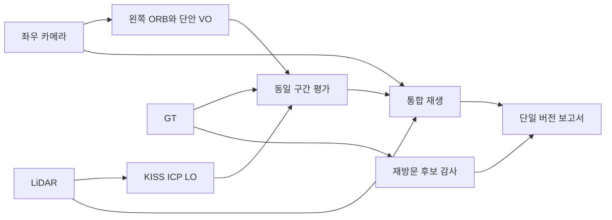

오른쪽 카메라는 현재 재생용이고 VO 입력에는 쓰지 않는다. GT는 평가와 후보 감사에 사용하며, 자동 루프 검출·보정은 이 흐름에 구현되어 있지 않다.

이 문서의 버전과 알고리즘 성능 버전은 다르다. v1.0.0 통합 자체는 새 정확도 실험이나 알고리즘 변경이 아니다. 주제별 과거 실험에서 사용하는 상대 경로 'src/', 'artifacts/', 'configs/'는 각 장에 명시한 원 실험 디렉터리를 기준으로 읽는다. 쉘 실행 명령은 별도 지시가 없으면 레포 루트 기준이다.

<a id="orb"></a>

## 2. ORB: 픽셀부터 descriptor와 매칭까지

기존 요약보다 상세한 설명을 우선한다. 피라미드 그림은 공통 픽셀 축으로 보완한 최신 자료다.

**원 실험 디렉터리:** `research/20261101_orb-explained/`

### 기본 용어와 사용 가능한 리소스


#### 약자와 이름을 먼저 풀기

| 이름 | 풀어 쓴 말 / 유래 | 이 프로젝트에서 하는 일 |
|---|---|---|
| ORB | Oriented FAST and Rotated BRIEF | 방향이 있는 코너와 회전 보정 이진 descriptor 생성 |
| FAST | Features from Accelerated Segment Test | 원 둘레 밝기를 비교해 코너 후보 검출 |
| Harris | Chris Harris의 성; 약자가 아님. Mike Stephens와 공동 제안 | 여러 방향으로 밝기가 바뀌는 정도를 평가 |
| NMS | Non-Maximum Suppression, 비최대 억제 | 가까이 중복된 응답 중 약한 것을 제거 |
| BRIEF | Binary Robust Independent Elementary Features | 여러 픽셀 쌍의 밝기 비교를 비트열로 표현 |
| rBRIEF | ORB 논문의 회전 대응·선택된 BRIEF 검사 패턴을 가리키는 명칭 | 분산이 높고 상관이 낮은 비교를 선택 |
| BF | Brute Force | 후보 descriptor들을 직접 비교 |
| Hamming | Richard Hamming의 성; 약자가 아님 | 두 비트열에서 서로 다른 자리 개수 |
| RANSAC | RANdom SAmple Consensus | 일부 잘못된 대응을 견디며 기하 모델 추정 |
| VO / SLAM | Visual Odometry / Simultaneous Localization and Mapping | 영상 이동 추정 / 위치와 지도 동시 추정 |
| ROI | Region of Interest, 관심 영역 | 피라미드에서 동일 장면 일부를 확대 비교 |
| MAE | Mean Absolute Error, 평균 절대 오차 | 축소 후 복원 영상과 원본의 평균 밝기 차이 |

ORB 이름·주요 구성은 [OpenCV ORB 설명](https://docs.opencv.org/4.13.0/d1/d89/tutorial_py_orb.html), FAST와 BRIEF의 이름은 각각 [FAST 설명](https://docs.opencv.org/4.13.0/df/d0c/tutorial_py_fast.html), [BRIEF 설명](https://docs.opencv.org/4.13.0/dc/d7d/tutorial_py_brief.html)에서 확인했다.

#### 자주 섞이는 데이터 타입

- **픽셀 intensity I(x,y):** 흑백 밝기. 이번 영상은 uint8, 즉 0~255 정수다. 색 이름이나 거리 값이 아니다.
- **patch:** 한 위치 주변을 잘라낸 작은 이미지. 예를 들어 31×31 픽셀이다.
- **keypoint:** 고른 위치와 부가 정보. x/y, 크기 size, 방향 angle, 검출 레벨 octave, 반응 response 등이 있다. angle과 response는 서로 다르다.
- **descriptor:** keypoint 주변 외형의 수치 요약. 이번 ORB는 32바이트=256비트다. keypoint 좌표가 descriptor 안에 그대로 저장되는 것은 아니다.
- **match:** 이전 영상 descriptor의 인덱스와 현재 영상 descriptor의 인덱스, 그 사이 거리다. 비슷하다고 검색된 후보이지 동일 물체라는 보장은 아니다.
- **inlier:** 지정한 기하 모델과 오차 허용 범위에 맞는 대응. 반대는 outlier다. 영상의 초록색 점이라는 이유만으로 진실이라고 단정할 수 없다.

#### 실제 보유 리소스

| 리소스 | 위치와 사용 |
|---|---|
| 원본 | data/kitti/dataset/sequences/00/image_0/000120.png 및 000121.png |
| 이전 교육 코드 | research/20261031_vo-lo-study/src/orb_stages.py:7~13 |
| 이전 피라미드 | 같은 study의 artifacts/orb/pyramid.npz |
| 실제 ORB 호출 | 같은 study의 src/vo.py; 새 src/analyze.py에도 설정 명시 |
| 새 중간 출력 | artifacts/*.npz, levels.csv, summary.json, harris_toys.json |
| 실행 환경 | 기존 연구 venv, OpenCV 5.0.0, 단일 CPU thread |

### 접근 선정: 단계마다 직접 확인하기

새 검출기를 개발할 문제가 아니라, 기존 알고리즘 설명과 그림의 정보 손실을 수정할 문제다. 따라서 기존 데이터를 사용하는 작은 재현 실험을 택했다. 이하 설명에서 **실제 ORB 출력**, **독립 교육 계산**, **가상의 수치 예제**를 구분한다. 원 논문 전체를 그대로 재구현했다고 부르지 않는다.

#### 피라미드: 왜 같은 사진을 여러 크기로 만드는가

차량이 물체에 가까워지면 그 물체가 사진에서 커진다. 한 크기의 작은 patch만 비교하면 같은 물체라도 주변 모양이 다르게 들어온다. 입력을 여러 해상도로 만들어 비슷한 크기로 보이는 레벨끼리 대응할 기회를 주는 것이 피라미드의 역할이다.

**다른 장면을 만드는 것이 아니다. 동일 장면을 더 적은 픽셀로 표현한다.** 따라서 큰 윤곽이 비슷한 것은 정상이다. 차이는 배열 크기, 작은 무늬의 소실, 같은 patch가 덮는 원본 영역이다.

이번 scaleFactor=1.2, 레벨 l=0~7이면 명목 축소 배수 s(l)=1.2^l이다. 폭은 대략 W/s(l), 높이는 H/s(l)이며 정수 반올림이 있다. 영상 길이 비율은 1/s(l), 픽셀 수 비율은 대략 1/s(l)^2다. '1.2배 scale'을 영상을 1.2배 키운다는 뜻으로 읽으면 반대가 된다.

가상의 예: 어떤 물체가 첫 영상에서 20px, 두 번째에서 24px라면 두 번째의 레벨1에서는 약 20px로 줄어든다. 이때 비슷한 크기의 모양을 비교할 수 있다. 실제 장면은 원근·가림·조명도 함께 변하므로 피라미드만으로 완전한 scale invariance가 생기지는 않는다.

**피라미드 scale과 VO metric scale은 별개다.** 전자는 영상 크기 비율이다. 후자는 '이동 벡터 1이 실제 몇 m인가'라는 물리 거리 문제다. ORB 레벨을 늘려도 단안 VO의 절대 거리 문제가 해결되지 않는다.

#### 기존 그림이 거의 같아 보였던 정확한 이유

이전 코드에서는 각 subplot의 `imshow(p)`가 해당 영상 크기에 맞춰 좌표 범위를 자동으로 잡았다. L0도 L3도 자기 칸을 거의 가득 채워 원래 줄어든 크기가 지워졌다. 제목에 shape만 적어 놓는 것으로는 충분하지 않았다.

기존 저장 배열과 같은 방식으로 재생성한 L0~L3를 `np.array_equal`로 비교했고 **네 배열 모두 동일**했다. 이는 이전 배열 생성이 실제 축소였다는 증거다. 이제 모든 subplot의 x축을 0~1241, y축을 0~376으로 고정했다. 같은 level pixel이 같은 도식 크기를 차지하므로 축소를 직접 볼 수 있다. PDF 화면의 실제 모니터 픽셀과 1:1이라는 뜻은 아니다.

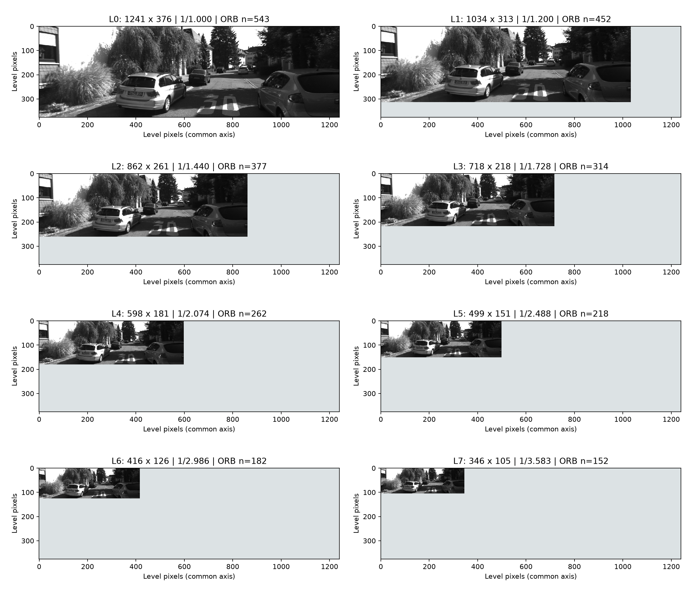
읽는 법: 회색 여백은 데이터가 없는 부분이다. L0는 전체 칸을 채우고 L7은 작은 부분만 채운다. 제목의 ORB n은 실제 ORB의 레벨별 개수이며 배경은 독립 교육용 resize다.

| 레벨 | 실제 배열 폭×높이 | 원본 대비 길이 | 31px patch의 원본 폭 | 실제 ORB 점 수 | 복원 MAE |
|---|---:|---:|---:|---:|---:|
| 0 | 1241×376 | 100.00% | 31.00px | 543 | 0.000 |
| 1 | 1034×313 | 83.33% | 37.20px | 452 | 3.138 |
| 2 | 862×261 | 69.44% | 44.64px | 377 | 3.312 |
| 3 | 718×218 | 57.87% | 53.57px | 314 | 4.442 |
| 4 | 598×181 | 48.23% | 64.28px | 262 | 5.277 |
| 5 | 499×151 | 40.19% | 77.14px | 218 | 5.348 |
| 6 | 416×126 | 33.49% | 92.57px | 182 | 6.339 |
| 7 | 346×105 | 27.91% | 111.08px | 152 | 7.170 |

MAE는 각 축소 영상을 원본 크기로 bilinear 확대하고 mean(abs(original-restored))로 계산했다. 단위는 0~255 밝기다. 0이 아니라는 것은 원본 복제본이 아니며 축소·복원 과정에서 정보가 바뀌었다는 뜻이다. VO 정확도 지표는 아니다. 레벨별 검출 개수도 품질 점수가 아니라 설정과 검출 결과다.

#### 같은 장면의 확대 비교와 patch 범위

bilinear interpolation은 정수 격자 사이 밝기를 주변 네 픽셀의 가중 평균으로 계산하는 보간이다. 줄어든 영상에서 모든 원본 픽셀을 독립적으로 보존할 수 없다. 미세 패턴이 사라지거나 다른 패턴처럼 보이는 aliasing이 생길 수 있다. 정밀한 축소 필터와 완벽한 영상 복원은 이번 실험 범위가 아니다.

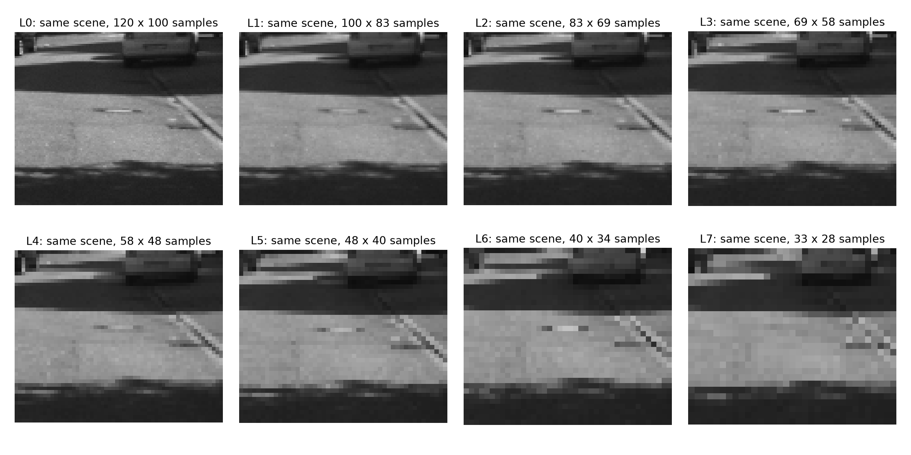
이번에는 의도적으로 같은 크기로 확대했다. 목적은 배열 전체 크기가 아니라 **정보 손실을 확대해 보는 것**이다. nearest 표시를 사용해 새 부드러운 픽셀을 만들어 숨기지 않았다. 같은 도로 부분이 L0에서는 120×100표본, L7에서는 33×28표본으로 표현된다. 작은 점과 경계가 뭉개지는 부분을 비교한다.

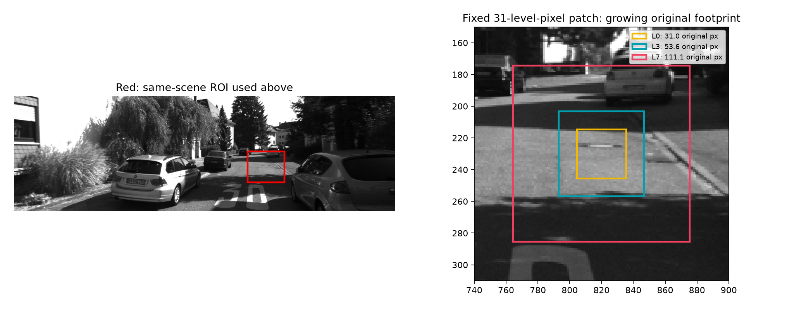
왼쪽 빨간 상자가 위 확대의 위치다. 오른쪽 상자들은 각 레벨에서 31픽셀인 patch가 원본에서 얼마나 큰 영역을 덮는지 보여준다. L7의 31px는 원본 약111px 범위다. 상자 중앙은 설명용 고정 위치이지 같은 keypoint가 모든 레벨에서 검출된다는 주장이 아니다.

OpenCV keypoint의 `octave`는 여기서 피라미드 레벨 인덱스다. 이름이 octave여도 매 레벨이 2배라는 뜻은 아니다. `pt`는 보통 원본 영상 좌표로 반환되고 `size`에는 레벨 scale이 반영된다. 그래서 서로 다른 레벨의 점도 원본 위에 그릴 수 있다. 이번 실험은 레벨별 출력 필드를 저장한다. [OpenCV ORB API](https://docs.opencv.org/4.13.0/db/d95/classcv_1_1ORB.html)

#### FAST: 원 둘레만 보고 후보를 빠르게 찾기

입력은 한 레벨의 grayscale 영상이다. 후보 중심 p의 밝기를 I(p), 밝기 문턱을 t라고 하자. 중심에서 반경 약3픽셀인 원 둘레의 16개 위치를 본다. 이번 FAST_9_16에서는 그 원을 따라 **연속 9개 이상**이 모두 I(p)+t보다 밝거나, 모두 I(p)-t보다 어두우면 통과한다. 밝고 어두운 것을 섞어 9개 세는 것이 아니다. 원이므로 끝 인덱스에서 처음으로 이어지는 구간도 검사한다.

FAST는 이름처럼 segment test의 구조를 이용해 많은 위치를 빨리 탈락시키려는 방법이다. 원래 FAST 논문의 FAST-12 설명과 이번 OpenCV FAST-9 설정을 혼동하면 안 된다. 학습된 decision tree는 검사 순서를 효율화하는 별도 요소이며 이번 코드는 그것을 재학습하지 않는다. [Rosten·Drummond, 2006 원문](https://www.edwardrosten.com/work/rosten_2006_machine.pdf)

왜 단순한데 코너를 찾을까? 균일한 영역은 원 둘레도 중심과 비슷해 탈락한다. 경계의 꺾임이나 국소적으로 독특한 밝기 분포에서는 긴 밝은/어두운 호가 생길 수 있다. 하지만 '기하학적으로 건물 모서리'만 검출하는 것은 아니다. 점광원·노이즈·텍스처도 통과할 수 있다.

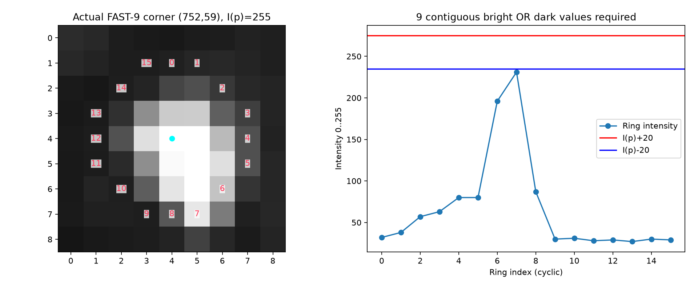
실제 선택 위치는 (752,59), 중심 밝기는 255다. t=20이므로 어두운 판정 경계는 235다. 원 둘레 밝기는 아래와 같고 모두 235보다 작아서 연속9 조건을 만족한다. 밝은 판정 경계 275는 uint8 범위 밖이라 이 위치는 밝은 호로 통과할 수 없다.

```text
ring index:  0  1  2  3  4  5   6   7  8  9 10 11 12 13 14 15
intensity:  32 38 57 63 80 80 196 231 87 30 31 28 29 27 30 29
state:      전부 dark (<235)
```

이 사례는 오히려 중요한 한계를 보여준다. FAST의 corner는 '물리적인 모서리'라는 의미와 동일하지 않다. 포화된 중심 밝기를 가진 작은 구조도 높은 응답이 가능하다. 이 점 하나를 대표적인 좋은 추적점이라고 일반화하지 않는다.

#### NMS: 이웃한 후보들을 왜 줄이는가

좋은 구조 주변에서 여러 픽셀이 동시에 통과할 수 있다. 이들을 모두 쓰면 한 군데에 점이 몰리고 비교 비용이 늘어난다. NMS는 가까운 후보 사이에서 응답이 더 큰 것을 남기는 지역 경쟁이다. 전체 영상에서 상위500개를 고르는 연산과는 다르다.

이번 영상에서 FAST nonmaxSuppression=False는 19,397개, True는 5,475개였다. 이 차이는 실제 detector를 두 설정으로 실행한 결과다. 점 개수가 줄었다고 recall이나 VO 성능이 좋아졌다고 결론내리지는 않는다. nonmax 점수의 정확한 내부 구현은 OpenCV 버전에 의존하므로 이 보고서는 임의의 간단한 점수를 같은 내부 점수라고 부르지 않는다.

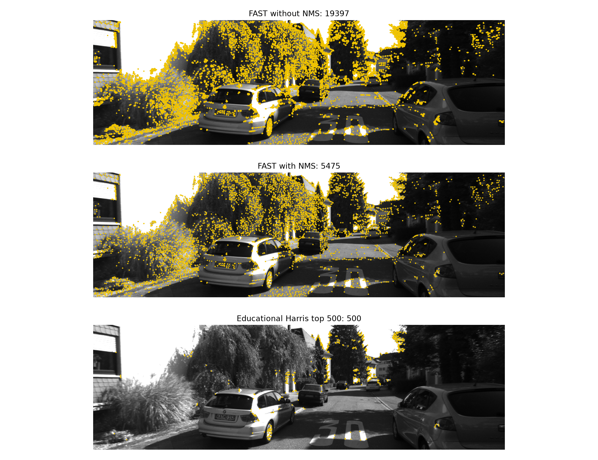
위에서 아래로 후보가 어떻게 줄어드는지 본다. 마지막 500개는 교육용 Harris 순위다. 실제 다중 레벨 ORB의 2,500개와 같은 집합이 아니다.

#### Harris: FAST를 썼는데 왜 또 다른 코너 점수가 필요한가

FAST의 역할은 빠른 후보 생성이다. 제한된 개수만 남길 때는 다른 관점의 코너 강도로 순위를 매길 수 있다. Harris는 patch를 어느 방향으로 조금 움직여도 모양이 달라지는지 평가한다. 이름은 약자가 아니라 제안자 이름에서 왔다. [Harris·Stephens, 1988 학회 기록](https://www.bmva-archive.org.uk/bmvc/1988/avc-88-023.html)

평평한 벽 patch는 좌우·위아래로 조금 이동해도 비슷하다. 긴 수직 경계는 가로로 이동하면 크게 달라지지만 세로로 이동하면 비슷하다. 코너는 두 방향 모두 변화가 크다. 이것이 코너가 2D 위치를 정하기에 유리한 이유다.

수식의 기호를 하나씩 쓰면 다음과 같다. I_x, I_y는 각각 가로·세로 밝기 변화량(영상 미분)이다. w는 patch 안의 픽셀에 주는 가중치다. sum은 patch 전체 합이다.

```text
M = [ sum(w * Ix²)      sum(w * Ix * Iy) ]
    [ sum(w * Ix * Iy)  sum(w * Iy²)     ]

R = det(M) - k * trace(M)²
  = lambda1 * lambda2 - k * (lambda1 + lambda2)²
```

M은 2×2 구조 행렬이다. trace는 대각 원소 합, det는 행렬식이다. lambda1/lambda2는 고유값으로, patch의 두 주된 방향에서 밝기가 얼마나 변하는지 요약한다. k는 점수 모양을 조절하는 상수이며 여기서는 0.04다. R이 큰 양수면 두 방향 변화가 모두 큰 경향, 음수면 한 방향만 큰 경계 경향, 0 근처면 평탄한 경향이다. 계산 구조와 해석은 [공식 Harris 설명](https://docs.opencv.org/4.13.0/dc/d0d/tutorial_py_features_harris.html)에 근거한다.

실제 교육 계산은 `cornerHarris(img, 7, 3, .04)`다. 7은 주변 집계 영역 크기, 3은 미분을 구하는 Sobel 커널 크기다. Sobel은 이웃 밝기의 가중 차분으로 미분을 근사하는 필터다. FAST 후보의 위치에서 R을 읽고 높은 순으로 500개를 골랐다. 이 dense Harris 계산을 OpenCV ORB 내부의 모든 최적화와 동일하다고 주장하지 않는다.

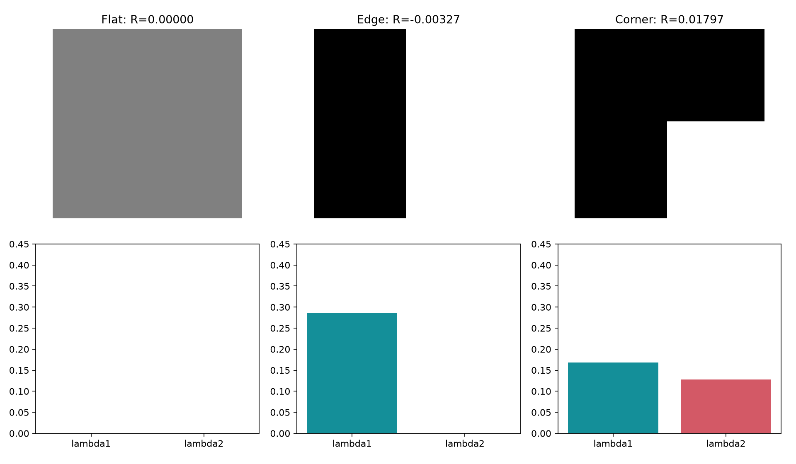
이 그림만은 해석을 쉽게 하려고 만든 41×41 합성 영상이다. 밝기는 0~1 float다. 위는 영상, 아래는 중심 부근 두 고유값이다. 실제 도로 사례와 합성 예제를 혼동하지 않는다.

| 합성 patch | lambda1 | lambda2 | R | 해석 |
|---|---:|---:|---:|---|
| 평탄면 | 0 | 0 | 0 | 어느 방향도 변화 없음 |
| 수직 경계 | 0.285714 | 0 | -0.003265 | 한 방향만 변화 |
| 코너 | 0.168367 | 0.127551 | 0.017973 | 두 방향 모두 변화 |

Harris의 약점은 blur·noise·밝기 대비에 따라 응답이 달라지고, 코너 점수가 높아도 다른 장소의 비슷한 코너와 구분된다는 보장은 없다는 것이다. 위치 선택과 식별력은 다른 문제다.

#### 방향: Oriented FAST의 Oriented는 어디서 생기는가

FAST만으로는 '이 patch가 어느 방향을 향하는가'를 얻지 못한다. 카메라가 회전하면 같은 물체 주변도 돌아가기 때문에 descriptor의 비교 방향을 맞출 기준이 필요하다.

교육 예에서는 중심을 (0,0)으로 놓고 반지름15인 원 안의 밝기를 무게처럼 사용한다. 좌표 x는 오른쪽, y는 아래로 증가한다. 모멘트(moment)는 '위치에 밝기를 곱해 더한 값'이다.

```text
m00 = sum(I)        : 밝기 총합
m10 = sum(x * I)    : 좌우 밝기 분포
m01 = sum(y * I)    : 상하 밝기 분포
centroid = (m10/m00, m01/m00)
theta = atan2(m01, m10)
```

centroid는 밝기 무게중심이다. 중심에서 무게중심으로 향하는 방향을 theta로 삼는다. atan2는 x/y 부호를 함께 고려해 사분면까지 구분하는 각도 함수다. m00=0인 검은 patch, m10/m01이 모두0인 대칭 patch는 방향이 의미 없거나 불안정해질 수 있다. 구현에서 반환하는 숫자가 있더라도 방향 정보가 충분하다는 뜻은 아니다.

이번 실제 patch의 m00=29662, m10=-1100, m01=-21548이다. 무게중심은 (-0.0371,-0.7265)px, 각도는 -92.92도다. 이미지 y가 아래로 증가하므로 화면상 위를 향한다. 0~360도로 표현하면 약267.08도지만 **이 독립 교육 계산이 실제 ORB keypoint.angle과 반드시 같다는 뜻은 아니다.** 경계/원형 표본 규칙이 다를 수 있다.

#### BRIEF: 작은 그림을 어떻게 0과 1로 바꾸는가

BRIEF는 검출기가 아니라 descriptor다. 이미 정해진 patch 안에서 위치 a와 b를 고르고 밝기를 비교한다. I(a)<I(b)이면 1, 아니면 0이다. 이런 질문 256개를 고정된 순서로 묶으면 256비트가 된다. 8비트가1바이트이므로 32바이트다. 픽셀을 비교하기 전에 smoothing을 해 작은 노이즈의 영향을 줄인다. [OpenCV BRIEF](https://docs.opencv.org/4.13.0/dc/d7d/tutorial_py_brief.html)

Gaussian smoothing은 이웃 밝기를 종 모양 가중치로 평균하는 것이다. 이번 교육 예는 7×7 커널과 sigma=2를 사용한다. sigma는 평균에 참여하는 공간 범위의 퍼짐을 조절한다. smoothing 때문에 작은 밝기 차이는 완화되지만 세부 정보도 줄어든다.

**Rotated BRIEF:** 고정된 비교 위치를 그대로 쓰면 patch가 회전할 때 다른 물체 부분을 읽는다. 앞에서 구한 theta만큼 비교 위치 좌표를 회전시키면 물체 기준으로 비슷한 위치를 비교할 수 있다. 여기서 이미지 전체를 회전시키는 것이 아니라 비교 좌표를 돌린다.

```text
[ x' ] = [ cos(theta)  -sin(theta) ] [ x ]
[ y' ]   [ sin(theta)   cos(theta) ] [ y ]
```

실제 영상에서 뽑은 교육용 첫8개 질문은 다음과 같다. 이것은 seed7로 뽑은 무작위 패턴이며 실제 ORB의 학습된 패턴이 아니다.

| 질문 | I(a) | I(b) | I(a)<I(b) |
|---|---:|---:|---:|
| 0 | 36 | 55 | 1 |
| 1 | 38 | 29 | 0 |
| 2 | 29 | 51 | 1 |
| 3 | 111 | 37 | 0 |
| 4 | 27 | 27 | 0 |
| 5 | 28 | 25 | 0 |
| 6 | 28 | 29 | 1 |
| 7 | 135 | 87 | 0 |

위 예의 앞8비트는 10100010이다. 어느 질문인지의 순서까지 같아야 두 descriptor를 비교할 수 있다. 프레임마다 새 random pattern을 뽑으면 대응 비교가 의미 없어진다.

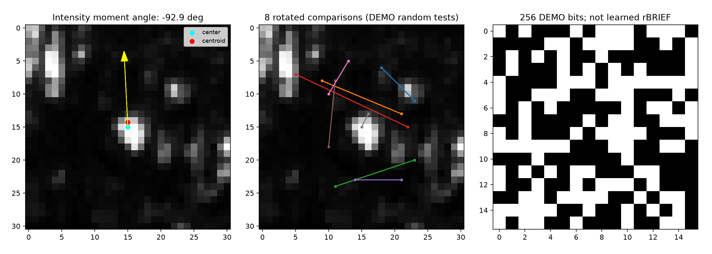
왼쪽은 원 중심·무게중심·방향, 가운데는 실제 patch에 그린8개 회전 비교, 오른쪽은256개 질문의 참/거짓이다. 화살표 길이10px는 각도를 보기 위한 표시 길이이며 무게중심 거리0.73px가 아니다. 비트의 16×16 배열은 표시용이며 실제 물체의 2D 모양 지도가 아니다.

#### rBRIEF: 무작위 질문만 있으면 충분한가

어떤 질문의 답이 거의 항상0이면 서로 다른 patch를 구분하는 정보가 적다. 반대로 0/1이 자주 바뀌는 질문은 더 다양한 경우를 나눌 수 있다. 또 두 질문의 답이 항상 함께 바뀌면 비슷한 정보를 중복해서 저장한다.

ORB의 rBRIEF 선택은 다양한 patch에서 비트의 평균이 약0.5이고 분산이 크며 질문 사이 상관이 낮은 패턴을 찾는 방향이다. Bernoulli 비트의 분산은 p(1-p)이므로 p=0.5일 때0.25로 최대다. 상관은 두 질문의 답이 함께 변하는 정도를 뜻한다. 완전한 독립을 보장한다는 뜻은 아니다. [OpenCV ORB의 rBRIEF 설명](https://docs.opencv.org/4.13.0/d1/d89/tutorial_py_orb.html)

이것은 '현재 frame120에서 매번 패턴을 다시 학습한다'는 말이 아니다. 이번 OpenCV 호출은 제공된 패턴으로 descriptor를 계산한다. 학습 데이터·선택 과정은 재실행하지 않았다. 새 교육 스크립트의 랜덤256질문을 rBRIEF 재현이라고 부르지 않는 이유다.

#### 실제 OpenCV ORB 출력과 교육 그림의 경계

실제 `detectAndCompute` 출력은 keypoint 2,500개와 uint8 descriptor 배열 (2500,32)다. 레벨별 개수 합도2,500이다. 각 행은 한 keypoint의256비트를32바이트에 담은 것이다. 코드에서 그림에 보이는 byte 값 하나를 하나의 bit로 해석하면 틀린다. `unpackbits`는 바이트를 비트들로 펼쳐 표시하는 연산이다.

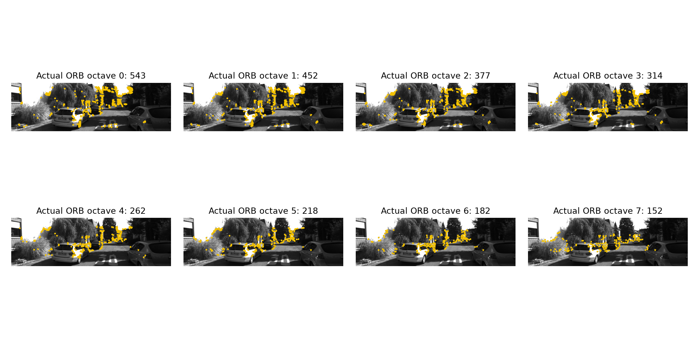
모든 배경이 같은 원본 크기인 것은 의도적이다. 이 그림의 질문은 '각 레벨에서 찾은 점이 원본의 어디에 있는가'다. 피라미드 크기를 보여주는 첫 그림과 목적이 다르다. 같은 물체가 여러 레벨에서 검출될 수도 있으며 점 하나하나의 3D 동일성은 이 그림만으로 알 수 없다.

우리 교육 피라미드는 원본에서 각 레벨을 독립 resize했다. 실제 ORB는 버전별 내부 경계 확장·보간·반복 축소·blur 등의 세부가 다를 수 있다. OpenCV4.13 소스를 참고했으나 실행 binary는5.0.0이고 정확한 빌드 소스 일치까지 확인하지 못했다. 따라서 그림을 'ORB 내부 buffer 그대로'라고 표시하지 않는다. [참고 소스](https://raw.githubusercontent.com/opencv/opencv/4.13.0/modules/features2d/src/orb.cpp)

#### Hamming, BF, cross-check, ratio: 무엇을 기준으로 같은 점을 찾는가

Hamming distance는 같은 길이 비트열에서 다른 자리 수다. 예를 들어101100과100110은 세 번째와 다섯 번째가 달라 거리가2다. XOR는 다를 때1, 같을 때0을 내는 비트 연산이다. XOR 결과에서1의 개수를 세는 popcount로 Hamming을 계산한다.

BF는 이전 descriptor마다 현재 descriptor들을 직접 비교해 가장 작은 거리를 찾는다. cross-check는 A가 고른 최선이 B이면서 B가 고른 최선도 A일 때만 남기는 상호 최근접 조건이다. 반복된 무늬에서는 상호 최근접이어도 오매칭일 수 있다. [OpenCV matching](https://docs.opencv.org/4.13.0/dc/dc3/tutorial_py_matcher.html)

ratio test는 최근접 거리 d1과 두 번째 거리 d2를 비교해 d1<0.75*d2 같은 조건을 쓴다. 최선과 차선이 비슷하면 애매하다고 보는 것이다. 예를 들어20과22는 탈락,20과50은 통과한다. 0.75는 이전 실험의 설정이지 보편적 정답이 아니다. cross-check와 ratio는 서로 다른 필터이며 이번 기본 VO는 cross-check다.

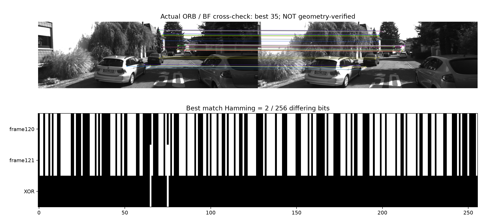
120→121의 실제 ORB/BF cross-check 대응은1,611개다. 위에는 거리순35개를 보여주고, 아래에는 최저 거리 대응의 descriptor 두 개와 XOR를 표시했다. XOR의1이2개이고 OpenCV distance도2로 일치한다. **이 그림은 기하 검증 전**이다. 작은 Hamming이 올바른 3D 대응을 보장하지 않는다.

#### 여기서 VO까지: ORB가 끝나는 곳

현재 baseline은 매칭을 거리순으로 최대1,000개 사용한다. 이후 `findEssentialMat`의 RANSAC으로 정적인 장면의 두 시점 기하를 추정한다. RANSAC은 일부 대응으로 후보 모델을 만들고 많은 대응이 그 모델에 맞는지 반복 확인하는 방식이다. 모델에 대한 오차가 작으면 inlier로 분류한다.

카메라 내부 파라미터 K는 초점거리와 주점을 담는다. 픽셀(u,v,1)에 K의 역행렬을 곱해 카메라 광선 방향에 대응하는 정규화 좌표 x를 만든다. Essential matrix E는 두 정규화 관측 사이의 관계 x2ᵀ E x1=0을 표현한다. 실제 대응에는 노이즈가 있어 이 값 또는 관련 거리 오차가 완전히0일 필요는 없다.

`recoverPose`는 E에서 회전 R과 이동 방향 t를 복원하고, 삼각측량된 점이 두 카메라 앞에 놓이는지 검사해 가능한 해를 고른다. 삼각측량은 두 광선으로3D 위치를 추정하는 계산이고, 앞쪽 여부 검사를 cheirality check라고 한다. [OpenCV 기하 API](https://docs.opencv.org/4.13.0/d9/d0c/group__calib3d.html)

단안 영상만으로 전체 장면과 이동을 함께 같은 배수로 키워도 같은 투영이 가능하다. 따라서 이 단계의 t 길이를 실제 m로 알 수 없다. 현재 코드는 단위 이동 방향을 누적하므로 속도 변화·프레임 간 거리 차이를 복원하지 못한다. 회전이 좋아도 경로 길이는 틀릴 수 있다. 피라미드·Harris·BRIEF는 이 물리적 scale 모호성을 해결하는 방법이 아니다.

이후의 발전 방향도 목적이 다르다. stereo는 알려진 카메라 간 거리로 깊이 scale을 얻는 접근, BA(Bundle Adjustment)는 여러 카메라 pose와3D 점을 영상 재투영 오차가 작도록 함께 조정하는 최적화, loop closure는 재방문 제약으로 전역 누적 오차를 줄이는 기능이다. 이들을 ORB라는 한 단어 안에 포함시키지 않는다. 이번 보고서에서 새 구현한 단계는 아니다.

### 시스템 아키텍처와 산출물 계약

| 모듈 | 입력 | 출력 및 저장 | 검증 |
|---|---|---|---|
| 피라미드 | frame120 grayscale | artifacts/pyramid.npz, levels.csv, roi_level_*.npy | 기존4배열 동일, shape/hash, 복원 MAE |
| FAST/Harris | 원본 픽셀, threshold20 | artifacts/fast_harris.npz, harris_toys.json | cyclic9 조건, 고유값/응답 부호 |
| 방향/BRIEF 교육 | 실제 patch, seed7 패턴 | artifacts/orientation_brief.npz | 모멘트·회전 좌표·픽셀 비교 저장 |
| 실제 ORB | 원본, 명시 설정 | artifacts/actual_orb.npz | 8레벨 합2500, descriptor shape |
| 매칭 | 120/121 descriptor | artifacts/matching.npz | XOR1 개수=OpenCV distance |
| 출판 | 위 출력 | figures/*.png, report.pdf | 이미지 decode 및 레이아웃 검토 |

모든 영상 좌표는 x오른쪽/y아래, 단위pixel이다. 방향 교육 배열은 radian, 표시값은 degree다. pi radian=180도다. level 좌표와 원본 좌표의 scale을 구분하며 이번 작업에는 새로운 센서 시간 정렬이 없다.

### 결과와 baseline 비교

| 검사 | 이전 자료 | 이번 결과 |
|---|---|---|
| 배열 구분 | shape만 표시 | 기존4배열 동일 재현, 8레벨 shape/hash 기록 |
| 축소 크기 시각화 | subplot 자동 fit | 모든 축 동일, 여백으로 축소 표현 |
| 정보 손실 | 확인 어려움 | 같은 ROI 표본 수와 nearest 확대 |
| patch 범위 | 설명 부족 | 31px→원본31~111.08px 표시 |
| FAST | 후보 overlay만 | 실제16픽셀 수치와9연속 조건 통과 |
| Harris | 순위 결과만 | 합성 평탄/경계/코너 고유값과 R 비교 |
| 방향/BRIEF | 이름 위주 | 모멘트 값·각도·비교 밝기·비트 저장 |
| 실제 매칭 | 선 그림 | 실제 descriptor XOR와 distance2 일치 |

이 표는 교육적 관찰 가능성의 개선이다. VO RMSE, detector recall, 실행 지연 성능을 새로 측정한 것이 아니다. 코드 assert가 통과했고 그림9개를 생성했다. 사람이 이해했는지는 이 자동검사만으로 판정할 수 없다.

### 강점, 한계, 실패 사례


#### Feature별 강점과 약점

| 구성 | 강한 조건 | 약한 조건 | 이번 근거 |
|---|---|---|---|
| 피라미드 | 제한된 영상 크기 변화 | 극단적 축소, 원근 변형, 가림 | L7 ROI 세부 소실, MAE7.170 |
| FAST | 대비가 뚜렷한 국소 구조 | 노이즈, blur, 포화 점 | 중심255인 실제 통과 예 |
| NMS | 이웃 중복 후보 제거 | 강한 소수 영역 편중 해결 불충분 | 19397→5475, 위치 그림 |
| Harris | 두 방향 변화 구분 | 반복 코너의 식별 문제 | 합성 고유값 표 |
| 밝기 중심 방향 | 비대칭 밝기 분포 | 대칭/어두운 patch, 조명 변화 | 실제 centroid가 중심에서0.73px밖에 떨어지지 않음 |
| 회전 BRIEF | 방향 추정이 일관된 경우 | 방향 오차, 비교 밝기 차이가 작은 경우 | 27/27,28/29 같은 민감한 질문 |
| Hamming/BF | 가볍고 해석 가능한 거리 | 반복 무늬, 모든 점 비교 비용 | 거리2도 기하 정답 아님 |

#### 숨기지 말아야 할 한계

이번 frame120 하나와121의 대응만으로 일반적인 불변성·강건성을 평가하지 않았다. 밝기 변화·회전·blur 조건별 성능 곡선은 없다. FAST가 찾은 포화점의 실제 추적 안정성도 이 실험으로 확인하지 않았다. 실제 ORB 패턴과 random 교육 패턴의 성능 비교를 한 것이 아니다.

이전 연구의 단일30도 합성 회전 ablation은 방향의 영향을 보여주는 별도 진단이다. 그 수치를 KITTI 전체나 실제 주행 회전에서의 정확도로 읽으면 안 된다. 이번 보고서는 이해를 위해 입력과 계산을 눈으로 추적하는 데 집중했다.

#### 성공 기준 달성도

배열 동일성, 실제 shape 기록, L1~7 비영 복원 오차, FAST9, XOR 거리 일치와 주요 용어 설명은 완료했다. OpenCV 내부 buffer 완전 재현, rBRIEF 재학습, 모든 주행 상황의 성공률은 범위 밖이며 완료했다고 표시하지 않는다.

### 한계를 다루는 후속 접근


#### SuperPoint: 검출 위치와 descriptor를 데이터로 학습

SuperPoint는 FAST/Harris의 수작업 규칙과 BRIEF식 외형 표현 대신, 영상에서 위치 점수와 descriptor를 함께 계산하는 신경망 접근이다. Homographic Adaptation은 알려진 평면 투영 변환으로 영상을 바꿔 얻은 검출 결과를 모아 학습 신호를 보강하는 과정이다. homography는 평면 또는 특정 카메라 운동에서 두 영상의 점을 연결하는3×3 투영 변환이다.

이 방향은 '어떤 점이 다시 찾기 좋고 어떤 표현이 구분에 좋은가'를 학습한다. 하지만 가림으로 사라진 관측을 항상 복원하거나 단안 metric scale을 해결하는 방법은 아니다. 학습된 weight, 호환 런타임, 우리 데이터에서의 검증이 필요하며 이번에는 실행하지 않았다. [DeTone·Malisiewicz·Rabinovich, SuperPoint, 2018](https://arxiv.org/abs/1712.07629)

#### LightGlue: 점 하나의 가장 가까운 descriptor만 보지 않기

LightGlue는 두 이미지의 local feature들을 받아 주변 대응의 관계까지 활용하는 학습 기반 matcher다. attention은 다른 feature의 정보 중 무엇을 더 참고할지 가중하는 계산이다. 쉬운 쌍과 어려운 쌍에 계산량을 다르게 쓰는 적응적 설계가 포함된다.

이것은 FAST 자체를 만드는 검출기가 아니라 주로 매칭 단계의 대안이다. 임의의 ORB 32바이트를 기존 모델에 그대로 넣으면 된다는 뜻은 아니다. 모델이 지원하는 descriptor 종류·차원·학습 조건을 맞춰야 한다. 반복 패턴의 애매함을 줄이는 방향이지만 실제 차량 이동, 가림, 잘못된 카메라 모델까지 모두 해결한다고 볼 수 없다. [Lindenberger·Sarlin·Pollefeys, LightGlue, 2023](https://arxiv.org/abs/2306.13643)

#### 지금 선택할 때의 구분

| 다음 방법 | 해결하려는 한계 | 필요한 것 | 예상 공수 |
|---|---|---|---|
| 설정 ablation | threshold/level에 대한 민감도 | 현재 데이터로 가능, 통제된 변환 | 낮음 |
| SuperPoint | 검출·표현의 반복성/식별력 | weight, 비교 기준, 모델 실행 환경 | 중간 |
| 호환 feature+LightGlue | 독립 최근접 매칭의 애매함 | 호환 descriptor와 weight | 중간 |
| stereo+깊이+pose 추정 | 단안 metric scale 모호성 | 오른쪽 영상과 calibration | 높음 |

후속 논문은 '모든 단점의 만능 후계자'가 아니라 서로 다른 부분을 바꾸는 선택지다. 이번 작업에서 자동 적용하지 않는다.

### 부록: 재현 경계와 참고문헌

- [가정] 교육 목적의 대표 frame120과 ROI(760,180,120,100)를 선택했다. 장면 전체 대표성을 보장하지 않는다.
- [미확인] 현재 OpenCV5.0.0 binary와4.13 참고 소스의 정확한 구현 일치. 원 ORB PDF 전체 직접 열람. 실제 rBRIEF 선택 과정 재현.
- [구분] 교육 Harris/원형 moment/random BRIEF는 실제 ORB의 내부 단계 trace가 아니다. 실제 ORB의 kp/descriptor/octave 결과는 별도 저장했다.
- [출처] 도표 수치는 이 작업의 artifacts에서 생성했다. 일반 알고리즘 정의는 본문 가까이에 링크한 원저자 논문·학회 기록·공식 OpenCV 자료를 사용했다. 옛 논문의 속도 비교 숫자와 특허 상태는 현재 사실로 재사용하지 않았다.
- ORB 서지: Ethan Rublee, Vincent Rabaud, Kurt Konolige, Gary Bradski, *ORB: An efficient alternative to SIFT or SURF*, ICCV2011. 공식 OpenCV 자료로 서지 확인.
- BRIEF 서지: Michael Calonder, Vincent Lepetit, Christoph Strecha, Pascal Fua, *BRIEF: Binary Robust Independent Elementary Features*, ECCV2010. 공식 OpenCV 자료로 서지 확인.
- 실제 실행 코드와 결과의 연결: src/analyze.py, configs/experiment.json, artifacts/summary.json. 새 연구 코드는 이전 생산 VO/LO를 수정하지 않는다.


<a id="vo-lo"></a>

## 3. VO 기하와 LiDAR Odometry: 구현·비교·한계

첫 200프레임 실험이다. 화면 구성은 5장의 통합 재생이 최신이다. 이 장의 실행 당시 커밋·측정 조건은 역사적 실험 출처로 보존한다.

**원 실험 디렉터리:** `research/20261031_vo-lo-study/`

### 영상 기하와 통제 실험

#### 방향 보정은 실제로 도움이 되는가: 통제 실험


frame 120을 정확히 30도 회전한 합성 영상을 만든다. 알려진 affine 변환으로 매칭의 정답 pixel 위치를 계산하고 오차 3px 미만을 올바른 대응으로 정의했다. GT는 이 교육 실험의 label에만 사용했다.

같은 검출 위치에서 ORB 방향을 사용한 경우와 angle을 0으로 강제한 경우를 비교했다. 방향을 제거한 방법은 실제 baseline 개선안이 아니라 구성 요소의 역할을 보는 ablation이다.

| 설정 | 상호 최근접 매칭 수 | 알려진 변환 기준 정확 대응 비율 |
|---|---:|---:|
| 실제 ORB 방향 사용 | 1280 | 89.14% |
| 같은 위치, descriptor angle=0 | 388 | 1.03% |

표 1. 단일 합성 회전에서 방향 보정 효과. 실제 도로의 원근·가림·독립 물체 운동·조명 변화를 포함한 전체 성능으로 해석하면 안 된다.

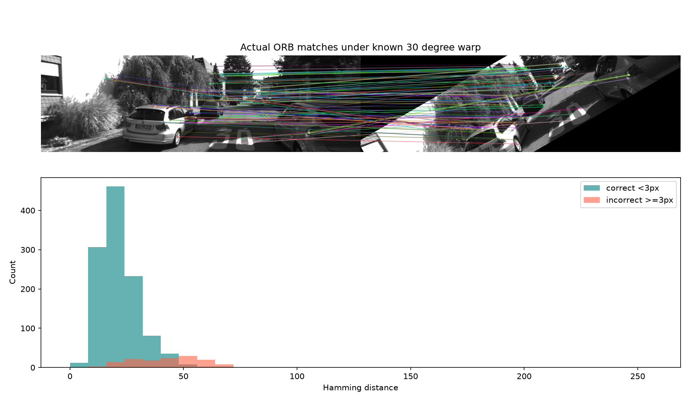

그림 6. 위는 실제 ORB 매칭 일부, 아래는 정답/오답별 Hamming 거리 분포. 겹치는 분포가 있으므로 거리 하나만으로 완벽한 판별이 불가능하다. 원시 자료는 `synthetic_rotation.csv`다.

#### 단계 5: BF Hamming, cross-check, ratio test


Hamming 거리는 두 descriptor의 XOR에서 다른 비트 수다. BFMatcher는 후보를 비교해 작은 거리를 찾는다. cross-check는 A가 선택한 B가 반대로도 A를 선택할 때 유지한다. 이는 상호 선택이지 같은 3D 점이라는 증명은 아니다.

ratio test는 가장 가까운 거리 d1이 두 번째 거리 d2에 비해 충분히 작은지 본다. 이번 비교는 `d1 < 0.75 d2`로, cross-check baseline을 KNN ratio 방식으로 **대체**한 ablation이다. 둘을 동시에 적용한 것으로 해석하지 않는다. 두 방법 모두 거리순 상위 1000개를 사용한다.

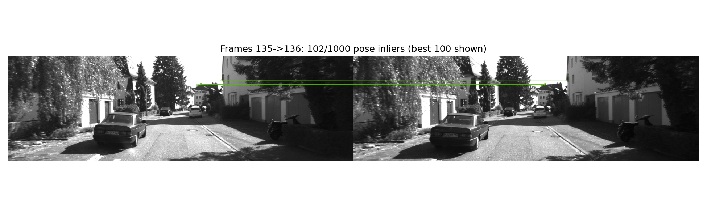

그림 7. frame 135→136의 pose inlier 중 거리순 상위 100개 범위만 표시했다. 전체 대응과 거리·mask는 `artifacts/vo/baseline/000136.npz`에 있으며 이 프레임의 pose inlier는 102/1000개다.

#### 단계 6: Essential Matrix와 RANSAC


매칭에는 오답이 섞인다. RANSAC은 작은 대응점 집합에서 기하 모델을 가정하고 많은 관측과 일관되는 모델을 찾는다. 카메라 K로 정규화한 대응 x1,x2에는 `x2ᵀ E x1≈0`라는 제약이 있고 `E=[t]×R`이다. 한 점의 상대 영상 위치가 한 직선 위에 놓여야 한다는 뜻이다.

이번 구현은 OpenCV `findEssentialMat`, RANSAC prob=0.999, threshold=1 pixel을 사용한다. 출력 E, Essential inlier mask, 두 영상 pixel 좌표를 모두 NPZ로 저장했다. 실제 API는 `vo.py`에 있다.

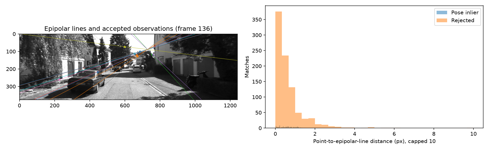

그림 8. frame 136의 epipolar line과 대응점, 점-직선 거리 분포. **pose에서 거절된 점의 중앙 거리가 더 작을 수도 있다:** 이번 inlier 중앙값 0.574px, 거절점 0.441px다. recoverPose는 epipolar 잔차만이 아니라 양의 깊이 등 기하 조건도 검사하므로 거절을 곧 오매칭 label로 취급하면 안 된다.

#### 단계 7: recoverPose와 경로 누적


E에서 가능한 R,t 후보를 복원하고 점이 카메라 앞쪽에 놓이는 해를 고른다. t는 방향만 알려준다. `X_current=R X_previous+t`이면 카메라 world pose는 상대 변환의 역행렬을 곱해 누적한다.

출력은 full 4×4 pose 배열이다. 개별 R,t와 E도 저장했다. 여기서 모든 프레임의 이동 길이를 1로 두면 차가 감속해도 추정 이동량은 1이다. 이것이 현 baseline의 구조적 scale 한계다. 좋은 descriptor만 넣어도 사라지지 않는다.

### LiDAR Odometry: 같은 깊이로 단계별 보기


#### LO는 무엇을 최적화하는가


카메라는 물체의 투영을 본다. LiDAR는 이미 meter 단위 3D 점을 제공한다. LO는 현재 점들을 이전 점군/지도에 맞추는 회전과 이동을 찾는다. 가장 단순한 목적은 대응 q에 대해 `Σ ||R p + t - q||²`를 줄이는 것이다. 대응이 알려져 있지 않아 대응 찾기와 변환 갱신을 반복한다.

이번 실행은 **공식 KISS-ICP 1.3.0의 핵심 pipeline**이다. 자체 신규 LO나 LOAM의 재현이 아니다. 별도로 이해를 위한 fixed-gate nearest-neighbor/SVD ICP를 저장된 실제 scan-map 쌍에 구현했다. 이 교육용 반복을 KISS C++ 내부 iteration log로 부르지 않는다.

#### 단계 1: XYZI 읽기와 범위 필터


각 .bin은 Nx4 float32의 x,y,z,intensity다. XYZ는 LiDAR 좌표계에서 x 전방/y 왼쪽/z 위쪽이다. intensity는 이번 정합 비용에 사용하지 않는다. 너무 가까운/먼 관측은 불안정하거나 비용 대비 효과가 낮을 수 있어 이번 실험은 5~100m를 사용했다.

입력 전체 스캔과 실제 KISS preprocessor 출력은 대표 프레임의 `artifacts/lo/000120.npz`에 저장된다. timestamp 기반 deskew는 **비활성화**했다. Odometry bin에 점별 시간 필드가 없고, 임의 시간 복원을 넣지 않기 위해서다.

#### 단계 2: Voxel 표본화


공간을 격자로 나눠 점 수를 줄인다. 그대로 모든 점을 사용하면 가까운 표면의 많은 점이 계산과 목적함수를 지배할 수 있다. 이번 KISS 설정의 map voxel은 1m, 내부 map 추가용 downsample은 0.5m, registration source는 1.5m다. 설치된 `KissICP.voxelize`에서 확인했다.

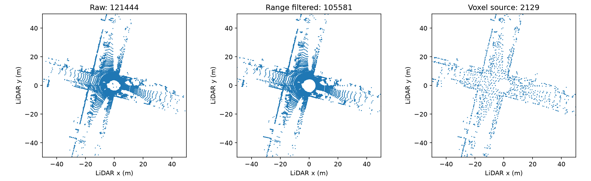

그림 9. frame 120의 원본→범위 필터→registration source. 각 점 개수는 그림 제목과 frames.csv에 있다. 같은 XY 범위를 그려 시각적 밀도를 비교한다. 큰 voxel은 비용을 줄이지만 작은 구조를 없앨 수 있다. voxel-size ablation은 미수행이다.

#### 단계 3: 운동 예측과 대응점


정합은 초기값에 민감하다. KISS는 직전 상대 운동을 다음 시점에도 적용하는 예측을 초기 pose로 사용한다. 이 예측은 IMU를 사용한 예측이 아니라 이전 LO 결과에 기반한다.

현재 source를 예측 pose로 변환해 local map과 대응시킨다. 너무 먼 대응은 배제하고 residual이 큰 관측의 영향은 robust kernel로 줄인다. KISS의 threshold σ는 예측과 실제 추정의 차이에 따라 갱신되며, 이번 설치 코드의 correspondence gate는 `3σ`, kernel 인자는 `σ`다. σ의 실제 시계열은 `artifacts/lo/frames.csv`에 저장된다.

#### 단계 4: 정합 반복과 pose 갱신


교육용 ICP는 다음 순서를 20회 실행한다: 현재 pose로 source 변환 → KD-tree 최근접 대응 → 1m gate → 중심을 뺀 대응의 cross-covariance → SVD로 R → 중심 차이로 t → pose 누적. reflection이면 det(R)=+1이 되도록 수정한다. 각 반복의 residual/대응 수/회전·이동 갱신을 CSV에 남긴다.

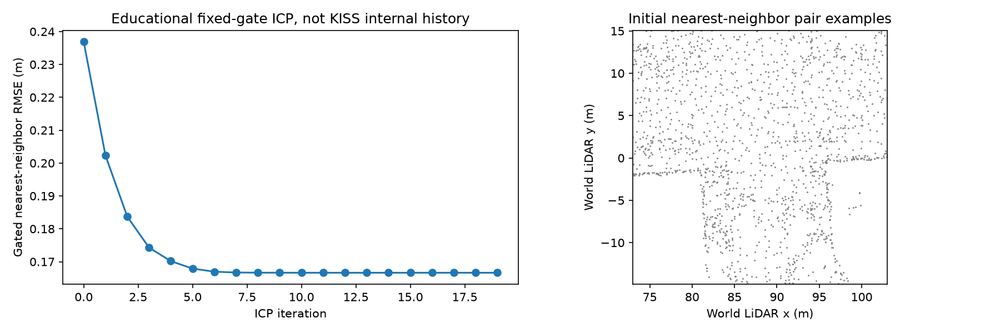

그림 10. frame 120 실제 scan-map에서 교육용 ICP의 gated 최근접 RMSE가 0.237m에서 0.167m로 줄었다. 매 반복 대응 집합이 달라지므로 고정 대응 비용의 단조 감소 보장은 아니며, 낮은 잔차 자체가 올바른 pose의 증명도 아니다.

실제 KISS는 robust registration backend를 사용한다. 보고서의 다음 거리 분포는 저장한 pose 전후에 SciPy KD-tree로 **독립 재계산한 진단**이고 KISS 내부 correspondence/가중치의 직접 dump가 아니다.

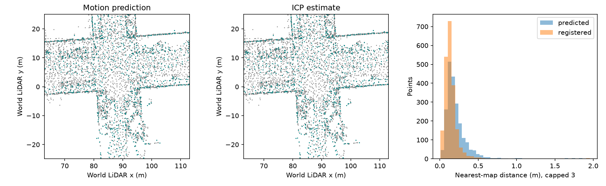

그림 11. 회색은 과거 local map, 청록은 현재 source. 예측과 최종 pose를 같은 공간에서 비교한다. 오른쪽은 최근접 거리 분포로 큰 거리는 3m에 모아 표시했다. 이전 source/target/pose와 거리 배열은 NPZ에 있다.

#### 단계 5: 로컬 지도 갱신


최종 pose로 downsample 스캔을 map에 추가하고 센서에서 멀어진 점을 관리한다. 모든 과거 점을 영구 보관하는 전역 지도와 다르다. 그림은 200프레임 후 rolling local map이며 loop closure로 보정된 완전한 SLAM 지도가 아니다.

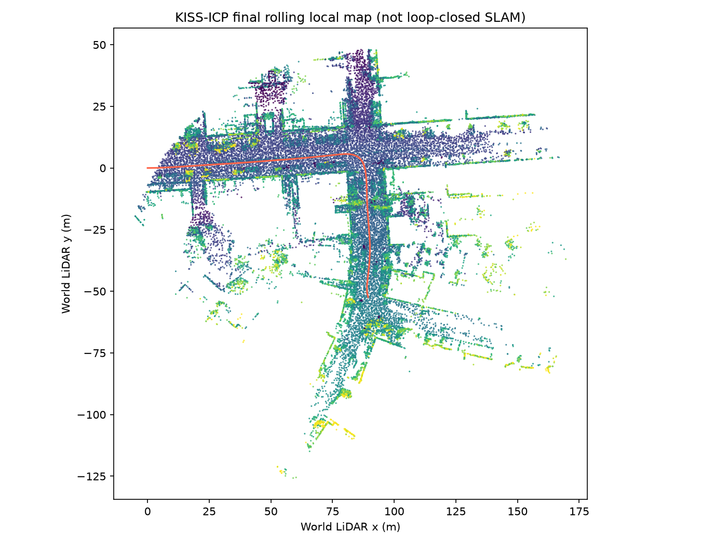

그림 12. 높이로 색칠한 LO 로컬 점군과 센서 경로. `final_local_map.npy`로 실제 3D 점을 제공한다. 색은 높이이지 카메라 RGB가 아니다.

#### LO의 한계와 관련 후속 연구


| 한계 | 관련 연구 / 접근 | 얻는 것 | 새로 필요한 것과 한계 |
|---|---|---|---|
| 전체 점 정합의 비용·geometry 활용 | LOAM(Zhang/Singh, RSS 2014): edge/plane 특징과 odometry/mapping 분리 | 구조적 제약 활용 | feature quality/센서 가정; 이번 미실행 |
| 단순 ICP의 outlier·초기값 민감도 | KISS-ICP(Vizzo 외, RA-L 2023): 표본화·적응 gate·robust 정합·운동 예측 조합 | 순수 LiDAR baseline | geometry 부족/동적 물체/나쁜 초기값에서 실패 가능 |
| 빠른 운동과 스캔 시간차 | FAST-LIO2(Xu 외, 2021 preprint): LiDAR와 IMU 결합, 직접 map 정합 | 고주파 운동 예측과 융합 | 정확한 시간/외부 보정/bias 모델 필요 |
| 장기 drift | loop detection + pose graph/global optimization | 재방문 제약으로 일관성 개선 | false loop 위험; 이번 미구현 |

표 3. LOAM은 KISS보다 오래된 다른 설계 갈래다. “KISS 다음에 나온 논문”이라는 뜻이 아니다. 이번 KISS 실행도 공식 KITTI loader의 별도 scan correction을 적용하지 않은 core 실험이며, 공식 논문/벤치마크 수치 재현으로 주장하지 않는다.

### 실험 설정과 재현


| 항목 | 설정 |
|---|---|
| 데이터 | KITTI 00, 0~199, 동일 인덱스 이미지/LiDAR |
| VO | ORB 2500, match limit1000, RANSAC1px/prob0.999, seed7+frame |
| ratio variant | cross-check 대신 KNN d1<0.75d2 |
| LO | KISS-ICP1.3.0, voxel1m, range5~100m, deskew false, C++ threads4 |
| GT | 추정에는 미사용, 평가에만 사용 |
| Metric transform | T_camera(t)=Tr × T_lidar(t) × inverse(Tr), 첫 pose 정규화 |
| Shape 진단 | 각 방법에 전체 구간 GT 사용한 global Sim(3) least squares |
| 환경 | Python3.11 arm64, 연구 전용 .venv, pinned lock 저장 |

표 4. 기준 설정. 상세 설정 `configs/experiment.json`, 실제 KISS 설정 `artifacts/lo/effective_config.json`. GT 위치로 fit한 scale은 추정 입력이 아니라 사후 진단이며, 그 결과를 metric VO로 부르지 않는다.

기준 Git HEAD는 `c1b5ff7e3af1525061166953afb6caab855f11c8`이다. 이번 연구 코드는 아직 별도 커밋되지 않았다. 환경/설정·calibration hash는 `artifacts/evaluation/environment.json`에 저장한다. full dependency는 `configs/requirements-lock.txt`다.

레포 루트에서 실행한다. 기존 제품 .venv는 변경하지 않았다.

```bash
uv venv --python 3.11 research/20261031_vo-lo-study/.venv
uv pip install --python research/20261031_vo-lo-study/.venv/bin/python \
  -r research/20261031_vo-lo-study/configs/requirements-lock.txt
source research/20261031_vo-lo-study/.venv/bin/activate
export MPLCONFIGDIR="$PWD/.cache/matplotlib"
export XDG_CACHE_HOME="$PWD/.cache"
python research/20261031_vo-lo-study/src/orb_stages.py
python research/20261031_vo-lo-study/src/vo.py
python research/20261031_vo-lo-study/src/lo.py
python research/20261031_vo-lo-study/src/evaluate.py
python research/20261031_vo-lo-study/src/geometry_stages.py
python research/20261031_vo-lo-study/src/playback.py
```

PDF 생성에는 기존 `research/20261030_progress-review/src/render_pdf.mjs`에 이 연구 폴더 경로를 인자로 전달한다. 이 렌더러는 Chrome과 `/tmp/kitti-report-pdf/node_modules`의 marked/playwright/mermaid가 필요하다. PDF 생성 환경은 알고리즘 환경과 분리된다.

#### 모듈별 산출물 계약


표의 NPZ/CSV는 실제 저장된 값이다. 모든 대표 프레임은 configs의 목록으로 고정했다.

| 모듈 | 타입·단위·좌표 | 저장 경로 | 검증 |
|---|---|---|---|
| ORB 교육 | images uint8, xy pixels, angles radians, bits bool | artifacts/orb/* | 실제 descriptor shape와 synthetic warp label |
| VO | Nx2 pixel, E/R/t, masks, 4x4 camera0 arbitrary pose | artifacts/vo/baseline,ratio | finite/SE3/frame count, 실패 상태 |
| LO | Nx3 m LiDAR/world, 4x4 pose, sigma m | artifacts/lo/* | finite/SE3, scan0 pose 정규화 |
| Geometry | epipolar distance px, ICP residual m | artifacts/geometry/* | 기록된 입력으로 직접 재계산 |
| Evaluation | full pose, 위치 m, 각도 degree | artifacts/evaluation/* | GT=self zero error, 알려진 similarity 복원 테스트 |
| Playback | embedded JPEG/points/trajectories | artifacts/playback/index.html | 브라우저 재생/seek/mode/canvas 검사 |

### 결과: VO와 LO를 어떻게 비교했는가


#### Metric LO와 shape 진단을 구분


단안 VO에 실제 scale이 없으므로 raw 숫자를 미터로 간주한 RMSE를 발표하지 않는다. 먼저 LO만 시작 좌표계가 같은 GT와 직접 비교하고, 다음에는 VO·LO 모두에 동일한 전역 Sim(3) fit을 적용해 경로 모양을 비교한다. 후자는 GT를 보고 유리하게 정렬한 **사후 진단**이다.

| 방법 / 평가 정책 | 위치 RMSE m | 끝점 오차 m | 1-frame 상대 이동 RMSE m | 상대 회전 RMSE deg |
|---|---:|---:|---:|---:|
| LO, 시작 좌표계만 일치 | 2.299 | 2.964 | 0.0387 | 0.0905 |
| VO baseline, GT Sim(3) | 5.336 | 3.772 | 0.2772 | 0.6554 |
| VO ratio, GT Sim(3) | 5.208 | 5.845 | 0.2854 | 0.9836 |
| LO, GT Sim(3) | 0.209 | 0.312 | 0.0385 | 0.0905 |

표 5. 같은 200프레임의 실측. Sim(3) fitted scale은 VO 0.73054, ratio0.76298, LO1.00180이다. LO의 2.299→0.209 변화는 scale만의 효과가 아니라 전역 회전/이동 정렬도 포함한다. 자세 원점 정렬 외 GT 보정을 하지 않은 수치는 첫 행이다.

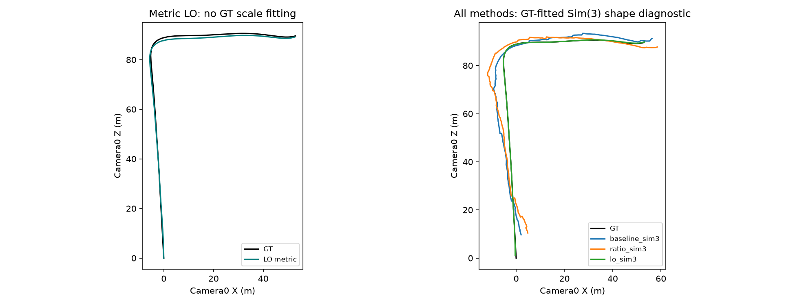

그림 13. 왼쪽은 metric LO, 오른쪽은 모든 방법의 사후 shape 정렬. 이번 LO가 이 구간에서 더 작은 오차를 보였지만 정교한 stereo/VIO/SLAM보다 낫다는 실험은 아니다.

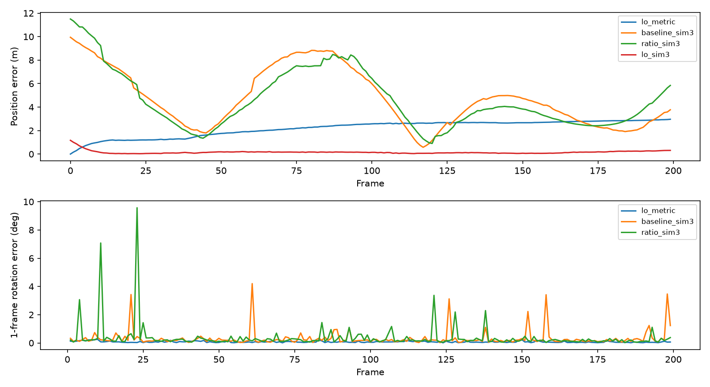

그림 14. 위치 오차와 1-frame 상대 회전 오차. 짧은 translation RPE와 전체 누적 위치 오차는 다른 성질이다. KITTI 공식 100~800m segment 평균 benchmark를 실행한 것은 아니다.

#### 작은 해결책: ratio test의 결과


VO baseline과 ratio 모두 199개 전이에서 pose를 반환했다. pose inlier 중앙 비율은 baseline58.2%, ratio56.6%; 최저 비율은 둘 다 frame136에서 10.2%, 7.0%였다. ratio가 이 구간에서 더 좋은 관측만 골랐다고 결론 낼 근거가 없다.

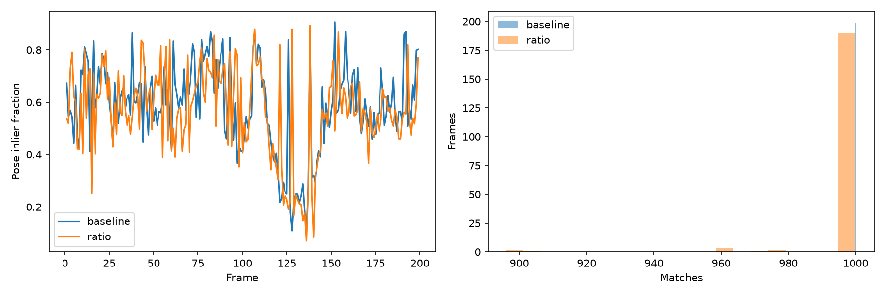

그림 15. pose inlier 비율과 매칭 수 분포. inlier 비율은 실제 정답 precision이 아니다. ratio의 위치 RMSE는 약 2.4% 낮지만 끝점/상대 이동/회전 지표는 악화됐다. 따라서 전체 개선으로 채택하지 않는다.

시간은 코드 내 추정 구간의 관측값으로 VO baseline 중앙64.1ms, ratio37.0ms, LO9.7ms였다. 영상/스캔 읽기·artifact 저장·그리기는 제외했고, 최초 실행에서 다른 연구 프로세스가 일부 겹쳤으며 thread 수와 구현 언어도 다르다. **공정한 latency benchmark나 실시간 보장은 아니다.** 시간 로그는 제공하지만 성능 순위의 근거로 사용하지 않는다.

#### LiDAR와 영상은 같은 것을 보고 있는가


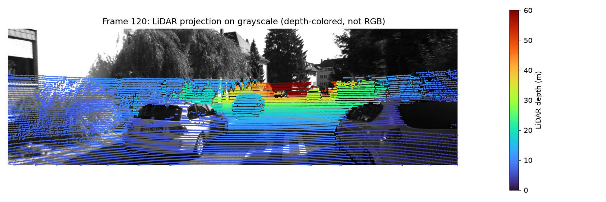

그림 16. frame120의 XYZ를 Tr/K로 영상에 투영했다. 색은 깊이이며 컬러 영상이 아니다. 이 그림은 대략적인 extrinsic 일관성 점검이고 동적 물체의 세밀한 시간 정렬을 보증하지 않는다.

[VO·LO 동기 비교 재생 열기](../research/20261031_vo-lo-study/artifacts/playback/index.html)

플레이백은 raw grayscale/LiDAR 투영/ORB 대응점, 현재 스캔 BEV, GT·VO·LO 누적 궤적을 같은 frame index로 갱신한다. 재생/일시정지/이전·다음/seek/속도/metric·shape 전환을 제공한다. 브라우저에서 파일을 직접 열 수 있고 서버·인터넷이 필요 없다. 사전 계산 결과를 재생하는 것이며 online estimation UI는 아니다.

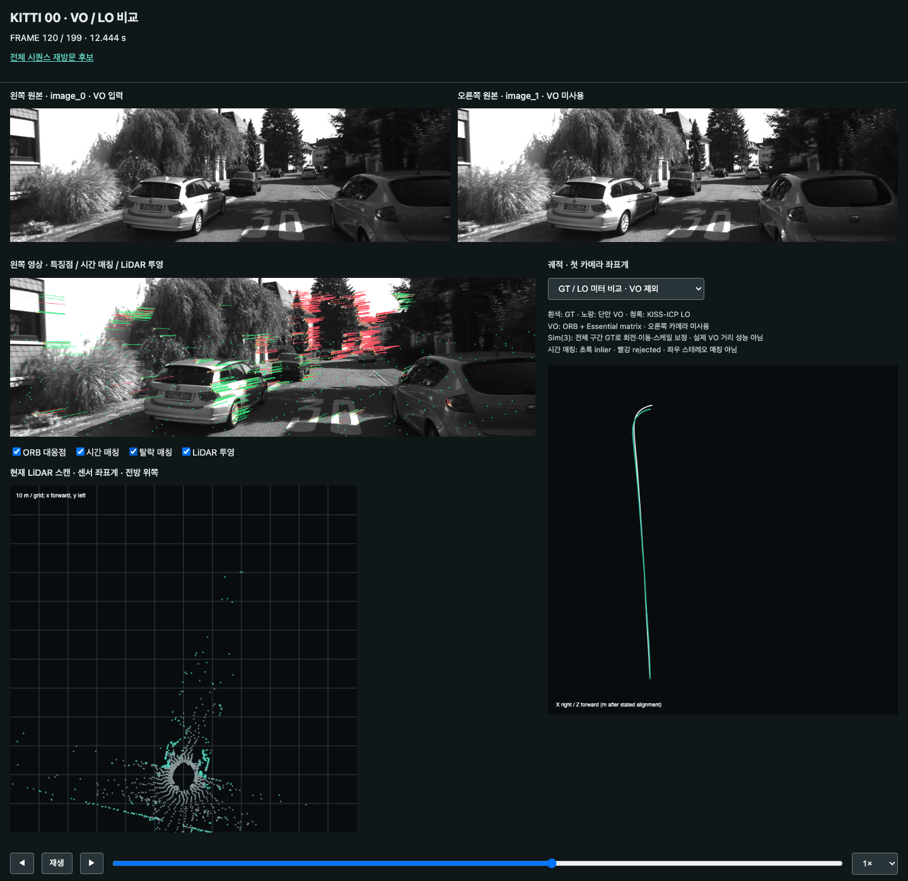

그림 17. frame120의 비교 재생 화면. 점군은 표시용으로 균일 stride 표본화했고 실제 정합 입력은 별도로 저장했다.

### 분석: 강점·약점과 이번에 알 수 없는 것


#### Feature별 강약점


| 관측/표현 | 확인한 강점 | 약점·한계 | 근거 |
|---|---|---|---|
| ORB 방향+binary | 합성 회전에서 정확 대응89.14% | 단일 warp 실험; 3D 시점/조명/가림 일반화 불가 | 표1/그림6 |
| Hamming/cross-check | 작은 descriptor로 많은 대응 생성 | 반복 구조와 모호한 후보; 기하 검증 필요 | frame136/거리 분포 |
| ratio gate | 위치 RMSE 약간 감소 | 상대 회전 및 끝점 악화 | 표5/그림15 |
| LiDAR XYZ | metric 공간 제약으로 작은 상대 오차 | 긴 평면/동적 물체/초기값 실패 가능성 [가정] | 이번 수치와 미시험 조건 구분 |
| voxel source | 원본보다 작은 정합 집합 | 세부 구조 소실과 voxel 편향 가능성 [가정] | 그림9; size ablation 없음 |
| intensity | 파일에 존재 | 이번 cost에 사용하지 않아 효과 미확인 | lo.py XYZ만 입력 |
| IMU | 고주파 보조 관측 가능 | 시간축 이상/bias 확인 전 | 기존 회고 보고서, 이번 미사용 |

#### 실패·한계 사례


- VO의 frame136은 많은 대응이 pose 복원에 기여하지 못했다. 단순 Hamming 또는 epipolar 거리만으로 원인을 설명할 수 없다. 동일 장면에서 ratio도 악화됐다.
- 고정 단위 이동량은 차량 속도 변화를 표현하지 못한다. 전역 scale fit으로도 모든 구간의 왜곡은 없어지지 않는다.
- LO도 GT 보정 없이 누적 위치 RMSE2.299m이며 완벽하지 않다. deskew off, 공식 KITTI scan correction 미적용, 초기 회전/정합 편향 등이 후보이나 기여도를 분리한 ablation은 하지 않았다.
- KISS C++의 모든 iteration/correspondence를 dump하지 않았다. 교육용 ICP와 독립 nearest-map 잔차를 대체 관찰로 제공했고 이를 실제 내부 출력이라고 표현하지 않았다.
- 연구 VO의 실패 hold 정책과 seed/thread 설정은 과거 exporter와 완전히 동일하지 않다. 이번 비교 표는 이번 재실행끼리 비교한다.
- 순수 frame index 대응은 Odometry camera/LiDAR에 한정한다. Raw OXTS를 같은 숫자로 연결하지 않았다.
- 200프레임만으로 장거리 loop closure/재위치추정/야간/비·안개/급격한 운동을 평가할 수 없다.

#### 해결 정도


사용자의 핵심 요청인 알고리즘 설명→단계 산출물→한계→후속 접근을 구현/그림/평가와 연결했다. VO/LO의 비교와 실제 local map도 제공한다. 완전 ORB/후속 learned 논문 재현이나 full SLAM의 구현까지 완료한 것은 아니다. 후속 연구를 설명한 뒤 자동으로 모두 구현하지 않고 다음 선택지로 남긴다.

### 질문에 대한 답: 컬러, IMU, SLAM


#### Gray 대신 컬러면 더 좋아지는가


**자동으로 좋아지지 않는다.** 현재 ORB는 밝기 패턴 기반이므로 컬러를 받아 grayscale로 바꾸면 색 정보를 이용하는 새 알고리즘이 되지 않는다. 같은 밝기의 다른 색을 구분하는 관측이나 semantic masking, 색을 이용한 map 정합을 설계해야 색의 효과가 생긴다.

컬러의 장점 후보는 객체 의미 분류·동적 객체 masking·색이 있는 지도다. 단점 후보는 처리량/메모리/노출·white balance 변화이며, 이 프로젝트에서 그 효과는 측정하지 않았다. KITTI의 컬러 영상은 별도 센서와 calibration을 사용하므로 grayscale 비교를 단순 채널 수 차이로만 통제하기도 어렵다. 현재 로컬에 컬러가 없어 ablation을 했다고 말할 수 없다.

다음 개선의 우선순위는 컬러 다운로드보다 **기존 우측 영상의 stereo 깊이**다. 이 판단은 현재 구조의 scale 미관측과 이미 보유한 데이터에 근거한다. 이후 실제 task가 semantic map이라면 컬러가 다른 가치를 갖는다.

#### IMU 데이터는 안 써도 되는가


**순수 VO/LO는 IMU 없이 가능하며, 이번 실험도 사용하지 않았다.** KISS-ICP의 운동 예측은 직전 LO의 변환을 활용한다. IMU가 없다는 이유로 LO가 meter scale을 잃지는 않는다. LiDAR가 이미 거리를 측정하기 때문이다.

IMU는 빠른 회전·짧은 시각 실패·scan 내 움직임을 다룰 보조 제약을 제공할 수 있지만 bias와 적분 drift가 있고 calibration/time offset/중력 처리가 필요하다. 센서를 하나 더 붙인다고 무조건 오차가 줄지 않는다. 현재 OXTS의 비양수 시간 간격5개와 긴 gap을 해결하지 않은 채 preintegration에 입력하면 오히려 잘못된 모델이 된다.

VIO/LIO는 별도 연구 단계다. 입력은 가속도/각속도이며 OXTS의 GPS/INS 위치·자세를 섞으면 GT 누출 우려가 있다. MLE/MAP, 공분산, residual weighting은 그 융합에서 관측의 신뢰도를 표현하는 도구가 된다.

#### KITTI Odometry로 SLAM 연구는 못하는가


**SLAM 연구도 할 수 있다.** 데이터셋 이름이 알고리즘을 odometry로 제한하지 않는다. 연속 영상/스캔으로 pose와 지도를 만들고 keyframe/BA/loop closure/재위치추정을 연구할 수 있다. 공식 페이지 이름도 Visual Odometry / SLAM Evaluation이다.

다만 평가에서 주어지는 주된 GT는 궤적이다. 지도 정확도를 정량 평가하려면 별도 기준 map·평가 방법이 필요하다. loop closure 효과를 보려면 실제 재방문이 있는 충분히 긴 구간이 필요하며 이번 0~199프레임은 그 실험이 아니다. SLAM에 loop closure가 정의상 항상 필수인 것은 아니지만 전역 일관성·장기 drift를 다루는 대표 기능이다.

이번 rolling local map은 LO의 scan-to-map 추정을 지원한다. 지도 그림이 있다는 사실만으로 loop-closed SLAM을 구현했다고 하지 않는다. KITTI 전체 00을 활용한 장기 지도/재방문 연구는 다음 단계로 분리한다.

### 개선 방향과 다음 단계 선택


| 우선순위 | 다음 연구 | 기대 효과 [가정] | 공수 [가정] |
|---|---|---|---|
| 1 | Stereo 깊이→PnP VO, 같은 LO/GT와 metric 비교 | 단안의 scale 한계를 직접 해소 | 중간 |
| 2 | LO deskew/scan correction/voxel 및 긴 구간 ablation | 이번 LO의 잔여 오차 원인 분리 | 중간 |
| 3 | ORB vs learned feature/matcher 비교 | 실제 모호한 관측에서 개선 여부 확인 | 중간~높음 |
| 4 | IMU 시간축/축/노이즈 검증 후 VIO 또는 LIO | 고속·관측 약화 조건의 융합 준비 | 높음 |

표 6. 모두 사용자 선택을 위한 제안이다. 실험하지 않은 효과를 보장하지 않는다. 기존 src 통합이나 자동 리팩터링은 하지 않았다. 교육 순서는 관측→대응→잔차→최적화→누적 오차→추가 센서/지도 제약으로 이어진다.

### 부록


#### 가정과 미확인


- [가정] 정량 목표가 지정되지 않아 동일 구간 baseline 비교를 사용했다. production latency 목표는 없다.
- [가정] 컬러·IMU·grid·stereo·learned matcher 개선 효과는 본 실험 밖이다.
- [미확인] 장거리/다른 시퀀스 일반화, 동적 객체별 GT, scan 내부 time 및 motion distortion의 기여도.
- [미확인] 공식 KITTI scan correction/deskew 적용 시 이 결과가 얼마나 바뀌는지.
- [미확인] multi-thread KISS의 다른 실행에서 bit-identical 재현. 환경/설정은 고정했으나 알고리즘 수치 결과가 bit-exact하다는 주장은 하지 않는다.

#### 참고문헌과 읽는 순서


1. Rublee, Rabaud, Konolige, Bradski. **ORB: An efficient alternative to SIFT or SURF**, ICCV 2011. DOI: 10.1109/ICCV.2011.6126544. [공식 구현 설명](https://docs.opencv.org/4.13.0/d1/d89/tutorial_py_orb.html). 본 보고서 4.2~4.6의 실험과 함께 읽는다.
2. [OpenCV Feature Matching](https://docs.opencv.org/4.13.0/dc/dc3/tutorial_py_matcher.html), [calib3d](https://docs.opencv.org/4.13.0/d9/d0c/group__calib3d.html). 매칭과 pose 추정의 책임을 구분한다.
3. Vizzo, Guadagnino, Mersch, Wiesmann, Behley, Stachniss. **KISS-ICP: In Defense of Point-to-Point ICP**, RA-L 2023. [저자 PDF](https://www.ipb.uni-bonn.de/pdfs/vizzo2023ral.pdf), [공식 코드](https://github.com/PRBonn/kiss-icp). 이번 LO 실험과 연결한다.
4. DeTone, Malisiewicz, Rabinovich. **SuperPoint: Self-Supervised Interest Point Detection and Description**, CVPR workshop 2018. [논문](https://arxiv.org/abs/1712.07629). feature 반복성과 descriptor 학습의 문제를 읽는다.
5. Lindenberger, Sarlin, Pollefeys. **LightGlue: Local Feature Matching at Light Speed**, ICCV 2023. [논문](https://arxiv.org/abs/2306.13643). 추출기와 matcher가 다른 모듈임을 염두에 둔다.
6. Engel, Koltun, Cremers. **Direct Sparse Odometry**, 2016 preprint. [논문](https://arxiv.org/abs/1607.02565). descriptor 대응 대신 광도 잔차를 쓰는 다른 갈래다.
7. Mur-Artal, Tardos. **ORB-SLAM2**, T-RO 2017. [논문](https://arxiv.org/abs/1610.06475). 특징점 이후 지도/최적화 시스템을 읽는다.
8. Zhang, Singh. **LOAM: Lidar Odometry and Mapping in Real-time**, RSS 2014. [저자 논문](https://roboticsproceedings.org/rss10/p07.pdf). edge/plane 기반의 다른 LO 설계를 비교한다.
9. Xu 외. **FAST-LIO2: Fast Direct LiDAR-inertial Odometry**, 2021 preprint. [논문](https://arxiv.org/abs/2107.06829). IMU와 map 정합을 결합할 때의 상태와 제약을 읽는다.
10. [KITTI Odometry 공식 설명](https://www.cvlibs.net/datasets/kitti/eval_odometry.php), [Raw 설명](https://www.cvlibs.net/datasets/kitti/raw_data.php). 원시 데이터/GT/동기화 범위를 확인한다.

#### 제출 점검


- 각 설명에 실행 산출물 또는 미수행 표기를 연결했다. 단일 링크 나열로 대체하지 않았다.
- 학습 패턴을 재훈련하지 않았고 실제 OpenCV 출력과 교육용 근사를 구분했다.
- 코드·설정·중간 산출물·그림·baseline ablation·실패 사례·좌표/단위·재현 명령을 제공했다.
- Sim(3) 진단과 metric 성능을 분리했고 GT를 estimator에 넣지 않았다.
- 추가 연구와 제품 통합은 자동 진행하지 않는다.


<a id="loops"></a>

## 4. SLAM과 재방문: 데이터가 있는가, 무엇이 아직 없는가

GT를 사용한 후보 분석이며 자동 loop closure 구현 결과가 아니다.

**원 실험 디렉터리:** `research/20261031_loop-readiness/`

### 문제 정의

SLAM은 위치와 지도를 함께 추정하는 문제다. 루프 클로징은 재방문으로 누적 오차를 줄이는 구성 요소이지 SLAM의 필수 정의는 아니다. KITTI Odometry라는 이름이 SLAM 연구를 금지하거나 데이터 사용을 오도메트리로 제한한다는 뜻은 아니다.

현재 baseline은 단안 ORB VO와 KISS-ICP LO의 00 시퀀스 첫 200프레임 결과다. VO에는 지도·BA·루프가 없고, LO의 rolling local map은 전역 루프 최적화 지도와 다르다. 이번 입력은 00 전체 GT poses/times, 실제 왼쪽 영상, 기존 VO/LO 산출물이다. 출력은 후보 CSV/JSON, 영상쌍, 비교 재생 HTML, 본 PDF다.

성공 기준: [가정] 500프레임 이상 떨어지고 중간 이동 100m 이상, GT 거리 5m 이하, 상대 회전 30도 이하인 후보가 최소 1쌍 존재할 것. 재생/탐색/정렬 모드 전환과 두 화면 이동에 브라우저 오류가 없어야 한다. 조건은 공식 벤치마크 규격이 아니라 이번 데이터 탐색용 설정이다.

범위 밖: 전체 구간 odometry 재실행, 자동 place recognition, pose graph 최적화, VIO/LIO, 운영 파이프라인 통합. 실제 루프 성능 기준은 이후 별도 정의해야 한다.

### 사용 가능한 리소스

| 리소스 | 확인 내용 | 부족한 것 |
|---|---|---|
| 데이터 | 00 grayscale stereo와 LiDAR 각각 4,541프레임, GT | 자동 루프 정답 라벨 |
| 기존 VO | ORB, Hamming 매칭, Essential RANSAC, recoverPose | metric scale, BA, 지도 |
| 기존 LO | KISS-ICP 1.3.0, metric 상대 이동 및 local map | 전역 그래프, 루프 검출 |
| Feature | ORB descriptor, LiDAR XYZ/intensity | 장소 검색 descriptor 및 검증 파이프라인 |
| 환경 | 연구용 Python venv, SciPy, OpenCV, Matplotlib, Chrome 검사 | 일반화 평가 및 전체 구간 실험 |

상세 인벤토리는 원 실험의 notes/inventory.md에 있다. VO/LO 알고리즘 단계 설명과 이미지는 이 문서의 2~3장을 참조한다.

### 접근 방법 선정

Quick-win으로 GT 위치의 cKDTree 근접 검색을 사용했다. 이는 '이 데이터에 재방문이 있는가'에 답할 수 있으므로 새 검출 알고리즘이나 선행연구 비교 실험은 수행하지 않았다. GT를 사용했기 때문에 실제 로봇의 loop detector로 사용해서는 안 된다.

근거 코드: src/audit.py:28 근접 검색, :31 시간·이동·회전 필터, :38 대표 선택, :63 실제 영상 읽기. 후보 수는 인접 프레임 조합을 포함하므로 11,772개의 독립 루프를 의미하지 않는다.

### 시스템 아키텍처

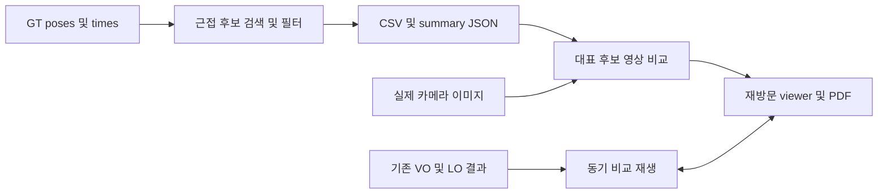

| 모듈 | 입력 / 좌표계 / 단위 | 출력 계약 | 검증 |
|---|---|---|---|
| 후보 검색 | GT Nx3 위치, 첫 카메라 좌표계, m | artifacts/candidates.csv | 유한값, 시간 단조 증가, 필터 |
| 대표 선정 | 후보와 GT 회전, 초/도 | artifacts/summary.json | 40m 이상 공간 분리 |
| 영상 비교 | uint8 image_0 PNG, 프레임 인덱스 | figures/pair_*.png 및 artifacts/loops/index.html | 이미지 decode와 프레임 표시 |
| 동기 재생 | 기존 200프레임 영상·LiDAR·poses | 별도 study의 artifacts/playback/index.html | play/seek/mode, canvas, 모바일 |

LiDAR pose는 기존 연구에서 Tr로 카메라 좌표계로 변환했다. 본 후보 검색은 GT 좌표만 사용하며 추가 센서 동기화나 단위 변환은 없다. 생산 코드 변경 없이 연구 디렉터리와 VSCode 실행 설정을 추가했다.

### 결과

| 후보 프레임 | GT 거리(m) | 시간 간격(s) | 중간 이동(m) | 상대 회전(도) |
|---|---:|---:|---:|---:|
| 2362 / 3305 | 0.031 | 97.7 | 800.4 | 0.94 |
| 421 / 3425 | 0.119 | 311.4 | 2348.8 | 6.11 |
| 61 / 4506 | 0.233 | 460.7 | 3627.0 | 0.37 |

표는 GT 근접 후보이며 검출 정확도나 보정 성능이 아니다. 전체 이동은 3724.2m, 시작-끝 거리는 97.2m다.

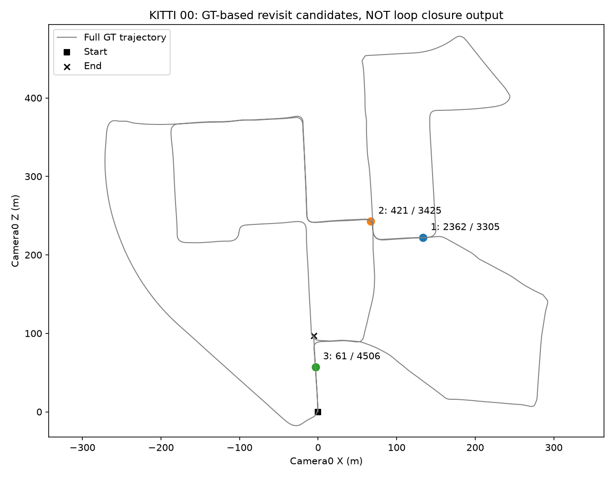
전체 경로 중 재방문 후보의 위치를 표시한다. 추정 궤적이 아니다.

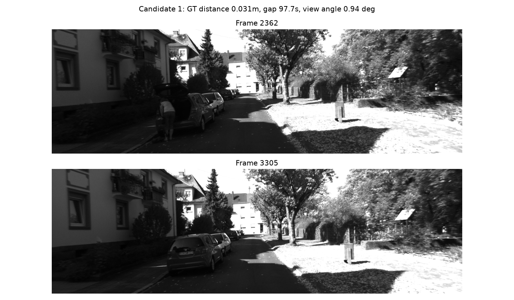
2362/3305의 실제 영상으로 건물·차량·도로 구조가 반복되는 장면을 확인할 수 있다.

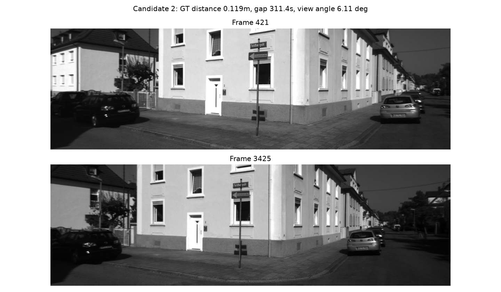
421/3425를 나란히 표시하여 시점 및 장면 차이를 확인한다.

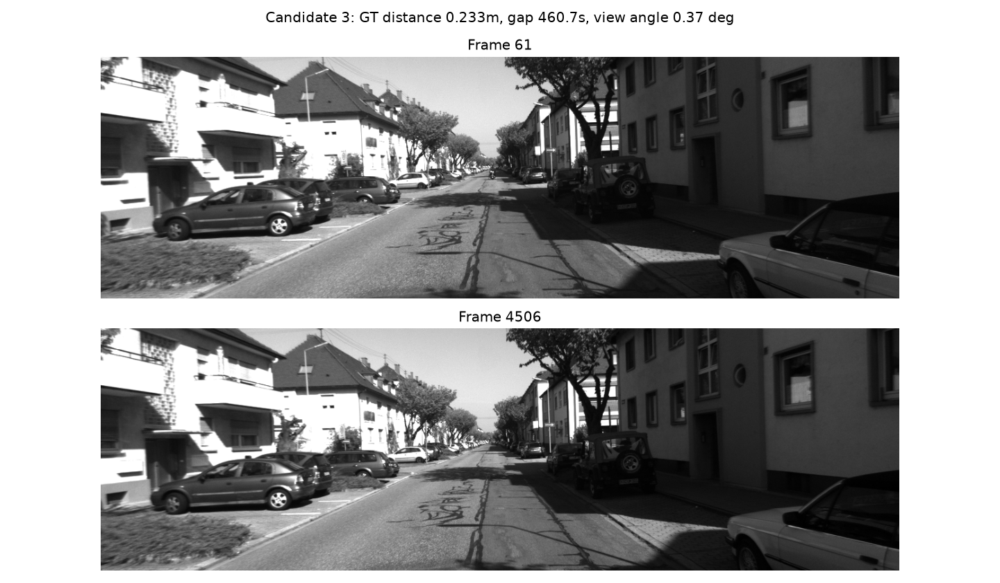
61/4506의 실제 영상 비교다. 첫 200프레임만으로는 이 재방문을 관측할 수 없다.

기존 첫 200프레임 평가 비교:
| 방법 / 정렬 정책 | 위치 RMSE(m) | 해석 |
|---|---:|---|
| ORB VO / GT 전역 Sim(3) | 5.336 | scale을 GT로 맞춘 사후 궤적 형상 |
| ratio VO / GT 전역 Sim(3) | 5.208 | 작은 개선이나 다른 지표 악화, 우월성 결론 불가 |
| KISS-ICP LO / GT 전역 Sim(3) | 0.209 | 동일 형상 비교 조건 |
| KISS-ICP LO / 시작점만 정렬 | 2.299 | metric 오차, 위 Sim(3) 수치와 구분 |

이 표는 이전 연구 산출물을 재사용하며 전체 KITTI 평가나 loop closure 효과가 아니다. 방법·평가 코드는 ../20261031_vo-lo-study/src/lo.py 및 evaluate.py다.

### 분석

#### Feature 강점/약점

| Feature | 강한 조건 | 약한 조건 | 근거 |
|---|---|---|---|
| GT 위치 근접 | 재방문 데이터 존재 확인 | 실사용 시 GT 없음 | 위 후보 3쌍 |
| 상대 회전 필터 | 비슷한 시점 영상 선별 | 반대 방향 루프 제외 | 30도 제한 |
| 실제 grayscale 영상 | 반복 구조 정성 확인 | 조명, 동적 물체, 유사 장소 | pair_1~3 |
| LiDAR 기하 | metric odometry 비교 | 반복 구조, 움직이는 물체 | 이전 LO 보고서; 이번에는 loop 검증 미실시 |

#### 알고리즘의 약점 및 실패 사례

GT 기준의 좋은 사례만 선정했으므로 자동 검색의 false positive/false negative는 측정하지 않았다. 가까운 GT 위치라도 가림이나 시선 차이로 정합이 실패할 수 있다. 프레임 간 연관으로 후보 개수는 크게 부풀 수 있다. 공식 KISS KITTI loader의 특수 scan correction과 deskew를 적용하지 않은 연구 설정이라는 한계도 유지된다.

#### 문제 해결 정도

데이터 존재 기준은 대표 3쌍으로 달성했다. Chrome 검사에서 재생, 120번 프레임 탐색, 정렬 모드 변경, 후보 선택, 양방향 화면 이동을 통과했고 JavaScript 오류는 0건이었다. 390px 모바일에서 가로 넘침이 없고 영상 3개가 정상 decode되었다. camera/BEV/path canvas의 비영 픽셀은 각각 466611/34435/3076개였다. 단, 실제 loop 검출·보정의 성공은 미평가다. 비교 재생은 원시 센서와 추정 궤적을 관찰하는 도구이며 실시간 온라인 계산기가 아니다.

### 개선 방향

| 보완 항목 | 기대 효과 | 예상 공수 |
|---|---|---|
| 전체 00 LO baseline | 루프 전 누적 오차 측정 | 중간 |
| 장소 검색 descriptor + 기하 검증 | GT 없이 후보 검색 및 오검출 배제 | 높음 |
| pose graph 최적화 | 검증된 루프를 통한 전역 보정 | 높음 |
| 추가 시퀀스 / 반대 시점 평가 | 선택 편향 확인 | 중간 |

### 다음 단계 제안

1. 00 전체 LO와 지도 누적을 실행해 baseline을 확정한다.
2. LiDAR 루프 검출 방법을 조사·선정하고 후보 검색과 정합 검증을 각각 평가한다.
3. 검증된 루프 제약으로 pose graph를 최적화하고 보정 전후 재생을 비교한다.

### 부록

- [가정] 5m/500프레임/100m/30도/40m 분리 조건은 탐색 목적의 임시 조건이다.
- [미확인] GT 없는 자동 루프 precision/recall, 전체 구간 LO 정확도, loop 최적화 개선량.
- 근거: 로컬 GT 및 실제 영상, src/audit.py, artifacts/summary.json, artifacts/candidates.csv. 본 작업은 새로운 논문 성능 수치를 인용하지 않는다.
- 관련 알고리즘 원문과 단계별 실험은 이 문서 2~3장의 참고문헌 및 본문 참조.


<a id="playback"></a>

## 5. 좌우 카메라·VO·LO 통합 재생

오른쪽 영상은 표시용이다. 단안 VO를 stereo VO로 바꾸지 않았다.

**원 실험 디렉터리:** `research/20261101_unified-playback/`

### 문제 정의

입력: KITTI 00 image_0/image_1/velodyne 및 기존 200프레임 VO/LO 산출물. 출력: 하나의 offline HTML. [가정] 성공 기준은 200개 오른쪽 영상의 존재/크기 검증, 다섯 canvas의 비영 픽셀, 재생/탐색/모드 전환 성공, 모바일 가로 넘침 0건, JavaScript 오류 0건이다. 알고리즘 개선 및 전체 시퀀스 추정은 범위 밖이다.

### 리소스

기존 src/viz/export_playback.py는 VO 전용이고, research/20261031_vo-lo-study/src/playback.py는 VO/LO 결과를 조합한다. 후자를 확장했다. image_1은 이미 로컬에 있다. 시간 매칭의 points_previous/current 및 pose_mask도 기존 NPZ에 존재한다. 새 센서 다운로드나 추정 실행은 필요 없다.

### 접근 선정

Quick-win: 기존 산출물을 재사용해 renderer/exporter만 확장한다. 알고리즘 개발이 아니므로 선행연구 조사와 신규 알고리즘 실험은 수행하지 않았다. 기존 생산 VO 코드는 변경하지 않는다.

### 아키텍처

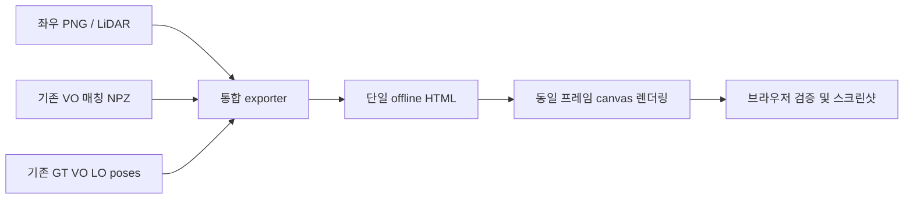
원본 영상은 uint8 grayscale이며 JPEG로 HTML에 내장한다. 매칭은 이전/현재 왼쪽 영상의 pixel 좌표와 pose inlier flag다. LiDAR는 센서 좌표 m, 궤적은 기존 평가 좌표계를 그대로 사용한다. 동일 프레임의 두 영상 decode가 끝난 후 전체 화면을 갱신하고 이전 비동기 렌더 요청을 version으로 폐기한다. HTML 산출물은 ../20261031_vo-lo-study/artifacts/playback/index.html, 스크린샷은 해당 study의 figures/playback_*.png다.

### 결과

| 항목 | 기존 연구 화면 | 통합 화면 |
|---|---|---|
| 카메라 원본 | 왼쪽 overlay만 | 왼쪽/오른쪽 원본 + 별도 왼쪽 overlay |
| 시간 매칭 | 현재 좌표 점만 | 이전→현재 선, inlier/rejected 선택 |
| LiDAR | 투영/BEV | 유지 |
| GT/VO/LO | 기본 Sim(3) | 기본 metric GT/LO, 선택형 Sim(3) |

표는 표시 기능 차이이며 VO 정확도 향상을 의미하지 않는다. 기존 baseline VO의 GT-fitted 위치 RMSE 5.336m도 그대로다. ratio 실험의 5.208m 결과가 기본 VO로 교체된 것이 아니다. 실제 오른쪽 영상을 읽지 못하거나 크기가 다르면 export는 실패한다.

검증 결과: 200프레임 export 성공. 120번 프레임에서 좌/우/overlay/BEV/궤적의 비영 픽셀은 466610/466609/466611/34435/3076개로 모두 비어 있지 않았다. 좌우 픽셀 배열이 다름을 검사하여 복제 영상이 아님을 확인했다. 재생, 탐색, 양쪽 궤적 모드, 후보 화면 왕복, 모바일 390px 가로 넘침 검사 통과. JavaScript 오류 0건. 이 검사는 센서 시간 offset의 독립 검증이나 알고리즘 정확도 검사가 아니다.


좌우 원본, 특징점/매칭 overlay, LiDAR, 궤적을 동일 프레임으로 표시한다.

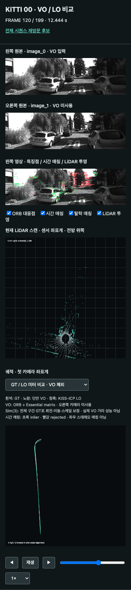
좁은 화면에서는 좌우 영상을 세로로 배치한다.

### 분석

| 관측 | 강점 | 한계 |
|---|---|---|
| 좌우 원본 | 실제 시차 비교 | stereo depth/VO 미구현 |
| 시간 매칭 | 움직임과 outlier 관찰 | 3D 지도 아님 |
| Sim(3) 궤적 | 형상 비교 | GT 이용, metric 성능 아님 |
| metric LO | GT scale fitting 없는 비교 | 현재 200프레임만 |

기존 VO 전용 화면은 단위 이동량과 GT 미터를 그대로 비교했다. 연구 화면은 전역 GT 정렬을 하므로 둘의 시각적 차이를 알고리즘 개선으로 해석하면 안 된다. 두 코드 버전의 모든 차이에 대한 controlled benchmark는 이번 범위가 아니다. 전체 HTML 크기가 증가하며 저사양 장치에서 메모리 사용은 미측정이다.

### 개선 방향

추후 stereo VO를 연구하면 오른쪽 영상을 실제 깊이 추정에 사용할 수 있다(공수 높음). 장시간 재생에서는 파일 분할/지연 로딩이 필요할 수 있다(중간). 이번에는 구현하지 않았다.

### 다음 단계

1. 현재 통합 화면에서 매칭과 GT 정렬 방식 차이를 학습한다.
2. 별도 연구로 stereo VO와 단안 VO의 metric 성능을 비교한다.

### 부록

[가정] 200프레임과 기존 추정 유지가 이번 UI 통합 범위다. [미확인] stereo 추정 성능, 장시간 메모리 사용. 출처는 로컬 exporter, evaluate.py의 sim3(), 기존 metrics.json이며 외부 논문 수치를 추가 인용하지 않는다.


<a id="audit"></a>

## 6. 초기 데이터·IMU 감사 기록과 과거 baseline

이 장만은 초기 상태의 보관 기록이다. 여기의 LO 미구현·ATE 미측정·옛 main 코드 지적은 당시 상태이며 현재 상태가 아니다. 현재 LO 구현 및 측정값은 3장, 현재 재생은 5장이 우선한다. 과거 실패·미확인 사항을 삭제하지 않기 위해 보존했다.

**원 실험 디렉터리:** `research/20261030_progress-review/`

### 사용 가능한 리소스


표는 이번에 확인한 리소스 요약이다. 전체 목록과 코드 위치는 [인벤토리](../research/20261030_progress-review/notes/inventory.md)에 있다.

| 리소스 | 현재 상태 | 제약 |
|---|---|---|
| Stereo grayscale | 00~21, 00 좌우 각 4,541장 | VO는 image_0만 사용 |
| GT | 00~10 pose 파일 | 평가용, 추정 입력으로 사용하지 않음 |
| LiDAR | Odometry 00의 4,541개 XYZI 스캔 | 다른 시퀀스 미추출; 추정 알고리즘 미구현 |
| OXTS | 45,700행 × 30열, 전 값 finite | IMU 외 GPS/INS 항목도 포함; 시간축 이상 존재 |
| Calibration | P0~P3/Tr, Raw 세 calibration 파일 | 센서간 변환 체인 실측 검증 전 |
| 플레이백 | 원본/ORB/매칭/GT·VO 동기화, seek/step/speed | 계산 후 재생; 실시간 VO 처리 성능 아님 |
| Feature | ORB 위치/descriptor, Hamming distance, inlier mask | 3D landmark나 semantic label 아님 |
| 부족한 것 | 공통 평가기, full pose log, stereo/VIO backend | ATE/RPE/latency 결과 아직 없음 |

데이터는 `data/kitti/dataset`, `data/kitti/raw`, 원본 ZIP은 `data/kitti/archives`에 있다. 이전 단계에서 Downloads의 세 ZIP을 이동하고 LiDAR 00과 OXTS·timestamp·calibration만 추출했다. Raw 영상/Raw LiDAR 중복 추출은 하지 않았다. 이 이력은 `data/kitti/SENSOR_IMPORT.md`와 이전 실행 기록에 근거한다.

### 결과


아래 표는 **기존 baseline 보관 결과의 재집계**이며 개선 방법과의 A/B 실험은 아니다.

| 지표 | 기존 결과 재집계 | 개선 알고리즘 |
|---|---:|---|
| 프레임 / 전이 | 200 / 199 | 미구현 |
| tracked 상태 | 199 / 199 전이 | 미평가 |
| ORB 개수 | 모든 프레임 2,500 | 미평가 |
| pose inlier 비율 최소/중앙/최대 | 10.2% / 58.2% / 90.6% | 미평가 |
| GT 누적 이동 거리 | 144.879m | 비교 참조 |
| VO 누적 이동량 | 199 임의 단위 | 미평가 |
| GT 1프레임 이동 | 0.371~1.060m | 비교 참조 |
| VO 1프레임 이동 | 약 1 고정 | 미평가 |
| ATE/RPE/heading error/latency | 미측정 | 미평가 |

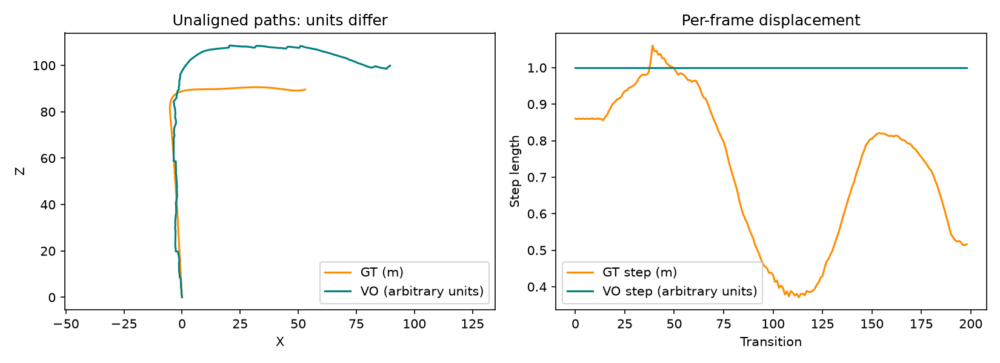

그림 1. 스케일 미정렬 궤적과 이동량. 서로 다른 단위이므로 곡선 차이를 미터 오차로 읽으면 안 된다. GT의 이동량 변화에 비해 VO의 길이는 고정된다.

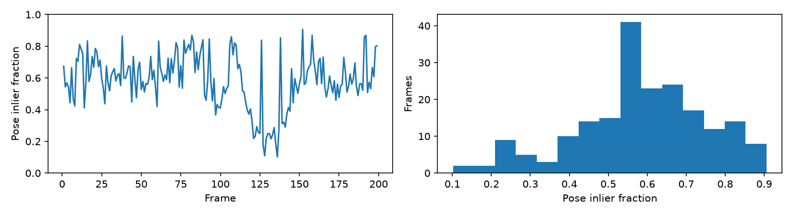

그림 2. 매칭 중 pose 복원 후 살아남은 비율. 정답 대응 label이 없으므로 precision/recall은 아니다.

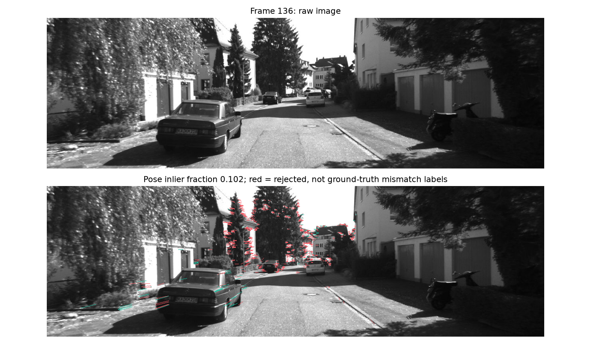

그림 3. 구간 내 최저 inlier 비율인 frame 136. 빨간 선은 기하/cheirality 검사에서 제외된 대응이며 실제 오매칭임을 보증하지 않는다.

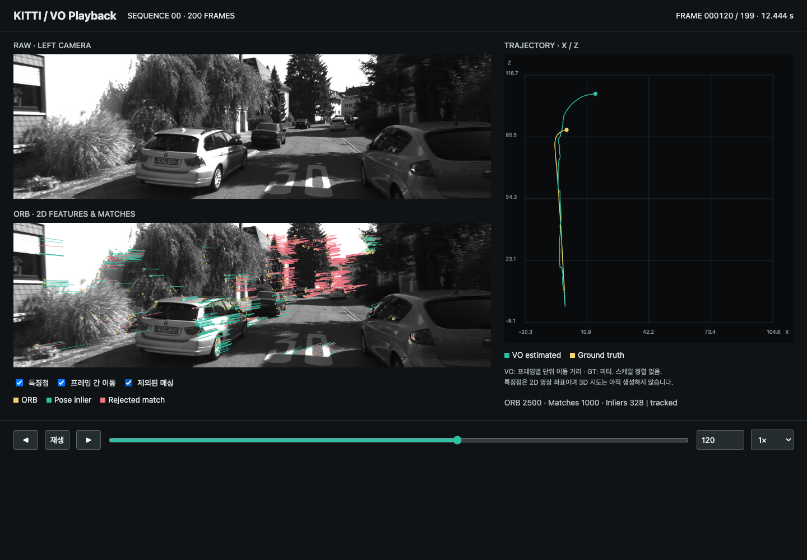

그림 4. 이전에 저장한 데스크톱 UI(frame 120). 원본 영상/특징점/궤적의 동기 관찰이 가능하다. 과거 Playwright 재생·탐색·모바일 검증은 대화 실행 기록에 근거하며 이번에는 브라우저 검증을 다시 실행하지 않았다.

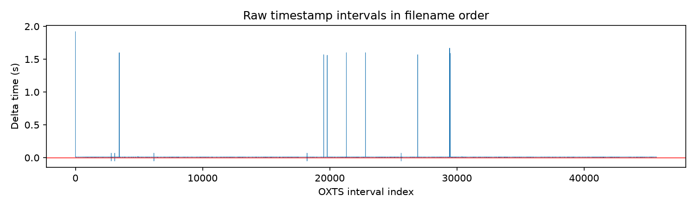

그림 5. OXTS 파일명 순서에서의 timestamp 차이. 중앙값 0.009996736초, 최소 -0.050010872초, 최대 1.919595343초, 비양수 간격 5개다. 원인은 아직 확인하지 않았다.

모듈 검증: 200프레임 파싱/유한 위치/영상 timestamp 단조 증가/inlier mask 일치 통과. IMU 45,700×30 유한값 및 timestamp 개수 일치 통과. **IMU 시간 단조성은 미달**이다. LiDAR 이미지 번호 일치와 첫/끝 XYZI 디코딩은 앞선 import 검증에서 통과했으며 전체 스캔 geometry 품질 검증은 아니다.

### 분석


#### Feature 강점/약점


| Feature | 강한 조건 또는 관찰 | 약한 조건 또는 한계 | 근거 |
|---|---|---|---|
| ORB 위치 | 이번 구간에서 2,500개를 지속 확보 | 개수가 많아도 분포/독립성/정확성 보장 안 됨 | frames.csv; 32칸 중 최소 13칸 점유 |
| Binary descriptor/Hamming | 실제 실행에서 프레임 대응 생성 | 반복무늬·시점/조명 변화 취약 가능성 [가정] | 코드 및 그림 3; 거리별 GT 분별력 미측정 |
| Pose inlier mask | 기하 일관성에 따른 후보 분리 | 비율 변화 큼, 정확도/정답 label 아님 | 그림 2, 최소 10.2% |
| Stereo disparity | metric 깊이 추출 가능성 | 원거리·작은 disparity 취약 예상 [가정] | P0/P1와 우측 영상 존재; 아직 미추출 |
| LiDAR XYZI | 공간 좌표 관측 가능 | 동적 객체·희소성 영향 [미확인] | 데이터 확보만 완료, 알고리즘 실험 없음 |
| IMU 가속도/각속도 | 약 100Hz 시간 간격의 측정 존재 | 시간 역전/간격 이상, bias/noise 미검증 | imu.json, 그림 5 |

표는 실측 관찰과 가설을 구분한다. Feature ablation, 실제 match label에 따른 분포 분리도, 오차 상관관계는 **미수행**이다. 2D 특징점 시각화를 3D 지도라고 부르지 않는다.

#### 알고리즘의 약점 및 실패 사례


1. **Scale 부재:** 서로 독립적인 두 프레임 추정에서 t 방향만 얻어 길이 1로 누적한다. 이는 단순한 전역 scale 차이뿐 아니라 구간별 속도 변화에 따른 형상 왜곡을 만들 수 있다. 그림 1과 runner:40이 근거다.
2. **낮은 inlier 구간:** frame 136은 1,000개 중 102개만 pose inlier다. 추정 상태는 tracked지만 정답 자세가 맞는지는 별도 평가하지 않았다. 원인을 차량 운동/오매칭/작은 시차 중 하나로 단정하지 않는다.
3. **main의 실패 처리:** 매칭 부족 시 frame을 생략하고 GT를 단순 앞부분 slicing한다(`run_kitti.py:30`, `:51`). 실제 skip이 생기면 frame 대응이 어긋날 수 있다. 이번 보관 구간의 실제 skip 사례는 없다.
4. **추정 구현 중복:** exporter는 자체 E/pose 처리와 최소 inlier gate를 갖고 runner와 동작이 다르다. main의 inlier 집계 오류도 남아 있다. 두 실행 결과를 동일 구현으로 무조건 취급하면 안 된다.
5. **IMU 입력 이상:** 파일 순서와 시간 순서가 일부 다르다. timestamp만 정렬하면 해결되는지, packet 순서/중복/누락 문제인지 확인 필요. 측정값·시각 대응을 깨뜨리는 임의 정렬은 하지 않았다.
6. **다운로더 재개:** feature 코드 `scripts/download_kitti_odometry.py:32` 부근은 Range 응답이 206인지와 Content-Range를 검증하지 않고 append한다. 서버가 Range를 무시하면 손상 가능성이 있다. 이번 다운로드에서 실제 손상이 있었다는 뜻은 아니다.

#### 문제 해결 정도


데이터 확보와 시각 디버깅, 관측 집계까지 완료됐다. metric VO 개선 여부, VIO/LIO 성능은 평가할 단계가 아니다. 00의 약 200프레임 결과만으로 전 시퀀스/고속/야간/동적 객체 성능을 일반화할 수 없다. 목표 성능 수치를 과거에 정하지 않았으므로 임의의 달성률은 제시하지 않는다.

### 부록


#### 가정 목록


- 다음 성능 연구는 동일 조건의 baseline 대비 개선으로 목표를 시작한다. 구체적 임계값은 아직 없다.
- Stereo/PnP의 metric scale 확보, grid/gate/KLT의 품질 효과와 예상 공수는 설계 판단이며 실험 결과가 아니다.
- 시점/조명 변화나 작은 disparity의 영향은 일반적 가설이며 이 데이터에서 ablation하지 않았다.

#### 미확인 사항


- IMU 비단조 시간/긴 gap 원인 및 Raw↔Odometry 정확한 시간 대응.
- IMU noise/bias, field별 적용 축, 동적 객체 GT, LiDAR 전체 스캔 품질.
- ATE/RPE/회전 오차, latency, 메모리, 다른 시퀀스 일반화 성능.
- 기존 HTML 생성의 정확한 환경/난수 상태/커밋 provenance; 이번 hash로 현재 파일만 식별.
- 원본 대용량 ZIP 전체 재검증은 이번 회고에서 하지 않았다.

#### 참고문헌


1. [OpenCV ORB 공식 설명](https://docs.opencv.org/4.13.0/d1/d89/tutorial_py_orb.html) — Rublee 외, ORB, 2011의 개념 및 API 배경.
2. [OpenCV Feature Matching](https://docs.opencv.org/4.13.0/dc/dc3/tutorial_py_matcher.html) — Hamming/cross-check 동작.
3. [OpenCV calib3d](https://docs.opencv.org/4.13.0/d9/d0c/group__calib3d.html) — Essential, recoverPose, PnP API.
4. [KITTI Odometry](https://www.cvlibs.net/datasets/kitti/eval_odometry.php) — 시퀀스/GT와 공식 segment 평가 정의. 이번에는 공식 100~800m 평가를 실행하지 않았다.
5. [KITTI Raw](https://www.cvlibs.net/datasets/kitti/raw_data.php) — 센서/보정/동기화 형식.
6. [Mur-Artal, Tardos, ORB-SLAM2](https://arxiv.org/abs/1610.06475), arXiv 2016 / T-RO 2017.
7. [Qin, Li, Shen, VINS-Mono](https://arxiv.org/abs/1708.03852), arXiv 2017 / T-RO 2018.

#### 제출 점검


- 회고 기준·baseline 재집계·그림 설명·모듈 산출물·코드 근거·재현 명령: 포함.
- 새 알고리즘 A/B 개선, feature ablation, full pose 정확도 평가: 미수행으로 표시.
- 과거 시스템의 E/R/descriptor 중간 산출물: 미보관 사실을 명시.
- 프로젝트 지침: 루트 CODEX.md에 연구 워크플로우 기록, AGENTS.md에서 참조.


<a id="reproduce"></a>

## 7. 재현 및 문서 갱신

### 최신 문서 갱신 절차
1. docs/report.md의 해당 주제를 직접 수정한다. 새 날짜별 보고서를 만들지 않는다.
2. 같은 문서 맨 위 버전과 아래 변경 이력을 함께 갱신한다. 오탈자는 patch, 설명/결과 확장은 minor, 구조·평가 계약의 큰 변경은 major를 올린다.
3. 그림은 실험 디렉터리의 실제 산출물을 상대경로로 연결하고 출처·설정·코드 버전을 기록한다.
4. 다음 명령으로 docs/report.pdf를 덮어쓴다. 원본과 PDF를 같은 기능 커밋에 포함한다.

```sh
node tools/render_report.mjs
```

초기 통합에 사용한 tools/consolidate_reports.mjs는 일회성 이관 도구다. 최신 원본이 있으면 실패하도록 되어 있으며 평소에는 실행하지 않는다. 각 장에 보존한 옛 PDF 생성 명령은 과거 재현 정보일 뿐 현재 문서 갱신에는 사용하지 않는다.

### 알고리즘 산출물 재현

```sh
# 기존 연구 환경과 데이터가 있을 때 전체 VO/LO 실험
research/20261031_vo-lo-study/.venv/bin/python research/20261031_vo-lo-study/src/run.py --stage all

# 기존 결과로 통합 playback과 재방문 viewer만 갱신
research/20261031_vo-lo-study/.venv/bin/python research/20261031_vo-lo-study/src/run.py --stage playback

# ORB 상세 그림/수치 재현 (기존 orb/pyramid.npz 필요)
env MPLCONFIGDIR=.cache/matplotlib XDG_CACHE_HOME=.cache research/20261031_vo-lo-study/.venv/bin/python research/20261101_orb-explained/src/analyze.py

# 통합 재생 검증
node research/20261031_vo-lo-study/src/check_playback.mjs

# 최신 PDF
node tools/render_report.mjs

# PDF 렌더 검증 결과 재확인
node tools/render_report.mjs --check-only

```

PDF 환경은 macOS Chrome, marked/playwright/mermaid다. 기본 의존성 경로는 /tmp/kitti-report-pdf/node_modules이고 REPORT_PDF_DEPS로 바꿀 수 있다. 설치 경로가 없으면 해당 패키지를 설치해야 한다. 다른 OS는 REPORT_CHROME으로 Chrome 실행 경로를 지정한다. 연구 Python 환경은 기존 requirements-lock.txt를 유지한다.

### Git 작업 규칙

병합된 feature 브랜치에 다음 작업을 이어 붙이지 않는다. 최신 main에서 새 feat/ 브랜치를 만든다. pull 실패를 해결하려고 데이터나 작업 파일을 지우지 않는다. 고유한 로컬 커밋이 있는지 먼저 확인한다.

```sh
git fetch origin --prune
git switch main
git pull --ff-only origin main
git switch -c feat/<next-task>
```

이번 로컬 main의 divergence 원인은 이미 원격에 동일 내용으로 존재하는 초기 session-summary 커밋의 해시 차이였다. backup/main-before-sync-20261101을 만든 뒤 rebase로 중복을 제거하여 681582f와 일치시켰다. 이 방법을 내용이 다른 로컬 커밋에도 무조건 적용한다는 뜻은 아니다. 전역 pull 설정은 변경하지 않았다.

<a id="versions"></a>

## 8. 버전 변경 이력

| 버전 | 갱신일 | 내용 | 알고리즘 변경 |
|---|---|---|---|
| v1.0.0 | 2026-11-02 | 날짜별 5개 보고서의 상세 설명·실험·그림을 주제별 고정 문서로 통합. ORB는 최신 교정본 우선, 초기 감사는 역사적 기록으로 구분. 고정 PDF 빌드와 링크/다이어그램 검증 추가. | 없음 |

과거 연구의 날짜·커밋·가정·미확인은 각 장에 보존했다. 추후 변경은 같은 파일과 Git 이력에 남긴다.
