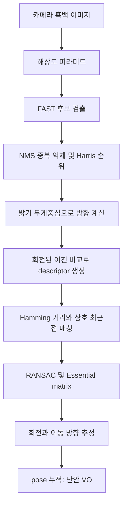
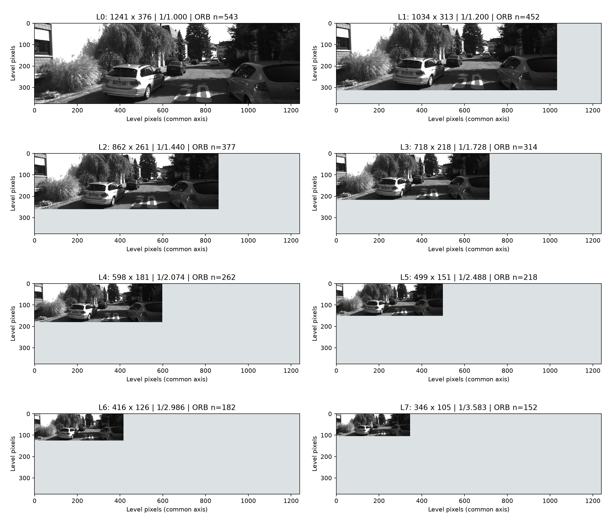
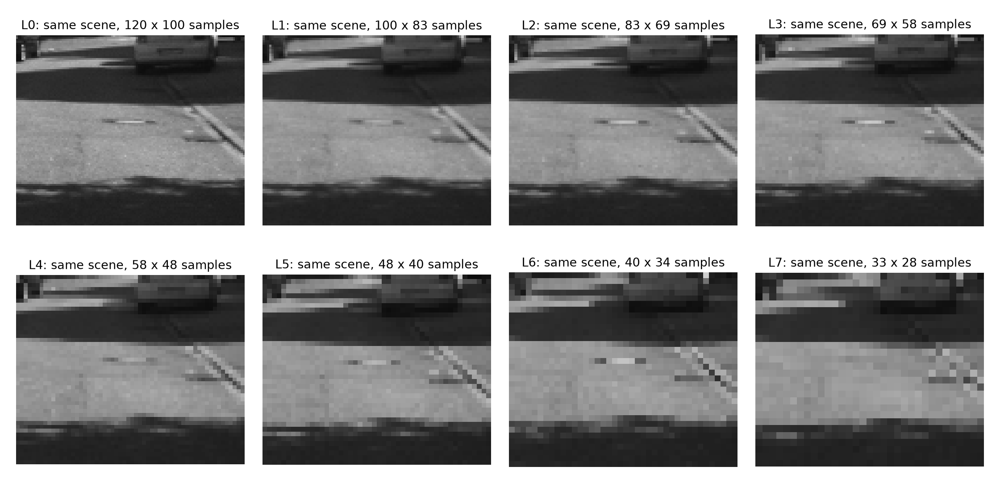
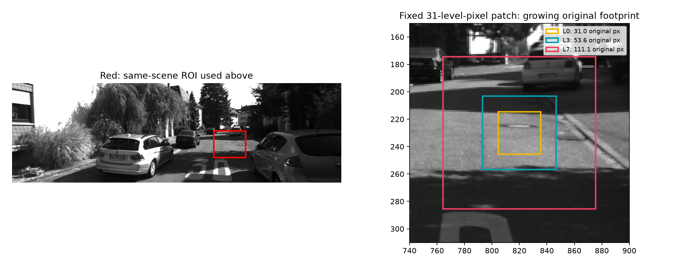
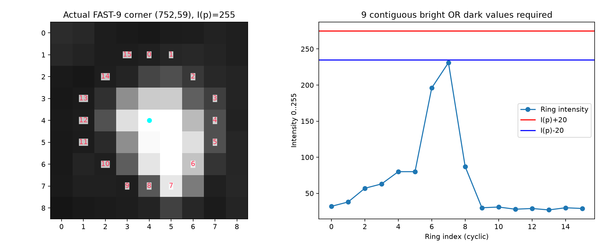
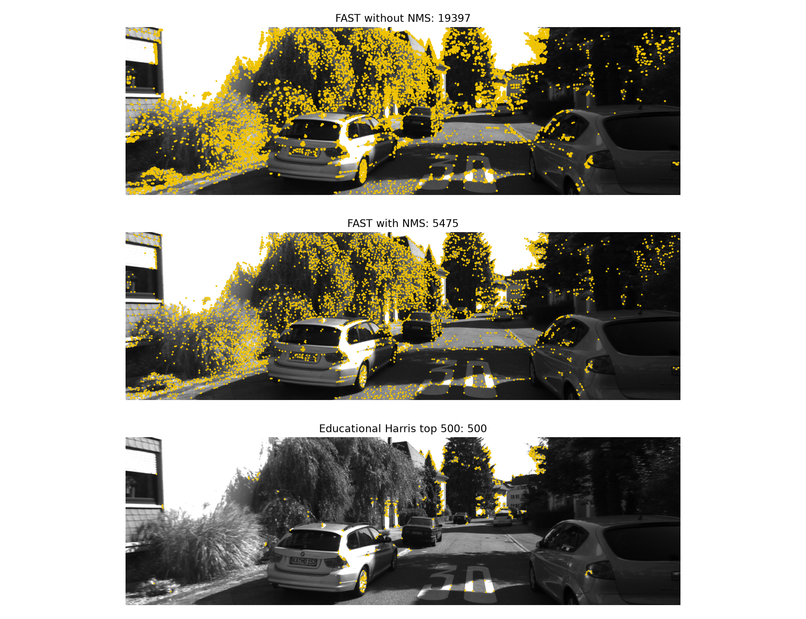
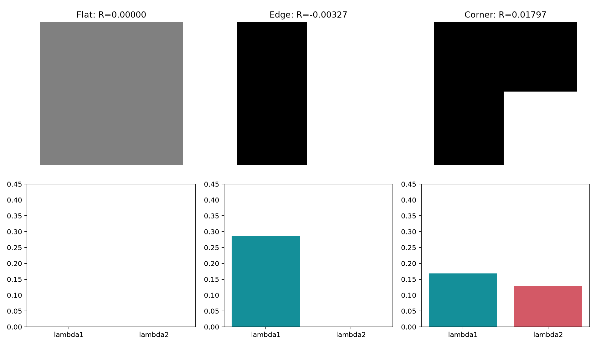
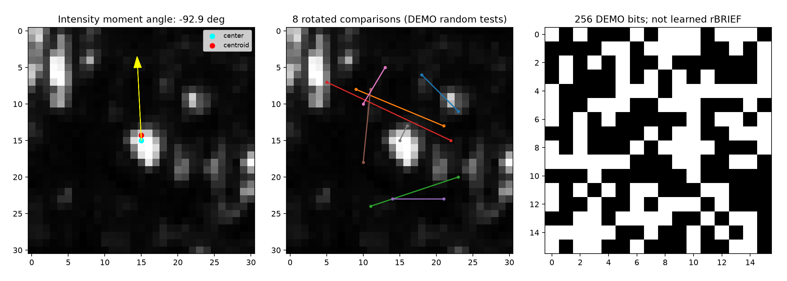
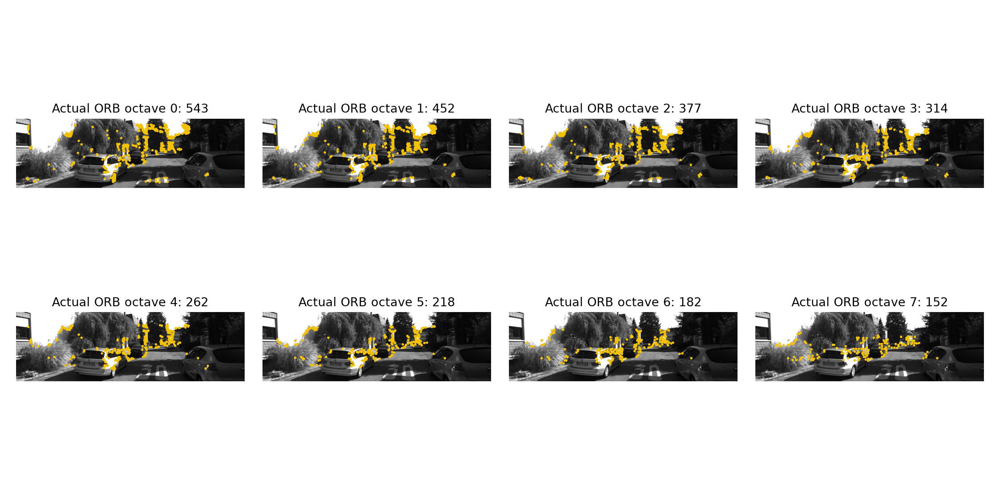
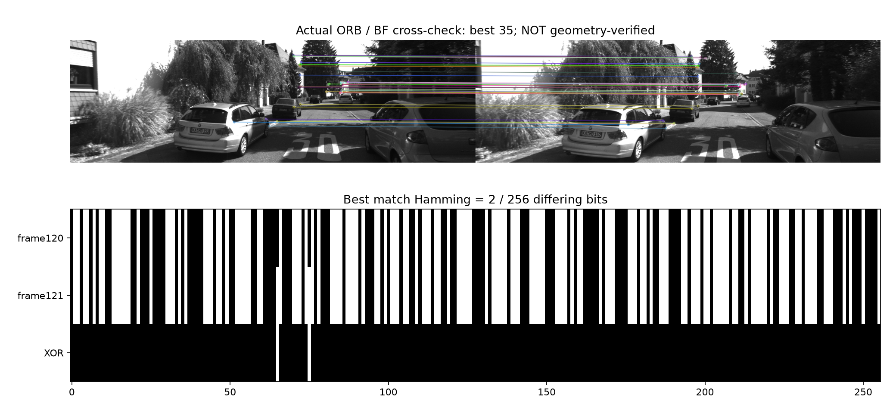

# ORB를 픽셀부터 이해하기: 약자, 단계별 계산, 피라미드 검증

## 1. 요약
- ORB는 **Oriented FAST and Rotated BRIEF**다. 영상에서 비교할 위치를 찾고 그 주변 모양을 256비트로 표현한다. 그 자체가 VO나 SLAM은 아니다.
- 기존 피라미드는 다른 해상도의 배열이 맞지만, 같은 크기의 그림 칸으로 자동 확대해 차이가 가려졌다. 설명과 시각화가 부족했다.
- 기존 4개 배열을 동일 재현했고 8레벨의 크기·해시·복원 오차·실제 ORB 검출 개수를 기록했다.
- FAST→NMS→Harris→방향→BRIEF→Hamming을 실제 수치와 9개 그림으로 설명한다. 교육용 계산과 실제 OpenCV 출력은 구분한다.
- VO 성능 개선 실험이 아니다. 알고리즘 변경 없이 학습 자료와 검증을 보완했다.

## 2. 문제 정의: 전체 흐름부터 보기

### 2.1 최종 목표는 무엇인가
우리가 원하는 최종 결과는 '차량이 얼마나 회전하고 이동했는가'다. 하지만 카메라가 주는 것은 흑백 픽셀 배열뿐이다. 먼저 두 영상에서 같은 물체의 같은 부분을 찾아야 한다. ORB는 이때 사용할 **관측을 만드는 앞단**이다.

사진의 모든 픽셀을 다 비교하지 않고 재발견하기 좋은 위치를 고른다. 그 위치 주변을 작은 숫자 묶음으로 요약하면 다음 영상에서도 비슷한 숫자를 가진 위치를 검색할 수 있다. 위치를 고르는 작업이 detection, 요약값을 만드는 작업이 description이다. 대응을 찾는 matching과 이동을 계산하는 estimation은 그 뒤에 있다.



위에서 B~F가 ORB의 주요 구성이다. G 이후는 현재 VO 파이프라인에 붙인 별도 단계다. ORB의 출력은 3D 지도도, 이동 거리도 아니다.

### 2.2 지금 해결하는 문제와 기준
baseline 자료는 FAST·Harris 등의 이름만 나열하고 계산 이유를 충분히 설명하지 않았다. 또한 교육용 4레벨 그림과 실제 ORB의 8레벨 설정이 혼동될 수 있었다.

입력은 KITTI 00의 120·121번 왼쪽 영상, 기존 피라미드 NPZ, 현재 OpenCV다. 출력은 단계별 배열·수치·그림과 이 PDF다. 성공 기준은 기존 4레벨 동일 재현, 8레벨별 실제 크기와 오차 기록, FAST 조건/XOR 검사 통과, 주요 용어를 처음 등장할 때 정의하고 단계별 입출력·이유·한계를 제공하는 것이다. [가정] 이번 범위는 ORB와 VO로 이어지는 연결 설명이다. LO 내부 재작성, 새 VO, rBRIEF 재학습은 하지 않는다.

## 3. 기본 용어와 사용 가능한 리소스

### 3.1 약자와 이름을 먼저 풀기
| 이름 | 풀어 쓴 말 / 유래 | 이 프로젝트에서 하는 일 |
|---|---|---|
| ORB | Oriented FAST and Rotated BRIEF | 방향이 있는 코너와 회전 보정 이진 descriptor 생성 |
| FAST | Features from Accelerated Segment Test | 원 둘레 밝기를 비교해 코너 후보 검출 |
| Harris | Chris Harris의 성; 약자가 아님. Mike Stephens와 공동 제안 | 여러 방향으로 밝기가 바뀌는 정도를 평가 |
| NMS | Non-Maximum Suppression, 비최대 억제 | 가까이 중복된 응답 중 약한 것을 제거 |
| BRIEF | Binary Robust Independent Elementary Features | 여러 픽셀 쌍의 밝기 비교를 비트열로 표현 |
| rBRIEF | ORB 논문의 회전 대응·선택된 BRIEF 검사 패턴을 가리키는 명칭 | 분산이 높고 상관이 낮은 비교를 선택 |
| BF | Brute Force | 후보 descriptor들을 직접 비교 |
| Hamming | Richard Hamming의 성; 약자가 아님 | 두 비트열에서 서로 다른 자리 개수 |
| RANSAC | RANdom SAmple Consensus | 일부 잘못된 대응을 견디며 기하 모델 추정 |
| VO / SLAM | Visual Odometry / Simultaneous Localization and Mapping | 영상 이동 추정 / 위치와 지도 동시 추정 |
| ROI | Region of Interest, 관심 영역 | 피라미드에서 동일 장면 일부를 확대 비교 |
| MAE | Mean Absolute Error, 평균 절대 오차 | 축소 후 복원 영상과 원본의 평균 밝기 차이 |

ORB 이름·주요 구성은 [OpenCV ORB 설명](https://docs.opencv.org/4.13.0/d1/d89/tutorial_py_orb.html), FAST와 BRIEF의 이름은 각각 [FAST 설명](https://docs.opencv.org/4.13.0/df/d0c/tutorial_py_fast.html), [BRIEF 설명](https://docs.opencv.org/4.13.0/dc/d7d/tutorial_py_brief.html)에서 확인했다.

### 3.2 자주 섞이는 데이터 타입
- **픽셀 intensity I(x,y):** 흑백 밝기. 이번 영상은 uint8, 즉 0~255 정수다. 색 이름이나 거리 값이 아니다.
- **patch:** 한 위치 주변을 잘라낸 작은 이미지. 예를 들어 31×31 픽셀이다.
- **keypoint:** 고른 위치와 부가 정보. x/y, 크기 size, 방향 angle, 검출 레벨 octave, 반응 response 등이 있다. angle과 response는 서로 다르다.
- **descriptor:** keypoint 주변 외형의 수치 요약. 이번 ORB는 32바이트=256비트다. keypoint 좌표가 descriptor 안에 그대로 저장되는 것은 아니다.
- **match:** 이전 영상 descriptor의 인덱스와 현재 영상 descriptor의 인덱스, 그 사이 거리다. 비슷하다고 검색된 후보이지 동일 물체라는 보장은 아니다.
- **inlier:** 지정한 기하 모델과 오차 허용 범위에 맞는 대응. 반대는 outlier다. 영상의 초록색 점이라는 이유만으로 진실이라고 단정할 수 없다.

### 3.3 실제 보유 리소스
| 리소스 | 위치와 사용 |
|---|---|
| 원본 | data/kitti/dataset/sequences/00/image_0/000120.png 및 000121.png |
| 이전 교육 코드 | research/20261031_vo-lo-study/src/orb_stages.py:7~13 |
| 이전 피라미드 | 같은 study의 artifacts/orb/pyramid.npz |
| 실제 ORB 호출 | 같은 study의 src/vo.py; 새 src/analyze.py에도 설정 명시 |
| 새 중간 출력 | artifacts/*.npz, levels.csv, summary.json, harris_toys.json |
| 실행 환경 | 기존 연구 venv, OpenCV 5.0.0, 단일 CPU thread |

## 4. 접근 선정: 단계마다 직접 확인하기
새 검출기를 개발할 문제가 아니라, 기존 알고리즘 설명과 그림의 정보 손실을 수정할 문제다. 따라서 기존 데이터를 사용하는 작은 재현 실험을 택했다. 이하 설명에서 **실제 ORB 출력**, **독립 교육 계산**, **가상의 수치 예제**를 구분한다. 원 논문 전체를 그대로 재구현했다고 부르지 않는다.

### 4.1 피라미드: 왜 같은 사진을 여러 크기로 만드는가
차량이 물체에 가까워지면 그 물체가 사진에서 커진다. 한 크기의 작은 patch만 비교하면 같은 물체라도 주변 모양이 다르게 들어온다. 입력을 여러 해상도로 만들어 비슷한 크기로 보이는 레벨끼리 대응할 기회를 주는 것이 피라미드의 역할이다.

**다른 장면을 만드는 것이 아니다. 동일 장면을 더 적은 픽셀로 표현한다.** 따라서 큰 윤곽이 비슷한 것은 정상이다. 차이는 배열 크기, 작은 무늬의 소실, 같은 patch가 덮는 원본 영역이다.

이번 scaleFactor=1.2, 레벨 l=0~7이면 명목 축소 배수 s(l)=1.2^l이다. 폭은 대략 W/s(l), 높이는 H/s(l)이며 정수 반올림이 있다. 영상 길이 비율은 1/s(l), 픽셀 수 비율은 대략 1/s(l)^2다. '1.2배 scale'을 영상을 1.2배 키운다는 뜻으로 읽으면 반대가 된다.

가상의 예: 어떤 물체가 첫 영상에서 20px, 두 번째에서 24px라면 두 번째의 레벨1에서는 약 20px로 줄어든다. 이때 비슷한 크기의 모양을 비교할 수 있다. 실제 장면은 원근·가림·조명도 함께 변하므로 피라미드만으로 완전한 scale invariance가 생기지는 않는다.

**피라미드 scale과 VO metric scale은 별개다.** 전자는 영상 크기 비율이다. 후자는 '이동 벡터 1이 실제 몇 m인가'라는 물리 거리 문제다. ORB 레벨을 늘려도 단안 VO의 절대 거리 문제가 해결되지 않는다.

### 4.2 기존 그림이 거의 같아 보였던 정확한 이유
이전 코드에서는 각 subplot의 `imshow(p)`가 해당 영상 크기에 맞춰 좌표 범위를 자동으로 잡았다. L0도 L3도 자기 칸을 거의 가득 채워 원래 줄어든 크기가 지워졌다. 제목에 shape만 적어 놓는 것으로는 충분하지 않았다.

기존 저장 배열과 같은 방식으로 재생성한 L0~L3를 `np.array_equal`로 비교했고 **네 배열 모두 동일**했다. 이는 이전 배열 생성이 실제 축소였다는 증거다. 이제 모든 subplot의 x축을 0~1241, y축을 0~376으로 고정했다. 같은 level pixel이 같은 도식 크기를 차지하므로 축소를 직접 볼 수 있다. PDF 화면의 실제 모니터 픽셀과 1:1이라는 뜻은 아니다.


읽는 법: 회색 여백은 데이터가 없는 부분이다. L0는 전체 칸을 채우고 L7은 작은 부분만 채운다. 제목의 ORB n은 실제 ORB의 레벨별 개수이며 배경은 독립 교육용 resize다.

| 레벨 | 실제 배열 폭×높이 | 원본 대비 길이 | 31px patch의 원본 폭 | 실제 ORB 점 수 | 복원 MAE |
|---|---:|---:|---:|---:|---:|
| 0 | 1241×376 | 100.00% | 31.00px | 543 | 0.000 |
| 1 | 1034×313 | 83.33% | 37.20px | 452 | 3.138 |
| 2 | 862×261 | 69.44% | 44.64px | 377 | 3.312 |
| 3 | 718×218 | 57.87% | 53.57px | 314 | 4.442 |
| 4 | 598×181 | 48.23% | 64.28px | 262 | 5.277 |
| 5 | 499×151 | 40.19% | 77.14px | 218 | 5.348 |
| 6 | 416×126 | 33.49% | 92.57px | 182 | 6.339 |
| 7 | 346×105 | 27.91% | 111.08px | 152 | 7.170 |

MAE는 각 축소 영상을 원본 크기로 bilinear 확대하고 mean(abs(original-restored))로 계산했다. 단위는 0~255 밝기다. 0이 아니라는 것은 원본 복제본이 아니며 축소·복원 과정에서 정보가 바뀌었다는 뜻이다. VO 정확도 지표는 아니다. 레벨별 검출 개수도 품질 점수가 아니라 설정과 검출 결과다.

### 4.3 같은 장면의 확대 비교와 patch 범위
bilinear interpolation은 정수 격자 사이 밝기를 주변 네 픽셀의 가중 평균으로 계산하는 보간이다. 줄어든 영상에서 모든 원본 픽셀을 독립적으로 보존할 수 없다. 미세 패턴이 사라지거나 다른 패턴처럼 보이는 aliasing이 생길 수 있다. 정밀한 축소 필터와 완벽한 영상 복원은 이번 실험 범위가 아니다.


이번에는 의도적으로 같은 크기로 확대했다. 목적은 배열 전체 크기가 아니라 **정보 손실을 확대해 보는 것**이다. nearest 표시를 사용해 새 부드러운 픽셀을 만들어 숨기지 않았다. 같은 도로 부분이 L0에서는 120×100표본, L7에서는 33×28표본으로 표현된다. 작은 점과 경계가 뭉개지는 부분을 비교한다.


왼쪽 빨간 상자가 위 확대의 위치다. 오른쪽 상자들은 각 레벨에서 31픽셀인 patch가 원본에서 얼마나 큰 영역을 덮는지 보여준다. L7의 31px는 원본 약111px 범위다. 상자 중앙은 설명용 고정 위치이지 같은 keypoint가 모든 레벨에서 검출된다는 주장이 아니다.

OpenCV keypoint의 `octave`는 여기서 피라미드 레벨 인덱스다. 이름이 octave여도 매 레벨이 2배라는 뜻은 아니다. `pt`는 보통 원본 영상 좌표로 반환되고 `size`에는 레벨 scale이 반영된다. 그래서 서로 다른 레벨의 점도 원본 위에 그릴 수 있다. 이번 실험은 레벨별 출력 필드를 저장한다. [OpenCV ORB API](https://docs.opencv.org/4.13.0/db/d95/classcv_1_1ORB.html)

### 4.4 FAST: 원 둘레만 보고 후보를 빠르게 찾기
입력은 한 레벨의 grayscale 영상이다. 후보 중심 p의 밝기를 I(p), 밝기 문턱을 t라고 하자. 중심에서 반경 약3픽셀인 원 둘레의 16개 위치를 본다. 이번 FAST_9_16에서는 그 원을 따라 **연속 9개 이상**이 모두 I(p)+t보다 밝거나, 모두 I(p)-t보다 어두우면 통과한다. 밝고 어두운 것을 섞어 9개 세는 것이 아니다. 원이므로 끝 인덱스에서 처음으로 이어지는 구간도 검사한다.

FAST는 이름처럼 segment test의 구조를 이용해 많은 위치를 빨리 탈락시키려는 방법이다. 원래 FAST 논문의 FAST-12 설명과 이번 OpenCV FAST-9 설정을 혼동하면 안 된다. 학습된 decision tree는 검사 순서를 효율화하는 별도 요소이며 이번 코드는 그것을 재학습하지 않는다. [Rosten·Drummond, 2006 원문](https://www.edwardrosten.com/work/rosten_2006_machine.pdf)

왜 단순한데 코너를 찾을까? 균일한 영역은 원 둘레도 중심과 비슷해 탈락한다. 경계의 꺾임이나 국소적으로 독특한 밝기 분포에서는 긴 밝은/어두운 호가 생길 수 있다. 하지만 '기하학적으로 건물 모서리'만 검출하는 것은 아니다. 점광원·노이즈·텍스처도 통과할 수 있다.


실제 선택 위치는 (752,59), 중심 밝기는 255다. t=20이므로 어두운 판정 경계는 235다. 원 둘레 밝기는 아래와 같고 모두 235보다 작아서 연속9 조건을 만족한다. 밝은 판정 경계 275는 uint8 범위 밖이라 이 위치는 밝은 호로 통과할 수 없다.

```text
ring index:  0  1  2  3  4  5   6   7  8  9 10 11 12 13 14 15
intensity:  32 38 57 63 80 80 196 231 87 30 31 28 29 27 30 29
state:      전부 dark (<235)
```

이 사례는 오히려 중요한 한계를 보여준다. FAST의 corner는 '물리적인 모서리'라는 의미와 동일하지 않다. 포화된 중심 밝기를 가진 작은 구조도 높은 응답이 가능하다. 이 점 하나를 대표적인 좋은 추적점이라고 일반화하지 않는다.

### 4.5 NMS: 이웃한 후보들을 왜 줄이는가
좋은 구조 주변에서 여러 픽셀이 동시에 통과할 수 있다. 이들을 모두 쓰면 한 군데에 점이 몰리고 비교 비용이 늘어난다. NMS는 가까운 후보 사이에서 응답이 더 큰 것을 남기는 지역 경쟁이다. 전체 영상에서 상위500개를 고르는 연산과는 다르다.

이번 영상에서 FAST nonmaxSuppression=False는 19,397개, True는 5,475개였다. 이 차이는 실제 detector를 두 설정으로 실행한 결과다. 점 개수가 줄었다고 recall이나 VO 성능이 좋아졌다고 결론내리지는 않는다. nonmax 점수의 정확한 내부 구현은 OpenCV 버전에 의존하므로 이 보고서는 임의의 간단한 점수를 같은 내부 점수라고 부르지 않는다.


위에서 아래로 후보가 어떻게 줄어드는지 본다. 마지막 500개는 교육용 Harris 순위다. 실제 다중 레벨 ORB의 2,500개와 같은 집합이 아니다.

### 4.6 Harris: FAST를 썼는데 왜 또 다른 코너 점수가 필요한가
FAST의 역할은 빠른 후보 생성이다. 제한된 개수만 남길 때는 다른 관점의 코너 강도로 순위를 매길 수 있다. Harris는 patch를 어느 방향으로 조금 움직여도 모양이 달라지는지 평가한다. 이름은 약자가 아니라 제안자 이름에서 왔다. [Harris·Stephens, 1988 학회 기록](https://www.bmva-archive.org.uk/bmvc/1988/avc-88-023.html)

평평한 벽 patch는 좌우·위아래로 조금 이동해도 비슷하다. 긴 수직 경계는 가로로 이동하면 크게 달라지지만 세로로 이동하면 비슷하다. 코너는 두 방향 모두 변화가 크다. 이것이 코너가 2D 위치를 정하기에 유리한 이유다.

수식의 기호를 하나씩 쓰면 다음과 같다. I_x, I_y는 각각 가로·세로 밝기 변화량(영상 미분)이다. w는 patch 안의 픽셀에 주는 가중치다. sum은 patch 전체 합이다.

```text
M = [ sum(w * Ix²)      sum(w * Ix * Iy) ]
    [ sum(w * Ix * Iy)  sum(w * Iy²)     ]

R = det(M) - k * trace(M)²
  = lambda1 * lambda2 - k * (lambda1 + lambda2)²
```

M은 2×2 구조 행렬이다. trace는 대각 원소 합, det는 행렬식이다. lambda1/lambda2는 고유값으로, patch의 두 주된 방향에서 밝기가 얼마나 변하는지 요약한다. k는 점수 모양을 조절하는 상수이며 여기서는 0.04다. R이 큰 양수면 두 방향 변화가 모두 큰 경향, 음수면 한 방향만 큰 경계 경향, 0 근처면 평탄한 경향이다. 계산 구조와 해석은 [공식 Harris 설명](https://docs.opencv.org/4.13.0/dc/d0d/tutorial_py_features_harris.html)에 근거한다.

실제 교육 계산은 `cornerHarris(img, 7, 3, .04)`다. 7은 주변 집계 영역 크기, 3은 미분을 구하는 Sobel 커널 크기다. Sobel은 이웃 밝기의 가중 차분으로 미분을 근사하는 필터다. FAST 후보의 위치에서 R을 읽고 높은 순으로 500개를 골랐다. 이 dense Harris 계산을 OpenCV ORB 내부의 모든 최적화와 동일하다고 주장하지 않는다.


이 그림만은 해석을 쉽게 하려고 만든 41×41 합성 영상이다. 밝기는 0~1 float다. 위는 영상, 아래는 중심 부근 두 고유값이다. 실제 도로 사례와 합성 예제를 혼동하지 않는다.

| 합성 patch | lambda1 | lambda2 | R | 해석 |
|---|---:|---:|---:|---|
| 평탄면 | 0 | 0 | 0 | 어느 방향도 변화 없음 |
| 수직 경계 | 0.285714 | 0 | -0.003265 | 한 방향만 변화 |
| 코너 | 0.168367 | 0.127551 | 0.017973 | 두 방향 모두 변화 |

Harris의 약점은 blur·noise·밝기 대비에 따라 응답이 달라지고, 코너 점수가 높아도 다른 장소의 비슷한 코너와 구분된다는 보장은 없다는 것이다. 위치 선택과 식별력은 다른 문제다.

### 4.7 방향: Oriented FAST의 Oriented는 어디서 생기는가
FAST만으로는 '이 patch가 어느 방향을 향하는가'를 얻지 못한다. 카메라가 회전하면 같은 물체 주변도 돌아가기 때문에 descriptor의 비교 방향을 맞출 기준이 필요하다.

교육 예에서는 중심을 (0,0)으로 놓고 반지름15인 원 안의 밝기를 무게처럼 사용한다. 좌표 x는 오른쪽, y는 아래로 증가한다. 모멘트(moment)는 '위치에 밝기를 곱해 더한 값'이다.

```text
m00 = sum(I)        : 밝기 총합
m10 = sum(x * I)    : 좌우 밝기 분포
m01 = sum(y * I)    : 상하 밝기 분포
centroid = (m10/m00, m01/m00)
theta = atan2(m01, m10)
```

centroid는 밝기 무게중심이다. 중심에서 무게중심으로 향하는 방향을 theta로 삼는다. atan2는 x/y 부호를 함께 고려해 사분면까지 구분하는 각도 함수다. m00=0인 검은 patch, m10/m01이 모두0인 대칭 patch는 방향이 의미 없거나 불안정해질 수 있다. 구현에서 반환하는 숫자가 있더라도 방향 정보가 충분하다는 뜻은 아니다.

이번 실제 patch의 m00=29662, m10=-1100, m01=-21548이다. 무게중심은 (-0.0371,-0.7265)px, 각도는 -92.92도다. 이미지 y가 아래로 증가하므로 화면상 위를 향한다. 0~360도로 표현하면 약267.08도지만 **이 독립 교육 계산이 실제 ORB keypoint.angle과 반드시 같다는 뜻은 아니다.** 경계/원형 표본 규칙이 다를 수 있다.

### 4.8 BRIEF: 작은 그림을 어떻게 0과 1로 바꾸는가
BRIEF는 검출기가 아니라 descriptor다. 이미 정해진 patch 안에서 위치 a와 b를 고르고 밝기를 비교한다. I(a)<I(b)이면 1, 아니면 0이다. 이런 질문 256개를 고정된 순서로 묶으면 256비트가 된다. 8비트가1바이트이므로 32바이트다. 픽셀을 비교하기 전에 smoothing을 해 작은 노이즈의 영향을 줄인다. [OpenCV BRIEF](https://docs.opencv.org/4.13.0/dc/d7d/tutorial_py_brief.html)

Gaussian smoothing은 이웃 밝기를 종 모양 가중치로 평균하는 것이다. 이번 교육 예는 7×7 커널과 sigma=2를 사용한다. sigma는 평균에 참여하는 공간 범위의 퍼짐을 조절한다. smoothing 때문에 작은 밝기 차이는 완화되지만 세부 정보도 줄어든다.

**Rotated BRIEF:** 고정된 비교 위치를 그대로 쓰면 patch가 회전할 때 다른 물체 부분을 읽는다. 앞에서 구한 theta만큼 비교 위치 좌표를 회전시키면 물체 기준으로 비슷한 위치를 비교할 수 있다. 여기서 이미지 전체를 회전시키는 것이 아니라 비교 좌표를 돌린다.

```text
[ x' ] = [ cos(theta)  -sin(theta) ] [ x ]
[ y' ]   [ sin(theta)   cos(theta) ] [ y ]
```

실제 영상에서 뽑은 교육용 첫8개 질문은 다음과 같다. 이것은 seed7로 뽑은 무작위 패턴이며 실제 ORB의 학습된 패턴이 아니다.

| 질문 | I(a) | I(b) | I(a)<I(b) |
|---|---:|---:|---:|
| 0 | 36 | 55 | 1 |
| 1 | 38 | 29 | 0 |
| 2 | 29 | 51 | 1 |
| 3 | 111 | 37 | 0 |
| 4 | 27 | 27 | 0 |
| 5 | 28 | 25 | 0 |
| 6 | 28 | 29 | 1 |
| 7 | 135 | 87 | 0 |

위 예의 앞8비트는 10100010이다. 어느 질문인지의 순서까지 같아야 두 descriptor를 비교할 수 있다. 프레임마다 새 random pattern을 뽑으면 대응 비교가 의미 없어진다.


왼쪽은 원 중심·무게중심·방향, 가운데는 실제 patch에 그린8개 회전 비교, 오른쪽은256개 질문의 참/거짓이다. 화살표 길이10px는 각도를 보기 위한 표시 길이이며 무게중심 거리0.73px가 아니다. 비트의 16×16 배열은 표시용이며 실제 물체의 2D 모양 지도가 아니다.

### 4.9 rBRIEF: 무작위 질문만 있으면 충분한가
어떤 질문의 답이 거의 항상0이면 서로 다른 patch를 구분하는 정보가 적다. 반대로 0/1이 자주 바뀌는 질문은 더 다양한 경우를 나눌 수 있다. 또 두 질문의 답이 항상 함께 바뀌면 비슷한 정보를 중복해서 저장한다.

ORB의 rBRIEF 선택은 다양한 patch에서 비트의 평균이 약0.5이고 분산이 크며 질문 사이 상관이 낮은 패턴을 찾는 방향이다. Bernoulli 비트의 분산은 p(1-p)이므로 p=0.5일 때0.25로 최대다. 상관은 두 질문의 답이 함께 변하는 정도를 뜻한다. 완전한 독립을 보장한다는 뜻은 아니다. [OpenCV ORB의 rBRIEF 설명](https://docs.opencv.org/4.13.0/d1/d89/tutorial_py_orb.html)

이것은 '현재 frame120에서 매번 패턴을 다시 학습한다'는 말이 아니다. 이번 OpenCV 호출은 제공된 패턴으로 descriptor를 계산한다. 학습 데이터·선택 과정은 재실행하지 않았다. 새 교육 스크립트의 랜덤256질문을 rBRIEF 재현이라고 부르지 않는 이유다.

### 4.10 실제 OpenCV ORB 출력과 교육 그림의 경계
실제 `detectAndCompute` 출력은 keypoint 2,500개와 uint8 descriptor 배열 (2500,32)다. 레벨별 개수 합도2,500이다. 각 행은 한 keypoint의256비트를32바이트에 담은 것이다. 코드에서 그림에 보이는 byte 값 하나를 하나의 bit로 해석하면 틀린다. `unpackbits`는 바이트를 비트들로 펼쳐 표시하는 연산이다.


모든 배경이 같은 원본 크기인 것은 의도적이다. 이 그림의 질문은 '각 레벨에서 찾은 점이 원본의 어디에 있는가'다. 피라미드 크기를 보여주는 첫 그림과 목적이 다르다. 같은 물체가 여러 레벨에서 검출될 수도 있으며 점 하나하나의 3D 동일성은 이 그림만으로 알 수 없다.

우리 교육 피라미드는 원본에서 각 레벨을 독립 resize했다. 실제 ORB는 버전별 내부 경계 확장·보간·반복 축소·blur 등의 세부가 다를 수 있다. OpenCV4.13 소스를 참고했으나 실행 binary는5.0.0이고 정확한 빌드 소스 일치까지 확인하지 못했다. 따라서 그림을 'ORB 내부 buffer 그대로'라고 표시하지 않는다. [참고 소스](https://raw.githubusercontent.com/opencv/opencv/4.13.0/modules/features2d/src/orb.cpp)

### 4.11 Hamming, BF, cross-check, ratio: 무엇을 기준으로 같은 점을 찾는가
Hamming distance는 같은 길이 비트열에서 다른 자리 수다. 예를 들어101100과100110은 세 번째와 다섯 번째가 달라 거리가2다. XOR는 다를 때1, 같을 때0을 내는 비트 연산이다. XOR 결과에서1의 개수를 세는 popcount로 Hamming을 계산한다.

BF는 이전 descriptor마다 현재 descriptor들을 직접 비교해 가장 작은 거리를 찾는다. cross-check는 A가 고른 최선이 B이면서 B가 고른 최선도 A일 때만 남기는 상호 최근접 조건이다. 반복된 무늬에서는 상호 최근접이어도 오매칭일 수 있다. [OpenCV matching](https://docs.opencv.org/4.13.0/dc/dc3/tutorial_py_matcher.html)

ratio test는 최근접 거리 d1과 두 번째 거리 d2를 비교해 d1<0.75*d2 같은 조건을 쓴다. 최선과 차선이 비슷하면 애매하다고 보는 것이다. 예를 들어20과22는 탈락,20과50은 통과한다. 0.75는 이전 실험의 설정이지 보편적 정답이 아니다. cross-check와 ratio는 서로 다른 필터이며 이번 기본 VO는 cross-check다.


120→121의 실제 ORB/BF cross-check 대응은1,611개다. 위에는 거리순35개를 보여주고, 아래에는 최저 거리 대응의 descriptor 두 개와 XOR를 표시했다. XOR의1이2개이고 OpenCV distance도2로 일치한다. **이 그림은 기하 검증 전**이다. 작은 Hamming이 올바른 3D 대응을 보장하지 않는다.

### 4.12 여기서 VO까지: ORB가 끝나는 곳
현재 baseline은 매칭을 거리순으로 최대1,000개 사용한다. 이후 `findEssentialMat`의 RANSAC으로 정적인 장면의 두 시점 기하를 추정한다. RANSAC은 일부 대응으로 후보 모델을 만들고 많은 대응이 그 모델에 맞는지 반복 확인하는 방식이다. 모델에 대한 오차가 작으면 inlier로 분류한다.

카메라 내부 파라미터 K는 초점거리와 주점을 담는다. 픽셀(u,v,1)에 K의 역행렬을 곱해 카메라 광선 방향에 대응하는 정규화 좌표 x를 만든다. Essential matrix E는 두 정규화 관측 사이의 관계 x2ᵀ E x1=0을 표현한다. 실제 대응에는 노이즈가 있어 이 값 또는 관련 거리 오차가 완전히0일 필요는 없다.

`recoverPose`는 E에서 회전 R과 이동 방향 t를 복원하고, 삼각측량된 점이 두 카메라 앞에 놓이는지 검사해 가능한 해를 고른다. 삼각측량은 두 광선으로3D 위치를 추정하는 계산이고, 앞쪽 여부 검사를 cheirality check라고 한다. [OpenCV 기하 API](https://docs.opencv.org/4.13.0/d9/d0c/group__calib3d.html)

단안 영상만으로 전체 장면과 이동을 함께 같은 배수로 키워도 같은 투영이 가능하다. 따라서 이 단계의 t 길이를 실제 m로 알 수 없다. 현재 코드는 단위 이동 방향을 누적하므로 속도 변화·프레임 간 거리 차이를 복원하지 못한다. 회전이 좋아도 경로 길이는 틀릴 수 있다. 피라미드·Harris·BRIEF는 이 물리적 scale 모호성을 해결하는 방법이 아니다.

이후의 발전 방향도 목적이 다르다. stereo는 알려진 카메라 간 거리로 깊이 scale을 얻는 접근, BA(Bundle Adjustment)는 여러 카메라 pose와3D 점을 영상 재투영 오차가 작도록 함께 조정하는 최적화, loop closure는 재방문 제약으로 전역 누적 오차를 줄이는 기능이다. 이들을 ORB라는 한 단어 안에 포함시키지 않는다. 이번 보고서에서 새 구현한 단계는 아니다.

## 5. 시스템 아키텍처와 산출물 계약
| 모듈 | 입력 | 출력 및 저장 | 검증 |
|---|---|---|---|
| 피라미드 | frame120 grayscale | artifacts/pyramid.npz, levels.csv, roi_level_*.npy | 기존4배열 동일, shape/hash, 복원 MAE |
| FAST/Harris | 원본 픽셀, threshold20 | artifacts/fast_harris.npz, harris_toys.json | cyclic9 조건, 고유값/응답 부호 |
| 방향/BRIEF 교육 | 실제 patch, seed7 패턴 | artifacts/orientation_brief.npz | 모멘트·회전 좌표·픽셀 비교 저장 |
| 실제 ORB | 원본, 명시 설정 | artifacts/actual_orb.npz | 8레벨 합2500, descriptor shape |
| 매칭 | 120/121 descriptor | artifacts/matching.npz | XOR1 개수=OpenCV distance |
| 출판 | 위 출력 | figures/*.png, report.pdf | 이미지 decode 및 레이아웃 검토 |

모든 영상 좌표는 x오른쪽/y아래, 단위pixel이다. 방향 교육 배열은 radian, 표시값은 degree다. pi radian=180도다. level 좌표와 원본 좌표의 scale을 구분하며 이번 작업에는 새로운 센서 시간 정렬이 없다.

## 6. 실험 설정과 재현
KITTI 00 왼쪽 frame120, 실제 매칭은121 추가. nfeatures=2500, nlevels=8, scaleFactor=1.2, patchSize=31, fastThreshold=20, WTA_K=2. WTA_K=2는 한 질문에서 두 위치를 비교한다는 설정이다. 설정은 configs/experiment.json, 임시 교육 예제 상수는 src/analyze.py에 명시되어 있다.

실행 기준 커밋 abe0c153c2a784868f24f2c179444679f368038e. 보고서와 새 연구 코드는 이후 기능 커밋에 포함된다. 원본 SHA256: 4275748ea3169714b8a142d0bfbae2e9abe7b60d7be9efbd3a44fa25c072a61c. 해시는 파일 내용이 바뀌었는지 식별하는 값이며 descriptor와는 다른 목적이다.

레포 루트에서:
```sh
env MPLCONFIGDIR=.cache/matplotlib XDG_CACHE_HOME=.cache \
  research/20261031_vo-lo-study/.venv/bin/python \
  research/20261101_orb-explained/src/analyze.py

node research/20261030_progress-review/src/render_pdf.mjs \
  research/20261101_orb-explained
```

기존 artifacts/orb/pyramid.npz가 없으면 먼저 기존 orb_stages.py를 실행해야 한다. 의존성 lock은 ../20261031_vo-lo-study/configs/requirements-lock.txt다. PDF renderer는 macOS Chrome과 /tmp/kitti-report-pdf의 Playwright/marked/mermaid 설치를 사용한다. 다른 OS에서는 경로 조정이 필요하다. 큰 데이터와 artifacts는 Git에 넣지 않고 코드·설정·그림·PDF를 남긴다.

## 7. 결과와 baseline 비교
| 검사 | 이전 자료 | 이번 결과 |
|---|---|---|
| 배열 구분 | shape만 표시 | 기존4배열 동일 재현, 8레벨 shape/hash 기록 |
| 축소 크기 시각화 | subplot 자동 fit | 모든 축 동일, 여백으로 축소 표현 |
| 정보 손실 | 확인 어려움 | 같은 ROI 표본 수와 nearest 확대 |
| patch 범위 | 설명 부족 | 31px→원본31~111.08px 표시 |
| FAST | 후보 overlay만 | 실제16픽셀 수치와9연속 조건 통과 |
| Harris | 순위 결과만 | 합성 평탄/경계/코너 고유값과 R 비교 |
| 방향/BRIEF | 이름 위주 | 모멘트 값·각도·비교 밝기·비트 저장 |
| 실제 매칭 | 선 그림 | 실제 descriptor XOR와 distance2 일치 |

이 표는 교육적 관찰 가능성의 개선이다. VO RMSE, detector recall, 실행 지연 성능을 새로 측정한 것이 아니다. 코드 assert가 통과했고 그림9개를 생성했다. 사람이 이해했는지는 이 자동검사만으로 판정할 수 없다.

## 8. 강점, 한계, 실패 사례

### 8.1 Feature별 강점과 약점
| 구성 | 강한 조건 | 약한 조건 | 이번 근거 |
|---|---|---|---|
| 피라미드 | 제한된 영상 크기 변화 | 극단적 축소, 원근 변형, 가림 | L7 ROI 세부 소실, MAE7.170 |
| FAST | 대비가 뚜렷한 국소 구조 | 노이즈, blur, 포화 점 | 중심255인 실제 통과 예 |
| NMS | 이웃 중복 후보 제거 | 강한 소수 영역 편중 해결 불충분 | 19397→5475, 위치 그림 |
| Harris | 두 방향 변화 구분 | 반복 코너의 식별 문제 | 합성 고유값 표 |
| 밝기 중심 방향 | 비대칭 밝기 분포 | 대칭/어두운 patch, 조명 변화 | 실제 centroid가 중심에서0.73px밖에 떨어지지 않음 |
| 회전 BRIEF | 방향 추정이 일관된 경우 | 방향 오차, 비교 밝기 차이가 작은 경우 | 27/27,28/29 같은 민감한 질문 |
| Hamming/BF | 가볍고 해석 가능한 거리 | 반복 무늬, 모든 점 비교 비용 | 거리2도 기하 정답 아님 |

### 8.2 숨기지 말아야 할 한계
이번 frame120 하나와121의 대응만으로 일반적인 불변성·강건성을 평가하지 않았다. 밝기 변화·회전·blur 조건별 성능 곡선은 없다. FAST가 찾은 포화점의 실제 추적 안정성도 이 실험으로 확인하지 않았다. 실제 ORB 패턴과 random 교육 패턴의 성능 비교를 한 것이 아니다.

이전 연구의 단일30도 합성 회전 ablation은 방향의 영향을 보여주는 별도 진단이다. 그 수치를 KITTI 전체나 실제 주행 회전에서의 정확도로 읽으면 안 된다. 이번 보고서는 이해를 위해 입력과 계산을 눈으로 추적하는 데 집중했다.

### 8.3 성공 기준 달성도
배열 동일성, 실제 shape 기록, L1~7 비영 복원 오차, FAST9, XOR 거리 일치와 주요 용어 설명은 완료했다. OpenCV 내부 buffer 완전 재현, rBRIEF 재학습, 모든 주행 상황의 성공률은 범위 밖이며 완료했다고 표시하지 않는다.

## 9. 한계를 다루는 후속 접근

### 9.1 SuperPoint: 검출 위치와 descriptor를 데이터로 학습
SuperPoint는 FAST/Harris의 수작업 규칙과 BRIEF식 외형 표현 대신, 영상에서 위치 점수와 descriptor를 함께 계산하는 신경망 접근이다. Homographic Adaptation은 알려진 평면 투영 변환으로 영상을 바꿔 얻은 검출 결과를 모아 학습 신호를 보강하는 과정이다. homography는 평면 또는 특정 카메라 운동에서 두 영상의 점을 연결하는3×3 투영 변환이다.

이 방향은 '어떤 점이 다시 찾기 좋고 어떤 표현이 구분에 좋은가'를 학습한다. 하지만 가림으로 사라진 관측을 항상 복원하거나 단안 metric scale을 해결하는 방법은 아니다. 학습된 weight, 호환 런타임, 우리 데이터에서의 검증이 필요하며 이번에는 실행하지 않았다. [DeTone·Malisiewicz·Rabinovich, SuperPoint, 2018](https://arxiv.org/abs/1712.07629)

### 9.2 LightGlue: 점 하나의 가장 가까운 descriptor만 보지 않기
LightGlue는 두 이미지의 local feature들을 받아 주변 대응의 관계까지 활용하는 학습 기반 matcher다. attention은 다른 feature의 정보 중 무엇을 더 참고할지 가중하는 계산이다. 쉬운 쌍과 어려운 쌍에 계산량을 다르게 쓰는 적응적 설계가 포함된다.

이것은 FAST 자체를 만드는 검출기가 아니라 주로 매칭 단계의 대안이다. 임의의 ORB 32바이트를 기존 모델에 그대로 넣으면 된다는 뜻은 아니다. 모델이 지원하는 descriptor 종류·차원·학습 조건을 맞춰야 한다. 반복 패턴의 애매함을 줄이는 방향이지만 실제 차량 이동, 가림, 잘못된 카메라 모델까지 모두 해결한다고 볼 수 없다. [Lindenberger·Sarlin·Pollefeys, LightGlue, 2023](https://arxiv.org/abs/2306.13643)

### 9.3 지금 선택할 때의 구분
| 다음 방법 | 해결하려는 한계 | 필요한 것 | 예상 공수 |
|---|---|---|---|
| 설정 ablation | threshold/level에 대한 민감도 | 현재 데이터로 가능, 통제된 변환 | 낮음 |
| SuperPoint | 검출·표현의 반복성/식별력 | weight, 비교 기준, 모델 실행 환경 | 중간 |
| 호환 feature+LightGlue | 독립 최근접 매칭의 애매함 | 호환 descriptor와 weight | 중간 |
| stereo+깊이+pose 추정 | 단안 metric scale 모호성 | 오른쪽 영상과 calibration | 높음 |

후속 논문은 '모든 단점의 만능 후계자'가 아니라 서로 다른 부분을 바꾸는 선택지다. 이번 작업에서 자동 적용하지 않는다.

## 10. 다음 학습 단계
1. 같은 frame에서 FAST threshold와 pyramid level을 바꿔 점의 수·위치가 왜 변하는지 확인한다.
2. 알려진 회전·크기·blur 변환에서 repeatability와 올바른 매칭률을 분리해 측정한다. repeatability는 같은 구조를 다시 검출하는 비율이다.
3. 그 다음 실제 두 프레임의 RANSAC→E→R,t를 값과 그림으로 추적한다. 최종 목표인 이동 추정과 ORB의 역할을 연결한다.

## 부록: 재현 경계와 참고문헌
- [가정] 교육 목적의 대표 frame120과 ROI(760,180,120,100)를 선택했다. 장면 전체 대표성을 보장하지 않는다.
- [미확인] 현재 OpenCV5.0.0 binary와4.13 참고 소스의 정확한 구현 일치. 원 ORB PDF 전체 직접 열람. 실제 rBRIEF 선택 과정 재현.
- [구분] 교육 Harris/원형 moment/random BRIEF는 실제 ORB의 내부 단계 trace가 아니다. 실제 ORB의 kp/descriptor/octave 결과는 별도 저장했다.
- [출처] 도표 수치는 이 작업의 artifacts에서 생성했다. 일반 알고리즘 정의는 본문 가까이에 링크한 원저자 논문·학회 기록·공식 OpenCV 자료를 사용했다. 옛 논문의 속도 비교 숫자와 특허 상태는 현재 사실로 재사용하지 않았다.
- ORB 서지: Ethan Rublee, Vincent Rabaud, Kurt Konolige, Gary Bradski, *ORB: An efficient alternative to SIFT or SURF*, ICCV2011. 공식 OpenCV 자료로 서지 확인.
- BRIEF 서지: Michael Calonder, Vincent Lepetit, Christoph Strecha, Pascal Fua, *BRIEF: Binary Robust Independent Elementary Features*, ECCV2010. 공식 OpenCV 자료로 서지 확인.
- 실제 실행 코드와 결과의 연결: src/analyze.py, configs/experiment.json, artifacts/summary.json. 새 연구 코드는 이전 생산 VO/LO를 수정하지 않는다.
