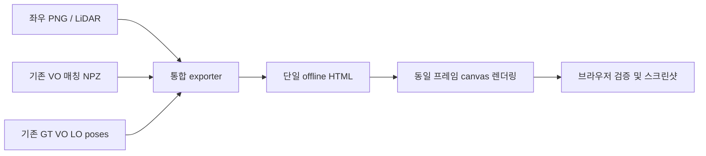
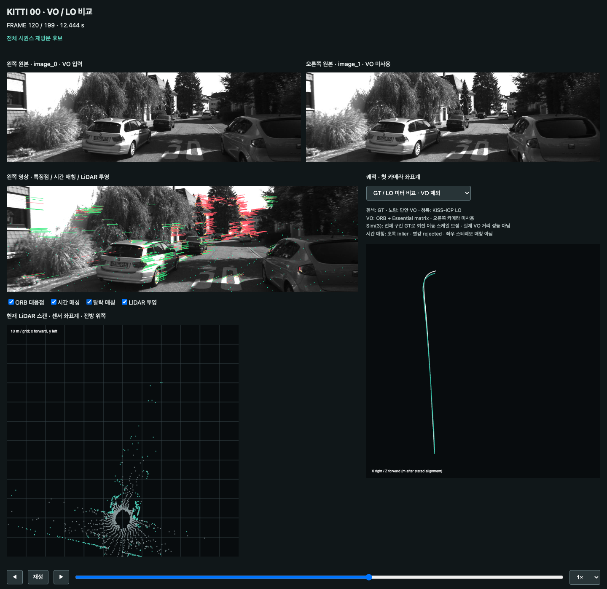
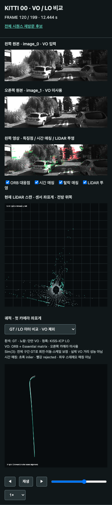

# 좌우 카메라와 VO·LO 통합 재생 보고서

## 1. 요약
- 기존 VO 전용 화면과 연구 VO/LO 화면이 분리되어 있었고 연구 화면에는 왼쪽 영상만 있었다.
- 연구 화면에 좌·우 원본과 ORB 시간 매칭을 추가하고 LiDAR 및 궤적과 동일 프레임으로 동기화했다.
- VO 알고리즘은 변경하지 않았다. 오른쪽 카메라는 표시용이며 stereo VO는 아니다.
- VO가 좋아 보이는 주요 표시 차이는 전체 GT를 이용한 Sim(3) 사후 정렬이다.
- 기본 궤적 모드를 GT/LO metric으로 변경하고 VO 사후 정렬 비교는 명시적으로 선택한다.

## 2. 문제 정의
입력: KITTI 00 image_0/image_1/velodyne 및 기존 200프레임 VO/LO 산출물. 출력: 하나의 offline HTML. [가정] 성공 기준은 200개 오른쪽 영상의 존재/크기 검증, 다섯 canvas의 비영 픽셀, 재생/탐색/모드 전환 성공, 모바일 가로 넘침 0건, JavaScript 오류 0건이다. 알고리즘 개선 및 전체 시퀀스 추정은 범위 밖이다.

## 3. 리소스
기존 src/viz/export_playback.py는 VO 전용이고, research/20261031_vo-lo-study/src/playback.py는 VO/LO 결과를 조합한다. 후자를 확장했다. image_1은 이미 로컬에 있다. 시간 매칭의 points_previous/current 및 pose_mask도 기존 NPZ에 존재한다. 새 센서 다운로드나 추정 실행은 필요 없다.

## 4. 접근 선정
Quick-win: 기존 산출물을 재사용해 renderer/exporter만 확장한다. 알고리즘 개발이 아니므로 선행연구 조사와 신규 알고리즘 실험은 수행하지 않았다. 기존 생산 VO 코드는 변경하지 않는다.

## 5. 아키텍처

원본 영상은 uint8 grayscale이며 JPEG로 HTML에 내장한다. 매칭은 이전/현재 왼쪽 영상의 pixel 좌표와 pose inlier flag다. LiDAR는 센서 좌표 m, 궤적은 기존 평가 좌표계를 그대로 사용한다. 동일 프레임의 두 영상 decode가 끝난 후 전체 화면을 갱신하고 이전 비동기 렌더 요청을 version으로 폐기한다. HTML 산출물은 ../20261031_vo-lo-study/artifacts/playback/index.html, 스크린샷은 해당 study의 figures/playback_*.png다.

## 6. 실험 설정
기준 커밋 dffa414. KITTI 00 프레임 0~199, 기존 experiment.json의 200프레임 설정 및 JPEG 품질 75를 유지한다. 알고리즘 및 poses 파일은 다시 계산하지 않는다.
```sh
research/20261031_vo-lo-study/.venv/bin/python research/20261031_vo-lo-study/src/run.py --stage playback
node research/20261031_vo-lo-study/src/check_playback.mjs
node research/20261030_progress-review/src/render_pdf.mjs research/20261101_unified-playback
```
환경: 기존 연구 venv, macOS Chrome, /tmp/kitti-report-pdf의 Playwright/marked/mermaid. 재현 환경과 패키지는 이전 연구 requirements-lock.txt를 사용한다.

## 7. 결과
| 항목 | 기존 연구 화면 | 통합 화면 |
|---|---|---|
| 카메라 원본 | 왼쪽 overlay만 | 왼쪽/오른쪽 원본 + 별도 왼쪽 overlay |
| 시간 매칭 | 현재 좌표 점만 | 이전→현재 선, inlier/rejected 선택 |
| LiDAR | 투영/BEV | 유지 |
| GT/VO/LO | 기본 Sim(3) | 기본 metric GT/LO, 선택형 Sim(3) |

표는 표시 기능 차이이며 VO 정확도 향상을 의미하지 않는다. 기존 baseline VO의 GT-fitted 위치 RMSE 5.336m도 그대로다. ratio 실험의 5.208m 결과가 기본 VO로 교체된 것이 아니다. 실제 오른쪽 영상을 읽지 못하거나 크기가 다르면 export는 실패한다.

검증 결과: 200프레임 export 성공. 120번 프레임에서 좌/우/overlay/BEV/궤적의 비영 픽셀은 466610/466609/466611/34435/3076개로 모두 비어 있지 않았다. 좌우 픽셀 배열이 다름을 검사하여 복제 영상이 아님을 확인했다. 재생, 탐색, 양쪽 궤적 모드, 후보 화면 왕복, 모바일 390px 가로 넘침 검사 통과. JavaScript 오류 0건. 이 검사는 센서 시간 offset의 독립 검증이나 알고리즘 정확도 검사가 아니다.


좌우 원본, 특징점/매칭 overlay, LiDAR, 궤적을 동일 프레임으로 표시한다.


좁은 화면에서는 좌우 영상을 세로로 배치한다.

## 8. 분석
| 관측 | 강점 | 한계 |
|---|---|---|
| 좌우 원본 | 실제 시차 비교 | stereo depth/VO 미구현 |
| 시간 매칭 | 움직임과 outlier 관찰 | 3D 지도 아님 |
| Sim(3) 궤적 | 형상 비교 | GT 이용, metric 성능 아님 |
| metric LO | GT scale fitting 없는 비교 | 현재 200프레임만 |

기존 VO 전용 화면은 단위 이동량과 GT 미터를 그대로 비교했다. 연구 화면은 전역 GT 정렬을 하므로 둘의 시각적 차이를 알고리즘 개선으로 해석하면 안 된다. 두 코드 버전의 모든 차이에 대한 controlled benchmark는 이번 범위가 아니다. 전체 HTML 크기가 증가하며 저사양 장치에서 메모리 사용은 미측정이다.

## 9. 개선 방향
추후 stereo VO를 연구하면 오른쪽 영상을 실제 깊이 추정에 사용할 수 있다(공수 높음). 장시간 재생에서는 파일 분할/지연 로딩이 필요할 수 있다(중간). 이번에는 구현하지 않았다.

## 10. 다음 단계
1. 현재 통합 화면에서 매칭과 GT 정렬 방식 차이를 학습한다.
2. 별도 연구로 stereo VO와 단안 VO의 metric 성능을 비교한다.

## 부록
[가정] 200프레임과 기존 추정 유지가 이번 UI 통합 범위다. [미확인] stereo 추정 성능, 장시간 메모리 사용. 출처는 로컬 exporter, evaluate.py의 sim3(), 기존 metrics.json이며 외부 논문 수치를 추가 인용하지 않는다.
