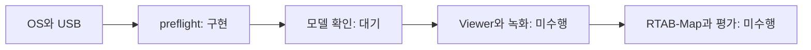

# 사전 점검과 향후 실내 매핑 계약

현재 구현: OS/USB 읽기 → preflight.py → artifacts/preflight/environment.json.
향후 제안: 공식 SDK → RGB/depth/calibration/timestamp 검증 → 녹화 → RTAB-Map → 지도/궤적/평가.

- preflight: Python 표준 라이브러리. macOS plist 또는 Linux sysfs를 읽는다. VID/PID·제품/제조사 이름만 저장하며 USB serial은 저장하지 않는다. 모델을 자동 확정하지 않는다. 수집 주기는 실행 시 1회.
- session.template.json: 미수집 세션의 계약. 단위·보정·시각·정렬이 null이면 미확인이다. 깊이 단위가 mm라고 가정하지 않는다. T_color_depth는 depth 좌표의 점을 color 좌표로 보내며 병진은 m다.
- 향후 입력: 색상 encoding·깊이 encoding과 유효값 규칙, 각 카메라 K 및 왜곡, 시각 clock domain, RGB-D 정렬 여부. 정렬된 depth를 사용할 때 해당 출력의 보정/깊이 의미도 확인한다.
- 향후 출력: 원시 녹화, RTAB-Map DB, timestamp를 포함한 궤적, 좌표계/단위가 명시된 점군, 평가 지표. 운영 코드 통합은 아직 제안뿐이다.
- 검증: parser fixture, 개인정보 제외, 빈/실패/미지원 상태 구분, 모델 문자열을 입력해도 live capture 검증으로 간주하지 않는 테스트 및 macOS 속성 읽기 회귀 검사를 포함한 10개 테스트.
