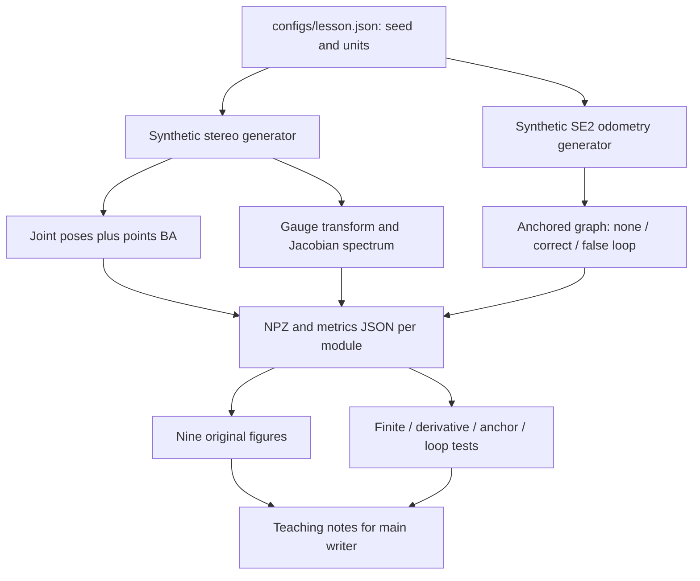

# 모듈 계약

| 모듈/소스 | 입력 계약 | 출력/저장 | 독립 검증 |
|---|---|---|---|
| `backend.py:34` make_ba | JSON 설정, 정수 seed | pose float64 (4,6), 점 (36,3), K (3,3), 관측 (4,2,36,2), outlier mask (4,2,36) | seed 동일성, 가시성, 양의 depth |
| `backend.py:64` JointBA | world-to-left rvec(rad)/t(m), XYZ(m), 좌우 관측(px), b(m) | 고정 첫 pose 제외 x(126), residual(576), J(576,126); `artifacts/ba/module.npz`, `metrics.json` | full-column 중앙차분, 실제 pose·점 동시 변경, finite/positive depth |
| `backend.py:118` gauge | 같은 GT, Q 회전, d 평행이동(m) | rigid 변환 차이, fixed/free SVD, scale sweep; `artifacts/gauge/module.npz`, `metrics.json` | 6방향 강체불변, stereo scale 변화 |
| `backend.py:155` make_graph | JSON, seed+1 | pose (25,3)=(x m,y m,theta rad), edge (24,2), 측정 (24,3) | compose/relative 역관계, wrap |
| `backend.py:174` PoseGraph | directed edge i→j, i-local 상대이동, sigma(m,m,rad) | first pose 제외 x(72), residual(72 또는 75); `artifacts/pose_graph/module.npz`, `metrics.json` | anchor 유지, GT loop 확인, false damage |
| `run.py:32` savefig | 실행 배열 | `figures/01_...png`부터 `09_...png` | 9개 파일·크기 검사, 직접 시각 검토 |
| `test_backend.py` | 코드+재생성 산출물 | `artifacts/tests/results.txt`, `metrics.json` | 실패 시 nonzero exit |

## 좌표·동기화·단위

- BA: 카메라 +x 오른쪽, +y 영상 아래쪽, +z 앞쪽. world는 첫 left camera와 일치.
- pose는 **world-to-camera** rvec/t. camera center는 `-R.T @ t`; t 자체를 위치로 그리지 않는다.
- right camera는 left-local +x로 b=0.24 m. 같은 회전이므로 right translation=`t-[b,0,0]`.
- 좌우 관측은 완전 동기화, 왜곡 0, K와 baseline 고정. 동기화/왜곡 보정 모듈 없음.
- graph: 별도 2D 세계. theta는 평면 반시계 방향 rad, plotting과 RMSE 표에서만 deg 변환.
- graph residual은 각 성분을 sigma로 나누어 무차원화한다. BA는 모든 성분의 잡음 수준이 같으므로 px 그대로 사용한다.
- 한 번에 전체 batch를 푸는 실험. 스트리밍 처리 주기·실시간 요구 없음.

## 산출물 재사용 경계

기존 VO, KITTI, pose-only LM 코드를 import하거나 교체하지 않는다. 주 작성자는
`notes/experiments.md`의 수식·수치와 `figures`를 최신 보고서에 통합할 수 있다.
이것은 통합 제안이지 기존 시스템에 연결되었다는 주장이 아니다.
NPZ는 object dtype을 쓰지 않아 `np.load(..., allow_pickle=False)`로 읽는다.
config와 소스·산출물 SHA-256, HEAD, 버전은 manifest에 기록한다.
cache는 own directory의 `.cache/matplotlib`에만 생성한다.
