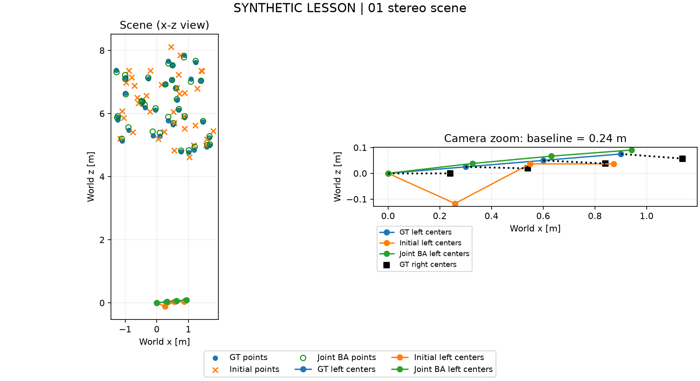
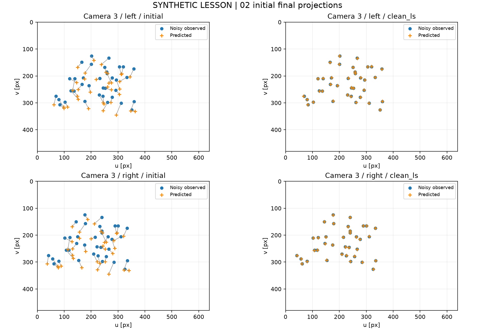
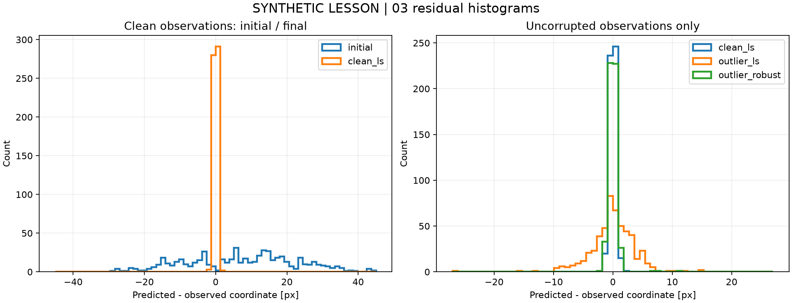
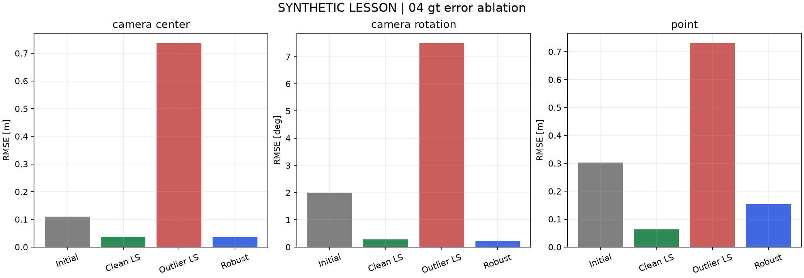
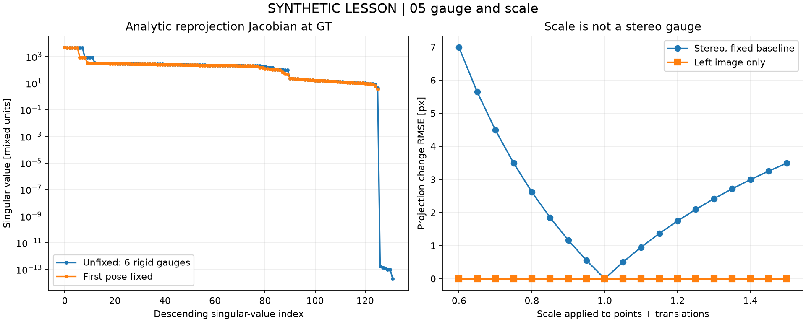
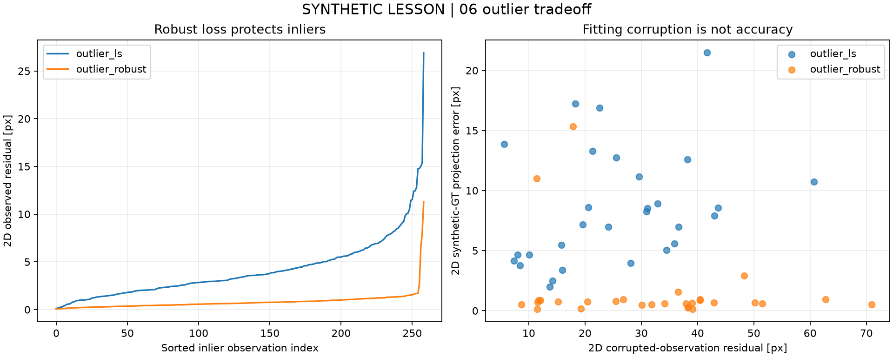
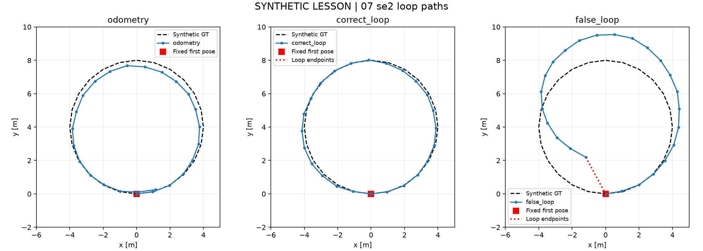
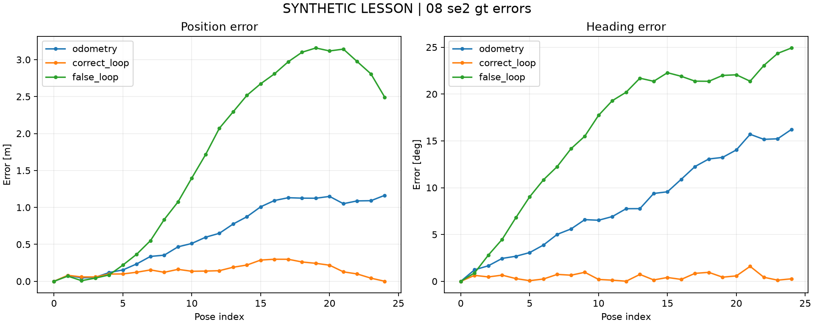
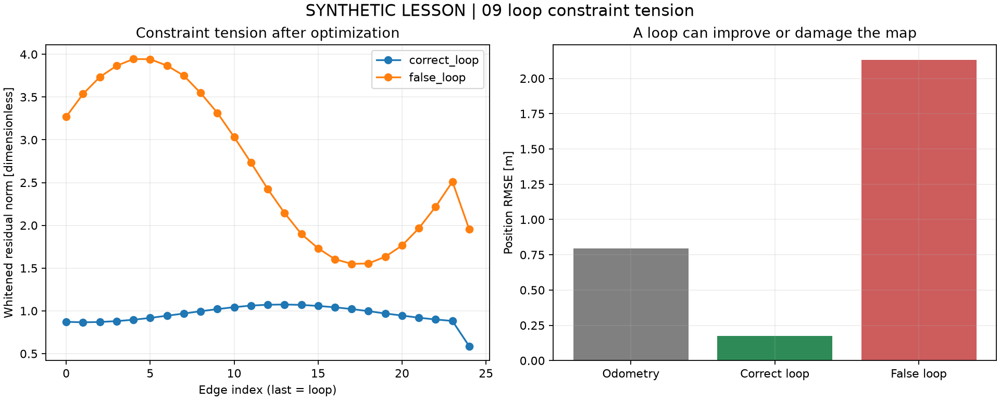

# 합성 카메라 backend 수업: 공동 BA와 루프의 이득·손상

중간 수업 자료 v1.0.0 | 2026-11-24 | 주 작성자 통합용, 별도 최종 보고서 아님

변경 이력: v1.0.0: 4-pose stereo joint BA, gauge 검증, outlier loss 비교,
25-node 2D SE(2) graph, 원본 그림 9개와 검증 코드 추가.

## 1. 먼저 볼 결론과 실험 경계

이 수업의 질문은 **"관측에 맞게 카메라와 점을 같이 움직이면 무엇이 개선되며,
틀린 관측을 강하게 믿으면 무엇이 망가지는가?"**이다.

- 공동 BA(Bundle Adjustment)는 pose와 3D점을 **한 최적화 변수 벡터에서 함께 갱신**한다. 점을 고정하는 pose-only refinement와 다르다.
- 좌표계 원점·방향은 영상만으로 정해지지 않는다. 첫 pose 고정으로 전역 강체 gauge(관측을 바꾸지 않는 자유도)를 제거하고, 알려진 stereo baseline으로 metric scale을 정한다.
- 오염 관측의 제곱합이 더 작다고 GT(Ground Truth, 생성 시 알고 있는 정답)에 더 가까운 것은 아니다. Robust loss는 잘못된 관측의 영향만 완화한다.
- 올바른 루프는 누적 drift를 줄이지만, 틀린 루프는 잔차를 줄이는 동안 지도 전체를 더 틀리게 만들 수 있다.

**전부 합성 데이터다.** 실제 영상 특징 추출, 삼각측량 초기화, KITTI 평가, loop detection을 수행하지 않았다.
BA 초기값은 GT perturbation이며 GT 첫 pose를 고정한다. Graph correct loop 역시 GT에서 만든 이상적 상대 제약이다.
최적화 함수에는 GT 오차 항을 넣지 않지만, 초기화·좌표계·correct loop는 oracle 교육 설정이다.
수치는 현실의 SLAM 정확도를 나타내지 않는다. Graph는 full 3D SLAM이 아닌 **2D SE(2) 수업**이다.

## 2. 입출력과 기호·단위

### Stereo BA

| 기호 | 정의 | 단위/크기 |
|---|---|---|
| i, j, s | rig pose, 점, 영상 side 인덱스; s=0 left, 1 right | i=0..3, j=0..35 |
| N, M | pose 수, 점 수 | 4, 36 |
| X_j | world 좌표 3D점 | m, 3-vector |
| r_i, R_i | Rodrigues 회전벡터와 대응 world-to-camera 회전행렬 | rad, 3-vector / 무차원 3×3 |
| t_i, C_i | world-to-left 이동벡터와 world 카메라 중심 | m, 3-vector; C_i=-R_i^T t_i |
| b, e_x | 고정 stereo baseline, x축 단위벡터 (1,0,0)^T | 0.24 m, 무차원 |
| P_ijs=(X_c,Y_c,Z_c) | side s 카메라 좌표의 점 | m |
| K | 내부파라미터 행렬 [[f_x,0,c_x],[0,f_y,c_y],[0,0,1]] | pixel 투영 계수 |
| f_x,f_y,c_x,c_y | 초점거리, 주점 | 520,520,320,240 px |
| pi(P), u_ijs | 예측 투영 함수, noisy 관측 2-vector=(u,v) | px |
| e_ijs, e_k | 2D 예측-관측 잔차, 이를 펼친 k번째 scalar 잔차 | px |
| x, delta | 최적화 변수와 증가량 | 회전 rad, 이동·점 m 혼합 |
| J, D | de/dx Jacobian, d pi/dP pinhole Jacobian | 각 열 px/rad 또는 px/m, D는 px/m |
| F, rho, c | 목적함수, 무차원 loss 함수, robust scale | F는 px², c=1.2 px |
| Q,d,a | gauge 시험의 전역 회전, 이동, scale | 무차원 3×3, m, 무차원 |
| sigma_l(J) | Jacobian의 l번째 특이값 | 혼합 단위 열에 의존 |

입력은 K, b, 알려진 점 ID와 좌우 관측, 초기 pose·점이다. 출력은 첫 pose를 제외한
3개 pose와 36개 점의 공동 추정, pixel residual, solver 진단이다.
첫 pose는 (r,t)=(0,0)으로 고정하며 변수 벡터에 아예 넣지 않는다.
4×2×36×2=576 scalar 관측, 6×(4-1)+3×36=126 변수를 사용한다.
관측 수가 변수 수보다 많다는 사실만으로 퇴화가 없다고 단정하지 않는다.

### 2D pose graph

| 기호 | 정의 | 단위/크기 |
|---|---|---|
| q_i=(p_i,theta_i) | 평면 pose; p_i=(x_i,y_i), theta_i heading | m,m,rad |
| R_2(theta) | [[cos(theta),-sin(theta)],[sin(theta),cos(theta)]] | 무차원 2×2 |
| z_ij=(z_t,z_theta) | directed edge i→j의 i-local 상대이동·각도 측정 | m,m,rad |
| h(q_i,q_j) | 두 pose에서 예측한 상대 측정 | m,m,rad |
| e_ij, w_ij | raw relative-coordinate 잔차, sigma로 나눈 잔차 | m,m,rad / 무차원 |
| sigma_t,sigma_theta | 측정 표준편차, 이 실험의 상대 가중치 설정 | m,rad |
| E | odometry와 선택 loop edge의 집합 | 24 또는 25 edge |
| F_g | graph 목적함수 | 무차원 |
| wrap(alpha) | atan2(sin(alpha),cos(alpha)); 동치 각도의 대표값 | rad, [-pi,pi] 경계 |

SE(2)는 Special Euclidean group in 2 dimensions, 즉 평면의 회전·이동 변환 집합이다.
위 기호 x_i는 평면 위치 성분이며 BA 전체 변수 x와 문맥이 다르다.

## 3. 공동 BA: 문제에서 계산으로

### 3.1 관측을 예측하는 식

카메라 앞쪽은 +z, 오른쪽은 +x, 아래는 +y다. World-to-camera 변환과 투영은

\[
P_{ijs}=R_iX_j+t_i-sb e_x,\qquad
\pi(P)=\begin{bmatrix}f_xX_c/Z_c+c_x\\f_yY_c/Z_c+c_y\end{bmatrix},
\qquad e_{ijs}=\pi(P_{ijs})-u_{ijs}.
\]

Right camera가 left에서 +b만큼 떨어져 있으므로 right 좌표에서는 x를 **빼야** 한다.
왜곡은 0이다. 코드의 `cv2.projectPoints` 입력은 rvec, tvec이며 camera center가 아니다.
API 근거: [OpenCV 공식 projectPoints 문서](https://docs.opencv.org/4.x/d9/d0c/group__calib3d.html).
구현: `src/backend.py:17`, `src/backend.py:83`.

**순서대로 계산하는 예:** 첫 카메라의 X=(1,0.5,5) m, R=I, t=0.

1. Left camera 좌표는 (1,0.5,5) m이다.
2. u_L=520×1/5+320=424 px, v_L=520×0.5/5+240=292 px.
3. Right camera 좌표는 (0.76,0.5,5) m이므로 u_R=399.04 px, v_R=292 px.
4. 관측 left=(424.6,291.4) px라면 left residual=(-0.6,+0.6) px.
5. 이 2D 관측의 LS cost는 ((-0.6)²+0.6²)/2=0.36 px².
6. Disparity d_px=u_L-u_R=24.96 px, 깊이는 f_x b/d_px=5 m다. 여기 d_px는 전역 이동 d와 다른 기호다.

단위 검산: px×m/px=m. 위 투영·깊이 예는 `test_backend.py:27`에서 수치 검사한다.

### 3.2 무엇을 최소화하는가

LS(Least Squares, 최소제곱)는 F(x)=1/2 sum_k e_k(x)²를 최소화한다.
실험의 robust 목적함수는

\[
F(x)=\frac{c^2}{2}\sum_k\rho((e_k(x)/c)^2),\quad
\rho(z)=2(\sqrt{1+z}-1).
\]

이것은 각 **scalar u/v residual**에 적용하는 soft-L1이며, 2D residual norm을 하나로
묶는 block loss와는 다르다. Outlier mask는 평가 분리용이고 solver는 mask를 보지 않는다.
같은 초기값·관측에서 `loss`만 `linear`와 `soft_l1`으로 바꾼다.
호출 인자와 종료 진단의 근거는 [SciPy 공식 least_squares 문서](https://docs.scipy.org/doc/scipy/reference/generated/scipy.optimize.least_squares.html)다.

### 3.3 선형화와 실제 구현의 경계

작은 변화 delta에서 e(x+delta) ≈ e(x)+J delta로 본다. 한 점에 대한 미분은

\[
D=\begin{bmatrix}f_x/Z_c&0&-f_xX_c/Z_c^2\\0&f_y/Z_c&-f_yY_c/Z_c^2\end{bmatrix},
\quad \frac{\partial e}{\partial X_j}=D R_i.
\]

카메라 회전·이동 열은 OpenCV가 돌려주는 Jacobian의 첫 6열을 사용한다.
각 관측 행에 해당 camera block과 point block을 채우므로 양쪽 변수가 동시에 영향을 준다.
첫 pose block은 제외한다. 구현: `backend.py:88`; 모든 열의 중앙차분 비교: `test_backend.py:47`.
수치 Jacobian 대안은 `solve(..., numerical=True)`이며 작은 3-camera/10-point 문제에서 해와 cost를 비교한다.

**실제 solver는 SciPy TRF**이고 dense `tr_solver="exact"`, `x_scale="jac"`를 사용한다.
여기서 exact는 신뢰영역 내부 부분문제의 solver 선택이다. Schur complement를 직접 구현하지 않았고,
block elimination 최적화·전역 최적해·LM 사용을 주장하지 않는다.
혼합 단위의 pose update norm은 단지 실제 변경 확인용이지 물리적 거리 지표가 아니다.

### 3.4 실행 절차

1. 고정 seed로 4개 rig pose, 36개 world 점을 만든다. 모든 점은 모든 좌우 영상에 보인다.
2. 투영에 독립 Gaussian noise 0.6 px를 추가한다. 별도 사본의 29/288개 2D 관측에 표준편차 24 px의 추가 잡음을 준다.
3. GT pose·점을 각각 설정된 잡음으로 흔들어 초기값을 만든다. 첫 pose만 그대로 둔다.
4. clean LS, outlier LS, outlier soft-L1을 같은 초기값에서 푼다. 점과 pose 모두 variable이다.
5. 유한성, 양의 depth, 첫 pose 불변, pose·point update, 종료 상태를 검사한다.
6. 관측 residual과 별도의 GT 오차를 계산한다. GT 정렬·후처리 scale fitting은 하지 않는다.

전체 데이터 흐름과 저장은 `run.py:42`, solver 호출은 `backend.py:109`다.

## 4. Gauge와 scale을 실제로 확인하기

관측을 바꾸지 않는 전역 좌표 변환은

\[
X'_j=QX_j+d,\quad R'_i=R_iQ^T,\quad t'_i=t_i-R_iQ^Td.
\]

대입하면 R'_iX'_j+t'_i=R_iX_j+t_i이므로 right의 -b e_x도 변하지 않는다.
따라서 3개 회전+3개 이동의 6 자유도는 fixed baseline만으로 사라지지 않는다.
반면 점과 translation을 a배 하고 baseline은 유지하면 left 투영은 같아도 right disparity가 바뀐다.
스케일이 stereo gauge가 아닌 이유다. baseline까지 같이 a배 하면 다시 스케일 불변이므로
**알려진 baseline을 고정했다는 조건**이 중요하다.

`backend.py:118` 및 `artifacts/gauge`의 직접 확인 결과:

- 전역 Q,d 변환 후 최대 pixel 차이: 1.14e-13 px.
- GT 상태에서 unfixed J는 576×132, 상대 임계값 1e-10에서 nullity 6.
- 첫 pose를 제외한 J는 576×126, 같은 기준에서 nullity 0; 최소 특이값 3.4987.
- a=1.5에서 stereo 전체 scalar 투영변화 RMSE 3.4919 px. Left-only 변화는 sweep 전체에서 최대 2.12e-14 px.

SVD(Singular Value Decomposition, 특이값 분해)는 local Jacobian이 변화에 반응하지 않는 방향을
찾는 도구다. rad/m 단위가 섞인 열의 singular value 크기는 parameterization에 의존한다.
특이값 숫자를 좌표계와 무관한 품질 점수로 해석하지 않는다.
테스트는 3축 회전·3축 평행이동도 각각 확인한다. 모든 장면의 full rank를 증명한 것은 아니다.

## 5. BA 결과 읽기

RMSE(Root Mean Square Error, 오차 제곱 평균의 제곱근)는 무엇을 평균하는지에 따라 다르다.
관측 RMSE는 u/v **scalar 좌표 전체**를 평균한다. Camera center와 point RMSE는 각 3D 오차 벡터의
제곱 norm을 평균한다. Rotation RMSE는 R_est R_gt^T의 회전각 제곱을 평균해 deg로 표시한다.
카메라 지표는 정확히 고정한 첫 pose를 제외한 3개만, 점 지표는 36개 전부를 쓴다.

| 실험 | 관측 좌표 RMSE px | Camera center RMSE m | Rotation RMSE deg | Point RMSE m |
|---|---:|---:|---:|---:|
| 초기, clean 관측 기준 | 17.0411 | 0.11037 | 1.99833 | 0.30231 |
| Clean LS | 0.50884 | 0.03791 | 0.28743 | 0.06351 |
| Outlier LS | 7.28989 | 0.73593 | 7.48733 | 0.72986 |
| Outlier soft-L1 | 8.04525 | 0.03569 | 0.23091 | 0.15268 |

Source: `artifacts/ba/metrics.json`. Clean과 outlier 행은 관측 자체가 다르므로 전체 residual 수치를 직접 우열 비교하지 않는다.
Outlier LS와 soft-L1은 **동일한** 오염 관측이다. Robust는 전체 관측 RMSE를 오히려 키우면서
GT projection RMSE를 4.1171→1.0967 px, uncorrupted 관측 RMSE를 3.6556→0.8819 px로 낮췄다.
Robust point 오차는 clean LS보다 여전히 크고 일부 관측의 큰 잔차가 남는다.
Robust camera 오차가 clean보다 작게 나온 것은 이 seed의 관찰로, outlier가 도움이 된다는 결론은 아니다.

세 BA의 solver success=True이고 ftol 종료다. nfev는 7/43/33이다.
최종 optimality는 각각 약 5.24e-5/1.53e-2/2.89e-3으로 gtol=1e-9를 만족해서 멈춘 것이 아니다.
**success flag는 GT 정확성이나 전역 최적해 인증이 아니다.** Cost 단위·loss가 달라 LS cost와 robust cost를 그대로 비교해서도 안 된다.

## 6. 2D SE(2) pose graph: 끝을 연결하면 모두 좋아질까

### 6.1 상대 측정과 목적함수

\[
h(q_i,q_j)=\begin{bmatrix}R_2(\theta_i)^T(p_j-p_i)\\
\operatorname{wrap}(\theta_j-\theta_i)\end{bmatrix}.
\]

Raw translation residual은 h의 앞 2성분-z_t, angular residual은
wrap(theta_j-theta_i-z_theta)다. 이를 각 표준편차로 나눈 w_ij에 대해
F_g=1/2 sum_(i,j in E) ||w_ij||²를 최소화한다.
이는 **i-local relative-coordinate residual**이며 SE(2) Log 오차의 완전한 구현은 아니다.
이동·회전 분산의 상관을 무시하는 대각 가중치 모델이다.

예를 들어 q_i=(1,2,pi/2), q_j=(1,3,pi/2+0.1)라면 world 이동은 (0,1) m이지만,
i-local 이동은 R_2(pi/2)^T(0,1)=(1,0) m이므로 h=(1,0,0.1)이다.
이 계산과 compose 역변환은 `test_backend.py:111`에서 확인한다.

### 6.2 재현 절차와 루프의 뜻

1. 반지름 4 m의 닫힌 경로에 25개 pose를 만든다. 마지막 pose는 첫 pose와 같은 위치·방향이다.
2. 24개 상대 odometry 측정에 translation sigma=0.04 m, rotation sigma=0.012 rad 잡음을 더한다. 매 edge에 +0.008 rad heading bias도 더한다.
3. 상대 측정을 순서대로 compose해 초기 경로를 만든다. 이 경로는 noisy odometry edge를 거의 정확히 만족하므로 odometry cost가 0이어도 GT와 어긋난다.
4. 같은 초기값에서 odometry-only / correct loop / false loop 세 graph를 푼다. 첫 pose는 변수에서 제외한다.
5. 루프 방향은 **24→0**, correct 측정은 (0 m,0 m,0 rad), false는 (2 m,-1.5 m,0.45 rad)다. False case는 correct loop에 추가한 것이 아니라 correct loop를 **대체**한다.
6. 루프 sigma=(0.02 m,0.02 m,0.008 rad)로 상대적으로 강하게 믿게 설정했다. 검출·승인 없이 거짓 제약을 넣는 실패 사례다.

Odometry 측정 생성의 bias는 solver 모델에 추가 변수를 두어 추정하지 않는다.
따라서 sigma는 실제 전체 모델 오차의 완벽한 통계 표현이 아니다.
Graph는 72변수, odometry-only 72 residual 또는 loop 포함 75 residual이다.
`backend.py:155`, `backend.py:174`, `backend.py:202`가 각각 생성·최적화·case 구성이다.

### 6.3 결과와 loop verification의 한계

| Case | 위치 RMSE m | Heading RMSE deg | 끝-시작 거리 m | Whitened scalar RMSE |
|---|---:|---:|---:|---:|
| Odometry only | 0.79434 | 9.82096 | 1.16349 | 약 6.34e-15 |
| Correct loop | 0.17331 | 0.61016 | 0.00087 | 0.55475 |
| False loop | 2.13234 | 18.19798 | 2.49250 | 1.63958 |

Source: `artifacts/pose_graph/metrics.json`. 위치·heading RMSE는 고정 첫 pose 제외 24개를 평균한다.
별도 rigid/scale alignment는 하지 않는다. Correct loop의 잔차는 0이 아니며 다른 noisy edge와 절충한다.
False loop cost는 19776.56→100.81로 줄었지만 GT 위치 오차는 odometry보다 커졌다.
이 수업은 "최적화가 잘못된 제약을 알아서 거절한다"는 오해의 반례다.

검증은 합성 GT에 correct/false edge를 대입해 각각 (0,0,0), (-2,+1.5,-0.45)의 raw residual이
나오는지 확인하는 것이다. 이것은 **GT 기반 정답 확인**이며 실운영 geometric verification이나
RANSAC(Random Sample Consensus), 장소인식, 자동 rejection gate를 구현한 것이 아니다.
Graph의 wrap은 ±pi에서 비미분 경계가 있다. 이번 초기값·측정에서 그 경계 문제는 관찰되지 않았지만
큰 초기오차에 대한 안정성을 보장하지 않는다.

## 7. 원본 그림 9개: 읽는 순서와 캡션

아래 그림은 모두 `src/run.py`가 NPZ에 저장한 것과 같은 배열에서 직접 그린 합성 그림이다.
영문 축 라벨은 폰트 이식성을 위한 것이며 설명은 한국어로 제공한다.



**그림 1.** World x-z 평면의 점·left camera와 카메라 확대도. Right GT center와 고정 baseline을 함께 표시한다.
이 그림은 3D 장면을 x-z 평면에 투영한 표시이므로 y 오차를 볼 수 없다. 숫자 RMSE는 3D로 계산한다.



**그림 2.** 마지막 rig의 좌우 영상에서 초기·clean BA 예측과 noisy 관측을 같은 640×480 pixel 축으로 비교.
선은 대응점의 예측-관측 차이이며 실제 촬영 영상이 아니다.



**그림 3.** 왼쪽은 clean 초기/최종 scalar residual 분포, 오른쪽은 같은 uncorrupted 관측 subset의 최종 residual 분포.
각 패널 내부는 공통 bin이며 모든 극단값을 포함한다. 양 패널의 x 범위는 다르다.



**그림 4.** 실제 GT 기준 위치·회전·점 오차. Outlier LS의 작은 관측 cost가 정확성을 뜻하지 않음을 보여준다.



**그림 5.** 동일 GT 상태의 raw analytic J에서 6개 rigid gauge가 anchor 후 제거된다. 오른쪽은 baseline을 고정하고
pose translation·점을 scale할 때 stereo는 변하지만 left-only는 변하지 않는 실측이다.



**그림 6.** 왼쪽은 inlier 2D residual norm의 정렬 분포, 오른쪽은 오염된 관측에서의 residual과 GT 투영 오차.
Scalar RMSE와 2D norm을 혼동하지 않는다. Robust도 일부 큰 오차를 남긴다.



**그림 7.** 같은 축·종횡비에서 odometry / correct / false loop의 경로를 비교한다.
붉은 점선은 루프 endpoint 연결선이며, false loop의 상대이동 측정 그 자체를 world 벡터로 그린 것은 아니다.



**그림 8.** pose별 GT 위치·heading 오차. 거짓 loop로 오차가 끝점뿐 아니라 중간 경로에도 퍼진다.



**그림 9.** edge별 whitened residual norm과 GT 위치 RMSE. 마지막 edge index=24가 loop다.
Loop가 서로 모순되는 측정들을 조정하도록 graph 전체에 영향을 주는 모습을 보여준다.

## 8. 풀이가 있는 연습문제 4개

### 문제 1: disparity와 깊이

f_x=520 px, b=0.24 m, u_L=424 px, u_R=399.04 px일 때 깊이는?
점과 translation만 2배로 늘리고 b는 고정하면 첫 camera의 u_R는?

**풀이:** disparity=24.96 px, Z=520×0.24/24.96=5 m.
X=(2,1,10) m가 되면 left u는 424로 같지만 right u=520×(2-0.24)/10+320=411.52 px.
Disparity는 12.48 px로 절반이 된다. Fixed baseline이 scale 변화를 관찰 가능하게 만든다.
원 투영·깊이는 `test_backend.py:27`, scale 불변/변화는 `test_backend.py:71`로 검사한다.

### 문제 2: 진짜 공동 BA인지 확인

4 pose, 36 point, 좌우 관측에서 첫 pose 고정 시 변수·scalar residual 수는?
첫 pose도 풀면 몇 개의 관측 불변 자유도가 예상되는가?

**풀이:** pose 3×6=18, point 36×3=108, 합계 126변수. Residual은 4×2×36×2=576.
첫 pose까지 풀면 132변수이고 전역 rigid gauge 6개가 남는다. 알려진 b 때문에 scale은 포함되지 않는다.
점 108변수를 빼고 pose만 풀면 pose-only다. 실제 J 양쪽 block과 최종 pose·점 변경을 테스트한다.
`test_backend.py:83`, `test_backend.py:98`, `test_backend.py:137` 참고.

### 문제 3: 큰 residual을 덜 믿는다는 뜻

한 scalar residual r=12 px, c=1.2 px일 때 LS와 soft-L1 cost 및 r에 대한 미분은?

**풀이:** LS cost=r²/2=72 px², dF/dr=12 px.
Soft-L1 cost=c²(sqrt(1+(r/c)²)-1)=1.44(sqrt(101)-1)=13.03182 px².
dF/dr=r/sqrt(1+(r/c)²)=12/sqrt(101)=1.19404 px.
큰 잔차가 목적함수를 끌어당기는 힘이 줄지만 완전히 0은 아니다. Outlier가 자동 삭제되는 것도 아니다.
`test_backend.py:98`에서 수치를 검사한다.

### 문제 4: 단위가 다른 graph residual과 거짓 루프

Raw residual=(0.04 m,-0.08 m,0.012 rad), sigma=(0.04 m,0.04 m,0.012 rad)의 whitened residual과 cost는?
GT의 마지막 pose=첫 pose인데 loop 측정이 (2 m,-1.5 m,0.45 rad)이면 raw residual은?

**풀이:** 성분별 나눗셈으로 w=(1,-2,1), cost=(1+4+1)/2=3, 둘 다 무차원이다.
실제 상대 pose는 (0,0,0)이므로 false loop residual=(-2,+1.5,-0.45).
강한 loop 가중치는 큰 모순을 줄이려고 경로를 변형시킬 수 있다. 최적화 후 cost 감소만으로 loop가 맞다고 승인하면 안 된다.
`test_backend.py:117`, `test_backend.py:129`에서 수치·방향을 검사한다.

## 9. 재현 명령, 파일, 검증

Repository root에서 실행한다. 기존 venv를 재사용하며 install 명령은 필요 없다.

```sh
cd /Users/youth/Project/slam-lab
env PYTHONDONTWRITEBYTECODE=1 OPENBLAS_NUM_THREADS=1 OMP_NUM_THREADS=1 MPLCONFIGDIR=.cache/matplotlib research/20261031_vo-lo-study/.venv/bin/python research/camera-backend-lessons/src/run.py
env PYTHONDONTWRITEBYTECODE=1 OPENBLAS_NUM_THREADS=1 OMP_NUM_THREADS=1 MPLCONFIGDIR=.cache/matplotlib research/20261031_vo-lo-study/.venv/bin/python research/camera-backend-lessons/src/test_backend.py
```

`run.py`가 plotting import 전에 own directory로 이동하므로 상대 MPLCONFIGDIR도 그 안에 생긴다.
입력 seed=20261124, graph seed=20261125. NumPy 2.4.6, SciPy 1.17.1, cv2 5.0.0
(opencv-python distribution 5.0.0.93), Matplotlib 3.11.1을 사용했다.
Direct dependency 목록은 `configs/requirements-observed.txt`이며 전체 transitive lockfile은 아니다.

| 경로 | 내용 |
|---|---|
| `configs/lesson.json` | 모든 실험 noise·baseline·크기·seed·최대 평가 횟수 |
| `src/backend.py` | 원본 모델, analytic/numerical Jacobian 옵션, solver |
| `src/run.py` | 실험 case, 지표·NPZ·그림·manifest 생성 |
| `src/test_backend.py` | 기하·수치미분·수렴 관찰·hash·그림 테스트 |
| `artifacts/ba/module.npz` | GT/초기/각 해의 pose·point·projection·residual, 관측과 mask |
| `artifacts/gauge/module.npz` | free/fixed spectrum, 전역변환, scale별 pixel 변화 |
| `artifacts/pose_graph/module.npz` | GT/초기/각 해, directed edges·측정·sigma·raw/whitened residual |
| 각 모듈 `metrics.json` | 단위가 명시된 RMSE와 solver 상태 |
| `artifacts/manifest.json` | 실행 HEAD·Python·dependency·config, 소스/config와 산출물 SHA-256 |
| `artifacts/tests` | 실행한 unittest 목록·성패, 실패 시 nonzero exit |

NPZ shape/축 순서는 `notes/architecture.md` 참조. Source 위치는 이 노트 버전의 파일 기준이며
정확한 실행본은 manifest SHA-256으로 구분한다. 기존 HEAD만으로 새 미커밋 파일을 식별할 수 없다.

테스트는 finite projection, positive depth, 모든 analytic J 열의 중앙차분 대조,
analytic/numerical solver 비교, anchor 유지, rigid gauge·scale·SVD, seed 반복,
SE(2) compose/relative, loop 방향·정답, 전체 산출물 finite, 두 변수군 갱신, fixed-seed 결과,
source/artifact hash, 그림 개수와 계산 연습문제를 포함한다.
성패는 `artifacts/tests/metrics.json`을 진실의 원본으로 사용한다.

## 10. 한계와 주 작성자 인계

- 한 seed, 작은 일반 위치의 장면이다. [미확인] 다중 seed 분산, 퇴화장면, 매우 큰 초기오차, 실제 센서에서의 성능.
- 관측 연관과 가시성이 이상적이다. 삼각측량/track loss/rolling shutter/calibration error를 모델링하지 않는다.
- Depth를 강제하는 bounds/barrier는 없다. 본 실행의 초기·최종 depth 양수를 검사했지만 모든 solver 중간 trial에서 양수임을 인증하지 않는다. Z=0 근처와 뒤쪽 점 처리가 필요한 실용 구현은 별도다.
- General dense solver로 작게 풀었다. 대규모 sparse BA, marginalization, Schur complement, covariance 추정과 실시간성은 미구현이다.
- 일부 설정된 장면 범위·graph 원 경로 등 생성 형태는 코드에 있다. JSON이 모든 가능한 scene model을 기술하는 범용 schema는 아니다.
- 올바른 루프도 exact synthetic GT이며 현실의 loop uncertainty를 전부 반영하지 않는다. 거짓 loop 대응 방법 자체는 구현하지 않았다.
- Objective 감소, solver success, 좋은 영상 overlay만으로 GT 정확도나 전체 SLAM의 성공을 주장하지 않는다.

주 작성자는 위 그림과 수식·실험 표를 `docs/report.md`의 기존 관련 단원에 통합하고 동일 최신 문서의
버전·변경 이력과 PDF를 갱신하면 된다. **이 작업은 own directory 밖 파일과 docs를 수정하지 않았다.**
통합 시 synthetic/oracle/2D/비-Schur 경고와 단위·지표 분모를 유지한다.
