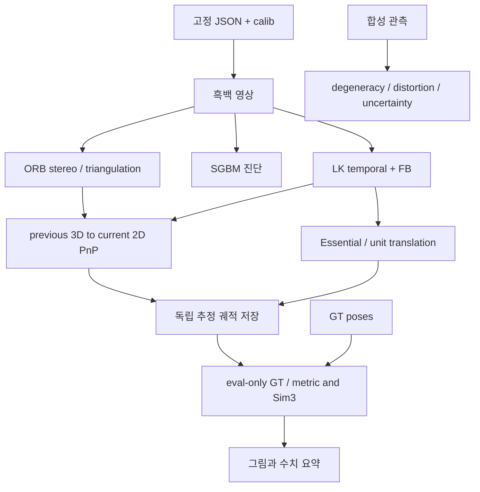

# 아키텍처와 계약 (구현 전)

## 모듈 계약
- geometry.py: SE(3) inverse/compose/transform/project, similarity fitting. T_ab는 b 좌표를 a로 변환한다.
- observations.py: ImagePair uint8 HxW, K 3x3 px, baseline m → ORB 좌우 pixels Nx2,
  descriptor Hamming bits, ratio 무차원, disparity px, X_previous Nx3 m, reprojection px.
  LK 입력은 previous ORB pixels, 출력은 current pixels 및 원래 인덱스 유지 mask.
- odometry.py: 영상·보정만 입력. PnP는 X_previous → current pixel로 T_current_previous를 추정한다.
  누적 T_start_current = T_start_previous @ inverse(T_current_previous).
  E도 같은 변환 방향이나 t는 임의 단위. GT 모듈을 import하지 않는다.
- evaluation.py: GT를 읽는 유일한 모듈. 각 구간 GT를 시작 자세로 정규화.
  stereo는 첫 자세 일치만, rigid fit/scale fit 없음. mono는 구간별 Sim3 position fit을 명시.
  ATE m, 1-frame relative translation RMSE m, rotation RMSE deg, endpoint m; 공식 KITTI score 아님.
- diagnostics.py: 실제 한 쌍 정류/게이트/SGBM/LK와 pose-only LM 전후. 깊이 정확도 GT 부재.
- synthetic.py: 알려진 생성 geometry/노이즈에서 퇴화·왜곡·불확실성을 별도 저장.
- figures.py: 저장된 stages에서 재현, 7인치 폭/12pt 이상, 실제와 합성을 제목으로 구분.
- run.py: seed, OpenCV 1 thread, 의존성 검사, 설정 및 입력 hash, 모듈 순차 실행/검증.
- test_invariants.py: 변환·단위·정렬·GT 의존성·hold·projection 불변량.

## 저장 / 시간 / 범위
configs/experiment.json: 모든 주 파라미터; 시작 포함 끝 제외; 영상 번호로 동기화.
artifacts/{stereo,dense,tracking,odometry,evaluation,synthetic,reprojection,provenance,tests}:
JSON 집계, CSV 행별 결과, NPZ 원시 단계. figures/*.png와 figure_manifest.json 연결.
모듈 단독 검증 후 전체 실행. 실패 카운트, NaN 대신 null summary, 유효 표본 수를 보존한다.
운영 모듈과 통합점은 제안뿐이다. tools 및 보고서는 다른 작성자 소유.

## 반드시 보존할 한계
- identity hold라도 previous image는 다음 영상으로 진행한다. 실패 구간의 이동은 영구히 손실되며 tracking recovery가 아니다.
- mono_unit의 성공 이동 norm=1은 변속 운동을 표현하지 못한다. 하나의 사후 Sim3 scale로 복원되지 않는다.
- metric stereo와 GT Sim3 mono는 정렬 조건과 관측이 다르므로 공정한 정확도 순위가 아니다.
- findEssentialMat이 여러 3x3 E를 반환하면 첫 후보 E[:3]만 사용한다. 최적 후보 선택을 구현하지 않았다.
  매 프레임 candidate_count와 selected_candidate=0을 기록한다.
- hold=0과 유한 metric은 실행/계약 성공이지 좋은 정확도나 강인성의 인증이 아니다.
- joint BA와 SE2 loop 예제는 별도 research/camera-backend-lessons 소유이며 여기서는 pose-only LM만 수행한다.
