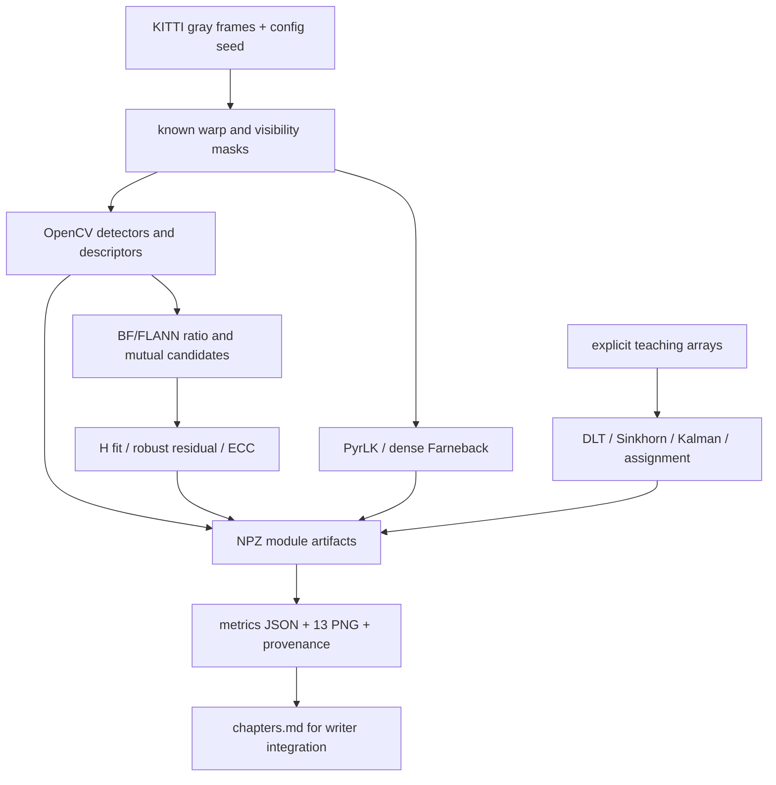

# Correspondence teaching experiment architecture

## Contracts and boundaries

All coordinates are resized-image pixel-center coordinates (x right, y down).
Source-to-destination H acts on column homogeneous vectors. OpenCV image
warping uses inverse sampling internally; flow is destination minus source,
in pixels per selected frame interval, not m/s. Intensities are uint8 DN for
OpenCV and explicit float [0,1] only in pedagogical derivative arrays.

| Module | Input / output | Parameters and unit | Validation | Storage |
|---|---|---|---|---|
| preparation | gray uint8 -> warped images, H, masks | width800, seed2306 | dimensions / image hashes | artifacts/features |
| features | image -> Nx2 points, NxD descriptors | cap1200, radius3px | repeatability in shared visibility | artifacts/features |
| matching | descriptors -> index pairs, d1/d2, GT residual | ratios0.5..0.95 | exact BF vs approximate index agreement | artifacts/matching |
| alignment | pairs -> H, residual arrays | RANSAC3px, confidence.999 | exact/noisy/outlier/degenerate cases | artifacts/alignment |
| motion | images -> sparse/dense displacements | LK21px, levels0/3; dense preset | interior mask EPE and FB | artifacts/motion |
| toys | explicit matrices -> intermediates | dimensionless, noted individually | numeric solved-example assertions | artifacts/toys |
| figure export | data -> 7in PNG | 190dpi, labels >=9pt | image dimensions / visual contact sheet | figures |

Data are loaded once; no asynchronous sensors or timestamps are fused.
Modules run once per script invocation. Manifest includes elapsed wall time,
dependency versions, platform, git HEAD and SHA256 of data/config/src.
Each module stores before the next is evaluated. No production integration.
Proposed integration point is only the writer importing H2 D9-D12 and relative
figure links into canonical docs/report.md, then rendering canonical PDF.
