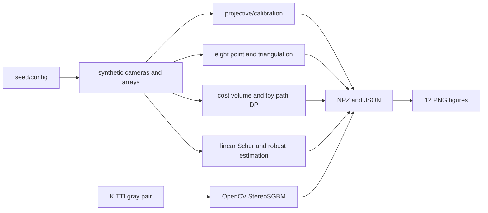

# Geometry architecture

실행 주기: 오프라인 1회. 입력 좌표는 world-to-camera Xc=RX+t, 우/하/전방 축; 거리 m, 영상 px, 각도 rad. KITTI는 저장된 rectified grayscale를 그대로 사용하고 새 시간 정렬을 하지 않는다. disparity는 OpenCV int16을 16으로 나누어 px로 변환한다.

src/experiment.py: 합성 데이터, 라이브러리 baseline, 그림 및 manifest 저장. src/test_geometry.py: 기하 불변량, full-SVD nullspace, 예제, 소거 검증. configs/experiment.json: seed/크기/잡음/SGM 설정. artifacts/{projective,multiview,stereo,sfm}/: 모듈별 NPZ/JSON. figures/: 7 inch, 200 dpi PNG. artifacts/manifest.json: 버전/시간/파일 SHA256.

수치 실험은 OpenCV triangulatePoints/calibrateCamera/StereoSGBM, SciPy least_squares를 사용한다. normalized eight-point와 1D path aggregation은 교육용 작은 구현으로만 표시한다. 통합 접점은 문서/그림 경로뿐이며 운영 실행 경로 변경은 없다.
