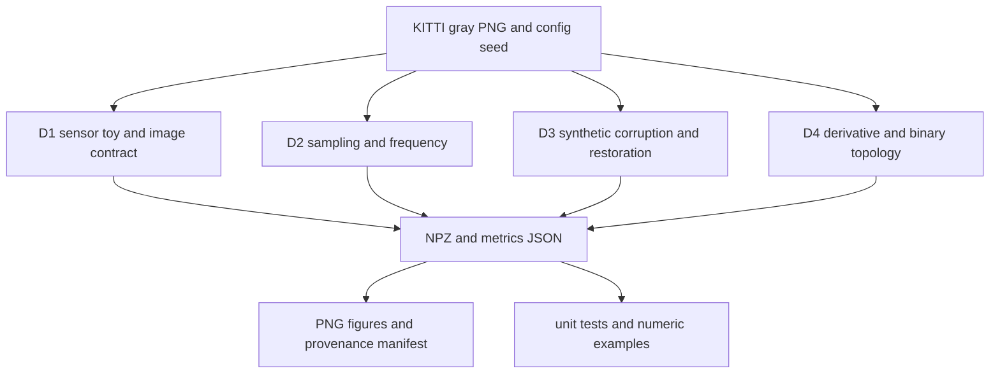

# Imaging 실험 구조

|모듈|입력·단위|출력·경로|검증|
|---|---|---|---|
|D1|gray uint8 DN; synthetic electrons; seed|artifacts/d1 arrays, metrics; figures01–03|평균분산, sRGB roundtrip, clipping|
|D2|float gray DN, cycles/pixel|artifacts/d2 arrays; figures04–06|DFT, convolution, separability, alias identity|
|D3|float gray DN, synthetic noise SD DN|artifacts/d3 arrays+scores; figures07–09|PSNR/SSIM identity, DC, bias variance|
|D4|gray DN, gradient DN/pixel, binary masks|artifacts/d4 stages+counts; figures10–13|ramp, NMS, propagation, topology, Otsu|

좌표: 배열[y,x], x오른쪽/y아래, 픽셀 간격1. 시간 정렬은 단일 프레임이라 없음. 정규화가 필요한 색만0–1이며 필터 기본값은0–255 float. 실제 이미지는 원값을 보존하고 수치계산 전 float 변환한다. 경계는 REFLECT_101, FFT 복원만 주기 경계의 합성 모델이다. 지표 비교 ROI와 경계 정책을 metadata에 남긴다. 구체 파라미터는 configs/default.json. 실행 순서 D1→D2→D3→D4, 모듈별 저장 후 검증. 실행은 src/run.py, unittest는 src/test_imaging.py. 기존 생산 코드와의 통합은 제안에만 머문다.
