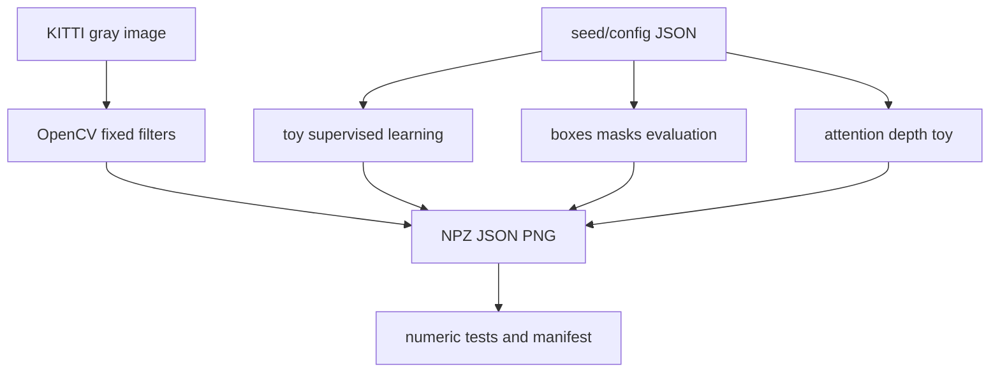

# Learning 교육 실험 설계

| 모듈 | 입력/출력 계약 | 저장 | 단독 검증 |
|---|---|---|---|
| learning | float64 N,2 무차원, binary labels; logits/loss | artifacts/learning | 미분, 손실 감소, 교정 |
| convolution | uint8 H,W 픽셀 -> float64 고정 필터 | artifacts/convolution | 크기, stride, residual |
| evaluation | 연속 xyxy 픽셀 박스, bool mask -> IoU/AP | artifacts/evaluation | 중복/빈집합/할당 |
| attention | float64 N,d 토큰 -> 행 확률 N,N | artifacts/attention | 행합, 순열, affine 깊이 |

오프라인 일괄 실행이며 타임스탬프 정렬은 해당 없음. 이미지 변환은 입력에서 float64/255, 좌표는 x 오른쪽 y 아래. 실제 센서 pose나 metric 깊이를 생성하지 않는다. 모든 그림 7인치 이상, 190dpi; 영문 축과 한국어 본문 캡션. 기존 모듈은 재사용 후보 참조만 하며 import/수정하지 않는다. 통합 접점은 notes/chapters.md의 docs 기준 링크뿐이다. 설정은 configs/default.json, 소스는 src/experiment.py와 src/test_experiment.py. 최종 manifest에 버전/해시/런타임/검사 결과를 기록한다.
