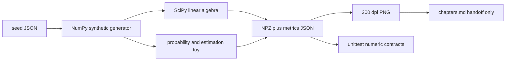

# 교육 실험 계약

모든 실행은 offline CPU float64, 시간 단위 s, 위치 m. 분해/미분 예는 무차원이며 축에 명시한다. 합성 진실값은 평가에만 사용하고 filter에는 관측과 모델만 전달한다. prior에서 독립 샘플을 생성하여 초기 일관성을 맞춘다.

| 모듈 | 입력 | 출력/단위 | 단독 검증 |
|---|---|---|---|
| D5 | A,b float64 | 조건수, 상대오차, PCA/metric | 분해 재구성/정사영 |
| D6 | scalar/vector 함수 | 차분 오차, 궤적, 희소행렬 | chain/gradient/Hessian |
| D7 | seed 합성 측정 | robust/상관/mixture | posterior, IRLS, EM |
| D8 | F,H,Q,R, dt=1s | Monte Carlo KF/RTS,NIS,NEES | Joseph/정보형/Schur |

src/experiments.py가 configs/experiment.json을 읽고 artifacts/<chapter>/arrays.npz 및 metrics.json을 저장한다. figures는 7in, 200dpi; 도해 영어 축은 한글 본문에서 해설한다. artifacts/provenance.json은 소스/config/입력 NPZ SHA256, 버전, 커밋, 총 실행시간을 기록한다. 실행간 timestamp/runtime은 달라지며 해시 일치 대상은 소스와 생성 입력 배열이다.

KF는 최소 선형 재귀의 교육용 구현이며 범용 필터 라이브러리 대체가 아니다. 선형 solve/Cholesky/eigh/QR은 NumPy/SciPy 사용. 전방/역방향 AD는 손계산 예만, 미분 프레임워크 설치 없음. 통합은 main writer가 수행하며 정규 docs/report.md/pdf 및 tools에는 쓰지 않는다.
