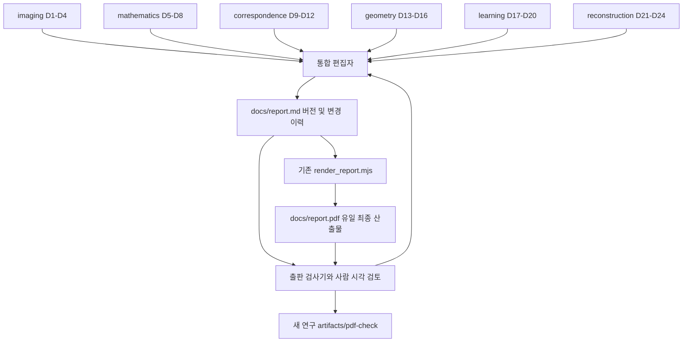

# 여섯 파트에서 단일 정본으로 가는 출판 계약

이 문서는 2026-11-25 현재 분담을 취합한 루트 설계다. 하위 파트보다 앞선 사전 연구 기록으로 소급하지 않는다. 조사 근거와 문헌 선택은 각 파트 notes를 유지하고 이 루트는 인터페이스와 승인 경계를 정한다.

| 모듈 | 입력/출력과 책임 | 단독 검증/경계 |
|---|---|---|
| 파트 연구자 6명 | 자기 폴더에 notes, configs(seed JSON), src, artifacts(NPZ/JSON), figures(PNG), chapters.md | 원문 확인, 수치시험, 장별 실패/ablation, 실제/합성 구분. 타 파트와 정본은 수정하지 않음 |
| 통합 편집자 | 확정된 네 장씩을 D1–D24 순서로 통합; 기존 A/C와 아카이브 맥락 보존 | 용어·기호·교차 참조·중복·문헌·문제 풀이 검토; 정본 버전·변경 이력 갱신 |
| 기존 renderer | canonical Markdown/그림 → canonical PDF | 폰트/여백/페이지 padding으로 분량 부풀리기 금지; 이번 checker 작업은 renderer 읽기 전용 |
| PDF checker | source/pdf 경로, min-pages, version/navigation 옵션 → validation.json·contact sheets·선택 페이지 PNG | read-only 입력 hash 재확인; 최소 페이지; 링크/이미지; chapter text; 선택적 source 통계 |
| 최종 시각 QA | 모든 contact sheet와 고해상도 주요 페이지 | 한글 glyph·겹침·잘림·표·수식·축을 사람/모델이 직접 검토. 자동 통과만으로 출판 승인하지 않음 |

## 산출물 및 좌표 계약

- 파트 원고 H2는 D번호, H3는 소절, anchor는 lowercase `dN`/`dN-k`로 유일해야 한다. D장 수는 H2에서만 세며 목차 언급과 H3를 장으로 중복 계산하지 않는다.
- 이미지 경로는 `docs/` 기준 `../research/computer-vision-textbook/PART/figures/...png`. 그림은 7in 안팎, 180dpi 이상, 읽을 수 있는 축과 캡션. 캡션에 단위·source·실제/합성·읽는 법·한계를 적는다.
- 기하 좌표·시간·밝기 단위는 각 파트의 interface에 명시한다. RGB/gray, uint8/float, px/m/rad, world-to-camera/camera-to-world와 timestamp 변환을 숨기지 않는다. 기존 raw OXTS/odometry 시간 정렬을 새로 검증한 것처럼 쓰지 않는다.
- config seed, 실행 명령, 의존성 버전, source/data hash, runtime, baseline·실패 수치와 중간 배열은 각 파트 artifacts에 보존한다. 교육 toy는 OpenCV/SciPy baseline과 구분한다.
- 파트별 artifacts와 출판 QA artifacts는 연구 중간물이며 Git 제외 규칙을 유지한다. `figures/`는 정본 재현에 필요한 자산으로 따로 취급한다.
- source 기준 commit `75f7140`; `feat/computer-vision-textbook`에서 이전 feature 미병합 상태를 유지한다는 통합 방침. 이 작업은 브랜치 변경·커밋·운영 모듈 통합을 하지 않는다.

## 출판 게이트

1. 각 파트 source freeze: 원문/풀이/실험/그림 검사와 미수행 목록 인계.
2. 편집 통합: 24신규장, 48개 이상 신규 고유 그림, 72개 이상 신규 완전 풀이를 확인한다.
3. 원본 분량: baseline 434160 bytes의 2배인 868320 bytes를 최소 필요조건으로 확인하고 의미 없는 반복·경로·공백 증가를 배제한다.
4. 기존 renderer로 정본 PDF 재생성. 목표 400–550쪽, 최소 384쪽이며 실질 내용 확장으로 충족한다.
5. checker `--min-pages 384 --source-coverage --require-navigation --expected-version <통합 버전>`와 전체 시각 QA. 버전은 통합 편집자가 결정하며 이 노트는 미리 완료를 선언하지 않는다.
6. 유일 최종 PDF를 전달하고 다음 지시를 기다린다. 별도 버전별 PDF·보고서는 만들지 않는다.

검사기 `--require-100-pages`는 기존 호출 호환성을 유지한다. `--min-pages N`과 함께 쓰면 max(100,N)을 적용한다. source coverage는 raw byte/고유 D장/이미지 occurrence·unique의 관측 통계이며 새 그림 여부·풀이 완전성·산문 품질을 자동으로 인증하지 않는다.
