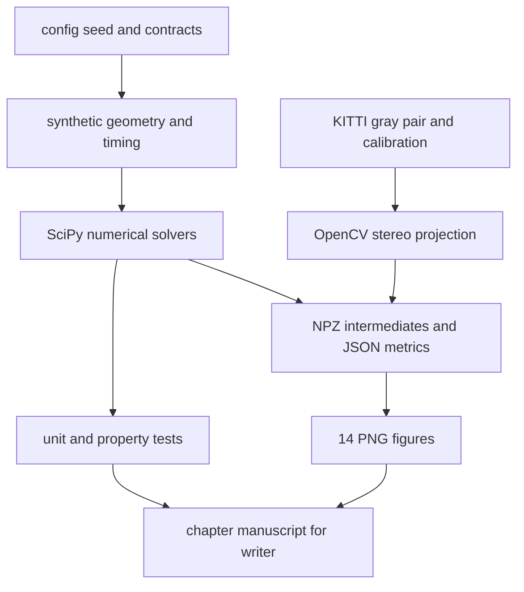

# 독립 교육 실험 아키텍처

| 모듈 | 계약/좌표/단위 | 처리 | 단독 검증/저장 |
|---|---|---|---|
| geometry | camera x right y down z forward; point m | KDTree, eigendecomposition, robust least_squares | plane rank/weighted mean; artifacts/geometry |
| rendering | normalized radiance, density 1/m, pixel covariance | alpha compositing, Jacobian, linear lights | conservation/PSD; artifacts/rendering |
| timing | seconds, radians, m/s2 | Rotation exponential, discrete integration | closed form/no rotation; artifacts/timing |
| evaluation | trajectory m, declared alignment, ms | SVD registration, queue recursion | gauge/scale/percentile; artifacts/evaluation |
| stereo | KITTI 00 frame 000000 uint8 | StereoSGBM disparity /16, P0/P1 baseline | valid depth reprojection; artifacts/stereo |

모든 모듈은 오프라인 단일 실행이다. 시간 정렬 교육은 timing 안에서만 하며 실제 센서 시간 정렬로 주장하지 않는다. 색은 렌더링의 합성 RGB 또는 KITTI 흑백으로만 기록한다. src/run.py는 설정을 읽고 배열/그림/manifest를 저장하며 src/test_numerics.py는 독립 수치를 확인한다. source/config/data SHA256, 의존성, 커밋, 실행 시간을 manifest에 저장한다. 통합은 원고/그림 링크를 주 작성자에게 전달하는 데서 종료한다. 생산 모듈 재사용/교체 없음.
